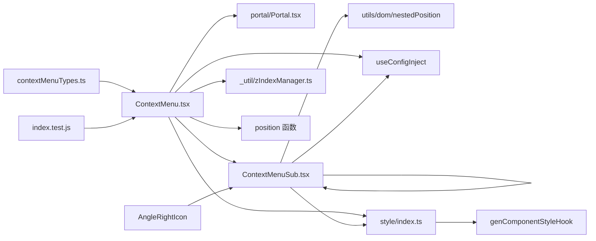
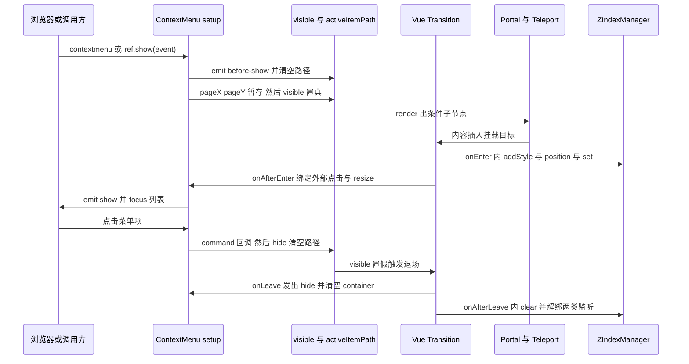
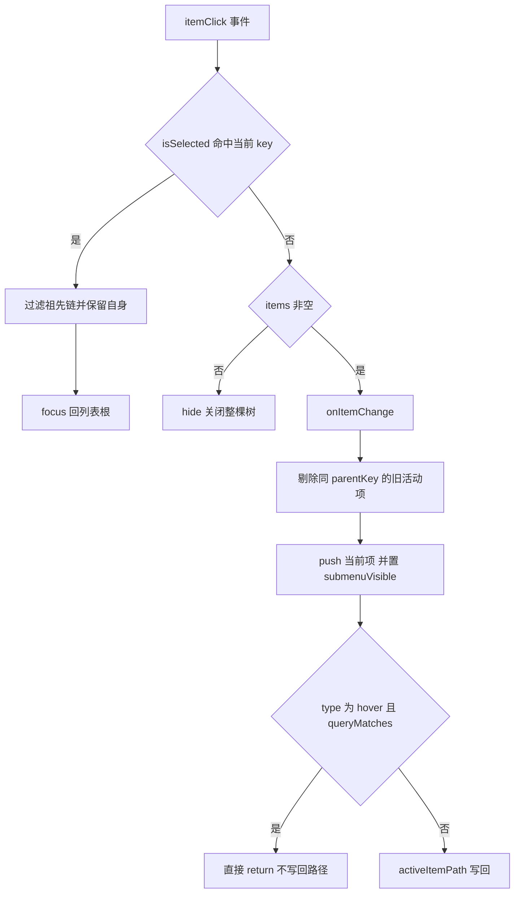

# C03-09 ContextMenu 右键菜单

> **本篇解决**：一个右键菜单为什么在本库里不接 `vc-trigger`、不接 `vc-align`，而是自己用 `Portal` + `Transition` + `pageX/pageY` 手写一套浮层；多级展开的全部状态为什么能被压缩成一条 key 路径；`baseZIndex` 在什么条件下才会被读到；改哪一行会让菜单弹不出来、错位、或样式整体失效。
> **前置**：C12-06《Portal 传送门》、I10《z-index 层级编排》、A07《交互基础设施总览：一个浮层是怎么拼起来的》、I02《vc-trigger 弹出时序与事件穿透》　**读者坐标**：`03-components/03-navigation` 第 9/14 篇

## 一、职责与边界

`XYContextMenu` 负责把一棵 `model` 菜单树渲染成一个跟随鼠标坐标出现的浮动 `ul`，并独自承担这个浮层的**全部**生命周期：开合判定、坐标钳制、多级展开路径、键盘导航与字符检索、点外面关闭、断点触发的移动端形态、以及根容器的 z-index 分配。它的所有实现都围绕「一个没有触发元素的浮层」这个前提展开。

它明确不负责：

- **触发时机**。组件不渲染任何锚点：`setup` 的 render 只返回 `wrapSSR(<Portal>…</Portal>)`（`packages/xiaoye-ui/src/context-menu/ContextMenu.tsx:869-920`），既不消费 `slots.default`，也没有可点击的包裹元素。模块内的 `target` 变量在 `ContextMenu.tsx:74` 声明、在 `ContextMenu.tsx:497` 被读来做「点外面」判据、在 `ContextMenu.tsx:796` 被清空，但**全文没有任何一处给它赋过元素**，因此这条判据恒为「不在 target 内」。非 `global` 模式下唯一的打开方式是拿模板引用调 `show(event)`（`ContextMenu.tsx:788-867` 的 `expose` 暴露了 `toggle`/`show`/`hide`），文档示例正是这么写的（`apps/docs/examples/context-menu/custom-target.vue:38-42`）。
- **定位求解**。没有 `vc-align`、没有 placement 表、没有碰撞翻转，只有 `pageX/pageY` 直写 `style.left/top` 加四条边界钳制（`ContextMenu.tsx:448-483`）。浮层基座那条链的机制归 A07 与 I02，本篇不重复论证；这里只说明 ContextMenu 为什么走另一条路。
- **滚动跟随**。窗口尺寸变化时它的策略是「直接关掉」（`ContextMenu.tsx:513-525`），而不是重算坐标；页面滚动既不重定位也不锁滚动。
- **焦点闭环**。它把焦点打到列表根节点（`ContextMenu.tsx:748-750` 的 `listRef` 与 `ContextMenu.tsx:143-145` 的 `focus(list)`），但不做焦点陷阱、不记录触发元素、关闭后不回焦。

依赖清单（全部为库内实现，逐个定点核对过）：

| 依赖 | 入口位置 |
| --- | --- |
| `Portal`（公开浮层挂载层） | `ContextMenu.tsx:19`、`ContextMenu.tsx:883` |
| `ContextMenuSub`（递归子菜单） | `ContextMenu.tsx:20`、`ContextMenu.tsx:902` |
| `ZIndexManager` | `ContextMenu.tsx:36`、`ContextMenu.tsx:419-421` |
| `useConfigInject` / `useStyle` | `ContextMenu.tsx:34-35`、`ContextMenu.tsx:52-53` |
| `@xiaoye-ui/utils/dom` 七个函数 | `ContextMenu.tsx:3-11` |
| `@xiaoye-ui/utils/object` 五个函数 | `ContextMenu.tsx:12-18` |
| `@xiaoye-ui/icons` 的 `AngleRightIcon` | `ContextMenuSub.tsx:5`、`ContextMenuSub.tsx:257` |
| `nestedPosition`（子菜单贴边翻转） | `ContextMenuSub.tsx:3`、`ContextMenuSub.tsx:120-123` |

被谁依赖：包根聚合入口 `packages/xiaoye-ui/src/components.ts:96-98`（`export *` + 默认导出 + 样式副作用导入）与 `packages/xiaoye-ui/src/components.ts:409` 的歧义定主语句；全局类型声明 `packages/xiaoye-ui/typings/global.d.ts:28`；元数据登记 `packages/metadata/src/components/index.ts:67`；按需入口 `packages/xiaoye-ui/package.json:216-220`。除自身测试与这些生成物之外，仓库内没有任何组件 import 这个目录，交叉验证命令与结果见附检查点 1。也就是说 `packages/xiaoye-ui/src/data-table/BodyRow.tsx:386` 的 `isSelectedWithContextMenu`、`packages/xiaoye-ui/src/tree-table/TreeTableRow.tsx:33` 的同名逻辑，都只是**为用户搭配 `XYContextMenu` 而预留的选中态**，与本目录零代码耦合；`packages/xiaoye-ui/src/vc-tree/Tree.tsx:837` 的 `onNodeContextMenu` 同理，是一条事件回调而非组件依赖。

## 二、源码地图

| 文件 | 行数 | 职责 | 关键导出或入口符号 |
| --- | --- | --- | --- |
| `packages/xiaoye-ui/src/context-menu/index.ts` | 15 | 注册入口，挂 `install`、转出具名类型 | `ContextMenu` 默认导出（`index.ts:15`）、`ContextMenuSub`（`index.ts:7`） |
| `packages/xiaoye-ui/src/context-menu/ContextMenu.tsx` | 922 | 主实现：状态、监听、定位、键盘、渲染 | `defineComponent` 起点 `ContextMenu.tsx:45`，`setup` 起点 `ContextMenu.tsx:51`，render 起点 `ContextMenu.tsx:881` |
| `packages/xiaoye-ui/src/context-menu/ContextMenuSub.tsx` | 298 | 递归列表项渲染与子菜单挂载 | `ContextMenuSub.tsx:13`，render 起点 `ContextMenuSub.tsx:167` |
| `packages/xiaoye-ui/src/context-menu/contextMenuTypes.ts` | 68 | Props 工厂与 `MenuItem` 结构 | `contextMenuProps`（`contextMenuTypes.ts:41`）、`MenuItem`（`contextMenuTypes.ts:7`） |
| `packages/xiaoye-ui/src/context-menu/style/index.ts` | 156 | CSS-in-JS 样式 | `genComponentStyleHook('ContextMenu', …)`（`style/index.ts:6`） |
| `packages/xiaoye-ui/src/context-menu/index.test.js` | 262 | 19 条自有用例，另由 `mountTest` 追加一条 | 用例集合起于 `index.test.js:24`，首条 `index.test.js:31`，末条 `index.test.js:248` |

主实现入口是 `ContextMenu.tsx:49`。`autoZIndex` 与 `baseZIndex` 这一对层级开关不是它独有的：`block-ui` 同样声明两者（`packages/xiaoye-ui/src/block-ui/blockUITypes.ts:27`、`packages/xiaoye-ui/src/block-ui/blockUITypes.ts:29`），`color-picker` 亦然（`packages/xiaoye-ui/src/color-picker/colorPickerTypes.ts:63`、`packages/xiaoye-ui/src/color-picker/colorPickerTypes.ts:65`）。这三个目录都在共享管理器的头部注释里被点名（`packages/xiaoye-ui/src/_util/zIndexManager.ts:2`），层级机制的全局推演归 I10 论点 1，本篇只在论点 4 补 ContextMenu 内部的落点。

测试确实被跑到了，判据是 glob 而不是文件位置：`packages/xiaoye-ui/vitest.config.mts:33` 的 `include` 含 `src/**/*.test.{js,ts,jsx,tsx}`，命中 `src/context-menu/index.test.js`；该测试文件里写了 JSX（`packages/xiaoye-ui/src/context-menu/index.test.js:212`），而它能在 `.js` 后缀下被编译，靠的是 `packages/xiaoye-ui/vitest.config.mts:26` 把 `\.test\.[jt]sx?$` 放进了 `vueJsx` 的 `include`。

## 三、架构与数据流

### 图 1：模块静态结构



这张图里值得停下来的是三条边。第一条是 `CM → PORTAL`：本库公开组件里挂到 `XYPortal` 上的消费者极少，C12-06 论点 1 已经论证过这条边与浮层基座（`vc-trigger` 内部的容器链）完全不通，所以 ContextMenu 拿不到 `ConfigProvider` 的全局弹窗容器，也拿不到 trigger 那套 pending 队列——图里因此没有任何指向 `vc-trigger`/`vc-align` 的边。第二条是 `SUB → SUB`：`ContextMenuSub.tsx:271-286` 在 `li` 内部再渲染自己，递归深度不受 props 限制，展开路径状态全部由父组件持有。第三条是 `CM → ZM` 与 `SUB → NPOS` 的分离：层级分配只发生在根容器（`ContextMenu.tsx:419-421`），子菜单挂载只算坐标不碰层级（`ContextMenuSub.tsx:120-123`），这条缝是论点 4 的入口。

### 图 2：一次右键的完整闭环



说明三个非显然的环节。第一，`visible` 置真（`ContextMenu.tsx:149`）之后组件才开始渲染容器，所以 `position()` 在这个时刻还拿不到 `container`，`ContextMenu.tsx:454` 的早退分支正是为这一次调用准备的；真正的坐标写入发生在 `Transition` 的 `onEnter` 钩子里（`ContextMenu.tsx:415-422`），顺序是「先补 `position: absolute`，再定位，再分配层级」。第二，`Portal` 在 `onMounted` 之前返回 `null`（`packages/xiaoye-ui/src/portal/Portal.tsx:27-38`），因此首帧根本不存在浮层节点，右键事件早于挂载的话会被静默吞掉。第三，退场侧的记账分成两步：`onLeave` 只发事件并把 `container` 置空（`ContextMenu.tsx:434-437`），解绑监听与回收层级要等 `onAfterLeave`（`ContextMenu.tsx:439-446`），两步之间如果 `xy-anchored-overlay` 有真实退场时长，外部点击与 resize 监听仍然挂在文档上。

### 图 3：点中一项之后的状态分叉



`onItemClick`（`ContextMenu.tsx:264-283`）先问「这一项已经在活动路径里吗」，命中就走重复点击分支去收敛路径，未命中才按「有子菜单/无子菜单」分叉；无子菜单的叶子点击直接 `hide()`，也就是说**选中态不是组件状态，关闭就是全部**——组件没有 `v-model`，没有任何对外可见的选中值。`onItemChange`（`ContextMenu.tsx:235-262`）里那个 `hover` 加 `queryMatches` 的组合分支（`ContextMenu.tsx:257-259`）是刻意让移动端在触屏 hover 误触发时不展开子菜单，它只挡住写回，前面的 `focusedItemInfo`（`ContextMenu.tsx:251`）与 `submenuVisible`（`ContextMenu.tsx:253`）已经落定，这正是论点 3 要拆的不对称。

## 四、核心机制精读

### 论点 1：它是一层没有触发元素的浮层，父组件写在标签上的属性与监听器会被整体丢弃

断言：`XYContextMenu` 的渲染输出里没有任何属于「组件自身位置」的 DOM 节点，`attrs` 从声明到 render 全程没有被消费，因此调用方写在 `<xy-context-menu>` 上的 `class`、`style`、`@contextmenu` 都会静默消失；打开菜单的唯一入口是 `expose` 出来的方法或 `global` 监听。

```tsx
// packages/xiaoye-ui/src/context-menu/ContextMenu.tsx:45
export default defineComponent({
  name: 'XYContextMenu',
  inheritAttrs: false,
  __XY_CONTEXT_MENU: true,
  props: initDefaultProps(contextMenuProps(), {}),
  emits: ['focus', 'blur', 'show', 'hide', 'before-show', 'before-hide'],
  setup(props, { emit, expose }) {
    const { prefixCls } = useConfigInject('contextmenu', props);
    const [wrapSSR, hashId] = useStyle(prefixCls);

    const slots = useSlots();
    const instance = getCurrentInstance()!;
```

逐段看：`ContextMenu.tsx:47` 显式关掉属性透传，这意味着框架不会自动把 `attrs` 挂到根元素上；`ContextMenu.tsx:51` 的解构只取出 `emit` 与 `expose`，`attrs` 连名字都没有出现——对同一文件跑 `grep -n "attrs" ContextMenu.tsx` 的命中数是 0（`ContextMenu.tsx` 里唯一的 `useSlots` 在 `ContextMenu.tsx:55`）。既然没有根元素，也没有手工 `v-bind`，`inheritAttrs: false` 之后的 attrs 就无处可去。`ContextMenu.tsx:50` 声明的六个事件（`focus`/`blur`/`show`/`hide`/`before-show`/`before-hide`）是例外：Vue 会把声明在 `emits` 里的 `onXxx` 从 attrs 中摘出去当组件事件，所以 `apps/docs/examples/context-menu/events.vue:5-8` 的四个生命周期事件能正常收到，因为它们由 `ContextMenu.tsx:139`、`ContextMenu.tsx:157`、`ContextMenu.tsx:433`、`ContextMenu.tsx:440` 显式 `emit`。而未声明的 `@contextmenu` 会留在 attrs 里，随 attrs 一起被丢掉。

再看渲染侧，这是断言的后半段：

```tsx
// packages/xiaoye-ui/src/context-menu/ContextMenu.tsx:881
    return () => {
      return wrapSSR(
        <Portal appendTo={props.appendTo}>
          <Transition
            name="xy-anchored-overlay"
            onEnter={onEnter}
            onAfterEnter={onAfterEnter}
            onLeave={onLeave}
            onAfterLeave={onAfterLeave}
          >
            {visible.value ? (
              <div
                ref={containerRef}
                id={id.value}
```

`ContextMenu.tsx:869-920` 整段没有 `attrs`、没有 `slots.default`，`Portal` 只接到一个 `appendTo` prop（`ContextMenu.tsx:883`）。子节点是 `{visible.value ? (<div …/>) : null}`（`ContextMenu.tsx:891-928`），也就是关闭态下连被 Teleport 的那个 `div` 都不存在。于是组件在原位置留下的 DOM 是零：`Portal` 在挂载前返回 `null`（`packages/xiaoye-ui/src/portal/Portal.tsx:36-38`），挂载后走 `Teleport`（`packages/xiaoye-ui/src/portal/Portal.tsx:54`），内容又被搬走。C12-06 论点 5 已经从 `Portal` 自己这一侧证明过同一件事——`inheritAttrs: false` 配一条不透传 `attrs` 的渲染路径；这里是第二层同样的写法，两层叠加的结果是：外层写什么都到不了菜单。

`ContextMenu.tsx:896-899` 的类名数组里也看不到 attrs 的踪影：它是 `['xy-contextmenu', { 'xy-contextmenu-mobile': queryMatches.value }, hashId.value]`，`hashId` 来自 `useStyle`（`ContextMenu.tsx:53`），是 CSS-in-JS 的哈希类，不是用户 class。

结论回扣：这个组件的对外接口只有三处——props（`contextMenuTypes.ts:41-64`）、`emits`（`ContextMenu.tsx:50`）、以及 `expose`（`ContextMenu.tsx:788-867`）。想「只在某块区域右键」的调用方必须自己接住右键事件再调 `show`，`apps/docs/examples/context-menu/custom-target.vue:38-42` 就是这个契约的标准写法：先 `preventDefault` 与 `stopPropagation`，再把同一个 `event` 交给实例方法。代价是这套用法无法通过属性声明表达，也解释了为什么 `target` 这个变量会留在文件里却从未被赋值（`ContextMenu.tsx:74`、`ContextMenu.tsx:497`、`ContextMenu.tsx:796`）：组件原本打算自己持有触发元素，最终把这件事推给了调用方。

顺带一个由 `expose` 写法带出的口径问题：`ContextMenu.tsx:788-867` 逐行列出了 **78** 个成员，涵盖 `state`（`focused`、`visible`、`activeItemPath`）、算法（`createProcessedItems`、`findNextItemIndex`）与监听器管理（`bindOutsideClickListener`、`unbindMatchMediaListener`），而手册的方法表只写 `show`/`hide`/`toggle` 三个（`apps/docs/components/context-menu.md:84-88`）。从代码面看，这个组件没有私有实现，模板引用能拿到的东西远多于文档承诺的；`packages/xiaoye-ui/src/context-menu/index.test.js:75-90` 正是靠这一点直接调用 `onEnter`、`onKeyDown`、`position` 来完成断言。

### 论点 2：坐标来自 `pageX/pageY` 的一次直写，四条钳制之外没有任何定位算法

断言：根容器的落位完全由 `ContextMenu.tsx:448-483` 这 35 行决定，它把鼠标页面坐标当作左上角候选，做四次比较后写回行内 `left/top`；它不测量锚点矩形、不考虑挂载祖先的定位上下文、也不处理 RTL，而这些恰好是子菜单那一侧做了的事。

```ts
// packages/xiaoye-ui/src/context-menu/ContextMenu.tsx:453
    function position() {
      if (!isClient || !container || pageX === null || pageY === null) return;

      let left = pageX + 1;
      let top = pageY + 1;
      const width = container.offsetParent
        ? container.offsetWidth
        : getHiddenElementOuterWidth(container);
      const height = container.offsetParent
        ? container.offsetHeight
        : getHiddenElementOuterHeight(container);
      const viewport = getViewport();
      const scrollTop =
        window.scrollY || document.documentElement.scrollTop || document.body.scrollTop || 0;
      const scrollLeft =
        window.scrollX || document.documentElement.scrollLeft || document.body.scrollLeft || 0;

      if (left + width - scrollLeft > viewport.width) {
        left -= width;
      }
```

三点值得逐段解释。第一，`ContextMenu.tsx:454` 的三个守卫不是防错，而是描述了这个函数的调用时机：`pageX/pageY` 只在 `show()` 里被写入（`ContextMenu.tsx:147-148`），`container` 只在 `ref={containerRef}` 回调里被写入（`ContextMenu.tsx:744-746`），而 `visible` 置真的那一帧容器还不存在，所以 `show()` 内部第一次调用 `position()`（`ContextMenu.tsx:149` 的三元分支）必然走早退；真正生效的一次是 `Transition` 入场钩子里的调用（`ContextMenu.tsx:415-422`）。`ContextMenu.tsx:149` 这个「已显示就只重定位，否则置真」的写法，使得同一时刻第二次右键不会重播入场动画，也不会重新分配层级——第二次右键落在 `position()` 上，`ZIndexManager.set` 只在 `onEnter` 里执行（`ContextMenu.tsx:419-421`），这是「已开菜单换位置不换层级」的实现根据。

第二，`ContextMenu.tsx:458-463` 的 `offsetParent` 二选一不是为了兼容，而是为了量出一个还没布局的盒子的尺寸：容器在 `ContextMenu.tsx:421` 才被补上 `position: absolute`，若此刻尚未参与布局，`offsetWidth` 为 0，于是退回 `getHiddenElementOuterWidth`。这个工具的做法是临时改行内样式再改回来（`packages/utils/src/dom/methods/getHiddenElementOuterWidth.ts:3-13`：写 `visibility: hidden` 与 `display: block`，取值后还原）。也就是说每打开一次菜单，最坏情况下要付两次强制同步布局。

第三，四条 `if`（`ContextMenu.tsx:465-479`）是本组件全部的「碰撞处理」：越过右边界就把宽度减掉，越过下边界就把高度减掉，越过左/上边界就贴回滚动原点。`left = pageX + 1` 与 `top = pageY + 1`（`ContextMenu.tsx:456-457`）里那个 `+1` 是给光标留出 1px，避免菜单刚出现就立刻吃掉自己的 hover；而它把 `pageX`（文档坐标）直接赋给 `style.left`（`ContextMenu.tsx:486`），隐含前提是「容器的包含块就是文档」——默认 `appendTo: 'body'`（`contextMenuTypes.ts:46-49`）时成立，因为 `Portal` 会 `Teleport` 到 `body`（`packages/xiaoye-ui/src/portal/Portal.tsx:54`）。一旦 `appendTo` 换成一个带 `transform`、`filter` 或自身定位的容器，`pageX/pageY` 与容器坐标原点就不同源，菜单会整体偏移；`appendTo: 'self'` 时更直接，`Portal` 走内联分支（`packages/xiaoye-ui/src/portal/Portal.tsx:25`、`packages/xiaoye-ui/src/portal/Portal.tsx:32-34`），容器变成组件原位附近的绝对定位盒，而 `position()` 依然按文档坐标写值。

对照组在子菜单里，走的是另一个工具函数：

```ts
// packages/utils/src/dom/methods/nestedPosition.ts:44
    // getBoundingClientRect returns a top position from the current visible viewport area
    if (element.getBoundingClientRect().top + itemOuterHeight + sublistHeight > viewport.height) {
      top = `-${sublistHeight - itemOuterHeight}px`;
    } else {
      top = '0px';
    }

    element.style.top = top;
    element.style.insetInlineStart = left;
```

子菜单的父级是 `li`（`ContextMenuSub.tsx:271-286` 渲染在 `li` 内），`nestedPosition` 从父项矩形出发算 `100%` 或 `-100%`（`packages/utils/src/dom/methods/nestedPosition.ts:26-42`），并写 `insetInlineStart` 而不是 `left`，从而跟随书写方向；根容器那段 `position()` 则写死 `style.left`（`ContextMenu.tsx:486`）。同一个组件里两套坐标系、两套逻辑属性，RTL 场景下根菜单与子菜单的贴边方向不一致是可直接观察的后果。另外 `nestedPosition` 在 `level % 2` 的窄屏分支里会拼出 `'-' + elementOffset.left + 'px'`（`packages/utils/src/dom/methods/nestedPosition.ts:33`），依赖 `elementOffset.left` 非零，`elementOffset.left` 为 0 时退回 `'100%'`——这条分支只在小屏出现，`packages/xiaoye-ui/src/context-menu/index.test.js` 全文没有覆盖 `nestedPosition`，该分支无测试保护。

### 论点 3：多级菜单的全部展开状态被压成一条字符串 key 路径，而 key 是用数组下标拼出来的

断言：组件不依赖任何用户提供的 id，`activeItemPath` 里每一项的 `key` 由「父 key + `_` + 本层下标」生成；展开、高亮、`aria-expanded`、子菜单是否挂载，全都只问「这条 key 在不在路径里」。这让状态极简，也把 key 的稳定性押在了 `model` 数组的下标顺序上。

```ts
// packages/xiaoye-ui/src/context-menu/ContextMenu.tsx:729
    function createProcessedItems(
      items: any[],
      level: number = 0,
      parent: any = {},
      parentKey: string = '',
    ): any[] {
      const processedItemsArr: any[] = [];

      items &&
        items.forEach((item, index) => {
          const key = (parentKey !== '' ? parentKey + '_' : '') + index;
          const newItem = {
            item,
            index,
            level,
            key,
            parent,
            parentKey,
          };

          newItem['items'] = createProcessedItems(item.items, level + 1, newItem, key);
          processedItemsArr.push(newItem);
        });

      return processedItemsArr;
    }
```

`ContextMenu.tsx:739` 是这条论点的定义行：顶层第 3 项是 `"2"`，它的第 1 个子项是 `"2_0"`。`ContextMenu.tsx:749` 递归时把 `level + 1` 与 `newItem` 一起下传，所以 `processedItems`（`ContextMenu.tsx:84-86` 的 computed）是一棵每项自带 `key/index/level/parent/parentKey/items` 的树，DOM id 也由它直接拼出（`ContextMenuSub.tsx:43-45` 的 `getItemId` 返回 `${props.menuId}_${processedItem.key}`），两侧共用同一套编码，这是键盘导航能用 `querySelector` 找到元素的前提（`ContextMenu.tsx:384`、`ContextMenu.tsx:722`）。

展开路径的写入集中在两个函数：

```ts
// packages/xiaoye-ui/src/context-menu/ContextMenu.tsx:245
      const { index, key, level, parentKey, items } = processedItem;
      const grouped = isNotEmpty(items);
      const activeItemPathValue = activeItemPath.value.filter(
        p => p.parentKey !== parentKey && p.parentKey !== key,
      );

      if (grouped) {
        activeItemPathValue.push(processedItem);
        submenuVisible.value = true;
      }

      focusedItemInfo.value = { index, level, parentKey };
```

`ContextMenu.tsx:242-244` 的双条件筛选含义是「先摘掉同级的旧活动项，也摘掉正好是这个 key 的旧记录」，随后 `ContextMenu.tsx:246-249` 只在有子项时把它 push 回去并翻起 `submenuVisible`。这里存在一处不对称，值得单独指出：`focusedItemInfo`（`ContextMenu.tsx:251`）与 `submenuVisible`（`ContextMenu.tsx:253`）在筛选之后立刻写入，而 `activeItemPath` 要等 `ContextMenu.tsx:257-259` 的移动端 hover 闸门放行才在 `ContextMenu.tsx:266` 落盘。触屏设备上手指划过带子菜单的项会触发 `mouseenter`（`ContextMenu.tsx:285-287` → `onItemChange(event, 'hover')`），于是 `submenuVisible` 已经为真，但路径没变；子菜单挂载条件读的是路径（`ContextMenuSub.tsx:281`：`visible={isItemActive(processedItem) && isItemGroup(processedItem)}`），所以这次悬停不会弹出子菜单，焦点索引却已经移动——症状是「高亮跟着手指走，子菜单不跟」。

第二处更要紧的是路径的读取端。`visibleItems`（`ContextMenu.tsx:88-94`）用 `focusedItemInfo.parentKey` 去路径里找父项，找不到就退回根数组；`focusedItemIdx`（`ContextMenu.tsx:96-100`）把 `id`、`parentKey`、`index` 拼成 DOM id。这两个 computed 一起把「焦点」表达成 `(parentKey, index)`，而 `activeItemPath` 表达成 key 序列——同一份信息两种编码，收敛点只有一个：`createProcessedItems` 生成的 key。

于是下标编码的代价显形在 `onItemClick` 的重复点击分支：

```ts
// packages/xiaoye-ui/src/context-menu/ContextMenu.tsx:271
        activeItemPath.value = activeItemPath.value.filter(
          p => key !== p.key && key.startsWith(p.key),
        );
```

`ContextMenu.tsx:272-274` 想用字符串前缀表达「保留祖先」，但 key 是下标拼接而非定宽编码：顶层第 10 项的 key 是 `"10"`，而 `"10".startsWith("1")` 为真，第 1 项 `"1"` 并不是它的祖先。后果是再次点击一个已展开的第 10 项时，路径里第 1 项的记录会被当作祖先保留下来，它的高亮类（`ContextMenuSub.tsx:193` 的 `xy-contextmenu-item-active`）与子菜单可见性（`ContextMenuSub.tsx:281`）就一起残留。这条分支在 `packages/xiaoye-ui/src/context-menu/index.test.js` 里没有对应用例，该分支无测试保护。同一函数入口的另一半逻辑是 `ContextMenu.tsx:280-282`：叶子项点击直接 `hide()`，因此「关闭即清空」是唯一的复位路径——`hide()`（`ContextMenu.tsx:151-156`）会把 `visible`、`activeItemPath`、`focusedItemInfo` 三项一起归零，但不会碰 `submenuVisible`，`submenuVisible` 只在 `ContextMenu.tsx:253` 被置真、从不被置假；它之所以不再造成可见差异，是因为根容器整体退场后子树连同这个 prop 一起被卸载（`ContextMenu.tsx:891-928` 的条件渲染），而不是因为状态被正确回收。

### 论点 4：层级只挂在根容器上，子菜单的 `zIndex: 1` 是行内层级造出的局部堆叠上下文里的常量

断言：整个组件对 z-index 的介入只有三行，全部作用于根 `div`；子菜单从不进入 `ZIndexManager`，它的层叠只在父容器创造的那个堆叠上下文内部排序，因此「多层菜单盖过别的浮层」这件事在实现上从未被表达过。

```tsx
// packages/xiaoye-ui/src/context-menu/ContextMenu.tsx:420
    function onEnter(el: HTMLElement) {
      addStyle(el, { position: 'absolute' });
      position();

      if (props.autoZIndex) {
        ZIndexManager.set('menu', el, props.baseZIndex);
      }
    }
```

`ContextMenu.tsx:421` 先补 `position: absolute` 是必要前提：`z-index` 对 `position: static` 的元素无效，而容器的行内样式此前只有 `left/top`。`ContextMenu.tsx:419-421` 把 `props.autoZIndex` 当作唯一开关，`props.baseZIndex` 原样传进 `ZIndexManager.set` 的第三个参数。对这三个调用点做定点核对可以确认覆盖面：`grep -n "ZIndexManager" packages/xiaoye-ui/src/context-menu/` 只命中 `ContextMenu.tsx:36`、`ContextMenu.tsx:425`、`ContextMenu.tsx:446`、`ContextMenu.tsx:793` 四行，`ContextMenuSub.tsx` 一次都没有引用它。回收侧同样只在根上：`onAfterLeave`（`ContextMenu.tsx:439-446`）与 `onBeforeUnmount`（`ContextMenu.tsx:774-782`）各调一次 `clear`。

`baseZIndex` 的真实语义在共享管理器里，I10 论点 1 已经把它读成「只在注册表为空那条分支被读到」，本篇只补 ContextMenu 侧的接线位置：`packages/xiaoye-ui/src/_util/zIndexManager.ts:10-16` 的 `set` 里，`newValue = last ? last.value + 1 : base + 1`，而 `last` 取自模块级数组 `packages/xiaoye-ui/src/_util/zIndexManager.ts:4` 的末位。这意味着同一页面第二个 `XYContextMenu` 即使配了 `baseZIndex: 1000`，拿到的仍是上一个受管浮层的值加一。`'menu'` 这个 key 字面量（`ContextMenu.tsx:425`）与另外两个调用方的 `'modal'`/`'overlay'`（`packages/xiaoye-ui/src/block-ui/BlockUI.tsx:176`、`packages/xiaoye-ui/src/color-picker/ColorPicker.tsx:360`）互不知情，机制解释归 I10 论点 2，本篇不重复。

子菜单那一侧的层级写在样式里：

```ts
// packages/xiaoye-ui/src/context-menu/style/index.ts:46
      [`${componentCls}-submenu`]: {
        position: 'absolute',
        minWidth: '100%',
        zIndex: 1,
        background: colorBgContainer,
        color: colorText,
        border: '0 none',
        borderRadius,
        boxShadow,
      },
```

`style/index.ts:49` 的 `zIndex: 1` 是一个绝对数值，但它的比较域由祖先决定：根 `div` 通过 `ContextMenu.tsx:425` 拿到行内 `z-index`（非 `auto`）且 `position: absolute`，这正是「创建一个堆叠上下文」的复合条件，于是所有层级的子菜单都只在这个上下文内部按 1 排序。换个说法：第二层、第三层子菜单互相能压住（同为 1 时后渲染的在上），但整个菜单相对别的浮层的相对高度，完全由那一次 `ZIndexManager.set` 决定。这里也是 I10 统计的 117 处硬编码层级中的一处（`style/index.ts:49`），本篇按 I10 的口径不再重复计数。

还有一个由「记账栈是模块级的」带出的测试口径问题：`packages/xiaoye-ui/src/context-menu/index.test.js:120-129` 直接调 `wrapper.vm.onEnter(el)` 并只断言 `el.style.zIndex` 非空。这次调用没有配对的 `onAfterLeave`，因此 `packages/xiaoye-ui/src/_util/zIndexManager.ts:14` push 进去的记录不会被回收，栈在非空状态下把后续所有 `set` 的取值继续累加。所以这条用例只能断言「有没有写行内值」，一旦改成断言具体数值就会随用例顺序漂移；同文件 `packages/xiaoye-ui/src/context-menu/index.test.js:131-140` 那条 `autoZIndex: false` 的反向用例正好不受影响，因为它根本不进 `set`。

### 论点 5：`separator`、`visible: false`、`disabled` 是三种不同的「不存在」，序号补偿靠手工减法

断言：菜单项的三种排除语义在实现里落在三个完全不同的位置——`visible: false` 不进 DOM，`separator` 进 DOM 但被 CSS 隐藏，`disabled` 既进 DOM 也可见只是不参与导航；于是数组下标成了唯一贯穿三者的坐标，无障碍计数只能靠事后扣除。

```tsx
// packages/xiaoye-ui/src/context-menu/ContextMenuSub.tsx:176
              if (!isItemVisible(processedItem)) return null;

              if (getItemProp(processedItem, 'separator')) {
                return (
                  <li
                    key={getItemKey(processedItem)}
                    id={getItemId(processedItem)}
                    style={getItemProp(processedItem, 'style')}
                    class={['xy-contextmenu-separator', getItemProp(processedItem, 'class')]}
                    role="separator"
                  />
                );
              }
```

`ContextMenuSub.tsx:176` 是第一道闸：`isItemVisible`（`ContextMenuSub.tsx:69-71`）判的是 `item.visible !== false`，为假直接 `return null`，这一项在 DOM、在下标可达性、在 aria 里彻底不存在——注意 `props.items` 本身仍是含它的完整数组，所以 `index` 不会重排。第二道是 `ContextMenuSub.tsx:178-188`，分隔符照常生成一个带 id 的 `li`，然后由样式把它抹掉：`packages/xiaoye-ui/src/context-menu/style/index.ts:133-135` 里 `${componentCls}-separator` 的值是 `display: 'none'`。也就是说分隔符占了 DOM 节点、占了 `key`、占了 `aria-posinset` 的原始下标，却在视觉上零存在。`packages/xiaoye-ui/src/context-menu/index.test.js:60-73` 断言的正是这个口径：四项 model 得到三个 `.xy-contextmenu-item` 加一个 `.xy-contextmenu-separator`，注释也写明了分隔符不计入 item。

第三道是禁用项，它连样式都不参与排除：`ContextMenuSub.tsx:190-198` 把 `xy-contextmenu-item-disabled` 加进 class，`ContextMenuSub.tsx:208` 把 `aria-disabled` 写进属性，点击与悬停回调仍然挂在 `ContextMenuSub.tsx:226-228` 上。真正把三者统一处理的是键盘与检索侧的谓词：

```ts
// packages/xiaoye-ui/src/context-menu/ContextMenu.tsx:604
    function isValidItem(processedItem: any): boolean {
      return (
        !!processedItem &&
        !isItemDisabled(processedItem.item) &&
        !isItemSeparator(processedItem.item) &&
        isItemVisible(processedItem.item)
      );
    }
```

`ContextMenu.tsx:592-599` 是唯一的「可达项」定义，`findFirstItemIndex`（`ContextMenu.tsx:609-611`）、`findLastItemIndex`（`ContextMenu.tsx:613-615`）、`findNextItemIndex`（`ContextMenu.tsx:617-626`）、`findPrevItemIndex`（`ContextMenu.tsx:628-637`）、`isItemMatched` 依赖的检索（`ContextMenu.tsx:583-590`）全部走它。于是方向键跳过下标 2 的那个分隔符：`packages/xiaoye-ui/src/context-menu/index.test.js:158-169` 用四项 model（第三项是分隔符）按一次 ArrowUp 断言 `focusedItemInfo.index` 为 `3`，直接把这个「下标有空洞」的行为钉成了契约。

aria 侧则做了一次手工补偿：

```ts
// packages/xiaoye-ui/src/context-menu/ContextMenuSub.tsx:107
    function getAriaPosInset(index: number): number {
      return (
        index -
        (props.items
          ?.slice(0, index)
          .filter(
            (processedItem: any) =>
              isItemVisible(processedItem) && getItemProp(processedItem, 'separator'),
          ).length || 0) +
        1
      );
    }
```

`ContextMenuSub.tsx:107-118` 的做法是从原始下标里减去「前面有多少个可见的分隔符」再加一，`ContextMenuSub.tsx:98-105` 的 `getAriaSetSize` 同步扣掉分隔符总数。两处都只扣分隔符，不扣 `visible: false` 的项——因为 `ContextMenuSub.tsx:176` 让不可见项根本不进 DOM，可它们的下标依旧留在了 `props.items` 里，于是 `aria-setsize`（`ContextMenuSub.tsx:218`）会大于实际渲染出的 `menuitem` 数量，`aria-posinset`（`ContextMenuSub.tsx:219`）也可能跳号。`disabled` 项同样计入 setsize，这在无障碍语义上是对的（禁用项存在），但和 `isValidItem` 的排除口径不一致，两套计数各有读者：屏幕阅读器读前者，键盘走后者。

最后是这套下标坐标系的一处断裂：`scrollInView` 带一个 `index` 形参，但它的两种 id 拼法不同源。

```ts
// packages/xiaoye-ui/src/context-menu/ContextMenu.tsx:718
    function scrollInView(index: number = -1) {
      if (!list) return;

      const itemId = index !== -1 ? `${id.value}_${index}` : focusedItemIdx.value;
      const element = findSingle(list, `li[id="${itemId}"]`);

      if (element) {
        element.scrollIntoView && element.scrollIntoView({ block: 'nearest', inline: 'start' });
      }
    }
```

`ContextMenu.tsx:721` 在显式传 `index` 时拼的是 `${id}_${index}`，而子菜单里真实 id 是 `${menuId}_${parentKey}_${index}`（`ContextMenu.tsx:96-100` 与 `ContextMenuSub.tsx:43-45` 两处口径一致），传参分支在子菜单中必然查不到元素。组件内部唯一的调用点 `ContextMenu.tsx:714` 恰好不传参，所以这条错路今天不被走；但 `scrollInView` 在 `ContextMenu.tsx:875` 被 `expose` 出去了，外部调用者一传 index 就会命中它。同一段还有一处静默失败：`list` 是 `ContextMenu.tsx:748-750` 里由 `listRef` 赋的裸模块变量（`el ? el.$el : undefined`），列表未挂载时 `ContextMenu.tsx:719` 直接返回，滚动跟随这件事因此完全没有可观测的失败信号。

### 论点 6：类名与 `prefixCls` 脱钩，动画名没有任何样式实现

断言：`prefixCls` 在本组件只服务于样式生成，从不参与 DOM class 的拼接；DOM 侧写死了 22 处 `xy-contextmenu` 字面量。两者在默认配置下数值相等，所以缺陷不可见；一旦换了前缀，样式与结构即分家。同时 `Transition` 用的 `xy-anchored-overlay` 在全仓没有任何 CSS 定义。

```ts
// packages/xiaoye-ui/src/context-menu/ContextMenu.tsx:52
    const { prefixCls } = useConfigInject('contextmenu', props);
    const [wrapSSR, hashId] = useStyle(prefixCls);
```

`ContextMenu.tsx:52` 拿到的是 `getPrefixCls('contextmenu', props.prefixCls)`（`packages/xiaoye-ui/src/config-provider/hooks/useConfigInject.ts:14`），而 `getPrefixCls` 的实现是「给了自定义前缀就原样返回，否则 `xy-` 加后缀」（`packages/xiaoye-ui/src/config-provider/context.ts:166-169`，`ConfigProvider` 侧的同名函数在 `packages/xiaoye-ui/src/config-provider/index.tsx:70-75`）。这个值接着只被送进 `useStyle`，也就是 `genComponentStyleHook` 生成的那条 hook；hook 内部把选择器写成 `` const componentCls = `.${prefixCls.value}`; ``（`packages/xiaoye-ui/src/theme/util/genComponentStyleHook.ts:87`）。至此全仓对 `prefixCls` 在本组件的引用可以穷举：`grep -on "prefixCls" ContextMenu.tsx ContextMenuSub.tsx style/index.ts` 只有四行输出——`ContextMenu.tsx:52`、`ContextMenu.tsx:53`、`ContextMenuSub.tsx:36`、`ContextMenuSub.tsx:37`，`style/index.ts` 一次也没有（它只用 hook 提供的 `componentCls`）。

DOM 侧则是另一套写法：根容器 `class={['xy-contextmenu', { 'xy-contextmenu-mobile': … }, hashId.value]}`（`ContextMenu.tsx:895-899`），列表 `class="xy-contextmenu-list"`（`ContextMenu.tsx:905`），子菜单 `rootClass`（`ContextMenuSub.tsx:39`）与逐项类名（`ContextMenuSub.tsx:190-198`）、内部元素（`ContextMenuSub.tsx:225`、`ContextMenuSub.tsx:233`、`ContextMenuSub.tsx:247`）。按 `grep -o` 计次，`xy-contextmenu` 字面量在 `ContextMenu.tsx` 出现 4 次、在 `ContextMenuSub.tsx` 出现 18 次。结论不是「写死不好」这么轻：`<ConfigProvider prefixCls="acme">` 之下，样式表里是 `.acme-contextmenu …`，而 DOM 上是 `.xy-contextmenu …`，`hashId` 类仍在（`ContextMenu.tsx:53` 提供、`ContextMenu.tsx:898` 挂上），但所有以 `componentCls` 为前缀的规则一条都命中不了，菜单会以无样式状态出现。A07 与 I02 那条链上的组件靠 `useConfigInject` 的返回值拼 class，因此不吃这个亏；这是手写浮层分支独有的口子。

顺带两处口径不齐：`ContextMenuSub` 的 props 表（`ContextMenuSub.tsx:17-33`）没有 `prefixCls` 字段，而它照样调 `useConfigInject('contextmenu', props)`（`ContextMenuSub.tsx:36`），于是它读到的 `props.prefixCls` 恒为 `undefined`——外部直接实例化 `ContextMenuSub`（`index.ts:7` 确实把它导出了）时无法逐实例改前缀，只能靠 `ConfigProvider`。

另一半断言关于动画。`ContextMenu.tsx:872-878` 与 `ContextMenuSub.tsx:173` 都写 `name="xy-anchored-overlay"`，而按 Vue 的约定，入场要生效得存在 `.xy-anchored-overlay-enter-active` 一类规则。全仓检索结果：

```bash
# packages/xiaoye-ui/src 与 apps/docs 下含 anchored 的样式文件数
grep -rln "anchored" --include='*.css' --include='*.less' --include='*.scss' packages apps | wc -l
```

命中 0。含 `xy-anchored-overlay` 的文件只有四个 `.tsx`：`ContextMenu.tsx:885`、`ContextMenuSub.tsx:173`、`packages/xiaoye-ui/src/color-picker/ColorPicker.tsx:657`、`packages/xiaoye-ui/src/data-table/ColumnFilter.tsx:739`，没有任何样式实现。后果是 `onAfterEnter`（`ContextMenu.tsx:424-432`）几乎与 `onEnter` 同帧执行，`emit('show')` 与「绑定外部点击监听」被提前到内容刚插入的时刻；反过来退场也没有时长，`onAfterLeave` 紧跟 `onLeave`。这一点在测试里被明确承认过：`packages/xiaoye-ui/src/context-menu/index.test.js:191` 的注释写着 `show` 事件在测试环境可能不触发，实际断言只到 `before-show`（`packages/xiaoye-ui/src/context-menu/index.test.js:190`）。

样式本身也留了几处未走 token 的字面值：`style/index.ts:29` 的 `minWidth: '12.5rem'`、`style/index.ts:48` 的 `minWidth: '100%'`、`style/index.ts:94-96` 的 `fontSize: '14px'` 与 `width/height: '14px'`（子菜单箭头图标尺寸）。同时这个组件的 Component Token 是空的：`style/index.ts:4` 写 `export interface ComponentToken {}`，主题侧登记为 `ContextMenu?: {}`（`packages/xiaoye-ui/src/theme/interface/components.ts:162`），所以 `theme.components.ContextMenu` 目前没有任何可调项，上述字面值只能靠覆盖样式改。

### 论点 7：键盘导航、`focus`/`blur` 事件与六个无障碍属性在父子交界处被摘掉，实现与 DOM 断线

断言：`ContextMenu.tsx:174-233` 写了 12 个按键分支，`ContextMenu.tsx:920-925` 把它们连同 `role`、`aria-*` 一起交给 `ContextMenuSub`，但这些名字全部落在子组件的 emits 声明里或无人读取的 props 里，没有任何一处绑到真实元素——所以浏览器里的键盘输入不会进入这套逻辑，只有拿模板引用直接调方法才能进入。

先看交接点，这是父组件唯一的传参清单：

```tsx
// packages/xiaoye-ui/src/context-menu/ContextMenu.tsx:908
                  tabindex={props.tabindex}
                  ariaOrientation="vertical"
                  ariaActivedescendant={focused.value ? focusedItemIdx.value : undefined}
                  menuId={id.value}
                  focusedItemId={focused.value ? focusedItemIdx.value : undefined}
                  items={processedItems.value}
                  templates={slots}
                  activeItemPath={activeItemPath.value}
                  ariaLabelledby={props.ariaLabelledby}
                  ariaLabel={props.ariaLabel}
                  level={0}
                  visible={submenuVisible.value}
                  onFocus={onFocus}
                  onBlur={onBlur}
                  onKeydown={onKeyDown}
```

再看接收侧的落点。`ContextMenuSub` 的 props 表把这些名字全部声明了（`ContextMenuSub.tsx:26-32` 的 `tabindex`、`id`、`role`、`ariaLabelledby`、`ariaLabel`、`ariaOrientation`、`ariaActivedescendant`），`emits` 表也声明了 `focus`、`blur`、`keydown` 三个事件名（`ContextMenuSub.tsx:34`），然后渲染只输出一个 `ul`：

```tsx
// packages/xiaoye-ui/src/context-menu/ContextMenuSub.tsx:173
        <Transition name="xy-anchored-overlay" onEnter={onEnter}>
          <ul ref={container} tabindex={props.tabindex as any} class={rootClass.value}>
```

`ContextMenuSub.tsx:174` 就是断线的物理位置：这个 `ul` 只绑了 `ref`、`tabindex`、`class` 三样，没有 `onKeydown`、没有 `onFocus`、没有 `onBlur`，也没有把 `role`、`id`、`aria-orientation`、`aria-activedescendant`、`aria-labelledby` 写进去。对同一文件跑 `grep -n "props.aria\|props.role\|props.id"` 命中 0 行，`grep -n "keydown"` 只命中 `ContextMenuSub.tsx:34` 那一行声明。而 `inheritAttrs: false`（`ContextMenuSub.tsx:15`）关掉了自动透传，`attrs` 里只有一件东西被手工捡回——`attrs.class`（`ContextMenuSub.tsx:39` 的 `rootClass`）；`mergeProps` 虽然被导入（`ContextMenuSub.tsx:6`），它只用在 `getMenuItemProps` 里给自定义模板拼类名（`ContextMenuSub.tsx:127-133`），第二个参数恒为 `{}`，没有参与根节点透传。

事件侧还多一道闸：`keydown` 既出现在 `emits` 声明里，父传的 `onKeydown`（`ContextMenu.tsx:922`）就被 Vue 归类为「组件事件监听」而不是 attr，只能靠子组件 `emit('keydown', …)` 触发；而 `ContextMenuSub` 全文只 `emit` 过 `itemClick`、`itemMouseenter`、itemMousemove（`ContextMenuSub.tsx:87`、`ContextMenuSub.tsx:91`、`ContextMenuSub.tsx:95`）以及递归转发的同名三个（`ContextMenuSub.tsx:282-284`），没有任何一处发出 `keydown`/`focus`/`blur`。于是这条链的结论是双向否证：既没有 DOM 监听器，也没有 emit 源。

```ts
// packages/xiaoye-ui/src/context-menu/ContextMenu.tsx:179
    function onKeyDown(event: KeyboardEvent) {
      const metaKey = event.metaKey || event.ctrlKey;

      switch (event.code) {
        case 'ArrowDown':
          onArrowDownKey(event);
          break;
```

`ContextMenu.tsx:174-233` 这整个 `switch`（含 `ArrowLeft`/`ArrowRight` 的进出子菜单、`Home`/`End`、`Escape`、`Tab`、以及 `ContextMenu.tsx:226-231` 的字符检索入口）因此在真实交互中不可达；连带的是一批状态永远停在初值：`focused`（`ContextMenu.tsx:60`）只被 `onFocus`（`ContextMenu.tsx:158-165`）写真，`focusedItemId` 在 `ContextMenu.tsx:910` 与 `ContextMenu.tsx:912` 处都写作 `focused.value ? focusedItemIdx.value : undefined`，于是它恒为 `undefined`。子组件的 `isItemFocused`（`ContextMenuSub.tsx:77-79`）拿它和项 id 比较，永远返回假，所以 `xy-contextmenu-item-focused`（`ContextMenuSub.tsx:194`）这个类不会出现在任何节点上，对应样式里以它为左值的那组规则（`style/index.ts:104-118` 的 focused 分支）也随之失去命中对象——屏幕上看到的 hover 背景其实来自同一选择器组的 `:hover` 半边（`style/index.ts:104`）。`searchValue`（`ContextMenu.tsx:71`）与 `searchItems`（`ContextMenu.tsx:655-697`）同理，只有键盘能喂它字符，而键盘进不来。

那 19 条自有用例为什么全绿？因为它们绕过了 DOM：`packages/xiaoye-ui/src/context-menu/index.test.js:151`、`packages/xiaoye-ui/src/context-menu/index.test.js:165`、`packages/xiaoye-ui/src/context-menu/index.test.js:179` 都是 `wrapper.vm.onKeyDown(makeKeyEvent('ArrowDown'))` 这种直接调 `expose` 方法的写法，`makeKeyEvent`（`packages/xiaoye-ui/src/context-menu/index.test.js:15-22`）造的是纯 JS 对象而非 `KeyboardEvent`。测试覆盖的是这些函数「被调用时算得对不对」，而不是「有没有人调用它们」——这也是本篇把断线写成机制而非写成 bug 的原因：从 `ContextMenu.tsx:143-145` 的 `focus(list)` 到 `ContextMenu.tsx:748-750` 的 `listRef`，实现明显假定了一个已经接好监听器的列表根节点，而 `ContextMenuSub` 那侧没有兑现。子菜单里更进一步：递归节点（`ContextMenuSub.tsx:271-286`）连 `onFocus`/`onBlur`/`onKeydown` 都不再转发，只转三个 item 事件，所以即使日后在根 `ul` 上补了监听，第二层往内的焦点也不在这张网上。

值得补一句的是：`role="menubar"`（`ContextMenu.tsx:906`）与 `role="menu"`（`ContextMenuSub.tsx:273`）的意图是完整的菜单语义，但由于 `role` 这个 prop 在子组件无人读取（`ContextMenuSub.tsx:28`），根 `ul` 上最终只有 `tabindex` 与 `class`；屏幕阅读器看到的是一个可聚焦的无序列表，而不是 menubar。

## 五、对外契约如何生效

这一节沿「名字从哪儿进、在哪儿被消费、最终落在哪个 DOM 面」追一遍，只讲通路，不列属性清单（属性表在 `apps/docs/components/context-menu.md:55-67`）。

**props 的进入点只有一个包装调用。** `ContextMenu.tsx:49` 写 `props: initDefaultProps(contextMenuProps(), {})`。这个工具的实现是「遍历第二个参数的键，把值写进对应 prop 的 `default`」（`packages/xiaoye-ui/src/_util/props-util/initDefaultProps.ts:16-31`），第二个参数是空对象时它退化成一次浅拷贝。也就是说本组件的默认值全部由工厂自己声明：`model` 默认 `null`（`contextMenuTypes.ts:44`）、`appendTo` 默认 `'body'`（`contextMenuTypes.ts:46-49`）、`autoZIndex` 默认真（`contextMenuTypes.ts:51`）、`baseZIndex` 默认 `0`（`contextMenuTypes.ts:53`）、`global` 默认假（`contextMenuTypes.ts:55`）、`breakpoint` 默认 `'960px'`（`contextMenuTypes.ts:57`）、`tabindex` 默认 `0`（`contextMenuTypes.ts:59`）。这与 `AGENTS.md` 里「用 `initDefaultProps(buttonProps(), defaults)` 初始化」的模板形似而神不同——本组件传的是空对象，包装调用没有任何效果，删掉它行为不变。这是一个可证伪的判断，命令见附检查点 3 的第二条。

**十个 prop 的消费位置可以穷举。** `model` 进 `processedItems`（`ContextMenu.tsx:84-86`），再作为 `items` 传给子组件（`ContextMenu.tsx:913`），子组件递归时逐层下传（`ContextMenuSub.tsx:277`）。`appendTo` 只出现在两处：暴露面（`ContextMenu.tsx:802`）和 `Portal` 的入参（`ContextMenu.tsx:883`），组件内部逻辑完全不感知挂载目标，这正是论点 2 里坐标不同源问题的根源。`autoZIndex` 与 `baseZIndex` 只服务 `ContextMenu.tsx:419-421`、`ContextMenu.tsx:440-442`、`ContextMenu.tsx:780-782` 三处。`global` 只在挂载钩子里被读一次（`ContextMenu.tsx:769-771`），而且没有任何更新路径：`bindDocumentContextMenuListener` 与 `unbindDocumentContextMenuListener` 分别只在 `onMounted`（`ContextMenu.tsx:782`）和 `onBeforeUnmount`（`ContextMenu.tsx:789`）被调用，运行中把 `global` 从假改真不会有任何反应——这条判断的依据是这两个函数在全仓的调用点集合。`breakpoint` 只在 `bindMatchMediaListener` 里被拼进媒体查询串（`ContextMenu.tsx:573`），同样是挂载时一次性求值；产出的 `queryMatches` 有两个读者：根节点的移动端类（`ContextMenu.tsx:897`）和 hover 闸门（`ContextMenu.tsx:262`）。`tabindex` 经 `ContextMenu.tsx:908` 落到 `ContextMenuSub.tsx:174` 的 `ul`，与 `model`、`appendTo`、`autoZIndex`、`baseZIndex`、`breakpoint` 一起构成六个能改变 DOM 面的 prop；剩下的四个里，`global` 只决定挂不挂文档监听而不改变结构（`ContextMenu.tsx:769-771`），`prefixCls` 只到样式层（论点 6），`ariaLabelledby` 与 `ariaLabel` 在 `ContextMenu.tsx:916-917` 交给子组件后被声明为 props（`ContextMenuSub.tsx:29-30`），却没有任何渲染点（论点 7），它们与 `role`、`id`、`aria-orientation`、`aria-activedescendant` 一起构成「接口存在、通路断裂」的一组。

**`model` 的函数式字段靠 `resolve` 生效。** 菜单项取值的统一入口是 `getItemProp`，子组件版本是 `resolve(processedItem.item[name], params)`（`ContextMenuSub.tsx:51-55`），而 `resolve` 的语义是「是函数就调用并把参数传进去，否则原样返回」（`packages/utils/src/object/methods/resolve.ts:3-8`）。这解释了 `contextMenuTypes.ts:9` 为什么把 `label` 标成 `string | ((...args: any) => string)`，也解释了命令回调为什么能拿到 `{ originalEvent, item }`：`ContextMenuSub.tsx:86` 在点击时以这组参数调 `getItemProp(processedItem, 'command', …)`。父组件侧还有一个同名但签名不同的 `getItemProp`（`ContextMenu.tsx:102-104`），它调 `resolve(item[name])` 时不传参数，于是同一个 `label` 函数在两侧收到的入参个数不同——这是把「项数据」的两套读取器分放在两个文件里的直接代价。

**插槽不是插槽，是三个被当作组件调用的函数。** `useSlots()` 的结果整体作为一个普通 prop 传下去（`ContextMenu.tsx:914` 的 `templates={slots}`，接收声明在 `ContextMenuSub.tsx:24`），消费方式是 `<props.templates.itemicon …/>`（`ContextMenuSub.tsx:237-241`）、`<props.templates.submenuicon …/>`（`ContextMenuSub.tsx:252-255`）、`<props.templates.item …/>`（`ContextMenuSub.tsx:262-267`）。因此插槽内容是以「函数式组件的 props」而不是「插槽作用域」拿到 `item`、`hasSubmenu`、`label`、`props` 的；`getMenuItemProps`（`ContextMenuSub.tsx:125-135`）为自定义 `item` 模板准备的类名包，第二个参数恒为 `{}`。这套写法有两个直接后果：其一是 `item` 模板一旦提供，`ContextMenuSub.tsx:230` 的三元就整体替换掉默认的 `a` 标签分支，`url` 与 `target`（`ContextMenuSub.tsx:232`、`ContextMenuSub.tsx:234`）以及 `onEnterKey` 里靠 `.xy-contextmenu-item-link` 找锚点再 `click()` 的逻辑（`ContextMenu.tsx:385-389`）都随之失效，除非自定义模板自己补上这个类名；其二是 `templates` 里除了这三个名字之外没有任何键被读过，`grep -rn "templates.default" packages/xiaoye-ui/src/context-menu/` 命中 0 行，所以写在 `<xy-context-menu>` 上的默认插槽内容会被完整丢弃。

**事件面：六个声明，四个可达。** `ContextMenu.tsx:50` 声明的 `before-show`（`ContextMenu.tsx:139`）、`before-hide`（`ContextMenu.tsx:157`）、`show`（`ContextMenu.tsx:433`）、`hide`（`ContextMenu.tsx:440`）都有真实触发路径；`focus` 与 `blur`（`ContextMenu.tsx:169`、`ContextMenu.tsx:176`）挂在 `onFocus`/`onBlur` 上，而这两个处理器在子组件侧没有绑定元素（论点 7），因此手册里承诺的这两个事件（`apps/docs/components/context-menu.md:77-78`）在浏览器里不会发出。

**注册与包根名字。** `index.ts:10-13` 用 `registerComponent` 挂 `install`，符合 `AGENTS.md` 的强制约定，标签名由该工具映射为 `xy-context-menu`（文档示例正是这个标签，见 `apps/docs/examples/context-menu/basic.vue:2`）。包根聚合由生成物完成：`packages/xiaoye-ui/src/components.ts:96-98` 三行分别负责 `export *`、默认导出定名与样式副作用导入，按需入口在 `packages/xiaoye-ui/package.json:216-220`（`./context-menu` 与 `./context-menu/style` 双入口）。有一处值得注意的重名处理：`menu` 目录同时导出 `MenuItem as Item` 与裸 `MenuItem` 组件（`packages/xiaoye-ui/src/menu/index.tsx:41-42`），与本目录的类型 `MenuItem`（`contextMenuTypes.ts:7`、`contextMenuTypes.ts:31`）撞名，生成器因此在 `packages/xiaoye-ui/src/components.ts:409` 插入一条显式 re-export 把包根的 `MenuItem` 类型含义定主给 `context-menu`，该归属被 `packages/xiaoye-ui/tests/entry-generator.test.js:219` 的快照式断言钉住。这条定主语句不属于 `packages/xiaoye-ui/scripts/ownership-pins.mjs:13-17` 的三个已发布 pin，是自动归属的结果，机制解释归 A02《组件目录契约与 gen:entries 生成物链路》，本篇不展开。

## 六、设计取舍

**第一条权衡：自建浮层，还是接进 `vc-trigger`。** 库内浮层的主流做法是让组件提供一个触发元素，由 trigger 接管该元素的事件、由 align 解算坐标（这条链的能力与限制归 A07 与 I02；`vc-trigger` 以「有一个根节点作为来源」为前提，见 `packages/xiaoye-ui/src/vc-trigger/Trigger.tsx:326`）。ContextMenu 的语义与它有两处结构性冲突：一是它的「锚点」是光标位置而非某个元素矩形，trigger/align 的输入模型是「目标元素 + placement」，把 `pageX/pageY` 塞进去需要伪造一个零尺寸目标；二是它可能根本不需要触发元素（`global` 模式下整页共享一个菜单）。实现选择是自建：`Portal` 负责搬运（`ContextMenu.tsx:883`），`Transition` 负责时机（`ContextMenu.tsx:872-878`），35 行 `position()` 负责落位（`ContextMenu.tsx:448-483`）。换来的是极小的依赖面与直白的坐标语义，赔上的是三样东西：没有翻转与避让只有四条边界钳制（`ContextMenu.tsx:465-479`）、没有滚动跟随（`ContextMenu.tsx:513-525` 直接关菜单）、以及拿不到 `ConfigProvider` 的容器约定（C12-06 论点 1 已论证 `XYPortal` 与内部容器链不通）。同族的另一支 `color-picker` 走的是同一套（`packages/xiaoye-ui/src/color-picker/ColorPicker.tsx:360`、`packages/xiaoye-ui/src/color-picker/ColorPicker.tsx:657`），说明这不是孤例而是一条并行的浮层分支。

**第二条权衡：`expose` 全量，换取可测性。** 键盘导航、定位、监听器绑定这一整套逻辑被逐个列进 `ContextMenu.tsx:788-867`，共 78 个成员，测试因此可以完全绕开 DOM 直接驱动 `onKeyDown`、`onEnter`、`position`（`packages/xiaoye-ui/src/context-menu/index.test.js:88-156`、`packages/xiaoye-ui/src/context-menu/index.test.js:120-129`）。代价是这个组件没有私有实现可言：模板引用能改写 `focusedItemInfo`、能手动 `bindOutsideClickListener`，而这些能力既不在手册里（`apps/docs/components/context-menu.md:84-88` 只承诺三个方法），也没有任何守卫。更实质的副作用是测试替身掩盖了接线缺失——正因为可以「直接调函数」，`ContextMenuSub.tsx:174` 上没有键盘监听这件事不会让任何一条用例变红（论点 7）。

**第三条权衡：下标即身份。** `createProcessedItems` 用 `父key_下标` 编码树位置（`ContextMenu.tsx:739`），组件因此对调用方零要求：`model` 里不需要 `key`、不需要 `id`，`contextMenuTypes.ts:33` 甚至留了 `[key: string]: any` 的扩展口。代价是路径状态与数组顺序强耦合，`model` 在菜单打开期间变化会让 `activeItemPath` 指向另一项（`ContextMenu.tsx:88-94` 的查找按 key 命中），两位数下标还会引入前缀歧义（`ContextMenu.tsx:272-274`）。

**第四条权衡：样式 hook 走全量 token，类名却写死。** 组件正确使用了 `genComponentStyleHook('ContextMenu', …)`（`style/index.ts:6`）与 `componentCls` 占位符，样式内部完全 token 化（`style/index.ts:23-154` 引用了 11 个别名 token），但 DOM 类名字面写死（论点 6）。这是「样式侧遵守规范、结构侧忘记规范」的典型组合，两者只在默认前缀下等价。同时 `ComponentToken` 是空接口（`style/index.ts:4`），组件没有任何专属 token，于是少量字面值留在样式里（`style/index.ts:29`、`style/index.ts:48`、`style/index.ts:94-96`），改主题时无法通过 `theme.components.ContextMenu` 调整。

**第五条：SSR 与降级。** 组件用模块级 `isClient` 常量（`ContextMenu.tsx:39`）为每个 DOM 函数加守卫（`ContextMenu.tsx:454`、`ContextMenu.tsx:486`、`ContextMenu.tsx:505`、`ContextMenu.tsx:514`、`ContextMenu.tsx:528`、`ContextMenu.tsx:537`、`ContextMenu.tsx:549`、`ContextMenu.tsx:558`、`ContextMenu.tsx:575`），`wrapSSR` 在根与每个子菜单实例各调一次（`ContextMenu.tsx:882`、`ContextMenuSub.tsx:172`），递归有几层就有几处包装调用；去重与注水行为由 cssinjs 引擎决定，机制见 A04《cssinjs 样式引擎与 SSR 注水》，本篇不展开。`Portal` 在挂载前返回 `null` 的做法（`packages/xiaoye-ui/src/portal/Portal.tsx:27-38`）意味着这个浮层的 SSR 产物只有样式没有内容，C12-06 论点 2 已经把这套 `isClient` + `mounted` 组合的边界论证过，此处只登记它是 ContextMenu 首帧不可用的同一个原因。

## 七、坑与改动指南

**坑 1：键盘完全不能操作菜单。**
触发：右键打开菜单后用方向键、`Enter`、`Escape`、`Tab` 操作。
症状：全部无反应，`Escape` 关不掉，只能用鼠标点外面或再点一项；`show`/`hide` 之外的 `focus`、`blur` 事件也从不触发。
原因：`onKeyDown` 等处理器作为 props 交给子组件（`ContextMenu.tsx:920-922`），子组件把它们声明成 emits（`ContextMenuSub.tsx:34`）却从不 `emit`，根 `ul` 上只绑了 `ref`、`tabindex`、`class`（`ContextMenuSub.tsx:174`），全目录也没有任何 `keydown` 的 DOM 监听。
定位：`packages/xiaoye-ui/src/context-menu/ContextMenuSub.tsx:174` 是第一修改点，补 `onKeydown={attrs.onKeydown}` 或把这些名字改成显式 props 并绑到元素上；同时注意递归节点没有转发这三个事件（`ContextMenuSub.tsx:282-284`）。

**坑 2：换前缀之后菜单变成无样式裸列表。**
触发：`<ConfigProvider prefixCls="acme">`，或给组件传 `prefixCls` prop。
症状：菜单能弹出、能点，但没有背景、圆角、阴影、hover 色，多个菜单项竖排塌成一列。
原因：类名硬编码 22 处（`ContextMenu.tsx:896`、`ContextMenu.tsx:905`、`ContextMenuSub.tsx:190-198` 等），而样式选择器由 `componentCls` = 注入前缀生成（`packages/xiaoye-ui/src/theme/util/genComponentStyleHook.ts:87`，前缀计算见 `packages/xiaoye-ui/src/config-provider/context.ts:166-169`）。
定位：改 `ContextMenu.tsx:895-899` 与 `ContextMenuSub.tsx` 的类名字面量为 `prefixCls.value` 拼接；`ContextMenuSub` 想支持逐实例前缀还得先补上 `prefixCls` prop（当前 props 表 `ContextMenuSub.tsx:17-33` 没有这个键）。

**坑 3：`global` 与「按区域右键」互斥，且改 prop 不生效。**
触发：设 `global` 为真；或运行中动态切换 `global`；或在 macOS 上用 Ctrl+左键模拟右键。
症状：整页任何位置右键都会弹菜单并吃掉原生菜单；切换 `global` 无任何反应；Ctrl+左键在 `global` 模式下不弹（判定只看 `event.button === 2`，`ContextMenu.tsx:541`，源码没有兜 `ctrlKey`）。
原因：`global` 只在挂载时决定要不要挂文档级监听（`ContextMenu.tsx:766-772`），监听器内部没有归属判断——本应做归属判断的 `target` 从未被赋值（`ContextMenu.tsx:74`）。
定位：`packages/xiaoye-ui/src/context-menu/ContextMenu.tsx:536-546`；要支持动态切换就加 `watch(() => props.global, …)`，要支持区域限定就必须先把 `target` 变成真实入参或 prop。

**坑 4：同页第二个实例的层级不受 `baseZIndex` 控制，`baseZIndex` 也从不参与比较。**
触发：页面上有两个 `XYContextMenu`，或与 `color-picker`、`block-ui` 混用；把 `baseZIndex` 配成很大的值想让菜单永远在最上。
症状：第一次能压住，之后层级随全局栈递增或漂走；`baseZIndex` 看起来「有时生效有时不生效」。
原因：`ZIndexManager.set` 的新值取注册表末位加一，`base` 只在表空时被读（`packages/xiaoye-ui/src/_util/zIndexManager.ts:10-16`），`key` 字面量 `'menu'` 只是记录不参与分组（`ContextMenu.tsx:425`）；回收按元素行内值反查（`packages/xiaoye-ui/src/_util/zIndexManager.ts:17-21`）。全局机制的完整推演见 I10 论点 1、I10 论点 2、I10 论点 4。
定位：`ContextMenu.tsx:419-421` 与 `ContextMenu.tsx:440-442` 是本组件仅有的两个写入点；子菜单不参与（层级只有样式里的 `zIndex: 1`，`packages/xiaoye-ui/src/context-menu/style/index.ts:49`）。

**坑 5：菜单项顺序变化后，展开路径与高亮会指向错误的项。**
触发：`model` 是异步数据、菜单打开期间发生增删或排序；或顶层项数超过 10 且重复点击分组项。
症状：子菜单在错误的父项下展开、旧项高亮残留、`aria-expanded` 与实际不符。
原因：项身份是下标拼出的 key（`ContextMenu.tsx:717-742`），路径查找按 key 命中（`ContextMenu.tsx:88-94`），祖先判断用字符串前缀（`ContextMenu.tsx:272-274`），而 `processedItems` 每次 `model` 变化整体重算（`ContextMenu.tsx:84-86`）。
定位：`ContextMenu.tsx:739` 是编码定义处；要接稳定 id，就得让 `createProcessedItems` 优先取 `item.key ?? item.id`，并同步改 DOM id 的两处拼法（`ContextMenu.tsx:96-100`、`ContextMenuSub.tsx:43-45`）。这两条分支均无测试保护。

**坑 6：`separator` 占下标但不占视觉，`visible: false` 占下标且不占 DOM。**
触发：混用 `separator` 与 `visible: false` 后，用 `querySelectorAll` 或 `aria-posinset` 推断第几项，或把 `index` 传给暴露出去的 `scrollInView`。
症状：视觉第 2 项的 `focusedItemInfo.index` 是 3；`aria-setsize` 大于实际 `menuitem` 数；给 `scrollInView` 传数字在子菜单里静默无效。
原因：分隔符渲染后由 CSS 抹掉（`ContextMenuSub.tsx:178-188` 与 `packages/xiaoye-ui/src/context-menu/style/index.ts:133-135`），不可见项走 `return null`（`ContextMenuSub.tsx:176`）而下标不重排；aria 只扣分隔符（`ContextMenuSub.tsx:98-118`）；`scrollInView` 的传参分支拼的 id 与子菜单真实 id 不同源（`ContextMenu.tsx:706-715` 对比 `ContextMenu.tsx:96-100`）。
定位：若要「分隔符不占位」，正确做法是在 `createProcessedItems` 之后过滤并重排下标，而不是靠样式；`index.test.js:158-169` 会随这个改动失败，它把当前口径钉成了契约。

**测试现状与安全边界。** 本目录只有一个测试文件：`packages/xiaoye-ui/src/context-menu/index.test.js`，19 条自有 `it`（首条 `index.test.js:31`，末条 `index.test.js:248`），另经 `mountTest` 在 `index.test.js:25` 追加一条更新与卸载用例（`packages/xiaoye-ui/tests/shared/mountTest.js:3-22`），按 `packages/xiaoye-ui/vitest.config.mts:33` 的 glob 它会被执行。它的覆盖面是「函数被直接调用时的计算结果」，不覆盖任何 DOM 事件通路，因此坑 1 与坑 3 的后半段（用户真实交互）落在测试盲区；`nestedPosition` 与 `-100%` 翻转分支、`scrollInView` 传参分支、`startsWith` 前缀歧义分支同样无测试保护。改动安全边界：`ContextMenu.tsx:448-483` 的坐标函数与 `ContextMenu.tsx:717-742` 的 key 编码是两个高耦合区，前者一动就影响所有 `appendTo` 取值下的落位（论点 2），后者一动就同时影响 DOM id、键盘定位、`aria` 与路径查找四处（论点 3、论点 5）；`ContextMenuSub.tsx:174` 的 `ul` 是补监听器的唯一位置，补完必须回头检查递归节点是否也要转发（`ContextMenuSub.tsx:271-286`）。改类名或前缀相关代码时，验证顺序是本篇收尾的三条命令加 `pnpm --filter xiaoye-ui test:unit`，并额外注意包根重名归属（`packages/xiaoye-ui/src/components.ts:409` 与 `packages/xiaoye-ui/tests/entry-generator.test.js:219`），因为改 `contextMenuTypes.ts:7` 的 `MenuItem` 名字会连带触发 `pnpm gen:entries` 的生成物变更。

## 附：本篇可证伪的三个检查点

1. **除生成物外没有任何代码依赖这个目录。** 跑 `grep -rn "from '.*context-menu'" packages apps --include='*.ts' --include='*.tsx' --include='*.js' --include='*.vue' | grep -v /dist/ | grep -v '^packages/xiaoye-ui/src/context-menu/'`，应只得到 `packages/xiaoye-ui/src/components.ts` 的 96、97、449 三行（`export *`、默认导出、歧义定主），据此可复核 §一 的「零库内消费者」与论点 3 的「与 `data-table`、`tree-table` 只是命名相近」。
2. **键盘监听不存在，且不是漏看。** 跑 `grep -c "onKeydown" packages/xiaoye-ui/src/context-menu/ContextMenuSub.tsx` 应得 `0`；跑 `grep -rn "addEventListener('keydown'" packages/xiaoye-ui/src/context-menu/ | wc -l` 应得 `0`；作为对照，`grep -n "onKeydown" packages/xiaoye-ui/src/context-menu/ContextMenu.tsx` 只有一行命中 `ContextMenu.tsx:922`。三条一起成立才说明论点 7 的「既无 DOM 绑定也无 emit 源」成立，任一条出现命中就说明这条断线已被补上。
3. **样式与结构分家、默认值包装是空操作。** 跑 `grep -on "prefixCls" packages/xiaoye-ui/src/context-menu/ContextMenu.tsx packages/xiaoye-ui/src/context-menu/ContextMenuSub.tsx packages/xiaoye-ui/src/context-menu/style/index.ts` 应得四行且全在 `ContextMenu.tsx:52`、`ContextMenu.tsx:53`、`ContextMenuSub.tsx:36`、`ContextMenuSub.tsx:37`（论点 6）；再跑 `grep -n "Object.keys(defaultProps)" packages/xiaoye-ui/src/_util/props-util/initDefaultProps.ts` 应命中 `packages/xiaoye-ui/src/_util/props-util/initDefaultProps.ts:17`，据此可复核 §五 关于 `ContextMenu.tsx:49` 传空对象即无副作用的推断。另附一条动画侧断言的验证：`grep -rn "anchored" --include='*.less' --include='*.css' --include='*.scss' packages apps | wc -l` 应得 `0`。
