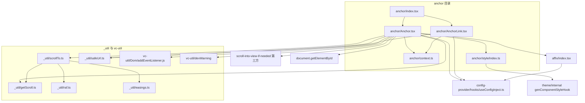
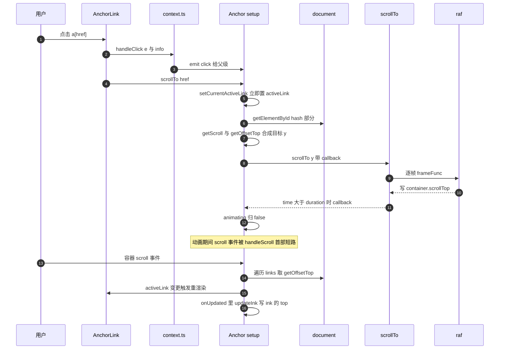
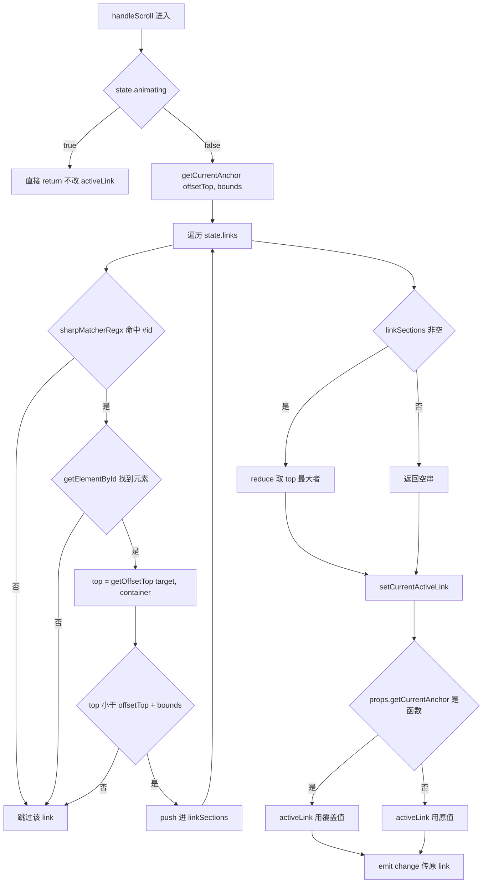

# C03-10 Anchor 锚点

> **本篇解决**：Anchor 的高亮态到底是怎么从一次 `scroll` 事件里算出来的——判定算法、两套坐标系的换算、链接注册表，以及它把滚动容器交给 Affix 的方式。
> **前置**：C03-00《类横写：menu/tabs/steps/breadcrumb 的选中态模型》、C03-11《Affix 固钉》、C03-12《BackTop 返回顶部》　**读者坐标**：`03-components/03-navigation` 第 10/14 篇
> **不是什么**：不是 `xy-affix` 的用法解读（粘顶机制归 C03-11），不是选中态模型的总论（本类共性归 C03-00）。

## 一、职责与边界

`Anchor` 解决一件事：**在「一列链接」与「一段可滚动正文」之间建立并维持对应关系**。它自己不渲染正文，也不管理正文里有哪些标题；它只维护三件事——链接集合、当前激活链接、以及把视口滚动到某个链接目标位置的动画（`packages/xiaoye-ui/src/anchor/Anchor.tsx:86-329`）。

明确**不负责**的部分同样重要：

- 不负责「固钉」。粘顶由 `xy-affix` 完成，Anchor 只在 `affix` 为真时把自己塞进 `Affix` 的默认插槽，并把滚动容器交给它（`Anchor.tsx:318-326`）。粘顶阈值计算、resize 重测、`affixBefore` 占位这些机制属于 C03-11《Affix》。
- 不负责「滚动到某个数值」。缓动曲线与 rAF 循环在 `_util/scrollTo.ts:14-38`，坐标读取在 `_util/getScroll.ts:5-33`，Anchor 只是调用方（`Anchor.tsx:179-184`）。
- 不负责 hash / 路由。渲染出的 `<a>` 用的是原始 `href`（`AnchorLink.tsx:96`），组件既不 `preventDefault`，也不写 `location.hash`（`AnchorLink.tsx:53-57`）。浏览器默认跳转与 `pushState` 路由都不在它的管辖内。
- 不负责内容侧的可见性上报。目标元素不需要注册、不需要挂任何 data 属性，Anchor 靠 `document.getElementById` 现场抓取（`Anchor.tsx:133`、`Anchor.tsx:167`）。

依赖清单（全部为本仓库路径）：`_util/classNames`、`vc-util/Dom/addEventListener.js`、`affix/index.tsx`、`_util/scrollTo`、`_util/getScroll`、`config-provider/hooks/useConfigInject`、`./context`、`./style`、`_util/vue-types`、`vc-util/devWarning`、`_util/type`、`_util/safeUrl`（`Anchor.tsx:13-25`、`AnchorLink.tsx:3-10`），外加一个第三方包 `scroll-into-view-if-needed`（`Anchor.tsx:12`）。反向依赖：`anchor/index.tsx:8-15` 把 `AnchorLink` 挂成 `Anchor.Link` 并双注册。

## 二、源码地图

| 文件 | 行数 | 职责 | 关键导出 |
| --- | --- | --- | --- |
| `anchor/Anchor.tsx` | 329 | 主实现：链接注册表、激活判定、滚动动画、ink 定位、Affix 包装 | `anchorProps:60`、`AnchorContainer:58`、`AnchorState:79`、默认导出 `:86` |
| `anchor/AnchorLink.tsx` | 109 | 单条链接：注册/注销、激活类名、点击转发 | `anchorLinkProps:12`、`AnchorLinkItemProps:20`、默认导出 `:32` |
| `anchor/context.ts` | 35 | provide/inject 通道与默认值 | `AnchorContext:5`、`AnchorContextKey:17`、`useProvideAnchor`/`useInjectAnchor:34` |
| `anchor/index.tsx` | 23 | 入口与 `Link` 静态属性、install | 默认导出 `:20`、`AnchorLink`/`Link:18` |
| `anchor/style/index.ts` | 173 | CSS-in-JS：竖排/横排两套规则 + Component Token | 默认导出 `genComponentStyleHook('Anchor', …):161` |
| `anchor/Anchor.test.js` | 213 | 名义 8 个 `it` 块，实际执行 2 个（`Anchor.test.js:62` 起的块注释覆盖其余 6 个，详见坑 6） | — |
| `_util/getScroll.ts` | 33 | 四种容器（Window/Document/HTMLElement/伪造对象）的滚动量读取 | `isWindow:1`、默认导出 `:5` |
| `_util/scrollTo.ts` | 38 | 基于 rAF 的垂直滚动动画 | 默认导出 `:14` |
| `vc-util/Dom/addEventListener.js` | 22 | 带 `remove()` 句柄的监听器包装 | 默认导出 `:3` |

主实现入口是 `Anchor.tsx:86` 的 `defineComponent`，`setup` 从 `:91` 开始；渲染函数在 `:289-327`，最后一步才决定「套不套 Affix」。注意组件目录里**没有** `anchorTypes.ts`——props 定义与实现同文件（`Anchor.tsx:60-75`），这与 `button/buttonTypes.ts` 的常见布局不同，找类型定义时不要往独立文件里翻。

聚合入口由生成器产出：`src/components.ts:13-15` 同时写了 `export * from './anchor'`、`export { default as Anchor } from './anchor'` 与 `import './anchor/style'`；子路径双入口在 `package.json:141`（`./anchor`）与 `package.json:145`（`./anchor/style`）。样式 hook 的 Token 全部从全局 Token 派生（`anchor/style/index.ts:161-171`），`ComponentToken` 接口是空的（`anchor/style/index.ts:6`），意味着 Anchor 没有可独立覆盖的组件级 Token。

## 三、架构与数据流

### 3.1 模块静态关系



关系图里有三个点值得先钉住。第一，**`AnchorLink` 与 `Anchor` 之间没有 import 方向的单向控制流**：`Anchor.tsx:22` 确实 import 了 `AnchorLink`（用于 `items` 递归渲染，`Anchor.tsx:266-285`），但运行时的通信全部走 `context.ts:17` 的 `AnchorContextKey`，链接把自身 `href` 注册进父级的数组、又从父级读回 `activeLink`（`AnchorLink.tsx:44-50`）。第二，**`Anchor` 是 `Affix` 的宿主而不是它的配置者**：只有 `offsetTop` 与 `target` 两个值跨过这条边界（`Anchor.tsx:322`），其余 Affix 能力（`offsetBottom`、`onChange`）Anchor 一个都不透传，用户想同时用底部粘顶就只能放弃 `affix`。第三，`document.getElementById` 是**唯一的目标发现手段**（`Anchor.tsx:133`、`Anchor.tsx:167`），内容侧与组件之间没有任何显式契约，这决定了它的松耦合也决定了它的脆弱。

### 3.2 一次滚动的完整闭环



闭环里有两处「先答后算」的顺序设计：`handleScrollTo` 在真正滚动之前就把 `activeLink` 定死（`Anchor.tsx:162`），随后 `state.animating = true`（`Anchor.tsx:177`）让滚动监听在整个动画期间保持沉默（`Anchor.tsx:190-192`）；否则每帧写入 `scrollTop` 都会触发一次重算，链接高亮会随动画抖到中间位置。`scrollTo` 的 `callback` 只在最后一帧且 `time >= duration` 时才调用（`_util/scrollTo.ts:31-35`），`animating` 的复位完全依赖这个约定。

### 3.3 激活判定分支



注意最后一步：`emit('change', link)` 传的是**未经 `getCurrentAnchor` 改写**的原始 link（`Anchor.tsx:156-157` 里赋值与 emit 用的是不同变量）。这条分支图上的不对称是有意的——受控函数只影响「哪一条亮」，不影响「外部收到什么」，但它同时意味着调用方无法从 `onChange` 里得知最终生效的 link。

## 四、核心机制精读

### 论点 1：激活判定是「裸 scroll 事件 × 全量几何重算」，本仓库既没有 IntersectionObserver 路径，也没有把这条链路接到已有的 rAF 节流壳上

先给可机械复现的否定证据：

```bash
grep -rn "IntersectionObserver" packages/xiaoye-ui/src | wc -l   # 0
```

也就是说，整个主库（含 28 个 `vc-*` 底层目录）没有任何一处用可见性观测来做激活判定，Anchor 也没有。它走的是最朴素的一条路：

```tsx
// packages/xiaoye-ui/src/anchor/Anchor.tsx:240
    onMounted(() => {
      nextTick(() => {
        const container = getContainer.value();
        state.scrollContainer = container;
        state.scrollEvent = addEventListener(state.scrollContainer, 'scroll', handleScroll);
        handleScroll();
      });
    });
```

`addEventListener` 是 `vc-util/Dom/addEventListener.js:3` 的薄壳，第四个参数 `option` 没传，而该壳只在 `touchstart`/`touchmove`/`wheel` 三种事件上自动补 `{ passive: false }`（`addEventListener.js:6-12`），`scroll` 不在其中，于是监听器以浏览器默认方式挂载，没有 passive、没有 capture。

每次事件回调进入 `handleScroll`（`Anchor.tsx:189`），注意它**不接收任何事件参数**——这是后面「设计取舍」里那条优化窗口的关键前提。它直接调用 `getCurrentAnchor` 做一次全量扫描：

```tsx
// packages/xiaoye-ui/src/anchor/Anchor.tsx:126
      const linkSections: Array<Section> = [];
      const container = getContainer.value();
      state.links.forEach(link => {
        const sharpLinkMatch = sharpMatcherRegx.exec(link.toString());
        if (!sharpLinkMatch) {
          return;
        }
        const target = document.getElementById(sharpLinkMatch[1]);
        if (target) {
          const top = getOffsetTop(target, container);
          if (top < offsetTop + bounds) {
            linkSections.push({
              link,
              top,
            });
          }
        }
      });
```

复杂度是每条链接一次 `getElementById` + 一次 `getBoundingClientRect()` + 一次 `getClientRects()`（`Anchor.tsx:34`、`Anchor.tsx:38`）。10 条链接就是每帧十几次强制布局；滚动期间浏览器不会帮你合并这些读取，因为它们发生在事件回调里而不是 rAF 回调里。

对照同类的兄弟组件：`back-top/BackTop.tsx:58` 的 `handleScroll` 被 `throttleByAnimationFrame` 包了一层，该壳的实现是「同一帧内只登记第一个 rAF 回调，后续调用直接丢弃」（`_util/throttleByAnimationFrame.ts:15-19`）。Anchor 没有走这条路，因此同一个页面上同时存在 Anchor 与 BackTop 时，只有 Anchor 那一路是全帧率的。

结论回扣：选择裸监听器让 Anchor 的判定永远基于「最新几何」，不会有滞后一帧的错位，代价是滚动期间的布局抖动完全由链接数量线性放大。要改成 IntersectionObserver，必须先把「目标元素」变成显式契约（observer 需要 element 引用而非 id 字符串），而那会摧毁论点 4 描述的零注册成本，这是一次真实的架构交换，不是换个 API 那么简单。

### 论点 2：判定语义不是「哪个章节正在视口内」，而是「哪些目标已经越过一条阈值线，取其中最靠下的一个」；这条线由 `offsetTop`/`targetOffset` 与 `bounds` 合成

```tsx
// packages/xiaoye-ui/src/anchor/Anchor.tsx:145
      if (linkSections.length) {
        const maxSection = linkSections.reduce((prev, curr) => (curr.top > prev.top ? curr : prev));
        return maxSection.link;
      }
      return '';
    };
    const setCurrentActiveLink = (link: string) => {
      const { getCurrentAnchor } = props;
      if (activeLink.value === link) {
        return;
      }
      activeLink.value = typeof getCurrentAnchor === 'function' ? getCurrentAnchor(link) : link;
      emit('change', link);
    };
```

`reduce` 取的是 `top` **最大**者，而候选集已在 `Anchor.tsx:136` 被筛成 `top < offsetTop + bounds`。两个条件合起来的几何含义是：在所有「上边界已抬到阈值线以上」的目标里，选那个离阈值线最近（也就是最后越线）的。这套判据有两个直接后果，都能从代码读出来：

- 页面顶到第一个锚点之间，`linkSections` 为空，`getCurrentAnchor` 返回空串（`Anchor.tsx:149`），`activeLink` 被置为 `''`，于是 `-ink-visible` 类不挂上（`Anchor.tsx:292-294`）、所有链接都非激活。也就是说 Anchor **没有「默认高亮第一条」的兜底**，这与 Menu/Tabs 必须有初始选中项的语义完全不同。
- 反向滚动同样成立：越线集合是「历史累积」的几何快照而非区间，往回滚时上一个目标重新满足条件即被选中，不需要任何额外的方向判断。

阈值线本身是两处算术的合成，而且**同一个 prop 被喂给了两条不同的路**：

```tsx
// packages/xiaoye-ui/src/anchor/Anchor.tsx:193
      const { offsetTop, bounds, targetOffset } = props;
      const currentActiveLink = getCurrentAnchor(
        targetOffset !== undefined ? targetOffset : offsetTop || 0,
        bounds,
      );
      setCurrentActiveLink(currentActiveLink);
    };
```

`Anchor.tsx:195` 与 `Anchor.tsx:176` 用的是同一个三元表达式（`targetOffset !== undefined ? targetOffset : offsetTop || 0`），即判定线与滚动落点补偿共用一个数；而 `offsetTop` 同时还作为 `Affix` 的粘顶偏移传了出去（`Anchor.tsx:322`）。三处消费一个 prop，语义是「粘顶高度」和「滚动停靠余量」恰好等价时才成立——这正是它俩在文档站里的用途（粘顶的目录顶边＝滚动后标题应该出现的位置）。一旦需要「目录钉在 32px 但滚动留 64px 余量」，只能靠 `targetOffset` 拆开（`Anchor.tsx:70` 声明、`:176`、`:195` 读取），`apps/docs/examples/anchor/targetOffset.vue` 就是这个用法。

`bounds` 的默认值不在 props 声明里，而在函数形参默认值上：prop 定义是无默认的裸 `Number`（`Anchor.tsx:63`），`handleScroll` 把 `undefined` 原样传进去，命中 `getCurrentAnchor = (offsetTop = 0, bounds = 5)`（`Anchor.tsx:125`）得到 5px 容差。这类「默认值藏在实现签名里」的写法有个可观察后果：`props.bounds` 为 `undefined` 与为 `0` 行为不同，前者按 5 判定、后者严格按 0，任何想用 `??` 或 `||` 归一的改动都会改变语义。

### 论点 3：组件内并存两套坐标系——`getOffsetTop` 返回视口相对值，`getScroll` 返回文档坐标，`handleScrollTo` 用一次相加完成换算；不可见元素返回 0 会伪装成「已越线」

```tsx
// packages/xiaoye-ui/src/anchor/Anchor.tsx:33
function getOffsetTop(element: HTMLElement, container: AnchorContainer): number {
  if (!element.getClientRects().length) {
    return 0;
  }

  const rect = element.getBoundingClientRect();

  if (rect.width || rect.height) {
    if (container === window) {
      container = element.ownerDocument!.documentElement!;
      return rect.top - container.clientTop;
    }
    return rect.top - (container as HTMLElement).getBoundingClientRect().top;
  }

  return rect.top;
}
```

三段分支各有一层用意。`:34-36` 用 `getClientRects().length === 0` 判「不在渲染树上」（`display: none` 时该数组为空），直接返回 0；`:41-44` 在容器是 `window` 时把参照换成 `documentElement` 并减掉 `clientTop`（即根元素的边框宽度，用来抵消 html 有边框时视口坐标与内容框的偏差）；`:45` 在容器是某个 `overflow: auto` 的 div 时，减去该容器自身的 `rect.top`，得到「相对于容器内容区上沿」的距离。三条路径的共同点：**都不加滚动偏移，返回值永远是视口相对量**。

而 `_util/getScroll.ts` 返回的是另一套量——文档/元素坐标：

```ts
// packages/xiaoye-ui/src/_util/getScroll.ts:12
  const method = top ? 'scrollTop' : 'scrollLeft';
  let result = 0;
  if (isWindow(target)) {
    result = target[top ? 'scrollY' : 'scrollX'];
  } else if (target instanceof Document) {
    result = target.documentElement[method];
  } else if (target instanceof HTMLElement) {
    result = target[method];
  } else if (target) {
```

`isWindow` 的判据是 `obj === obj.window`（`_util/getScroll.ts:1-3`），因此 Window 走 `scrollY`，Document 走 `documentElement.scrollTop`。第四个 `else if (target)` 分支按注释自陈是给测试伪造对象留的路（`_util/getScroll.ts:21-25`）。

两套坐标在 `handleScrollTo` 里做一次相加就完成换算，这正是它必须存在的原因：

```tsx
// packages/xiaoye-ui/src/anchor/Anchor.tsx:172
      const container = getContainer.value();
      const scrollTop = getScroll(container, true);
      const eleOffsetTop = getOffsetTop(targetElement, container);
      let y = scrollTop + eleOffsetTop;
      y -= targetOffset !== undefined ? targetOffset : offsetTop || 0;
      state.animating = true;

      scrollTo(y, {
        callback: () => {
          state.animating = false;
        },
        getContainer: getContainer.value,
      });
```

`y = 当前滚动量 + 目标距视口上沿的相对距离`，得到目标在文档坐标里的绝对位置，再减掉停靠余量，交给 `_util/scrollTo.ts:14` 的动画。注意 `Anchor.tsx:179-184` 传的是 `getContainer.value`（一个函数）而不是容器对象本身，符合 `ScrollToOptions.getContainer?: () => HTMLElement | Window | Document` 的约定（`_util/scrollTo.ts:7`）。

现在回到 `:34-36` 那个 `return 0`。它在判定路径上是个语义陷阱：**不可见目标的 `top` 被报成 0，而 0 几乎总是满足 `top < offsetTop + bounds`（`Anchor.tsx:136`）**。于是当一个 `display: none` 的章节标题恰好是文档里第一个越线者时，它会以「已滚到最上面」的身份被选为 `maxSection`，链接高亮却指向一段用户看不见的内容。同一函数在滚动路径上表现相反——`Anchor.tsx:167-174` 找到元素但 `getOffsetTop` 返回 0 时，`y` 会算成「文档顶部减停靠余量」，点击一条指向隐藏元素的链接会把页面滚到顶。两条路共用同一个函数、同一个返回值，语义却一个是「伪装成越线」、一个是「伪装成在顶部」，这是组件用 id 抓取目标（`Anchor.tsx:133`）而不是用显式注册所必须付的账。

### 论点 4：链接集合是一张「由子组件在挂载时自报」的运行时常量表，不是 props 树的一部分；`items` 与默认插槽两条渲染路径共用同一张表

```tsx
// packages/xiaoye-ui/src/anchor/Anchor.tsx:220
    useProvideAnchor({
      registerLink: (link: string) => {
        if (!state.links.includes(link)) {
          state.links.push(link);
        }
      },
      unregisterLink: (link: string) => {
        const index = state.links.indexOf(link);
        if (index !== -1) {
          state.links.splice(index, 1);
        }
      },
      activeLink,
      scrollTo: handleScrollTo,
      handleClick: (e, info) => {
        emit('click', e, info);
      },
      direction: anchorDirection,
    });
```

`state.links` 在 `Anchor.tsx:113-118` 初始化为空数组（`reactive<AnchorState>` 声明见 `Anchor.tsx:79-84`），父级自己不解析任何结构。写入方只有三处，全在 `AnchorLink` 里：挂载时 `registerLink(props.href)`（`AnchorLink.tsx:69-71`）、卸载时 `unregisterLink(props.href)`（`AnchorLink.tsx:73-75`）、`href` 变化时先解旧再登新（`AnchorLink.tsx:59-67`）。读取方只有一处，就是判定用的那次遍历（`Anchor.tsx:128`）——`grep -n "state.links" Anchor.tsx` 会给出全部 5 个命中（`:128`、`:222`、`:223`、`:227`、`:229`），除首行外都在注册表内部。这张表让 Anchor 与 Menu/Tabs 分道：后者要从 children/props 里算出可选项集合，Anchor 是「谁挂载谁登记」，因此嵌套层级、`v-for`、条件渲染都能自然工作，代价是集合在首帧之后才完整。顺带一个死亡信号：那张被注释掉的测试里断言的是 `wrapper.vm.$refs.anchor.links`（`Anchor.test.js:151`），而今天的 `expose` 只交出一个 `scrollTo`（`Anchor.tsx:186-188`），`setup` 没有返回 `state`，这条断言在现有实现下不可能成立。

`registerLink` 的去重靠 `includes`（`Anchor.tsx:222`），意味着**两条 href 相同的链接在表里只有一条**——它们会同时高亮（`AnchorLink.tsx:81` 用 `activeLink.value === href` 比较），但注销其中一条会把两条一起熄灭：`unregisterLink` 的 `indexOf` + `splice`（`Anchor.tsx:227-230`）只删第一次出现的下标，而 `includes` 让表里本来就没有第二份，所以只要还剩一条同 href 的链接挂载着，它登记的路径已经在 `:222` 被短路，卸载后表里那一项被删走，剩下的链接就永久失去激活能力。

`href` 变更那条路径有一个可见的时序缝隙：

```tsx
// packages/xiaoye-ui/src/anchor/AnchorLink.tsx:59
    watch(
      () => props.href,
      (val, oldVal) => {
        nextTick(() => {
          unregisterLink(oldVal);
          registerLink(val);
        });
      },
    );
```

注销与登记被推迟到 `nextTick`（`AnchorLink.tsx:62-64`），而 `activeLink` 的比对是同步的（`AnchorLink.tsx:81`）。在同一个 tick 内，`href` 已经变了但表里还是旧值，此时若容器恰好触发一次 `scroll`，判定用的仍是旧 href。这个缝隙本身不影响正确性（旧 href 已无对应元素，`getElementById` 会落空，`Anchor.tsx:134` 的 `if (target)` 直接跳过），但它解释了为什么「改 href 后偶发一帧没有高亮」不是 bug 而是登记时序。

两条渲染路径都汇聚到这张表：`items` 走 `createNestedLink` 递归产出 `AnchorLink`（`Anchor.tsx:266-285`），默认插槽走用户手写嵌套（`Anchor.tsx:313` 的 `slots.default?.()`）。差别只在 children：

```tsx
// packages/xiaoye-ui/src/anchor/Anchor.tsx:279
                v-slots={{ customTitle: slots.customTitle }}
              >
                {anchorDirection.value === 'vertical' ? createNestedLink(children) : null}
              </AnchorLink>
```

水平方向直接丢弃 `children`（`Anchor.tsx:281`），并在 dev 环境额外告警一次「`Anchor items#children` is not supported when `Anchor` direction is horizontal」（`Anchor.tsx:103-109`）；同时另一条 dev 告警检查 `items` 与默认插槽是否并存（`Anchor.tsx:95-101`），条件是 `props.items && typeof slots.default !== 'function'`——注意这是「有 items 且没有默认插槽」才**不**告警，两个逻辑条件的写法容易被误读，改这里时要连 `vc-util/devWarning.ts:5-7` 的 `valid` 语义（valid 为假才打印）一起看。

### 论点 5：Anchor 与 URL 是完全解耦的——不写 hash、不读 hash、不拦默认跳转，激活态是纯几何推导的结果，深链高亮依赖浏览器先完成定位

第二组的否定证据同样可复现，且用了两种检索方式交叉验证：

```bash
grep -rn "preventDefault\|hashchange\|popstate\|location.hash" packages/xiaoye-ui/src/anchor   # 无输出
grep -rc "preventDefault" packages/xiaoye-ui/src/anchor/*.tsx                                   # 两份都是 0
```

点击链接的实际动作序列是：

```tsx
// packages/xiaoye-ui/src/anchor/AnchorLink.tsx:53
    const handleClick = (e: Event) => {
      const { href } = props;
      contextHandleClick(e, { title: mergedTitle, href });
      scrollTo(href);
    };
```

`contextHandleClick` 只是把事件原样转给父级再 `emit('click', e, info)`（`Anchor.tsx:234-236`），没有任何一方调用 `e.preventDefault()`；`scrollTo(href)` 则立刻进入 `Anchor.tsx:159` 的 `handleScrollTo`。于是同一次点击同时启动两件事：组件的 rAF 缓动动画，以及 `<a href="#id">` 的浏览器默认跳转。后者的时序在事件处理函数返回之后，而 `_util/scrollTo.ts:17` 的 `scrollTop` 是在调用瞬间就捕获的插值起点，因此动画的起点是**点击前**的位置，浏览器却已经把视口瞬移到了目标元素——这就是「点击一条靠下的链接时先跳一下再滑回指定偏移」的机制来源，不是渲染抖动。

URL 侧的写入完全交给浏览器：`href` 经过 `_util/safeUrl.ts:40-42` 的协议白名单（`_util/safeUrl.ts:10`）后原样落到属性上（`AnchorLink.tsx:96`）。`#section-1` 属于「无协议即相对路径」分支（`_util/safeUrl.ts:31-33`），因此正常锚点不受影响；而 `javascript:` 一类伪协议会被换成空串 `href`，此时组件仍然会跑一次 `handleScrollTo`，但 `sharpMatcherRegx` 对空串匹配失败（`Anchor.tsx:51` 要求 `#` 后至少一个字符）而提前返回（`Anchor.tsx:164-166`），只是 `setCurrentActiveLink` 已经在返回之前被调用（`Anchor.tsx:162`）——安全校验掐住了跳转，没掐住高亮。

反向（URL → 组件）同样没有任何通道：挂载时只调用一次 `handleScroll()`（`Anchor.tsx:245`），它读的是几何而不是 hash。所以「带 `#section-3` 打开页面能否高亮」取决于浏览器是否已经把这一步滚到位：如果内容还在异步渲染、或目标元素当时不可见（论点 3 的 `return 0`），首帧判定就会得到一个错的值，而由于没有 `hashchange` 监听器，此后再也不会重试。这条路径**没有测试保护**——`Anchor.test.js` 里唯一与滚动相关的用例位于被注释掉的块内（`Anchor.test.js:62` 起的 `/*` 与 `Anchor.test.js:212` 行尾的 `*/`），实际执行的只有 2 个用例（见「七、坑与改动指南」）。

### 论点 6：滚动容器的解析是一条三级兜底链，容器「函数」而非容器「元素」跨过 Affix 边界；Anchor 上的属性透传最终落在 Affix 的占位层

```tsx
// packages/xiaoye-ui/src/anchor/Anchor.tsx:120
    const getContainer = computed(() => {
      const { getContainer } = props;
      return getContainer || getTargetContainer?.value || getDefaultContainer;
    });
```

三级的来源各不相同。第一级是组件自己的 prop `getContainer`（`Anchor.tsx:66`）；第二级来自 `useConfigInject`（`Anchor.tsx:92`），而 `config-provider/hooks/useConfigInject.ts:23-25` 里的 `getTargetContainer` 读的是 `props.getTargetContainer`——**Anchor 并没有声明这个 prop**，所以这一项在 Anchor 上恒为 `undefined`，实际生效的是 `configProvider.getTargetContainer?.value`，即全局 `<xy-config-provider get-target-container>` 那条通道（声明见 `config-provider/context.ts:64-66`、聚合逻辑见 `config-provider/index.tsx:112-115`）；第三级是模块级函数 `getDefaultContainer()` 返回 `window`（`Anchor.tsx:29-31`）。

这里有个容易被误读的双层 `.value`：`getContainer` 是一个 `ComputedRef<() => AnchorContainer>`，它的**值本身是个函数**，所以判定时写 `getContainer.value()`（`Anchor.tsx:127`、`Anchor.tsx:172`、`Anchor.tsx:242`），而传给 Affix 时写 `getContainer.value`（`Anchor.tsx:322`）。后者不是笔误——Affix 的 `target` 契约正是「一个返回对应 DOM 元素的函数」（`affix/index.tsx:51-54`，默认值 `getDefaultTarget`）。Anchor 与 Affix 因此在「传函数」这一层严格对齐，两边都靠每次调用重新解析，容器被替换后无需重新挂载。

包装决策在渲染函数的最后一步：

```tsx
// packages/xiaoye-ui/src/anchor/Anchor.tsx:318
      return wrapSSR(
        !affix ? (
          anchorContent
        ) : (
          <Affix {...attrs} offsetTop={offsetTop} target={getContainer.value}>
            {anchorContent}
          </Affix>
        ),
      );
```

`affix` 默认为真（`Anchor.tsx:64`），所以生产路径几乎总是走 Affix。关键在 `{...attrs}`：Anchor 声明了 `inheritAttrs: false`（`Anchor.tsx:89`），未被 props 声明吸收的一切（`class`、`style`、任何 `data-*`、以及用户误写的 `get-target-container` 之类）都会经此下沉，而 Affix 同样 `inheritAttrs: false`（`affix/index.tsx:77`）并把这些属性铺在它自己的占位 div 上（`affix/index.tsx:272`）。于是**「给 Anchor 写 class」实际是给 Affix 的外层占位 div 写 class**，而不是给 `.xy-anchor-wrapper`（该 div 在 `Anchor.tsx:310` 由 `wrapperClass` 这个显式 prop 控制，`Anchor.tsx:296-299`）。这是两个不同层，改样式选择器时必须分清。

另一处只有两条边的耦合是 `wrapperStyle.maxHeight`：

```tsx
// packages/xiaoye-ui/src/anchor/Anchor.tsx:305
      const wrapperStyle = {
        maxHeight: offsetTop ? `calc(100vh - ${offsetTop}px)` : '100vh',
        ...props.wrapperStyle,
      };
```

它直接吃 `offsetTop` 这个数（`Anchor.tsx:306`），与 Affix 的粘顶偏移、判定阈值线（`Anchor.tsx:195`）合起来构成同一个 prop 的第四个消费点。用户传 `props.wrapperStyle` 里的 `maxHeight` 会因展开顺序覆盖它（`Anchor.tsx:307`），这是唯一的手工逃生口。而 `affix` 为假时，Anchor 会挂 `-fixed` 类（`Anchor.tsx:301-303`），意图配合 `showInkInFixed` 控制不粘顶时是否显示 ink——但见「七、坑」第 4 条，这条 CSS 规则当前匹配不到任何元素。

### 论点 7：ink（激活指示条）走的是几何通道而不是类名通道，靠一次 `querySelector` 加四次内联 style 赋值实现，且只在 `onUpdated` 里被调用

```tsx
// packages/xiaoye-ui/src/anchor/Anchor.tsx:201
    const updateInk = () => {
      const linkNode = anchorRef.value.querySelector(`.${prefixCls.value}-link-title-active`);
      if (linkNode && spanLinkNode.value) {
        const horizontalAnchor = anchorDirection.value === 'horizontal';
        spanLinkNode.value.style.top = horizontalAnchor
          ? ''
          : `${linkNode.offsetTop + linkNode.clientHeight / 2}px`;
        spanLinkNode.value.style.height = horizontalAnchor ? '' : `${linkNode.clientHeight}px`;
        spanLinkNode.value.style.left = horizontalAnchor ? `${linkNode.offsetLeft}px` : '';
        spanLinkNode.value.style.width = horizontalAnchor ? `${linkNode.clientWidth}px` : '';
        if (horizontalAnchor) {
          scrollIntoView(linkNode, {
            scrollMode: 'if-needed',
            block: 'nearest',
          });
        }
      }
    };
```

四行内联赋值把「激活链接的盒模型」复制给那个唯一的 `<span class="xy-anchor-ink">`（渲染点 `Anchor.tsx:312`，`ref` 在 `Anchor.tsx:111`）：竖排写 `top`/`height`（`:205-208`，`top` 额外加半个行高做垂直居中），横排写 `left`/`width`（`:209-210`），两条方向各自把另一对属性置空串以免残留。这里的选择器是**运行时用 `prefixCls` 拼出来的**（`Anchor.tsx:202`），所以自定义前缀（`useConfigInject('anchor', props)`，`Anchor.tsx:92`）不会让查询失效，但依赖「类名里必须带 `-link-title-active`」这个隐式契约——它由 AnchorLink 挂上（`AnchorLink.tsx:89-91`）。

调用点只有一处：

```tsx
// packages/xiaoye-ui/src/anchor/Anchor.tsx:253
    onUpdated(() => {
      if (state.scrollEvent) {
        const currentContainer = getContainer.value();
        if (state.scrollContainer !== currentContainer) {
          state.scrollContainer = currentContainer;
          state.scrollEvent.remove();
          state.scrollEvent = addEventListener(state.scrollContainer, 'scroll', handleScroll);
          handleScroll();
        }
      }
      updateInk();
    });
```

`onUpdated` 在这里承担两件事，第二件是 ink 定位，第一件是**容器漂移自愈**：因为 `getContainer` 是 computed（`Anchor.tsx:120-123`），ConfigProvider 换了目标容器后，Anchor 只有在发生任意一次更新时才发现「函数变了」，然后解绑旧监听、绑新监听并立刻重算一次高亮（`Anchor.tsx:256-260`）。挂载时走的是同一套代码的另一个副本（`Anchor.tsx:242-245`）。若组件从不重渲染，容器漂移就不会被纠正——`updateInk` 同理，它不可能在「DOM 变了但组件没更新」的情况下被调用，例如链接文本异步变长导致 `offsetTop` 漂移，ink 就会停在旧位置。这与 C03-00 论点 5 描述的「几何通道额外引入一帧延迟与一张可能过期的量表」是同一形态的问题：类名通道只要状态对就永远画得对，几何通道必须有人主动重测。

横排那一路多出一个第三方调用：`scrollIntoView(linkNode, { scrollMode: 'if-needed', block: 'nearest' })`（`Anchor.tsx:212-215`，导入在 `Anchor.tsx:12`）。它的目的是把溢出到可视区外的激活链接带回横条内——承载滚动的是样式给的 `overflowX: scroll`（`anchor/style/index.ts:134-142`，同时隐藏了滚动条）。需要注意的是 `scroll-into-view-if-needed` 默认会向上遍历**所有**可滚动祖先，Anchor 没有传 `boundary`/`rootNode` 之类的收窄参数，因此当横条本身在页面边缘时，这次调用也可能顺带滚动页面。这个「为对齐指示条而引发的二次滚动」又会触发 `handleScroll`（`Anchor.tsx:189`），而 `state.animating` 只在点击动画期间为真（`Anchor.tsx:177`、`Anchor.tsx:181`），保护不到这里，于是存在一次「ink 定位 → 页面滚动 → 重新判定」的回环。

## 五、对外契约如何生效

属性清单见 `apps/docs/components/anchor.md`，此处只走通路。

**props 的分流。** `anchorProps()` 声明在 `Anchor.tsx:60-75`，14 个键里只有 4 个真正被组件读成「行为」：`offsetTop`（四处消费，见论点 6）、`bounds`（`Anchor.tsx:196`）、`targetOffset`（`Anchor.tsx:176`、`Anchor.tsx:195`）、`getContainer`（`Anchor.tsx:121`）。`items` 决定渲染走递归还是插槽（`Anchor.tsx:313`），`direction` 只喂 `anchorDirection`（`Anchor.tsx:93`）并被塞进 context 供链接与样式分流（`Anchor.tsx:237`、`AnchorLink.tsx` 侧的 `direction` 目前不参与渲染判断）。`prefixCls` 是 `String` 无默认值（`Anchor.tsx:61`），真正的默认前缀由 `useConfigInject('anchor', props)`（`Anchor.tsx:92`）产出——直接 `import Anchor` 而不套 ConfigProvider 也能拿到 `xy-anchor`，这是本库所有组件的统一路径。

**事件走的是 prop-function，不是 emits。** `Anchor.tsx:86-91` 的 `defineComponent` 里根本没有 `emits` 字段（`grep -rn "emits" packages/xiaoye-ui/src/anchor/` 无输出），`onChange` 与 `onClick` 是以 `Function as PropType<…>` 的形式声明成 props 的（`Anchor.tsx:73-74`），随后用 `emit('change', link)`（`Anchor.tsx:157`）与 `emit('click', e, info)`（`Anchor.tsx:235`）触发。Vue 的 `emit` 会在 vnode props 上找 `onChange`/`onClick`，因此模板里写 `@change` 与写 `:on-change` 等价。要注意两条路的入参不对称：`change` 只带一个当前 link 字符串，而 `click` 带 `(MouseEvent, { title, href })`，`title` 是 `AnchorLink` 求值后的 `mergedTitle`（`AnchorLink.tsx:55` 传 `{ title: mergedTitle, href }`，求值在 `AnchorLink.tsx:80`）——如果 `title` 传的是函数，事件里拿到的是它执行后的 VNode 而不是函数本身。

**expose 面只有一个方法。** `Anchor.tsx:186-188` 交出 `{ scrollTo: handleScrollTo }`，且因为 `inheritAttrs: false` 与 `setup` 无返回值，模板 ref 能拿到的公开面就这一个（与 `Anchor.test.js:209` 里被注释掉的 `anchorRef.value.handleScroll()` 形成对照，见论点 4）。文档站的 `apps/docs/components/anchor.md:78` 提到的 `targetOffset` 与 `bounds` 默认值（`5`）与实现一致，但那个 `5` 并不在 prop 声明上，而在 `Anchor.tsx:125` 的形参默认值——文档表与实现是两处真源，改一处不会同步另一处。

**context 是唯一的父子协议，且默认值是静默失败。** `AnchorContext` 有 6 个成员（`context.ts:5-12`），注入缺省值是一张全 `noop` 表（`context.ts:15`、`context.ts:24-31`），其中 `activeLink` 缺省是 `computed(() => '')`（`context.ts:28`）。后果是 `<xy-anchor-link>` 脱离 `<xy-anchor>` 单独使用时不报错、不告警，只是永不点亮；`direction` 缺省为 `'vertical'`（`context.ts:30`）。provide 侧在 `Anchor.tsx:220-238` 一次性给出全部 6 个成员，没有任何一个是可选的，因此新增 context 字段必须同时补 `context.ts:24-31` 的缺省对象，否则脱离父级的链接会在渲染期抛错。

**样式契约。** `useStyle(prefixCls)` 返回的 `hashId` 必须出现在 DOM 上，组件把它放在 wrapper 类名的第一位（`Anchor.tsx:296`），并在最外层用 `wrapSSR(...)` 包裹（`Anchor.tsx:318`）；漏掉任一处会让 SSR 首屏无样式。激活视觉只有两条规则承担：链接文字变色（`anchor/style/index.ts:61-63` 的 `&-active > ${componentCls}-link-title`）与 ink 显隐（`anchor/style/index.ts:92`、`:98-100`）。`FullToken<'Anchor'>` 的六个派生 Token 全部从全局 Token 计算（`anchor/style/index.ts:164-171`），其中 `anchorTitleBlock: (fontSize / 14) * 3`（`:169`）把间距绑到了字号上，而 `anchorBallSize`（`:170`）在当前两份样式函数里一次都没被读取——它是可搜证的面。

## 六、设计取舍

**几何扫描而不是 IntersectionObserver。** 这是本组件最关键的一次立场选择，而且它换来的东西确实值钱：目标元素与组件之间**零注册成本**。只要页面上有个 `id`，链接就能指向它——Markdown 生成的标题、第三方组件内部渲染的区块、异步插入的章节，全都不需要知道 Anchor 存在（`Anchor.tsx:133`、`Anchor.tsx:167` 两次 `document.getElementById` 就是全部契约）。IntersectionObserver 的观察对象必须是 DOM 引用，要在文档站这种「内容结构与目录结构毫无编译期关系」的场景里等价实现，得先造一套 `id → element` 的登记机制，而那正是 Anchor 现在不需要的那一层。赔上去的是性能：每条链接每次事件一回 `getClientRects()` + `getBoundingClientRect()`（`Anchor.tsx:34`、`Anchor.tsx:38`），且监听器没有被任何节流壳包住（`Anchor.tsx:244`）。

这里有一个真实存在但没被采用的中间方案：`_util/throttleByAnimationFrame.ts:15-19` 就在同仓库里，`back-top/BackTop.tsx:58` 是现成消费者。对本组件而言套壳的**语义风险恰好为零**——`handleScroll` 不接收任何事件参数（`Anchor.tsx:189`），判定读的永远是执行瞬间的活几何，所以 C03-12 论点 2 论证的那条「同帧后续事件的参数被首帧锁死」的缺陷在这条链路上根本不成立。换句话说，这是本组件性能账上最便宜的一笔改进，而它没有被做，代价由链接数量买单。

**组合 Affix 而不是自实现粘顶。** `Anchor.tsx:322` 一行就把钉住能力、占位防塌陷、resize 重测全借了过来，Anchor 侧只写了两行相关代码。收益是两件事各归其位：Anchor 不管 DOM 生命周期，Affix 不管内容语义（C03-11 论点 1 也独立证实了 Affix 侧的观测手段与 Anchor 无关）。代价有三条，都能在源码里指认：其一，属性透传失控，`{...attrs}` 把 Anchor 上未声明的一切推到 Affix 的占位层（`Anchor.tsx:89`、`Anchor.tsx:322`、`affix/index.tsx:272`）；其二，Affix 的能力面被砍到只剩 `offsetTop` 与 `target`，`offsetBottom`（`affix/index.tsx:49`）和 `onChange`（`affix/index.tsx:57`）无法从 Anchor 触达，想要底部粘顶必须 `:affix="false"` 再自己套一层 Affix；其三，多一层 DOM 与一个 ResizeObserver 实例。被放弃的另一条路是 CSS `position: sticky`——它没有占位问题也不需要 JS，但拿不到「已钉住」这个状态类名，而 Anchor 的 `-fixed`／`showInkInFixed` 语义（`Anchor.tsx:301-303`）本质上是在模拟一个状态位；耐人寻味的是这条 CSS 路线如今反而更贴合组件的实际表现，因为 `-fixed` 对应的样式规则根本匹配不到任何元素（见坑 4）。

**运行时注册表而不是从 props 树推导。** `items` 已经是声明式的数据（`Anchor.tsx:71`），理论上激活判定可以直接从这棵树算出链接集合，而不必等子组件挂载时回报。没有这么做的原因在 `Anchor.tsx:313`：`items` 与默认插槽是并列的两条路，`slots.default?.()` 分支下的 children 是任意 VNode，可能是 `AnchorLink`、也可能是被包了一层的 `AnchorLink`，从 VNode 树里抽 `href` 需要穿透与兜底（这正是 C03-00 论点 1 记录的「选中项身份取自 key 还是下标」那一类分裂的源头）。注册表把两条路收敛成同一个集合，代价是集合的完整性晚于首帧，且同 `href` 会被去重（`Anchor.tsx:222`）。

**默认「什么都不高亮」。** `getCurrentAnchor` 在没有候选时返回空串（`Anchor.tsx:149`），组件不做「回退到第一条」的兜底。这条立场与本类其他导航组件相反：Menu、Tabs、Steps 都必须有当前项。它的合理性来自使用场景——文档站顶部到第一个标题之间确实不该有任何目录项亮着；代价是首屏空白期里 ink 完全隐藏（可见性类绑在 `activeLink` 上，`Anchor.tsx:292-294`），若判定因异步渲染拿到错的几何，用户看到的是整条目录熄灭，而不是「亮错了哪一条」，排查方向因此容易被带偏到样式层。

**`getOffsetTop` 只有一套语义、两处用途。** 视口相对量对判定是对的（阈值线就在视口里），对滚动是错的（滚动需要文档坐标），组件用一次相加把它圆了回来（`Anchor.tsx:175`）。这条函数没有为两种用途拆成两个名字，是坑 1 里「不可见元素在两条路上症状相反」的直接成因。可搜证的旁证是容器类型：`Anchor.tsx:58` 导出的 `AnchorContainer` 只含 `HTMLElement | Window`，而 `_util/getScroll.ts:6` 与 `_util/scrollTo.ts:7` 的类型域更宽（含 `Document`），两套容器类型靠 `Anchor.tsx:172-173` 的一次传递拼在一起。

## 七、坑与改动指南

**坑 1｜`display: none` 的目标会伪装成「已滚过阈值线」，抢走高亮。** 触发：章节标题被 `v-show` 隐藏、折叠面板内的标题、或链接指向尚未展开的区块 id。症状：目录里某条链接点亮、ink 移到它面前，正文却不在对应位置；往回滚时它尤其容易被选中。原因：`getOffsetTop` 在 `!element.getClientRects().length` 时返回 `0`（`Anchor.tsx:34-36`），而 `0 < offsetTop + bounds` 几乎恒成立（`Anchor.tsx:136`），于是它进入候选并常成为 `top` 最大者（`Anchor.tsx:146`）。定位：`packages/xiaoye-ui/src/anchor/Anchor.tsx:33-49` 与 `packages/xiaoye-ui/src/anchor/Anchor.tsx:125-150`。**该分支无测试保护**（见坑 6）。修法是在 `Anchor.tsx:136` 的筛选里额外要求 `rect.width || rect.height`，或让不可见元素返回 `Number.POSITIVE_INFINITY` 彻底出局——但后者会同时改变 `handleScrollTo` 的行为（`Anchor.tsx:174`），两处必须分开评估。

**坑 2｜`offsetTop` 有四个消费方，无法单点调整。** 触发：想让目录钉得低一点，或想让滚动停靠时多留一点余量。症状：改一个数，粘顶高度、判定线、滚动落点、wrapper 最大高度一起动。原因：`Anchor.tsx:322`（Affix 偏移）、`Anchor.tsx:195`（判定线）、`Anchor.tsx:176`（滚动停靠）、`Anchor.tsx:306`（`maxHeight: calc(100vh - N px)`）四条读取路径，其中中间两条已被 `targetOffset` 拆开（`Anchor.tsx:70`），首尾两条没有。定位：`packages/xiaoye-ui/src/anchor/Anchor.tsx:305-308` 与 `packages/xiaoye-ui/src/anchor/Anchor.tsx:318-326`。改动建议：若把 `maxHeight` 也拆出去，注意 `Anchor.tsx:306` 用的是真值判断，传 `0` 与不传在此同义，改成 `!== undefined` 会让 `offsetTop = 0` 产出 `calc(100vh - 0px)` 这个等价但不同的字符串，内联 style 快照类测试会飘。

**坑 3｜一次点击同时跑两套滚动：组件缓动 + 浏览器默认跳转。** 触发：`href` 是当前页内的 `#id`，且目标离当前位置较远。症状：视口先瞬移到目标，再滑回 `offsetTop` 指定的位置；SPA 里还多出一条 hash 历史。原因：`AnchorLink` 的 `handleClick` 不调用 `e.preventDefault()`（`AnchorLink.tsx:53-57`），而 `scrollTo(href)` 同步启动动画（`Anchor.tsx:159-185`），`_util/scrollTo.ts:17` 捕获的插值起点是**点击前**的 `scrollTop`。定位：`packages/xiaoye-ui/src/anchor/AnchorLink.tsx:53` 与 `packages/xiaoye-ui/src/_util/scrollTo.ts:17`。放大版本：`href` 写成完整外链时默认跳转直接离开当前页——这不是假设，仓库里就留着这种写法的用例（`Anchor.test.js:51`、`Anchor.test.js:59`），此时 `getElementById` 找不到目标，组件的动画静默不执行（`Anchor.tsx:167-170`），只剩浏览器自己的跳转。

**坑 4｜`showInkInFixed` 是无效果 prop：`-fixed` 的 CSS 选择器匹配不到任何元素。** 触发：`:affix="false"` 并按文档期望设置 `showInkInFixed`（`apps/docs/components/anchor.md:77` 把它描述成控制是否显示小方块）。症状：无论传 `true` 还是 `false`，只要 `activeLink` 非空，ink 都照常显示。原因：类名只在一处写出（`Anchor.tsx:301-303`），唯一消费它的规则是那条三件套后代选择器（`anchor/style/index.ts:105-107`），要求「ink 里再套 ink」；实际渲染中 ink span 是 `.xy-anchor` 的直接子节点且内部无嵌套（`Anchor.tsx:311-312`）。ink 的真实显隐条件只有 `-ink-visible`（`anchor/style/index.ts:92`、`anchor/style/index.ts:98-100`），绑在 `activeLink` 上（`Anchor.tsx:292-294`），与 `showInkInFixed` 无关。定位：两条命令交叉验证——`grep -rn -- "-fixed" packages/xiaoye-ui/src/anchor/` 恰命中 2 行，`grep -rn "showInkInFixed" packages/xiaoye-ui/src apps/docs` 只有 props 声明、解构、类名拼接与文档表 4 处。修法是把选择器改成单层 `${componentCls}-fixed ${componentCls}-ink`，并让 `-ink-visible` 的挂载条件真正读入 `showInkInFixed`。

**坑 5｜同 `href` 的两条链接：一条卸载会让另一条永久失去激活能力。** 触发：同一页两个位置（顶部横条与右侧竖栏）指向同一锚点，或 `v-for` 生成了重复 href。症状：先卸载其中一条，剩下的那条点击时仍会点亮（`handleScrollTo` 直接调 `setCurrentActiveLink`，`Anchor.tsx:162`），但任意一次滚动判定之后它再也不亮。原因：`registerLink` 用 `includes` 去重，表里只有一份（`Anchor.tsx:221-224`），`unregisterLink` 用 `indexOf` + `splice` 无条件删掉那一份（`Anchor.tsx:226-230`），而剩下的链接没有再登记的机会（`AnchorLink.tsx:69-71` 只在挂载时登记）。定位：`packages/xiaoye-ui/src/anchor/Anchor.tsx:220-231`。修法是把登记表换成 `Map<href, number>` 引用计数，`registerLink`/`unregisterLink` 成对增减。

**坑 6｜`Anchor.test.js` 名义 8 个用例、实际执行 2 个，其余 6 个无法直接复活。** 触发：改动判定或滚动逻辑后跑 `pnpm test:unit` 看绿。症状：功能回归漏网，覆盖信号虚假。原因：`Anchor.test.js:62` 的一个 `/*` 把 6 个 `it` 整段注掉，直到 `Anchor.test.js:212` 行尾的 `*/` 才结束；这些用例依赖 Vue 2 / VTU 1 时代的 API——`asyncExpect`（`Anchor.test.js:103`，文件里从未 import）、`wrapper.vm.$refs.anchor.$data.activeLink`（`Anchor.test.js:105`）、`wrapper.vm.$refs.anchor.links`（`Anchor.test.js:151`，而 `setup` 未返回 `state`）、`anchorRef.value.handleScroll()`（`Anchor.test.js:209`，而 `expose` 只有 `scrollTo`，`Anchor.tsx:186-188`）。定位：`grep -n "describe\|it(" packages/xiaoye-ui/src/anchor/Anchor.test.js` 给出 9 个命中，其中 6 个落在注释块内；`cd packages/xiaoye-ui && npx vitest run src/anchor/Anchor.test.js` 输出 `Tests  2 passed (2)`。现存两个用例的断言也弱（`Anchor.test.js:37` 只断 `not.toBe(hash)`）。改动本模块前先补一条能读结果的断言，例如断言渲染出的链接 `a` 上是否带 `-link-title-active`（类名来源 `AnchorLink.tsx:89-91`），再动 `getCurrentAnchor`。

**坑 7｜容器漂移只在 `onUpdated` 里纠正，不重渲染就永不重试。** 触发：ConfigProvider 的 `get-target-container` 指向的容器在 Anchor 挂载后才出现或被替换。症状：滚新容器不高亮，旧容器上还留着监听器。原因：换绑逻辑只写在 `onUpdated` 的分支里（`Anchor.tsx:253-262`），而 `onUpdated` 需要组件自身发生一次更新才触发；挂载路径是另一份代码（`Anchor.tsx:240-247`），两者没有共享的重试机制。Affix 侧有同形态缺陷并被独立记录（C03-11 坑 3）。定位：`packages/xiaoye-ui/src/anchor/Anchor.tsx:240-264`。安全边界：改这段时不要只加 `watch(getContainer)`——那会绕过首次重算，挂载与换绑两处都显式补了一次 `handleScroll()`（`Anchor.tsx:245`、`Anchor.tsx:260`）。

**测试现状与改动边界。** 组件自己的测试只有 `packages/xiaoye-ui/src/anchor/Anchor.test.js`，按 `packages/xiaoye-ui/vitest.config.mts:33` 的 glob（`src/**/*.test.{js,ts,jsx,tsx}`）确实会被收集执行，但只有 2 个用例存活（坑 6）；组件目录里没有 `__tests__/` 子目录。这条链路下游的测试面是：`_util/scrollTo.test.js`、`_util/easings.test.js`（`easeInOutCubic` 即 `_util/scrollTo.ts:23` 用到的那条曲线）、`_util/safeUrl.test.ts`（`AnchorLink.tsx:96` 用到的那层校验）。**`getScroll` 没有任何测试**：`grep -rl "getScroll" packages/xiaoye-ui --include='*.test.*'` 与 `grep -rn "getScroll" packages/xiaoye-ui/tests` 两条命令都无输出，而 `_util/getScroll.ts:25` 的注释却写着「Check the corresponding tests for details」，指向的测试在本仓库已不存在——它的四路分支（`_util/getScroll.ts:14-27`）里最松的那一路（`_util/getScroll.ts:20-27`，类型上应为 `never`）现在完全无人守护，改动时不能假定行为被固定住了。安全改动顺序：先补「隐藏目标」「同 href 重复」「offsetTop 单点调整」三条断言，再动 `getCurrentAnchor` 的筛选式（`Anchor.tsx:136`、`Anchor.tsx:146`）；改 `getOffsetTop` 时同步核对 `handleScrollTo` 的坐标相加（`Anchor.tsx:174-176`）；增删 context 成员时同时补 `context.ts:5-12` 的类型与 `context.ts:24-31` 的缺省对象；改动目录名或导出名后必须跑 `pnpm gen:entries`，因为 `src/components.ts:13-15` 与 `packages/xiaoye-ui/package.json:112`、`packages/xiaoye-ui/package.json:116` 都是生成物，`pnpm check:entries` 会因漂移让 `prebuild` 失败。

## 附：本篇可证伪的三个检查点

1. **没有 IntersectionObserver 路径**：在仓库根执行 `grep -rn "IntersectionObserver" packages/xiaoye-ui/src | wc -l`，本篇断言输出为 `0`；再用第二种方式复核 `grep -rlni "intersectionobserver" packages apps | grep -v node_modules | grep -v /dist/ | wc -l`，断言同样为 `0`。若哪天出现命中，论点 1 与「六、设计取舍」第一条的立场描述都要重写。
2. **实际执行的测试是 2 个而不是 8 个**：执行 `cd packages/xiaoye-ui && npx vitest run src/anchor/Anchor.test.js`，断言末行输出 `Tests  2 passed (2)`；配合 `grep -n "describe\|it(" packages/xiaoye-ui/src/anchor/Anchor.test.js | wc -l` 得到 `9`，以及 `grep -n "^ *\/\*\|\*\/" packages/xiaoye-ui/src/anchor/Anchor.test.js` 命中 `Anchor.test.js:62` 与 `Anchor.test.js:212`。三个数字合起来即坑 6；若某天 `Tests` 变成 `8 passed`，坑 6 作废。
3. **`-fixed` 选择器匹配不到 DOM**：执行 `grep -rn -- "-fixed" packages/xiaoye-ui/src/anchor/`，断言恰命中两行——`packages/xiaoye-ui/src/anchor/Anchor.tsx:302`（写入类名）与 `packages/xiaoye-ui/src/anchor/style/index.ts:105`（唯一消费者，选择器要求 `-ink` 的后代里还有 `-ink`）；再核对渲染结构 `sed -n '309,316p' packages/xiaoye-ui/src/anchor/Anchor.tsx`，ink span 是 `.xy-anchor` 的直接子节点、其内部不含第二个 ink。两条同时成立即证明 `showInkInFixed` 没有生效路径（坑 4）。若样式被改成单层选择器，坑 4 需改写为「行为已生效」。
