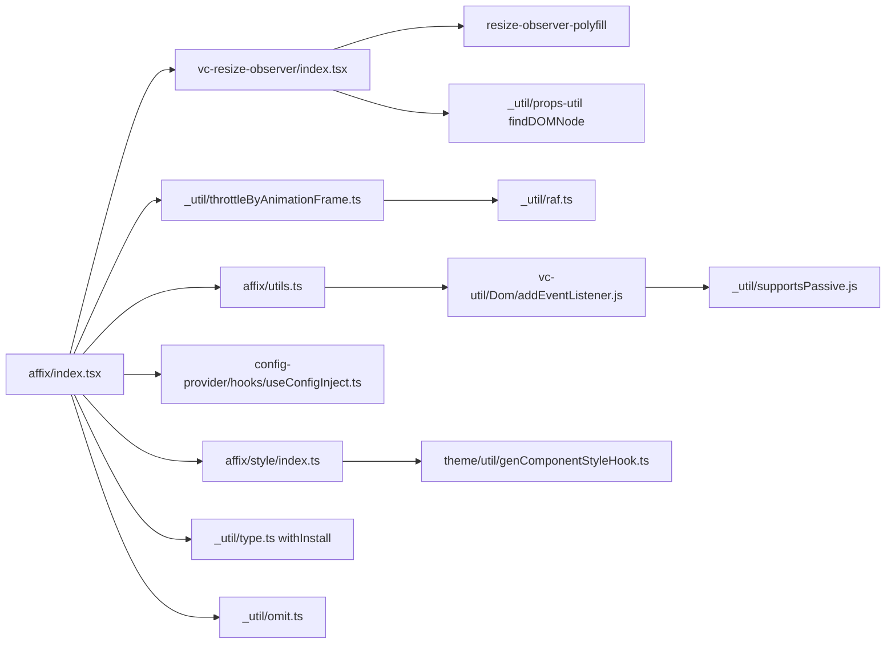
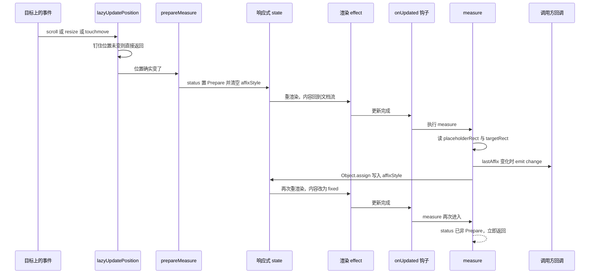
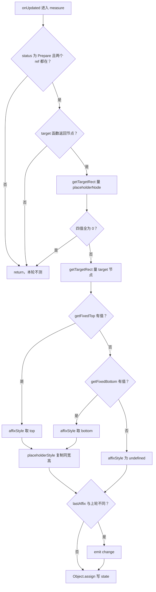

# C03-11 Affix 固钉

> **本篇解决**：一个「钉住」行为为什么需要两次渲染才能完成；观测手段为什么是 7 个事件而不是 IntersectionObserver；占位高度到底从哪个矩形复制而来；改哪一行会让钉住位置漂移或让文档流塌陷。
> **前置**：I03《vc-util 工具层》、I13《响应式内核 hooks》　**读者坐标**：`03-components/03-navigation` 第 11/14 篇

## 一、职责与边界

Affix 负责一件事：当被包裹内容随滚动越过目标容器设定的阈值时，把这块内容切换成 `position: fixed` 落位，同时在原文档流位置留下一个等宽等高的占位节点，使页面不塌陷、后续元素不上跳。它的所有实现都围绕这个切换的**时机判定**与**几何一致性**展开。

它明确不负责：

- **层级编排**。组件只有一个固定算式 `zIndexBase + 10`（`packages/xiaoye-ui/src/affix/style/index.ts:24`），不参与弹出层叠序管理；叠序机制见 I10《z-index 层级编排》。
- **滚动定位**。把页面滚到某个锚点是 Anchor（C03-10）与 `_util/scrollTo` 的职责，Affix 只读矩形、不写 `scrollTop`。
- **事件绑定底座**。`addEventListener` 的包装与 passive 策略机制归 I03《vc-util 工具层》，本篇只讲它在 Affix 观测链路里被怎样调用、以及为什么这里的参数组合和默认值不同。
- **响应式状态范式**。Affix 没有使用 I13《响应式内核 hooks》里的任何 hook，而是自带一个手写的两态状态机，这个「反常」本身就是本篇论点 2 的主题。

依赖清单（全部为源码内直连依赖，按 `packages/xiaoye-ui/src/affix/index.tsx:13-26` 与 `packages/xiaoye-ui/src/affix/utils.ts:1-2` 的 import 顺序）：`_util/classNames`、`vc-resize-observer`、`_util/throttleByAnimationFrame`、`_util/type` 的 `withInstall`、`./utils`、`config-provider/hooks/useConfigInject`、`_util/omit`、`./style`、`vc-util/Dom/addEventListener`、`_util/supportsPassive`。

被谁依赖：全仓 `packages` + `apps` 里跨目录引用 Affix 的只有一个组件 —— Anchor 在 `packages/xiaoye-ui/src/anchor/Anchor.tsx:322` 把导航内容整块包进 `<Affix offsetTop target>`，且仅在 `affix` 为真时成立（`packages/xiaoye-ui/src/anchor/Anchor.tsx:318-326`）。复现命令：

```bash
grep -rn "from '\.\./affix'\|from '\./affix'\|xiaoye-ui/affix" packages apps \
  --include='*.ts' --include='*.tsx' --include='*.vue' --include='*.js' \
  | grep -v node_modules | grep -v "/dist/"
```

除 Anchor 外，其余出现处只有生成物 `packages/xiaoye-ui/src/components.ts:5-6` 的两条 re-export 与 `packages/xiaoye-ui/src/components.ts:7` 的样式副作用导入，以及 `packages/xiaoye-ui/package.json:102-106` 的 `./affix`、`./affix/style` 双入口。特别地：BackTop 没有复用 Affix 或它的观测表（`grep -rin "affix" packages/xiaoye-ui/src/back-top/` 无输出，该组件自己在 `packages/xiaoye-ui/src/back-top/BackTop.tsx:73` 直接挂 `scroll` 监听）；Anchor 虽然把内容包进了 Affix，却仍然绕过 `addObserveTarget` 用同一个底座自挂滚动监听（`packages/xiaoye-ui/src/anchor/Anchor.tsx:14`、`packages/xiaoye-ui/src/anchor/Anchor.tsx:244`）。也就是说「按 target 复用监听表」这一优化目前只有 Affix 自己在用，同一个页面上 Anchor + 若干 Affix 会出现两套互不知情的滚动监听。

## 二、源码地图

| 文件                                                                                             |                            行数 | 职责                                                                      | 关键导出                                                                                          |
| ------------------------------------------------------------------------------------------------ | ------------------------------: | ------------------------------------------------------------------------- | ------------------------------------------------------------------------------------------------- |
| `packages/xiaoye-ui/src/affix/index.tsx`                                                           |                           284 | 主实现：props、状态机、渲染（主入口 `packages/xiaoye-ui/src/affix/index.tsx:74`） | `affixProps`、`AffixProps`、`AffixEmits`、`AffixExpose`、`withInstall(Affix)` 默认导出             |
| `packages/xiaoye-ui/src/affix/utils.ts`                                                            |                           107 | 几何判定 + 按 target 复用的事件监听表                                     | `getTargetRect`、`getFixedTop`、`getFixedBottom`、`addObserveTarget`、`removeObserveTarget`       |
| `packages/xiaoye-ui/src/affix/style/index.ts`                                                      |                            27 | CSS-in-JS：只声明 fixed 与 z-index                                        | `genComponentStyleHook('Affix', …)`（`packages/xiaoye-ui/src/affix/style/index.ts:22`）           |
| `packages/xiaoye-ui/src/affix/index.test.js`                                                       |                           132 | 唯一测试文件，当前只剩 2 个 `it`                                          | 无（`describe('Affix Render')`，`packages/xiaoye-ui/src/affix/index.test.js:46`）                  |
| `packages/xiaoye-ui/src/vc-resize-observer/index.tsx`                                              |                           139 | 子节点尺寸监听（第二观测通道）                                            | 透传组件，`packages/xiaoye-ui/src/vc-resize-observer/index.tsx:135-137` 只渲染第一个子节点        |
| `packages/xiaoye-ui/src/_util/throttleByAnimationFrame.ts`                                         |                            29 | 帧级节流，带 `cancel`                                                     | 默认导出 `throttleByAnimationFrame`（`packages/xiaoye-ui/src/_util/throttleByAnimationFrame.ts:7`） |
| `packages/xiaoye-ui/src/_util/raf.ts`                                                              |                            53 | raf 的逻辑 id 封装                                                        | `wrapperRaf` / `wrapperRaf.cancel`（`packages/xiaoye-ui/src/_util/raf.ts:48`）                     |
| `packages/xiaoye-ui/src/vc-util/Dom/addEventListener.js`                                           |                            22 | 事件绑定与 `remove` 句柄（机制归 I03）                                    | 默认导出 `addEventListenerWrap`（`packages/xiaoye-ui/src/vc-util/Dom/addEventListener.js:3`）      |
| `packages/xiaoye-ui/src/_util/supportsPassive.js`                                                  |                            13 | 特性探测，模块顶层求值                                                    | 默认导出布尔                                                                         |
| `packages/xiaoye-ui/src/_util/omit.ts`                                                             |                            10 | 渲染前剔除内部 props                                                      | 默认导出 `omit`                                                                                     |
| `packages/xiaoye-ui/src/_util/props-util/index.ts`                                                 |                           285 | `findDOMNode`（`packages/xiaoye-ui/src/_util/props-util/index.ts:90`）被 ResizeObserver 取被观测元素 | `findDOMNode` |

组件没有 `demo/` 目录、没有 `__tests__/` 子目录、没有 `*Types.ts`（props 与 `AffixState` 全部内联在 `index.tsx:34-73`）；用法手册在 `apps/docs/components/affix.md`，示例在 `apps/docs/examples/affix/`（6 个 `.vue`）。属性清单见手册，本篇不复述。

## 三、架构与数据流

### 3.1 模块静态关系



三条边值得先标记，后面各论点都围绕它们展开：`IDX → UTL` 是**观测与几何**通道（谁触发重算、算出什么）；`IDX → RO` 是**第二观测通道**（内容自身尺寸变化时没有滚动事件）；`IDX → THR → RAF` 是**节流通道**，决定「一次事件」到「一次测量」之间至少隔一帧（`packages/xiaoye-ui/src/_util/raf.ts:34-36`）。注意 `utils.ts` 与组件之间是**单向**的：监听表持有的是组件实例（`packages/xiaoye-ui/src/affix/index.tsx:238`），回调从实例的 `exposed` 上取方法（`packages/xiaoye-ui/src/affix/utils.ts:75`），所以组件本身不注册任何 DOM 监听器。

### 3.2 一次滚动触发的完整闭环



这条链的关键是**它必须转两圈**。第一圈把 `affixStyle` 撤掉，让被包裹内容回到正常文档流；第二圈才在 `onUpdated`（`packages/xiaoye-ui/src/affix/index.tsx:244-246`）里读取占位节点的矩形。原因很直白：如果带着 `position: fixed` 去量 `placeholderNode`，量到的是钉住后的视口坐标，判定条件会自我强化，任何一次抖动都收不住。`status` 这个字段（`packages/xiaoye-ui/src/affix/index.tsx:30-33`）存在的唯一作用就是让第二次 `measure()` 早退（`packages/xiaoye-ui/src/affix/index.tsx:101`），把循环掐死在两圈内。

### 3.3 measure 的判定分支



三个「否」出口分别 `return` 在 `packages/xiaoye-ui/src/affix/index.tsx:102`（守卫不通过）、`packages/xiaoye-ui/src/affix/index.tsx:107`（`target()` 返回空）、`packages/xiaoye-ui/src/affix/index.tsx:121`（占位矩形四值全 0），三处都不写入 `state`，其中最后一处的判据是「节点尚未布局」的兜底，例如 jsdom 环境或未 attach 的节点。`top` 与 `bottom` 两条分支是**互斥且 top 优先**的：`fixedTop !== undefined` 先判（`packages/xiaoye-ui/src/affix/index.tsx:136`），`fixedBottom` 只在 else-if 里生效（`packages/xiaoye-ui/src/affix/index.tsx:150`），这决定了同时传两个 offset 时的行为（见论点 4）。

## 四、核心机制精读

### 论点 1：Affix 的观测手段是「7 个事件 × 按 target 复用的监听表」外加一路 ResizeObserver，全库没有任何 IntersectionObserver 路径；而这条链路上有一个可被机械证明的 passive 参数错位。

断言先摆出来：判定「是否该钉住」完全不依赖浏览器可见性 API，而是靠往 target 上挂 7 个事件监听器，每次事件回调里同步读一次 `getBoundingClientRect`。触发事件清单是硬编码的：

```ts
// packages/xiaoye-ui/src/affix/utils.ts:32
const TRIGGER_EVENTS = [
  'resize',
  'scroll',
  'touchstart',
  'touchmove',
  'touchend',
  'pageshow',
  'load',
];
```

这份清单在源码里没有任何注释解释各项用途（`packages/xiaoye-ui/src/affix/utils.ts:31-40` 上方只有 `// ======================== Observer ========================` 一行分隔注释），从事件语义看，真正高频的是 `scroll` 与 `touchmove`，`touchstart` / `touchend` 服务触摸开始与惯性收尾，`pageshow` 与 `load` 则覆盖 bfcache 恢复和首屏；这层归因是推断而非源码陈述。注册过程按 target 复用，一个 target 只有一份七元组：

```ts
// packages/xiaoye-ui/src/affix/utils.ts:71
    TRIGGER_EVENTS.forEach(eventName => {
      entity!.eventHandlers[eventName] = addEventListener(target, eventName, () => {
        entity!.affixList.forEach(
          targetAffix => {
            const { lazyUpdatePosition } = (targetAffix as any).exposed;
            lazyUpdatePosition();
          },
          (eventName === 'touchstart' || eventName === 'touchmove') && supportsPassive
            ? ({ passive: true } as EventListenerOptions)
            : false,
        );
      });
    });
```

逐段看：`entity` 由 `addObserveTarget` 用 `observerEntities.find(item => item.target === target)` 得到（`packages/xiaoye-ui/src/affix/utils.ts:58`），命中就只 push 实例（`packages/xiaoye-ui/src/affix/utils.ts:60-62`），所以页面上 20 个钉在同一 `window` 的 Affix 仍只占用 7 个 DOM 监听器；`affixList` 里存的是组件内部实例（`packages/xiaoye-ui/src/affix/index.tsx:238` 传入的 `currentInstance`），回调靠 `.exposed` 取方法（`packages/xiaoye-ui/src/affix/utils.ts:75`），这就是论点 5 里 expose 白名单必须是 `lazyUpdatePosition` 的原因。注销同样按引用计数：`removeObserveTarget` 先把实例从 `affixList` 里 filter 掉，只有当列表空了才 `handler.remove()`（`packages/xiaoye-ui/src/affix/utils.ts:87-107`）。

**第三参数与第四参数的错位。** 直觉上第 78-80 行那个三元表达式是给 `addEventListener` 的 options（它甚至被 `as EventListenerOptions` 断言过类型），但它实际落在 `affixList.forEach` 的第二个参数位，也就是 `thisArg`。用 TypeScript 自己的 parser 数一下实参数就能定死这件事：

```bash
node -e "const ts=require('typescript'),fs=require('fs');const f='packages/xiaoye-ui/src/affix/utils.ts';
const sf=ts.createSourceFile(f,fs.readFileSync(f,'utf8'),ts.ScriptTarget.Latest,true,ts.ScriptKind.TS);
const L=p=>sf.getLineAndCharacterOfPosition(p).line+1;
(function w(n){if(ts.isCallExpression(n)){const t=n.expression.getText();
if(/addEventListener|affixList\.forEach/.test(t))console.log(t,'args='+n.arguments.length,'lines=['+n.arguments.map(a=>L(a.getStart())).join(',')+']');}
ts.forEachChild(n,w);})(sf);"
# 实测输出：
# "addEventListener" args=3 lines=[72,72,72]
# "entity!.affixList.forEach" args=2 lines=[74,78]
```

后果链是确定的：`addEventListenerWrap(target, eventType, cb, option)` 收到 3 个实参，`option` 为 `undefined`（`packages/xiaoye-ui/src/vc-util/Dom/addEventListener.js:3-5`），于是走它的默认分支——`touchstart`、`touchmove`、`wheel` 三者被强制设成 `{ passive: false }`（`packages/xiaoye-ui/src/vc-util/Dom/addEventListener.js:6-12`）。也就是说：代码想声明「这个触摸监听不阻塞滚动」，浏览器实际收到的是「这个触摸监听可能调用 preventDefault，请等待它执行完再合成下一帧」。在长列表里滚动、页面上挂着多个钉住项时，`touchmove` 每帧都要同步走完 `lazyUpdatePosition` 的矩形比较（`packages/xiaoye-ui/src/affix/index.tsx:193-207`），这正是该分支本意要避免的开销。`supportsPassive` 探测本身在模块顶层求值、只靠 `try/catch` 兜住 `window` 不存在的场景（`packages/xiaoye-ui/src/_util/supportsPassive.js:3-11`）。

第二观测通道是 `ResizeObserver`：`packages/xiaoye-ui/src/affix/index.tsx:271` 用它把整棵子树包起来，`onResize={updatePosition}`。被观测元素是它渲染出的第一个子节点（`packages/xiaoye-ui/src/vc-resize-observer/index.tsx:135-137`），也就是那个占位外层 div（`packages/xiaoye-ui/src/affix/index.tsx:272`），取节点的方式是 `findDOMNode(instance)`（`packages/xiaoye-ui/src/vc-resize-observer/index.tsx:107`）。它必须存在，因为有一类变化不会产生任何滚动事件：父容器宽度改变、内容换行导致高度改变、侧栏折叠。此时 `onResize` 用的是 `getBoundingClientRect` 取整后的四元组比对（`packages/xiaoye-ui/src/vc-resize-observer/index.tsx:62-78`），尺寸真变了才用一个微任务派发回调（`packages/xiaoye-ui/src/vc-resize-observer/index.tsx:84`），注释写明「defer the callback but not defer to next frame」——它比滚动通道少一帧延迟。底层是 `resize-observer-polyfill`（`packages/xiaoye-ui/src/vc-resize-observer/index.tsx:3`），不是原生构造函数。

关于「为什么不用 IntersectionObserver」：源码层面这是事实而不是取舍——`IntersectionObserver` 在 `packages` 与 `apps` 的 `.ts/.tsx/.vue/.js` 里出现次数为 0（复现：`grep -rn "IntersectionObserver" packages/xiaoye-ui/src --include='*.ts' --include='*.tsx' --include='*.vue'` 与 `grep -rlni "intersectionobserver" packages apps | grep -v node_modules | grep -v /dist/`，两条命令输出均为空）。原因也不难复述：IO 只能给「进入/离开视口的比例与交叉」，给不了 `top`、`bottom` 这些要参与算术的连续量，而 Affix 的核心判据恰好是带阈值的算术比较（论点 4）。

### 论点 2：`updatePosition` 不测量任何东西，它只翻一个状态位；真正的几何计算挂在 `onUpdated` 上，一次钉住判定固定消耗两次渲染。

断言：Affix 的事件回调与测量之间隔着一整个渲染周期，`measure()` 在组件里没有任何直接调用者，唯一的调用点是更新钩子。三个函数如下：

```tsx
// packages/xiaoye-ui/src/affix/index.tsx:173
    const prepareMeasure = () => {
      Object.assign(state, {
        status: AffixStatus.Prepare,
        affixStyle: undefined,
        placeholderStyle: undefined,
      });
      // Test if `updatePosition` called
      if (process.env.NODE_ENV === 'test') {
        emit('testUpdatePosition');
      }
    };

    const updatePosition = throttleByAnimationFrame(() => {
      prepareMeasure();
    });
    const lazyUpdatePosition = throttleByAnimationFrame(() => {
      const { target } = props;
      const { affixStyle } = state;

      // Check position change before measure to make Safari smooth
      if (target && affixStyle) {
        const targetNode = target();
        if (targetNode && placeholderNode.value) {
          const targetRect = getTargetRect(targetNode);
          const placeholderRect = getTargetRect(placeholderNode.value as HTMLElement);
          const fixedTop = getFixedTop(placeholderRect, targetRect, offsetTop.value);
          const fixedBottom = getFixedBottom(placeholderRect, targetRect, offsetBottom.value);
          if (
            (fixedTop !== undefined && affixStyle.top === fixedTop) ||
            (fixedBottom !== undefined && affixStyle.bottom === fixedBottom)
          ) {
            return;
          }
        }
      }
      // Directly call prepare measure since it's already throttled.
      prepareMeasure();
    });
```

拆开看三层设计：

第一层，`prepareMeasure` 只做两件事——把 `status` 置 `Prepare`、把上一轮的 `affixStyle` / `placeholderStyle` 清成 `undefined`（`packages/xiaoye-ui/src/affix/index.tsx:174-178`）。清空是关键：`affixStyle` 一旦被写进渲染（`packages/xiaoye-ui/src/affix/index.tsx:274`），节点就脱离文档流；必须先撤掉它，下一次量到的 `placeholderRect` 才是内容在正常流里的真实盒子。这就是两圈渲染的第一圈。

第二层，`measure()` 的入口守卫（`packages/xiaoye-ui/src/affix/index.tsx:99-103`）用 `status !== AffixStatus.Prepare` 把无关的更新挡掉：

```tsx
// packages/xiaoye-ui/src/affix/index.tsx:98
    const measure = () => {
      const { status, lastAffix } = state;
      const { target } = props;
      if (status !== AffixStatus.Prepare || !fixedNode.value || !placeholderNode.value || !target) {
        return;
      }
```

`newState` 从构造那一刻就带 `status: AffixStatus.None`（`packages/xiaoye-ui/src/affix/index.tsx:110-112`），所以第二圈渲染结束时 `onUpdated` 再调 `measure()` 会立刻早退——状态机自己把循环掐断，最多两圈。唯一的 `measure()` 调用点确实只有 `onUpdated`：`packages/xiaoye-ui/src/affix/index.tsx:244-246`。用 `grep -nE "measure|Measure" packages/xiaoye-ui/src/affix/index.tsx` 复核，命中 8 行：98 是函数定义，173 是 `prepareMeasure` 定义，186 与 209 是对 `prepareMeasure` 的调用，192 与 208 是注释，272 是 `data-measure-status` 属性名，**245 是 `measure()` 在全文件唯一的调用处**。

第三层，`updatePosition` 与 `lazyUpdatePosition` 的区别不是节流与否（两者都被 `throttleByAnimationFrame` 包过，`packages/xiaoye-ui/src/_util/throttleByAnimationFrame.ts:15-19`），而是**要不要先做一次廉价的等值校验**。`lazyUpdatePosition` 只在「已经钉着」时才有提前返回的机会（`affixStyle` 为空即跳过整段比较，`packages/xiaoye-ui/src/affix/index.tsx:193`），它用同一个 `getFixedTop` 重算，若结果与当前 `affixStyle.top` 完全相同就直接 return（`packages/xiaoye-ui/src/affix/index.tsx:200-205`），从而避免触发那一整轮「撤 fixed → 重渲染 → 量 → 再渲染」。滚动路径用懒版本（`packages/xiaoye-ui/src/affix/utils.ts:75-76`），尺寸变化与 props 变化用急版本（`packages/xiaoye-ui/src/affix/index.tsx:231`、`packages/xiaoye-ui/src/affix/index.tsx:271`），因为这两种情况下旧的 `affixStyle` 已经不可信。注释里的 `to make Safari smooth` 就是这个意思。

一个附带发现：`data-measure-status={status}`（`packages/xiaoye-ui/src/affix/index.tsx:272`）把这个内部状态写进了 DOM，但全仓没有任何读取方——`grep -rn "data-measure-status" packages apps --include='*.ts' --include='*.tsx' --include='*.js' --include='*.vue' --include='*.snap' | grep -v /dist/` 只有这一处命中。它既不是测试锚点也不参与样式，纯粹是排查用痕迹；而 `status` 变化本身已经会触发渲染，删除该属性不影响两圈循环成立。

### 论点 3：占位高度不是「内容自然高度」，而是从撤销 fixed 后的外层矩形复制来的一对 px 字符串；它同时承担防塌陷与防 ResizeObserver 自激两个职责。

断言：`affixStyle` 与 `placeholderStyle` 共用同一对 `width` / `height`，来源只有一个——`placeholderRect`，也就是外层 wrapper 在**正常流里**的 `getBoundingClientRect()`。

```tsx
// packages/xiaoye-ui/src/affix/index.tsx:136
      if (fixedTop !== undefined) {
        const width = `${placeholderRect.width}px`;
        const height = `${placeholderRect.height}px`;

        newState.affixStyle = {
          position: 'fixed',
          top: fixedTop,
          width,
          height,
        };
        newState.placeholderStyle = {
          width,
          height,
        };
```

`fixedBottom` 分支是这段代码的逐字复制品，只把 `top` 换成 `bottom`（`packages/xiaoye-ui/src/affix/index.tsx:156-163`）。`placeholderRect` 在 `packages/xiaoye-ui/src/affix/index.tsx:113` 取得，取值时 `affixStyle` 已被论点 2 的第一圈清空，所以它量到的是「内容没被钉住时占多大」。渲染结构一共三层，占位与钉住是**兄弟**：

```tsx
// packages/xiaoye-ui/src/affix/index.tsx:270
      return wrapSSR(
        <ResizeObserver onResize={updatePosition}>
          <div {...restProps} {...attrs} ref={placeholderNode} data-measure-status={status}>
            {affixStyle && <div style={placeholderStyle} aria-hidden="true" />}
            <div class={className} ref={fixedNode} style={affixStyle}>
              {slots.default?.()}
            </div>
          </div>
        </ResizeObserver>,
      );
```

三层各自的必要性：外层 div 挂着 `ref={placeholderNode}`，既是测量对象又是 `ResizeObserver` 的被观测元素（`packages/xiaoye-ui/src/affix/index.tsx:271`）；中间那个带 `aria-hidden="true"` 的 div 只在钉住时存在（`affixStyle &&` 短路，`packages/xiaoye-ui/src/affix/index.tsx:273`），负责顶住文档流高度；内层 div 承接 `affixStyle`，是真正被 `position: fixed` 的那一个（`packages/xiaoye-ui/src/affix/index.tsx:274`）。

这里有一个容易被忽略的耦合：**如果没有占位 div，`ResizeObserver` 会自激**。被观测的是外层，钉住后外层只剩一个 fixed 兄弟（脱离文档流），外层高度塌成 0 → RO 报尺寸变化 → `updatePosition` → 撤 fixed → 高度恢复 → RO 再报变化，两圈状态机救不了这种由尺寸事件驱动的外循环。占位 div 用同尺寸把外层撑住（`packages/xiaoye-ui/src/affix/index.tsx:146-149`），钉住与未钉住两种状态下外层高度相同，RO 才安静下来。同理，RO 的回调本身还做了「取整后四元组比对」来抑制抖动（`packages/xiaoye-ui/src/vc-resize-observer/index.tsx:70-78`）。

代价是宽度被冻结在测量那一刻的像素值：钉住期间外层不再影响内层宽度，父容器变宽不会让钉住项跟着变宽，只能等一次尺寸事件把两圈重新跑完。另一处代价是 `left` / `right` **完全不写**——`affixStyle` 只有 `position`、`top`（或 `bottom`）、`width`、`height` 四个键（`packages/xiaoye-ui/src/affix/index.tsx:140-145`），横向落位交给浏览器对 fixed 盒子的 static position 处理。这条边界的存在被手册自己承认：`apps/docs/components/affix.md:73-77` 明确要求「`Affix` 内的元素不要使用绝对定位」并给出外层套 absolute 的写法，`apps/docs/components/affix.md:87-91` 则承认「元素 `left` 位置不正确」，建议水平滚动场景改用原生 `position: sticky`。需要区分的是：以上是文档层面的已知限制陈述，`packages/xiaoye-ui/src/affix/` 内没有为横向位置写任何补偿代码。

顺带一个死代码：`packages/xiaoye-ui/src/affix/index.tsx:127-134` 把 `packages/xiaoye-ui/src/affix/index.tsx:115-122` 那个「四值全 0 就 return」的判据一字不差地又写了一遍，中间只隔着 3 行取矩形与算 offset 的纯读操作（`packages/xiaoye-ui/src/affix/index.tsx:124-126`），不改变任何输入，因此第二个守卫永不为真。删掉它不改变行为；反过来，若有人为了「让 targetRect 变化后重新判一次」而在这两段之间插入赋值，就会得到一个静默失效的分支。

### 论点 4：`getTargetRect` 对 `window` 返回的是一个只有 `top` 与 `bottom` 两个字段的伪矩形，整套判据因此只依赖两个数；而钉住落位永远在视口坐标系里。

断言：判定「该不该钉」与算出「钉在哪」的算术全部收敛在 24 行里，且 `window` 分支刻意不做真实测量。

```ts
// packages/xiaoye-ui/src/affix/utils.ts:6
export function getTargetRect(target: BindElement): DOMRect {
  return target !== window
    ? (target as HTMLElement).getBoundingClientRect()
    : ({ top: 0, bottom: window.innerHeight } as DOMRect);
}

export function getFixedTop(placeholderRect: DOMRect, targetRect: DOMRect, offsetTop: number) {
  if (offsetTop !== undefined && targetRect.top > placeholderRect.top - offsetTop) {
    return `${offsetTop + targetRect.top}px`;
  }
  return undefined;
}

export function getFixedBottom(
  placeholderRect: DOMRect,
  targetRect: DOMRect,
  offsetBottom: number,
) {
  if (offsetBottom !== undefined && targetRect.bottom < placeholderRect.bottom + offsetBottom) {
    const targetBottomOffset = window.innerHeight - targetRect.bottom;
    return `${offsetBottom + targetBottomOffset}px`;
  }
  return undefined;
}
```

三件事要看清。

**其一，伪矩形只喂得出两个字段。** `{ top: 0, bottom: window.innerHeight }`（`packages/xiaoye-ui/src/affix/utils.ts:9`）没有 `left`、`width`、`height`，谁哪天写 `targetRect.width` 就会拿到 `undefined` 并算出 `NaNpx`。当前三个消费点只用 `top` / `bottom`，是刻意维持的窄契约。`top: 0` 代入 `getFixedTop` 后判据退化成 `0 > placeholderRect.top - offsetTop`，返回值退化成 `${offsetTop}px`，即「贴着视口 offsetTop 处」，语义与手册里 `offsetTop` 默认 0 的描述一致（`apps/docs/components/affix.md:64`）。

**其二，落位坐标是视口系，不是容器系。** `getFixedTop` 的返回值是 `offsetTop + targetRect.top`（`packages/xiaoye-ui/src/affix/utils.ts:14`），`targetRect.top` 对容器而言是容器自身相对视口的上边距。所以传 `target` 时，容器只改变**触发时机**（判据里的 `placeholderRect.top` 是流内位置）与**落位数值**（容器顶部偏移到哪，钉住项就跟到哪），而 `position: fixed` 的包含块始终是视口。`getFixedBottom` 更直白：先把容器底边换算成「距视口底的距离」`window.innerHeight - targetRect.bottom`（`packages/xiaoye-ui/src/affix/utils.ts:25`）再叠上 `offsetBottom`。这解释了手册 FAQ 里「使用 `target` 绑定容器时，元素会跑到容器外」的现象（`apps/docs/components/affix.md:81-85`）：容器被滚动到屏幕外时，钉住项仍按容器的视口坐标落位，而不是被裁剪在容器内。

**其三，两个 offset 的优先级是硬编码的。** 组件先把「谁都没传」规约成 `offsetTop = 0`：

```tsx
// packages/xiaoye-ui/src/affix/index.tsx:92
    const offsetTop = computed(() => {
      return props.offsetBottom === undefined && props.offsetTop === undefined
        ? 0
        : props.offsetTop;
    });
    const offsetBottom = computed(() => props.offsetBottom);
```

只传 `offsetBottom` 时 `offsetTop` 为 `undefined`，`getFixedTop` 第一行的 `offsetTop !== undefined` 就把它否掉（`packages/xiaoye-ui/src/affix/utils.ts:13`），不会误触发顶部钉住；两个都传时 `measure` 的 `if / else if` 让 top 胜出（`packages/xiaoye-ui/src/affix/index.tsx:136`、`packages/xiaoye-ui/src/affix/index.tsx:150`），`offsetBottom` 变成死配置。反过来这也解释了论点 2 里 `lazyUpdatePosition` 的等值校验为什么写成字符串比较：`affixStyle.top` 与 `fixedTop` 都是同一个模板产出的 `${…}px`（`packages/xiaoye-ui/src/affix/index.tsx:142` 对 `packages/xiaoye-ui/src/affix/utils.ts:14`），若哪边改成数值，`===` 恒不成立，提前返回失效，每次滚动都会多跑两圈渲染——性能回归但功能仍然正确，属于最难被测试抓到的一类退化。

### 论点 5：把实例登记进监听表有两条路径，`prevTarget` 只在其中一条里被写，于是「同一个实例被登记两次」在数学上可达——它被帧节流兜住了，不是被逻辑排除的。

断言：`addObserveTarget` 的调用点有两处，一处判重、一处不判重。

```tsx
// packages/xiaoye-ui/src/affix/index.tsx:216
    watch(
      () => props.target,
      val => {
        const newTarget = val?.() || null;
        if (state.prevTarget !== newTarget) {
          removeObserveTarget(currentInstance);
          if (newTarget) {
            addObserveTarget(newTarget, currentInstance);
            // Mock Event object.
            updatePosition();
          }
          state.prevTarget = newTarget;
        }
      },
    );
    watch(() => [props.offsetTop, props.offsetBottom], updatePosition);
    onMounted(() => {
      const { target } = props;
      if (target) {
        // [Legacy] Wait for parent component ref has its value.
        // We should use target as directly element instead of function which makes element check hard.
        state.timeout = setTimeout(() => {
          addObserveTarget(target(), currentInstance);
          // Mock Event object.
          updatePosition();
        });
      }
    });
```

watcher 跟踪的是 `props.target` 这个**函数本身**（`packages/xiaoye-ui/src/affix/index.tsx:217`），不是它返回的节点。`target` 的契约类型就是「返回节点的函数」（`packages/xiaoye-ui/src/affix/index.tsx:52`、`apps/docs/components/affix.md:65`），仓库里唯一的内部消费者 Anchor 传的也是函数（`packages/xiaoye-ui/src/anchor/Anchor.tsx:322`），测试同理（`packages/xiaoye-ui/src/affix/index.test.js:39`）。这类写法在模板里通常内联，父组件每次渲染都生成新的函数对象，因此这个 watcher 会被频繁触发；判重靠 `state.prevTarget !== newTarget` 这一行把「函数换了、元素没换」的情况过滤掉。`state.prevTarget` 初值是 `null`（`packages/xiaoye-ui/src/affix/index.tsx:87`），而且**只有这个 watcher 会写它**——`onMounted` 的 `setTimeout` 分支直接调 `addObserveTarget`（`packages/xiaoye-ui/src/affix/index.tsx:238`），既不查 `prevTarget` 也不写 `prevTarget`。

于是存在这样一条可达序列：挂载后 `setTimeout` 的宏任务尚未执行，父组件先于它重渲染一次（子组件 `onMounted` 里回写父状态就会如此），watcher 以 `flush: 'pre'` 在微任务里先跑，`removeObserveTarget` 此时找不到该实例（还没登记过）、`addObserveTarget` 登记一次并写 `prevTarget`；随后 `setTimeout` 回调执行，再登记一次。而 `addObserveTarget` 命中已有 entity 时的行为是无条件 `push`（`packages/xiaoye-ui/src/affix/utils.ts:60-62`），没有任何去重，于是 `affixList` 里出现两个相同实例，每次事件循环两遍 `lazyUpdatePosition`。

之所以线上看不出来，是因为兜底发生在下游：`throttleByAnimationFrame` 用 `requestId == null` 做同帧丢弃（`packages/xiaoye-ui/src/_util/throttleByAnimationFrame.ts:16-18`），第二次调用在同一帧内被吃掉。换句话说，**这个竞态的正确性由另一个文件的行为保证，而不是由登记逻辑保证**——一旦有人把节流换成 `lodash/throttle` 之类带 trailing 调用的实现，重复登记就会显形为每次事件多轮测量。卸载路径是干净的：`removeObserveTarget` 用 `filter` 移除全部同引用项（`packages/xiaoye-ui/src/affix/utils.ts:91`），不会因为双登记而漏解绑。

`setTimeout` 本身是延迟首帧测量的权宜，注释自陈 `[Legacy]`（`packages/xiaoye-ui/src/affix/index.tsx:235-236`），理由是「等父组件的 ref 有值」。它带来两个可见副作用：其一，`state.timeout` 这个字段没出现在 `AffixState` 接口里（`packages/xiaoye-ui/src/affix/index.tsx:34-40` 声明了 5 个字段，`packages/xiaoye-ui/src/affix/index.tsx:82-89` 的初值对象却有 6 个），类型与实现已经漂移；其二，清理必须成对写全，`onUnmounted` 里 `clearTimeout` + `removeObserveTarget` + 两个 `cancel()` 四件事一个都不能少：

```tsx
// packages/xiaoye-ui/src/affix/index.tsx:247
    onUnmounted(() => {
      clearTimeout(state.timeout);
      removeObserveTarget(currentInstance);
      (updatePosition as any).cancel();
      (lazyUpdatePosition as any).cancel();
    });
```

两个 `cancel()` 会走到 `wrapperRaf.cancel`，而那里的清理传错了键：`cleanup(realId)` 删的是「真实 raf id」，但 `rafIds` 这张 `Map` 是用逻辑 id 做键写入的（`packages/xiaoye-ui/src/_util/raf.ts:39` 与 `packages/xiaoye-ui/src/_util/raf.ts:48-51`，对照 `packages/xiaoye-ui/src/_util/raf.ts:17-19` 的实现）。结果是每取消一次帧请求，`Map` 里残留一条永不删除的 `id → realId` 记录。量级是个位数泄漏，不是功能错误，但它意味着「卸载一个 Affix 就回收全部资源」这句直觉并不严格成立。`_util/raf.ts` 目前不在 `OUTLINE.md` 任何篇目的「主要源码」列里（`grep -n "raf" docs/column/OUTLINE.md` 无输出），此处按边界内最小描述处理。

### 论点 6：`.xy-affix` 这个类名只在钉住状态下才挂到 DOM 上，样式文件里也只有两条声明——组件的可样式面几乎为零，它没有 Component Token。

断言：类名挂载条件与钉住条件被写在同一行，导致未钉住时组件在 CSS 层面「隐身」。

```tsx
// packages/xiaoye-ui/src/affix/index.tsx:254
    const { prefixCls } = useConfigInject('affix', props);
    const [wrapSSR, hashId] = useStyle(prefixCls);
    return () => {
      const { affixStyle, placeholderStyle, status } = state;
      const className = classNames({
        [prefixCls.value]: affixStyle,
        [hashId.value]: true,
      });
```

`[prefixCls.value]: affixStyle` 的键值是 `undefined` 或一个对象（`packages/xiaoye-ui/src/affix/index.tsx:257` 从 state 解构出来的 `affixStyle`），前者在 `classNames` 里判定为假，所以未钉住时内层 div 只带 hash 类（`packages/xiaoye-ui/src/affix/index.tsx:260`、`packages/xiaoye-ui/src/affix/index.tsx:274`）。这个设计让「针对 `.xy-affix` 写的 CSS」只作用于钉住态——对钉住态加 `box-shadow` 或 `background` 恰好符合预期，而想给未钉住态加样式则必须自己套一层元素。hash 类恒真是必须的：CSS-in-JS 的 hash 是样式作用域的唯一凭据，`useStyle` 返回的 `wrapSSR` 负责 SSR 首屏样式注入（`packages/xiaoye-ui/src/affix/index.tsx:270`）。

样式侧只有两条声明：

```ts
// packages/xiaoye-ui/src/affix/style/index.ts:10
const genSharedAffixStyle: GenerateStyle<AffixToken> = (token): CSSObject => {
  const { componentCls } = token;

  return {
    [componentCls]: {
      position: 'fixed',
      zIndex: token.zIndexPopup,
    },
  };
};
```

```ts
// packages/xiaoye-ui/src/affix/style/index.ts:22
export default genComponentStyleHook('Affix', token => {
  const affixToken = mergeToken<AffixToken>(token, {
    zIndexPopup: token.zIndexBase + 10,
  });
  return [genSharedAffixStyle(affixToken)];
});
```

`position: 'fixed'` 在这里是**冗余**的——`affixStyle` 内联样式已经带同一个键（`packages/xiaoye-ui/src/affix/index.tsx:141`），而内联优先级更高；这条 CSS 真正独立承担的是 `zIndex`。`zIndexPopup` 不是别名层来的 `zIndexPopupBase`，而是 `zIndexBase + 10`，两个 seed 的默认值分别是 0 与 1000（`packages/xiaoye-ui/src/theme/themes/seed.ts:67-68`），所以钉住项默认层级是 **10**。`packages/xiaoye-ui/src/theme/interface/seeds.ts:160-164` 的中文注释把 Affix 与 FloatButton、Modal 并列归到 `zIndexPopupBase` 一族，实现却走 `zIndexBase + 10`，二者不一致；效果是钉住项会被任何浮层（弹出体系通常从 1000 起）稳稳压住——这大概率正是想要的，但注释与代码得有一个改。组件侧也没有为它开放任何专属 Token：`packages/xiaoye-ui/src/theme/interface/components.ts:70` 里 Affix 的 ComponentToken 是空对象 `{}`，`packages/xiaoye-ui/src/affix/style/index.ts:5-7` 的 `AffixToken` 只多出一个内部 `zIndexPopup`。想改钉住项层级，唯一入口是全局 `zIndexBase`，而它会影响所有组件。

## 五、对外契约如何生效

`affixProps()` 用函数式定义（`packages/xiaoye-ui/src/affix/index.tsx:43-59`），但组件选项里直接写的是 `props: affixProps()`（`packages/xiaoye-ui/src/affix/index.tsx:78`），没有经过 `initDefaultProps` 包装——`target` 的默认值因此是以 `default: getDefaultTarget` 内联在 prop 定义里的（`packages/xiaoye-ui/src/affix/index.tsx:53`）。这与仓库约定不同：`AGENTS.md:714` 要求 Props 经 `initDefaultProps(buttonProps(), defaults)` 初始化，而 `grep -rln "initDefaultProps" packages/xiaoye-ui/src --include='*.tsx' --include='*.ts' | wc -l` 得到的 117 个文件里不含 affix（`grep -c "initDefaultProps" packages/xiaoye-ui/src/affix/index.tsx` 输出 0）。`offsetTop` / `offsetBottom` 两个 prop 干脆没有 default——「都不传时按 0 处理」这条契约不在 props 层，而在 `computed` 里（`packages/xiaoye-ui/src/affix/index.tsx:92-96`）。因此从外部看 `props.offsetTop === undefined` 与「语义上的 0」是两种状态，`measure` 靠这个区分来判定走哪个分支（论点 4）。组件选项也没有 `slots` 声明，插槽只有一个 `default`（`packages/xiaoye-ui/src/affix/index.tsx:275`）。

链路按四条看：

**prefixCls → 类名。** `useConfigInject('affix', props)` 产出 `prefixCls`（`packages/xiaoye-ui/src/affix/index.tsx:254`），其值由 `configProvider.getPrefixCls(name, props.prefixCls)` 决定（`packages/xiaoye-ui/src/config-provider/hooks/useConfigInject.ts:14`）。这个类名是否落到 DOM 上取决于钉住状态（论点 6），而 `prefixCls` prop 本身被 `omit` 剔除、不会作为属性铺到元素上（`packages/xiaoye-ui/src/affix/index.tsx:263`）。

**target → 事件回调。** `target` 是「返回节点的函数」而非节点，这个选择让 SSR 阶段能安全返回 `null`（`packages/xiaoye-ui/src/affix/index.tsx:27-29`），也让父组件可以在 `ref` 尚未就位前就完成渲染。代价是 prop 身份不稳定，必须有 `prevTarget` 判重层（`packages/xiaoye-ui/src/affix/index.tsx:220`），并由此带来论点 5 的双登记窗口。事件回调不读 `props.target` 的结果做判断，它只负责喊 `lazyUpdatePosition`（`packages/xiaoye-ui/src/affix/utils.ts:75-77`），把节点解析推迟到真正要量的时候（`packages/xiaoye-ui/src/affix/index.tsx:194`）。

**onChange → 回调。** `onChange` 被声明成 **prop**（`packages/xiaoye-ui/src/affix/index.tsx:57`），而组件选项里没有 `emits` 字段（`packages/xiaoye-ui/src/affix/index.tsx:74-79` 依次是 `compatConfig`、`name`、`inheritAttrs`、`props`、`setup`）。`measure` 里的 `emit('change', newState.lastAffix)`（`packages/xiaoye-ui/src/affix/index.tsx:168`）因此走的是 Vue 的「emit 回落到同名 `onXxx` prop」路径；模板里写 `@change` 与显式传 `:onChange` 都收得到。`AffixEmits` 这个类型（`packages/xiaoye-ui/src/affix/index.tsx:63-66`）不服务于运行时的 emits 校验，它唯一的用途是给两个 prop 的函数签名做类型标注（`packages/xiaoye-ui/src/affix/index.tsx:57-58`）。同一族的还有 `onTestUpdatePosition`，它只为测试存在：`process.env.NODE_ENV === 'test'` 才 emit（`packages/xiaoye-ui/src/affix/index.tsx:179-182`），而当前那份测试并没有订阅它。

`omit` 在这条链上是承重的：`['prefixCls','offsetTop','offsetBottom','target','onChange','onTestUpdatePosition']` 六项被剔除后才铺给外层 div（`packages/xiaoye-ui/src/affix/index.tsx:262-272`）。如果 `onChange` 漏在这一列之外，它会作为原生 `change` 事件监听器挂到外层容器上，钉住内容里的 `input` / `select` 一改动就会带着 `Event` 调用用户的回调，参数与语义全错。`emit('change')` 只在 `lastAffix` 真变了的时候发（`packages/xiaoye-ui/src/affix/index.tsx:167`），所以滚动过程中钉住项持续微调位置不会刷屏回调。

**attrs 与 expose。** `inheritAttrs: false`（`packages/xiaoye-ui/src/affix/index.tsx:77`）配合手动 `{...attrs}`，把用户的 `class` / `style` 精确送到**外层占位 div**（`packages/xiaoye-ui/src/affix/index.tsx:272`），而不是钉住节点。手册建议的对策「把绝对定位设在 `Affix` 自身」（`apps/docs/components/affix.md:73-77`）之所以可行，源码前提就是这一条：用户样式作用的对象确实是外层容器。`expose({ updatePosition, lazyUpdatePosition })`（`packages/xiaoye-ui/src/affix/index.tsx:212-215`）是命令式出口，类型由 `AffixExpose`（`packages/xiaoye-ui/src/affix/index.tsx:68-71`）锁定；观测表依赖这个白名单里的 `lazyUpdatePosition` 取方法，所以**从 expose 里删掉它等于让所有滚动监听失效**，而且不会有任何报错（`packages/xiaoye-ui/src/affix/utils.ts:75` 解构出一个 `undefined` 再调用，抛错点在事件回调里，栈与被测组件无关）。

**注册与产物。** 默认导出被 `withInstall` 包了一层（`packages/xiaoye-ui/src/affix/index.tsx:284`），后者给组件挂 `install`，内部转 `registerComponent`（`packages/xiaoye-ui/src/_util/type.ts:39-46`），由 `toXYTagName('XYAffix')` 得到标签 `xy-affix`（`packages/xiaoye-ui/src/_util/registerComponent.ts:6-11`），并且用 `if (!app.component(tagName))` 防重复注册（`packages/xiaoye-ui/src/_util/registerComponent.ts:23-25`）。组件名 `XYAffix` 声明在 `packages/xiaoye-ui/src/affix/index.tsx:76`。按需样式链路是生成物：`packages/xiaoye-ui/src/components.ts:5-7` 三条语句 + `packages/xiaoye-ui/package.json:102-106` 的 `./affix` 与 `./affix/style` 双入口。

## 六、设计取舍

**事件驱动 vs 可见性观测。** 选前者不是为了兼容，是因为算术：`getFixedTop` 需要「目标顶边与占位顶边的带符号距离」参与 `>` 比较并直接产出落位数值（`packages/xiaoye-ui/src/affix/utils.ts:12-17`），而 IntersectionObserver 给出的是交叉比例与离散阈值回调，无法回答「现在该写多少 px」。赔上的代价是每次事件都要同步读几何：`lazyUpdatePosition` 的提前返回路径里连着两次 `getTargetRect`（`packages/xiaoye-ui/src/affix/index.tsx:196-197`），而 `getTargetRect` 的容器分支就是 `getBoundingClientRect()`（`packages/xiaoye-ui/src/affix/utils.ts:7-8`），在滚动线程上属于强制布局读取；再叠上论点 1 那个 passive 错位，触摸滚动的合成开销被进一步放大。缓解手段只有两层：按 target 复用监听表（`packages/xiaoye-ui/src/affix/utils.ts:58-68`）与帧级丢弃（`packages/xiaoye-ui/src/_util/throttleByAnimationFrame.ts:16-18`）。

**「撤 fixed 再量」的两圈渲染 vs 一帧内完成。** 直接量当前节点最快，但带 `position: fixed` 的节点量到的是钉住后的坐标，判据会被自己的输出污染，抖动无法收敛。现在的方案保证每次判定读的永远是流内几何（`packages/xiaoye-ui/src/affix/index.tsx:113`），换来的代价是一次**可感知的中间态**：状态切换时内容会真实回到文档流一帧，页面高度在那一帧由占位 div 顶住（`packages/xiaoye-ui/src/affix/index.tsx:273`）。高度对得准时看不出来，一旦 `placeholderRect` 与实际内容高度有偏差（例如钉住后才异步加载出图片），就会在那一帧出现跳动。这个取舍无法在现有结构里消除，只能靠「占位尺寸与内容尺寸一致」来压低概率。

**手写 `AffixStatus` 状态机 vs 复用 I13《响应式内核 hooks》。** 组件里的状态不是用户可控的值，而是「上一次几何快照」，没有受控/非受控语义，套 `useMergedState` 只会增加一层无意义的抽象（`packages/xiaoye-ui/src/affix/index.tsx:82-89` 的 6 个字段里没有一个是对外可读的）。但代价也很具体：判重、时序、清理都得自己写，于是有了论点 5 里那条不判重的登记路径，以及 `state.timeout` 这类没进接口的野字段。

**`position: fixed` vs `position: sticky`。** sticky 一行 CSS 就够，不需要测量、不需要占位、不需要 JS 事件。但 sticky 必须寄生在滚动容器的直接流内位置、拿不到「距视口底部 offsetBottom」这种跨容器语义，也没法发 `change` 事件。组件层要的是任意 `target` + 双向 offset + 可编程回调，所以选了 JS 方案：换来 API 表达力，赔上横向落位（`left` 不写）与一次布局抖动。手册 FAQ 建议「水平滚动容器改用原生 `position: sticky`」（`apps/docs/components/affix.md:87-91`）实际上就是承认这条边界的另一端 sticky 更合适。

**不做主题化的 Component Token。** `packages/xiaoye-ui/src/theme/interface/components.ts:70` 给 Affix 的是空对象，意味着没有可覆盖的专属变量。收益是这个组件对主题系统的耦合面几乎为零；损失是层级这类明显需要定制的值只能靠全局 `zIndexBase` 间接影响（`packages/xiaoye-ui/src/affix/style/index.ts:24`），而且和 `zIndexPopupBase` 的注释承诺相反（`packages/xiaoye-ui/src/theme/interface/seeds.ts:160-164`）。

## 七、坑与改动指南

**坑 1｜`touchmove` 被注册成非 passive，触摸滚动掉帧。** 触发：移动端或触摸板上长页面 + 至少一个钉住项。症状：惯性滚动卡顿，去掉 Affix 即恢复。原因：本意传给 `addEventListener` 的 `{ passive: true }` 实际落在 `affixList.forEach` 的 `thisArg` 位（`packages/xiaoye-ui/src/affix/utils.ts:73-81`），`option` 为 `undefined` 后由底座补成 `{ passive: false }`（`packages/xiaoye-ui/src/vc-util/Dom/addEventListener.js:6-12`）。定位：用论点 1 里的 TypeScript parser 命令复核实参个数。**该分支无任何测试保护。** 修法是把第 78-80 行的三元表达式移出 `forEach` 成为 `addEventListener` 的第 4 个实参。

**坑 2｜同时传 `offsetTop` 与 `offsetBottom` 时后者静默失效。** 触发：响应式模板里两个 offset 都用同一个对象绑定、未做互斥清理。症状：底部钉住永远不生效。原因：`measure` 是 `if (fixedTop !== undefined) … else if (fixedBottom !== undefined)`（`packages/xiaoye-ui/src/affix/index.tsx:136`、`packages/xiaoye-ui/src/affix/index.tsx:150`），top 优先且无告警。定位：`packages/xiaoye-ui/src/affix/index.tsx:125-126` 两行的产物直接决定分支。改动建议：若要支持双约束，必须同时改 `lazyUpdatePosition` 的等值校验（`packages/xiaoye-ui/src/affix/index.tsx:200-205`），那里只比较 `top` 或 `bottom` 单键。

**坑 3｜`target()` 指向挂载后才出现的节点时，钉住完全不生效且无提示。** 触发：`target` 指向异步渲染出来的容器（`v-if`、懒挂载的 Tab 面板）。症状：滚到底也不钉，控制台干净。原因：`onMounted` 只用一个 `setTimeout(0)` 等一次（`packages/xiaoye-ui/src/affix/index.tsx:237-241`），回调里 `target()` 若返回 `null` 就被 `addObserveTarget` 首行 `if (!target) return` 丢弃（`packages/xiaoye-ui/src/affix/utils.ts:56`）；这条路径不写 `state.prevTarget`，所以之后除非 `target` **函数身份**变化否则不会重试（`packages/xiaoye-ui/src/affix/index.tsx:217-229`）。定位：上述两处，另可用 `grep -n "Legacy" packages/xiaoye-ui/src/affix/index.tsx` 看到作者自己标注的权宜性质。安全改法是把默认值 `() => window`（`packages/xiaoye-ui/src/affix/index.tsx:53`）与「用户函数返回 null」区分开，或在 `target()` 为空时挂一次重试。

**坑 4｜外层祖先带 `transform` / `filter` 时钉住项跟着跑。** 触发：把 Affix 放进有变换效果的卡片、抽屉或动画容器。症状：`fixed` 表现得像 `absolute`。原因：这是浏览器的包含块规则，而组件侧**没有任何补偿代码**——`affixStyle` 只写 4 个键、从不写 `left`（`packages/xiaoye-ui/src/affix/index.tsx:140-145`），`grep -n "transform" packages/xiaoye-ui/src/affix/index.tsx packages/xiaoye-ui/src/affix/utils.ts` 无命中。定位：手册只提示了绝对定位的禁忌（`apps/docs/components/affix.md:73-77`），没覆盖祖先变换这条。改动建议：与其在库里做 `getComputedStyle` 扫祖先，不如把这类场景引导到 sticky。

**坑 5｜内容高度在钉住后变化，占位不跟随，页面出现空白段。** 触发：钉住条内有异步展开、图片加载、换行。症状：解钉后原位置高度与钉住前不一致。原因：占位与钉住盒共用一对测量于「未钉住那一刻」的 px（`packages/xiaoye-ui/src/affix/index.tsx:137-149`），唯一的补正通道是 RO 的尺寸比较（`packages/xiaoye-ui/src/vc-resize-observer/index.tsx:73-78`），而它先对宽高取整（`packages/xiaoye-ui/src/vc-resize-observer/index.tsx:70-71`），小于 1px 的变化不敏感。定位：`packages/xiaoye-ui/src/affix/index.tsx:146-149`。安全做法是让钉住内容与外层尺寸解耦（固定高度），或显式给外层 `style`。

**坑 6｜一次「零矩形」早退会把状态机卡在 `Prepare`，之后靠别的原因引起的渲染才能脱困。** 触发：钉住区域在未布局状态下被测量，典型是被包裹内容此刻 `display: none`（`v-show` 隐藏的面板、折叠的卡片）。症状：内容显示后仍然不钉，随手滚一下页面又正常了。原因链：`measure` 的零矩形守卫（`packages/xiaoye-ui/src/affix/index.tsx:115-122`）在 `Object.assign(state, newState)`（`packages/xiaoye-ui/src/affix/index.tsx:171`）之前 return，于是 `status` 停在 `Prepare`、`affixStyle` 停在 `undefined`；下一次事件走 `prepareMeasure` 时（`packages/xiaoye-ui/src/affix/index.tsx:174-178`），写入的三个值与当前值两两相同，同值写入不会产生新的渲染，而 `measure()` 的唯一驱动者正是渲染完成钩子（`packages/xiaoye-ui/src/affix/index.tsx:244-246`），于是这条链停摆，直到某次 props 变化（`packages/xiaoye-ui/src/affix/index.tsx:231`）或插槽内容变化把渲染重新推起来。「同值写入不触发渲染」是 Vue 渲染器的行为，本仓库源码内没有可引用位置。

> ⚠️ 未在源码中找到对应实现，此处为待核实推断。

即上述最后一环（同值 `Object.assign` 不引发重渲染）依赖运行时语义而非本模块代码，若要坐实需在测试里断一次「连续两次 `prepareMeasure` 后 `onUpdated` 只进一次」。附带提醒：`packages/xiaoye-ui/src/affix/index.tsx:127-134` 是 `packages/xiaoye-ui/src/affix/index.tsx:115-122` 的逐字重复且永不生效，改动时容易误以为「这里还会再判一次」而漏掉真正的入口。

**坑 7｜用 `$refs.xxx.affixStyle` 写断言，得到恒真结论。** 触发：照抄仓库里现成的那份测试。症状：测试全绿，但功能回归照样漏网。原因：`setup` 返回的是渲染函数（`packages/xiaoye-ui/src/affix/index.tsx:256`），`state` 是局部 `reactive`（`packages/xiaoye-ui/src/affix/index.tsx:82-89`），二者都不出现在实例代理上；`expose` 白名单只有两个方法（`packages/xiaoye-ui/src/affix/index.tsx:212-215`）。于是 `wrapper.vm.$refs.affix.affixStyle` 恒为 `undefined`，`toBeFalsy()` 永远通过。把 8 处引用摊开看，倾向非常明显：`grep -n "affixStyle" packages/xiaoye-ui/src/affix/index.test.js` 命中 86、89、92、105、108、111、125、130 行，其中**存活的三处（86、92、108）全是 `toBeFalsy()`，被注释掉的 89、105、111 三处全是 `toBeTruthy()`**，剩下 125、130 属于整段注释的第 3 个 `it`。也就是说，这个文件里凡是可能证明组件工作过的断言都不在，留下的三条只证明「某个不存在的属性依然是假」。

**测试现状与改动边界。** `packages/xiaoye-ui/src/affix/index.test.js` 是唯一测试（`describe` 内 2 个 `it`，`packages/xiaoye-ui/src/affix/index.test.js:46-132`，第 3 个整段被注释），它按 `packages/xiaoye-ui/vitest.config.mts:33` 的 `src/**/*.test.{js,ts,jsx,tsx}` 确实会被执行，但通过 `spyElementPrototype` 把 `getBoundingClientRect` 替换成只含 `top` / `bottom` 的假对象（`packages/xiaoye-ui/src/affix/index.test.js:58-65`），并且用 `classRect[this.className]` 索引（`packages/xiaoye-ui/src/affix/index.test.js:60`）——所以它只对**类名恰好叫 `fixed` / `container` 的节点**提供矩形，几何路径从未被真实校验；`getObserverEntities` 这个「仅供测试使用」的调试导出也正是为此而写（`packages/xiaoye-ui/src/affix/utils.ts:50-53`），但当前没有任何文件引用它（`grep -rn "getObserverEntities" packages apps | grep -v /dist/` 只剩定义本身）。要安全改动本模块：先补一条能读到结果的断言（例如断言渲染出的内联 `style` 文本，或给组件加一个测试专用读取口），再动 `measure`；改 `utils.ts` 的算术时同时核对 `lazyUpdatePosition` 里的字符串比较；改 expose 面时全量搜 `\.exposed`（当前唯一消费者是 `packages/xiaoye-ui/src/affix/utils.ts:75`）；改样式 hook 名时记得 `pnpm check:entries` 会校验生成物新鲜度，不要手工改 `packages/xiaoye-ui/src/components.ts`。

## 附：本篇可证伪的三个检查点

1. **passive 参数错位**：在仓库根执行 `node -e "const ts=require('typescript'),fs=require('fs');const f='packages/xiaoye-ui/src/affix/utils.ts';const sf=ts.createSourceFile(f,fs.readFileSync(f,'utf8'),ts.ScriptTarget.Latest,true,ts.ScriptKind.TS);(function w(n){if(ts.isCallExpression(n)){const t=n.expression.getText();if(/addEventListener|affixList\.forEach/.test(t))console.log(t,'args='+n.arguments.length);}ts.forEachChild(n,w);})(sf);"` —— 本篇断言输出恰为两行，`"addEventListener"` 的 `args=3`、`"entity!.affixList.forEach"` 的 `args=2`。若哪天 `addEventListener` 变成 4 个实参，论点 1 与坑 1 即失效。
2. **测试断言恒真**：执行 `cd packages/xiaoye-ui && pnpm exec vitest run src/affix` 得到 `Tests 2 passed (2)`；再执行 `grep -n "expose({" packages/xiaoye-ui/src/affix/index.tsx` 与 `grep -n "affixStyle" packages/xiaoye-ui/src/affix/index.test.js`，前者只命中 `packages/xiaoye-ui/src/affix/index.tsx:212`、后者全部出现在 `$refs.affix.affixStyle` 形式上。两条合起来即可自行判定坑 7：被断言的属性不在暴露面上。
3. **观测手段只有一条**：执行 `grep -rn "IntersectionObserver" packages/xiaoye-ui/src --include='*.ts' --include='*.tsx' --include='*.vue'` 与 `grep -rlni "intersectionobserver" packages apps | grep -v node_modules | grep -v /dist/`，两条输出均为空；同时 `grep -nE "measure|Measure" packages/xiaoye-ui/src/affix/index.tsx` 恰命中 8 行、其中只有 245 是 `measure()` 调用。若命中数或行号变化，论点 1 与论点 2 的结论需要重写。
