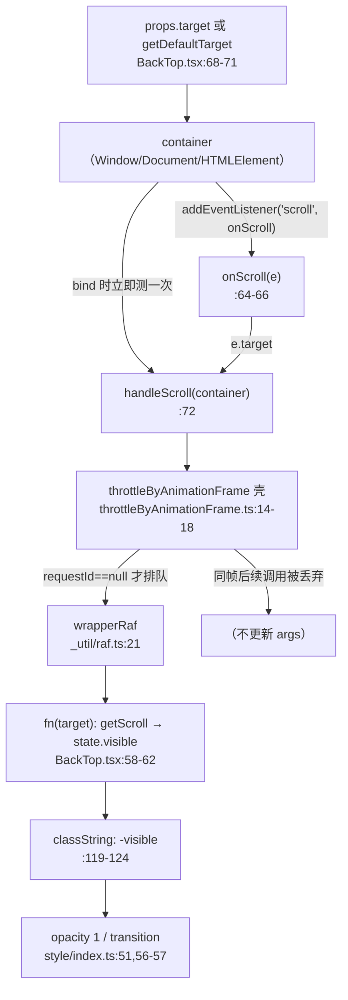
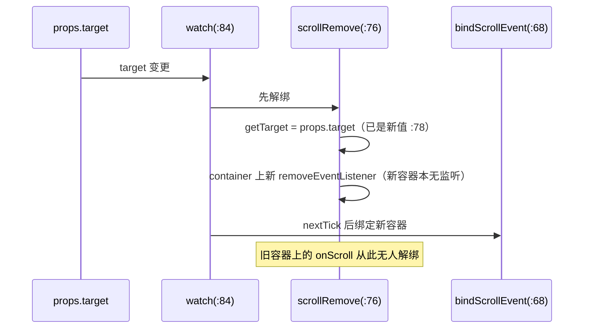

# C03-12 BackTop 返回顶部

> **本篇解决**：`BackTop` 的可见性从滚动事件到 CSS 类要经过几层、`throttleByAnimationFrame` 在首帧锁死参数意味着什么、`target` prop 变化时为什么旧容器上的监听器永远不会被摘掉、隐藏态只做 `opacity: 0` 会带来什么后果，以及全仓 222 处 `compatConfig` 在没有任何 compat 依赖的构建里是不是死配置。
> **前置**：C03-11《Affix 固钉》（同一个滚动监听族，含 `_util/raf.ts` 与 `throttleByAnimationFrame` 的取证）、A05《ConfigProvider 注入链》。

## 一、职责与边界

`BackTop` 是一个**自身即按钮**的固定定位元素：它监听某个滚动容器（默认页面），当滚动位移超过阈值时把自己淡入，点击时用缓动把容器滚回顶部。全部实现集中在 `back-top/BackTop.tsx` 的 149 行里，没有下层 `vc-*` 包装目录，是本库里少见的「单文件组件 + 四个 `_util` 工具」形态。

它依赖的四个工具各有归属，本篇只用到它们的行为接口，不展开实现：

- `_util/getScroll.ts` 的 `getScroll`（`_util/getScroll.ts:6`）把 Window / Document / HTMLElement 三种目标归一成数值；判定函数 `isWindow` 也在同一文件（`_util/getScroll.ts:1-3`），并被 `_util/scrollTo.ts:3` 复用。
- `_util/scrollTo.ts` 的 `scrollTo`（`BackTop.tsx:17` 导入、`:50` 调用）负责回顶动画，缓动函数是 `_util/easings.ts` 的 `easeInOutCubic`（该函数与 CSS 侧 `motionEase*`  token 的分工见 I09）。
- `_util/throttleByAnimationFrame.ts` 提供节流壳与 `cancel`（`_util/throttleByAnimationFrame.ts:8-24`，返回类型 `throttledFn & throttledCancelFn` 声明在 `:4-6`）。
- `_util/raf.ts` 是节流壳内部的调度器（`wrapperRaf:21`）。

与 `Affix` 的分工要提前说清，因为两者用的是**同一套滚动监听族**：`Affix` 靠 `getTargetRect` 比较矩形位置来决定 fixed 的切换，`BackTop` 靠读取 `scrollTop` 与阈值比较来决定 `opacity`。因此 `throttleByAnimationFrame` 与 `_util/raf.ts` 的两个已知缺陷同时命中这两个组件，具体取证见 C03-11《Affix 固钉》，本篇只做一次结构性引用（见论点 2 与 §七 坑 5），并在论点 2 给出 `raf.ts` 的键错位事实本身。

组件公开名 `XYBackTop`、标签 `xy-back-top`、内部标志 `__XY_BACK_TOP`（`BackTop.tsx:26-28`）。库内没有其他组件消费它（除生成物与 theme 注册表）：

```bash
grep -rn "BackTop" packages/xiaoye-ui/src --include='*.ts' --include='*.tsx' | grep -v "^packages/xiaoye-ui/src/back-top/"
```

命中的只有 `components.ts:28`、`:29`、`:30`、`:447` 与 `theme/interface/components.ts:4`、`:78`，即「公开 + 有 Token 槽位」但无库内复用。

## 二、源码地图

```
packages/xiaoye-ui/src/back-top/
├── index.ts                       公开面与安装
├── BackTop.tsx                   149   全部逻辑
├── backTopTypes.ts                18   4 个 prop
├── style/index.ts                      CSS-in-JS：fixed + opacity 过渡
└── __tests__/back-top.test.tsx    131   8 个 it
```

props 一共四个（`backTopTypes.ts:8-16`）：`prefixCls`、`visibilityHeight`（`{ type: Number, default: 400 }`）、`target`（`functionType<() => HTMLElement | Window | Document>()`，即**传的是取容器的函数而不是容器本身**）、`duration`（默认 450）、`onClick`（`eventType<MouseEventHandler>()`）。`BackTop.tsx:29-32` 又用 `initDefaultProps` 把 `visibilityHeight` 与 `duration` 的默认值重申一遍——两处默认值必须一致，`visibilityHeight: 400`（`backTopTypes.ts:10` 与 `BackTop.tsx:30`）、`duration: 450`（`backTopTypes.ts:14` 与 `BackTop.tsx:31`）目前是对齐的，但这是**手写双份**。

`emits: ['click']`（`BackTop.tsx:33`）与 props 里的 `onClick`（`backTopTypes.ts:16`）同时存在，两者都指向「点击」这一个事件，见 §五。

测试 8 个用例（`__tests__/back-top.test.tsx:21`、`:27`、`:35`、`:44`、`:57`、`:67`、`:77`、`:101`），覆盖默认渲染、阈值上下、`visibilityHeight === 0`、点击 emit、自定义插槽、局部容器滚动、`target` 变更后重绑。值得先记下的是：每个断言都只验证「新行为生效」，没有一个验证「旧行为停止」（`:101-130` 那条重绑用例只断言 `container2` 生效，从不检查 `container1` 是否已停止影响可见性）——这正是 §七 坑 1 能长期存活的原因。

## 三、架构与数据流





可见性的完整链路只有一处真值来源：`state.visible`（`BackTop.tsx:39-41`）。初始值是 `props.visibilityHeight === 0`——**阈值配 0 时组件首屏即可见**，其余配置首屏一律不可见，直到 `bindScrollEvent` 里那次主动测量（`:72`）把它纠正。

## 四、核心机制精读

### 论点 1：`getScroll` 用四路分支把三种滚动目标归一，第四路是给测试留的后门

`handleScroll` 的判据只有一行：`state.visible = getScroll(target, true) >= visibilityHeight`（`BackTop.tsx:58-62`）。真正处理目标差异的是 `_util/getScroll.ts`：

```ts
// _util/getScroll.ts:12-27
  const method = top ? 'scrollTop' : 'scrollLeft';
  let result = 0;
  if (isWindow(target)) {
    result = target[top ? 'scrollY' : 'scrollX'];
  } else if (target instanceof Document) {
    result = target.documentElement[method];
  } else if (target instanceof HTMLElement) {
    result = target[method];
  } else if (target) {
    // ... the program may falls into this branch.
    result = target[method];
  }
```

四路分别是：Window 读 `scrollY`（不是 `scrollTop`）、Document 读 `documentElement.scrollTop`、HTMLElement 读自身 `scrollTop`、以及最后那条 `else if (target)`。注释（`:22-25`）自陈第四路在类型推断下应当是 `never`，之所以存在是因为「loose mode 类型检查 + 测试里 mock 出 `{ documentElement: { scrollTop: 400 } }` 这种形状」，并且明确写着「Don't sure what is the real scenario this happens」。也就是说这条分支的动机是**为测试服务而非为生产服务**。

还有一条兜底容易被忽略：`getScroll.ts:29-31`，只要目标不是 Window 且读出来的值不是 number，就再退一层 `(target.ownerDocument ?? target).documentElement?.[method]`。这解释了一个反直觉现象：给 `target` 传一个 SVG 元素或 `ShadowRoot` 之类没有 `scrollTop` 的对象，不会返回 `undefined`，而是静默返回文档根的滚动值——**可见性会跟随页面而不是你指定的容器**。

对本组件而言，`BackTop.tsx:44-45` 的默认目标拿的是 `domRef.value.ownerDocument`（一个 Document，而不是 Window），因此在缺省 `target` 时走的是第二分支；而 Window 分支只在消费者显式 `:target="() => window"` 时才被用到。两条路径都能得到正确数值，但它们的读取字段不同（`window.scrollY` 与 `document.documentElement.scrollTop`），在 quirks 模式下后者为 0——这是一个配置相关的差异，源码里没有为此做任何补偿。

### 论点 2：节流壳把「首帧的第一个参数」锁死，同帧内后续事件被静默丢弃

```ts
// _util/throttleByAnimationFrame.ts:8-24
function throttleByAnimationFrame<T extends any[]>(fn: (...args: T) => void) {
  let requestId: number | null;

  const later = (args: T) => () => {
    requestId = null;
    fn(...args);
  };

  const throttled: throttledFn & throttledCancelFn = (...args: T) => {
    if (requestId == null) {
      requestId = raf(later(args));
    }
  };

  throttled.cancel = () => {
    raf.cancel(requestId!);
    requestId = null;
  };
```

三点后果按顺序读：

1. **丢弃是无条件的**：`requestId != null` 时新传入的 `args` 直接被忽略（`:15-17`），既没有 trailing call，也没有把最新参数写回已有闭包。因此同一帧内滚动多个容器时，只有第一个容器会被测量。对 `BackTop` 来说，绑定路径的 `handleScroll(container)`（`BackTop.tsx:72`）与紧随其后的真实事件 `handleScroll(e.target)`（`:65`）之间正好存在这样的竞争：前者排队后 `requestId` 非空，若二者落在同一帧，后者的参数被丢弃——由于两者通常是同一个容器，结果无害，但这个「bind 时主动测一次」与「事件驱动测一次」的写法本身就是靠丢弃语义兜住的。
2. **参数在闭包里而不是在调用里**：`later(args)`（`:11`）为每次排队新建一个执行闭包，所以 `handleScroll` 的注释「立即提取 target 避免事件对象在异步回调中被重置」（`BackTop.tsx:57`）说明的是另一半事实——真正被异步执行时读的是捕获的 `target`，而不是延迟读取事件对象。
3. **`cancel` 之后必须再来一次事件才会重新排队**：`throttled.cancel`（`:19-22`）把 `requestId` 归 null 并调用 `raf.cancel`。`BackTop.tsx:80` 在解绑前调它，这是正确用法（避免解绑后仍有排队回调读写已卸载容器）。

`raf` 这里指的是 `_util/raf.ts` 的 `wrapperRaf`，它返回的是**逻辑 id**而不是浏览器的 raf 句柄：

```ts
// _util/raf.ts:21-46（节选）
  rafUUID += 1;
  const id = rafUUID;
  function callRef(leftTimes: number) {
    if (leftTimes === 0) {
      cleanup(id);           // :28  以逻辑 id 为键
      callback();
    } else {
      const realId = raf(() => { callRef(leftTimes - 1); });
      rafIds.set(id, realId); // :39  逻辑 id → 浏览器句柄
    }
  }
// _util/raf.ts:48-51
wrapperRaf.cancel = (id: number) => {
  const realId = rafIds.get(id);
  cleanup(realId);            // :50  却用浏览器句柄当键去删
  return caf(realId);         // :51  取消动作本身是对的
};
```

`rafIds` 这张表用逻辑 id 作键（`:39`），`cancel` 却拿浏览器句柄去 `delete`（`:50`）。于是每一次 `cancel` 都会**留下一个永不删除的表项**：`caf(realId)` 确实取消了回调（`:51`），功能面正常，但 `Map` 随 cancel 次数单调增长，且逻辑 id 空间与浏览器句柄空间被混用——若某个浏览器句柄恰好等于另一条在途记录（`:50` 删的是别人的键），那条记录就再也无法被删。C03-11《Affix 固钉》已把同一处记为缺陷，本篇给出的是它在 `BackTop` 解绑路径上的触发条件：每次 `target` 变更与每次卸载各调用一次 `cancel`（`BackTop.tsx:80`、`:110-112`）。

### 论点 3：`target` 变更时解绑读的是已经变新的 props，旧容器永久留存监听器

这是本组件最实在的一个缺陷，机制完全可从代码读出：

```ts
// BackTop.tsx:76-82
    const scrollRemove = () => {
      const { target } = props;
      const getTarget = target || getDefaultTarget;
      const container = getTarget();
      handleScroll.cancel();
      container?.removeEventListener('scroll', onScroll);
    };

// BackTop.tsx:84-92
    watch(
      () => props.target,
      () => {
        scrollRemove();
        nextTick(() => {
          bindScrollEvent();
        });
      },
    );
```

`watch` 的回调在 `props.target` **已经更新之后**才运行，所以 `scrollRemove` 里 `getTarget()` 取到新容器（`:78-79`），对着新容器执行 `removeEventListener`——而新容器此刻本来就没有监听器。真正挂着 `onScroll` 的旧容器（绑定发生在 `:68-74`）从未被摘除。后续旧容器每次滚动都会驱动 `handleScroll` → `getScroll(旧容器)` → 改写 `state.visible`，也就是说：**换了 target 之后，两个容器都在控制同一个按钮的显隐**，且顺序取决于谁先滚动。

卸载路径同样只摘当前 target（`BackTop.tsx:110-112` 调同一个 `scrollRemove`），因此旧容器的监听器在整个组件生命周期内不会释放；只要旧容器仍然在 DOM 上（例如它属于一个常驻侧栏），这就是一处真实的泄漏。

要修必须让解绑知道「上一次是哪个容器」，而实现里没有任何地方缓存它：`bindScrollEvent` 与 `scrollRemove` 都从 `props.target` 现取（`:69-71`、`:77-79`），二者之间也没有共享变量。这属于「解绑所需的标识没有被保存」这一类结构缺陷，与 §七 坑 2 里 `unbind` 的语义问题不同源。

### 论点 4：回顶动画由 `scrollTo` 逐帧写 `scrollTop`，与可见性走的是同一套目标归一

点击时 `scrollToTop` 只做两件事：把滚动动画交给 `_util/scrollTo.ts`，然后 `emit('click', e)`（`BackTop.tsx:48-55`）。参数默认值的写法值得注意——`const { target = getDefaultTarget, duration } = props`（`:49`）取的是**函数本身**作为默认值，正好符合 `scrollTo` 期望的 `getContainer?: () => ...`（`_util/scrollTo.ts:7`），所以缺省路径与显式路径在语义上同构。

`scrollTo` 的实现是逐帧重算而非调用浏览器原生平滑滚动：

```ts
// _util/scrollTo.ts:15-23
  const { getContainer = () => window, callback, duration = 450 } = options;
  const container = getContainer();
  const scrollTop = getScroll(container, true);
  const startTime = Date.now();

  const frameFunc = () => {
    const timestamp = Date.now();
    const time = timestamp - startTime;
    const nextScrollTop = easeInOutCubic(time > duration ? duration : time, scrollTop, y, duration);
```

三个契约点：

1. **起点值一次读取。** `scrollTop` 在动画开始前测一次（`:17`），插值以它为基准（`_util/easings.ts:1` 的签名是 `easeInOutCubic(t, b, c, d)`，即时间、起始值、目标值、时长，函数体用 `cc = c - b` 求位移量，`:2-8`）。因此动画期间用户再次滚动不会被重算，视觉上会「抢不过」动画——这与 `scroll-behavior: smooth` 的浏览器实现行为不同。
2. **三种目标三种写法。** Window 用 `window.scrollTo(x, y)`（`:24-25`），Document 写 `documentElement.scrollTop`（`:26-27`），其余按 HTMLElement 直接写 `scrollTop`（`:28-29`）。这套分支与 `getScroll` 的读取分支（`_util/getScroll.ts:12-27`）一一对应，是同一个归一问题在读、写两侧的两次独立实现——两份代码任何一侧新增目标类型，另一侧不会自动跟上。
3. **`duration` 的默认值写了三份。** `backTopTypes.ts:14`（`default: 450`）、`BackTop.tsx:31`（`initDefaultProps` 重申 450）、`scrollTo.ts:15`（参数解构默认 450）。三处一致时才表现为「450ms 回顶」，改动时没有任何共享常量把它们绑在一起。

终止条件同样在 `scrollTo.ts:31-35`：`time < duration` 就继续排队（`raf(frameFunc)`），否则调用可选的 `callback`。`BackTop` 没有传 `callback`（`:50-53` 只给 `getContainer` 与 `duration`），所以它无法在动画结束后做任何收尾（例如立即重测可见性）。结合论点 5 会看到这个缺失的实际后果。

### 论点 5：首屏到可见之间有三层异步，阈值 0 是唯一的例外

`state.visible` 的初值写成一个特例判断：`props.visibilityHeight === 0`（`BackTop.tsx:40`）。这意味着除「阈值配 0」这一种配置外，组件首屏必然不可见，真实可见性要等三层异步全部走完才确定：

```ts
// BackTop.tsx:94-98
    onMounted(() => {
      nextTick(() => {
        bindScrollEvent();
      });
    });
```

1. **第一层：`onMounted` → `nextTick`**（`:94-98`）。绑定发生在挂载后的下一个微任务，因此 `domRef.value` 一定已可用（`getDefaultTarget` 依赖它，`:44-45`）。
2. **第二层：`bindScrollEvent` 里的主动测量**（`:72`）。这一步把首屏的真实滚动位置读进来，是「阈值 0 之外的配置也能立刻正确」的唯一机会。
3. **第三层：`handleScroll` 本身是节流的**（`:58`），它不立即执行，而是经 `throttleByAnimationFrame` 排队到 `wrapperRaf`（`_util/throttleByAnimationFrame.ts:15-17`），也就是下一帧才写 `state.visible`。

于是可见性真正落到 DOM 上比挂载晚约两帧。测试里每条断言都显式跨过这段等待——`__tests__/back-top.test.tsx` 的滚动用例采用 `document.dispatchEvent(new Event('scroll'))` 后再 `await flushRaf()` 的写法（`:50-51`、`:115`、`:120`、`:123`），这既印证了三层异步的存在，也说明组件没有对外提供「已测得首屏可见性」的时机信号（没有 `callback`、没有事件）。与论点 4 末段呼应：`scrollTo` 的 `callback` 未被使用，动画结束也不重测。

`onActivated`/`onDeactivated` 这对钩子（`:100-108`）说明组件按 `<keep-alive>` 场景设计：失活时解绑、激活时重新走一遍绑定与主动测量。但这两条路径都经过同一个 `scrollRemove`，因此同样带着论点 3 的缺陷——被 `keep-alive` 缓存的实例在 `target` 变更后再失活，旧容器上的监听器依然存活并继续改写这个失活组件的状态。

## 五、对外契约如何生效

**可见性只有一个出口：CSS 类。** `classString`（`BackTop.tsx:119-124`）把 `prefixCls`、`hashId`、`attrs.class` 与两个状态类（`-rtl`、`-visible`）合并，样式侧靠 `back-top/style/index.ts:36` 起的 `[componentCls]` 块、`:53`（默认 `opacity: 0`）与 `:56-57`（`&-visible { opacity: 1 }`）配合 `:51` 的 `transition: all ${motionDurationMid}` 完成淡入淡出。根元素本身是 `position: fixed`（`style/index.ts:38`）。

**`expose` 的形状可疑。** `BackTop.tsx:114-117` 暴露的是 `{ visible: state, scrollToTop }`——`visible` 指向整个 `reactive` 对象而不是那个布尔值，因此外部拿到的是 `backTopRef.visible.visible`。这与 `state` 的定义（`:39-41`）直接对应，属于「把内部状态袋当 API 端点」的写法。

**`onClick` 有两份声明。** props 里有 `onClick`（`backTopTypes.ts:16`，`eventType<MouseEventHandler>()`），同时 `emits: ['click']`（`BackTop.tsx:33`）。`scrollToTop`（`:48-55`）先 `scrollTo(0, {...})` 再 `emit('click', e)`，父组件写 `@click="fn"` 时 `fn` 经 emit 通道被调用一次。由于 `onClick` 已被声明为 prop，它不会作为 attr 落到根 `<div>` 的原生监听上（根节点用的是 `{...attrs}`，`BackTop.tsx:129`，而 prop 不进 attrs），因此当前实现没有「双触发」，但代价是同一个事件名在 API 面上占了两格。

**默认插槽可整体替换视觉。** `:137-143`：给了默认插槽就用插槽内容，否则渲染 `-content` 包 `-icon` 的缺省结构，图标是 `@xiaoye-ui/icons` 的 `UpOutlined`（`:1` 具名导入，符合图标硬约束）。

**无障碍属性有声明没有实现。** 根节点带 `role="button"`、动态 `tabindex`（可见时 0，隐藏时 -1）、`aria-label="back to top"`（`:132-135`）。`tabindex` 的切换是正确的（隐藏时不进 Tab 序列），但 `role="button"` 的非原生元素**不会**因为按 Enter 而合成 click，源码里没有任何 `keydown` 处理；`aria-label` 是硬编码英文字符串，不经过 locale 通道（语言包体系见 I11）。

## 六、设计取舍

**取舍一：读 `scrollTop` 而不是观察矩形。** 与 `Affix` 同族却选择不同判据：`BackTop` 只比较数值阈值（`BackTop.tsx:61`），不测 DOM 位置。好处是每次判定只读一个数（`getScroll.ts:14-16`），不必像矩形测量那样成对读 `top/height`；代价是它**只能服务「滚动即显隐」这一种语义**，无法响应容器尺寸变化，也解释了为什么隐藏态不需要占位与还原。

**取舍二：隐藏用 `opacity` 而不是 `visibility`/`display`。** `style/index.ts:53`、`:56-57` 只改透明度，元素始终存在并可接收指针事件。换来的是可以纯 CSS 过渡淡入淡出（`:51`），不需要处理 `display: none` 的过渡断层。代价见 §七 坑 3——一个看不见的按钮仍然可点。

**取舍三：`target` 传函数而不是元素。** props 定义是 `() => HTMLElement | Window | Document`（`backTopTypes.ts:12`），这让 SSR 与「容器尚未挂载」两种场景都能安全表达（`BackTop.tsx:70-71` 每次都现取），也是 `watch(() => props.target)` 能重绑的前提（`:84`）。代价是消费方传箭头函数时，每次渲染都是新引用，`watch` 会反复触发重绑——而重绑路径本身带缺陷（论点 3）。

**取舍四：`compatConfig: { MODE: 3 }` 全仓铺开。** `BackTop.tsx:25` 带着这行，而全仓 `compatConfig` 命中 222 处（`grep -rn "compatConfig" packages/xiaoye-ui/src | grep -v "/dist/" | wc -l`）。它只在 Vue 以 `@vue/compat` 构建被别名到 `vue` 时才生效，而本库任何 manifest 都不依赖它：`grep -rn "@vue/compat" package.json packages/*/package.json apps/docs/package.json` 为空。因此在默认安装路径下这 222 行是**惰性配置**，只有当消费者自己把 `vue` alias 到 compat 构建时才起作用——这解释了它为什么不会立刻出问题，也解释了它为什么是迁移未清理的遗留面（与 I16 记录的「API 面存活、实现死亡」同族，但更弱：它连行为都没有，只是元数据）。

## 七、坑与改动指南

**坑 1：`target` 变更后，旧容器的滚动仍然控制按钮显隐。**
触发：`:target` 从容器 A 换成容器 B（含模板里写内联箭头函数导致每次渲染都是新函数引用的情形）。
症状：滚动 A 也会让按钮出现/消失；页面滚动与局部滚动容器互相抢占同一个可见性状态。
原因：`scrollRemove` 读的是已经更新的 `props.target`，对 B 执行了本应对 A 的 `removeEventListener`（`BackTop.tsx:76-82`），A 的监听器从未摘除；卸载路径同样只摘当前 target（`:110-112`）。
定位：`BackTop.tsx:68-74`、`:76-82`、`:84-92`、`:110-112`。
判据补充：`__tests__/back-top.test.tsx:101-130` 只断言新容器生效（`:125`），没有断言旧容器失效，所以这个坑不会被现有测试发现。

**坑 2：`cancel` 留下永不清除的 `rafIds` 表项。**
触发：任何一次 `target` 变更或组件卸载。
症状：无功能异常；`_util/raf.ts:15` 的 `Map` 只增不减，长期运行的页面上条目数随重绑次数增长。
原因：`wrapperRaf.cancel` 用浏览器句柄当键去 `delete`（`_util/raf.ts:18-51`），而写入时键是逻辑 id（`:39`）。
定位：`_util/raf.ts:39`、`:48-51`，调用侧 `BackTop.tsx:80`。

**坑 3：隐藏的按钮依然可点击。**
触发：滚动位置在阈值之下（`opacity: 0`），用户点击组件所在的固定位置。
症状：页面被滚回顶部，但用户此前看不到任何按钮；`emit('click')` 照常触发。
原因：隐藏只做透明度（`style/index.ts:53`、`:56-57`），没有 `pointer-events: none` 也没有 `visibility: hidden`——`grep -n "pointer-events\|visibility" back-top/style/index.ts` 命中为空；而 `onClick` 始终绑定（`BackTop.tsx:135`）。
定位：`style/index.ts:53`、`:56-57`、`BackTop.tsx:132-135`。

**坑 4：键盘用户能聚焦、不能激活。**
触发：滚动过阈值后用 Tab 聚焦按钮（此时 `tabindex` 为 0，`BackTop.tsx:133`），按 Enter 或空格。
症状：没有任何反应。
原因：根元素是 `<div role="button">`（`:128`、`:132`），浏览器不会为其合成 click，组件也没有 `keydown` 处理器——`grep -n "keydown\|onKeydown" back-top/BackTop.tsx` 命中为空，只有 `onClick`（`:135`）。
定位：`BackTop.tsx:128-135`。

**坑 5：`aria-label` 不受 locale 控制。**
触发：任何语言环境。
症状：辅助技术始终朗读英文「back to top」。
原因：硬编码字符串（`BackTop.tsx:134`），组件没有引入 locale 通道（`back-top/` 目录内无任何 `locale` 引用）。
定位：`BackTop.tsx:134`。语言包与组件文案的取用路径归 I11。

**坑 6：`visibilityHeight` 改动后不会立刻重测。**
触发：运行时把阈值从 400 改成 100（当前页面已滚到 200）。
症状：按钮不出现，直到下一次滚动事件到来。
原因：`watch` 只监听 `props.target`（`BackTop.tsx:84-85`），没有监听 `visibilityHeight`；判定发生在节流回调里（`:58-62`），无事件即无重算。
定位：`BackTop.tsx:84-92`、`:58-62`。

**坑 7：给 `target` 传无 `scrollTop` 的元素会静默回落到文档根。**
触发：`:target="() => someSvgElement"` 或自定义组件实例。
症状：按钮跟随页面滚动而不是你指定的容器。
原因：`getScroll.ts:29-31` 的非数值兜底会取 `(target.ownerDocument ?? target).documentElement?.[method]`。
定位：`_util/getScroll.ts:29-31`、`BackTop.tsx:70-72`。

**改动安全边界**：动 `handleScroll`/`scrollRemove` 前先补两类断言——「旧 target 失效」与「隐藏态不响应点击」，现有 8 个用例（`__tests__/back-top.test.tsx`）对这两件事零覆盖；动 `style/index.ts` 的 `opacity` 策略属于对外可见行为变更（涉及坑 3 的修复方向是加 `pointer-events: none` 或 `visibility`），需按 AGENTS.md 的语义化版本要求评估。

## 附：本篇可证伪的三个检查点

**检查点 1：`compatConfig` 是无人执行的配置。**

```bash
cd packages/xiaoye-ui/src && grep -rn "compatConfig" . | grep -v "/dist/" | wc -l
grep -rn "@vue/compat" package.json packages/*/package.json apps/docs/package.json | wc -l
```

预期第一条为 222（当前 HEAD），第二条为 0。若第二条出现非零，说明本库开始依赖 compat 构建，论点「惰性配置」与 §六 取舍四需改写。

**检查点 2：隐藏态没有指针屏蔽。**

```bash
grep -n "pointer-events\|visibility" packages/xiaoye-ui/src/back-top/style/index.ts
grep -n "opacity" packages/xiaoye-ui/src/back-top/style/index.ts
```

预期第一条为空、第二条至少含 `:53`（默认 0）与 `:56-57` 附近的 `-visible` 块。一旦第一条出现命中，坑 3 已修复。

**检查点 3：解绑用的 target 与绑定时不同源。**

```bash
sed -n '68,82p' packages/xiaoye-ui/src/back-top/BackTop.tsx
```

预期能同时看到 `bindScrollEvent` 与 `scrollRemove` 各自内部 `const { target } = props` 与 `target || getDefaultTarget` 的取值语句（`:69-70`、`:77-78`），且组件里没有缓存「上一次绑定的容器」的变量（`grep -n "boundTarget\|lastTarget" back-top/BackTop.tsx` 为空）。若出现缓存变量或 `watch` 的 `(newVal, oldVal)` 用法，坑 1 与论点 3 需删改。
