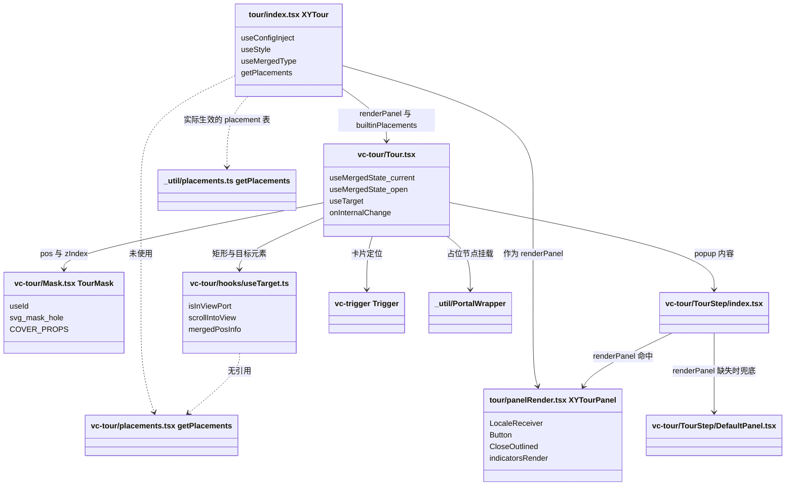
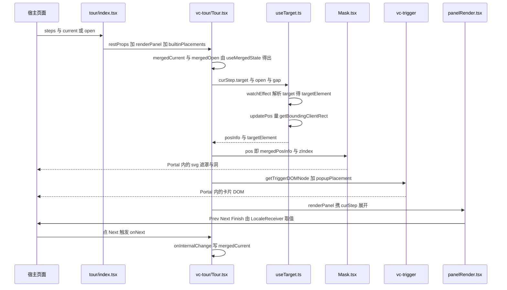
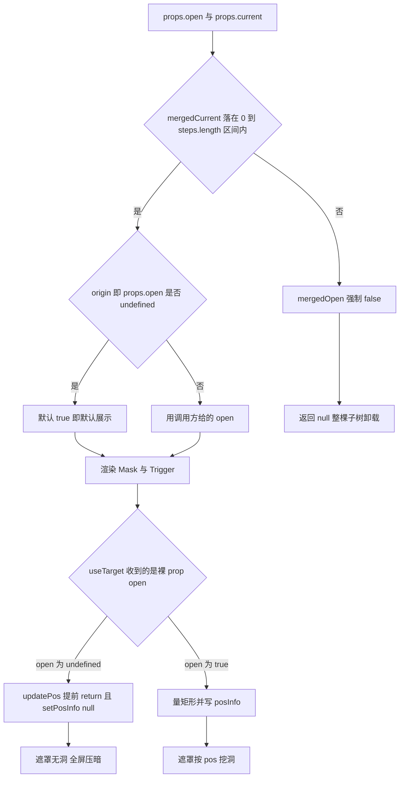
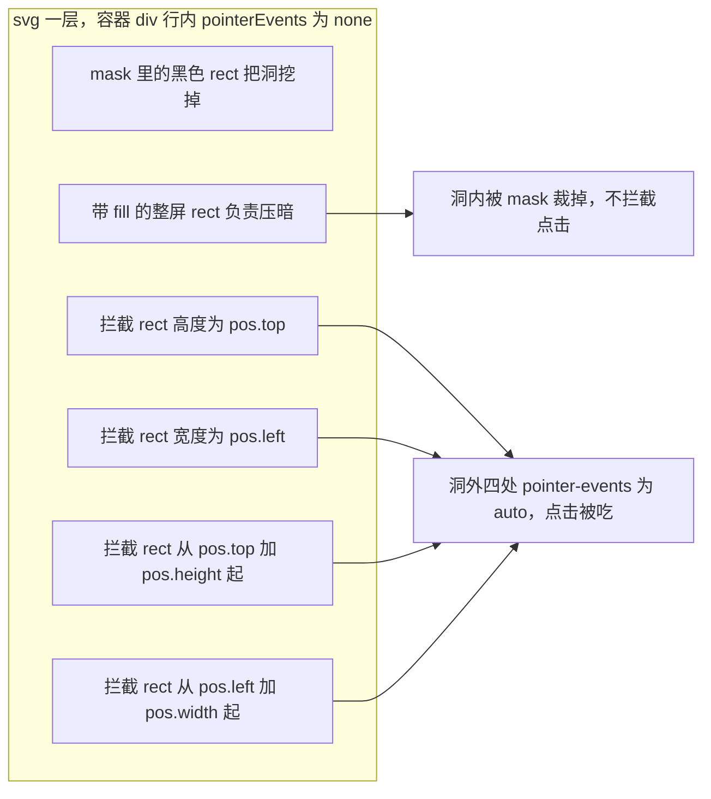

# C03-13 Tour 引导

> **本篇解决**：Tour 的「高亮框为什么会跟错位置、为什么引导层能压住别的浮层（或压不住）」这两类问题的源码答案 —— 即 `vc-tour` 如何把「目标元素」转成「遮罩上的一个洞 + 一张跟随的卡片」，以及它的层级、滚动、动画三条链路各自在哪里汇合。
> **前置**：I01 vc-align 定位求解与碰撞检测　I02 vc-trigger 弹出时序与事件穿透　I10 z-index 层级编排　A07 交互基础设施总览　**读者坐标**：`03-components/03-navigation` 第 14/13 篇

## 一、职责与边界

Tour 负责一件事：把「页面上某个已存在的元素」变成一条引导序列的锚点，并在锚点旁边挂一张可翻页的卡片，同时用一层带洞的遮罩把其余内容压暗。它**不负责**目标元素本身的位置——目标由调用方用 `target` 交回来，可以是一个 `HTMLElement`、一个返回 `HTMLElement` 的函数，也可以是字符串选择器类型的值（`packages/xiaoye-ui/src/vc-tour/interface.ts:8`）；它同样**不负责**求解「卡片该放在哪个坐标」，那句言权整个交给 `vc-trigger`，再往下是 `vc-align`，这一段 I01 vc-align 定位求解与碰撞检测、I02 vc-trigger 弹出时序与事件穿透已经各自展开过，本篇只在接缝处引用，不重述。

分层上 Tour 是「公开层薄、vendor 层厚」的典型：`packages/xiaoye-ui/src/tour/index.tsx` 只有 92 行，做三件事——注入 `prefixCls` 与样式（`:24`、`:27`）、把步骤的 `type` 合并出来（`:29`）、替换 `builtinPlacements` 与 `renderPanel`（`:66`、`:47`）。真正的状态机、遮罩、目标测量全在 `packages/xiaoye-ui/src/vc-tour/` 的 6 个文件里。注意真实公开层入口是 `tour/index.tsx`，仓库里**不存在** `tour/Tour.tsx`；主实现是 `vc-tour/Tour.tsx`（`:60` 起 `defineComponent`，`274` 行）。

依赖清单（被谁依赖 / 依赖谁）：

- 被依赖：`packages/xiaoye-ui/src/components.ts:367-369` 三行——聚合导出、默认导出 `Tour`、样式副作用导入；`packages/xiaoye-ui/src/theme/interface/components.ts:63`、`:152` 把它注册进组件 Token 表。除此之外没有任何组件 import `tour`，它是叶子。
- 依赖谁：`vc-trigger`（`vc-tour/Tour.tsx:4`）、`_util/PortalWrapper`（`:24`、`:257`，Portal 的机制归 C12-06 Portal 传送门）、`_util/hooks/useMergedState`（`:6`）、`_util/hooks/useState`（`hooks/useTarget.ts:6`）、`locale/LocaleReceiver`（`tour/panelRender.tsx:8`）、`button`（`:9`）、`@xiaoye-ui/icons` 的 `CloseOutlined`（`:4`）、`style/placementArrow`（`tour/style/index.ts:5`）。

## 二、源码地图

| 文件 | 行数 | 职责 | 关键导出 / 主实现入口 |
| --- | --- | --- | --- |
| `packages/xiaoye-ui/src/tour/index.tsx` | 92 | 公开层：配置注入、样式包裹、替换 placement 表与面板 | `withInstall(Tour)` `tour/index.tsx:95`，组件体 `:18` |
| `packages/xiaoye-ui/src/tour/interface.ts` | 42 | 公开 props 面（靠展开继承 vendor 层） | `tourProps()` `:5`、`tourStepProps()` `:23`、`TourLocale` `:38` |
| `packages/xiaoye-ui/src/tour/useMergedType.ts` | 38 | 逐步合并 `type`，决定深浅底色 | `useMergedType` `:14`，核心 `:27-33` |
| `packages/xiaoye-ui/src/tour/panelRender.tsx` | 161 | 真实面板：国际化按钮、指示点、封面、箭头节点 | `panelRender` `:15`，指示点 `:87-101` |
| `packages/xiaoye-ui/src/tour/style/index.ts` | 250 | CSS-in-JS：面板、主色变量、遮罩过渡、左右侧圆角上限 | `genComponentStyleHook('Tour', …)` `:240` |
| `packages/xiaoye-ui/src/tour/index.test.js` | 18 | 唯一的 Tour 测试，只验证能挂载 | `tour/index.test.js:6`、`:8` |
| `packages/xiaoye-ui/src/vc-tour/Tour.tsx` | 265 | 主实现：开合状态机、目标解析、遮罩与 Trigger 组装 | `tourProps()` `:33`，组件体 `:60`，渲染分支 `:204` |
| `packages/xiaoye-ui/src/vc-tour/Mask.tsx` | 131 | 带洞遮罩：SVG mask 挖洞 + 四块拦截矩形 | `Mask` `:25`，洞 `:74-88`，拦截区 `:100-119` |
| `packages/xiaoye-ui/src/vc-tour/hooks/useTarget.ts` | 101 | 目标解析、矩形测量、`gap` 膨胀、滚动 | 默认导出 `:21`，`updatePos` `:45` |
| `packages/xiaoye-ui/src/vc-tour/placements.tsx` | 79 | vendor 自己的 12 个 placement 表 | `getPlacements()` `:71` |
| `packages/xiaoye-ui/src/vc-tour/TourStep/index.tsx` | 26 | 面板分流：有 `renderPanel` 走它，否则走 `DefaultPanel` | `TourStep` `:5`，分流 `:15-19` |
| `packages/xiaoye-ui/src/vc-tour/TourStep/DefaultPanel.tsx` | 56 | vendor 兜底面板，硬编码英文 | `DefaultPanel` `:6` |
| `packages/xiaoye-ui/src/vc-tour/interface.ts` | 36 | 步骤级 props 与内部传递 props | `tourStepInfo()` `:6`、`tourStepProps()` `:24` |
| `packages/xiaoye-ui/src/vc-tour/util.ts` | 7 | 视口判定 | `isInViewPort` `:1` |
| `packages/xiaoye-ui/src/vc-tour/index.ts` | 6 | vendor 出口 | `:1-6` |

主实现入口的坐标是 `packages/xiaoye-ui/src/vc-tour/Tour.tsx:60`（`defineComponent` 起始）与同文件 `:204`（唯一的渲染返回分支）。样式主入口 `packages/xiaoye-ui/src/tour/style/index.ts:240`。测试侧唯一命中 `packages/xiaoye-ui/vitest.config.mts:33` 那条 `src/**/*.test.{js,ts,jsx,tsx}` glob 的是 `packages/xiaoye-ui/src/tour/index.test.js`；整个 `vc-tour/` 目录里没有任何 `*.test.*` 文件，也就是说遮罩、目标测量、开合状态机这三块最容易被改坏的实现**没有一行测试保护**。

## 三、架构与数据流

静态结构先看这张图。节点全部是真实文件名或真实符号，箭头指向「谁在渲染时持有谁」，不是调用栈。



图里两条虚线是本篇要论证的重点：`tour/index.tsx:68` 用 `_util/placements.ts` 建的表**顶掉**了 `vc-tour/placements.tsx:71` 的表，导致后者连同它写入的 `autoArrow` 字段一起变成不可达代码；`useTarget.ts` 与 `placements.tsx` 之间没有任何引用，所以 `gap` 的膨胀只影响遮罩，不影响卡片。

第二步「打开一页」的动态闭环用序列图。注意每一步的数据都换过载体：DOM 元素 → 矩形对象 → CSS style 字符串 → SVG 属性 → 类名。



这张图里最要紧的是**两个方向相反的分支**：卡片位置由 `Trigger` 从真实目标元素求解（`Tour.tsx:237` 的 `getTriggerDOMNode`），而遮罩洞的位置由 `posInfo` 直接写死（`Mask.tsx:79-84`）。同一个「目标矩形」被复制成了两条互不校验的落地路径，这是 Tour 一切跟位类 bug 的根。

第三步的开合判定是 Tour 自己独有的，也是本篇论点 3 的靶子。



`mergedOpen` 的判定在 `vc-tour/Tour.tsx:76-82`，它把「越界即关闭」和「不传即打开」两件事压进一个 `postState`；而 `useTarget` 收到的却是未经 `postState` 处理的原始 `open`（`Tour.tsx:94`）。同一个组件里两个「是否打开」的真值来源不同步，第四段流程图的那个左下角分支就是这么来的。

最后是遮罩的命中区划分。它不是靠 `clip-path` 或 `pointer-events` 的反向选择，而是把「不能点」的区域显式画成四个矩形。



`COVER_PROPS`（`vc-tour/Mask.tsx:9-12`）把 `pointer-events` 显式设成 `auto`，是因为容器 div 自己写死了 `pointerEvents: 'none'`（`Mask.tsx:62`）——不反向开启，整块遮罩就完全点不动，包括「应该点得动的目标元素」。而洞内的点击之所以能穿透，靠的是那个整屏 rect 被 `<mask>` 挖空（`Mask.tsx:96`）加上洞的位置恰好没有任何拦截矩形覆盖（`Mask.tsx:100-119` 的四块都按 `pos` 让开了中间）。

## 四、核心机制精读

### 论点 1：Tour 的锚点不是 Trigger 的孩子，而是「一个隐形占位 div 挂 CHILD、真实目标用 `getTriggerDOMNode` 事后顶替」——占位节点在定位链上是彻底多余的

**断言**：`vc-tour` 面对的真实约束是「目标元素不在我的组件树里，我不能把它搬进 Portal，也不能给它加事件」。它的解法是把这两件事拆开：给 `Trigger` 塞一个 `pointer-events: none` 的隐形 div 只为了满足「Trigger 必须有一个子节点」这条契约，真正参与定位的节点由 `getTriggerDOMNode` 回调在运行时替换成调用方交回来的那个 DOM。

```tsx
// packages/xiaoye-ui/src/vc-tour/Tour.tsx:156
      // when targetElement is not exist, use body as triggerDOMNode
      const getTriggerDOMNode = () => {
        return targetElement.value || document.body;
      };
// ...
// packages/xiaoye-ui/src/vc-tour/Tour.tsx:232
            popup={getPopupElement}
            forceRender={false}
            destroyPopupOnHide
            zIndex={zIndex}
            mask={false}
            getTriggerDOMNode={getTriggerDOMNode}
          >
            <Portal visible={mergedOpen.value} autoLock>
              <div
                class={classNames(rootClassName, `${prefixCls}-target-placeholder`)}
                style={{
                  ...posInfoStyle.value,
                  position: 'fixed',
                  pointerEvents: 'none',
                }}
              />
            </Portal>
          </Trigger>
```

逐段看：`Tour.tsx:164-166` 的兜底顺序是「有目标用目标，没目标用 `document.body`」，注意它返回的是 `targetElement.value`——也就是 `useTarget` 解析出来的那个 HTMLElement，不是 `target` 这个原始 prop。`Tour.tsx:237` 把它作为 `getTriggerDOMNode` 交给 Trigger。`Tour.tsx:239` 的 `<Portal visible autoLock>` 包住那个占位 div，`autoLock` 是 PortalWrapper 的滚动锁定开关（归 C12-06 Portal 传送门）；占位 div 的行内样式由 `posInfoStyle` 提供（`Tour.tsx:182-194`），也就是说它确实被搬到了目标矩形的位置上。

关键在于 Trigger 拿到这个回调之后做了什么：

```tsx
// packages/xiaoye-ui/src/vc-trigger/Trigger.tsx:340
    getRootDomNode() {
      const { getTriggerDOMNode } = this.$props;
      if (getTriggerDOMNode) {
        const domNode =
          this.triggerRef?.$el?.nodeName === '#comment' ? null : findDOMNode(this.triggerRef);
        return findDOMNode(getTriggerDOMNode(domNode));
      }
```

`Trigger.tsx:343-344` 先算出占位节点自己，但只是把它当参数传给回调；`Tour.tsx:164` 的实现**完全不使用这个参数**，直接返回真实目标，于是 `Trigger.tsx:345` 的结果就是那个页面里原本的按钮或卡片。再往下：

```tsx
// packages/xiaoye-ui/src/vc-trigger/Popup/PopupInner.tsx:67
    const getAlignTarget = () => {
      if (props.point) {
        return props.point;
      }
      return props.getRootDomNode;
    };
```

`PopupInner.tsx:71` 把 `getRootDomNode` 整个函数交给 `vc-align` 当 `target`（`point` 分支在 Tour 路径上不会命中，因为 `vc-tour/Tour.tsx` 从不传 `point`）。于是 `vc-align` 求解时的源节点是真实目标元素，占位 div 连一次 `getBoundingClientRect` 都没被读到。

**结论回扣**：占位 div 的全部作用是「让 Trigger 有个可挂 ref 的 child」，它携带的定位样式（`posInfoStyle`）和类名 `${prefixCls}-target-placeholder`（产出点 `Tour.tsx:241`）都不产生任何可观测效果——我在 `packages/xiaoye-ui/src/tour/style/index.ts` 的 250 行里找不到任何 `target-placeholder` 选择器，`grep -rn "target-placeholder" packages/xiaoye-ui/src` 全仓也只命中 `Tour.tsx:241` 这一行写入；样式里那条相近的 `:210` `${componentCls}-placeholder-animated` 作用在遮罩的 SVG rect 上（`vc-tour/Mask.tsx:85`），与这个 div 无关。这也解释了为什么把 `gap.offset` 调大只会让遮罩的洞变大、卡片却不动：`gap` 只进 `mergedPosInfo`（`hooks/useTarget.ts:88-97`），而卡片走的是 `getTriggerDOMNode` 这条完全独立的路径。

### 论点 2：遮罩的「洞」是 SVG `<mask>` 里的黑白双矩形，点击穿透靠四块显式拦截矩形拼出的框，而不是 `clip-path` 或 CSS 遮罩

**断言**：Tour 需要在「一整屏压暗」里留一个能点的洞，而 CSS 侧做不到「挖洞后仍拦截四周」。`Mask.tsx` 因此把渲染与命中拆成两层：渲染层是一个 `fill` 的整屏 rect 减去 mask 里的黑 rect；命中层是四块 `pointer-events: auto` 的透明 rect，按目标矩形让开中间。

```tsx
// packages/xiaoye-ui/src/vc-tour/Mask.tsx:9
const COVER_PROPS = {
  fill: 'transparent',
  'pointer-events': 'auto',
};
// ...
// packages/xiaoye-ui/src/vc-tour/Mask.tsx:74
                      <defs>
                        <mask id={maskId}>
                          <rect x="0" y="0" width="100vw" height="100vh" fill="white" />
                          {pos && (
                            <rect
                              x={pos.left}
                              y={pos.top}
                              rx={pos.radius}
                              width={pos.width}
                              height={pos.height}
                              fill="black"
```

继续看渲染层与命中层：

```tsx
// packages/xiaoye-ui/src/vc-tour/Mask.tsx:89
                      </defs>
                      <rect
                        x="0"
                        y="0"
                        width="100%"
                        height="100%"
                        fill={fill}
                        mask={`url(#${maskId})`}
                      />

                      {/* Block click region */}
                      {pos && (
                        <>
                          <rect {...COVER_PROPS} x="0" y="0" width="100%" height={pos.top} />
                          <rect {...COVER_PROPS} x="0" y="0" width={pos.left} height="100%" />
```

逐段解释：`Mask.tsx:75` 的 `<mask>` 用白底（`fill="white"`，`:76`）表示「保留」，黑 rect（`:84`）表示「擦除」，这是 SVG mask 的亮度约定，所以洞的圆角来自 `rx={pos.radius}`（`:81`），而 `pos.radius` 就是 `gap.radius` 的默认值 2（`hooks/useTarget.ts:89`）。`Mask.tsx:90-97` 的压暗 rect 用 `fill={fill}`，默认 `rgba(0,0,0,0.5)`（`Mask.tsx:32`），并被 `mask` 属性挂上刚才那个 mask 定义（`:96`）——洞因此是「渲染层的减法」，与文档流无关。命中层是 `:100` 起的四块：上块 `height={pos.top}`、左块 `width={pos.left}`、下块从 `y={pos.top + pos.height}` 起用 `calc(100vh - …)` 补到底（`:104-110`）、右块从 `x={pos.left + pos.width}` 起用 `calc(100vw - …)` 补到边（`:111-117`）。四块都展开 `COVER_PROPS`，把 `fill` 设为 `transparent`、`pointer-events` 强制 `auto`（`:9-12`）。

为什么非要显式开 `pointer-events`：容器 div 的行内样式写死了 `pointerEvents: 'none'`（`Mask.tsx:62`），SVG 整体默认不吃事件；不开这四块，遮罩就等于不存在，页面任意位置都能点，引导就失去「只能操作目标」的语义。反过来，洞的正中央既没有拦截矩形覆盖，压暗 rect 又在那里被 mask 擦掉，所以目标元素可以被正常点击——这就是 `non-modal` 与 `mask` 两个示例行为差异的全部实现。

另外 `maskId` 由 `${prefixCls}-mask-${id}` 拼出（`Mask.tsx:42`），`id` 来自 `useId()`（`Mask.tsx:38`），这是为了同页多个 Tour 实例的 `<mask>` 定义不互相覆盖；`fill` 也可以按步骤改成透明得到「只挖洞不压暗」的效果，因为 `mergedMask` 允许步骤级覆盖（`Tour.tsx:88`）且 `mergedMaskStyle?.color` 被单独取出传给 `fill`（`Tour.tsx:212`）。

### 论点 3：组件里存在两个互不同步的「是否打开」——`mergedOpen` 经过 `postState` 归一化，而喂给 `useTarget` 的是没归一化的裸 prop，非受控用法因此拿到「看得见卡片、量不到目标」的半开状态

**断言**：开合真值在 `Tour.tsx:76-82` 被 `useMergedState` 的 `postState` 归一化了一次（越界即关、不传即开），但 `Tour.tsx:94` 传给 `useTarget` 的仍是 `toRefs(props)` 里的原始 `open`。两条路径读的不是同一个布尔量，于是「默认打开」和「默认不测量」同时成立。

```tsx
// packages/xiaoye-ui/src/vc-tour/Tour.tsx:69
    const [mergedOpen, setMergedOpen] = useMergedState(undefined, {
      value: computed(() => props.open),
      postState: origin =>
        mergedCurrent.value < 0 || mergedCurrent.value >= (props.steps?.length || 0)
          ? false
          : (origin ?? true),
    });

    const openRef = shallowRef(mergedOpen.value);
    watchEffect(() => {
      if (mergedOpen.value && !openRef.value) {
        setMergedCurrent(0);
      }
      openRef.value = mergedOpen.value;
    });
```

`Tour.tsx:72-73` 是「越界即关」：`mergedCurrent` 小于 0 或不小于 `steps.length` 时 `postState` 直接返回 `false`，这是 Tour 唯一的关闭兜底——调用方不需要在最后一步手动 `open=false`，把 `current` 推到越界值同样会关。`Tour.tsx:74` 的 `origin ?? true` 是「不传即开」：`props.open` 为 `undefined` 时 Tour 默认是展开的。`emits` 里也同时声明了 `update:open`（`Tour.tsx:64`），但 `props.open` 是用 `booleanType()` 声明的（`Tour.tsx:39`，实现见 `packages/xiaoye-ui/src/_util/type.ts:58-60`），该写法会显式写下 `default: undefined`，所以未传时读到的就是 `undefined` 而不是 `false`——「不传即开」这条路是成立的。`Tour.tsx:84-90` 则是「从关到开时把步号清零」：用一个 `shallowRef` 记住上一次的 `mergedOpen`，只在上升沿执行 `setMergedCurrent(0)`，这样第二次打开引导不会停在上次的第 3 步。

问题出在下一段：

```tsx
// packages/xiaoye-ui/src/vc-tour/Tour.tsx:92
    const [posInfo, targetElement] = useTarget(
      computed(() => curStep.value.target),
      open,
      gap,
      mergedScrollIntoViewOptions,
    );
```

这里第 2 个参数 `open` 来自 `Tour.tsx:66-67` 那条 `toRefs(props)` 解构，是裸 prop；而渲染分支用的是 `mergedOpen.value`（`Tour.tsx:195`）。`useTarget` 内部拿它做的第一件事是硬闸门：

```ts
// packages/xiaoye-ui/src/vc-tour/hooks/useTarget.ts:45
  const updatePos = () => {
    if (!open.value) {
      setPosInfo(null);
      return;
    }
    if (targetElement.value) {
      // Exist target element. We should scroll and get target position
      if (!isInViewPort(targetElement.value) && open.value) {
        targetElement.value.scrollIntoView(scrollIntoViewOptions.value);
      }
```

`useTarget.ts:46-49`：只要 `open` 假值就直接把 `posInfo` 置 `null` 并返回，既不滚动也不测量。而 `useTarget.ts:67-74` 的重算触发点是 `watch([open, targetElement], …, { immediate: true })`——**只监听 `open` 和 `targetElement`**，切步时 `mergedCurrent` 变了但 `open` 没变，`updatePos` 也不会被叫到。合起来的症状是：`<xy-tour :steps="steps" />` 这种不显式传 `open` 的写法，卡片照常渲染照常定位（因为定位走 `getTriggerDOMNode` 那条独立路径，见论点 1），遮罩却是一片没有洞的全屏压暗，`posInfo` 恒为 `null` 使 `Mask.tsx:77` 与 `:100` 的 `pos &&` 双双短路。

我核对了仓库里全部 5 个 Tour 示例：`apps/docs/examples/tour/basic.vue:12`、`indicator.vue:12`、`mask.vue:13`、`non-modal.vue:12`、`placement.vue:4` 都显式绑了 `:open="open"`，所以这条路在文档站里一次都没有被走过；`vc-tour` 又没有任何测试文件，这个不一致不会被任何门禁抓到。修法只有一条是安全的：把 `Tour.tsx:94` 的 `open` 换成 `mergedOpen`（注意 `useTarget` 的签名参数名也叫 `open`，见 `hooks/useTarget.ts:23`）。I02 vc-trigger 弹出时序与事件穿透 的论点 2 已经论证过 trigger 侧受控/非受控的分歧点是「值是否为 `undefined`」，Tour 这里踩的是同一个约定的另一半。

### 论点 4：`targetElement` 用 `undefined` 与 `null` 区分两种「没有目标」，顶层渲染靠这个区分决定「不渲染」还是「居中渲染」；矩形去重则是 `JSON.stringify` 全量比对

**断言**：`useTarget` 把「还没执行过 target 函数」和「执行了但取不到元素」编码成两个不同的假值，并在 `Tour.tsx` 的渲染入口当作初始化栅栏使用；一旦调用方的 `target` 写成「元素尚未挂载时返回 `null`」，Tour 会立刻以 `null` 落位并从此进入居中分支。

```ts
// packages/xiaoye-ui/src/vc-tour/hooks/useTarget.ts:27
  // ========================= Target =========================
  // We trade `undefined` as not get target by function yet.
  // `null` as empty target.
  const [targetElement, setTargetElement] = useState<null | HTMLElement | undefined>(undefined);

  watchEffect(
    () => {
      const nextElement =
        typeof target.value === 'function' ? (target.value as any)() : target.value;

      setTargetElement(nextElement || null);
    },
    { flush: 'post' },
  );
```

`hooks/useTarget.ts:28-29` 的两行注释就是这个三态约定的唯一文档。`useState(undefined)`（`:30`，hook 本体在 `packages/xiaoye-ui/src/_util/hooks/useState.ts`）给出初始 `undefined`；`useTarget.ts:37` 的 `nextElement || null` 把「函数返回 `undefined`」和「`target` 根本没配」统统压成 `null`。注意 `:32-40` 的 `watchEffect` 是 `flush: 'post'`，所以首帧同步执行时 `targetElement` 仍是 `undefined`。渲染入口读它：

```tsx
// packages/xiaoye-ui/src/vc-tour/Tour.tsx:138
      // ========================= Render =========================
      // Skip if not init yet
      if (targetElement.value === undefined) {
        return null;
      }
```

`Tour.tsx:140-142` 是**整个 setup 里唯一的提前返回**，它把「首帧不渲染」实现成 `undefined` 判定。这里有个容易被忽略的后果：`=== undefined` 是严格比较，`null` 会穿过这道栅栏继续渲染，于是「目标取不到」被当成合法状态处理，落到 `Tour.tsx:212` 与 `:236-243` 的居中分支——`builtinPlacements` 传 `undefined`、`popupStyle` 改成 `position: fixed` 加 `translate(-50%, -50%)`，卡片钉在视口中央。这个分支是 `non-modal` 之外另一种「没有高亮对象」的形态，它**不依赖 `posInfo`**，所以即便论点 3 的闸门把 `posInfo` 打成 `null`，居中卡片仍然正常。

再看测量结果的写入策略：

```ts
// packages/xiaoye-ui/src/vc-tour/hooks/useTarget.ts:56
      const { left, top, width, height } = targetElement.value.getBoundingClientRect();
      const nextPosInfo: PosInfo = { left, top, width, height, radius: 0 };
      if (JSON.stringify(posInfo.value) !== JSON.stringify(nextPosInfo)) {
        setPosInfo(nextPosInfo);
      }
```

`useTarget.ts:58` 用 `JSON.stringify` 做去重而不是逐字段比较，目的是避免 `resize` 高频回调里把 `posInfo` 刷成同值触发无谓重渲染（`window.addEventListener('resize', updatePos)` 见 `useTarget.ts:76`）。代价是每次比较都要序列化两个对象，而且它比较的是「四个几何量」，`radius` 恒被写成 `0`（`:57`），真正的圆角要到 `mergedPosInfo` 里才由 `gap` 注入：

```ts
// packages/xiaoye-ui/src/vc-tour/hooks/useTarget.ts:83
  const mergedPosInfo = computed(() => {
    if (!posInfo.value) {
      return posInfo.value;
    }

    const gapOffset = gap.value?.offset || 6;
    const gapRadius = gap.value?.radius || 2;

    return {
      left: posInfo.value.left - gapOffset,
      top: posInfo.value.top - gapOffset,
      width: posInfo.value.width + gapOffset * 2,
      height: posInfo.value.height + gapOffset * 2,
      radius: gapRadius,
    };
  });
```

`useTarget.ts:88-89` 的 `|| 6` / `|| 2` 是 `gap` 的硬编码兜底，两个数都不来自任何 Token；`useTarget.ts:92-96` 做的是「向外膨胀 `offset` 像素」，这就是遮罩上的洞为什么总比目标元素大一圈的全部原因。`useTarget.ts:84-86` 在 `posInfo` 为 `null` 时把 `null` 原样透传，正好接上论点 2 里 `pos &&` 的短路。

### 论点 5：公开层把整张 placement 表换掉了——`vc-tour/placements.tsx` 在 `<xy-tour>` 路径上是死代码，vendor 层那句 `??` 兜底永远不成立

**断言**：`vc-tour` 自带一张 12 键的 placement 表并按 `arrowPointAtCenter` 动态生成，但公开层无条件传入了 `_util/placements.ts` 的另一张表，使前者的三元右侧永不求值。用户实际拿到的间距、翻转与 `ignoreShake` 行为全部来自 tooltip 那张表，而不是 tour 这张。

```tsx
// packages/xiaoye-ui/src/tour/index.tsx:68
      const builtinPlacements = computed(() =>
        getPlacements({
          arrowPointAtCenter: true,
          autoAdjustOverflow: true,
        }),
      );
```

`tour/index.tsx:67-72` 在渲染函数体内建表，参数被写死成 `arrowPointAtCenter: true` 与 `autoAdjustOverflow: true`，随后在 `tour/index.tsx:88` 传给 `<VCTour>`。vendor 层的接收点：

```tsx
// packages/xiaoye-ui/src/vc-tour/Tour.tsx:211
            builtinPlacements={
              !curStep.value.target
                ? undefined
                : (restProps.builtinPlacements ?? getPlacements(arrowPointAtCenter.value))
            }
```

`Tour.tsx:214` 的 `??` 只有在 `restProps.builtinPlacements` 为 `null`/`undefined` 时才求值右侧。走 `<xy-tour>` 时它恒为一个非空对象，于是 `vc-tour/placements.tsx:71` 的 `getPlacements` 永不执行：

```ts
// packages/xiaoye-ui/src/vc-tour/placements.tsx:71
export function getPlacements(arrowPointAtCenter = false) {
  const placements: BuildInPlacements = {};
  Object.keys(basePlacements).forEach(key => {
    placements[key] = { ...basePlacements[key], autoArrow: arrowPointAtCenter, targetOffset };
  });
  return placements;
}
```

`placements.tsx:74` 就是 I02 vc-trigger 弹出时序与事件穿透 论点 8 里那条「有真实赋值方、零读取方」的 `autoArrow` 的唯一写入点，声明处是 `packages/xiaoye-ui/src/vc-trigger/interface.ts:36`，`vc-align/` 全目录零命中。本篇补上另一半：在 `<xy-tour>` 路径下连这行赋值本身都不会执行，所以 `arrowPointAtCenter` 这个 prop 从 vendor 层的语义出发就已经是空转。同文件 `:79` 的 `export const placements = getPlacements()` 也只被 `:71` 的函数消费，`Tour.tsx:12-13` 只 import 了 `getPlacements` 与 `PlacementType`。

两张表的行为差异是可量化的：

```ts
// packages/xiaoye-ui/src/vc-tour/placements.tsx:33
  bottom: {
    points: ['tc', 'bc'],
    offset: [0, 8],
  },
```

```ts
// packages/xiaoye-ui/src/_util/placements.ts:59
    bottom: {
      points: ['tc', 'bc'],
      offset: [0, 4],
    },
```

同为 `bottom`，vendor 层偏移 8px，公开层偏移 4px；更关键的是 `topLeft` 的锚点对——`placements.tsx:38` 是 `points: ['bl', 'tl']`，而 `_util/placements.ts:64` 是 `points: ['bl', 'tc']` 并额外加 `horizontalArrowShift`，也就是说公开层把「角对角」改成了「角对边中点」。这符合 A07 交互基础设施总览 的论点 5（placement 表把语义名翻译成两点，箭头完全靠翻译结果的 class 反查）在本组件上的具体落点：Tour 的面板宽 520px（`tour/style/index.ts:58`），用 tooltip 那套带箭头顶推的偏移才不至于让卡片角戳在目标边缘上。

公开层还额外做了两件事，都在 `_util/placements.ts` 的收尾循环里：

```ts
// packages/xiaoye-ui/src/_util/placements.ts:96
  Object.keys(placementMap).forEach(key => {
    placementMap[key] = arrowPointAtCenter
      ? {
          ...placementMap[key],
          overflow: getOverflowOptions(autoAdjustOverflow),
          targetOffset,
        }
      : {
          ...placements[key],
          overflow: getOverflowOptions(autoAdjustOverflow),
        };

    placementMap[key].ignoreShake = true;
  });
```

`:97` 走的是 `arrowPointAtCenter` 为真的分支（由 `tour/index.tsx:70` 决定），于是每个 placement 都带上 `overflow`（`_util/placements.ts:28-36` 的 `getOverflowOptions` 把 `autoAdjustOverflow: true` 翻成 `adjustX: 1, adjustY: 1`）和共享的 `targetOffset`；`:108` 给每个 placement 补 `ignoreShake = true`。`adjustX/adjustY` 与 `ignoreShake` 的语义归 I01 vc-align 定位求解与碰撞检测（它的论点 3 与论点 7 分别覆盖这两项），本篇只确认它们是**通过公开层注入**的，而不是 tour 自己的能力。

最后一个具体的坑：`PlacementType` 联合里有 `| 'center'`（`placements.tsx:16`），但 `basePlacements` 只有 12 个键（`placements.tsx:20-69`）、`_util/placements.ts` 的 `placementMap` 同样只有这 12 个键（`:46-95`），两处都没有 `center`。写 `placement: 'center'` 能通过类型检查，落到 `Tour.tsx:228` 的 `popupPlacement` 后在两张表里都查不到项。

### 论点 6：`type: 'primary'` 的整套换色只靠一个 CSS 自定义属性 `--xy-arrow-background-color`，把面板底色和箭头底色绑成同一个变量；箭头节点是面板自己画的，不是 trigger 画的

**断言**：Tour 有两种底色（默认浅、primary 深），而箭头必须由 `style/placementArrow` 这套通用箭头样式绘制，它只能吃一个颜色表达式。实现办法是在面板根节点上声明一个自定义属性，primary 分支覆盖它，箭头侧再 `var()` 回去——一次属性赋值完成两个位置的联动。

```ts
// packages/xiaoye-ui/src/tour/style/index.ts:48
      [componentCls]: {
        ...resetComponent(token),

        color: colorText,
        position: 'absolute',
        zIndex: tourZIndexPopup,
        display: 'block',
        visibility: 'visible',
        fontSize,
        lineHeight,
        width: 520,
        '--xy-arrow-background-color': colorBgContainer,
```

`tour/style/index.ts:59` 在 `.xy-tour` 根节点上定义 `--xy-arrow-background-color` 为 `colorBgContainer`；同文件 `:58` 的面板宽度 `520` 是**裸数字字面量**，不走任何 Token，这是本篇在样式侧看到的唯一一处对「禁止硬编码」约定的直接违反（`:244-247` 的 `indicatorWidth: 6`、`indicatorHeight: 6` 至少还进了 token）。primary 的覆盖：

```ts
// packages/xiaoye-ui/src/tour/style/index.ts:158
        // =============================  primary type  ===========================
        // `$` for panel, `&$` for pure panel
        [`${componentCls}-primary, &${componentCls}-primary`]: {
          '--xy-arrow-background-color': colorPrimary,

          [`${componentCls}-inner`]: {
            color: colorTextLightSolid,
            textAlign: 'start',
            textDecoration: 'none',
            backgroundColor: colorPrimary,
```

`style/index.ts:160` 的选择器写成 `${componentCls}-primary, &${componentCls}-primary` 两种形式，注释 `:159` 说明了分工：前者命中面板自身，后者命中「根节点即面板」的 pure 形态；而 `:61-64` 的 `&-pure` 分支在本组件两个目录里找不到类名产出方——`grep -rn "pure" packages/xiaoye-ui/src/vc-tour packages/xiaoye-ui/src/tour` 只命中 `tour/style/index.ts:61` 这条规则本身与 `:159` 的那行注释，`vc-tour` 与 `tour` 的任何 tsx 都不产生 `-pure` 类名，属于为另一种使用形态预留而未接通的规则。`:161` 把自定义属性改成 `colorPrimary`，`:163-168` 改面板底色与前景色，`:177`、`:186`、`:190`、`:201` 用 `TinyColor`（`:1` 导入）算半透明态。同一段里的 `:66-68` 的 `&${componentCls}-hidden` 也是同一处境：`tour` 与 `vc-tour` 两个目录里 `hidden` 只出现在这一行（`grep -rn "hidden" packages/xiaoye-ui/src/vc-tour packages/xiaoye-ui/src/tour` 单命中 `style/index.ts:66`）。箭头侧消费：

```ts
// packages/xiaoye-ui/src/tour/style/index.ts:230
    // ============================= Arrow ===========================
    getArrowStyle<TourToken>(token, {
      colorBg: 'var(--xy-arrow-background-color)',
      contentRadius: tourBorderRadius,
      limitVerticalRadius: true,
    }),
```

`style/index.ts:232` 传的 `colorBg` 是一个字符串表达式 `'var(--xy-arrow-background-color)'`，`limitVerticalRadius: true` 对应 `:216-227` 那段「左右 placement 的圆角上限」逻辑与 `MAX_VERTICAL_CONTENT_RADIUS`（`:5` 从 `style/placementArrow` 导入）。

箭头节点本身在 DOM 里的产出方是面板，不是 trigger：

```tsx
// packages/xiaoye-ui/src/tour/panelRender.tsx:98
            <div
              {...attrs}
              class={classNames(
                stepType === 'primary' ? `${prefixCls}-primary` : '',
                attrs.class,
                `${prefixCls}-content`,
              )}
            >
              {arrow && <div class={`${prefixCls}-arrow`} key="arrow" />}
```

`panelRender.tsx:106` 依据 `arrow` prop 决定是否输出 `${prefixCls}-arrow`；而 `arrow` 的值来自 `Tour.tsx:161` 的 `arrow={mergedArrow.value}`，`mergedArrow`（`Tour.tsx:100-106`）做过一层「步骤级优先、其次全局、无目标则强制 `false`」的合并。同一份 props 里另有一个 `arrow` 被送去 trigger：`Tour.tsx:210` 的 `arrow={!!restProps.arrow}` 用的是 `restProps`，也就是**全局值**而非合并值。两处喂的数据源不同，是「步骤级 `arrow: false` 关不掉某一层箭头」的根因，我在第七段把它列成坑。

primary 的分色还有个前置步骤：`type` 是按步骤合并出来的，不是直接读 prop。

```ts
// packages/xiaoye-ui/src/tour/useMergedType.ts:27
  const innerType = computed(() => {
    return typeof innerCurrent.value === 'number'
      ? steps && steps.value?.[innerCurrent.value]?.type
      : defaultType?.value;
  });

  const currentMergedType = computed(() => innerType.value ?? defaultType?.value);
```

`useMergedType.ts:27-33` 的结果被公开层用在两处：`tour/index.tsx:42` 把它拼进根类名 `${prefixCls}-primary`，`tour/index.tsx:52` 又把全局 `type` 透传给 `<TourPanel>`，让面板内部按 `stepType` 决定按钮配色（`panelRender.tsx:96-100`）。这里有个可核实的错位：根类名用的是**合并后**的 `currentMergedType`，面板里 `${prefixCls}-primary` 用的是**全局** `type`（`panelRender.tsx:108` 的 `stepType` 来自 `props.type`，而 `tour/index.tsx:52` 传的是 `type={type}` 即全局值）。当调用方只在某一步上写 `type: 'primary'` 而全局不写时，`.xy-tour-primary` 会加在根上而面板的 `${prefixCls}-primary` 不会——`style/index.ts:160` 的选择器恰好带了 `&${componentCls}-primary` 这一支（根节点自己就是 `.xy-tour.xy-tour-primary`），所以面板内层靠后代选择器仍然被覆盖到，最终视觉正确，但正确性是选择器写法兜住的，不是数据流兜住的。

## 五、对外契约如何生效

`<xy-tour>` 的属性面是**继承出来的**，不是抄写的。`packages/xiaoye-ui/src/tour/interface.ts:5-12` 的 `tourProps()` 第一行就是 `...VCTourProps()`，而 `VCTourProps` 是 `vc-tour/index.ts:3` 转出的 `vc-tour/Tour.tsx:33` 那份，后者自己又先从 `triggerProps()` 里摘了 `builtinPlacements` 与 `popupAlign` 两项（`vc-tour/Tour.tsx:34-37`）。这条展开链决定了一个容易判错的结论：**`zIndex` 是 `<xy-tour>` 声明过的 prop**。`grep -rn "zIndex" packages/xiaoye-ui/src/tour/` 只命中 `tour/style/index.ts:53` 与 `:243` 两行（我复核过），字面上公开层确实没写它，但 `tour/index.tsx:23` 的 `props: tourProps()` 通过上面的展开链把 `vc-tour/Tour.tsx:54` 的 `zIndex: { type: Number, default: 1001 }` 带了进来，所以 `<xy-tour :z-index="1100" />` 走的是 props 而不是 attrs，并且被 `TourProps` 类型接受。I10 z-index 层级编排 论点 3 用同一条 grep 推出「唯一旁路是 attrs」，这一句在结论层面（能改、不提示）成立，在机制层面需要按上面的展开链修正。

值的流向是这样的：`tour/index.tsx:37` 把 `steps`、`current`、`type`、`rootClassName` 四个从 `props` 里**摘出来单独处理**，剩下的以 `restProps` 整体展开给 `<VCTour>`（`:76`），摘出来的四个再逐个补回——`steps` 在 `:84`、`current` 在 `:79`、`defaultCurrent` 在 `:80`、`rootClassName` 被换成 `customClassName` 在 `:77`。`type` 是唯一一个**不再往下传**的顶层 prop：它只被 `useMergedType`（`:29-34`）和 `mergedRenderPanel`（`:51`）消费。`prefixCls` 由 `useConfigInject('tour', props)`（`:24`）产出并在 `:78` 显式覆盖 vendor 层 `Tour.tsx:49` 的 `rc-tour` 默认值，这是 `xy-` 前缀能落到遮罩与卡片上的唯一保证。`hashId` 拼进 `customClassName`（`:43`）而不是单独的 class，意味着 CSS-in-JS 的哈希作用在 vendor 层的根节点上。

事件侧的流向比属性侧绕。`tour/index.tsx:61-65` 定义了 `onStepChange`，它一次做三件事：`updateInnerCurrent`（`:61`，回到 `useMergedType.ts:24-26` 更新 `innerCurrent`，从而让下一步的 `type` 正确）、`emit('update:current')`（`:62`）、`emit('change')`（`:63`）。这个函数以 `onChange` prop 的身份交给 vendor（`:83`）。以下为修前快照（2026-09-29 已改）——当时 vendor 的 `onInternalChange` 在两条 `emit` 之后又各补一次 prop 直调：

```tsx
（以下为修前快照，2026-09-29 已改，这两行 callEvent 在源码里已不存在）
    const onInternalChange = (nextCurrent: number) => {
      setMergedCurrent(nextCurrent);
      emit('change', nextCurrent);
      emit('update:current', nextCurrent);
      callEvent(props.onChange, nextCurrent);            // ← 修前多这一行
      callEvent(props['onUpdate:current'], nextCurrent); // ← 修前多这一行
    };
```

修后同一个函数只留 `emit`，本文件的局部 `callEvent` helper 一并删除：

```tsx
// packages/xiaoye-ui/src/vc-tour/Tour.tsx:119
    const onInternalChange = (nextCurrent: number) => {
      setMergedCurrent(nextCurrent);
      // emit 已覆盖 vnode 上的 props.onChange / props['onUpdate:current']，再手工调一次就是双投
      emit('change', nextCurrent);
      emit('update:current', nextCurrent);
    };
```

定论（原句写作「是否也会命中同一个函数……无法核对」，现已可判）：Vue 的 `emit` 本就从 `instance.vnode.props` 里按 `toHandlerKey(event)` 取处理器，「声明为 prop」并不会把 `onChange` 从 `vnode.props` 里移走，所以修前 `Tour.tsx:122` 的 `emit('change')` 与那行 `callEvent(props.onChange, nextCurrent)`（修前 `:137`）指向的是**同一个用户函数的两个投递口**——这就是「事件双投递」族的**形态一**（`emit` 紧跟 `callEvent`）。判别只靠数调用次数：Tour 本轮**没有挂计数回归**（挂载真实 Tour 需要目标元素与滚动时机），所以本篇不写「一次切步打几次」的实测值；同族形态一的实测对照在 `packages/xiaoye-ui/src/_util/__tests__/event-dispatch-count.test.tsx`，判据一律是 `toHaveBeenCalledTimes(1)`。为什么这么修：`emit` 已经是完整出口，补直调不只是多跑一次，它还把「这个事件到底是 prop 还是 emit」在源码里模糊掉——读代码的人以为 `props.onChange` 是调用方直传的回调，运行时它却可能是外层为 `emit` 生成的桥接 arrow。

同一形态在本文件还有两处站点，同样只留 `emit`：`handleClose`（`packages/xiaoye-ui/src/vc-tour/Tour.tsx:144-149`，`emit('close', mergedCurrent.value)` 在 `:155`）与 `onFinish` 回调（`Tour.tsx:174-178`，`emit('finish')` 在 `:186`）；被删掉的 `callEvent(onClose, …)` 与 `callEvent(props['onUpdate:open'], false)` 挂在修前 `:164`、`:165`，`callEvent(onFinish)` 挂在修前 `:195`。核对命令 `grep -n "callEvent" packages/xiaoye-ui/src/vc-tour/Tour.tsx` 现命中 0 行。

还有一层要分开记：公开层 `tour/index.tsx` 先摊 attrs 与 restProps、再绑 `onChange={onStepChange}`（`:86`），两个键经 JSX 的 `mergeProps` 并成数组，于是 vendor 的一次 `emit('change')` 会同时打到「用户函数」与「桥接 arrow」，而 arrow 自己又 `emit('change')`（`:64`）。按这个两层形状复刻的最小复现（脚本不入库，用仓库内 `vue@3.5.40` 与 `jsdom@24.1.3` 跑通）计数是：修前 **4** 次、删掉 vendor 直调后 **2** 次、再把公开层的 `onChange` 加进 omit 才是 **1** 次。**这一半在 2026-09-30 已经落地**：`tour/index.tsx:76` 与 `:79` 各写了一份 `omit(…, ['onChange'])`（attrs 侧也要剥，因为 `onChange` 不在 `tourProps` 白名单里、它走 attrs）。真实 Tour 组件树在 jsdom 里翻不到页（要目标元素与滚动时机），所以这条用的判别器是**数组形状本身**——`mergeProps` 并出来的数组会让 Vue 打 `Expected Function, got Array` 的 prop 校验告警，用例「Tour 摊给内层的事件键不应是 mergeProps 数组」（`packages/xiaoye-ui/src/_util/__tests__/event-dispatch-count.test.tsx:388`）收集 `console.warn` 并断言为空：把 `tour/index.tsx` 退回基线复跑得到 **1** 条告警，修后 0 条。它与 `C03-05` 论点 6 的 Tabs、`C05-04` 的 TreeSelect 是同一条链同一个修法：**外层 omit 清单必须与本层桥接 arrow 同步**，只清 vendor 层会留下 2 倍。

最后修一条机制表述：`props['onUpdate:current']` 在 vendor 层**没有**对应的 prop 声明（`vc-tour/Tour.tsx:33-55` 里没有这个键），而 `Tour.tsx:62` 写了 `inheritAttrs: false`，所以它落进 attrs 而不是 props——修前那行 `callEvent(props['onUpdate:current'], nextCurrent)` 恒取到 `undefined`，是一次空跳（上面那组最小复现里带过探针，`typeof` 打出来就是 `undefined`）；`emit('update:current')` 之所以还能生效，是因为 emit 读的是 `vnode.props`，attrs 上的 `onUpdate:current` 同样在里面。原句「这一行取到什么值同样需要运行时核对，我不把它当事实写」按此定论。

插槽只有一个，且是转写而非直用：`tour/index.tsx:55-57` 把 `slots.indicatorsRender` 塞进 `<TourPanel>` 的 `v-slots`，消费点在 `panelRender.tsx:73-74`，签名是 `{ current, total }`；缺省时走 `:90-101` 自绘的 `${prefixCls}-indicator` 序列。`default` 插槽在两层都不被读取——卡片内容完全由 `steps[i].title` / `description` / `cover` 喂（`panelRender.tsx:53-69`），这也是 `tour/index.test.js:12` 那句 `<Tour class="Tour" content="Xiaoye UI" />` 里 `content` 不起任何作用的原因。

`expose` 在两层都不存在：`tour/index.tsx:24` 的第二个参数只有 `{ attrs, emit, slots }`，`vc-tour/Tour.tsx:65` 只有 `{ emit }`，全仓库 `grep -rn "expose" packages/xiaoye-ui/src/tour packages/xiaoye-ui/src/vc-tour` 零命中。所以 Tour 没有命令式 API，模板 ref 拿不到 `next()` / `prev()` / `goTo()`，跳步只能靠改 `current`。想直接调 trigger 的 `forcePopupAlign` 也没有通道——vendor 自己是在 `Tour.tsx:111-116` 的两个 `watch` 里内部调用 `triggerRef.value?.forcePopupAlign()`（切步和 `arrowPointAtCenter` 变化时各一次），这个 `triggerRef`（`:69`）既没暴露也没转发。

## 六、设计取舍

**挖洞用 SVG mask 而不是 `box-shadow: 0 0 0 9999px`。** 后者一行 CSS 就能得到「一个亮矩形 + 全屏压暗」，代价是命中区无法只留洞——亮区照样被阴影层挡住，或者要另配一个透明元素做反选。`vc-tour` 选了 mask（`Mask.tsx:74-88`）加四块拦截矩形（`:100-119`），换来的是「洞内可点」这个语义能被精确实现，以及洞的几何可以逐帧过渡（`Mask.tsx:85` 挂 `${prefixCls}-placeholder-animated`，样式在 `tour/style/index.ts:209-213` 的 `transition: all ${motionDurationSlow}`）。赔上的成本是坐标体系混排：同一个 `<svg>` 里 `width="100vw"`（`Mask.tsx:76`）、`width="100%"`（`:93`）、`height={pos.top}`（`:102`）与 `calc(100vh - …)`（`:109`）四种单位并存。之所以没炸，是因为这个 `<svg>` 不写 `viewBox`（`Mask.tsx:68-72` 只有 width/height 样式），用户单位就等于 CSS px，而 `pos` 来自 `getBoundingClientRect()` 的视口坐标（`hooks/useTarget.ts:56`）除以 fixed 容器（`Mask.tsx:56-60`）——三个前提同时成立才让数字能直接填进 `x`/`y`。改其中任何一个前提（例如给 svg 加 `viewBox`）都会让洞整体跑偏。

**公开层换掉 vendor 的 placement 表。** 见论点 5。收益是 `<xy-tour>` 与 tooltip 族共享同一套带箭头顶推的偏移与 `ignoreShake`（`_util/placements.ts:108-109`），面板宽 520（`tour/style/index.ts:58`）时不至于戳边；代价是 vendor 层的 `arrowPointAtCenter` 参数链（`vc-tour/Tour.tsx:107-109`、`:118-120`、`placements.tsx:71-77`）在真实产品路径上整体空转，只留下一次 `forcePopupAlign()` 调用。这条链路后来的人读到这里会以为改 `arrow.pointAtCenter` 有反应，实际没有。

**组件 Token 表被留空。** `tour/style/index.ts:7` 的 `export interface ComponentToken {}` 是空对象，`theme/interface/components.ts:63`、`:152` 因此等于向调用方声明「Tour 没有可调的专属 token」。所有尺寸常量要么借用 alias token（`:246` 的 `tourBorderRadius: borderRadiusLG`、`:247` 的 `tourCloseSize: fontSize * lineHeight`），要么就地写死（`:58` 的 `width: 520`、`:244-245` 的 `6`，以及 `hooks/useTarget.ts:88-89` 的 `6` / `2`）。这样做的收益是 Tour 的暗色/紧凑主题不需要单独适配；赔上是 `gap` 的默认外扩与面板宽度分属两个文件、没有共同来源，改一处必漏另一处。

**面板交给 `renderPanel` 契约，vendor 的 `DefaultPanel` 沦为不可达。** `Tour.tsx:165` 把 `renderPanel` 下传，`TourStep/index.tsx:15-19` 以 `typeof renderPanel === 'function'` 分流。因为 `tour/index.tsx:48-59` 无条件提供了 `mergedRenderPanel`，`DefaultPanel` 在 `<xy-tour>` 路径上永不渲染。分层收益是 vendor 层不必懂国际化与 `Button`；成本有二：其一，`DefaultPanel.tsx:2` 的静态 import 使这个 56 行文件仍被打进产物且无法被 tree-shaking 摇掉（它在 `:18` 被无条件引用）；其二，兜底面板里留着两个不符合本项目命名约定的写法——`:35`、`:40`、`:44` 三处硬编码英文 `Prev` / `Finish` / `Next`（公开层靠 `LocaleReceiver` 取值，见 `panelRender.tsx:96` 与 `locale/en_US.ts:38-42`），`:28` 的选中态类名是裸的 `'active'` 而不是 `${prefixCls}-indicator-active`（对比 `panelRender.tsx:81`），一旦有人直接用 `vc-tour`，这个 `active` 会落在 `.xy-tour` 之外没有任何样式承接。

**「越界即关」而不是显式 `open`。** `Tour.tsx:72-73` 把 `mergedCurrent` 的合法区间当成开合条件，好处是最后一步点 `Finish` 时 `handleClose`（`:152-157`）与 `onFinish`（`:183-187`）之外还有一层自动收敛，调用方忘记处理 `open` 也不会留一个空卡片。代价是 `steps` 数组长度参与决定开合状态：运行中动态缩短 `steps`（例如按权限过滤掉两步），当前步号可能立刻越界、整棵子树在 `Tour.tsx:195` 处直接返回 `null`，表现为「引导自己消失了」而不是「停在有效步」。这个副作用只在 `postState` 那一行，改不动它就得同时改 `mergedCurrent` 的钳位。

## 七、坑与改动指南

1. **不显式传 `open` 的用法：遮罩是一片没有洞的黑，卡片却正常**
   - 触发：`<xy-tour :steps="steps" />`，只给 `steps`（或只配 `defaultCurrent`），不绑 `open`。
   - 症状：引导卡片出现在目标旁边且定位正确，但整屏被 `rgba(0,0,0,0.5)` 压暗、目标元素上没有亮区、四周全部点不动，看起来像「遮罩忘了挖洞」。
   - 原因：`mergedOpen` 经 `postState` 归一化后默认是 `true`（`packages/xiaoye-ui/src/vc-tour/Tour.tsx:76-82`），而喂给 `useTarget` 的是未归一化的裸 prop `open`（`Tour.tsx:92-97`），`updatePos` 的第一行就是 `if (!open.value) { setPosInfo(null); return; }`（`packages/xiaoye-ui/src/vc-tour/hooks/useTarget.ts:45-49`），`posInfo` 恒为 `null` 使 `Mask.tsx:77` 与 `:100` 的 `pos &&` 双双短路。卡片之所以没事，是因为它走 `getTriggerDOMNode` 那条独立路径（`Tour.tsx:164-166`、`:246`）。
   - 定位：`packages/xiaoye-ui/src/vc-tour/Tour.tsx:94`、`packages/xiaoye-ui/src/vc-tour/hooks/useTarget.ts:46`、`packages/xiaoye-ui/src/vc-tour/Mask.tsx:77`。修法只有一条：把 `:101` 那个裸 `open` 换成 `mergedOpen`。该分支无测试保护——`vc-tour` 目录里没有任何 `*.test.*` 文件。

2. **`placement: 'center'` 能通过类型检查，但两张 placement 表都没有这个键**
   - 触发：某一步写 `placement: 'center'`。
   - 症状：卡片不按居中处理，而是落到 `vc-trigger` 查不到 placement 的行为上（表现为贴到目标边上或维持上一次求解结果），且没有任何告警。
   - 原因：`PlacementType` 联合里列了 `| 'center'`（`packages/xiaoye-ui/src/vc-tour/placements.tsx:16`），但 `basePlacements` 只有 12 个键（`:20-69`），公开层实际用的 `_util/placements.ts` 那张 `placementMap` 同样只有 12 个键（`packages/xiaoye-ui/src/_util/placements.ts:46-95`）。真正的「居中」是另一条路径实现的——没有 `target` 时走 `popupStyle` 的 `translate(-50%, -50%)`（`vc-tour/Tour.tsx:218-225`），它跟 `placement` 参数无关。
   - 定位：`packages/xiaoye-ui/src/vc-tour/placements.tsx:16`、`packages/xiaoye-ui/src/vc-tour/placements.tsx:20-69`、`packages/xiaoye-ui/src/_util/placements.ts:46-95`。

3. **步骤级 `arrow: false` 只能关掉面板里的那个箭头节点**
   - 触发：全局 `arrow` 保持默认（`vc-tour/Tour.tsx:46` 的 `true`），某一步写 `arrow: false`。
   - 症状：卡片上看不到箭头，但 trigger 侧仍认为自己带箭头；后续如果动了 `arrowPointAtCenter` 或 placement 表，两者行为会分叉。
   - 原因：合并值 `mergedArrow`（`Tour.tsx:100-106`，含「无目标强制 `false`」的规则）只喂给 `TourStep`（`Tour.tsx:161`），最终决定 `${prefixCls}-arrow` 这个 div 是否渲染（`packages/xiaoye-ui/src/tour/panelRender.tsx:106`）；而交给 Trigger 的是 `arrow={!!restProps.arrow}`（`vc-tour/Tour.tsx:210`），读的是**未合并的全局 prop**。同一个语义两个数据源。
   - 定位：`packages/xiaoye-ui/src/vc-tour/Tour.tsx:161`、`packages/xiaoye-ui/src/vc-tour/Tour.tsx:210`、`packages/xiaoye-ui/src/tour/panelRender.tsx:106`。改法是把 `:219` 改成 `!!mergedArrow.value`，但要先确认 trigger 侧对 `arrow` 的用法（I02 vc-trigger 弹出时序与事件穿透 论点 8 已论证 `autoArrow` 无读取方，因此这个改动不会影响对齐求解）。

4. **目标比视口高时每次重算都触发一次 `scrollIntoView`**
   - 触发：把一个高于视口的元素（长表格容器、整页 `<main>`）设为 `target`。
   - 症状：切步或窗口 resize 时页面反复跳动，`scrollIntoViewOptions` 越复杂越明显，严重时表现为抖动。
   - 原因：`isInViewPort` 判的是「四边全包含」——`top >= 0 && left >= 0 && right <= viewWidth && bottom <= viewHeight`（`packages/xiaoye-ui/src/vc-tour/util.ts:6`）。元素比视口高时 `bottom <= viewHeight` 永不成立，函数恒返回 `false`，于是 `useTarget.ts:52-54` 每轮都走进 `scrollIntoView`；而滚动本身又可能改变 rect、再触发 `updatePos`（resize 路径见 `useTarget.ts:76`）。
   - 定位：`packages/xiaoye-ui/src/vc-tour/util.ts:1-7`、`packages/xiaoye-ui/src/vc-tour/hooks/useTarget.ts:52-54`。想靠 `scrollIntoViewOptions: false` 关掉滚动是行不通的：类型确实允许布尔（`packages/xiaoye-ui/src/vc-tour/interface.ts:19`），但 `useTarget.ts:53` 把它原样交给 `scrollIntoView(false)`，按 DOM 规范那是「`alignToTop: false`」而不是「不滚动」，页面照样滚、只是滚向另一端。真要关掉必须在 `useTarget.ts:52` 的条件里补一个 `scrollIntoViewOptions.value !== false`。该分支无测试保护。

5. **渲染函数体内新建 `computed`，每次渲染多一个不回收的响应式节点**
   - 触发：任何导致 Tour 重渲染的父级更新（切步、`steps` 变化、`open` 变化都会连带触发）。
   - 症状：不是功能错误，是长跑页面的内存与依赖图增长；难以归因，因为 Vue 不会告警。
   - 原因：`posInfoStyle` 这个 `computed` 写在 `vc-tour/Tour.tsx:126` 的返回函数内部（定义在 `:191-203`，读取在 `:252`），`builtinPlacements` 同理写在 `packages/xiaoye-ui/src/tour/index.tsx:37` 开始的渲染函数里（定义 `:66-71`，读取 `:85`）。两处都只在定义后立刻读一次 `.value`，等价于一次普通函数调用，却付出了创建 computed watcher 的代价。
   - 定位：`packages/xiaoye-ui/src/vc-tour/Tour.tsx:182`、`packages/xiaoye-ui/src/tour/index.tsx:68`。安全的改法是降级成普通函数或直接内联表达式，不要往 setup 顶层搬——`posInfoStyle` 依赖 `posInfo`，而 `posInfo` 在 setup 顶层可见，所以搬上去反而可行；`builtinPlacements` 则完全不依赖渲染期变量，应当搬到 setup 顶层。

6. **直接用 `vc-tour` 会得到一套 `rc-tour-*` 无样式类名**
   - 触发：绕过公开层，`import Tour from 'xiaoye-ui/vc-tour'`（或内部相对路径）直接渲染。
   - 症状：引导能显示、能翻页、能定位，但完全没有底色、阴影、箭头与关闭按钮样式，类名前缀是 `rc-tour`。
   - 原因：`vc-tour/Tour.tsx:49` 的 `prefixCls` 默认值是字符串 `'rc-tour'`，而 CSS-in-JS 的类名是 `useConfigInject('tour', props)` 生成的 `xy-tour`（`packages/xiaoye-ui/src/tour/index.tsx:25`、`:78` 显式覆盖），样式只注册在 `xy-tour` 这套前缀下（`packages/xiaoye-ui/src/tour/style/index.ts:240`）。整个仓库里 `rc-tour` 只出现在 `Tour.tsx:49` 这一行（`grep -rn "rc-tour" packages/xiaoye-ui/src` 单命中）。
   - 定位：`packages/xiaoye-ui/src/vc-tour/Tour.tsx:49`、`packages/xiaoye-ui/src/tour/index.tsx:25`、`:78`。

7. **`gap` 的默认外扩与面板圆角分属两个文件，改一处会漏另一处**
   - 触发：想统一调整「洞比目标大一圈」的量。
   - 症状：改了 `gap.offset` 后洞变大了，但 `radius` 仍是 2；或者反过来只改了圆角却发现洞的圆角与面板 `inner` 的 `tourBorderRadius`（`tour/style/index.ts:246`，取 `borderRadiusLG`）不一致。
   - 原因：`gapOffset`/`gapRadius` 的默认值是 `|| 6` 与 `|| 2` 两个裸数字（`packages/xiaoye-ui/src/vc-tour/hooks/useTarget.ts:88-89`），不参与 Token 系统；而 `Tour` 的 `ComponentToken` 是空接口（`packages/xiaoye-ui/src/tour/style/index.ts:7`），无处可登记。
   - 定位：`packages/xiaoye-ui/src/vc-tour/hooks/useTarget.ts:88-89`、`packages/xiaoye-ui/src/tour/style/index.ts:7`、`packages/xiaoye-ui/src/theme/interface/components.ts:145`。

**测试现状**：Tour 全链路只有一个测试文件在跑。按 `packages/xiaoye-ui/vitest.config.mts:33` 的 glob `src/**/*.test.{js,ts,jsx,tsx}` 匹配，命中的是 `packages/xiaoye-ui/src/tour/index.test.js`，内容只有 `mountTest(Tour)`（`tour/index.test.js:6`）和一个「`findComponent(Tour).exists()` 为真」（`:8-17`）；这个用例既不传 `steps` 也不传 `open`，因此连 `Tour.tsx:140` 的初始化栅栏都走不到（`targetElement` 一直是 `undefined`，组件直接 `return null`，断言仍然通过）。`vc-tour/` 下遮罩、目标测量、开合状态机、placement 合并**全部无测试保护**。

**改动安全边界**：可以动的地方——`useTarget.ts` 的 `updatePos`（`:45-65`，只要维持 `PosInfo` 五字段形状，`Mask.tsx` 与 `posInfoStyle` 都只读这五个键）、`mergedArrow` 的合并规则（`Tour.tsx:100-106`）、`postState` 的区间判定（`:86-88`）。要慎动的地方——`Mask.tsx:100-119` 四块拦截矩形的几何（动了就改变「哪里能点」，且这块逻辑没有测试）、`tour/style/index.ts:59` 与 `:161` 那对 `--xy-arrow-background-color` 的读写（动了会让 `getArrowStyle` 的 `colorBg` 失效，见 `:232`）、`placements.tsx:20-69` 的 `offset`（公开层根本没用它，改了没效果，见论点 5）。禁止动的是 `tour/index.tsx:84` 的 `prefixCls` 显式覆盖，去掉它就退回坑 6。

**验证命令**：`pnpm --filter xiaoye-ui test:unit -- tour`（对应 `I02` 篇末那条更宽的浮层回归串 `pnpm --filter xiaoye-ui test:unit -- tooltip dropdown menu select popconfirm tour`，Tour 的改动应一起跑，因为它动的是 `getTriggerDOMNode` 这条共用链）。

## 附：本篇可证伪的三个检查点

1. **「两个不同步的 open」确实存在**：`mergedOpen` 有 `postState`，`useTarget` 收的是裸 prop。跑

```bash
grep -n "toRefs(props)\|mergedOpen\|      open,\|updatePos = ()" packages/xiaoye-ui/src/vc-tour/Tour.tsx packages/xiaoye-ui/src/vc-tour/hooks/useTarget.ts
```

   期望看到 `Tour.tsx:67` 的 `toRefs(props)`、`:76` 的 `mergedOpen`、`:101` 的裸 `open,`、以及 `useTarget.ts:45` 的 `updatePos`——若 `:101` 那行变成 `mergedOpen,`，本篇论点 3 与坑 1 即失效。

2. **`autoArrow` 与 `'center'` 都是无人消费的死值**：跑

```bash
grep -rn "autoArrow" packages/xiaoye-ui/src && grep -rn "center" packages/xiaoye-ui/src/vc-tour/placements.tsx packages/xiaoye-ui/src/_util/placements.ts
```

   期望 `autoArrow` 只有两处（`vc-trigger/interface.ts:36` 的声明、`vc-tour/placements.tsx:74` 的赋值），`center` 只有 `placements.tsx:16` 的类型成员——出现第三处读取或出现 `center: {` 的表项，则论点 5 与坑 2 需要重写。

3. **Tour 只有一个测试文件，且它测不到位置逻辑**：跑

```bash
find packages/xiaoye-ui/src/vc-tour packages/xiaoye-ui/src/tour -name "*.test.*" && pnpm --filter xiaoye-ui test:unit -- tour
```

   期望 `find` 只输出 `packages/xiaoye-ui/src/tour/index.test.js` 一行，测试全绿——一旦有人补了 `vc-tour` 的位置测试并让它红，坑 1、坑 4 的「无测试保护」表述即作废。
