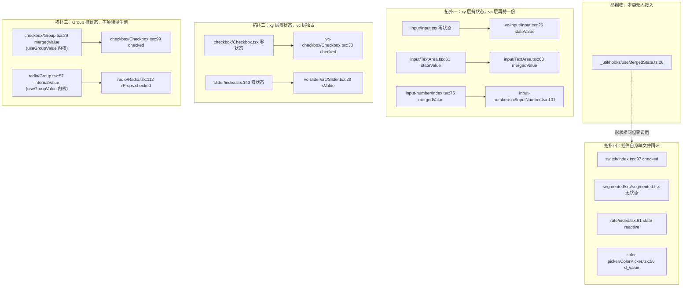
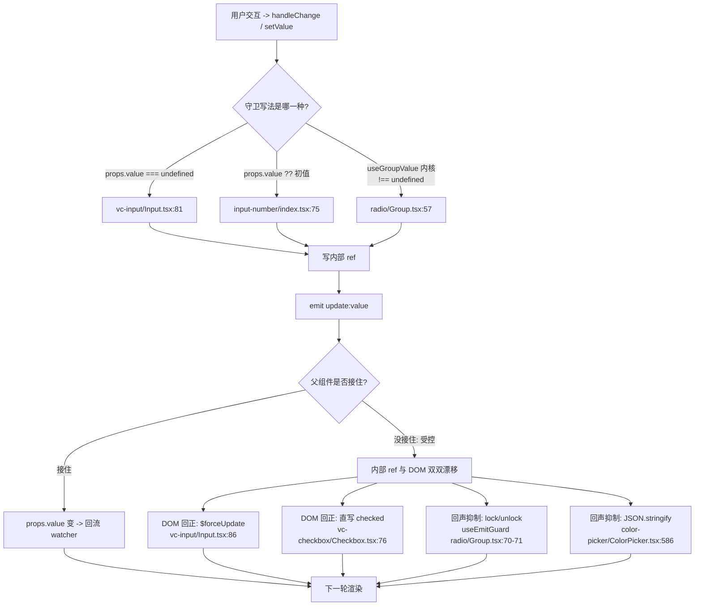
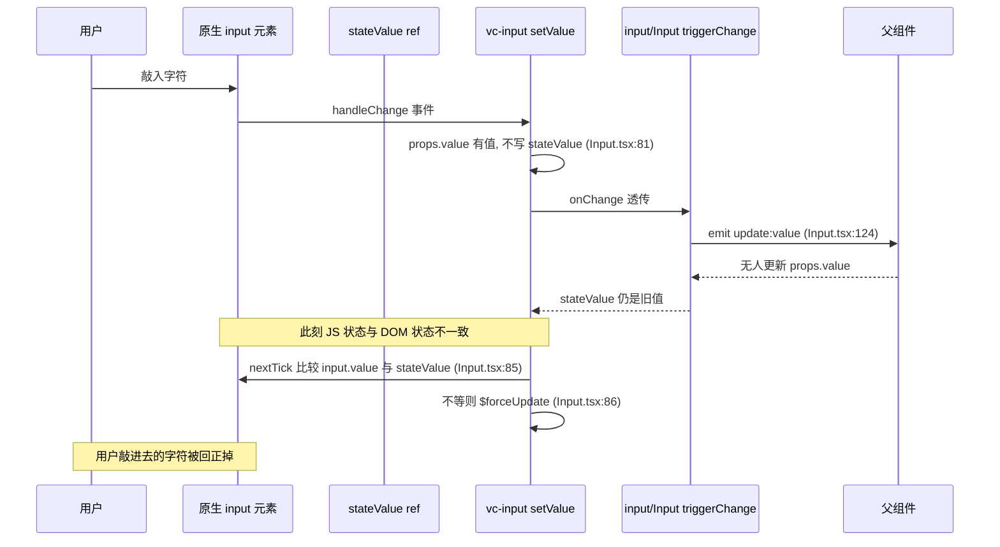

# C04-00 类横写：受控/非受控与 `useMergedState` 的一致实现

> **本篇解决**：基础表单控件这一类里，`value`/`defaultValue`/`checked`/`defaultChecked` 到底有几条接入路径、同一类控件对外的受控 API 是否一致、新增一个表单控件该选哪条路。
> **前置**：I13 响应式内核 hooks　**读者坐标**：`03-components/04-form-controls` 第 0/10 篇（类横写）

## 一、职责与边界

本篇是 C04「基础表单控件」类的横写篇，只管一件事：**这一类 9 个公开控件（input、input-number、checkbox、radio、switch、segmented、slider、rate、color-picker）加上它们的 `vc-*` 底座，各自是怎么把「外部受控值」和「内部自有值」合成一个可渲染、可回流的值的**。管三问：接入路径有几种、同一路径在不同控件里的行为是否一致、新增一个表单控件应该抄哪一个。

不负责的部分：

- **不重复论证 `useMergedState` 内部机制**。该 hook 的返回值同构性、`value.value !== undefined` 判定、`mergedValue`/`innerValue` 双 ref、`watchEffect` 与 `watch(value)` 的双跑、`toRaw` 去重门槛、21 个调用点里只有 4 处传 `onChange`、`_util/hooks/` 无任何单测——这些结论全部由 **I13 响应式内核 hooks** 建立，本篇直接引用其结论，不再展开。I13 也已给出「全仓受控实现实为三套」的判定；本篇的增量是：**在 C04 这一个类里，套数比三套更多，而且分裂发生在类内部而非层之间**。
- 不讲 `v-model` 的编译器语义、不讲 props 声明规范（归 A06）、不讲 Form 的校验流水线（归 C06-01）、不讲各控件的选项/日期流水线（归 C05-00）。
- 不做单个控件的逐 API 讲解。属性清单见 `apps/docs/components/input.md` 等手册篇。

依赖清单（本篇取证涉及的全部文件，均相对 `packages/xiaoye-ui/src/`）：

| 依赖方向 | 对象 | 证据 |
| --- | --- | --- |
| 底座 | `_util/hooks/useMergedState.ts` | 本类 0 个控件导入它（见论点 1 的复现命令） |
| 底座 | `vc-input/Input.tsx`、`_util/BaseInput.tsx` | `input/Input.tsx:164` 把 `onChange` 接到 `triggerChange` |
| 底座 | `vc-checkbox/Checkbox.tsx` | `checkbox/Checkbox.tsx:12`、`radio/Radio.tsx` 同一底座 |
| 底座 | `vc-slider/src/Slider.tsx` + `_util/BaseMixin.ts` | `vc-slider/src/Slider.tsx:11` `mixins: [BaseMixin]` |
| 工具 | `_util/props-util/index.ts:45`（`hasProp`）、`_util/props-util/initDefaultProps.ts:18` | `vc-slider/src/Slider.tsx:65`、`rate/index.tsx:49` |
| 跨类 | `form/FormItemContext`（`onFieldChange`/`onFieldBlur`） | `input/Input.tsx:127` 等 14 处（见论点 5） |
| 跨类 | `config-provider/DisabledContext`、`useConfigInject` | `switch/index.tsx:82-83`、`checkbox/Checkbox.tsx:36-38` |

## 二、源码地图

C04 这一类的状态代码分布很薄：**除 `color-picker/ColorPicker.tsx`（702 行）外，受控逻辑全部落在每个控件主文件的前 130 行内**，平均一个控件的「状态声明 + 回流 watcher + 写入守卫」三段加起来不到 30 行。正因为短，复制粘贴的成本低于抽象的成本，才长成现在这个样子。

| 文件 | 行数 | 在受控链路里的职责 | 关键行 |
| --- | --- | --- | --- |
| `_util/hooks/useMergedState.ts` | 47 | 本类的「外部参照物」，无人调用 | `:26` 判定、`:35` 无条件写 |
| `vc-input/Input.tsx` | 254 | Input 的真实状态宿主 | `:26` 声明、`:30-35` 回流、`:77-93` 写入 |
| `input/Input.tsx` | 230 | 零状态，纯透传 + emit | `:123-128` `triggerChange` |
| `input/TextArea.tsx` | 317 | 双 ref：`stateValue` + `mergedValue` | `:61`、`:63`、`:127-143` |
| `input-number/index.tsx` | 250 | xy 层自己持状态，`??` 判定 | `:75` 声明、`:94-101` 写入 |
| `input-number/src/InputNumber.tsx` | — | 第二层状态，同写法 | `:109`、`:294`、`:400` |
| `checkbox/Group.tsx` | 137 | Group 状态宿主 + 子项注册表 | `:25` 声明、`:63-84` `toggleOption` |
| `checkbox/Checkbox.tsx` | 147 | 零状态，group 模式改派生值 | `:59-63` 告警、`:93-104` 分支 |
| `radio/Group.tsx` | 158 | Group 状态宿主，`in props` 判定 | `:56`、`:70-82` |
| `radio/Radio.tsx` | 158 | 零状态，双 `update:` 事件 | `:83-89`、`:109-116` |
| `switch/index.tsx` | 230 | 状态 + 值映射层 | `:97-107`、`:129-137` |
| `segmented/src/segmented.tsx` | 189 | 无内部状态，`value` 必填 | `:47`、`:129-135` |
| `slider/index.tsx` | 255 | 零状态，非受控下沉到 `vc-slider` | `:141-145`、`:97` |
| `rate/index.tsx` | 254 | `reactive` 状态，`value` 带默认值 | `:48`、`:63-74`、`:93-100` |
| `color-picker/ColorPicker.tsx` | 702 | 唯一带回声抑制的实现 | `:56`、`:304-309`、`:576-594` |
| `vc-checkbox/Checkbox.tsx` | 150 | 原生 checkbox 状态宿主 | `:33`、`:55-77` |
| `vc-slider/src/Slider.tsx` | — | Options API + `data()` 状态 | `:29-31`、`:55`、`:65` |
| `_util/BaseMixin.ts` | 45 | `setState` 垫片，`$forceUpdate` | `:7-26` |
| `_util/props-util/initDefaultProps.ts` | 34 | 给 props 补 `default` | `:18-29` |
| `_util/props-util/index.ts` | 285 | `hasProp` 名不副实 | `:45-47` |

主实现入口是 `vc-input/Input.tsx:26`——它是本类最早、也最被后来者抄写的状态声明形状。

## 三、架构与数据流

### 图 1：静态结构——状态宿主到底在哪一层

本类不存在「统一的一层」持状态。按「谁是那份可写状态的第一个持有者」把 12 个文件摊开，得到四种拓扑，节点标签都是真实文件与符号：



这张图要读的信息是**边的方向而不是框的划分**：拓扑一和二里「谁写状态」在 `vc-*` 层，所以 `v-model` 的回流必须穿过一次组件边界（`input/Input.tsx:124` 的 `emit('update:value', e.target.value)` 发生在 `vc-input` 已经写完 `stateValue` 之后）；拓扑三里子项根本没有自己的状态，`checked` 是 `props.value === group.stateValue` 的比较结果（`radio/Radio.tsx:112`、`checkbox/Checkbox.tsx:99`），所以「子项受控」是个假命题——只有 Group 受控；拓扑四的 4 个控件彼此独立。`useMergedState` 在图里是孤立节点，只有一条虚线，代表「结构上可接入、实际零接入」。

### 图 2：一次写入的判定分岔——同一个语义的 3 种守卫拼法



分岔点在**左半边的守卫**，它们互不等价：`=== undefined` 把 `null` 判成受控（`vc-input/Input.tsx:26`），`??` 把 `null` 判成非受控（`input-number/index.tsx:75`）。**2026-09-30 更新**：本类原有的第五种拼法 `'value' in props`（原 `radio/Group.tsx:70`）已被移除——radio/checkbox 两个 Group 的守卫收敛进 `_util/hooks/useGroupValue.ts:36` 的 `props.value !== undefined` 判据，与 hook 同口径；Group 侧的回声抑制由同文件 `useEmitGuard` 的 lock/unlock 承担（`radio/Group.tsx:70-71`）。右半边的四种回正是另一层分裂：**只有会驱动原生表单元素的控件需要 DOM 回正**（`input` 系与 `checkbox`/`radio` 系），因为浏览器自己记住了用户敲进去的字符和点出来的勾；`switch`、`slider`、`segmented` 这类纯 `div` 控件不需要，于是它们也没抄这一手（`switch/index.tsx:129-137` 的 `setChecked` 干脆不写内部状态，只 emit）。

### 图 3：受控 Input 在「父组件故意不接 `update:value`」时的完整闭环



这条闭环是 `useMergedState` **结构上给不出来的**：I13 已证 `useMergedState.ts:35` 是无条件写 `innerValue`，所以接了 hook 的组件（如 `vc-picker/Picker.tsx:237`）在同样场景下 `innerValue` 会被推进、只是不显示；而 `vc-input` 选择不写 `stateValue`（`vc-input/Input.tsx:81-89`），代价就是必须额外做一次 DOM 对账。图里 `$forceUpdate` 那一步（`vc-input/Input.tsx:86`）不是可选的优化，是受控语义的实现本体——去掉它，受控 Input 会变成「看起来能改、提交时读到旧值」的假受控。

## 四、核心机制精读

### 论点 1：C04 全类零接入 `useMergedState`，也零接入 `useState`；「受控」这一个判定在本类有 9 种互不等价的拼法

**断言**：把 9 个公开控件目录与三个 `vc-*` 底座（`vc-input`、`vc-checkbox`、`vc-slider`）放在一起统计，`useMergedState` 与 `useState` 的命中数都是 **0**——这一类没有一行受控代码走 `_util/hooks/`，全部是就地手写。而「外部值是否接管」这一个判定，本类实际存在 9 种拼法，其中至少 4 组之间对 `null` / `undefined` / 「绑定了但没值」三种输入的归类结果不同。

两种方法交叉验证「零接入」（结果都是 0）：

```bash
cd packages/xiaoye-ui/src
grep -rn "useMergedState" --include='*.ts' --include='*.tsx' --include='*.vue' \
  input input-number checkbox radio switch segmented slider rate \
  color-picker vc-input vc-checkbox vc-slider | wc -l        # 0
grep -rn "hooks/useMergedState" --include='*.ts' --include='*.tsx' . \
  | grep -cE "^\./(input|input-number|checkbox|radio|switch|segmented|slider|rate|color-picker|vc-input|vc-checkbox|vc-slider)/"   # 0
```

九种拼法，逐个给出声明行与判定行（拼法 6 已无存例，只留该条说明）：

```ts
// packages/xiaoye-ui/src/vc-input/Input.tsx:26
    const stateValue = shallowRef(props.value === undefined ? props.defaultValue : props.value);
```

```ts
// packages/xiaoye-ui/src/input/TextArea.tsx:61
    const stateValue = shallowRef(props.value ?? props.defaultValue);
    const resizableTextArea = shallowRef();
    const mergedValue = shallowRef('');
```

```ts
// packages/xiaoye-ui/src/input-number/index.tsx:75
    const mergedValue = shallowRef(props.value ?? props.defaultValue);
    const focused = shallowRef(false);
    watch(
      () => props.value,
      () => {
        mergedValue.value = props.value;
      },
    );
```

```ts
// packages/xiaoye-ui/src/switch/index.tsx:97
    const checked = ref<string | number | boolean>(
      props.checked !== undefined ? props.checked : (attrs.defaultChecked as boolean),
    );
    const checkedStatus = computed(() => checked.value === props.checkedValue);
```

```ts
// packages/xiaoye-ui/src/radio/Group.tsx:56
    const { updating, lock, unlock } = useEmitGuard();
    const { internalValue, setInternalValue } = useGroupValue<any>(props, {
      onSync: () => unlock(),
    });
```

```ts
// packages/xiaoye-ui/src/color-picker/ColorPicker.tsx:56
    const d_value = ref(props.defaultValue !== undefined ? props.defaultValue : props.modelValue);
```

```ts
// packages/xiaoye-ui/src/vc-slider/src/Slider.tsx:29
  data() {
    const defaultValue = this.defaultValue !== undefined ? this.defaultValue : this.min;
    const value = this.value !== undefined ? this.value : defaultValue;
    return {
      sValue: (this as any).trimAlignValue(value),
      dragging: false,
    };
  },
```

```ts
// packages/xiaoye-ui/src/rate/index.tsx:49
  props: initDefaultProps(rateProps(), {
    value: 0,
    count: 5,
    allowHalf: false,
    allowClear: true,
    tabindex: 0,
    direction: 'ltr',
  }),
```

逐段解释这八行为什么不等价：

- **拼法 1（`=== undefined` 三元）** 是 `vc-*` 底座的主流：`vc-input/Input.tsx:26`、`vc-checkbox/Checkbox.tsx:33` 两处逐行同构（原第三处 `checkbox/Group.tsx:29` 已于 2026-09-30 收敛进 `useGroupValue` 内核，判据同为 `!== undefined`）。传 `:value="null"` 时 `null !== undefined` 成立，组件判为**受控**，`stateValue` 落成 `null`，最终由 `vc-input/utils/commonUtils.ts:22-27` 的 `fixControlledValue` 在渲染前把 `undefined`/`null` 一律换成 `''`。
- **拼法 2、3（`??`）** 是同一句话的反面：`input/TextArea.tsx:61`、`input-number/index.tsx:75` 用空值合并，传 `null` 会落到 `defaultValue`，组件判为**非受控**。也就是说 `<xy-input>` 与 `<xy-input-number>` 对「父组件把值置为 `null`」这一个动作给出相反的状态归属。同一个 `input-number` 内部还自我分裂：xy 层用 `??`（`input-number/index.tsx:75`），底层 `input-number/src/InputNumber.tsx:101`、`:294`、`:400` 三处全用 `=== undefined` 系。
- **拼法 4（`!== undefined ? : attrs.x`）** 的特别处不在判定而在**取值来源**：`switch/index.tsx:98` 从 `attrs` 里捞 `defaultChecked`，因为 `defaultChecked` 根本没进 props 声明，同时 `switch/index.tsx:86-95` 用 `'defaultChecked' in attrs` 与 `'value' in attrs` 做废弃告警——这是本类唯一一处「用 attrs 的存在性当判定输入」。I13 已指出它的回流 watcher 无条件赋值；这里补充它的第二个后果：**`attrs` 不是响应式声明的 prop，父组件改 `defaultChecked` 不会触发任何 watcher**。
- **拼法 5（`'value' in props`）—— 已于 2026-09-30 移除**。原实现是本类唯一真正按「有没有绑定」而非「值是什么」判定的写法（原 `radio/Group.tsx:70`），它和 `useMergedState.ts:26` 的 `value.value !== undefined` 在 `<xy-radio-group :value="undefined">` 上结论相反。后续探针实验补上了本篇当年悬置的那块拼图（「未在源码中找到对应实现」（原悬置标注））：Vue 3 会把**声明过的 prop 键一律放进 `props`**（父组件没传时值为 `undefined`），所以 `'value' in props` **恒真**——非受控分支永远不可达，不传 `value` 的 RadioGroup 点击选项时内部值不更新、子项 `checked` 不变。修复方式：Radio.Group 与 Checkbox.Group 一并收敛进 `_util/hooks/useGroupValue.ts` 共享内核（判据 `props.value !== undefined`，见该文件 `:36`），`radio/Group.tsx:57-69` 是消费点。
- **拼法 6（`isControlled` computed）—— 已于 2026-10-02 随 rating、toggle-button 两个控件的移除退出本类，现无存例。** 原实现是这两个控件共用的样板（同一段 11 行代码的两份副本，除 `internalValue` 初值一行：`props.defaultValue ?? 0` 对 `props.defaultValue`）。它的判定语义与 hook 相同（`!== undefined`），但回流条件写成 `isControlled.value && val !== undefined`——`isControlled.value` 就是 `props.value !== undefined`，而 watcher 的 `val` 正是 `props.value`，**两个条件是同一个命题**，后半个纯属冗余；配合 `{ immediate: true }` 它换到了一件 hook 没有的行为：`props.value` 从有值改成 `undefined` 时**保留**最后一次内部值，而不是像 `useMergedState.ts:42-44` 那样把 `undefined` 抄进去清空。这条差异与 I13 坑 1 的结论正好相反方向；同一思想在本类的残留是 `input/Password.tsx:43` 对 `visible` 通道的二次守卫。
- **拼法 7（`defaultValue` 优先级反转）**：`color-picker/ColorPicker.tsx:56` 判定的是 `props.defaultValue !== undefined`，写法意图是「`defaultValue` 优先、`modelValue` 兜底」。**本行初稿在这里的判定写反了**（原写「左支在没传 `defaultValue` 时为假，落到 `modelValue`」），由 C04-10 反证并在此更正：`defaultValue` 的默认值是 `null`（`color-picker/colorPickerTypes.ts:47` 的 `anyType<any>(null)`，而 `_util/type.ts:66-67` 的 `anyType` 把它展开成 `{ validator: () => true, default: null }`），`null !== undefined` 为**真**，所以**不传 `defaultValue` 时取的是左支**，`d_value` 初值恒为 `null`，`props.modelValue` 那条兜底分支在「用户只传 `v-model`」的常见形态下**永远不会被执行**。结论不是「靠默认值恰好是 `null` 才没写反」，而是**它确实写反了**：非受控初值通道整条失效。
  为什么这个反转几乎没有症状——**它被连打了两次补丁，两次都是巧合**：其一，紧跟其后的 `watch(() => props.modelValue, …)`（`color-picker/ColorPicker.tsx:575-592`）带 `{ immediate: true, deep: true }`，在 setup 阶段就把 `d_value` 覆盖成 `modelValue`（`:579`），所以那个 `null` 初值活不过一帧；其二，`d_value` 在组件内部**只写不读**——除了 `:56` 的初始化，其余命中全是写入（`:305`、`:579`、`:599`）或转出（`:630` 的 `expose`），没有任何一处读它参与计算或渲染。于是非受控初值通道是**双重死亡**：判定写反 + 目标变量无人读取。真正决定面板显示的是 `:575` 那个 watcher 与 `:215` 的 `HEXtoHSB(props.defaultColor)` 回落，`defaultValue` 到不了渲染路径。与 `useMergedState.ts:14-21` 的「后写赢三段覆盖」相比，这条既丢了初值语义、又没有可观测的报错，是最难被发现的一类写法。
- **拼法 8（Options API `data()` + `hasProp`）**：`vc-slider/src/Slider.tsx:29-35` 把状态放在 `data()` 返回值里，判定用的是 `this.x !== undefined`；而写入守卫 `vc-slider/src/Slider.tsx:65` 换成 `hasProp(this, 'value')`。`hasProp` 的实现是 `_util/props-util/index.ts:45-47` 的 `instance[prop] !== undefined`——**函数名承诺「是否存在该 prop」，实现却是「是否不为 undefined」**，所以拼法 8 在语义上等于拼法 1，但读代码的人会按名字理解成拼法 5。这是本类最容易被误读的一对。
- **拼法 9（给 `value` 本身设默认值 → 恒受控）**：`rate/index.tsx:49` 经 `_util/props-util/initDefaultProps.ts:18-29` 把 `value: Number` 变成 `{ type: Number, default: 0 }`。于是 `rate/index.tsx:92` 的 `if (props.value === undefined)` **永远为假**，`state.value` 在鼠标路径上永远不被写入；而 `rate/` 目录下 `grep -rn "defaultValue" rate/` 无任何命中，即 Rate **根本没有 `defaultValue` 这个 prop**。Rate 是本类唯一一个「写了受控守卫、但守卫的条件不可达」的控件。

九种拼法里有 4 处是「零状态」实现，它们把判定推给别的文件或干脆不判定：`input/Input.tsx`（零状态，见论点 2）、`checkbox/Checkbox.tsx`、`radio/Radio.tsx`（派生值，见论点 3）、`segmented/src/segmented.tsx`（`value` 声明为 `required: true`，`segmented/src/segmented.tsx:47`，本类唯一没有非受控模式的控件）。

结论回扣：**新增表单控件不要照抄任何邻近控件**——邻近控件的判定至少有一半对 `null` 的处理和你的预期相反。可选路径只有两条：接 `useMergedState`（拿到 `!== undefined` 判定 + 双 ref + `toRaw` 去重，代价是拿不到论点 2 的 DOM 回正），或者自己手写一套判定与回流（本类原有的 `isControlled` 样板已随 2026-10-02 移除的两个控件退出，见拼法 6）。本类目前没有人选第一条；选第二条的原有 2 个控件，已随组件移除清零。

### 论点 2：原生控件必须同时收编「JS 状态」和「浏览器自有状态」，本类用三种手工回正手段，其中一种写坏了优先级

**断言**：`input`、`textarea`、`checkbox`、`radio` 这四个控件的可写状态有两份——组件里的 ref 和浏览器为原生表单元素维护的 `value`/`checked`。受控模式下本类一律**不写组件 ref**（`vc-input/Input.tsx:81`、`vc-checkbox/Checkbox.tsx:55`），于是两份必然漂移；把它拉回来的动作只能直接作用在 DOM 上。这一层能力是 `useMergedState` 结构上给不出来的，也是本类不接入它的**唯一技术上成立的理由**。

```ts
// packages/xiaoye-ui/src/vc-input/Input.tsx:77
    const setValue = (value: string | number, callback?: Function) => {
      if (stateValue.value === value) {
        return;
      }
      if (props.value === undefined) {
        stateValue.value = value;
      } else {
        nextTick(() => {
          if (inputRef.value.input.value !== stateValue.value) {
            rootRef.value?.$forceUpdate();
          }
        });
      }
      nextTick(() => {
        callback && callback();
      });
    };
```

拆三段：

- `:78-80` 的短路是**幂等保护**，但比较对象是自己的 ref 而不是外部值，所以受控时每次输入都会走到 `:83`。
- `:81-82` 与 `:83-89` 是互斥的两条腿：非受控写 ref，受控**什么都不写**，转而安排一次 `nextTick` 对账。I13 论点 2 已把这种写法登记为「受控时不写内部 state」的第三种受控写法，本篇补充它的另一半：这种写法的成立依赖 `:85-87`，缺了它受控语义就不完整。
- `:85` 比的是 `inputRef.value.input.value`（DOM 里的真实字符串）与 `stateValue.value`（JS 里被父组件钉住的目标值）。两者不等说明用户敲进去了父组件不认的字符，`:86` 用 `rootRef.value?.$forceUpdate()` 强制重渲染，让 `:26` 那份 `stateValue` 重新写回 `<input value=...>`。**`$forceUpdate` 在这里不是性能补丁，而是把 DOM 状态覆盖回 JS 状态的唯一手段**——`shallowRef` 的值没变，响应式系统不会重渲染，浏览器就会保留用户敲的字符。
- `rootRef` 由 `:29` 的 `shallowRef<ComponentPublicInstance>()` 持有，`:66-73` 的 `expose` 把 `input` 一并暴露出去；`:86` 的引用带 `?.`，说明作者知道这个实例引用可能为空。

`checkbox` 用了同一目的、不同手段的实现：

```ts
// packages/xiaoye-ui/src/vc-checkbox/Checkbox.tsx:51
    const eventShiftKey = ref();
    const handleChange = e => {
      if (props.disabled) {
        return;
      }
      if (props.checked === undefined) {
        checked.value = e.target.checked;
      }
      e.shiftKey = eventShiftKey.value;
      const eventObj = {
        target: {
          ...props,
          checked: e.target.checked,
        },
        stopPropagation() {
          e.stopPropagation();
        },
        preventDefault() {
          e.preventDefault();
        },
        nativeEvent: e,
      };

      // fix: maintain current state in controlled mode
      // 受控模式下维持现有状态
      if (props.checked !== undefined) {
        inputRef.value.checked = !!props.checked;
      }
      emit('change', eventObj);
```

`:55-57` 与 `vc-input` 同构（非受控才写 ref）；`:75-76` 则是**绕过渲染、直写 DOM property**：`inputRef.value.checked = !!props.checked`。复选框是原生控件里唯一「DOM property 与 JS 状态可以一对一赋值」的，所以这里不需要 `$forceUpdate`，一次赋值即可完成回正。`:73` 的英文注释加 `:74` 的中文注释是本类里少见的把意图写在代码旁边的地方，改这段前应读它。

第三条手段在 `TextArea`，它多了一层显示值加工，也因此多了一个写坏的守卫：

```ts
// packages/xiaoye-ui/src/input/TextArea.tsx:110
    const instance = getCurrentInstance();
    watch(
      () => props.value,
      () => {
        if ('value' in instance.vnode.props || {}) {
          stateValue.value = props.value ?? '';
        }
      },
    );
```

`:114` 想写的是「`value` 真的被绑定时才同步」，即 `radio/Group.tsx:70` 那种存在性判定；但 `in` 的优先级高于 `||`，实际解析成 `('value' in instance.vnode.props) || {}`——右操作数是 `{}`，**恒为真值，守卫完全失效**；而它本来想防的 `props` 为 `undefined` 的情况会直接抛 `TypeError: Cannot use 'in' operator to search for 'value' in undefined`。两种意图都没实现。可复现：

```bash
node -e "const v={props:{class:'x'}}; console.log('value' in v.props || {})"   # => {}（真值）
node -e "const v={props:undefined}; 'value' in v.props || {}"                  # => TypeError
```

`TextArea` 的另外两份状态在 `:61` 的 `stateValue` 与 `:63` 的 `mergedValue`，后者由 `:239-250` 的 `watchEffect` 生成：

```ts
// packages/xiaoye-ui/src/input/TextArea.tsx:128
    const setValue = (value: string | number, callback?: Function) => {
      if (stateValue.value === value) {
        return;
      }
      if (props.value === undefined) {
        stateValue.value = value;
      } else {
        nextTick(() => {
          if (resizableTextArea.value.textArea.value !== mergedValue.value) {
            resizableTextArea.value?.instance.update?.();
          }
        });
      }
```

`:136` 与 `vc-input/Input.tsx:85` 的差异有两处：比的是 `mergedValue`（加工后的显示串）而不是 `stateValue`；回正动作调 `instance.update()`（`ResizableTextArea` 的自动高度重算）而不是 `$forceUpdate`。加上 `:115` 的 `?? ''`，`TextArea` 对「空值」的处理是 `null`/`undefined` → `''`，与 `vc-input/utils/commonUtils.ts:22-27` 的 `fixControlledValue` 落在同一个终点：

```ts
// packages/xiaoye-ui/src/vc-input/utils/commonUtils.ts:22
export function fixControlledValue(value: string | number) {
  if (typeof value === 'undefined' || value === null) {
    return '';
  }
  return String(value);
}
```

`:23` 用 `typeof value === 'undefined'` 而不是 `value === undefined`——两种写法在本仓库等价，但与 `:24` 的 `=== null` 并列时，读起来像在区分两种空值，实际终点都是 `''`。

对照组是**不需要 DOM 回正**的控件，它们因此把内部状态那一半也省了：

```ts
// packages/xiaoye-ui/src/switch/index.tsx:129
    const setChecked = (check: CheckedType, e: MouseEvent | KeyboardEvent) => {
      if (mergedDisabled.value) {
        return;
      }
      emit('update:checked', check);
      emit('change', check, e);
      props.onChange?.(check, e as MouseEvent);
      formItemContext.onFieldChange();
    };
```

```ts
// packages/xiaoye-ui/src/segmented/src/segmented.tsx:128
    const handleChange = (_event: ChangeEvent, val: SegmentedValue) => {
      if (props.disabled) {
        return;
      }
      emit('update:value', val);
      emit('change', val);
    };
```

`switch/index.tsx:129-137` 全程没碰 `:97` 那个 `checked` ref——`Switch` 的 `<button>` 是自己画的（`switch/index.tsx:213` 的 `aria-checked`），浏览器不持状态，所以受控时「什么都不做、只 emit」就够了；`segmented/src/segmented.tsx:128-134` 同理，且它连内部状态都没有，渲染直读 `props.value`（`segmented/src/segmented.tsx:158`、`:173`）。这两个文件是本类里**唯一两处「受控模式行为正确且没有影子状态」**的实现，代价是它们没有非受控模式：`Switch` 的初值要从 `attrs` 里捞（`switch/index.tsx:98`），`Segmented` 的 `value` 是 `required: true`（`segmented/src/segmented.tsx:47`）。

结论回扣：判断一个新控件要不要自己写状态，标准不是「它是不是表单控件」，而是**它背后是不是一个原生表单元素**。是（input/textarea/checkbox/radio）就必须同时实现「不写 ref」和「回正 DOM」两半，只写前一半会做出假受控；不是（switch/segmented/slider/rate/color-picker）就应当像 `segmented/src/segmented.tsx:128` 那样零状态，把非受控需求交给 `useMergedState`。

### 论点 3：Group 型控件里「子项受控」是假命题，两条 Group 路径的判定、注册表与 context 写法三处都不同

**断言**：`checkbox` 与 `radio` 这两个「一对多」控件把状态整个上移到 Group，子组件的 `checked` 是渲染期算出来的派生比较值，子组件本身零状态。**2026-09-30 更新**：两条路径原先在**判定拼法、子项注册机制、context 注入写法**三处各不相同，且都不与 `useMergedState` 相同；现在判定拼法已收敛——两 Group 共用 `_util/hooks/useGroupValue.ts` 的受控/非受控内核（判据 `!== undefined`，与 `useMergedState` 同口径但仍是独立实现），子项注册表也收进同文件的 `useValueRegistry` 标准件（radio 侧依旧不需要注册表）；context 注入写法保持不同。I13 论点 2 已把 `checkbox/Group.tsx:29` 登记为手写实现之一，现已随收敛摘出。

判定与写入守卫（2026-09-30 起两份判定都指向 `useGroupValue` 内核，摘录取各自消费点）：

```ts
// packages/xiaoye-ui/src/checkbox/Group.tsx:29
    const { internalValue: mergedValue, setInternalValue } = useGroupValue<CheckboxValueType[]>(
      props,
      {
        initialValue: () => props.defaultValue,
        normalize: v => v || [],
      },
    );
```

```ts
// packages/xiaoye-ui/src/radio/Group.tsx:62
      // 非受控时自己存值；受控时等父组件写回。
      // 判据是「值是否为 undefined」而不是「键是否存在」——Vue 3 会把声明过的 prop
      // 一律放进 props（父组件没传时值为 undefined），`'value' in props` 恒真。
      setInternalValue(value);
      if (!updating.value && value !== lastValue) {
        lock();
        emit('update:value', value);
        emit('change', ev);
        formItemContext.onFieldChange();
      }
```

- `checkbox/Group.tsx:29` 原用拼法 1（`=== undefined` 三元）、回流带 `|| []` 兜底——`props.value` 变 `undefined` 时数组被清空；这个语义保留为内核的 `normalize: v => v || []` 钩子（`:33`），受控/非受控判定则收进 `useGroupValue.ts:36` 的 `props.value !== undefined`。`radio/Group.tsx:57` 的 `internalValue` 经内核初始化，**仍然不读 `defaultValue`**（`radio/interface.ts` 里也没有 `defaultValue` 声明位），非受控 RadioGroup 的初值只能是 `undefined`。
- 原 `radio/Group.tsx:70` 的拼法 5（存在性判定）已随收敛移除，重入守卫改由 `useEmitGuard` 提供：`lock()` 在发事件前置位、`nextTick` 自动解除（`useGroupValue.ts:104-109`），受控值写回时经 `onSync` 调 `unlock()` 立即解锁（`radio/Group.tsx:59`）。这套组合的目标不变——**同一次用户操作只发一对 `update:value` + `change`**。`checkbox/Group.tsx:54-55` 没有这一层，它是无条件 emit。
- 与之对照，`color-picker/ColorPicker.tsx:586` 用第三种手段解决同一个问题：

```ts
// packages/xiaoye-ui/src/color-picker/ColorPicker.tsx:576
    watch(
      () => props.modelValue,
      newValue => {
        d_value.value = newValue;
        hsbValue.value = toHSB(newValue);

        const emitted = lastEmittedValue.value;
        lastEmittedValue.value = undefined;

        // 值由组件自身 emit 产生时 UI 已是最新，跳过回写；否则按外部值刷新 UI
        if (emitted !== undefined && JSON.stringify(emitted) === JSON.stringify(newValue)) {
          return;
        }

        updateUI();
      },
      // rgb/hsb 格式下 modelValue 是对象，父组件原地修改也需要感知
      { immediate: true, deep: true },
    );
```

`:586` 用 `JSON.stringify` 做结构相等比较来识别「这次 props 回流是我自己刚发出去的」，`:582` 的注释把这个意图写明了。三种手段解决同一件事，散在三个文件里：`radio/Group.tsx:74`（布尔标志 + `nextTick`）、`color-picker/ColorPicker.tsx:586`（序列化比较）、`vc-picker/RangePicker.tsx:316`（走 hook，靠 `useMergedState.ts:36` 的 `toRaw` 门槛，I13 论点 1 已述）。C04 类内前两种并存，第三种为零。

子项注册表只在 `checkbox` 侧存在，因为它要解决「Group 的 `options` 数组与插槽里的 `<xy-checkbox>` 混合渲染时，选中顺序与去重」。2026-09-30 起注册表收进 `_util/hooks/useGroupValue.ts` 的 `useValueRegistry` 标准件，`checkbox/Group.tsx:47-48` 只剩一行消费点：

```ts
// packages/xiaoye-ui/src/checkbox/Group.tsx:47
    // 子项注册表：子项挂载登记 / 卸载注销 → registeredValues 是「当前还活着的 value 集合」
    const { registerValue, cancelValue, registeredValues } = useValueRegistry<CheckboxValueType>();
```

```ts
// packages/xiaoye-ui/src/_util/hooks/useGroupValue.ts:66
export function useValueRegistry<V = string>() {
  const triggerUpdate = ref(Symbol());
  // 这两张表整体替换而不是原地改，用 shallowRef 即可；它同时避免泛型 V 被 ref 深层解包
  const registeredValuesMap = shallowRef(new Map<Symbol, V>());
  const registeredValues = shallowRef(new Map<V, true>());

  const cancelValue = (id: Symbol) => {
    registeredValuesMap.value.delete(id);
    triggerUpdate.value = Symbol();
  };
  const registerValue = (id: Symbol, value: V) => {
    registeredValuesMap.value.set(id, value);
    triggerUpdate.value = Symbol();
  };

  watch(triggerUpdate, () => {
    const next = new Map<V, true>();
    for (const value of registeredValuesMap.value.values()) {
      next.set(value, true);
    }
    registeredValues.value = next;
  });
```

`useGroupValue.ts:67` 的 `triggerUpdate` 是一个「每次变更就换一个全新 Symbol」的信号位——因为 `registeredValuesMap` 是 `ref(new Map())`，`Map.set`/`delete` 不会触发 `ref` 的依赖（I13 论点 5 在 `useRefs.ts:9` 上指出过同一现象，那里靠整表替换解决，这里靠换一个 Symbol 解决）；`watch` 重建 `registeredValues` 的本体在 `useGroupValue.ts:81-87`。`radio` 侧没有这一层，因为 RadioGroup 的子项顺序由 `options` 或插槽唯一决定，不需要跨组件登记。

`toggleOption` 用这张表把用户选中的值再筛一遍、再排序：

```ts
// packages/xiaoye-ui/src/checkbox/Group.tsx:50
    const toggleOption = (option: CheckboxOptionType) => {
      const optionIndex = mergedValue.value.indexOf(option.value);
      const value = [...mergedValue.value];
      if (optionIndex === -1) {
        value.push(option.value);
      } else {
        value.splice(optionIndex, 1);
      }
      // 非受控时才落内部值，受控时等父组件写回（等价于原来的 `props.value === undefined`）
      setInternalValue(value);
      const val = value
        .filter(val => registeredValues.value.has(val))
        .sort((a, b) => {
          const indexA = options.value.findIndex(opt => opt.value === a);
          const indexB = options.value.findIndex(opt => opt.value === b);
          return indexA - indexB;
        });
      emit('update:value', val);
      emit('change', val);
      formItemContext.onFieldChange();
    };
```

注意守卫与 emit 的不对称：`mergedValue` 只在非受控时更新（守卫在内核 `useGroupValue.ts:43-47` 的 `setInternalValue` 里，判据 `props.value !== undefined`），但 `emit` 的是**过滤 + 排序后的 `val`**，不是写进 `mergedValue` 的那个 `value`。`:61` 的 `filter` 意味着「未登记的选中项会被静默丢弃」。

子项侧的派生值与两条不同的 context 管道：

```ts
// packages/xiaoye-ui/src/radio/Radio.tsx:109
      if (radioGroup) {
        rProps.name = radioGroup.name.value;
        rProps.onChange = onChange;
        rProps.checked = props.value === radioGroup.value.value;
        rProps.disabled = mergedDisabled.value || radioGroup.disabled.value;
      } else {
        rProps.onChange = handleChange;
      }
```

```ts
// packages/xiaoye-ui/src/checkbox/Checkbox.tsx:93
      if (checkboxGroup && !skipGroup) {
        checkboxProps.onChange = (...args) => {
          emit('change', ...args);
          checkboxGroup.toggleOption({ label: children, value: props.value });
        };
        checkboxProps.name = checkboxGroup.name.value;
        checkboxProps.checked = checkboxGroup.mergedValue.value.includes(props.value);
        checkboxProps.disabled = mergedDisabled.value || contextDisabled.value;
        checkboxProps.indeterminate = indeterminate;
      } else {
        checkboxProps.onChange = handleChange;
      }
```

两处 `checked` 都是渲染期比较（`radio/Radio.tsx:112` 的 `===`、`checkbox/Checkbox.tsx:99` 的 `.includes`），子组件从不写它，所以「单独给一个 `<xy-checkbox>` 绑 `v-model:checked` 而它处在 Group 里」是无效写法——`:93` 的分支直接覆盖了 `checked` 与 `onChange`。`checkbox` 侧留了逃生口 `skipGroup`（`checkbox/Checkbox.tsx:48` 的 `watchEffect` 与 `:93` 的条件都读它），`radio` 侧**没有对应开关**，Group 里的 Radio 无法退回独立受控模式。

context 的两种管道也在同一类里并存：`checkbox/Group.tsx:89` 直接 `provide(CheckboxGroupContextKey, {...})`，键类型在 `checkbox/interface.ts:80-87` 声明（`mergedValue: Ref<CheckboxValueType[]>` 是裸 ref）；`radio/Group.tsx:85-91` 走的是 `radio/context.ts:7-9` 的 `useProvideRadioGroupContext` 包装，键在 `radio/context.ts:6`。也就是说 `checkbox` 是本类里唯一不经过 `useProvide*` 助手的 Group。改名或统一时，两侧的影响面不一样。

结论回扣：新增「一对多」控件时，先决定要不要 `skipGroup` 这类逃生口，再决定注册表要不要——`radio` 与 `checkbox` 的差别（`radio/Radio.tsx:112` 不需要 `registeredValues`、`checkbox/Checkbox.tsx:99` 需要）来自「Group 的选中值集合由谁排序」，不是随手写的。

### 论点 4：`v-model` 参数名在本类分裂成 4 组，`change` 载荷分裂成 5 种形状，6 个文件在没有 `emits` 声明的情况下发 `update:*`

**断言**：类内受控对外面的不一致比内部实现更严重。三个层次各自分裂：

**（a）`v-model` 参数名四种。** 逐个给出发出点：

```ts
// packages/xiaoye-ui/src/input/Input.tsx:123
    const triggerChange = (e: Event) => {
      emit('update:value', (e.target as HTMLInputElement).value);
      emit('change', e);
      emit('input', e);
      formItemContext.onFieldChange();
    };
```

```ts
// packages/xiaoye-ui/src/checkbox/Checkbox.tsx:65
    const handleChange = (event: CheckboxChangeEvent) => {
      const targetChecked = event.target.checked;
      emit('update:checked', targetChecked);
      emit('change', event);
      formItemContext.onFieldChange();
    };
```

```ts
// packages/xiaoye-ui/src/color-picker/ColorPicker.tsx:304
    function writeValue(value: any, _event: MouseEvent | TouchEvent) {
      d_value.value = value;
      lastEmittedValue.value = value;
      emit('update:modelValue', value);
      emit('value-change', value);
    }
```

- `update:value` 是主流：`input/Input.tsx:124`、`input/TextArea.tsx:159`、`input/Search.tsx:49`、`input-number/index.tsx:98`、`checkbox/Group.tsx:71`、`radio/Group.tsx:72`、`segmented/src/segmented.tsx:132`、`slider/index.tsx:144`、`rate/index.tsx:95` 共 10 处（第 10 处是 `radio/Radio.tsx:86`，见（b））。
- `update:checked` 是布尔类控件的第二套名字：`checkbox/Checkbox.tsx:67`、`switch/index.tsx:133`。它的 props 侧对应在 `checkbox/interface.ts:55`（`checked`）与 `switch/index.tsx:29`，`defaultChecked` 在 `checkbox/interface.ts:54` 是 prop、在 `switch/index.tsx` 却**根本不是 prop**（`switch/index.tsx:98` 从 `attrs` 读）。
- `update:modelValue` 只有 `color-picker/ColorPicker.tsx:307` 一处，对应 `color-picker/colorPickerTypes.ts:45` 的 `modelValue`。也就是说 `<xy-color-picker v-model="c">` 与 `<xy-input v-model:value="c">` 在同一个表单里必须写两种形态。
- `update:visible` 是第四种，出现在 `input/Password.tsx:40`，属于 Input 家族却用 `visible` 而非 `open`/`checked`。它自己还带一份内部状态 `input/Password.tsx:33` 的 `shallowRef(false)`，回流守卫写成 `props.visible !== undefined`（`input/Password.tsx:43-44`），即拼法 1 作用在第二个受控通道上——`Password` 因此同时受 `value` 与 `visible` 两个 prop 管辖，本类独一份。

**（b）一次交互双通道。** `XYRadio` 是唯一同时发两条 v-model 的控件：

```ts
// packages/xiaoye-ui/src/radio/Radio.tsx:83
    const handleChange = (event: RadioChangeEvent) => {
      const targetChecked = event.target.checked;
      emit('update:checked', targetChecked);
      emit('update:value', targetChecked);
      emit('change', event);
      formItemContext.onFieldChange();
    };
```

`:85` 与 `:86` 都携带 `targetChecked`（布尔），props 侧两个通道也都声明了（`radio/Radio.tsx:31`、`:32`），`emits` 两个都列了（`radio/Radio.tsx:44-45`）。这个双发只在**独立 `<xy-radio>`** 路径上生效（`radio/Radio.tsx:115` 走 `handleChange`），一旦进了 Group 就换成 `onChange`（`radio/Radio.tsx:111`），由 Group 发 `update:value` 且载荷是选项值而不是布尔值（`radio/Group.tsx:72`）。也就是说 `@update:value` 这一个事件在 `<xy-radio>` 上拿到 `boolean`、在 `<xy-radio-group>` 上拿到 `option.value`——同名事件、类型不同，`radio/interface.ts` 没有任何注释说明这一点。

**（c）`emits` 选项缺失的 6 个文件。** 复现（统计「发了 `update:*` 但没有 `emits:` 选项」的组件文件）：

```bash
cd packages/xiaoye-ui/src
grep -rl "emit('update:" --include='*.tsx' input input-number checkbox radio \
  switch segmented slider rate color-picker \
  | grep -v test | while read f; do
    [ "$(grep -c '^\s*emits:' $f)" = "0" ] && echo $f; done
# 6 个：input/Search.tsx input/Password.tsx input/TextArea.tsx
#       segmented/src/segmented.tsx slider/index.tsx rate/index.tsx
```

其中两处的 `emits` 不是漏写，是**被注释掉后留下的痕迹**，原始清单还看得见：

```ts
// packages/xiaoye-ui/src/slider/index.tsx:98
  props: sliderProps(),
  // emits: ['update:value', 'change', 'afterChange', 'blur'],
  slots: Object as CustomSlotsType<{
```

```ts
// packages/xiaoye-ui/src/rate/index.tsx:54
  }),
  // emits: ['hoverChange', 'update:value', 'change', 'focus', 'blur', 'keydown'],
  setup(props, { slots, attrs, emit, expose }) {
```

`slider/index.tsx:99` 与 `rate/index.tsx:54` 这两行注释是本类最有信息量的一处历史：注释里的 `afterChange`（slider）与 `hoverChange`（rate）在现行代码中已改名或已不存在，但注释没删。三者（slider、rate、segmented）之所以去掉 `emits` 仍能工作，是因为它们把回调同时声明成了 **prop**：`slider/index.tsx:87`、`rate/index.tsx:37`、`segmented/src/segmented.tsx:50` 都有 `'onUpdate:value': functionType<...>()`。`emit('update:value', x)` 在没有 `emits` 声明时会去 props 上找 `onUpdate:value`，所以链路是通的。

但省掉 `emits` 有一个必须补偿的副作用：Vue 只把**声明过的**东西从 `attrs` 里摘走。本类这 6 个文件全部靠「把 `onUpdate:xxx` 也声明成 prop」来摘走监听器——`vc-input/inputProps.ts:98`、`input/Password.tsx:29` 各有一份。这条通道一旦漏写，监听器就会随 `attrs` 被铺到真实 DOM 上：`segmented/src/segmented.tsx:139` 的 `<div {...attrs}>` 正是这种整体铺开的写法。已经额外付过一笔账的两个控件写得很明白：

```ts
// packages/xiaoye-ui/src/radio/Radio.tsx:102
      const rProps: RadioProps = {
        prefixCls: prefixCls.value,
        id,
        ...omit(restProps, ['onUpdate:checked', 'onUpdate:value']),
        disabled: disabled.value ?? contextDisabled.value,
      };
```

`switch/index.tsx:176-197` 的 `omit(props, [...])` 列表第 10 项就是 `'onUpdate:checked'`（`switch/index.tsx:188`），两者都是为了不把监听函数铺到真实 DOM 上。`input/TextArea.tsx:255` 的 `{...props, ...attrs}` 没有做任何 omit，函数会被一路带到 `ClearableLabeledInput`——这是本类里唯一一处「两个通道都可能被带下去」的写法，改动时要单独验证。

**（d）`change` 载荷第五种形状。** 同一类里 `change` 事件的参数形态有 5 种，逐一给点：

| 形状 | 代表发出点 |
| --- | --- |
| 原生 `Event` | `input/Input.tsx:125` |
| 合成 `{target, stopPropagation, preventDefault, nativeEvent}` | `vc-checkbox/Checkbox.tsx:59-71`，由 `checkbox/Checkbox.tsx:68` 原样转发 |
| 裸值 | `input-number/index.tsx:99`、`slider/index.tsx:145`、`segmented/src/segmented.tsx:133` |
| `(值, 事件)` 两参 | `switch/index.tsx:135` |
| `{event, value}` 对象 | `color-picker/ColorPicker.tsx:301` |

结论回扣：这一类目前没有「一致的对外契约」可言。可执行的最小统一约定是：非布尔控件一律 `value`/`defaultValue`/`update:value`/裸值 `change`；布尔控件一律 `checked`/`defaultChecked`/`update:checked`，并像 `switch/index.tsx:188` 那样把 `onUpdate:checked` 写进 omit 列表；`modelValue` 只留给确实需要 `v-model` 无参用法的组件，且必须在 `interface.ts` 里注明为什么。`color-picker` 与 `radio` 是现状的两个偏离点，`rate` 是第三个（`radio/Radio.tsx:85-86` 的双通道）。

### 论点 5：`formItemContext.onFieldChange()` 是本类与 Form 的唯一耦合点，9 个控件目录里 2 个完全没接，且接入的 7 个都没有同值门槛

**断言**：表单控件的「值变了」要通知 Form 重跑校验，本类唯一的通知口是 `useInjectFormItemContext()` 返回的 `onFieldChange`。全类 `onFieldChange()` 调用点 **10 处**、`onFieldBlur()` **4 处**，分布在 10 个文件里；`segmented`、`color-picker` 两个目录**一次都没调用，也没导入过 `useInjectFormItemContext`**。因为 context 的默认值是空函数（`packages/xiaoye-ui/src/form/FormItemContext.ts:70-71`），没接的控件不会报错，只会在用户改值后**不触发校验**——这是静默失效，不是崩溃。

复现（两条独立命令交叉验证「零接入」）：

```bash
cd packages/xiaoye-ui/src
grep -rn "onFieldChange()" --include='*.tsx' --include='*.ts' \
  input input-number checkbox radio switch segmented slider rate \
  color-picker vc-input vc-checkbox | grep -v test | wc -l    # 10
grep -rln "useInjectFormItemContext" --include='*.tsx' --include='*.ts' \
  segmented color-picker                                # 空
```

接入方的调用形状全部一样——**先 emit、最后 onFieldChange**，以 `switch` 与 `rate` 为样本：

```ts
// packages/xiaoye-ui/src/rate/index.tsx:91
    const changeValue = (value: number) => {
      if (props.value === undefined) {
        state.value = value;
      }
      emit('update:value', value);
      emit('change', value);
      formItemContext.onFieldChange();
    };
```

```ts
// packages/xiaoye-ui/src/slider/index.tsx:143
    const handleChange = (val: SliderValue) => {
      emit('update:value', val);
      emit('change', val);
      formItemContext.onFieldChange();
    };
```

这里有一个本类特有的后果，与 I13 论点 1 的结论正好构成分野：`useMergedState.ts:36` 的 `toRaw(mergedValue.value) !== newValue` 门槛意味着「同值不再发 `onChange`」，因而接了 hook 的组件天然带**同值去重**；而 `rate/index.tsx:91-98`、`slider/index.tsx:143-147`、`switch/index.tsx:129-137`、`checkbox/Checkbox.tsx:65-70`、`input/Input.tsx:123-128` 这些手写实现的 `emit` 与 `onFieldChange()` 都在守卫**之外**，无条件执行。于是本类的默认行为是：**用户把值改成原样，Form 的校验照样重跑一遍**。对 `input` 这种每个字符都触发的控件，代价是每敲一个字符跑一次校验规则；对 `rate` 更糟——`rate/index.tsx:49` 已把 `value` 的默认值设成 `0`，`:94` 的守卫永不成立，鼠标点击时 `emit('update:value')` 发的是新值、`state.value` 却是旧值，校验被触发但控件显示不动（见坑 1）。

`onFieldBlur` 一侧只有 4 个控件接：`input/Input.tsx:115`、`input/TextArea.tsx:156`、`input-number/index.tsx:105`、`rate/index.tsx:131`。`checkbox`、`radio`、`switch`、`slider`、`color-picker` 全部只发 `onFieldChange`，不发 `onFieldBlur`，因此 Form 的 `trigger: 'blur'` 类校验规则对它们无效——`form/FormItemContext.ts:18-19` 把两个通道都声明成了契约的一部分，本类只有一半人用。

`id` 的解析是这条耦合链上的第二处不一致，两种写法对 `null` 的结果不同：

```ts
// packages/xiaoye-ui/src/radio/Radio.tsx:100
      const { prefixCls: customizePrefixCls, id = formItemContext.id.value, ...restProps } = props;
```

```ts
// packages/xiaoye-ui/src/input-number/index.tsx:113
      const id = props.id ?? formItemContext.id.value;
```

前者是解构默认值，只有 `props.id === undefined` 才回退；后者是 `??`，`null` 也回退。`radio/Radio.tsx:100`、`checkbox/Checkbox.tsx:84`、`checkbox/Group.tsx:87`、`radio/Group.tsx:87`、`slider/index.tsx:186`、`input/TextArea.tsx:225` 用前者，`input-number/index.tsx:113`、`switch/index.tsx:199` 用后者，`input/Input.tsx:139` 是唯一带可选链的 `formItemContext.id?.value`。三种写法在 `id` 为 `null` 时给出三个结果，而 `id` 直接决定 `<label for>` 的关联。

未接入的控件还有一处连带差异：`color-picker/ColorPicker.tsx:639` 走自己的 `props.inputId`，`segmented/src/segmented.tsx` 则完全不设 `id`。两者都绕开了 `formItemContext.id`，所以 FormItem 的 label 无法自动关联到它们。

结论回扣：**新增表单控件必须显式做两件事**——`useInjectFormItemContext()` 拿到 context、在 `emit` 之后调 `formItemContext.onFieldChange()`（`switch/index.tsx:136` 是最小正确样本），并把 `id` 用 `props.id ?? formItemContext.id.value` 解出来。只接 `onFieldChange` 不接 `onFieldBlur`，`trigger: 'blur'` 的规则会静默不触发；一个都不接，控件在 Form 里就是「能填不能验」。

## 五、对外契约如何生效

本类契约的流动路径有四段，每段都有一条「谁负责」的分歧，逐段看。

**props 进入。** `value`/`defaultValue`/`checked`/`defaultChecked` 一律在各控件的 `interface.ts`、`*Types.ts` 或 `inputProps.ts` 里声明，经 `initDefaultProps`（`_util/props-util/initDefaultProps.ts:4-26`）补默认值。它在 `:20-26` 分三种情形写入：已有 `type` 或 `default` 的对象直接改 `prop.default`（`:20-21`）；有 `.def()` 方法的（`vue-types` 链式对象）调 `prop.def(...)`（`:22-23`）；裸构造函数（如 `value: Number`）走 `:25` 的 `propTypes[k] = { type: prop, default: defaultProps[k] }` 重建。第三条分支正是 `rate/index.tsx:49` 把 `rate/index.tsx:24` 的 `value: Number` 变成 `{type: Number, default: 0}` 的地方——**一个「默认值」在这一步写进了 prop 定义，进而改变了受控判定条件在运行时是否可达**。`:16` 的 `const propTypes: T = { ...types }` 只浅拷贝一层，`:21` 与 `:25` 都是在原对象或其属性上动刀，所以 `rateProps()` 的返回值本身也被改过。

**判定与回流发生在哪。** 声明期读一次（`vc-input/Input.tsx:26` 的 `shallowRef(...)`），之后靠一个 `watch(() => props.value, ...)`（`vc-input/Input.tsx:30-35`、`input-number/index.tsx:77-82`、`checkbox/Group.tsx:30-35`、`switch/index.tsx:102-107`）。没有一处用 `watchEffect` 或 `computed` 做「每次渲染现算」，因此本类所有控件的受控值都经历一次 ref 写入，也就都受 I13 论点 6 那条 pre-flush 时机的支配（`useMergedState.ts:25` 同理）。唯一把外部值直接读进渲染函数的是零状态实现：`segmented/src/segmented.tsx:158`、`:173` 与 `input/Input.tsx` 的透传。

**渲染读的是哪一份。** 三种：读内部 ref（`vc-input/Input.tsx:26` → `BaseInput` 的 value、`switch/index.tsx:100` 的 `checkedStatus`）、读派生比较（`radio/Radio.tsx:112`、`checkbox/Checkbox.tsx:99`）、读 props（`segmented/src/segmented.tsx:158`）。第三种天然受控、没有非受控能力；第一种有影子状态、需要 DOM 回正（论点 2）；第二种把受控责任整个交给父级 Group。

**event 出口与 `emits`。** 类内发 `update:*` 的文件共 14 个：8 个声明了 `emits`（`input/Input.tsx:29`、`input-number/index.tsx:52`、`checkbox/Checkbox.tsx:32`、`checkbox/Group.tsx:16`、`radio/Radio.tsx:42`、`radio/Group.tsx:48`、`switch/index.tsx:70`、`color-picker/ColorPicker.tsx:31`），另外 6 个一个都没写（论点 4 末尾那份清单）。这 6 个都靠「把 `onUpdate:xxx` 也声明成 prop」把监听器从 `attrs` 里摘走：`vc-input/inputProps.ts:98`（`Input`/`TextArea`/`Search` 三个共享它）、`input/Password.tsx:29`、`slider/index.tsx:87`、`rate/index.tsx:37`、`segmented/src/segmented.tsx:50`。另有三个内部子组件各自声明了 `emits`（`input-number/src/InputNumber.tsx:87`、`segmented/src/MotionThumb.tsx:49`、`rate/Star.tsx:26`），它们是底座、不对外。两种写法效果相同，但后者让「props 上同时存在一个可调用的回调函数」变成公开面的一部分——`switch/index.tsx:135` 的 `props.onChange?.(check, e)` 就是直接调用 prop 而非 `emit`，同一次点击因此可能既走 `emit('change')`（`:134`）又走 `props.onChange`，而这两条通道对同一个 `@change` 监听器只会命中一条（`emits` 存在时 `emit` 找到的是 `props.onChange`），写 `onEvent` prop 的人拿不到 `emit` 的参数整形。`radio/Radio.tsx:105` 与 `switch/index.tsx:188` 的 `omit` 就是这套双通道带来的税。

**expose。** 类内 `focus`/`blur` 是事实标准：`input/Input.tsx:80-86`、`input-number/index.tsx:90-93`、`checkbox/Checkbox.tsx:78-81`、`radio/Radio.tsx:81`、`switch/index.tsx:119`、`slider/index.tsx:151-154`、`rate/index.tsx:185-188`、`checkbox/Group.tsx:83`、`color-picker/ColorPicker.tsx:620`。两个文件完全没有 `expose`：`segmented/src/segmented.tsx:121`、`radio/Group.tsx:49` 的 `setup` 形参里根本没有 `expose`，所以 `<xy-segmented ref="x">` 拿不到 `focus()`。另外 `vc-input/Input.tsx:70` 把内部 `stateValue` 这个 ref 本身暴露了出去，`input/Search.tsx:63` 真的在读它（`inputRef.value?.input?.stateValue`）——底座把内部状态当成了公开契约，改 `vc-input` 的状态变量名会直接打断 `Search`。

**context。** 三条管道并存：Group 级的 `CheckboxGroupContextKey`（`checkbox/Group.tsx:89`）与 `radioGroupContextKey`（`radio/context.ts:6`）；Form 级的 `useInjectFormItemContext`（`form/FormItemContext.ts:78`）；全局级的 `useConfigInject` 与 `useInjectDisabled`（`checkbox/Checkbox.tsx:36-38`、`switch/index.tsx:82-83`、`radio/Radio.tsx:57`）。disabled 的合并写法在类内也是三种：`computed(() => checkboxGroup?.disabled.value || disabled.value)`（`checkbox/Checkbox.tsx:44-46`，`||`）、`disabled.value ?? contextDisabled.value`（`radio/Radio.tsx:106`，`??`）、`props.disabled ?? disabledContext.value`（`switch/index.tsx:83`，`??` 但不读 `useConfigInject` 的 `disabled`）。`||` 与 `??` 在这里不等价：`useConfigInject` 的 `disabled` 为 `false` 时，`||` 会继续往右取值而 `??` 停在 `false`。

## 六、设计取舍

**取舍一：不接 `useMergedState`，换 DOM 控制力。** 论点 2 给出这是本类唯一技术上成立的一次不接。`input`/`checkbox`/`radio` 必须同时管住 JS 状态和浏览器状态，而 hook 的返回面只有 `[Ref, setter]`（`_util/hooks/useMergedState.ts:12`，I13 论点 1 已证），没有任何一处能挂 `inputRef`。换来的是 `vc-input/Input.tsx:83-89` 这种「`nextTick` + 手工对账 + `$forceUpdate`」的实现复杂度；赔上的是 `input` 系、`checkbox` 系与其余 8 个控件从此走上两条路，`useMergedState.ts:26` 的那一条判定规则对本类一行也不生效。

**取舍二：把状态放在 `vc-*` 层还是 xy 层——两样都做了，于是有的控件做了两遍。** `checkbox` 选下层（`vc-checkbox/Checkbox.tsx:33`，xy 层 `checkbox/Checkbox.tsx` 零状态）；`input` 选下层（`vc-input/Input.tsx:26`）但 `input/TextArea.tsx:61` 又在 xy 层另起一份 `stateValue` 与一份 `mergedValue`（`:63`），因为 `TextArea` 不经过 `vc-input/Input`、走的是 `ClearableLabeledInput` + `ResizableTextArea`；`input-number` 上下两层各持一份且判定不同（`input-number/index.tsx:75` 的 `??` 对 `input-number/src/InputNumber.tsx:101` 的 `=== undefined`）。这不是设计，是三个时期分三次写的结果——但既然现状如此，代价就固化成「改 `input-number` 的受控行为要看两个文件，且两个文件对 `null` 的判断相反」。

**取舍三：`emits` 声明换成 `onUpdate:` prop 声明。** 前者是 Vue 的正式契约（能在 `emits` 不在列时报错），后者只是把回调当普通值收。换来的收益几乎为零（两种写法在功能上等价，见 §五），换来的成本是 `radio/Radio.tsx:105`、`switch/index.tsx:188` 两处必须手工 `omit`，否则函数会铺到真实 DOM 元素上。**这一条本篇认定为缺陷而非权衡**：`slider/index.tsx:99` 与 `rate/index.tsx:54` 那两行注释掉的 `emits` 说明作者原本写对了，之后主动删掉，源码里没有注释解释为什么。

**取舍四：`Segmented` 用 `required: true` 关掉非受控模式。** `segmented/src/segmented.tsx:47` 把 `value` 声明成必填，配合 `:128-134` 的零状态实现，换来一个「永远显示父组件的值」的控件——这是本类里唯一一处「不做两套、只做一套」的决定，也是全类实现最干净的。代价是 `<xy-segmented>` 不带 `v-model` 时 Vue 直接抛必填 prop 警告，`defaultValue` 无从谈起。与之对照 `Switch`（`switch/index.tsx:98`）想保留非受控却把初值来源写进了 `attrs`，两头不靠。

**没有被取舍的路**：Vue 3.4 的 `defineModel` 能给本类全部 9 个控件一次性统一 `value`/`checked`/`modelValue` 三套参数名与判定，`packages/xiaoye-ui/package.json:44` 的 `"vue": ">=3.4.0"` 门槛也够；I13 已核实全仓 `defineModel` 零使用，本篇另按 `grep -rn "defineModel" packages/xiaoye-ui/src --include='*.ts' --include='*.tsx' --include='*.vue'` 复跑一次，命中 0 行。**「为什么不用 `defineModel`」未在源码中找到任何注释或文档说明，本篇不给结论**。同样，`hasProp` 为什么实现成 `!== undefined` 而不是真正的存在性检查（`_util/props-util/index.ts:45-47`），仓库里没有注释，本篇只登记名实不符这一事实。

## 七、坑与改动指南

**坑 1：`<xy-rate>` 不绑 `v-model` 时能点、能发事件，但星星永远不亮。**
触发：写 `<xy-rate />` 或 `<xy-rate @change="fn" />` 而不传 `value`。症状：鼠标点击有 `change` 回调、键盘方向键能改显示，唯独鼠标点击后星星数量不变；表单里 `onFieldChange` 被触发、值却停在 0。原因：`rate/index.tsx:49` 的 `initDefaultProps` 给 `value`（原声明 `rate/index.tsx:24`）设了默认值 `0`，于是 `rate/index.tsx:92` 的 `if (props.value === undefined)` 永假，鼠标路径的 `state.value` 写入被跳过；而键盘路径 `rate/index.tsx:139`、`:149` 直接写 `state.value += 0.5`，绕过了 `changeValue` 的守卫，所以两条路径行为不一致。`rate/` 目录内没有 `defaultValue`（`grep -rn "defaultValue" rate/` 无命中），非受控模式根本无法声明。定位：`packages/xiaoye-ui/src/rate/index.tsx:49`（默认值）与 `packages/xiaoye-ui/src/rate/index.tsx:92`（不可达守卫）。**该分支无测试保护**——`rate/index.test.js` 全文 8 行，只有 `focusTest(Rate)` 与 `mountTest(Rate)`（`rate/index.test.js:6-7`）。口径要说清：该文件里**没有字面 `it(`**，但两个工厂展开后实际执行 4 条用例（`tests/shared/focusTest.js` 3 条 `it(`、`tests/shared/mountTest.js` 1 条），所以准确的表述是「有 4 条可执行用例，但零条覆盖鼠标点击/`changeValue` 的受控守卫」——按 `grep -c "it("` 数成「0 条测试」是把工厂展开前的字面数当成了运行数，这正是 C03-10 登记的「测试面假象」的镜像形状（那边是文件存在但整块被注释，这边是文件字面为零但运行非零）。

**坑 2：`TextArea` 的回流守卫恒真，且没有 props 时抛 `TypeError`。**
触发：（a）任何 `props.value` 变化——你以为只有绑定了 `value` 才同步；（b）组件实例的 `vnode.props` 为 `undefined` 时 `value` 变化。症状：（a）父组件用 `:value="undefined"` 想切回非受控，`stateValue` 被写成 `''`（`input/TextArea.tsx:115` 的 `?? ''`）而不是保留用户已输入的内容；（b）控制台抛 `Cannot use 'in' operator to search for 'value' in undefined`。原因：`input/TextArea.tsx:114` 写作 `'value' in instance.vnode.props || {}`，`in` 优先级高于 `||`，实际是 `('value' in instance.vnode.props) || {}`，右值 `{}` 恒真、括号也没有把 `|| {}` 包进 `in` 的右操作数。定位：`packages/xiaoye-ui/src/input/TextArea.tsx:114`。修正方式二选一：改成 `'value' in (instance.vnode.props || {})`，或与 `input/Input.tsx` 一致直接用 `props.value === undefined` 判定。**`input/index.test.js` 里有 `describe('TextArea')`（`:35`），但没有覆盖这条分支**——它是回流路径，需要 `setProps` 才能命中。

**坑 3：同名事件 `update:value` 在 `<xy-radio>` 与 `<xy-radio-group>` 上载荷类型不同。**
触发：把 `@update:value` 处理函数在两个组件间复用，或从 `<xy-radio-group>` 迁移到多个独立 `<xy-radio v-model:value="...">`。症状：同一个 handler 一边收到 `boolean`、一边收到选项值；类型上看不出来（`radio/Radio.tsx:31-32` 两个通道的 `functionType` 形参都标成 `(checked: boolean)`，Group 侧 `radio/Group.tsx:38` 标的是 `(val: any)`）。原因：`radio/Radio.tsx:85-86` 独立模式双发 `update:checked` 与 `update:value` 且都携带 `event.target.checked`；Group 模式走 `radio/Radio.tsx:111` 的 `onChange`，由 `radio/Group.tsx:72` 发选项值。定位：`packages/xiaoye-ui/src/radio/Radio.tsx:85`（双发点）与 `packages/xiaoye-ui/src/radio/Group.tsx:72`（Group 发值点）。`radio/interface.ts` 全文 32 行，对这两个通道的语义差别没有任何注释。

**坑 4：Group 里的子项绑 `v-model:checked` 无效，`radio` 连逃生口都没有。**
触发：在 `<xy-checkbox-group>` 内写 `<xy-checkbox v-model:checked="x" />`，或想在 `<xy-radio-group>` 里让某个 Radio 退回独立受控。症状：Checkbox 的勾选完全跟随 Group，`x` 永远不更新（`emit('update:checked')` 仍会发，`checkbox/Checkbox.tsx:67`，但你的 `checked` 被覆盖）；Radio 则无任何办法。原因：Group 分支在渲染期直接改写 `checked` 与 `onChange`——`checkbox/Checkbox.tsx:99` 用 `checkboxGroup.mergedValue.value.includes(props.value)`、`radio/Radio.tsx:112` 用 `props.value === radioGroup.value.value`。Checkbox 侧靠 `skipGroup` 退回（`checkbox/Checkbox.tsx:93` 的 `if (checkboxGroup && !skipGroup)`，props 声明在 `checkbox/interface.ts:67`），Radio 侧没有对应开关。定位：`packages/xiaoye-ui/src/checkbox/Checkbox.tsx:93` 与 `packages/xiaoye-ui/src/radio/Radio.tsx:109`。

**坑 5：Checkbox Group 新增一条写入 `registeredValuesMap` 的路径却忘了 bump 信号，选中值被静默丢弃。**
触发：给 `registerValue`/`cancelValue` 之外的地方（例如动态改 `props.value` 的子项）直接 `registeredValuesMap.value.set(...)`。症状：`v-model:value` 拿到的数组少一项，界面上勾却亮着；不报错。原因：`checkbox/Group.tsx:48-56` 两个入口都在写完后 `triggerUpdate.value = Symbol()`，`:55` 的 `watch(triggerUpdate, ...)` 才重建 `registeredValues`；`ref(new Map())` 的 `Map.set` 不触发依赖（I13 论点 5 在 `useRefs.ts:9` 记过同一现象）。随后 `checkbox/Group.tsx:65` 的 `.filter(val => registeredValues.value.has(val))` 会把没登记的项从 emit 出去的数组里删掉。定位：`packages/xiaoye-ui/src/checkbox/Group.tsx:47`（信号位）与 `packages/xiaoye-ui/src/checkbox/Group.tsx:65`（丢弃点）。`checkbox/group.test.js` 有 2 个 `it()`，未覆盖这条过滤。

**坑 6：`Switch` 改 `defaultChecked` 不生效，改 `checked` 会把内部值清成 `undefined`。**
触发：`<xy-switch :default-checked="x" />` 里改 `x`；或父组件把 `v-model:checked` 绑的变量置回 `undefined`。症状：前者毫无反应，后者开关立刻变灰/失态且此后 `attrs` 那份初值也找不回来。原因：`switch/index.tsx:98` 的初值来自 `attrs.defaultChecked`，`attrs` 不是声明式 prop、`switch/index.tsx:102-107` 的 watcher 只监听 `props.checked`，两者都不响应 `attrs` 变化；而回流 watcher 无条件 `checked.value = props.checked`（`switch/index.tsx:105`），`undefined` 会直接写进去。这与 I13 坑 1 描述的是同一症状，但 `input/Password.tsx:43` 对 `visible` 通道恰好做了 `!== undefined` 二次守卫，所以「置回 undefined 会不会丢值」在这一类里有两种答案。定位：`packages/xiaoye-ui/src/switch/index.tsx:98`（非响应来源）与 `packages/xiaoye-ui/src/switch/index.tsx:105`（无守卫写入）。

**坑 7：`segmented`、`color-picker` 在 Form 里能填不能验。**
触发：把这两个控件放进 `<xy-form-item>` 并配 `rules`。症状：输入不触发校验、`trigger: 'change'` 的规则永远不跑；`label` 也关联不上（`segmented/src/segmented.tsx` 不设 `id`，`color-picker/ColorPicker.tsx:639` 用的是自定义 `props.inputId`，声明在 `color-picker/colorPickerTypes.ts:72`）。原因：四个目录都没有 `useInjectFormItemContext`（论点 5 的第二条命令返回空），而 context 默认值是空函数（`form/FormItemContext.ts:70-71`），所以缺接入不会报错。定位：`packages/xiaoye-ui/src/form/FormItemContext.ts:70`。同理 `checkbox`/`radio`/`switch`/`slider` 只发 `onFieldChange` 不发 `onFieldBlur`，`trigger: 'blur'` 规则对它们静默失效（`onFieldBlur` 全类只有 4 处：`input/Input.tsx:115`、`input/TextArea.tsx:156`、`input-number/index.tsx:105`、`rate/index.tsx:131`）。

**坑 8：把 `hasProp` 当成「prop 是否存在」来改，会连带改掉 Slider 的受控语义。**
触发：为了修 `radio/Group.tsx:70` 那类存在性需求，把 `_util/props-util/index.ts:45-47` 的 `hasProp` 改成真正的 `in` 判定。症状：`vc-slider` 的行为变（本来传 `:value="undefined"` 判为非受控，改后判为受控），且不报错。原因：`hasProp` 的实现就是 `instance[prop] !== undefined`，与 `useMergedState.ts:26` 语义相同；`vc-slider/src/Slider.tsx:65` 靠它决定要不要写 `sValue`。名字与实现不符是既有事实，任何改动都是跨组件行为变更。定位：`packages/xiaoye-ui/src/_util/props-util/index.ts:45`。**`vc-slider`、`vc-input`、`vc-checkbox` 三个底座目录合计没有任何测试文件**（`find packages/xiaoye-ui/src/vc-input packages/xiaoye-ui/src/vc-checkbox packages/xiaoye-ui/src/vc-slider -name '*.test.*'` 为空），这条改动不会被单测拦住。

### 测试现状

- 类内 12 个测试文件，全部会被执行——`packages/xiaoye-ui/vitest.config.mts:33` 的 include 是 `['tests/**/*.test.{js,ts,jsx,tsx}', 'src/**/*.test.{js,ts,jsx,tsx}']`，`.js` 在列。
- 数量分布（`grep -c "it("`）：`color-picker/index.test.js` 18、`switch/index.test.js` 4、`checkbox/checkbox.test.js` 2、`radio/radio.test.js` 2、`slider/index.test.js` 1、`segmented/index.test.js` 1。`rate/index.test.js` **0 条 `it()`**（仅 `focusTest` + `mountTest`，见坑 1）。
- 三个 `vc-*` 底座（`vc-input`、`vc-checkbox`、`vc-slider`）零测试文件，`input/TextArea.tsx` 只在 `input/index.test.js:35` 的 `describe('TextArea')` 里被挂载测试覆盖，回流分支未覆盖。
- `_util/hooks/useMergedState.ts` 本身也无单测（I13 测试现状一节已用两种方法核实），所以「本类不接 hook」这件事既没有测试驱动，也没有测试保护。

### 安全边界与验证命令

- **可以单独改、影响面只在一条链路**：`input/TextArea.tsx:114` 的守卫（坑 2，改完跑 `pnpm --filter xiaoye-ui test:unit input`）、`checkbox/Group.tsx:47-65` 的注册表（坑 5，配套 `checkbox/group.test.js`）。
- **改一处牵全类**：`_util/props-util/initDefaultProps.ts:20-26` 的三分支——它决定 `value` 类 prop 有没有默认值，进而决定所有 `props.x === undefined` 守卫是否可达（坑 1 就是这么产生的）。验证必须 `pnpm --filter xiaoye-ui test:unit` 全量 + `pnpm typecheck`。
- **改一处牵两个底座**：`vc-input/inputProps.ts:98` 的 `'onUpdate:value'` 声明被 `input/Input.tsx`、`input/TextArea.tsx`、`input/Search.tsx` 三份继承（`input/inputProps.ts:17` 的 `omit(vcInputProps(), [...])`），删掉它会让三个组件的监听器一起漏进 `attrs`。
- **动 Group 契约前先跑**：`pnpm --filter xiaoye-ui test:unit checkbox radio`，并手工验一次 `<xy-checkbox-group>` 套 `<xy-checkbox>` 的 `skipGroup` 路径（`checkbox/Checkbox.tsx:93`）——Radio 侧没有这条路径（坑 4），单测也不会告诉你。
- **统一判定时的顺序建议**：先补 `vc-input`/`vc-checkbox`/`vc-slider` 三个底座的测试（现状为零），再动 `vc-input/Input.tsx:26`、`vc-checkbox/Checkbox.tsx:33` 这类判定行（`checkbox/Group.tsx:29` 的判定已于 2026-09-30 收敛进 `_util/hooks/useGroupValue.ts:36`，改动时同样要有回归网），否则收敛九种拼法的过程没有任何回归网。

## 附：本篇可证伪的三个检查点

1. **`Rate` 的 `value` prop 带默认值 `0`，因此 `rate/index.tsx:92` 的受控守卫不可达（论点 1 拼法 9、坑 1）。** 跑：
   ```bash
   cd packages/xiaoye-ui/src
   grep -n "value: Number," rate/index.tsx
   grep -n "value: 0," rate/index.tsx
   grep -n "if (props.value === undefined)" rate/index.tsx
   grep -rn "defaultValue" rate/ | grep -v test
   ```
   预期前三条分别命中 `rate/index.tsx:24`（裸 `Number` 声明）、`:49`（`initDefaultProps` 给的默认值）、`:94`（守卫），第四条**无输出**。若第四条有了输出，或 `:49` 那行不再是 `value: 0,`，则「恒受控」结论作废。

2. **C04 全类（含三个 `vc-*` 底座）对 `useMergedState` 零接入（论点 1、图 1 的孤立节点）。** 跑：
   ```bash
   cd packages/xiaoye-ui/src
   grep -rn "useMergedState" --include='*.ts' --include='*.tsx' --include='*.vue' \
     input input-number checkbox radio switch segmented slider rate \
     color-picker vc-input vc-checkbox vc-slider | wc -l
   ```
   预期 `0`。任何非零输出都说明本类的接入状态已变，论点 1「九种手写拼法」的前提随之改变；若接入的是 `useState` 而非 `useMergedState`，把 `grep` 的模式换成 `useState` 再跑一次，同样应为 `0`。

3. **`input/TextArea.tsx:114` 的守卫因 `in` 与 `||` 的优先级而恒真（论点 2、坑 2）。** 跑：
   ```bash
   cd packages/xiaoye-ui/src
   grep -n "'value' in instance.vnode.props || {}" input/TextArea.tsx
   node -e "const v={props:{class:'x'}}; console.log('value' in v.props || {})"
   node -e "const v={props:undefined}; try{'value' in v.props||{}}catch(e){console.log(e.message)}"
   ```
   预期第一条命中 `input/TextArea.tsx:114`，第二条输出 `{}`（真值，说明未绑定 `value` 时守卫照样通过），第三条输出 `Cannot use 'in' operator to search for 'value' in undefined`。若第一条无命中，说明该行已被修成 `'value' in (instance.vnode.props || {})` 或被整体重写，坑 2 作废。
