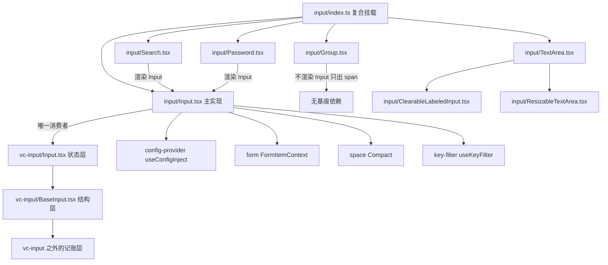
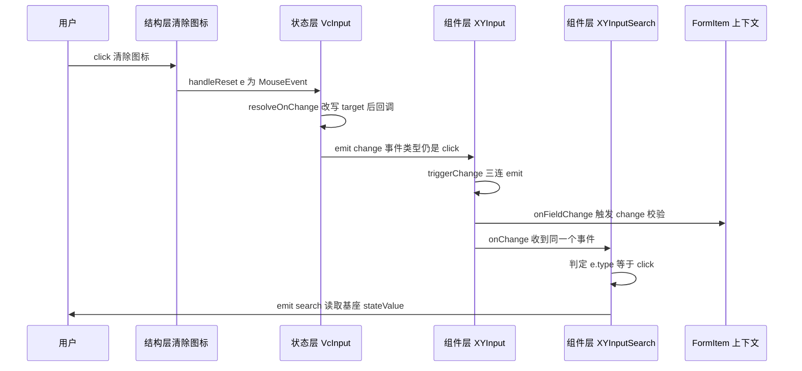
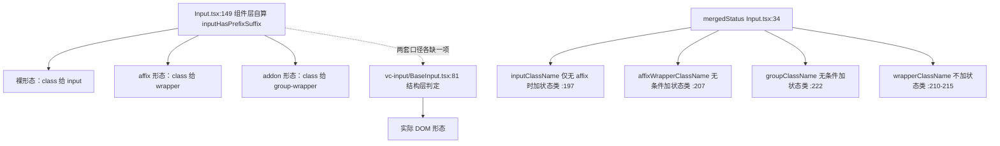

# C04-01 Input 输入框

> **本篇解决**：`<xy-input>` 这一层到底算了什么、把类名放进了哪个盒子？为什么 `allow-clear`、`prefix`、`addon`、`status` 这几个开关互相看不见对方？`Search` 的按钮和 `Password` 的眼睛是怎么「挤」进同一个输入框的？改 `Input.tsx` 的哪一行会让 `xy-input-group` 或 `xy-input-search` 一起崩？
> **前置**：I04 输入基座：vc-input 与 BaseInput（已完成，`docs/column/02-infrastructure/04-input-base-输入基座vc-input.md`）　**读者坐标**：`03-components/04-form-controls` 第 1 篇；本篇只讲 `src/input/` 组件层，基座机制一律引用 I04 对应论点，不重复推导

## 一、职责与边界

`packages/xiaoye-ui/src/input/` 这一层的职责只有一句话：**把「全局配置 + 表单上下文 + 用户插槽」三种外部信息折算成类名和节点，交给 `vc-input` 去落地**，同时把 `Input` 这一个组件包装成 `Input` / `Input.Group` / `Input.Search` / `Input.Password` / `Input.TextArea` 五个可独立使用的成员。

它明确**不负责**的事，全部在 I04《输入基础设施（BaseInput / vc-input / 记账层）》里已论证，本篇不再展开：受控值镜像与 IME 冻结（`_util/BaseInput.tsx`）、DOM 形态三分支的判定本体（`vc-input/BaseInput.tsx:81`、`:121`）、自动高度测量（`input/ResizableTextArea.tsx` + `input/calculateNodeHeight.tsx`）、`attrs` 四级接力与 expose 链断点的机制推导（I04 论点 1/5、§5.1/§5.3）。本篇只登记这些机制**在组件层留下的可见后果**。

依赖与被依赖（实测）：

| 方向 | 对象 | 证据 |
| --- | --- | --- |
| 依赖 | `vc-input/Input.tsx`（状态层），且是唯一消费者 | `packages/xiaoye-ui/src/input/Input.tsx:12` |
| 依赖 | `vc-input/utils/commonUtils` 的 `hasPrefixSuffix` / `resolveOnChange` / `triggerFocus` | `packages/xiaoye-ui/src/input/Input.tsx:11`、`packages/xiaoye-ui/src/input/TextArea.tsx:15` |
| 依赖 | `form/FormItemContext` 的两个 context | `packages/xiaoye-ui/src/input/Input.tsx:3-7` |
| 依赖 | `space/Compact` 的 `useCompactItemContext` / `NoCompactStyle` | `packages/xiaoye-ui/src/input/Input.tsx:16` |
| 依赖 | `_util/statusUtils` 的两个函数 | `packages/xiaoye-ui/src/input/Input.tsx:9` |
| 依赖 | `key-filter/useKeyFilter`（本目录内唯一的外部行为集成点） | `packages/xiaoye-ui/src/input/Input.tsx:17` |
| 依赖 | `button`（Search 的合成按钮）与 `@xiaoye-ui/icons` | `packages/xiaoye-ui/src/input/Search.tsx:6`、`packages/xiaoye-ui/src/input/Input.tsx:15` |
| 被依赖 | `vc-resize-observer` 只被 textarea 链路使用，`input/ResizableTextArea.tsx` 是它在输入侧的挂载点 | I04 论点 6；本篇不涉及 |
| 平级复用 | `input-number/`、`mentions`、`cascader` 等都不引用 `input/` 目录，它们各自组 `vc-input` 或自写原生标签 | `packages/xiaoye-ui/src/input-number/index.tsx:112` 自己消费 `FormItemInputContext` |

一句话定性：**这一层是「类名与节点的装配车间」，不是状态机**。`Input.tsx` 全文 230 行里没有一处 `ref` 承载用户输入值——值的所有权在基座，组件层只借用它（见论点 3）。


## 二、源码地图

| 文件 | 行数 | 职责 | 关键导出 / 主入口 |
| --- | --- | --- | --- |
| `input/index.ts` | 37 | 复合挂载 + 全局注册 + 副名导出 | `default`（`:31`）、`InputGroup`/`InputSearch`/`Textarea`/`InputPassword`（`:24-29`） |
| `input/Input.tsx` | 230 | 主实现：四路类名装配、表单状态、插槽转交 | `default`（`:24`，`name: 'XYInput'` 在 `:26`，`setup` 在 `:30`） |
| `input/inputProps.ts` | 50 | 组件层 props = 基座 props 去掉四个类名 prop 再加 keyFilter 三项 | `inputProps`（`:15`）、`textAreaProps`（`:37`） |
| `input/Group.tsx` | 50 | 纯 `<span>` 容器：类名 + context 覆写 | `default`（`:11`，`name: 'XYInputGroup'`） |
| `input/Search.tsx` | 169 | 把按钮塞进 `addonAfter`，自管 IME 与 Enter | `default`（`:19`，`name: 'XYInputSearch'`） |
| `input/Password.tsx` | 109 | 可见性状态机 + 图标注入 `suffix` + `type` 切换 | `default`（`:18`，`name: 'XYInputPassword'`） |
| `input/TextArea.tsx` | 317 | textarea 侧组件层：`name: 'XYTextarea'`（`:54`） | 机制归 I04 论点 6/7，本篇只在坑里引用 |
| `input/ClearableLabeledInput.tsx` | 124 | textarea 侧的第二套 affix 结构 | I04 论点 5 已定性 |
| `input/util.ts` | 20 | `hasPrefixSuffix` / `hasAddon` 的**本地副本** | 只有 `hasAddon` 被引用（`:18`、引用方 `input/ClearableLabeledInput.tsx:11`） |
| `input/style/index.ts` | 966 | 单 hook 样式：`genComponentStyleHook('Input', …)`（`:952`） | `genStatusStyle`（`:81`）、`-borderless`（`:168`）、`-clear-icon`（`:566`） |
| `input/index.test.js` | 182 | 11 个活跃用例（Input 3 / TextArea 3 / Search 1 / Password 4） | 执行判据见 `packages/xiaoye-ui/vitest.config.mts:33` |
| `input/Search.test.js` | 130 | 4 个活跃 + **6 个被注释**的 `it(` | 注释块从 `:53` 起 |

三个「读代码前先知道」的地图事实：

1. **组件层的 props 定义是「减法」**。`input/inputProps.ts:17-22` 从基座 props 里 `omit` 掉 `wrapperClassName` / `groupClassName` / `inputClassName` / `affixWrapperClassName` 四个，意味着这四个名字在 `<xy-input>` 上**不是 prop**：用户传了会进 `attrs`，再被 `Input.tsx:153` 的 `{...attrs}` 原样带给基座，最后在 `Input.tsx:190`/`:200`/`:210`/`:216` 被组件层自己算出的同名 prop 覆盖掉（JSX 多段展开是后写覆盖前写）。这是一条静默失效路径，见 §七 坑 1。
2. **`input/util.ts` 与 `vc-input/utils/commonUtils.ts:10-20` 是逐字重复的两份判定函数**，两份 `hasPrefixSuffix` 实现体完全相同（`input/util.ts:10-16` 对 `commonUtils.ts:10-16`），但 `Input.tsx:11` 导的是 commonUtils 那份，`util.ts` 里的 `hasPrefixSuffix` 在全仓没有任何引用者。用两种方法交叉验证过：`grep -rn "hasPrefixSuffix" packages/xiaoye-ui/src --include='*.ts' --include='*.tsx'` 只列出定义两处 + 消费三处（`input/Input.tsx:149`、`vc-input/BaseInput.tsx:81`、`vc-input/Input.tsx:180`），均不来自 `input/util`。
3. **主实现的渲染出口只有一个**：`Input.tsx:130` 的 `return () => {...}`，全部装配逻辑（解构 props、拼四种节点、算四个类名）都在这个函数体里，每次渲染重跑一遍；组件层没有任何 `computed` 缓存类名（`Input.tsx` 里只有 `mergedStatus`/`mergedSize`/`keyFilterTarget` 三个 computed）。


## 三、架构与数据流

### 3.1 静态结构：组件层五个文件与它们各自接的基座



这张图要说明的是**组件层内部有两棵互不相同的树**：`Input` 这棵树（`Input` → `vc-input` 三层）和 `TextArea` 这棵树（`TextArea` → `ClearableLabeledInput` + `ResizableTextArea` → 记账层）。`Search` 与 `Password` 不直接接基座，它们是 `Input` 的**包装工**——这个选择决定了本篇论点 3、论点 4 的全部机制：Search 的按钮必须借 `addonAfter` 这条通道，Password 的眼睛必须借 `suffix` 这条通道，因为组件层没有第二根管子可以插进 `Input`。`Group` 最特殊，它一个基座文件都不碰（`input/Group.tsx:42-47` 只渲染一个 `<span>`），所以它对形态的影响全部靠 CSS 后代选择器完成。

`useConfigInject` / `FormItemContext` / `Compact` / `useKeyFilter` 四条外部输入只进 `Input.tsx` 这一个文件（`Input.tsx:35`、`:33`、`:38`、`:53`），`Group`/`Search`/`Password` 各自只调 `useConfigInject` 拿自己的 `prefixCls`（`Group.tsx:21`、`Search.tsx:82`、`Password.tsx:80`）。也就是说：**表单校验态的读取点是单点的**，这是论点 2 的结构前提。

### 3.2 一次「清空 + 搜索」的完整事件回流



图里有两个分支值得单独解释，因为它们都不在调用方看得见的位置。第一个是 `Input.tsx:123-128` 的 `triggerChange`：它把基座的一次 `change` **拆成三个对外事件**（`update:value`、`change`、`input`），所以 `<xy-input @input>` 收到的根本不是原生 `input` 事件，而是 `change` 的重发；IME 期间基座不报 `change`，`@input` 也一起被冻结（机制推导见 I04 论点 3，此处只登记组件层的语义改写）。第二个是 `Search.tsx:50-52` 的 `e.type === 'click'` 判定：清空图标点击时，基座把**原始的 MouseEvent** 原样交给 `resolveOnChange`（`vc-input/utils/commonUtils.ts:29-56` 只改写 `target`/`currentTarget`，不改 `type`），于是「清空」在 `<xy-input-search>` 上表现为一次搜索请求。这个行为没有任何测试保护，因为覆盖它的六个用例被注释掉了（`input/Search.test.js:53-118`）。

### 3.3 形态决定类名落点：组件层的四路分派



这张图是 I04 §5.4「上层猜下层」那条接缝的组件层视角：**同一个 `mergedStatus` 被同时展开到 `inputClassName`（守卫条件 `!inputHasPrefixSuffix`）、`affixWrapperClassName`（无守卫）、`groupClassName`（无守卫）三个盒子上，而 `wrapperClassName` 是四路里唯一既不带状态类也不带尺寸类的**（`Input.tsx:210-215` 只有 `-group-rtl` 和 `hashId`）。这个不对称不是笔误：`wrapperClassName` 对应的是结构层内部的 `-group` 中间层（`vc-input/BaseInput.tsx:122-129`），它只负责 flex 排版，盒子没有边框，所以没有状态可给。真正会咬人的是 `bordered={false}` 只落到前两路（`:195`、`:205`），第三路 `-group-wrapper` 与第四路 `-group` 都没有 borderless 类名可用，详见论点 1 与 §七 坑 4。


## 四、核心机制精读

### 论点 1：组件层的全部产出就是四个类名 prop，四路分派的粒度并不对称——尺寸与状态给了三个盒子，`bordered` 只给两个，`wrapperClassName` 一个都不给

断言：`Input.tsx` 不产生任何 DOM，它产生的只有 `inputClassName` / `affixWrapperClassName` / `wrapperClassName` / `groupClassName` 四个字符串（`Input.tsx:190-224`），这四个字符串与基座四个盒子的对应关系是**手工硬编码**的，并且四个盒子的能力集合互不相同。

```tsx
// packages/xiaoye-ui/src/input/Input.tsx:190
          inputClassName={classNames(
            {
              [`${prefixClsValue}-sm`]: mergedSize.value === 'small',
              [`${prefixClsValue}-lg`]: mergedSize.value === 'large',
              [`${prefixClsValue}-rtl`]: direction.value === 'rtl',
              [`${prefixClsValue}-borderless`]: !bordered,
            },
            !inputHasPrefixSuffix && getStatusClassNames(prefixClsValue, mergedStatus.value),
            hashId.value,
          )}
          affixWrapperClassName={classNames(
            {
              [`${prefixClsValue}-affix-wrapper-sm`]: mergedSize.value === 'small',
              [`${prefixClsValue}-affix-wrapper-lg`]: mergedSize.value === 'large',
              [`${prefixClsValue}-affix-wrapper-rtl`]: direction.value === 'rtl',
              [`${prefixClsValue}-affix-wrapper-borderless`]: !bordered,
            },
            getStatusClassNames(`${prefixClsValue}-affix-wrapper`, mergedStatus.value, hasFeedback),
            hashId.value,
          )}
          wrapperClassName={classNames(
            {
              [`${prefixClsValue}-group-rtl`]: direction.value === 'rtl',
            },
            hashId.value,
          )}
          groupClassName={classNames(
// ...
            getStatusClassNames(`${prefixClsValue}-group-wrapper`, mergedStatus.value, hasFeedback),
            hashId.value,
          )}
```

逐段看：

- **`inputClassName`（`Input.tsx:190-199`）里的状态类带守卫**：`!inputHasPrefixSuffix && getStatusClassNames(...)`。这个 `&&` 的短路值不是布尔而是 `false`，`classNames` 会忽略 falsy 项，所以写法安全。守卫的判定式 `inputHasPrefixSuffix` 在 `:149`，它算的是 `hasPrefixSuffix({ prefix, suffix }) || !!hasFeedback`——**没有 `allowClear`**；而基座的判定式在 `vc-input/BaseInput.tsx:81` 是 `hasPrefixSuffix({ prefix, suffix, allowClear })`——**没有 `hasFeedback`**。两处口径的差集与后果 I04 §5.4 已经推导完，本篇只补一个组件层视角的事实：这个守卫是**猜**，它猜的是下层的分支结果，而不是从下层拿结果。
- **尺寸类的三份复制**：`-sm`/`-lg` 同时出现在 `inputClassName`（`:192-193`）、`affixWrapperClassName`（`:202-203`）、`groupClassName`（`:218-219`）三处，前缀各不同。样式侧对应三套规则：`genBasicInputStyle` 的 `&-borderless` 之类是相对选择器（`input/style/index.ts:168`），因此被 `.xy-input`（`input/style/index.ts:543-544` 一带）和 `.xy-input-affix-wrapper`（`input/style/index.ts:619`）两次展开就自动得到两个盒子的版本；而 `.xy-input-group-wrapper-lg` 是**独立手写的**（`input/style/index.ts:730-739`），里面只有 `-group-addon` 的 `borderRadius`，没有任何高度或字号。也就是说 addon 形态的尺寸是靠「内部 input 自己变尺寸 + addon 圆角跟随」拼出来的，不是靠外层统一控制。
- **`wrapperClassName` 是四路里最弱的一路**（`:210-215`）：只有 `-group-rtl` 与 `hashId`，既无尺寸也无状态。它对应结构层的 `.xy-input-group` 中间盒子（`vc-input/BaseInput.tsx:122-129`），该盒子在样式里是 `display: table` 的排版容器（`input/style/index.ts:209-213`），本身不画边框，所以「不给」是自洽的。真正的坑在第四路：**`groupClassName` 没有 `-group-wrapper-borderless` 这一项**（对照 `:216-224` 的键集合），而 `.xy-input-group-addon` 是带实边框和底色的（`input/style/index.ts:264-265`：`backgroundColor: token.colorFillAlter` + `border: ${token.lineWidth}px ...`）。全文件 `borderless` 只出现三次（`input/style/index.ts:93`、`:114`、`:168`），没有任何一条属于 addon。
- **`hashId.value` 被重复写了四次**（`:198`、`:209`、`:215`、`:224`）。这是必需的而不是冗余：`hashId` 是 CSS-in-JS 的样式作用域类（归 A04 论证），它必须出现在**每个**真正被渲染的盒子上，四个盒子是四兄弟关系，父类名不会传给兄弟。任何一路漏写 `hashId`，那一路上其它 `xy-input-*` 类就会命中不到带作用域的规则。

回扣到「能观察到什么」：`<xy-input addon-before="前缀" :bordered="false" status="error" />` 这一组属性下，源码能确定的是——内层 input 拿到 `xy-input-borderless`、affix 盒子（如果同时有 prefix）拿到 `xy-input-affix-wrapper-borderless`、最外 `xy-input-group-wrapper` 拿到 `xy-input-group-wrapper-status-error` 但**拿不到任何 borderless 类**，因此 addon 的 `colorFillAlter` 底色与 `colorBorder` 边框仍然画出来。这是类名发射面的事实，不需要浏览器即可判定。


### 论点 2：校验态在组件层完成「context → 类名」的**一次性降级**，`status=""` 无法用来清除表单状态，而 addon 内容被显式剥夺了校验态

断言：`xy-input` 的校验态不是状态机，是两条单向转换——`getMergedStatus` 把两个来源压成一个字符串（`Input.tsx:34`），`getStatusClassNames` 再把那个字符串压成类名（`Input.tsx:197`/`:207`/`:222`）；触发校验的另一头靠 `formItemContext` 的两个回调（`Input.tsx:115`、`:127`）。**基座完全不参与**：`vc-input/Input.tsx` 里 `status` 这个词出现 0 次（`grep -c "status" packages/xiaoye-ui/src/vc-input/Input.tsx` 输出 `0`），尽管 `vc-input/inputProps.ts:103` 把它声明成了 prop。

```tsx
// packages/xiaoye-ui/src/input/Input.tsx:32
    const formItemContext = useInjectFormItemContext();
    const formItemInputContext = FormItemInputContext.useInject();
    const mergedStatus = computed(() => getMergedStatus(formItemInputContext.status, props.status));
```

```tsx
// packages/xiaoye-ui/src/_util/statusUtils.tsx:22
export const getMergedStatus = (contextStatus?: ValidateStatus, customStatus?: InputStatus) =>
  customStatus || contextStatus;
```

- `InputStatuses = ['warning', 'error', ''] as const`（`statusUtils.tsx:4`）把**空串列为合法取值**，而 `:23` 的合并用的是 `||`。两者放一起就是一个可复现的缺陷：`<xy-form-item>` 校验失败给出 `error` 后，调用方想「用 `status=""` 关掉红框」是关不掉的，因为 `'' || contextStatus` 会返回 `contextStatus`。要真正屏蔽只能给 `<xy-input>` 外面套一层 `NoFormStatus`（`:113-120`）或干脆离开 FormItem。这是「类型允许的值」与「实现消费的语义」不一致，两者都在源码里，不是文档问题。
- **两个 context 是两件事**：`formItemContext`（`FormItemContext.ts:17-20` 声明的 `id`/`onFieldBlur`/`onFieldChange`/`clearValidate`）负责**触发**，`formItemInputContext`（`FormItemContext.ts:104-109` 的 `status`/`hasFeedback`/`feedbackIcon`/`isFormItemInput`）负责**呈现**。前者被 `Input.tsx:139` 用来拿 `id`（label 关联），被 `:115` 在 blur 时调 `onFieldBlur()`，被 `:127` 在 change 时调 `onFieldChange()`；不在 Form 里时它们落到 `FormItemContext.ts:69-72` 的空实现，所以调用点不需要判空。
- 触发之后走的是 FormItem 自己的 trigger 逻辑：`FormItem.tsx:200-205` 把 `validateTrigger` 归一为数组，**默认值是 `'change'`**（`:204`）。结合 I04 论点 3 的结论「IME 合成期间基座不报 change」，可以得到一条只有把两篇叠起来才看得见的行为：中文输入过程中 `@change` 不触发，因此**表单的 change 校验在拼音未上屏时也不会触发**——这两件事同源，不是各自的巧合。
- `hasFeedback` 与 `feedbackIcon` 从 context 直接取节点：`Input.tsx:131` 解构、`:142-147` 拼成 `suffixNode`。这里有一个容易读漏的细节：`:142` 的表达式 `(hasFeedback || suffix) && (<>...</>)` 在两者都不存在时得到的是 `undefined`（不是 `false`），因此 `Input.tsx:149` 传给 `hasPrefixSuffix` 的 `suffix` 是 `undefined`，被 `vc-input/utils/commonUtils.ts:2-8` 的 `isValid` 正确排除。但同一个 `isValid` 对 `false` 是**放行**的（它只排 `undefined` 与 `null`），而它对数组返回的是 `filterEmpty(value).length`——也就是说「插槽存在但渲染为空」会归化成 `0` 从而被判为无内容。这个「三态判定」在论点 5 里还有下文，因为它同时决定 affix 形态出不出现在 DOM 里。
- addon 的两个插槽内容被**显式降级**：`Input.tsx:175-188` 把 `addonAfter`/`addonBefore` 各包一层 `<NoCompactStyle><NoFormStatus>`。`NoFormStatus` 的实现是 `FormItemInputContext.useProvide({})`（`FormItemContext.ts:116`），`NoCompactStyle` 是 `SpaceCompactItemContext.useProvide(null)`（`space/Compact.tsx:54`）。`useProvide` 会新建一个 merged 对象并只 `Object.assign(mergedProps, props, newProps || {})`（`_util/createContext.ts:5-12`），传 `{}` 进去的结果就是一个**字段全空的新 context**。所以 addon 里放 `<xy-input>` 或 `<xy-select>` 时，它们读不到外层 FormItem 的 status，也读不到 Space compact 的尺寸——这是有意为之：addon 是装饰物，不该跟着变红、不该被 compact 削圆角。


### 论点 3：`Search` 不是「Input 旁边加按钮」，而是把按钮**折进 `addonAfter` 借用 addon 形态**；搜索值取的是基座内部 `stateValue`，不是调用方的 model

断言：`Search.tsx` 全文没有渲染任何 `<input>`，它做的三件事是：算出一个 Button 节点（`Search.tsx:97-136`）、把它和用户 addonAfter 拼成数组（`:137-139`）、作为 `addonAfter` prop 交给 `<Input>`（`:159`）。因此搜索框的 DOM 形态**必然**是 addon 形态（`vc-input/BaseInput.tsx:121-147` 那条分支），这决定了它的圆角、尺寸、compact 行为全部走 group 通道。

```tsx
// packages/xiaoye-ui/src/input/Search.tsx:137
      if (addonAfter) {
        button = [button, addonAfter];
      }
// ...
      return (
        <Input
          ref={inputRef}
          {...omit(restProps, ['onUpdate:value', 'onSearch', 'enterButton'])}
          {...attrs}
          onPressEnter={onPressEnter}
          onCompositionstart={handleOnCompositionStart}
          onCompositionend={handleOnCompositionEnd}
          size={size.value}
          prefixCls={inputPrefixCls.value}
          addonAfter={button}
          suffix={suffix}
          onChange={onChange}
          class={cls}
          disabled={disabled}
          v-slots={slots}
        />
      );
```

- **prop 与 slot 的双轨优先级在这里暴露得最清楚**。`Search.tsx:88` 用 `addonAfter = slots.addonAfter?.()` 的解构默认值形式取插槽，即 **props 优先、slot 兜底**；`Input.tsx:137-138` 用的是同一种写法，所以也是 prop 优先。于是 `<xy-input-search>` 的用户即使写了 `#addon-after`，拿到的也是 Search 拼出来的 `[button, addonAfter]` 数组（因为 Search 已经先把 slot 折进 prop 了，`:164` 又用 `v-slots={slots}` 把原始 slot 一并传下去，但 prop 非 undefined，默认值不生效）。这条「slot 被上层折成 prop 后就不再可覆盖」是 Search/Password 共同的实现姿势，改任何一处都会改变优先级。
- **`enterButton` 的三态判定**（`:92-103`）：先 `enterButton = enterButton || enterButton === ''`（`:93`，把空串当 true），再判断传入节点是不是本库 Button——判据是 `enterButtonAsElement.type.__XY_BUTTON`（`:102`；该内部标识定义在 `packages/xiaoye-ui/src/button/button.tsx:39`，注意主实现文件名是**小写** `button.tsx`，另有 `dropdown/dropdown-button.tsx:22` 也带同一标识），或 `tagName === 'button'`（`:103`）走原生节点路径。命中时用 `cloneElement(enterButtonAsElement, {...}, false)` 覆盖式克隆并挂 `onMousedown`/`onClick`（`:104-118`），否则自己渲染一个 `<Button type="primary">`（`:121-135`）。源码里那个判定用的局部变量名仍叫 `isAntdButton`（`:99`），但它读的是本库的 `__XY_BUTTON` 标识——命名残留，不影响行为。同一套标识也被 `tooltip/Tooltip.tsx:169` 用来判定可聚焦节点，说明它是跨组件的类型探针而非 Search 私有约定。
- **搜索值的来源**：`:62-64` 的 `onSearch` 读 `inputRef.value?.input?.stateValue`。`inputRef` 是 `<Input>` 实例，`.input` 是 `Input.tsx:83` 暴露的 `input: inputRef`（即 VcInput 实例），而 `stateValue` 正是 VcInput 在 `expose` 里带出的那个响应式值（I04 §5.3 的 expose 清单）。**所以点击按钮搜索的是基座内部值，不受调用方 `v-model:value` 是否已同步影响**；反过来说，这条链路完全依赖基座把 `stateValue` 暴露出来——基座哪天把它从 expose 里摘掉，Search 的 `@search` 参数就静默变成 `undefined`。而 `:57` 的 `document.activeElement === inputRef.value?.input` 拿同一个格子和 DOM 比，比较对象是实例代理而非元素，恒为 false（断点机制见 I04 §5.3，本篇只登记组件层症状：**「按下按钮不失去焦点」这条保护实际上从未生效**）。
- **第二套 IME 标志**：`composedRef`（`:36`，写于 `:74`/`:79`，读于 `:67`）。I04 §5.4 清点过仓库里与输入相关的四套合成标志位，`Search` 这套不在其中——它是**第五套**，且与基座的 `isComposing` 互不通信：基座冻结 `change` 时，Search 靠自己的 `compositionstart`/`compositionend` 决定是否放行 Enter。为什么需要它：拼音候选态按 Enter 是「选词」，不该触发搜索，而基座的 `pressEnter` 事件（`vc-input/Input.tsx:24` 的 emits 第七项）对合成态无感知。
- **`loading` 与 Enter 的互斥**：`:67` 的 `if (composedRef.value || props.loading) return;`——`loading` 为真时 Enter 搜索被吞掉，这是给「异步搜索结果未回来」的防重入。`loading` 这个名字来自基座 props 声明（`vc-input/inputProps.ts:87`），组件层的 `Input.tsx` 完全不碰它（`grep -c "loading" packages/xiaoye-ui/src/input/Input.tsx` 输出 `0`），它只随 `Input.tsx:154` 的 `...rest` 原样下传；Search 把它转成按钮的 `loading`（`:130`）。
- **清空会误触搜索**：`:48-54` 的 `onChange` 在 `e.type === 'click'` 时 `emit('search', ...)`。这不是防御性代码而是**清空图标路径的副作用**：`vc-input/Input.tsx:119-124` 的 `handleReset` 把鼠标点击事件原样交给 `resolveOnChange`，后者遇到 `e.type === 'click'` 只改写 `target`/`currentTarget` 为克隆节点（`vc-input/utils/commonUtils.ts:40-56`），`type` 保持 `click`；再经 `Input.tsx:125` 的 `emit('change', e)` 传到 Search。结论：**`<xy-input-search allow-clear>` 点一次清除图标 = 发一次空关键词搜索**。
- **`emits` 选项是缺失的**：`Search.tsx:19-33` 只写了 `props`，没有 `emits`，但它 emit 了 `update:value`、`change`、`search`、`compositionstart`、`compositionend`（`:49-53`、`:63`、`:75`、`:80`）。能工作是靠 Vue 的 emit 读 vnode 原始 props（I04 §5.2 论证过同一条通路）；`onSearch` 还被显式声明成了 prop（`:28-32`），因此 `@search` 不进 `attrs`。副作用是 `Search` 的对外事件面**没有任何声明可查**，`search` 这个名字在类型面只能靠 `onSearch` prop 倒推。


### 论点 4：`Password` 的可见性是「本地 `shallowRef` + `watchEffect` 单向钉死」，一旦传了 `visible` 就变成只读；眼睛图标是**塞进 `suffix` 的一个自带 icon 前缀的 `<span>`**，`action="hover"` 绑的是会冒泡的 `onMouseover`

断言：`Password.tsx` 是 109 行的纯包装器，它只做三件事——维护一个本地 `visible`（`:33`）、把它映射成 `type`（`:93`）、把图标塞进 `suffix`（`:85`、`:96`）。它**不管理密码值**，也不与基座的记账层发生任何直接关系。

```tsx
// packages/xiaoye-ui/src/input/Password.tsx:33
    const visible = shallowRef(false);
    const onVisibleChange = () => {
      const { disabled } = props;
      if (disabled) {
        return;
      }
      visible.value = !visible.value;
      emit('update:visible', visible.value);
    };
    watchEffect(() => {
      if (props.visible !== undefined) {
        visible.value = !!props.visible;
      }
    });
```

- **受控即只读**：`:42-46` 用的是 `watchEffect`（不是 `watch`），它无条件依赖 `props.visible`。只要调用方写了 `:visible="x"`，`onVisibleChange` 里那次本地翻转就会在同一次 effect  flush 后被 `props.visible` 覆盖回去——除非调用方接住 `@update:visible` 并更新 `x`。这不是 bug 而是设计，但**源码里没有任何注释说明这一点**，而组件把 `onUpdate:visible` 显式声明成了 prop（`:29`）而不是依赖 Vue 的隐式监听器收集，等于把「必须成对接」写进了 props 面。测试用例 `index.test.js:164-181` 恰好演示了这个风险：它写的是 `visible="false"`（字符串字面量）却只断言图标数量与回调被调用（`:173`、`:180`），**没有一条断言检查 `type` 到底是 `password` 还是 `text`**。这条分支目前没有断言保护。
- **图标节点是手工拼的**：`getIcon`（`:58-79`）返回 `<span class={classNames(defaultIconPrefixCls, `${prefixCls}-icon`)} {...iconProps}>`，`defaultIconPrefixCls` 的值是 `'xyicon'`（`packages/xiaoye-ui/src/config-provider/context.ts:14`）。为什么不用图标组件包一层：样式选择器写的是 `${iconCls}${componentCls}-password-icon`（`input/style/index.ts:690`），即 **`.xyicon.xy-input-password-icon` 双类联合**（`cursor: 'pointer'` 在 `input/style/index.ts:692`），少了 `xyicon` 这一格就命中不到规则。`prefixCls` 在这里是 `useConfigInject('input-password', props)` 给的 `xy-input-password`（`:80`），与内层 input 的 `xy-input` 是两个前缀——所以「密码框」在 DOM 上的可寻址类名是 wrapper 上的 `xy-input-password`，测试也正是用它做断言（`index.test.js:133`）。
- **`action` 的两个取值绑的是不同事件，且第三值静默失效**：`ActionMap = { click: 'onClick', hover: 'onMouseover' }`（`:12-15`），`iconTrigger = ActionMap[action] || ''`（`:60`）——传 `"mouseEnter"` 之类的直觉值时 `iconTrigger` 是空串，`:63` 的键就成了 `''`，**图标上没有任何点击/悬停处理器，密码永远切换不了**，且不报错。`hover` 绑的是 `onMouseover` 而不是 `onMouseenter`：`mouseover` 会从子节点冒泡，图标内部还有 `<EyeOutlined />` 这样的子节点，鼠标在图标内部移动会**重复派发** `mouseover`，每次都调 `onVisibleChange`，表现是「光标经过眼睛时密码反复切换」。`action` 这个词在整个 `input/` 目录里只出现在 `Password.tsx:26`、`:59`、`:60`、`:91` 四处，两个测试文件（`index.test.js`、`Search.test.js`）都没有出现过它，即 `hover` 与未知值两条分支均无测试。
- **图标自身吃掉 mousedown/mouseup**：`:65-72` 两个 `preventDefault`，注释写明目的分别是「 Prevent focused state lost」与「Prevent caret position change」。注意这跟 Search 的 `onMousedown`（`Search.tsx:56-60`）是两种写法：Password 是**无条件** preventDefault，Search 是**判定当前是否已聚焦**才 preventDefault——而 Search 那个判定因 `expose` 断链恒为 false（见论点 3）。同目录下两个组件对同一问题给了两种答案，只有一种真的在工作。
- **`type` 切换走 props，不走 DOM**：`:93` 的 `type: visible.value ? 'text' : 'password'` 是传给 `<Input>` 的 prop，最终由状态层写进元素（`vc-input/Input.tsx:186` 的 `type`）。而「切回密文时抹掉 `value` 属性」这件安全相关的动作**不在 Password 里**，它藏在 `Input.tsx:88-110` 的 `removePasswordTimeout`：条件是 `inputRef.value?.input.getAttribute('type') === 'password'`（`:94`）。I04 §5.3 已证明 `inputRef.value.input` 恒为 `undefined`，所以这个 `if` 永不成立、`:97` 的 `removeAttribute('value')` 从未执行。组件层的症状是：**密码框在自动填充场景下，原生 `value` 属性可能残留在 DOM 上**（残留与否取决于浏览器行为，此处只断言「清理逻辑不会跑」）。
- **`size` 的二次赋值是形式性的**：`:99-101` 的 `if (size) omittedProps.size = size;`——`size` 本来就在 `restProps` 里（`:83` 解构把它拿出来又塞回去），这段判断只是避免把 `undefined` 显式写进对象。类名侧 `inputClassName`（`:86-88`）把 `xy-input-password` 与 `attrs.class` 合并后作为 `class` 传给 Input，再由 `Input.tsx:189` 并入 `class={[attrs.class, compactItemClassnames]}`。因为密码框必有 `suffix`，形态判定必走 affix 分支（`vc-input/BaseInput.tsx:81`），所以 `attrs.class` 的最终落点是 affix wrapper（`:91`），这一点与 I04 论点 5 的三分支规则一致，不再重复。


### 论点 5：`allow-clear` 的三个细节都落在组件层——图标由组件层强制注入（基座的 `'*'` 兜底在全仓不可达）、可见性交给 CSS 而不是节点删除、而 `:allow-clear="false"` 会**凭空多出一层 affix wrapper**

断言：`allowClear` 这个 prop 在组件层只被做了三件事：原样下传（`Input.tsx:174`）、注入一个默认 `clearIcon` 插槽（`:150` + `:225`）、**不参与形态判定**（`:149` 的 `hasPrefixSuffix({ prefix, suffix })` 没有 `allowClear` 这一项）。I04 的边界约定明确把「`allowClear` 在 input 层的差异」留给本篇，下面三条就是那个差异的完整内容。

```tsx
// packages/xiaoye-ui/src/vc-input/BaseInput.tsx:31
      if (!allowClear) {
        return null;
      }
      const needClear = !disabled && !readonly && value;
      const className = `${prefixCls}-clear-icon`;
      const iconNode = slots.clearIcon?.() || '*';
      return (
        <span
          onClick={handleReset}
          // Do not trigger onBlur when clear input
          onMousedown={e => e.preventDefault()}
          class={classNames(
            {
              [`${className}-hidden`]: !needClear,
              [`${className}-has-suffix`]: !!suffix,
            },
            className,
          )}
          role="button"
          tabindex={-1}
        >
```

- **`'*'` 兜底在本仓不可达**：`iconNode = slots.clearIcon?.() || '*'`（`:36`）。结构层 `BaseInput` 只被状态层 `VcInput` 使用，而 `VcInput` 全仓只有一个导入点——`grep -rn "vc-input/Input" packages --include='*.tsx' --include='*.ts' --include='*.vue'` 的命中只有 `packages/xiaoye-ui/src/input/Input.tsx:12`。既然唯一的组件层消费者**无条件**提供 `clearIcon` 插槽（`Input.tsx:150` 的 `slots.clearIcon || (() => <CloseCircleFilled />)`，再经 `:225` 的 `v-slots={{ ...slots, clearIcon }}` 下发），那么任何人直接用 `VcInput` 且不给插槽时，清除图标会是一个星号字符。这条兜底是给「下一个消费者」准备的，不是给现状准备的。
- **可见性是 CSS 的，不是节点级的**：`needClear` 为假时加的是 `-hidden` 类（`:44`），样式是 `visibility: hidden`（`input/style/index.ts:583-585`），图标**仍然占位**。这样输入框在「有值/无值」之间切换时宽度不抖。空值/禁用态的可寻址类名是 `.xy-input-clear-icon-hidden`，`index.test.js:26-32` 用的正是它（`expect(wrapper.findAll('.xy-input-clear-icon-hidden').length).toBeTruthy()`）——注意这条断言只要**找到元素就为真**，`length` 为 0 时才为假，所以它证明的是「禁用态有 hidden 类」，不证明图标不可点。真正的「禁用不响应」靠 `:34` 的 `!disabled` 与 `:31` 的 `!allowClear` 两道。
- **`:allow-clear="false"` 会升格形态**：结构层判定 `hasPrefixSuffix({ prefix, suffix, allowClear })`（`:81`）里，`allowClear` 走的是 `vc-input/utils/commonUtils.ts:2-8` 的 `isValid`，而它只排除 `undefined` 与 `null`。`allowClear` 在 `vc-input/inputProps.ts:27` 声明为 `{ type: Boolean, default: undefined }`，不写时是 `undefined`（裸形态），显式写 `false` 时是 `false` → **`isValid` 放行** → affix 分支被进入。此时 `getClearIcon` 在 `:31` 返回 `null`、`suffixNode` 在 `:95` 取 `(suffix || allowClear) && ...` 得到 `false`，于是 DOM 上出现一个**里面什么都没有的 `xy-input-affix-wrapper`**：盒模型从 `inline-block` 的 `<input>` 变成 `inline-flex` 的 `<span>` 包 `<input>`（`input/style/index.ts:619-621`），同时组件层 `:149` 因为口径里没有 `allowClear`，坚持认为没升格，把状态类塞进 `inputClassName`（`:197`），而 `affixWrapperClassName`（`:207`）无条件再加一份状态类——两个盒子同时带状态。**结论：不要用 `:allow-clear="false"` 来「关闭」清除，要么不写这个 prop，要么写 `undefined`。**
- **`-has-suffix` 的判定用的是未调用的插槽函数**：`getClearIcon` 的解构默认值是 `suffix = slots.suffix`（`:28`，**没有 `?.()`**），而同一文件的渲染函数用的是 `suffix = slots.suffix?.()`（`:68`）。于是 `:45` 的 `!!suffix` 只要 `#suffix` 插槽**存在**就为真（哪怕它渲染出空数组），图标就会带上 `-has-suffix` 的左右间距（`input/style/index.ts:587-589` 的 `marginInline: 0 ${inputAffixPadding}px`）。同一个文件里两种口径并存，是本篇认为最容易被误改的一处：把 `:28` 改成 `slots.suffix?.()` 看起来是「修 bug」，实际会把「插槽存在但渲染为空」的情形从有间距变成无间距。
- **addon 与 prefix/suffix 的判定口径不同**（状态层，直接决定组件层形态）：`vc-input/Input.tsx:136-137` 用 `prefix = slots.prefix?.()`、`suffix = slots.suffix?.()`（**调用后取数组**，空插槽被 `isValid` 的 `filterEmpty(value).length` 归零 → 判定为无），而 `:128-129` 用 `addonBefore = slots.addonBefore`、`addonAfter = slots.addonAfter`（**取函数本身** → 存在即为真）。结构层同样分裂：`vc-input/BaseInput.tsx:67-68` 调用、`:69-70` 不调用。后果是 `<xy-input>` 写一个空的 `#addon-before` 也会撑出 `xy-input-group-wrapper` + `xy-input-group` + `xy-input-group-addon` 三层（`:121-147`），其中 addon 盒子是 `display: table-cell`（`input/style/index.ts:242-246`），空插槽就得到一个有底色有边框的空单元格；而空的 `#prefix` 插槽什么都不会多出来。组件层对这两种写法没有任何拦截。
- **`clearIcon` 同时是 prop 和 slot，只有 slot 那条轨生效**：prop 声明在 `vc-input/inputProps.ts:22`（`clearIcon: PropTypes.any`），但结构层只读 `slots.clearIcon`（`:36`）；而 `vc-input/Input.tsx:141-163` 的 omit 清单里没有 `clearIcon`，于是它以 `...otherProps` 的身份（`:165`）继续下沉到元素层，最终成为 `<input>` 上的一个未知属性。用 `clear-icon="x"` 传图标是无效的，这一点在类型面看不出来（prop 是 `any`）。


### 论点 6：`Input.Group` 是一个只有类名和一次 context 覆写的 `<span>`，它给不了子节点尺寸，而它那次覆写对 `xy-input` 是空操作——只有 `xy-textarea` 会受影响

断言：`Group.tsx` 全文 50 行，`setup` 里没有任何 `ref`、没有事件、没有 `expose`；它的对外效果只有两处——一个 `<span>` 的类名集合（`Group.tsx:31-46`）和一个重新提供的表单状态 context（`:22-25`）。

```tsx
// packages/xiaoye-ui/src/input/Group.tsx:21
    const { prefixCls, direction, getPrefixCls } = useConfigInject('input-group', props);
    const formItemInputContext = FormItemInputContext.useInject();
    FormItemInputContext.useProvide(formItemInputContext, {
      isFormItemInput: false,
    });

    // style
    const inputPrefixCls = computed(() => getPrefixCls('input'));
    const [wrapSSR, hashId] = useStyle(inputPrefixCls);

    const cls = computed(() => {
      const pre = prefixCls.value;
      return {
        [`${pre}`]: true,
        [hashId.value]: true,
        [`${pre}-lg`]: props.size === 'large',
        [`${pre}-sm`]: props.size === 'small',
        [`${pre}-compact`]: props.compact,
        [`${pre}-rtl`]: direction.value === 'rtl',
      };
    });
    return () => {
      return wrapSSR(
        <span {...attrs} class={classNames(cls.value, attrs.class)}>
```

- **它用的样式 hook 是 Input 的**：`useStyle(inputPrefixCls)`（`Group.tsx:28-29`），传进去的是 `getPrefixCls('input')` 而不是自己的 `xy-input-group`。配合 `input/style/index.ts:952` 的 `genComponentStyleHook('Input', ...)`（整个输入族只有这一个 hook），`-group` 与 `-group-wrapper` 的规则都是 Input 那一份 token 集生成出来的（`input/style/index.ts:711-714` 把 `genInputGroupStyle` 挂在 `.xy-input-group` 下）。所以「给 Group 单独加一个 Component Token」目前无处落——`FullToken<'Input'>` 是唯一入口，这条约束归 A03/A04，本篇登记事实。
- **`size` 不往下传，只往下命中**：`-lg`/`-sm` 写在 group 自己的 span 上（`Group.tsx:36-37`），真正生效靠后代选择器 `&-lg ${componentCls}, &-lg > ${componentCls}-group-addon`（`input/style/index.ts:225-231`）。也就是说 `<xy-input-group size="large">` 里必须放**类名带 `xy-input` 的节点**才会变大；放进来的如果是自定义节点，尺寸不会继承，Group 也不会在组件层面给任何提示。与之对照，`<xy-space compact>` 那条路是真的把 size 灌进子组件 props 的——`Input.tsx:39-41` 的 `mergedSize = compactSize || size` 读的就是 `SpaceCompactItemContext`（`space/Compact.tsx:54-46`），而 Group 没有提供任何尺寸 context。同一个库里「分组」有两个机制，一个管 props（compact）一个只管 CSS（group）。
- **`compact` 类是纯 CSS 的**：`Group.tsx:38` 只写一个 `xy-input-group-compact`，对应样式在 `input/style/index.ts:381`（`&${componentCls}-group-compact`）。它和 `Space` 的 `compactItemClassnames`（`Input.tsx:189` 加在 input 的 class 上）是两套东西：前者让组内相邻元素贴死，后者让**单个输入框**在 compact 组里去掉自己的圆角（`input/style/index.ts:841-855`）。
- **`isFormItemInput: false` 这次覆写对 `xy-input` 是空操作**：`useProvide(formItemInputContext, { isFormItemInput: false })`（`Group.tsx:23-25`）的合并语义由 `_util/createContext.ts:5-12` 决定——`Object.assign(mergedProps, props, newProps || {})`，第二个参数覆盖第一个，且在 `watchEffect` 里持续同步。所以组内 `formItemInputContext.status` 依然继承外层 FormItem，唯独 `isFormItemInput` 被改成 `false`。而 `Input.tsx:34` 只读 `status`，`Search.tsx`/`Password.tsx` 连 `formItemInputContext` 都不注入（两个文件里没有 `FormItemInputContext` 这个词）。全仓 `isFormItemInput` 的**读取点**是 `tree-select/index.tsx:242`、`radio/Radio.tsx:131`、`input-number/index.tsx:112`、`input/TextArea.tsx:296`、`cascader/index.tsx:293`、`checkbox/Checkbox.tsx:111`、`select/index.tsx:194`（`grep -rn "isFormItemInput" packages/xiaoye-ui/src` 的完整命中，其余是类型声明 `form/FormItemContext.ts:105` 与写入点 `form/FormItem.tsx:451`、`calendar/Header.tsx:186`）。结论：`<xy-input-group>` 里放 `<xy-input>` 行为不变，放 `<xy-textarea>` 会让它的 `xy-input-textarea-in-form-item` 类消失（`input/TextArea.tsx:296`），放 `<xy-select>`/`<xy-radio>` 同理。**同一个容器对族内不同成员效果不同**，这是 Group 最该被记录的一条。
- **`inheritAttrs: false` 加 class 两次**：`Group.tsx:14` 关闭自动继承，`:44` 既 `{...attrs}` 又 `class={classNames(cls.value, attrs.class)}`。因为 `class` 同时出现在展开与显式赋值里，外部类名会进同一个 `classNames` 结果（重复类名，浏览器按集合处理，无可观察副作用）；但 `style` 只走 `{...attrs}` 一条路，所以 `<xy-input-group style="...">` 是有效的。这与 `Input.tsx:153` + `:189` 的写法同构——组件层没有统一收口，五个文件各写各的。

## 五、对外契约如何生效

### 5.1 名字面：五个标签、四个副名、一个类型声明

`index.ts` 是三件事的交汇点，而这三件事**互相不一致**：

```ts
// packages/xiaoye-ui/src/input/index.ts:9
Input.Group = Group;
Input.Search = Search;
Input.TextArea = TextArea;
Input.Password = Password;

/* istanbul ignore next */
Input.install = function (app: App) {
  registerComponent(app, Input);
  registerComponent(app, Input.Group);
// ...
```

- **运行面（注册了什么标签）**：`Input.install` 注册五个（`index.ts:16-20`），标签名由 `toXYTagName` 从组件 `name` 推导（`_util/registerComponent.ts:6-11`，规则是 `XY` → `xy-` + 驼峰转连字符 + 全小写）。按各文件声明的 `name` 实测映射：`XYInput`（`Input.tsx:26`）→ `xy-input`、`XYInputGroup`（`Group.tsx:13`）→ `xy-input-group`、`XYInputSearch`（`Search.tsx:21`）→ `xy-input-search`、`XYInputPassword`（`Password.tsx:20`）→ `xy-input-password`、`XYTextarea`（`TextArea.tsx:54`）→ `xy-textarea`。注意最后一个：组件名是 `XYTextarea` 而不是 `XYTextArea`，所以标签是 `xy-textarea`；`registerComponent` 的重复注册保护在 `:23`（`if (!app.component(tagName))`）。
- **包根名面（`import { ... } from 'xiaoye-ui'`）**：`index.ts:24-29` 导出的四个副名是 `InputGroup`、`InputSearch`、`Textarea`、`InputPassword`。`Textarea` 这个拼写与 `InputXxx` 的命名规律不一致，且与运行面标签 `xy-textarea` 的驼峰形式（`Textarea`）也不是同一个前缀族。聚合入口 `src/components.ts:183-185` 是 `export * from './input'` + `export { default as Input }` + 样式副作用导入（生成物，禁手工编辑，见根 `AGENTS.md`）。
- **类型面（`GlobalComponents`）**：`packages/xiaoye-ui/typings/global.d.ts` 一共 108 条声明（每目录一条），输入族只有 `XYInput` 一条（`global.d.ts:49`）。**`XYInputGroup`/`XYInputSearch`/`XYInputPassword`/`XYTextarea` 都不在其中**（`grep -n "XYInput\|XYTextarea" packages/xiaoye-ui/typings/global.d.ts` 只命中 `:51`）。也就是说运行期能用的四个标签在模板类型检查里没有全局声明，这与生成器的口径（每个目录只取 default）一致，属于生成物覆盖面与注册面的已知缺口，不是本篇主题（归 A02）。

### 5.2 props 面：组件层只新增三个，其余全靠「继承 + 减法」

`inputProps()`（`input/inputProps.ts:15-31`）= `omit(vcInputProps(), [四个类名 prop])` + `keyFilterPreset`/`keyFilterPattern`/`keyFilterValidateOnly`（`:24-29`）。所以 `<xy-input>` 的 props 面**几乎等于基座 props 面**（`vc-input/inputProps.ts:16-104`），组件层自己的新增只有 keyFilter 三项和 `textAreaProps`（`:37-46`）。`Search`/`Password` 各自再往上加：`inputPrefixCls`/`enterButton`/`onSearch`（`Search.tsx:25-32`）、`action`/`visibilityToggle`/`visible`/`onUpdate:visible`/`iconRender`（`Password.tsx:30-30`）。

`textAreaProps` 的减法更能说明分层：`input/inputProps.ts:38` 从 `inputProps()` 里去掉 `prefix`/`addonBefore`/`addonAfter`/`suffix` 四项——**textarea 在 props 面上根本没有 addon**，这与其走另一棵树（`ClearableLabeledInput` + `ResizableTextArea`）一致，树的差异被如实反映到了类型上。

### 5.3 事件面：一次 change 变三个事件，且 keyFilter 的入口条件恒假

`Input.tsx:29` 声明了 **8 项** emits（`update:value`/`change`/`input`/`focus`/`blur`/`pressEnter`/`keydown`/`keyup`），但组件层自己只 `emit` 其中 5 项（`:114`、`:120`、`:124`、`:125`、`:126`——`grep -n "emit(" packages/xiaoye-ui/src/input/Input.tsx` 的命中就是这五处加 `formItemContext` 的两个回调）；`pressEnter`/`keydown`/`keyup` 三项是**基座发的**（`vc-input/Input.tsx:24` 的 emits 与 `:172` 的 `handleKeyDown`），组件层声明它们只为让 `@press-enter` 这类写法在类型与文档面成立。合成事件一个都不在 emits 里，`@compositionstart` 走的是 I04 §5.2 论证过的 props 透传轨。`triggerChange`（`Input.tsx:123-128`）在基座一次 `change` 上连发 `update:value`、`change`、`input`，因此：

- `v-model:value` 与 `@input` 的时机**完全相同**，都受 I04 论点 3 的 IME 冻结约束。想要「每次按键都拿到」的语义在本组件上不存在。
- `@input` 事件对象的 `target` 在清空路径上是游离克隆节点（机制见 I04 论点 4，`commonUtils.ts:49-52`），组件层没有做任何修正。
- **`Search` 与 `Password` 的事件面比 `Input` 更薄**：两者都没有 `emits` 选项（`grep -n "emits" packages/xiaoye-ui/src/input/{Search,Password,Group}.tsx` 无命中），`Search` 却发了 5 类事件（`Search.tsx:49`、`:51`、`:53`、`:63`、`:75`、`:80`），`Password` 只发 `update:visible`（`Password.tsx:40`）。`Password` 的可见性双轨里，`visible` 是 prop、`onUpdate:visible` 也被显式声明成 prop（`Password.tsx:28-29`），这是本目录唯一一处「把 v-model 的两个半边都写成 props」的写法；`Search` 的 `onSearch` 同理（`Search.tsx:28-32`）。
- **`Group` 没有任何对外契约**：无 emits、无 expose、无 context 写出（`Group.tsx:20-48`），它的 props 只有 `prefixCls`/`size`/`compact` 三项（`:15-19`）。想从父组件「拿到」分组里的某个输入框，只能靠自己给 `<xy-input>` 写 ref。

`keyFilter` 三个 prop（`input/inputProps.ts:24-29`）是组件层唯一一处**行为级**集成：`Input.tsx:53-58` 把 `keyFilterTarget` 交给 `useKeyFilter`。而 `keyFilterTarget` 读的是 `inputRef.value?.input`（`:49-51`），I04 §5.3 已论证这一格恒为 `undefined`。本篇补组件层后果：**`<xy-input key-filter-preset="...">` 在源码层面拿不到目标元素，过滤逻辑不会挂上**。这个结论只到「传入的是实例代理而非 DOM 元素」为止，`useKeyFilter` 内部对 `target` 为空时的具体行为（是否注册原生监听器）我没有逐行核对，不在本篇断言范围内。


## 六、设计取舍

### 6.1 四个类名 prop，而不是让基座读 context 或让组件层自己拼 DOM

现状是第三条路：组件层读 `useConfigInject` 与 `FormItemInputContext`（`Input.tsx:33-38`），算出四个字符串，让基座决定贴到哪个盒子（`vc-input/BaseInput.tsx:91-92`、`:104-105`、`:131-135`）。

被放弃的第一条路是**组件层自己组装 DOM**——这条路在本目录里其实**已经有一条平行实现活着**：textarea 那条链路不复用结构层，自己在 `ClearableLabeledInput.tsx:104-113` 包了一层 `xy-input-affix-wrapper`（I04 论点 5 已定性）。代价就是两套 affix 结构对 `allowClear` 的行为不一致。如果 input 也这么走，就会得到三套。

被放弃的第二条路是**把 `status`/`size`/`bordered` 当语义 prop 传给基座**。这条路看起来走过一半就被停下了：`status` 至今仍在基座 props 里声明（`vc-input/inputProps.ts:103`），但 `vc-input/Input.tsx` 里 `status` 出现 0 次（`grep -c` 结果 `0`）；`size` 与 `bordered` 则被状态层的 omit 清单显式摘掉（`vc-input/Input.tsx:152-153`），根本不下沉。**赔上的结果**就是论点 1 的那条脆弱不变量：组件层必须自己复算一次形态判定（`Input.tsx:149`）来决定状态类给谁，而这次复算与下层判定口径不同（少 `allowClear`）。收益是基座完全不知道自己属于哪个组件，可以被 `select` 的搜索框、`pagination` 的快速跳转复用（引用面见 I04 §一 的依赖表）。

### 6.2 Search / Password 包 `Input` 而不是包 `VcInput`

包 `Input` 一次拿到 size/status/border/direction/compact/disabled 六套装配（`Input.tsx:35-45`），代价是**只剩 `addonAfter` 和 `suffix` 两根管子**可插，于是形态被锁死：Search 永远是 addon 形态（`Search.tsx:159`）、Password 永远是 affix 形态（`Password.tsx:96`）。锁死形态的连锁后果在 §七 坑 2、坑 3 里。

第二个代价是**事件必须手工重接，而且接不全**。`Search.tsx:152` 的 omit 清单第一项就是 `onUpdate:value`，它把父级传下来的 v-model 写入函数摘掉了——于是 `Input` 那侧的 `emit('update:value')`（`Input.tsx:124`）没有接收者，值更新改由 `Search.tsx:49` 自己发。这条设计保证了 `v-model:value` 只更新一次，但也让 `@input` 成了例外：`onInput` **不在** omit 清单里，它随 `restProps`（`Search.tsx:90`）直达 `Input`，所以 `<xy-input-search @input>` 收的是 `Input` 发的事件，而 `<xy-input-search @change>` 收的是 `Search` 二次封装后发的事件（`Search.tsx:53`）。同一个组件上两类事件穿过的是两条不同的路径，读 `Search.tsx` 一个文件看不出来，必须叠上 `Input.tsx:154-163` 的 omit 清单才能确认。

### 6.3 一次 `change` 三连发，而不是分别接 `input` 与 `change`

组件层只把 `onChange` 接到基座（`Input.tsx:164`），然后在里面连发三个名字（`:124-126`）。换来的是「`v-model:value` 与 `@change` 语义一致」——这与原生 `<input>` 的行为（`input` 实时、`change` 失焦）**相反**。赔上的是 `@input` 这个名字在库里失去了它最直觉的含义，而且 I04 论点 3 的 IME 冻结会同时冻结 `@input` 与 `@change`。基座其实**两条都往外发**（`vc-input/Input.tsx:168-169` 把 `onChange` 和 `onInput` 都绑到 `handleChange`），组件层却只挂了 `onChange`（`Input.tsx:164`），`onInput` 被 omit 掉（`:157`）——所以「改成接 `input`」是一行改动，但它会同时改变 `v-model` 的更新时机，属于破坏性变更。

### 6.4 副组件共享一份 CSS hook，而不是每个各自 `genComponentStyleHook`

`input/style/index.ts:952` 只有一个 `'Input'` hook，Group（`Group.tsx:29`）、Search（`Search.tsx:82` 的前缀走同一份样式）、TextArea 全用它。收益是 hashId 只有一个、token 派生集中（`input/style/index.ts:875` 的 `mergeToken<InputToken<T>>`）；代价是用 `<xy-input-group>` 一个容器也会把 textarea/password/search 的规则一起注册，按需粒度的收益在这个目录里基本拿不到。这条权衡的引擎侧后果归 A04。

## 七、坑与改动指南

**坑 1：`:allow-clear="false"` 反而多出一层 wrapper**
触发：显式写 `:allow-clear="false"`（而不是不写）。症状：DOM 从裸 `<input>` 变成 `span.xy-input-affix-wrapper > input`，`display` 从 `inline-block` 变 `inline-flex`，用户的 `class`/`style` 落到 wrapper 上；同时状态类出现在 input 与 wrapper 两个盒子上。原因：`allowClear` 为 `false` 时 `isValid` 仍然放行，结构层判定为真；组件层判定口径里没有 `allowClear`，认为没升格。定位：`packages/xiaoye-ui/src/vc-input/utils/commonUtils.ts:2-8`（只排 `undefined`/`null`）、`packages/xiaoye-ui/src/vc-input/BaseInput.tsx:81`、`packages/xiaoye-ui/src/input/Input.tsx:149`。**该分支无测试保护**（两个测试文件里都没有 `allowClear: false` 用例，`index.test.js:26-32` 测的是 `allowClear: true` + `disabled`）。

**坑 2：空插槽撑出 addon 结构**
触发：写了 `#addon-before` / `#addon-after` 但条件渲染成空（`v-if` 为假时插槽仍存在，或插槽内容返回注释节点）。症状：输入框外面多出 `xy-input-group-wrapper` → `xy-input-group` → `xy-input-group-addon` 三层，多出一个有底色有边框的空单元格，宽度被 `display: table-cell`（`width: 1`）挤占。原因：addon 走的是「插槽函数存在即为真」的口径，与 prefix/suffix 的「调用后按 `filterEmpty` 长度判定」不同。定位：`packages/xiaoye-ui/src/vc-input/Input.tsx:128-129`、`packages/xiaoye-ui/src/vc-input/BaseInput.tsx:69-70`、`packages/xiaoye-ui/src/input/style/index.ts:242-251`。修法要小心：把 `:69-70` 改成 `slots.addonAfter?.()` 会连带影响 `Search`——它的 `addonAfter={button}` 是 prop，`Search.tsx:137-139` 在 `addonAfter` 为真时把按钮和用户 addon 拼成数组，两者判定口径必须一起核对。

**坑 3：`<xy-input-search allow-clear>` 点清除图标会发一次搜索**
触发：搜索框带 `allow-clear`，输入框有值，用户点清除图标。症状：`@search` 被调用一次，参数是空串（且第二参数 `e.target` 是游离克隆节点），如果调用方在 `@search` 里发请求就打了一次空查询。原因：`handleReset` 把原生 click 事件交给 `resolveOnChange`，后者对 `type === 'click'` 只改写 `target`/`currentTarget` 不改 `type`，组件层原样 `emit('change', e)`，Search 用 `e.type === 'click'` 当「点击按钮搜索」的判据。定位：`packages/xiaoye-ui/src/input/Search.tsx:50-52`、`packages/xiaoye-ui/src/vc-input/Input.tsx:119-124`、`packages/xiaoye-ui/src/vc-input/utils/commonUtils.ts:40-56`。**这是有意的历史行为还是缺陷，源码没有注释说明**；覆盖它的六个用例全被注释（`packages/xiaoye-ui/src/input/Search.test.js:53-118`）。

**坑 4：`status=""` 清不掉表单校验态**
触发：外层 `<xy-form-item>` 校验失败，调用方想局部关掉某个输入框的红框，写 `status=""`。症状：红框照旧，`xy-input-status-error` 类仍然生成。原因：`getMergedStatus` 用 `customStatus || contextStatus`，空串被当未提供。定位：`packages/xiaoye-ui/src/_util/statusUtils.tsx:22-23`（类型面允许空串见 `:4`）。可用替代：把该输入框用 `NoFormStatus` 包一层（`packages/xiaoye-ui/src/form/FormItemContext.ts:113-120`），或改用 `status="success"`。

**坑 5：`Password` 的三个静默失效点**
触发与症状：(a) `action="hover"` 时鼠标在图标内移动会反复切换明文/密文；(b) `action` 传任何 `click`/`hover` 之外的值，图标上没有任何处理器，永远点不开；(c) 模板里写 `#icon-render` 不生效（源码只读 `slots.iconRender`，驼峰）。原因依次是绑的是会冒泡的 `onMouseover`、`ActionMap[action] || ''` 把未知值吃成空串、插槽名精确匹配。定位：`packages/xiaoye-ui/src/input/Password.tsx:12-15`、`:60`、`:59`。测试现状：`index.test.js:127-155` 覆盖了 `iconRender` 的 prop 与插槽两种写法，但插槽是以**对象键 `iconRender`** 传的（`:144`），模板 kebab-case 路径没被测到；`action` 这个 prop 在两个测试文件里一次都没出现。

**坑 6：`<xy-input-password visible="false">` 渲染的是明文**
触发：把 `visible` 当字符串属性写（漏了冒号）。症状：密码框直接显示明文。原因：`visible` 声明为 `{ type: Boolean, default: undefined }`（`packages/xiaoye-ui/src/input/Password.tsx:28`），Vue 只对它做类型告警、不做字符串转换，`props.visible` 保持 `"false"`，`:43-44` 的 `if (props.visible !== undefined) visible.value = !!props.visible` 于是把它钉成 `true`。实测证据：跑 `npx vitest run src/input` 时 stderr 打印 `Invalid prop: type check failed for prop "visible". Expected Boolean, got String with value "false"`，而用例 `packages/xiaoye-ui/src/input/index.test.js:164-181` 仍然通过——因为它只断言图标数量（`:173`）和回调（`:180`），**没有断言 `type`**。

**坑 7：四个类名 prop 在 `<xy-input>` 上传了等于没传**
触发：从上游迁移带来的 `:input-class-name`/`affix-wrapper-class-name` 等写法。症状：类名不出现在任何盒子上。原因：组件层把它们从 props 面 `omit` 掉了（`packages/xiaoye-ui/src/input/inputProps.ts:17-22`），它们进 `attrs`；`attrs` 虽然被 `{...attrs}` 下传（`packages/xiaoye-ui/src/input/Input.tsx:153`），但随后被组件层自己算出的同名 prop 覆盖（`:190`、`:200`、`:210`、`:216`）。定位同上，另注意 `class` 与 `style` 是有效的（`Input.tsx:189` 会把 `attrs.class` 并进去），最终落到哪个盒子由形态决定（I04 论点 5）。

**坑 8：`autofocus` 的真实覆盖面**
触发：期望 `<xy-input autofocus>` 在弹窗/路由里自动聚焦。症状：不聚焦。原因：属性本身会写到原生标签（`packages/xiaoye-ui/src/vc-input/Input.tsx:192-194` 只在 falsy 时删键），而原生 `autofocus` 的语义是「文档首次加载时获得焦点」，动态挂载的节点上浏览器不会二次触发——这一条是 Web 平台行为，不在本仓源码里；本仓可核实的是那个主动 `focus()` 的补救分支被环境变量挡住了（`packages/xiaoye-ui/src/vc-input/Input.tsx:227-233`，条件是 `process.env.NODE_ENV === 'test'`，生产构建里恒不执行）。共享用例 `packages/xiaoye-ui/tests/shared/focusTest.js:50-66` 用 `trigger('focus')` 自己造事件（`:63`），因此**测不出这个缺陷**。安全做法是挂载后调 `xyInputRef.value.focus()`（方法链完好，见 I04 §5.3 表格）。

**测试现状与安全边界**
`input/` 目录只有两个测试文件，实测命令 `cd packages/xiaoye-ui && npx vitest run src/input` 的结果：`Test Files 3 passed (3)`、`Tests 32 passed | 1 skipped (33)`（第三个文件是被 `src/input` 前缀匹配到的 `src/input-number/index.test.js`），其中 `src/input/index.test.js` 为 21 项含 1 项 `it.skip`（`packages/xiaoye-ui/src/input/index.test.js:36`，跳过的是自动高度用例，主题归 I04 论点 6），`src/input/Search.test.js` 为 7 项。是否被执行按 `packages/xiaoye-ui/vitest.config.mts:33` 的 glob 判定（`src/**/*.test.{js,ts,jsx,tsx}`），`.js` 后缀在列。**没有测试的文件**：`Group.tsx`、`Password.tsx`（只有 `index.test.js` 里那 4 条）、`util.ts`、`inputProps.ts`；上面坑 1/2/4/5/7/8 六条**全部没有测试保护**。改这个目录的最小验证集：

```bash
cd packages/xiaoye-ui && npx vitest run src/input
pnpm --filter xiaoye-ui typecheck
node docs/column/tools/verify-refs.mjs --excerpt docs/column/03-components/04-form-controls/C04-01-input-输入框.md
```

改 `Input.tsx:149` 的判定口径属于**跨层修改**：它必须与 `vc-input/BaseInput.tsx:81` 同步改，否则状态类的落点分配会翻转；改 `Search.tsx:137-139` 或 `Password.tsx:96` 之前要确认坑 2 的插槽口径不会被顺带改掉。

## 附：本篇可证伪的三个检查点

1. **「组件层从不读 `isFormItemInput`，因此 `Group.tsx:23-25` 的覆写对 `xy-input` 是空操作」**——命令：`grep -rn "isFormItemInput" packages/xiaoye-ui/src/input`。预期只命中两处：`packages/xiaoye-ui/src/input/Group.tsx:24`（写入）与 `packages/xiaoye-ui/src/input/TextArea.tsx:296`（读取）。若将来 `Input.tsx`/`Search.tsx`/`Password.tsx` 里出现第三处，论点 6 的结论就要重写。
2. **「`allowClear: false` 与 `allowClear: undefined` 在结构层判定上不等价」**——命令：`grep -n "undefined\|null\|Array.isArray" packages/xiaoye-ui/src/vc-input/utils/commonUtils.ts | head -8` 与 `grep -n "allowClear" packages/xiaoye-ui/src/vc-input/inputProps.ts`。预期前者显示 `isValid` 只把 `undefined`/`null` 判为无效（`:4-5`），后者显示 `allowClear: { type: Boolean, default: undefined }`（`:27`）。两者合起来即坑 1 的完整证据链，不需要跑浏览器。
3. **「`Search` 的 `@search` 触发路径没有任何活跃测试」**——命令：`grep -c "^[[:space:]]*//[[:space:]]*it(" packages/xiaoye-ui/src/input/Search.test.js` 与 `grep -n "type" packages/xiaoye-ui/src/input/index.test.js | grep -i password`。预期前者输出 `6`（六个搜索触发用例被注释，起于 `packages/xiaoye-ui/src/input/Search.test.js:53`），后者无输出（`Input.Password` 那组用例里没有对 `type` 的断言）。跑 `cd packages/xiaoye-ui && npx vitest run src/input 2>&1 | grep "Invalid prop"` 还能直接看到坑 6 的运行时告警。

