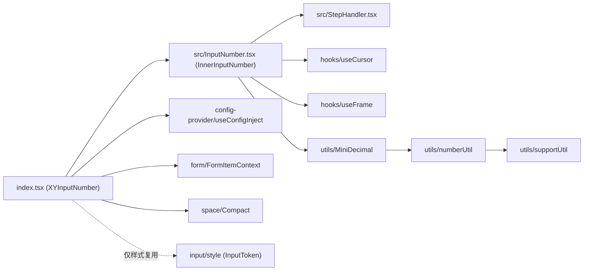
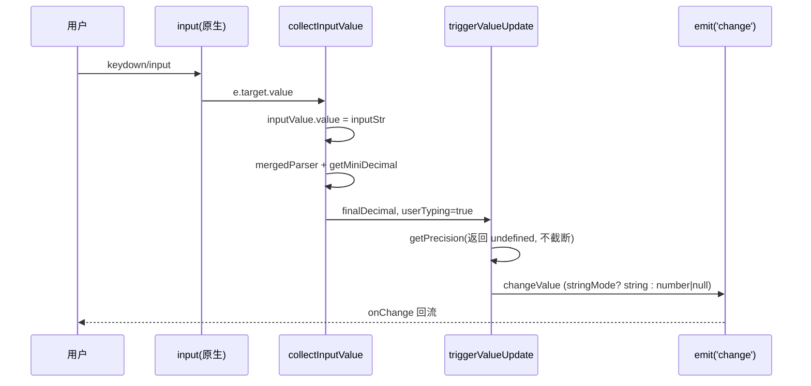
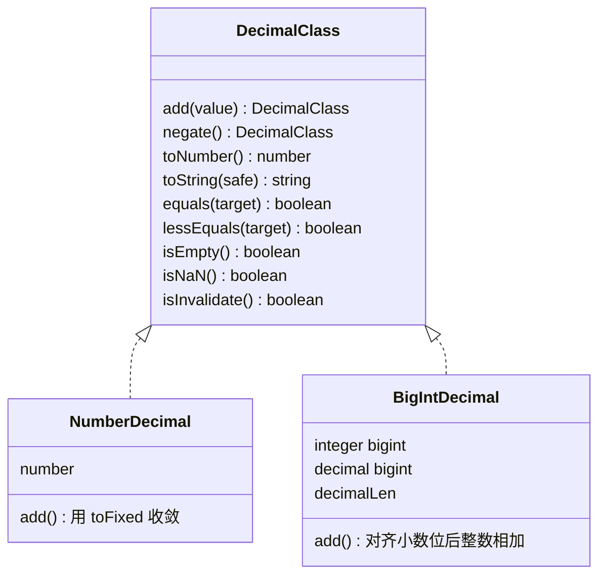
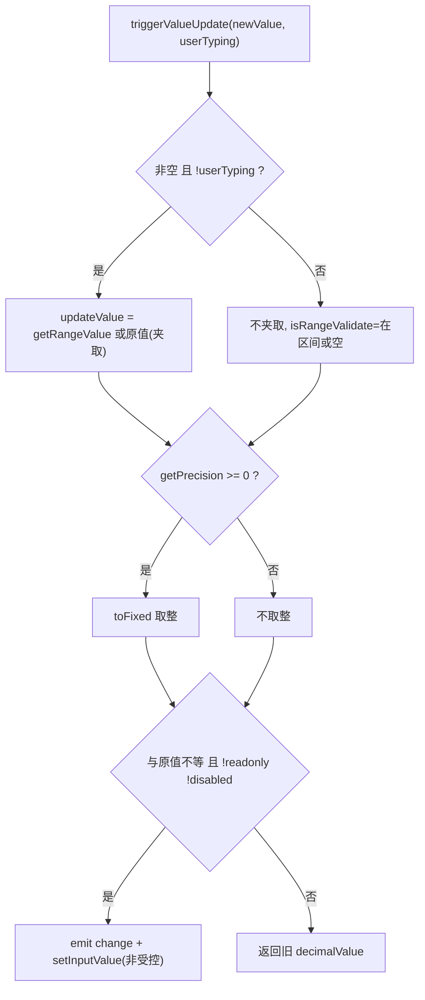

# C04-02 InputNumber 数字输入框

> **本篇解决**：InputNumber 把「字符串输入」与「数字值」之间的一次往返拆开落在哪几层、精度/步进/夹取各自的执行时机，以及 `value` 的对外契约究竟是字符串还是数字。

## 一、职责与边界

InputNumber 负责把「一段可编辑的文本」约束成「一个可校验范围的数值」，并把文本与数值之间的往返、精度、步进、上下限夹取这四件事收在一处完成。它不负责渲染输入框外观细节之外的东西：不接 `vc-input`、不接 `_util/BaseInput`，也不复用 I04《输入基座：vc-input 与 BaseInput》里那套 IME 合成与光标控制基座——这些它自己另写了一份（见 `packages/xiaoye-ui/src/input-number/src/InputNumber.tsx:332`、`packages/xiaoye-ui/src/input-number/src/hooks/useCursor.ts:21`）。它与 Input 唯一的真实共享发生在样式层：`packages/xiaoye-ui/src/input-number/style/index.tsx:1` 直接 import `../../input/style` 的 `InputToken` 与一批 `gen*InputStyle` 生成器，把输入框的边框、hover、focus、status 视觉复用过来，运行期状态则完全独立。

分层上它被切成两个组件：对外的 `XYInputNumber`（`packages/xiaoye-ui/src/input-number/index.tsx:49`）只做 ConfigProvider 注入、size/status/compact/disabled 归并、前后缀与 addon 包裹、以及 focus/blur 的 `expose`；真正处理数值的 `InnerInputNumber`（`packages/xiaoye-ui/src/input-number/src/InputNumber.tsx:81`）只认「字符串或数字」两种输入，不感知主题与表单。

它明确不负责的事：不做校验（交给 `form`，见 C06-01 类篇）、不做货币/百分比格式化（那属于调用方传入的 `formatter`/`parser`，本篇只解释默认实现）、不处理滚轮调速（源码里根本没有 wheel 监听，第四节给出验证命令）。

依赖清单：向上被 `form`、`Descriptions` 等以 `xiaoye-ui/input-number` 引入；向下依赖 `_util/type`、`_util/KeyCode`、`_util/isValidValue`、`_util/raf`、`config-provider/hooks/useConfigInject`、`space/Compact`、`form/FormItemContext`、`@xiaoye-ui/icons` 的 `UpOutlined`/`DownOutlined`，以及自身目录内的 `MiniDecimal`/`numberUtil`/`supportUtil`/`StepHandler`/`useCursor`/`useFrame`。受控/非受控的通用机制属于 I13《响应式内核 hooks》与 C04-00 横写篇，本篇不重复论证，只描述 InputNumber 这两层各自把回退写成什么样。

## 二、源码地图

| 文件 | 行数 | 职责 | 关键导出 |
| --- | --- | --- | --- |
| `packages/xiaoye-ui/src/input-number/index.tsx` | 250 | 对外壳：注入配置、包裹 addon/prefix、`expose` focus/blur | `inputNumberProps`、默认导出 `XYInputNumber` |
| `packages/xiaoye-ui/src/input-number/src/InputNumber.tsx` | 611 | 主实现：文本↔数值往返、精度/步进/夹取、渲染原生 `<input>` | `inputNumberProps`、默认 `InnerInputNumber` |
| `packages/xiaoye-ui/src/input-number/src/StepHandler.tsx` | 109 | 上下箭头长按循环与移动端隐藏 | 默认 `StepHandler` |
| `packages/xiaoye-ui/src/input-number/src/utils/MiniDecimal.ts` | 309 | 高精度加减：`BigIntDecimal`/`NumberDecimal`/`toFixed` | `getMiniDecimal`、`toFixed` |
| `packages/xiaoye-ui/src/input-number/src/utils/numberUtil.ts` | 115 | 字符串解析：`trimNumber`/`getNumberPrecision`/`validateNumber`/`num2str` | 同上 |
| `packages/xiaoye-ui/src/input-number/src/utils/supportUtil.ts` | 3 | `supportBigInt` 能力探测 | `supportBigInt` |
| `packages/xiaoye-ui/src/input-number/src/hooks/useCursor.ts` | 78 | 格式化后光标位置恢复 | 默认 `useCursor` |
| `packages/xiaoye-ui/src/input-number/src/hooks/useFrame.ts` | 25 | 多次调用只跑最后一次的 rAF 合并 | 默认导出 |
| `packages/xiaoye-ui/src/input-number/style/index.tsx` | 415 | CSS-in-JS：复用 Input Token 生成组件样式 | `genComponentStyleHook('InputNumber')` |
| `packages/xiaoye-ui/src/input-number/index.test.js` | 26 | 极薄：仅 focus/mount 与「清空后 blur 回 null」一条 | — |

主实现入口是 `InnerInputNumber` 的 `setup`，从 `packages/xiaoye-ui/src/input-number/src/InputNumber.tsx:93` 起；数值往返的心脏函数 `triggerValueUpdate` 在 `packages/xiaoye-ui/src/input-number/src/InputNumber.tsx:247`。对外壳把底层组件以 `VcInputNumber` 之名引入（`packages/xiaoye-ui/src/input-number/index.tsx:5`），这里的「Vc」是目录内自封装命名，并不指向顶层的 `vc-*` 供应商控件。

样式 hook 的注册与组件 Token 默认值集中在 `packages/xiaoye-ui/src/input-number/style/index.tsx:396`，其中 `handleVisible: 'auto'`（`packages/xiaoye-ui/src/input-number/style/index.tsx:413`）决定箭头默认只在 hover/focus 时出现。

## 三、架构与数据流

先看静态分层。`index.tsx` 与 `src/InputNumber.tsx` 之间是「配置壳」与「数值核」的分工，数值核再把加减委托给 `MiniDecimal`，把长按节流委托给 `StepHandler`：



壳层 `index.tsx` 自身维护一个 `mergedValue`，并额外挂了一个 `watch` 在 `props.value` 上（`packages/xiaoye-ui/src/input-number/index.tsx:77`）；核层 `InputNumber.tsx` 又维护一个 `decimalValue`（`packages/xiaoye-ui/src/input-number/src/InputNumber.tsx:98`）与另一个 `watch`（`packages/xiaoye-ui/src/input-number/src/InputNumber.tsx:455`）。也就是说同一个受控值在被夹取、被格式化之前，先在两层各存了一份镜像，两层都各自判断「是不是受控」再决定要不要更新本地副本。这两份回退各写各的，是理解后续所有「值没同步」「格式化时机不对」类 bug 的起点。

再看一次用户输入到 `onChange` 回流的完整闭环。关键在于 `collectInputValue` 先无条件写 `inputValue`（保证能显示「1.」「-」这种半成品），再尝试解析成 `MiniDecimal` 并交给 `triggerValueUpdate`，后者按 `userTyping` 决定是否夹取与套精度：



这条链上「先显示后解析」的顺序是有意的：如果反过来先 `triggerValueUpdate` 再写 `inputValue`，用户在打「1.」准备继续输入小数时就会被提前格式化掉。源码注释把优先级写死在 `packages/xiaoye-ui/src/input-number/src/InputNumber.tsx:167`：受控 `value` 变化 > 用户输入（只格式化不套精度）> blur/Enter 触发重校验。

还要交代一层贯穿全篇的「属性/事件边界」，否则读者会疑惑 `class`、`onClick`、`readonly` 这些到底落在哪个 DOM。两层组件都声明了 `inheritAttrs: false`（`packages/xiaoye-ui/src/input-number/index.tsx:50`、`packages/xiaoye-ui/src/input-number/src/InputNumber.tsx:82`），意味着 Vue 不会自动把未识别属性挂到根元素，而是要求组件自己决定归属。壳层的做法是把 `{ ...attrs, ...props }` 合流后，挑出 `class`/`style`/`bordered`/`readonly`/`addonBefore` 等自己消费，剩余的 `...others` 才铺给 `VcInputNumber`；底层再次用 `{ ...(attrs as HTMLAttributes), ...props }` 合流，把 `min`/`max`/`step`/`onChange` 等具名拿走，最后的 `...inputProps` 落到 `<input>`（`packages/xiaoye-ui/src/input-number/src/InputNumber.tsx:567`）。于是同一批属性经历「两次显式挑选 + 两次 rest 展开」才抵达原生节点。这个设计让「给 InputNumber 传 `data-*` 或原生 `readonly`」能穿透到输入框，代价是任何一层新增具名 prop 都会截断本该透传给 `<input>` 的属性——例如壳层的 `readonly` 被解构消费后只用于加 `-readonly` 类（`packages/xiaoye-ui/src/input-number/index.tsx:134`），是否真禁编辑取决于它经 `others` 再往下传的路径，而不是同名 prop。

无障碍角色也在这条链上落地：底层给 `<input>` 直接写死 `role="spinbutton"` 并同步 `aria-valuemin`/`aria-valuemax`/`aria-valuenow`（`packages/xiaoye-ui/src/input-number/src/InputNumber.tsx:560`），其中 `aria-valuenow` 取的是 `decimalValue.toString()`，无效值时置 `null`——这是它与普通文本输入框在语义上最硬的区别，也是第六节「为何不接以字符串为中心的输入基座」的动因之一。

## 四、核心机制精读

### 论点 1：InputNumber 不站在 I04 的输入基座上，它自带一份原生 input、composition 与光标恢复

断言：与 Input（C04-01）走 `vc-input`/`BaseInput` 不同，InputNumber 直接渲染裸 `<input>`，IME 合成、beforeinput、光标记录都自己实现，和 Input 的耦合只发生在样式 import。

`packages/xiaoye-ui/src/input-number/src/InputNumber.tsx:332` 起是它自己的合成处理：

```tsx
    // >>> Composition
    const onCompositionStart = () => {
      compositionRef.value = true;
    };

    const onCompositionEnd = () => {
      compositionRef.value = false;

      collectInputValue(inputRef.value.value);
    };

    // >>> Input
    const onInternalInput = (e: ChangeEvent) => {
      collectInputValue(e.target.value);
    };
```

紧接着 `packages/xiaoye-ui/src/input-number/src/InputNumber.tsx:390` 又用 `onBeforeInput` 抢在浏览器事件序列之前把 `userTypingRef` 置真（注释写明是为 Safari 中文输入的触发顺序）。这三段——composition、beforeinput、input——共同承担了 I04 基座在 Input 里做的「合成期不解析、结束再解析」职责，只不过这里是就地重写。

渲染层证据是它挂的原生元素，而非某个 `BaseInput`（`packages/xiaoye-ui/src/input-number/src/InputNumber.tsx:557`）：

```tsx
            <input
              autofocus={autofocus}
              autocomplete="off"
              role="spinbutton"
              aria-valuemin={min as any}
              aria-valuemax={max as any}
              aria-valuenow={
                decimalValue.value.isInvalidate() ? null : (decimalValue.value.toString() as any)
              }
              step={step}
              {...inputProps}
              ref={inputRef}
              class={inputClassName}
              value={inputValue.value}
              disabled={disabled}
              readonly={readonly}
```

`recordCursor`/`restoreCursor` 来自目录内的 `useCursor`（`packages/xiaoye-ui/src/input-number/src/hooks/useCursor.ts:9`、`packages/xiaoye-ui/src/input-number/src/hooks/useCursor.ts:47`），在 `collectInputValue` 开头记录、在 `inputValue` 变化后恢复（`packages/xiaoye-ui/src/input-number/src/InputNumber.tsx:294`、`packages/xiaoye-ui/src/input-number/src/InputNumber.tsx:474`）——因为默认 `restoreCursor` 只在传了 `formatter` 时才跑（见第六节）。

反向验证「确实不依赖基座」可用：

```bash
grep -rniE "vc-input|BaseInput" packages/xiaoye-ui/src/input-number --include='*.tsx' --include='*.ts'
```

命中为零（结果里只有 `inputNumberProps` 之类子串，没有 `from '../../vc-input'` 或 `BaseInput` 的 import）。唯一指向 Input 目录的引用在样式层（`packages/xiaoye-ui/src/input-number/style/index.tsx:1` 的 `import type { InputToken } from '../../input/style'`）。结论：InputNumber 与 Input 是「共用视觉 Token、不共用行为基座」的兄弟，改动 I04 基座不会波及 InputNumber 的输入逻辑，反之也不会。

### 论点 2：`value` 对外是 number，只有 stringMode 或空态才回 string/null；但壳层把回调签名写成了 number，是类型谎言

断言：底层 `onChange` 回传什么类型，完全由一个 `getDecimalValue` 决定；而空态被特判成 `null`。三者共同构成对外契约：非受控默认是 `number`，除非显式开 `stringMode`。

`packages/xiaoye-ui/src/input-number/src/InputNumber.tsx:27` 是唯一的类型出口：

```tsx
const getDecimalValue = (stringMode: boolean, decimalValue: DecimalClass) => {
  if (stringMode || decimalValue.isEmpty()) {
    return decimalValue.toString();
  }

  return decimalValue.toNumber();
};
const getDecimalIfValidate = (value: ValueType) => {
  const decimal = getMiniDecimal(value);
  return decimal.isInvalidate() ? null : decimal;
};
```

注意 `isEmpty()` 时也走 `toString()`（返回空串 `''`），但真正的 `onChange` 出口在 `triggerValueUpdate` 里又做了一次空态→`null` 的覆盖（`packages/xiaoye-ui/src/input-number/src/InputNumber.tsx:273`）。这段在 2026-09-29 之前长这样（**修前快照**，源码已改）：

```tsx
          const changeValue = updateValue.isEmpty()
            ? null
            : getDecimalValue(props.stringMode, updateValue);
          emit('change', changeValue);
          callPropEvent(props.onChange, changeValue);   // ← 修前多这一行
```

`emit('change')` 本来就会去 vnode 上找 `onChange`，紧跟的 `callPropEvent(props.onChange, …)` 是同一函数的第二个投递口——这是「事件双投递」族的**形态一**（该 helper 在本仓只出现在 `input-number`，名字还和别处的 `callEvent` 不同，只 grep `callEvent` 会整个漏掉）。修后只留 `emit`：

```tsx
// packages/xiaoye-ui/src/input-number/src/InputNumber.tsx:283
          emit('change', changeValue);
```

所以完整的对外取值是三元：正常值 `number`（stringMode 下 `string`）、空值 `null`。这被 `index.test.js` 里唯一一条行为断言钉住——清空 input 再 blur，`onChange` 收到 `null`（`packages/xiaoye-ui/src/input-number/index.test.js:24`）。

契约裂缝在壳层：底层 `onChange` 的类型签名是 `ValueType`（即 `string | number`，`packages/xiaoye-ui/src/input-number/src/InputNumber.tsx:70`），且实际还会传 `null`；可 `index.tsx` 的 `handleChange` 却把参数标成了 `number`（`packages/xiaoye-ui/src/input-number/index.tsx:94`），并原样 `emit('update:value', val)`：

```tsx
    const handleChange = (val: number) => {
      if (props.value === undefined) {
        mergedValue.value = val;
      }
      emit('update:value', val);
      emit('change', val);
      formItemContext.onFieldChange();
    };
```

于是 `v-model:value` 在 TS 类型上被收窄成 `number`，运行期却可能拿到 `null` 或（开 stringMode 后）`string`。而 props 侧 `value` 的定义是 `someType<ValueType>([String, Number])`（`packages/xiaoye-ui/src/input-number/src/InputNumber.tsx:44`），即「字符串、数字都能传进来」。一句话概括本篇核心契约：**入参宽（string|number），出参由 `getDecimalValue` 收敛（默认 number，stringMode→string，空→null），壳层类型标注与真实出参不一致。** 需要高精度大数时，`stringMode` 不只是「显示为字符串」，而是保证 `onChange` 不被 `toNumber()` 打回精度受限的 `number`。

这条契约的存在理由可以从数字序列化路径看得更清。`num2str` 在遇到科学计数或超出安全整数时，会用 `BigInt(number).toString()` 展开，否则夹到 `MAX_SAFE_INTEGER`（`packages/xiaoye-ui/src/input-number/src/utils/numberUtil.ts:83`）：

```ts
export function num2str(number: number): string {
  let numStr = String(number);
  if (isE(number)) {
    if (number > Number.MAX_SAFE_INTEGER) {
      return String(supportBigInt() ? BigInt(number).toString() : Number.MAX_SAFE_INTEGER);
    }
    ...
    numStr = number.toFixed(getNumberPrecision(numStr));
  }

  return trimNumber(numStr).fullStr;
}
```

也就是说一旦值离开 `number` 域（`> 2^53`），`getDecimalValue` 的 `toNumber()` 分支就会丢精度——`stringMode` 正是让 `onChange` 停在 `toString()` 分支（`packages/xiaoye-ui/src/input-number/src/InputNumber.tsx:28`）来绕开这条精度悬崖。反过来，`BigIntDecimal` 内部全程以字符串/bigint 承载，只有最终对外输出时才按 `stringMode` 决定要不要落回 `number`。这就是「内部高精度、外部按开关选择精度」的分界，也是本篇把 `value` 契约判为「number 优先、非默认无损」的依据。

### 论点 3：精度不是靠浮点 `+` 与 `toFixed`，而是整条加减都搬进 MiniDecimal；运行期优先 BigInt

断言：`step` 累加、上下限比较、`precision` 取整全部在 `DecimalClass` 抽象里以字符串/bigint 完成，避开 `0.1 + 0.2 !== 0.3` 的浮点陷阱；只有 BigInt 不可用时才降级到 `NumberDecimal`。

工厂函数在 `packages/xiaoye-ui/src/input-number/src/utils/MiniDecimal.ts:262`：

```ts
export default function getMiniDecimal(value: ValueType): DecimalClass {
  // We use BigInt here.
  // Will fallback to Number if not support.
  if (supportBigInt()) {
    return new BigIntDecimal(value);
  }
  return new NumberDecimal(value);
}
```

`supportBigInt()` 就是 `typeof BigInt === 'function'`（`packages/xiaoye-ui/src/input-number/src/utils/supportUtil.ts:1`）。两个实现共享同一接口，类图如下：



`BigIntDecimal.add` 的做法是把两个数按更大小数位对齐成整数字符串再相加（`packages/xiaoye-ui/src/input-number/src/utils/MiniDecimal.ts:197`）：

```ts
    const maxDecimalLength = Math.max(this.getDecimalStr().length, offset.getDecimalStr().length);
    const myAlignedDecimal = this.alignDecimal(maxDecimalLength);
    const offsetAlignedDecimal = offset.alignDecimal(maxDecimalLength);

    const valueStr = (myAlignedDecimal + offsetAlignedDecimal).toString();

    // We need fill string length back to `maxDecimalLength` to avoid parser failed
    const { negativeStr, trimStr } = trimNumber(valueStr);
    const hydrateValueStr = `${negativeStr}${trimStr.padStart(maxDecimalLength + 1, '0')}`;

    return new BigIntDecimal(
      `${hydrateValueStr.slice(0, -maxDecimalLength)}.${hydrateValueStr.slice(-maxDecimalLength)}`,
    );
```

降级路径 `NumberDecimal.add` 也坚持不用裸 `+` 的结果，而是按两边精度取 `toFixed`（`packages/xiaoye-ui/src/input-number/src/utils/MiniDecimal.ts:80`），并对超安全整数夹回 `MAX_SAFE_INTEGER`（`packages/xiaoye-ui/src/input-number/src/utils/MiniDecimal.ts:72`）。范围比较走 `lessEquals`，它靠「加对方负数再看是否 ≤ 0」实现（`packages/xiaoye-ui/src/input-number/src/utils/MiniDecimal.ts:238`），因此 min/max 判定也享有同样的精度语义，不会因浮点误差把边界值误判成越界。

需要厘清一个反直觉点：`precision` 这个 prop 并不改变 `MiniDecimal` 里存的数，它是 `formatter`/`onChange` 的显示与取整参数（`packages/xiaoye-ui/src/input-number/src/InputNumber.tsx:65` 的注释写得很直白：「Syntactic sugar of `formatter`」），真正的取整发生在 `toFixed`（`packages/xiaoye-ui/src/input-number/src/utils/MiniDecimal.ts:275`），它对齐了 JS `toFixed` 的四舍五入语义，还专门处理 `advancedNum >= 5` 的进位（`packages/xiaoye-ui/src/input-number/src/utils/MiniDecimal.ts:288`）。

### 论点 4：min/max 夹取被 `userTyping` 门控——打字过程中不夹，只有 blur/Enter/步进才夹

断言：越界值在用户还在输入时会被原样放过（甚至触发 `onChange` 显示越界），把「拉回区间」推迟到非输入态。这是 `triggerValueUpdate` 里一条 `if (!updateValue.isEmpty() && !userTyping)` 造成的分支。

`packages/xiaoye-ui/src/input-number/src/InputNumber.tsx:247`：

```ts
    const triggerValueUpdate = (newValue: DecimalClass, userTyping: boolean): DecimalClass => {
      let updateValue = newValue;

      let isRangeValidate = isInRange(updateValue) || updateValue.isEmpty();

      // Skip align value when trigger value is empty.
      // We just trigger onChange(null)
      // This should not block user typing
      if (!updateValue.isEmpty() && !userTyping) {
        // Revert value in range if needed
        updateValue = getRangeValue(updateValue) || updateValue;
        isRangeValidate = true;
      }

      if (!props.readonly && !props.disabled && isRangeValidate) {
        const numStr = updateValue.toString();
        const mergedPrecision = getPrecision(numStr, userTyping);
        if (mergedPrecision >= 0) {
          updateValue = getMiniDecimal(toFixed(numStr, '.', mergedPrecision));
        }
```

配合 `getRangeValue`（`packages/xiaoye-ui/src/input-number/src/InputNumber.tsx:224`）与 `isInRange`（`packages/xiaoye-ui/src/input-number/src/InputNumber.tsx:241`）：

```ts
    const getRangeValue = (target: DecimalClass) => {
      // target > max
      if (maxDecimal.value && !target.lessEquals(maxDecimal.value)) {
        return maxDecimal.value;
      }

      // target < min
      if (minDecimal.value && !minDecimal.value.lessEquals(target)) {
        return minDecimal.value;
      }

      return null;
    };
```

数据流分支画出来更清楚：



精度侧同理被门控：`getPrecision` 一旦看到 `userTyping` 就直接 `return undefined`（`packages/xiaoye-ui/src/input-number/src/InputNumber.tsx:110`），于是打字段落里连取整都不做。越界与未取整的值此时仍会 `emit('change')`（因为 `isRangeValidate` 允许 `updateValue.isEmpty()`，且 userTyping 分支不改 `updateValue`），调用方因此在输入过程中就能收到「越界的半成品」。真正把它夹回，是 `onBlur`/`onPressEnter` 调 `flushInputValue(false)`（`packages/xiaoye-ui/src/input-number/src/InputNumber.tsx:369`，userTyping 传 false）之时，或点箭头/按方向键走 `onInternalStep` → `triggerValueUpdate(target, false)`（`packages/xiaoye-ui/src/input-number/src/InputNumber.tsx:365`）。

这里有个易被忽略的渲染细节：越界不会阻止显示，只打一个 class。渲染期在 `packages/xiaoye-ui/src/input-number/src/InputNumber.tsx:540` 给容器加 `-out-of-range`，NaN 时加 `-not-a-number`（`packages/xiaoye-ui/src/input-number/src/InputNumber.tsx:539`），供样式与外部选择器使用。

还有一个更少人注意的守卫：`triggerValueUpdate` 的外层条件是 `if (!props.readonly && !props.disabled && isRangeValidate)`（`packages/xiaoye-ui/src/input-number/src/InputNumber.tsx:261`），不满足时函数直接 `return decimalValue.value`（`packages/xiaoye-ui/src/input-number/src/InputNumber.tsx:294`），也就是把传入的 `newValue` 整个丢弃、回吐旧值。这意味着 `disabled`/`readonly` 期间不仅用户改不动，连点箭头走 `onInternalStep` 也拿不到变更——`onInternalStep` 里虽然没显式判 disabled，但更新被这道门挡在 `triggerValueUpdate` 之外。定位「禁用态下值仍在变」这类问题应先查这一行，而不是查事件绑定。空值则走另一条豁免：`isRangeValidate = isInRange(updateValue) || updateValue.isEmpty()`（`packages/xiaoye-ui/src/input-number/src/InputNumber.tsx:258`）让「清空」永远合法，从而能在 `min>0` 的约束下仍把 `null` 发出去，这正是那条唯一单测钉住的行为。

### 论点 5：步进调速只有两条路——方向键与长按循环；源码里没有滚轮调速

断言：改变数值的「自动重复」来自两处：键盘 ArrowUp/ArrowDown 每次按下走一次 `onInternalStep`（连续加速依赖浏览器自身的按键 repeat），以及点击箭头按钮后的 `setTimeout` 循环（先 `STEP_DELAY=600ms` 再起 `STEP_INTERVAL=200ms`）。整条链路里没有 wheel/scroll/deltaY 监听，鼠标滚轮不改变数值。

方向键分支在 `onKeyDown`（`packages/xiaoye-ui/src/input-number/src/InputNumber.tsx:408`）：

```tsx
      if (props.keyboard === false) {
        return;
      }

      // Do step
      if (!compositionRef.value && [KeyCode.UP, KeyCode.DOWN].includes(which)) {
        onInternalStep(KeyCode.UP === which);
        event.preventDefault();
      }
```

`keyboard` 默认 true（`packages/xiaoye-ui/src/input-number/src/InputNumber.tsx:55`），关掉后方向键不再步进，但 Enter 与按钮仍可用——因为键盘门控只在 `onKeyDown` 里判断。合成期（`compositionRef`）也会屏蔽方向键，避免中文输入选词上下键误触发步进。

按钮长按的循环与常量在 `packages/xiaoye-ui/src/input-number/src/StepHandler.tsx:10` 与 `packages/xiaoye-ui/src/input-number/src/StepHandler.tsx:36`：

```tsx
      // Loop step for interval
      function loopStep() {
        emit('step', up);

        stepTimeoutRef.value = setTimeout(loopStep, STEP_INTERVAL);
      }

      // First time press will wait some time to trigger loop step update
      stepTimeoutRef.value = setTimeout(loopStep, STEP_DELAY);
```

注意这套循环是**等间隔**的：无论按多久，速率恒为每 200ms 一次，不做「越按越快」的加速曲线。`onStopStep` 绑在 `mouseup`/`mouseleave`（`packages/xiaoye-ui/src/input-number/src/StepHandler.tsx:77`），并在 `onBeforeUnmount` 兜底清除（`packages/xiaoye-ui/src/input-number/src/StepHandler.tsx:56`）；`mousedown` 先 `preventDefault()`（`packages/xiaoye-ui/src/input-number/src/StepHandler.tsx:37`）以免点箭头时输入框失焦或选中文本。移动端整体不渲染箭头（`packages/xiaoye-ui/src/input-number/src/StepHandler.tsx:61` 的 `isMobile()` 短路返回 null）。

无论来自哪条路，最终都汇进 `onInternalStep`（`packages/xiaoye-ui/src/input-number/src/InputNumber.tsx:339`），它把「加一步」交给 MiniDecimal 而非浮点加（`packages/xiaoye-ui/src/input-number/src/InputNumber.tsx:354`），并在越界时提前返回：

```tsx
    const onInternalStep = (up: boolean) => {
      // Ignore step since out of range
      if ((up && upDisabled.value) || (!up && downDisabled.value)) {
        return;
      }

      // Clear typing status since it may caused by up & down key.
      // We should sync with input value.
      userTypingRef.value = false;

      let stepDecimal = getMiniDecimal(props.step);
      if (!up) {
        stepDecimal = stepDecimal.negate();
      }

      const target = (decimalValue.value || getMiniDecimal(0)).add(stepDecimal.toString());
```

`upDisabled`/`downDisabled` 由 `maxDecimal.lessEquals(decimalValue)` 与 `decimalValue.lessEquals(minDecimal)` 计算（`packages/xiaoye-ui/src/input-number/src/InputNumber.tsx:197`、`packages/xiaoye-ui/src/input-number/src/InputNumber.tsx:205`），因此到达边界后步进自动停手。`onInternalStep` 会先 `userTypingRef.value = false` 再步进，把「刚才在打字」的状态清掉，好让 `triggerValueUpdate(target, false)` 走夹取+取整分支。

`onStep` 回调附带 `offset` 与 `type`（`packages/xiaoye-ui/src/input-number/src/InputNumber.tsx:359`），步进后 `inputRef.value?.focus()` 把焦点还给输入框（`packages/xiaoye-ui/src/input-number/src/InputNumber.tsx:371`）。要注意 `stepInfo.offset` 恒等于 `props.step` 本身，而不是「实际加上的增量」：当目标值被 `triggerValueUpdate` 夹到 `max`/`min` 时，`stepValue`（取自夹取后的 `updatedValue`）与 `offset`（取自原始 `props.step`）会不一致——调用方若拿 `offset` 去反推真实变化量会算错，应当以 `stepValue` 为准。

「没有滚轮」是可证伪命题，用命令坐实（应返回空、计数为 0）：

```bash
grep -rniE "wheel|onScroll|deltaY|mousewheel|addEventListener\(.scroll" \
  packages/xiaoye-ui/src/input-number --include='*.tsx' --include='*.ts' | head
```

结论：任何「InputNumber 支持滚轮调值」的说法在本库源码中不成立；如需滚轮，得由调用方自行监听并调 `step` 或直接改 `value`。

### 论点 6：格式化与用户输入是一条「先剥后解析、显示期不套精度」的往返，光标靠 formatter 才恢复

断言：默认 `parser` 用一条保留字母数字的正则剥离千分位与货币符号，默认 `formatter` 在用户输入期刻意不做精度/分隔符处理；而中文全角句点「。」的替换被推迟到下一帧，光标恢复只在显式传了 `formatter` 时才启用。

`mergedParser`（`packages/xiaoye-ui/src/input-number/src/InputNumber.tsx:123`）：

```tsx
    const mergedParser = (num: string | number) => {
      const numStr = String(num);

      if (props.parser) {
        return props.parser(numStr);
      }

      let parsedStr = numStr;
      if (props.decimalSeparator) {
        parsedStr = parsedStr.replace(props.decimalSeparator, '.');
      }

      // [Legacy] We still support auto convert `$ 123,456` to `123456`
      return parsedStr.replace(/[^\w.-]+/g, '');
    };
```

正则 `[^\w.-]+` 会删掉空格、逗号、`$` 之类，但**保留字母、数字、下划线、点与负号**；随后 `getMiniDecimal` 里 `validateNumber` 决定它到底是不是合法数（`packages/xiaoye-ui/src/input-number/src/utils/numberUtil.ts:97`，接受 `11.28`、`1.`、`.1` 三种形态）。也就是说 `$12a` 会被剥成 `12a` 再判非法——默认 parser 不保证「只剩数字」，这是 legacy 兼容换来的宽松。

`mergedFormatter`（`packages/xiaoye-ui/src/input-number/src/InputNumber.tsx:150`）在用户输入期直接短路掉精度与分隔符：

```tsx
    const mergedFormatter = (number: string, userTyping: boolean) => {
      if (props.formatter) {
        return props.formatter(number, { userTyping, input: String(inputValue.value) });
      }

      let str = typeof number === 'number' ? num2str(number) : number;

      // User typing will not auto format with precision directly
      if (!userTyping) {
        const mergedPrecision = getPrecision(str, userTyping);

        if (validateNumber(str) && (props.decimalSeparator || mergedPrecision >= 0)) {
          // Separator
          const separatorStr = props.decimalSeparator || '.';

          str = toFixed(str, separatorStr, mergedPrecision);
        }
      }

      return str;
    };
```

往返的另一半是「全角句点异步纠正」：`collectInputValue` 末尾用 `onNextPromise`（来自 `useFrame`，`packages/xiaoye-ui/src/input-number/src/hooks/useFrame.ts:18`）把 `。`→`.` 的再解析推到下一帧，且 `useFrame` 保证多次调用只跑最后一次（`packages/xiaoye-ui/src/input-number/src/hooks/useFrame.ts:19`）。这段在 `packages/xiaoye-ui/src/input-number/src/InputNumber.tsx:311`。

光标恢复被绑在 formatter 上：`watch(inputValue, ...)` 里 `if (props.formatter) restoreCursor()`（`packages/xiaoye-ui/src/input-number/src/InputNumber.tsx:463`）。也就是说默认无 formatter 时不做光标复位；一旦你传了把值改成带分隔符/单位的 formatter，`restoreCursor` 才会按前缀/后缀匹配把光标落回原位（`packages/xiaoye-ui/src/input-number/src/hooks/useCursor.ts:47`）。这条「格式化改了字符串形状，光标就得重定位」的因果，解释了为何光标逻辑与 formatter 强绑定而非无条件运行。

## 五、对外契约如何生效

本节沿一条 prop/event 的实际流动走一遍，说明「你写在模板上的东西」在哪一层被消费。

**props 流入。** 壳层把底层 `baseInputNumberProps()` 整个展开进自己的 props（`packages/xiaoye-ui/src/input-number/index.tsx:30`），再叠加 `size`/`bordered`/`addonBefore` 等表现层字段。渲染时它并不逐个转发，而是 `omit(others, ['size', 'defaultValue', 'onChange', 'onBlur', 'onFocus'])` 后整体铺到 `VcInputNumber` 上（`packages/xiaoye-ui/src/input-number/index.tsx:146`）——`size` 被拦下是因为它只用于加 `-lg`/`-sm` 类名（`packages/xiaoye-ui/src/input-number/index.tsx:131`），`defaultValue` 被拦下是因为壳层已用 `mergedValue = props.value ?? props.defaultValue` 消化掉了（`packages/xiaoye-ui/src/input-number/index.tsx:75`），而后三个是 2026-09-29 新加的：壳层在同一个元素上又显式绑了 `onChange={handleChange}`/`onBlur={handleBlur}`/`onFocus={handleFocus}`，`mergeProps` 会把摊下来的用户 handler 与自家桥接 arrow 并成数组，于是数组里那份直调一次、arrow 里的 `emit` 再命中同一个函数一次（**这是「事件双投递」族的形态三**，见本篇坑 7 的计数）。真正落到原生 `<input>` 的，是底层再次的 `...inputProps` 展开（`packages/xiaoye-ui/src/input-number/src/InputNumber.tsx:567`），但底层在展开前先把 `onFocus`/`onBlur`/`onKeydown`/`onKeyup` 四个键从这份复制对象里删掉（`packages/xiaoye-ui/src/input-number/src/InputNumber.tsx:521`）——删除只作用在 `{ ...attrs, ...props }` 的副本上，不碰 props/attrs 本身。

**v-model 绑定。** `onUpdate:value` 被直接接到 `baseProps.onChange`（`packages/xiaoye-ui/src/input-number/index.tsx:40`），配合 `value={mergedValue.value}`（`packages/xiaoye-ui/src/input-number/index.tsx:149`）构成受控闭环。`v-model.lazy` 修饰符被翻成 `lazy` prop（`packages/xiaoye-ui/src/input-number/index.tsx:148`），底层据此把监听器从 `onInput` 换成 `onChange`（`packages/xiaoye-ui/src/input-number/src/InputNumber.tsx:525`）——即「每次按键即同步」与「失焦/change 才同步」的开关。

**事件回流。** 底层只有一个出口：`emit('change', changeValue)`（`packages/xiaoye-ui/src/input-number/src/InputNumber.tsx:283`）。2026-09-29 之前它后面还跟一句 `callPropEvent(props.onChange, changeValue)`，同一个函数被投两次；那次清理顺手删掉了全部 8 处 `callPropEvent` 直调与这个 helper 本身（`change`/`input`/`step`/`pressEnter`/`keydown`/`keyup`/`blur`/`focus` 各一处）。壳层收到后汇进 `handleChange`（`packages/xiaoye-ui/src/input-number/index.tsx:94`），再 `emit('update:value')` + `emit('change')` 并触发 `formItemContext.onFieldChange()`（`packages/xiaoye-ui/src/input-number/index.tsx:100`）通知 Form 校验。`onStep` 只在底层发（`packages/xiaoye-ui/src/input-number/src/InputNumber.tsx:360`），壳层没重新转发，所以想接 `onStep` 得依赖 attr 透传。

**slots。** 壳层声明了 `addonBefore`/`addonAfter`/`prefix`/`upIcon`/`downIcon`（`packages/xiaoye-ui/src/input-number/index.tsx:59`）。其中 `upIcon`/`downIcon` 被映射成底层的 `upHandler`/`downHandler` 插槽，缺省用 `@xiaoye-ui/icons` 的 `UpOutlined`/`DownOutlined`（`packages/xiaoye-ui/src/input-number/index.tsx:157`）；`prefix`/`addonBefore` 决定是否套 `affix-wrapper`/`group`（`packages/xiaoye-ui/src/input-number/index.tsx:168`、`packages/xiaoye-ui/src/input-number/index.tsx:194`）。

**expose 与 context。** 壳层 `expose({ focus, blur })` 转发到 `inputNumberRef`（`packages/xiaoye-ui/src/input-number/index.tsx:90`），底层又各自 `expose` 到原生 `inputRef`（`packages/xiaoye-ui/src/input-number/src/InputNumber.tsx:493`）。`id` 若未显式给则取 `formItemContext.id`（`packages/xiaoye-ui/src/input-number/index.tsx:113`）；`disabled` 由 `useConfigInject` 与 `useInjectDisabled` 归并（`packages/xiaoye-ui/src/input-number/index.tsx:69`）；状态色由 `getMergedStatus(formItemInputContext.status, props.status)` 决定（`packages/xiaoye-ui/src/input-number/index.tsx:65`）。

**关键点：受控回退被写了两遍。** 壳层 `watch(() => props.value, ...)` 把 `mergedValue` 重置为 `props.value`（`packages/xiaoye-ui/src/input-number/index.tsx:77`），底层又有一个 `watch(() => props.value, ...)` 重建 `decimalValue`（`packages/xiaoye-ui/src/input-number/src/InputNumber.tsx:455`），且底层在非受控时才用 `setUncontrolledDecimalValue` 更新本地（`packages/xiaoye-ui/src/input-number/src/InputNumber.tsx:100`）。这两层各判断一次 `props.value === undefined`，是 InputNumber 与 I13 里那套统一 `useMergedState` 的差异所在——它没有复用统一 hook，而是分两层手写，原因见下一节。

## 六、设计取舍

**为什么不复用 `useMergedState`。** InputNumber 需要同时持有三种形态：原始受控入参（`mergedValue`，`string|number|undefined`）、解析后的 `DecimalClass`（`decimalValue`，`packages/xiaoye-ui/src/input-number/src/InputNumber.tsx:98`）、以及供 `<input>` 显示的字符串（`inputValue`，`packages/xiaoye-ui/src/input-number/src/InputNumber.tsx:140`）。I13 的 `useMergedState` 管的是「一个受控值 + 一个本地值」两态，套不进这种「显示串与数值对象分离」的模型，于是壳与核各写一份 `watch`。换来的代价是同一份受控语义在两层重复判定，一旦某层判断口径变化（比如受控 `props.value` 为 `null` 与 `undefined` 的分歧）就会出现「外层已更新、内层仍显示旧格式化串」这类难定位的错位；收益是每个形态都能被独立精确控制（如「打 `1.` 不立刻变 `1`」的例外直接写在底层 `watch` 的 `!newValue.equals(currentParsedValue) || !userTypingRef.value` 条件里，`packages/xiaoye-ui/src/input-number/src/InputNumber.tsx:465`）。

**为什么用 BigInt 而不是引入 big.js/decimal.js。** 高精度若外包给第三方小数库会进 bundle、破坏 tree-shaking，也和本库「不引运行时依赖」的取向相悖。`MiniDecimal` 用原生 `BigInt` 把小数按位对齐成整数相加（`packages/xiaoye-ui/src/input-number/src/utils/MiniDecimal.ts:183`），零依赖。赔上的成本：BigInt 只有整数语义，所有小数位处理都得手工 `padStart`/切片还原（`packages/xiaoye-ui/src/input-number/src/utils/MiniDecimal.ts:215`），且必须保留一条 `NumberDecimal` 降级路径给不支持 BigInt 的环境（`packages/xiaoye-ui/src/input-number/src/utils/MiniDecimal.ts:268`），两套实现要维持行为一致。

**为什么把夹取推迟到 blur。** 若在每次 `onChange` 就强制夹到 `max`，用户想把 `1` 改成 `12`（`max=10`）时会在打完第二位的瞬间被回退，根本无法输入。所以 `triggerValueUpdate` 用 `!userTyping` 门控夹取（`packages/xiaoye-ui/src/input-number/src/InputNumber.tsx:255`），输入期放行、失焦/回车/步进才回收。代价是 `onChange` 在输入过程中会收到越界值，把「范围校验」的责任间接推给了逐键监听的调用方。

**为什么不接 I04 输入基座而是自渲染原生 input。** spinbutton 语义（`role="spinbutton"` + `aria-valuemin/max/now`，`packages/xiaoye-ui/src/input-number/src/InputNumber.tsx:560`）、按键即改、每键都要 parser/formatter，与基座以字符串 value 为中心的行为模型会互相掣肘。就地重写 composition/cursor 换来对数值链路的完全掌控，赔上的是「同一 IME 边角行为在 Input 与 InputNumber 可能不一致」的维护分裂——这一点与 C04-01 的结论并列即可，本篇不重复展开基座内部。

**`lazy` 用原生 change 事件换轻量，但会丢实时格式化。** 底层把 `lazy` 直接翻译成「绑 `onChange` 而非绑 `onInput`」（`packages/xiaoye-ui/src/input-number/src/InputNumber.tsx:525`）：

```tsx
      const eventProps = {} as any;
      if (lazy) {
        eventProps.onChange = onInternalInput;
      } else {
        eventProps.onInput = onInternalInput;
      }
```

代价是原生 `<input>` 的 `change` 事件只在失焦/提交时触发，于是 `lazy` 模式下整条 parser→`triggerValueUpdate`→夹取的链路从「每键」降级为「每提交」，`onChange` 出参也随之只在失焦时发。省掉的是打字期的反复解析与重渲染，赔上的是 `v-model.lazy` 用户对「实时联动/实时千分位」的期待——这与默认非受控逐键同步是一条明确的开关式权衡，不是性能优化免费午餐。

## 七、坑与改动指南

测试现状：`input-number` 目录内只有一个 `packages/xiaoye-ui/src/input-number/index.test.js`，它匹配 `packages/xiaoye-ui/vitest.config.mts:33` 的 `src/**/*.test.{js,ts,jsx,tsx}` glob 因此确实被执行，但只覆盖 focus/mount 与「清空后 blur 回 null」一条；事件投递次数由本篇坑 7 新加的三条计数用例钉住（`packages/xiaoye-ui/src/_util/__tests__/event-dispatch-count.test.tsx`）。下面各坑里，除坑 7 外，除非特别指出，**对应分支均无测试保护**（滚轮、BigInt 降级、光标恢复、夹取时机、precision 取整都没有单测）。

**坑 1（2026-09-29 已纠正：原判据是错的）：`props.onKeydown` 这条读取路径恒空，但用户函数并不会因此失效。**
触发：给 `<xy-input-number :on-keydown="fn">` 传函数 prop。
症状：`fn` 正常调用**一次**（实测：`packages/xiaoye-ui/src/_util/__tests__/event-dispatch-count.test.tsx` 退回 HEAD 基线复跑同样是一次，不是本文原先写的「永不被调用」）。
原因：分两半。前半句仍然成立——`inputNumberProps` 从未声明 `onKeydown`/`onKeyup`（声明块 `packages/xiaoye-ui/src/input-number/src/InputNumber.tsx:39` 到 `:77` 内无 `onKey`），所以源码里 `callPropEvent(props.onKeydown, event)` 这一句确实是空操作（该直调已在 2026-09-29 随全族清理删除）。后半句是本文原先的错：**投递不靠那句直调，靠 `emit('keydown', event)`**（`packages/xiaoye-ui/src/input-number/src/InputNumber.tsx:416`、`:431`）。`keydown`/`keyup` 都在 `emits` 里（`packages/xiaoye-ui/src/input-number/src/InputNumber.tsx:87`），而 Vue 对「声明过的事件」有一套 attr 侧处理：`isEmitListener` 命中的 `onXxx` 不会被当作普通 attr 摊到原生节点上，`emit` 则直接从 vnode props 里取同一个函数——所以只投一次，不多不少。教训：判「某个 handler 到底通不通」要跑一次交互数调用次数，别只读 `props.onX` 那一条路径。
定位：`packages/xiaoye-ui/src/input-number/src/InputNumber.tsx:416`、`:431`、`:87`。

**坑 2：`v-model:value` 类型标成 number，运行期能拿到 null/string。**
触发：非受控或受控下清空、或开 `stringMode`。
症状：把绑定值声明为 `number` 的 TS 代码里出现 `null`，或 stringMode 下拿到 `string` 与类型不符。
原因：壳层 `handleChange(val: number)`（`packages/xiaoye-ui/src/input-number/index.tsx:94`）直接 `emit('update:value', val)`，而底层出参可为 `null`（空态覆盖 `packages/xiaoye-ui/src/input-number/src/InputNumber.tsx:271`）或 `string`（stringMode 分支 `packages/xiaoye-ui/src/input-number/src/InputNumber.tsx:28`）。
定位：`packages/xiaoye-ui/src/input-number/index.tsx:94`。改动方向是把这里签名放宽成 `ValueType | null`。

**坑 3：逐键校验的 Form 规则会在打字期误报越界。**
触发：`min=0 max=10`，配 `trigger: 'input'`/`'change'` 的校验规则。
症状：用户输入 `1`、`12` 的过程中，`onChange` 先收到 `12`（越界），校验红一下，失焦后又夹回 `10`。
原因：夹取被 `!userTyping` 门控（`packages/xiaoye-ui/src/input-number/src/InputNumber.tsx:255`），输入过程放行越界值并照常 `emit('change')`（`packages/xiaoye-ui/src/input-number/src/InputNumber.tsx:283`）。
定位：`packages/xiaoye-ui/src/input-number/src/InputNumber.tsx:247`（`triggerValueUpdate`）。缓解：校验 `trigger` 设为 `blur`。

**坑 4：受控传 `value` 却不回写，打字后失焦被弹回。**
触发：`:value="x"` 但不监听 `@update:value` 更新 `x`。
症状：能临时看到新字符，`blur`/`Enter` 后显示值退回旧 `x`。
原因：`flushInputValue` 在 `props.value !== undefined` 时无条件 `setInputValue(decimalValue.value, false)` 用受控值复位（`packages/xiaoye-ui/src/input-number/src/InputNumber.tsx:380`）。
定位：`packages/xiaoye-ui/src/input-number/src/InputNumber.tsx:380`。这是受控语义正确行为，但常被误当 bug。

**坑 5：只给 `formatter` 不给 `parser`，特殊格式解析失败且光标跳。**
触发：`formatter` 输出带单位/自定义分隔符，但不写对应 `parser`。
症状：显示正常，回解成 NaN，再被 `flushInputValue` 弹回或清空。
原因：默认 `mergedParser` 靠 `[^\w.-]+` 粗剥（`packages/xiaoye-ui/src/input-number/src/InputNumber.tsx:136`），非标准形状不保证还原；同时 `restoreCursor` 仅在有 `formatter` 时才跑（`packages/xiaoye-ui/src/input-number/src/InputNumber.tsx:463`），格式化改形状后光标按前后缀匹配重定位（`packages/xiaoye-ui/src/input-number/src/hooks/useCursor.ts:55`），匹配失败会落到串尾。
定位：`packages/xiaoye-ui/src/input-number/src/InputNumber.tsx:150`。`formatter` 与 `parser` 必须成对提供。

**坑 6：`precision` 拦不住打字，且取整是四舍五入不是截断。**
触发：`precision=2`，用户输入 `1.234` 后失焦。
症状：输入期可见 `1.234`（不被截断），失焦后按四舍五入收敛；`1.235` 会进到 `1.24`。
原因：`getPrecision` 在 `userTyping` 时返回 undefined 不截断（`packages/xiaoye-ui/src/input-number/src/InputNumber.tsx:111`）；取整走 `toFixed`，对第 `precision+1` 位 `>= 5` 触发进位递归（`packages/xiaoye-ui/src/input-number/src/utils/MiniDecimal.ts:288`）。
定位：`packages/xiaoye-ui/src/input-number/src/InputNumber.tsx:110`。需要「截断而非进位」得自写 `formatter` 并用 `toFixed` 的 `cutOnly` 语义（`packages/xiaoye-ui/src/input-number/src/utils/MiniDecimal.ts:275`）。

**坑 7：一次交互把外部 handler 投 4~6 次（2026-09-29 已修，本篇是全库最重的一个样本）。**
触发：`<xy-input-number :on-focus="fn" :on-blur="fn" :on-change="fn">` 三种任一。
症状与实测（修前 → 修后，全部为真实挂载后派发单个事件所数到的次数）：一次 `focus` **6 → 1**、一次 `blur` **6 → 1**、一次输入 **4 → 1**。`grep -rn "callEvent" packages/xiaoye-ui/src` 找不到这个组件，因为它的 helper 在 `input-number` 里叫 **`callPropEvent`**（`packages/xiaoye-ui/src/input-number/src/InputNumber.tsx`，修前有 8 处调用点），按名字搜会整族漏掉——这是本族审计的一个反例：**别只按函数名搜，要按「emit 之后紧跟一句调用同名 prop 回调」的形状搜**（`docs/column/tools/scan-double-dispatch.mjs` 就是按形状写的，它同时覆盖了两个别名）。
原因：三种形态在这里叠了三层。① 形态一：底层每个事件都是 `emit('x')` + `callPropEvent(props.onX)`；② 形态三：壳层 `{...omit(others, [...])}` 把用户 handler 整包摊给底层，又显式绑 `onChange={handleChange}` 等桥接 arrow，`mergeProps` 并成数组；③ 底层自己再把 `{ ...attrs, ...props }` 的剩余部分摊给原生 `<input>`。三层相乘得到 6，而不是 2。
修法（已落地）：底层删掉全部 `callPropEvent` 直调与 helper 本身，只留 `emit`；在摊给 `<input>` 前把 `onFocus`/`onBlur`/`onKeydown`/`onKeyup` 从复制对象里删掉（`packages/xiaoye-ui/src/input-number/src/InputNumber.tsx:521`）；壳层把 `onChange`/`onBlur`/`onFocus` 加进 `omit` 列表（`packages/xiaoye-ui/src/input-number/index.tsx:146`）。注意壳层**没有**剥 `onInput`/`onStep`/`onPressEnter`——它自己不发这些事件，剥了就会把用户回调彻底丢掉，这类「只剥本层桥接过的」边界同样适用于 `steps`、`slider`。
回归：`packages/xiaoye-ui/src/_util/__tests__/event-dispatch-count.test.tsx` 里三条 InputNumber/Switch 族用例，判据全是 `toHaveBeenCalledTimes(1)`；退回 HEAD 复跑这三条必红（已实测：6 次与 4 次的报错原文）。

**改动安全边界。** 动 `triggerValueUpdate`/`getPrecision`/`toFixed` 任一处都会同时影响「显示串」「onChange 出参类型」「夹取时机」三条链，改前至少要补测：清空→blur 回 null（已有，`packages/xiaoye-ui/src/input-number/index.test.js:10`）、越界打字→blur 夹回、stringMode 出参为 string、BigInt 与 Number 降级一致。验证命令：

```bash
pnpm --filter xiaoye-ui test:unit -- input-number
pnpm typecheck
```

## 附：本篇可证伪的三个检查点

1. **命题：InputNumber 不支持滚轮调速。** 命令（期望命中数 0）：
   ```bash
   grep -rniE "wheel|deltaY|mousewheel" packages/xiaoye-ui/src/input-number --include='*.tsx' --include='*.ts' | wc -l
   ```
   本仓库实测输出 `0`；若将来有人加了滚轮，此数变非零即证伪论点 5。

2. **命题：受控回退在壳层与核层各写了一遍 watch。** 命令（期望恰好两条，一一对应两个文件）：
   ```bash
   grep -rn "() => props.value" packages/xiaoye-ui/src/input-number
   ```
   实测输出 `index.tsx:78` 与 `src/InputNumber.tsx:442` 各一条，佐证第五节「受控值被写两遍」与 I13 统一 hook 的差异。

3. **命题：min/max 夹取被用户输入态门控。** 命令（期望命中该行）：
   ```bash
   grep -rn "isEmpty() && !userTyping" packages/xiaoye-ui/src/input-number/src/InputNumber.tsx
   ```
   实测命中 `packages/xiaoye-ui/src/input-number/src/InputNumber.tsx:255`，即 `triggerValueUpdate` 里「非空且非打字期才 `getRangeValue` 夹回」的分支，是论点 4 的直接证据。
