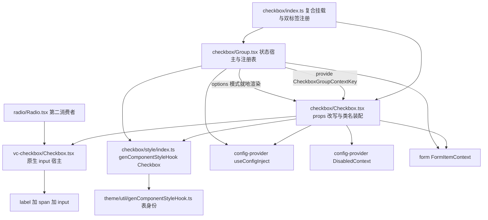
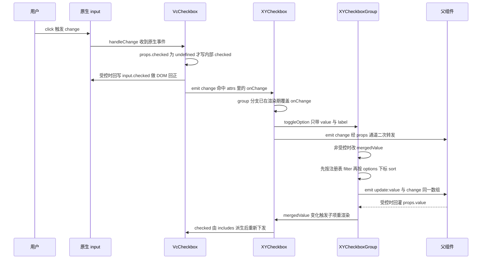
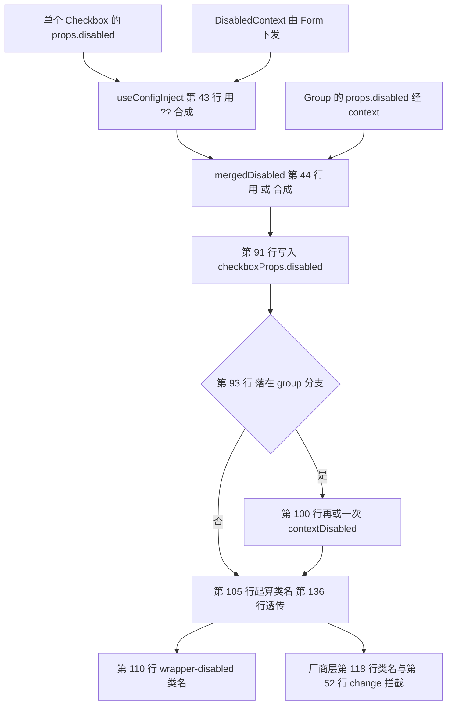
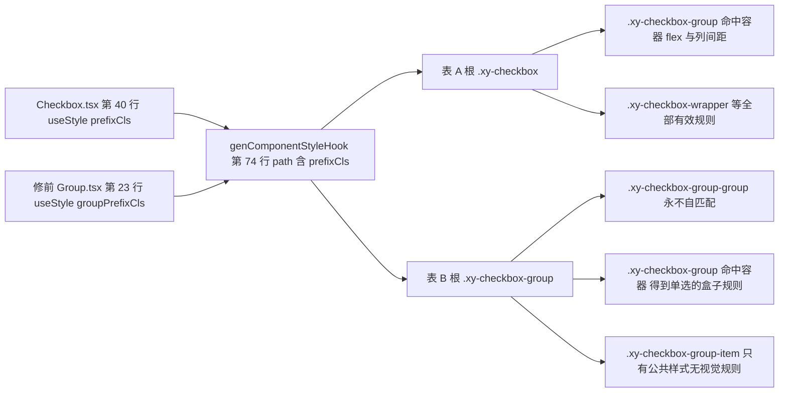

# C04-03 Checkbox 多选框

> **本篇解决**：`<xy-checkbox>` 与 `<xy-checkbox-group>` 之间到底交换了什么？为什么组件层只有 147 行却能让 `checked`、`onChange`、`disabled` 三个 prop 在不同分支下走向四种结局？`indeterminate` 为什么改不了原生控件只改类名？Group 的选中数组为什么要经过一次「注册表过滤 + options 下标重排」两阶段的改写？以及：给 `<xy-checkbox>` 传 `@input`、`title`、`isGroup` 之后，它们各自在哪一行消失（三条互不相同的通路）。
> **前置**：C04-00 类横写：受控/非受控与 `useMergedState` 的一致实现（已完成）、I04 输入基座（vc-input 与 BaseInput，已完成）　**读者坐标**：`03-components/04-form-controls` 第 3/10 篇；本篇只讲 `src/checkbox/` 与 `src/vc-checkbox/`，受控判定与 DOM 回正的横向对比归 C04-00，Radio 侧差异归 C04-04

## 一、职责与边界

`checkbox/` 这一层不负责「记住勾了什么」，也不负责渲染那个方块。它做且只做三件事：**把 props 逐字段改写成一个交给厂商层的对象**（`packages/xiaoye-ui/src/checkbox/Checkbox.tsx:86-104`）、**把类名装配到 label 与厂商层 span 两个不同的盒子上**（同文件 `:105-121`）、**在 Group 与独立 Checkbox 之间切换事件去向**（同文件 `:93-104`）。状态的宿主只有两个：Group 里的 `mergedValue`（`packages/xiaoye-ui/src/checkbox/Group.tsx:29`）和厂商层里那个原生 input 的 `checked`（`packages/xiaoye-ui/src/vc-checkbox/Checkbox.tsx:33`）。单个 `<xy-checkbox>` 组件实例自身**零状态**——全文 147 行里没有一处 `ref` 承载勾选值。

本篇**不重复推导**以下内容，它们已由 C04-00 定论：`useMergedState` 在本类零接入（C04-00 论点 1）、`vc-checkbox/Checkbox.tsx:76` 的 DOM 回正是本类四种回正手段之一（C04-00 论点 2）、Group 型控件「子项受控是假命题」以及两 Group 的差异（C04-00 论点 3；2026-09-30 起 `checkbox/Group.tsx:29` 与 `radio/Group.tsx:57` 的受控判定已收敛进 `_util/hooks/useGroupValue.ts` 共享内核，判据统一为 `props.value !== undefined`）、`formItemContext.onFieldChange()` 是本类与 Form 的唯一耦合点（C04-00 论点 5）。本篇补的是这三行代码之下的**装配规则、属性通路和样式表身份**。

依赖与被依赖（全部实测，统计时排除 `dist` 与 `node_modules`）：

| 方向 | 对象 | 证据 |
| --- | --- | --- |
| 依赖 | `vc-checkbox/Checkbox.tsx`（唯一的原生 input 宿主），本层是它的两个消费者之一 | `packages/xiaoye-ui/src/checkbox/Checkbox.tsx:12` |
| 与 Radio 共享底座 | 另一个消费者是 `radio/Radio.tsx:4`；除这两处外全仓再无引用 | `packages/xiaoye-ui/src/radio/Radio.tsx:4` |
| 依赖 | `form/FormItemContext` 的两个 context（字段注册 + 校验态） | `packages/xiaoye-ui/src/checkbox/Checkbox.tsx:16` |
| 依赖 | `config-provider` 的 `useConfigInject` 与 `DisabledContext` | `packages/xiaoye-ui/src/checkbox/Checkbox.tsx:17`、`:18` |
| 依赖 | `_util/props-util` 的 `flattenChildren`（决定 label 文本盒是否存在） | `packages/xiaoye-ui/src/checkbox/Checkbox.tsx:13` |
| 被依赖（跨类） | Table 表头过滤器直接按类名耦合本组件产物 | `packages/xiaoye-ui/src/table/style/filter.ts:155` |
| 平级拷贝 | `vc-cascader/OptionList/Checkbox.tsx` 是第三份「勾选框」实现，与 `vc-checkbox` 零共享 | `packages/xiaoye-ui/src/vc-cascader/OptionList/Checkbox.tsx:12-41` |
| 不被依赖 | `vc-checkbox` 没有 `index.ts`、不在生成物 `components.ts` 与 `package.json` 的 `exports` 里 → 非公开导入面 | `packages/xiaoye-ui/src/components.ts:68-70` |

## 二、源码地图

| 文件 | 行数 | 职责 | 关键导出 / 取证锚点 |
| --- | --- | --- | --- |
| `checkbox/index.ts` | 20 | 复合挂载 + 一次注册两个标签 | `Checkbox.Group` 挂载 `:8`、`install` 双注册 `:11-15`、副名导出 `:16` |
| `checkbox/interface.ts` | 89 | props + 事件对象 + context 类型（本类唯一没有 `*Types.ts` 命名的组件） | `abstractCheckboxProps` `:51`、`checkboxProps` `:71`、`CheckboxGroupContextKey` `:88` |
| `checkbox/Checkbox.tsx` | 147 | 组件层主实现 | `name: 'XYCheckbox'` `:28`、`setup` `:33`、渲染出口 `:82` |
| `checkbox/Group.tsx` | 137 | 状态宿主 + 子项注册表 + options 展开 | `mergedValue` `:25`、注册表 `:43-61`、`toggleOption` `:63`、`provide` `:85` |
| `vc-checkbox/Checkbox.tsx` | 150 | 原生 input 宿主（厂商层） | `name: 'Checkbox'` `:24`、内部 `checked` `:33`、`handleChange` `:51`、DOM 三件套 `:142-147` |
| `checkbox/style/index.ts` | 300 | 单 hook 样式，Checkbox 与 Group 共用 | `xyCheckboxEffect` `:14`、`genCheckboxStyle` `:27`、`getStyle` `:289`、默认导出 `:298` |
| `checkbox/checkbox.test.js` | 41 | 2 个共享套件 + 2 个显式 `it` | `focusTest` `:8`、`value` 告警 `:27` |
| `checkbox/group.test.js` | 126 | 6 个 `it`，其中 1 个零断言 | 零断言那条在 `:82-93` |
| `checkbox/demo/` | — | **不存在**：本组件没有组件内 demo 目录 | 示例落在 `apps/docs/examples/checkbox/` 共 6 个 `.vue` |

三个「读码前必须知道」的地图事实：

1. **主实现只有一个渲染出口**，且它返回的是一个「每次渲染重跑一遍」的闭包（`packages/xiaoye-ui/src/checkbox/Checkbox.tsx:82`）。整个组件层只有 `mergedDisabled` 一个 `computed`（`:44-46`），类名、props 改写对象、`aria-checked` 全部在渲染函数体内现算——这决定了本篇论点 1 与论点 3 的成立方式：**求值顺序就是优先级**。
2. **`vc-checkbox` 目录只有一个文件**，`checkboxProps` 在这里是**普通对象**而不是函数（`packages/xiaoye-ui/src/vc-checkbox/Checkbox.tsx:8`），经 `initDefaultProps` 补默认值（`:26`）；组件层的同名导出却是函数式工厂（`packages/xiaoye-ui/src/checkbox/interface.ts:71`）。两层同名不同形，是读码时最容易搞混的一点。
3. **`checkbox/style/index.ts` 的 hook 名是 `'Checkbox'` 而选择器根由调用方传入**（`:298` 的 `genComponentStyleHook('Checkbox', (token, { prefixCls }) => ...)`），Group 修复前传的是带 `-group` 后缀的值。这是论点 6 的全部起因，也是本篇发现的最高价值缺陷——**2026-09-29 已修**（`Group.tsx` 改传自己的前缀，见论点 6 题注）。

## 三、架构与数据流

### 3.1 静态结构：两层两文件一 hook，三个 context 入口



这张图要读的是**边的缺失**而不是边的存在。三条关键空缺：`Group` 不指向 `vc-checkbox`（它只渲染 `Checkbox`，见 `packages/xiaoye-ui/src/checkbox/Group.tsx:91`），所以 Group 永远碰不到原生 input；`vc-checkbox` 不指向任何 context（全文没有一处 `inject`，见 `packages/xiaoye-ui/src/vc-checkbox/Checkbox.tsx:1-6` 的导入清单），所以它不知道 group 存在；`checkbox/index.ts` 与 `interface.ts` 都不进样式链路。也就是说：**Group 与子项之间只有一条通道——`CheckboxGroupContextKey` 这个 `InjectionKey`（`packages/xiaoye-ui/src/checkbox/interface.ts:88`）**，而这条通道传的是 6 个成员组成的裸对象（`packages/xiaoye-ui/src/checkbox/interface.ts:80-87`），其中 `mergedValue` 是直接暴露的 ref 而不是只读派生值（`packages/xiaoye-ui/src/checkbox/Group.tsx:79`），子项可以原地改写它（论点 5 会用到这一点）。

三个 context 入口里有一个容易被忽略的副作用：`useInjectFormItemContext()` 在被调用的那一刻就把调用者登记为 FormItem 的字段（`packages/xiaoye-ui/src/form/FormItemContext.ts:82`），紧接着一行又把「默认内部 context」重新 provide 给下游（`packages/xiaoye-ui/src/form/FormItemContext.ts:87`）。正是这一行让 Group 与其 3 个子项不会在同一个 FormItem 里被登记 4 次、进而不会触发 `packages/xiaoye-ui/src/form/FormItemContext.ts:45-60` 的「一个 FormItem 只能收一个字段」开发期告警。删掉 `:87` 那行的后果会在 Checkbox 家族立刻显形（`packages/xiaoye-ui/src/checkbox/Group.tsx:18` 与 `packages/xiaoye-ui/src/checkbox/Checkbox.tsx:34` 都调用它，一个 group + N 个子项就是 N+1 次登记）。同一形状在 radio 族里重复一次（`packages/xiaoye-ui/src/radio/Group.tsx` 与 `packages/xiaoye-ui/src/radio/Radio.tsx` 也成对调用），所以这不是 checkbox 独有的侥幸而是两族共同的依赖；全仓共有 22 个文件命中该函数（`grep -rln "useInjectFormItemContext" packages/xiaoye-ui/src --include='*.tsx' --include='*.ts'`）。

### 3.2 一次点击的完整闭环（group 模式）



图里有三处「看起来该发生却没发生」的动作，它们是本篇论点 1 的主体：第一，`emit('update:checked')` 在这条链上**根本不出现**——它只在非 group 分支的 `handleChange` 里被调用一次（`packages/xiaoye-ui/src/checkbox/Checkbox.tsx:67`）；第二，`toggleOption` 收到的 `label` 字段（`packages/xiaoye-ui/src/checkbox/Checkbox.tsx:96`）在 Group 内部**没有任何读取点**（`packages/xiaoye-ui/src/checkbox/Group.tsx:50-69` 只读 `option.value`）；第三，父组件回灌 `props.value` 之后，内核的 `watch`（`packages/xiaoye-ui/src/_util/hooks/useGroupValue.ts:49-55`，2026-09-30 起为 Group 状态的宿主）只是把数组整个换掉，**不会再 emit 一次**——这是它比 radio 侧（`radio/Group.tsx:70-71` 的 `useEmitGuard` 重入守卫）少一层回声抑制的原因，结论见 C04-00 论点 3，本篇不重述。

### 3.3 禁用的三条合流路径



分岔点是**两种合成算子被混用在同一条链上**：`??` 出现在 `packages/xiaoye-ui/src/config-provider/hooks/useConfigInject.ts:43`（`props.disabled ?? disabledContext.value`），`||` 出现在 `packages/xiaoye-ui/src/checkbox/Checkbox.tsx:44-46` 与 `:100`。`??` 尊重显式 `false`，`||` 不尊重——于是同一个 `<xy-checkbox :disabled="false">` 在 `<xy-form disabled>` 里、放进 Group 与不放进 Group 会走向相反结论（论点 3 展开）。图的右半边还有一个隐含前提：类名与真值之所以目前不出岔，是因为 `:105` 的类名计算发生在 `:93-104` 的改写**之后**，这一点在论点 3 末尾单独交代。

## 四、核心机制精读

### 论点 1：组件层不持有状态，它持有的是一次「props 改写台」——改写发生在展开之后，因此四个 prop 在 group 分支里被无声替换，第五个字段写出去就没人读

```tsx
// packages/xiaoye-ui/src/checkbox/Checkbox.tsx:82
    return () => {
      const children = flattenChildren(slots.default?.());
      const { indeterminate, skipGroup, id = formItemContext.id.value, ...restProps } = props;
      const { onMouseenter, onMouseleave, onInput, class: className, style, ...restAttrs } = attrs;
      const checkboxProps: CheckboxProps = {
        ...restProps,
        id,
        prefixCls: prefixCls.value,
        ...restAttrs,
        disabled: mergedDisabled.value,
      };
      if (checkboxGroup && !skipGroup) {
        checkboxProps.onChange = (...args) => {
          emit('change', ...args);
          checkboxGroup.toggleOption({ label: children, value: props.value });
        };
        checkboxProps.name = checkboxGroup.name.value;
        checkboxProps.checked = checkboxGroup.mergedValue.value.includes(props.value);
        checkboxProps.disabled = mergedDisabled.value || contextDisabled.value;
        checkboxProps.indeterminate = indeterminate;
      } else {
        checkboxProps.onChange = handleChange;
      }
```

**逐段拆**。

`:84` 的解构是整段的第一道分水岭：`indeterminate`、`skipGroup`、`id` 三个名字被**摘出** `restProps`，其余全部原样进入。摘出的意义是「不再随展开传递」，所以 `:86-92` 组装出的对象里默认**没有** `indeterminate`——注意这个动作在两个分支里不对称：group 分支在 `:101` 又把它写了回去，非 group 分支从头到尾没写。论点 4 会证明这一行写回去的值在下游没有任何读取点。

`:86-92` 的展开顺序是 `restProps → id → prefixCls → restAttrs → disabled`。`restAttrs` 排在 `restProps` 之后，意味着**同名时用户写在标签上的 attribute 覆盖 props 派生值**；但紧跟其后的 `disabled: mergedDisabled.value`（`:91`）排在最后，于是 `disabled` 成为唯一一个「props 与 attrs 都插不了嘴」的键。这就是为什么 `<xy-checkbox disabled>` 能生效却**不是**通过 `props.disabled` 直接透传生效的——它必须绕一圈 `useConfigInject` 的合成（论点 3）。

`:94` 与 `:103` 分别覆盖 `onChange`，`:99` 覆盖 `checked`，`:98` 覆盖 `name`，`:100` 覆盖 `disabled`。四个被覆盖的键里有三个是用户可能显式传入的（`checked`、`onChange`、`name` 在 `packages/xiaoye-ui/src/checkbox/interface.ts:55`、`:64`、`:59` 都有声明位）。**`checked` 的覆盖是彻底失效**：group 模式下 `:99` 无条件用 `mergedValue.includes(props.value)` 重算，`props.checked` 连参与判断的资格都没有。

**`onChange` 的覆盖为什么不丢回调**，是这段代码最反直觉的地方，答案在事件通道而不在这个对象里：

```tsx
// packages/xiaoye-ui/src/checkbox/Checkbox.tsx:65
    const handleChange = (event: CheckboxChangeEvent) => {
      const targetChecked = event.target.checked;
      emit('update:checked', targetChecked);
      emit('change', event);
      formItemContext.onFieldChange();
    };
    const checkboxRef = ref();
    const focus = () => {
      checkboxRef.value?.focus();
    };
    const blur = () => {
      checkboxRef.value?.blur();
    };
    expose({
      focus,
      blur,
    });
```

`:32` 声明了 `emits: ['change', 'update:checked', 'mouseenter', 'mouseleave']`，而 `onChange` 同时是 `:64` 声明的 prop。Vue 3 的运行时在解析 props 时，凡是命中 `emits` 声明的 `onXxx` 键都归入「事件监听器」而不是 attr，`emit('change', ...)` 会直接调用它。所以 `:94` 覆盖掉的只是「把这个函数当作属性继续往下传」这条路，用户自己的 `onChange` 由 `:95` 的 `emit('change', ...args)` 唤起。**结论是：`onChange` 有两条并行的传递通道（props 展开 / emit 派发），源码里只有一条被覆盖，另一条还在跑**。这条区分不是学院式的——它是这个组件最容易改坏的地方：如果有人认为 group 分支的 `emit('change')` 与 `Group.tsx:82` 的 `emit('change', val)` 重复而删掉 `:95`，那么 `Group.tsx:108` 转发给子项的 `option.onChange` 会静默失效（它正是以 `onChange` prop 的形态存在的），而全仓唯一守着这条路的用例是 `packages/xiaoye-ui/src/checkbox/group.test.js:111-154`，它测的是插槽子项、不是 options 子项。

再看两个「写了没人读」的字段。`:96` 的 `{ label: children, value: props.value }` 里，`label` 在 Group 侧没有任何读取点：`toggleOption` 的函数体从 `:63` 到 `:84` 只出现一次 `option.`，读的是 `option.value`（`packages/xiaoye-ui/src/checkbox/Group.tsx:55`）。真正的 `label` 消费发生在别处——options 模式在 `packages/xiaoye-ui/src/checkbox/Group.tsx:101` 直接渲染 `option.label`。所以 `:96` 传的是一份被丢弃的 VNode 数组。

`update:checked` 则相反：它有 emits 声明（`:32`）、有 `interface.ts:65` 的 prop 声明位、有 `:67` 的唯一调用点，但**这个调用点在 group 分支里永远不会执行**。组合起来的实际后果是：`<xy-checkbox-group>` 里的 `<xy-checkbox v-model:checked="flag">` 既不会被 group 的状态反向改写（`:99` 覆盖了 `checked`），也永远不会把用户的点击写回 `flag`——`flag` 停在初始值上，且没有任何告警。

**回扣论点**：这一层不是状态层，是**改写层**；它的全部行为规则都写在「谁覆盖谁」里，而不是写在某个 store 里。因此维护它的安全边界只有一条：任何新字段进入 `checkboxProps` 之前，必须先确认它落在 `:93-104` 的哪一侧、以及覆盖它的那一行是否还活着。

### 论点 2：属性到 DOM 要过两道白名单，第一道在组件层摘掉 `onInput`，第二道在厂商层只放行 `class` / `data-*` / `aria-*` / `role` 与五个具名事件

```tsx
// packages/xiaoye-ui/src/checkbox/Checkbox.tsx:123
      return wrapSSR(
        <label
          class={classString}
          style={style as CSSProperties}
          onMouseenter={(e: MouseEvent) => {
            emit('mouseenter', e);
            (onMouseenter as EventHandler)?.(e);
          }}
          onMouseleave={(e: MouseEvent) => {
            emit('mouseleave', e);
            (onMouseleave as EventHandler)?.(e);
          }}
        >
          <VcCheckbox
            aria-checked={ariaChecked}
            {...checkboxProps}
            class={checkboxClass}
            ref={checkboxRef}
          />
          {children.length ? <span>{children}</span> : null}
        </label>,
      );
```

`<label>` 只拿到四样东西：`class`（`:125`）、`style`（`:126`）、`onMouseenter`、`onMouseleave`。这两行 `emit` 先于「调用 attrs 里的同名函数」（`:128-129`、`:132-133`）的顺序安排，让 `@mouseenter` 的观察者拿到事件的时间点早于父组件自己的 handler——这是本类里唯一一处「emit 与 props 回调共存且刻意排序」的写法。第一道白名单在 `:85` 完成：`onMouseenter`、`onMouseleave` 被摘出来用于 label，**`onInput` 也被摘出来，但整个文件里它只出现在这一行**（可验证：`grep -n "onInput" packages/xiaoye-ui/src/checkbox/Checkbox.tsx` 仅命中 `:85`）。摘出而未使用意味着它既不在 label 上、也不在 `restAttrs` 里，于是**不会**继续向厂商层传递。`<xy-checkbox @input="log">` 的实际结局是：事件永不触发、控制台无任何提示。

穿过第一道的属性进入 `checkboxProps`，再作为 props/attrs 抵达厂商层，撞上第二道：

```tsx
// packages/xiaoye-ui/src/vc-checkbox/Checkbox.tsx:100
      const {
        class: className,
        onFocus,
        onBlur,
        onKeydown,
        onKeypress,
        onKeyup,
      } = attrs as HTMLAttributes;
      const othersAndAttrs = { ...others, ...attrs };
      const globalProps = Object.keys(othersAndAttrs).reduce((prev, key) => {
        if (key.startsWith('data-') || key.startsWith('aria-') || key === 'role') {
          prev[key] = othersAndAttrs[key];
        }
        return prev;
      }, {});

      const classString = classNames(prefixCls, className, {
        [`${prefixCls}-checked`]: checked.value,
        [`${prefixCls}-disabled`]: disabled,
      });
```

`:109-114` 的 `reduce` 是一次**显式白名单过滤**：只有 `data-*`、`aria-*`、`role` 三类键能从 `othersAndAttrs` 活下来。它的产物在 `:131` 被展开进 `inputProps`，而 `inputProps` 的其余成员是逐个点名的（`:120-140` 一共 11 个属性键、一次 `globalProps` 展开、7 个事件处理器槽位，其中 `onChange: handleChange`（`:132`）与 `onClick`（`:133`）写在展开之后）。两道合起来的完整放行清单是：`class`（`:116` 合并）、`data-*`/`aria-*`/`role`（`:110`）、`onFocus`/`onBlur`/`onKeydown`/`onKeypress`/`onKeyup`（`:101-106` 取出、`:134-138` 绑回）、以及厂商层 `emits: ['click', 'change']`（`:31`）声明过的两个事件名。**清单之外的一切都在 `:108` 的合并里活着走完一段路，然后在 `:131` 之前蒸发**：`title`、`placeholder`、`dir` 这类原生属性，`onDblclick` 这类没被点名的处理器，全部静默丢弃。这里要特别记住 `onChange` 与 `onClick` 是**靠 emits 声明**而非靠 attrs 透传生效的：厂商层的 props（`:8-21`）里没有这两个名字，它们本会落入 `attrs`，但因为命中 `emits` 而被 Vue 归为监听器，所以 `:108` 的 `othersAndAttrs` 里根本不存在它们。

回到 `:136-141` 的四行 JSX，它的书写顺序本身是一条优先级链：`aria-checked` 最先、展开次之、`class` 与 `ref` 最后。因此 `aria-checked={ariaChecked}` 是**四个里唯一可能被展开体覆盖的**——只要 `restAttrs` 里出现 `aria-checked` 键（用户在模板上直接写 `aria-checked` 就会），`:137` 派生出的 `'mixed'` 就会被顶掉，而 `'mixed'` 是 `indeterminate` 唯一的无障碍表达（论点 4）。`class` 那一项需要一句限定：Vue JSX 的多段展开走 `mergeProps`，它对 `class`/`style` 是合并而非覆盖，属框架运行时语义、本仓无源码可引；但本处不构成风险，因为 `attrs.class` 已在 `:85` 被摘走、`checkboxProps` 内不存在 `class` 键，`:139` 是厂商层 span 唯一的类名来源。

**回扣论点**：`<xy-checkbox>` 的「属性可透传」是个半真命题。维护者判断某个属性能不能落到 `<input>` 上，唯一可靠的做法是去厂商层数 `:120-140` 的点名单，而不是假设 `v-bind="$attrs"` 语义存在——这个组件两层都是 `inheritAttrs: false`（`packages/xiaoye-ui/src/checkbox/Checkbox.tsx:29`、`packages/xiaoye-ui/src/vc-checkbox/Checkbox.tsx:25`）。

### 论点 3：「禁用」在这一个文件里有三条合流路径与两种合成算子，显式 `:disabled="false"` 是否有效取决于这个 Checkbox 有没有落进 Group

```tsx
// packages/xiaoye-ui/src/checkbox/Checkbox.tsx:36
    const { prefixCls, direction, disabled } = useConfigInject('checkbox', props);

    const contextDisabled = useInjectDisabled();
    // style
    const [wrapSSR, hashId] = useStyle(prefixCls);

    const checkboxGroup = inject(CheckboxGroupContextKey, undefined);
    const uniId = Symbol('checkboxUniId');
    const mergedDisabled = computed(() => {
      return checkboxGroup?.disabled.value || disabled.value;
    });
    watchEffect(() => {
      if (!props.skipGroup && checkboxGroup) {
        checkboxGroup.registerValue(uniId, props.value);
      }
    });
```

`:36` 与 `:38` 是**同一个 DisabledContext 的两个入口**。`useConfigInject` 内部自己调了 `useInjectDisabled()`（`packages/xiaoye-ui/src/config-provider/hooks/useConfigInject.ts:9`），并在 `:43` 产出 `props.disabled ?? disabledContext.value`；组件层又在本文件 `:38` 独立注入一次同一个 key。两次注入拿到的是同一个 ref 对象（`inject` 沿组件树取到的就是 `provide` 的那个 computed，见 `packages/xiaoye-ui/src/config-provider/DisabledContext.ts:7-9`），所以 `disabled.value` 里**已经含**上下文禁用，`contextDisabled.value` 是它的第二次读取。

`packages/xiaoye-ui/src/config-provider/DisabledContext.ts:5`

```ts
const DisabledContextKey: InjectionKey<Ref<DisabledType>> = Symbol('DisabledContextKey');

export const useInjectDisabled = () => {
  return inject(DisabledContextKey, ref<DisabledType>(undefined));
};
export const useProviderDisabled = (disabled: Ref<DisabledType>) => {
  const parentDisabled = useInjectDisabled();
  provide(
    DisabledContextKey,
    computed(() => disabled.value ?? parentDisabled.value),
  );
  return disabled;
};
```

这个 context 只有两个写入点（`packages/xiaoye-ui/src/form/Form.tsx:142` 与 `packages/xiaoye-ui/src/config-provider/index.tsx:218`），合流规则都是 `??`——即「显式 `false` 有权切断继承」。而 `:44-46` 用的是 `||`，且把 group 的 disabled 排在左侧（`checkboxGroup?.disabled.value`，来自 `packages/xiaoye-ui/src/checkbox/Group.tsx:95` 的 `computed(() => props.disabled)`）。两种算子混在一串里，就产生了下面这张真值表（`D` = `props.disabled`，`G` = Group 的 `disabled`，`C` = DisabledContext）：

| 输入 | 无 group 时（走 `:91`） | 有 group 时（走 `:100`） | 结论 |
| --- | --- | --- | --- |
| `D=undefined, C=true` | `true`（`:43` 的 `??` 落到 C） | `true` | 一致 |
| `D=true, C=undefined` | `true` | `true`（`G` 任意） | 一致 |
| `D=undefined, G=true` | 不适用：没有 group 就没有 `G` | `true`（`||` 左侧短路） | 一致 |
| `D=false, G=false, C=true` | **`false`** | **`true`** | **不一致** |

唯一分岔发生在第四行：调用方显式写 `:disabled="false"`、外层是 `<xy-form disabled>`（或 `<xy-config-provider :disabled>`）、且这个 Checkbox 在 group 里。此时 `:100` 的 `|| contextDisabled.value` 把 `??` 精心保留的「显式假」又翻回了真。**这一行的存在本身说明它是补丁**：非 group 分支不需要它，因为 `:43` 已经把 context 折进来了；group 分支加上它之后，`mergedDisabled` 的语义从「自身或组或上下文」变成「自身或组或上下文，再或一次上下文」，多出来的那次只在 `props.disabled === false` 时可见。改法有两个方向，且都必须写清取舍：把 `:100` 删掉（行为变成第四行也一致，代价是丢掉某个我们尚未从源码推出动机的场景），或者把 `:44-46` 的 `||` 换成带 `??` 优先级的显式合并（代价是 group 的 disabled 不再能覆盖子项的显式 `false`——那正是 `packages/xiaoye-ui/src/checkbox/group.test.js:34-56` 这条用例想要的语义）。

**还有一件必须写进维护手册的事：这个组件的类名与真值今天不出岔，靠的是求值顺序，不是靠设计。** `:105-115` 的 `classString` 里读的是 `checkboxProps.checked`（`:109`）与 `checkboxProps.disabled`（`:110`），而这两处读的已经是 `:93-104` 改写**之后**的对象——所以 `-wrapper-checked`、`-wrapper-disabled` 与厂商层的 `-checked`/`-disabled` 同源。一旦有人为了「可读性」把 `classString` 提成 `computed` 或上移到 `if` 之前，`:110` 就会退回读 `:91` 那个未含 `contextDisabled` 的值，第四行场景立刻变成「输入框禁用、外层 label 仍是 `cursor: pointer`」的可见缺陷。同理，`:44-46` 的 `mergedDisabled` 是全文件唯一的 `computed`，其余全是渲染期内联计算（`:82` 起的整个函数体每次渲染重跑），所以「谁先算谁的值进得去」是这个组件的隐性契约。

### 论点 4：`indeterminate` 是纯呈现态——它进不了厂商层的 props、进不了原生 input 的 `indeterminate` 属性，只产出两个类名与一个 `aria-checked`，而写回它的那一行本身就是死写

```tsx
// packages/xiaoye-ui/src/checkbox/Checkbox.tsx:105
      const classString = classNames(
        {
          [`${prefixCls.value}-wrapper`]: true,
          [`${prefixCls.value}-rtl`]: direction.value === 'rtl',
          [`${prefixCls.value}-wrapper-checked`]: checkboxProps.checked,
          [`${prefixCls.value}-wrapper-disabled`]: checkboxProps.disabled,
          [`${prefixCls.value}-wrapper-in-form-item`]: formItemInputContext.isFormItemInput,
        },
        className,
        hashId.value,
      );
      const checkboxClass = classNames(
        {
          [`${prefixCls.value}-indeterminate`]: indeterminate,
        },
        hashId.value,
      );
      const ariaChecked = indeterminate ? 'mixed' : undefined;
```

三段产出，逐个追。

**第一段（`:106-112`）是 label 的类名**，五项里有一项值得单独点名：`-wrapper-in-form-item` 取自 `formItemInputContext.isFormItemInput`（`:111`），而 `FormItemInputContext` 的默认值是空对象（`packages/xiaoye-ui/src/form/FormItemContext.ts:111` 的 `createContext<FormItemStatusContextProps>({})`），所以 Form 之外它是 `undefined`。这个类名唯一的用途是激活那条带 `// FIXME: magic` 注释的硬编码规则（`packages/xiaoye-ui/src/checkbox/style/index.ts:69-74`，把 input 定死成 14×14）。

**第二段（`:116-121`）是厂商层 span 的类名**，它经由 `:139` 的 `class={checkboxClass}` 进入 `packages/xiaoye-ui/src/vc-checkbox/Checkbox.tsx:116` 的 `classNames(prefixCls, className, {...})`，最终落在与 `.xy-checkbox` **同一个元素**上——因为样式里写的是 `'&-indeterminate'`（字符串拼接而非后代），产物选择器是 `.xy-checkbox-indeterminate .xy-checkbox-inner:after`：

```ts
// packages/xiaoye-ui/src/checkbox/style/index.ts:149
      [checkboxCls]: {
        '&-indeterminate': {
          // Wrapper > Checkbox > inner
          [`${checkboxCls}-inner`]: {
            '&:after': {
              top: '50%',
              insetInlineStart: '50%',
              width: token.fontSizeLG / 2,
              height: token.fontSizeLG / 2,
              backgroundColor: token.colorPrimary,
              border: 0,
              transform: 'translate(-50%, -50%) scale(1)',
              opacity: 1,
              content: '""',
            },
          },
        },
      },
```

这条规则把「对勾」换成一个居中的实心方块。它与 `:280` 的 `-disabled` 变体（`&${checkboxCls}-indeterminate ${checkboxCls}-inner::after` 改用 `colorTextDisabled`）是 indeterminate 的全部视觉表达。注意 `:160` 用的是 `transform: ... scale(1)` 而选中态用的是 `rotate(45deg) scale(1)`（`:208`）——半选态靠 `opacity: 1` + 无旋转的小方块实现，二者互斥由 `:150` 的类名决定。

**第三段（`:122`）是 `aria-checked="mixed"`**，它走的是本篇论点 2 里的第二道白名单：`:137` 把它作为 JSX 属性交给厂商层 → 厂商层 props（`packages/xiaoye-ui/src/vc-checkbox/Checkbox.tsx:8-21`）不认 → 进 `attrs` → 命中 `:110` 的 `aria-` 前缀判断 → 在 `:131` 展开进 `inputProps` → 落到那个 `opacity: 0` 的 `<input>` 上（`packages/xiaoye-ui/src/checkbox/style/index.ts:90-97`）。这是 indeterminate 唯一进入语义树的通道。

**关键的负面结论：原生 `input.indeterminate` 属性从未被赋值。** 用两种方法交叉验证：其一，`grep -rn "indeterminate" packages/xiaoye-ui/src --include='*.ts' --include='*.tsx'` 在 checkbox 家族只命中 8 处（`checkbox/Checkbox.tsx:84/101/118/122`、`Group.tsx:105`、`interface.ts:12/61/74`、`style/index.ts:150/280`），全部是 JSX 属性名、props 声明位或类名拼接，无一处 `element.indeterminate = ...`；其二，按属性赋值形状再查一次 `grep -rn "\.indeterminate\s*=" packages/xiaoye-ui/src` → 零命中。也就是说浏览器为原生 checkbox 维护的三态里的第三态没有被使用，半选完全由 CSS 类名与 `aria-checked` 伪造。这样做的直接代价是：**任何读 `input.indeterminate` 的代码（包括部分浏览器/AT 对原生三态的优先取值、以及 `:indeterminate` 伪类）拿到的都是 `false`**。CSS 侧确实没用到 `:indeterminate` 伪类（`packages/xiaoye-ui/src/checkbox/style/index.ts` 全文只有类名选择器与 `:hover`/`:focus-visible`），所以库内自洽；但「用 `:indeterminate` 伪类写自定义样式」这条路对本库是关闭的，而使用者无从得知。此处属于「行为后果由属性缺失推导、未做运行时实测」的推断，源码可证的是零赋值这一点。

最后回到 `:101`：`checkboxProps.indeterminate = indeterminate;` 是一行**写出去没有读者的死写**。它只在 group 分支执行，值最终落在厂商层的 `attrs` 里，而 `:110` 的过滤器把它丢掉；非 group 分支连写都不写，恰好证明少写这行没有任何可观测差异（`:118` 用的是 `:84` 解构出的局部变量 `indeterminate`，与 `checkboxProps` 无关）。同一层还有一处相关但**不**死的细节：`indeterminate` 在 `interface.ts:61` 是 `booleanType()`（无默认值），在 `:74` 被 `checkboxProps()` 覆盖成 `booleanType(false)`，而 `Group.tsx:105` 传的 `option.indeterminate` 可能是 `undefined`——Vue 对 `undefined` 的 prop 会套默认值，所以落到 `:118` 时是 `false` 而不是 `undefined`，类名不会因为选项缺字段而抖动。

### 论点 5：Group 交出去的不是 `mergedValue`，而是「`mergedValue` ∩ 挂载注册表，再按 options 下标重排」——数组的真相在注册表里

```tsx
// packages/xiaoye-ui/src/checkbox/Group.tsx:47
    // 子项注册表：子项挂载登记 / 卸载注销 → registeredValues 是「当前还活着的 value 集合」
    const { registerValue, cancelValue, registeredValues } = useValueRegistry<CheckboxValueType>();
```

```tsx
// packages/xiaoye-ui/src/_util/hooks/useGroupValue.ts:66
export function useValueRegistry<V = string>() {
  const triggerUpdate = ref(Symbol());
  // 这两张表整体替换而不是原地改，用 shallowRef 即可；它同时避免泛型 V 被 ref 深层解包
  const registeredValuesMap = shallowRef(new Map<Symbol, V>());
  const registeredValues = shallowRef(new Map<V, true>());

  const cancelValue = (id: Symbol) => {
    registeredValuesMap.value.delete(id);
    triggerUpdate.value = Symbol();
  };
  const registerValue = (id: Symbol, value: V) => {
    registeredValuesMap.value.set(id, value);
    triggerUpdate.value = Symbol();
  };

  watch(triggerUpdate, () => {
    const next = new Map<V, true>();
    for (const value of registeredValuesMap.value.values()) {
      next.set(value, true);
    }
    registeredValues.value = next;
  });
```

三个变量、一个手工失效信号，只为产出**一个 `has()` 查询**（它的唯一读取点在 `checkbox/Group.tsx:61`）。链路是：子项在自己的 `watchEffect` 里报上 `uniId` 与 `value`（`packages/xiaoye-ui/src/checkbox/Checkbox.tsx:47-51`）→ `registerValue` 写进 `registeredValuesMap` 并把 `triggerUpdate` 换成一个新 Symbol（`useGroupValue.ts:76-79`）→ `:81-87` 的 `watch` 因这个 Symbol 变化而重跑，把 map 的所有 value 摊平成集合 `registeredValues`。`triggerUpdate` 存在的意义是把「集合发生了变化」这件事显式化——`watch` 的源只有这一个 Symbol，完全不读 `registeredValuesMap`，所以没有这一下自增就永远不会重算。这是一个可以自己换掉的复杂度：把 `:81` 的源改成 `registeredValuesMap` 本身、逻辑等价（前提是 `ref(new Map())` 的集合方法被代理，属 Vue 运行时语义、本仓无源码可引）；现在的写法多养了一个 Symbol 变量和一次额外分配（每次注册都 `Symbol()` 一次，`:74`/`:78` 各一次）。原实现内联在 `checkbox/Group.tsx:47-65`，2026-09-30 起收敛为上述标准件（与 Radio.Group 共文件）。

第二处改写发生在 `toggleOption` 里：

```tsx
// packages/xiaoye-ui/src/checkbox/Group.tsx:50
    const toggleOption = (option: CheckboxOptionType) => {
      const optionIndex = mergedValue.value.indexOf(option.value);
      const value = [...mergedValue.value];
      if (optionIndex === -1) {
        value.push(option.value);
      } else {
        value.splice(optionIndex, 1);
      }
      // 非受控时才落内部值，受控时等父组件写回（等价于原来的 `props.value === undefined`）
      setInternalValue(value);
      const val = value
        .filter(val => registeredValues.value.has(val))
        .sort((a, b) => {
          const indexA = options.value.findIndex(opt => opt.value === a);
          const indexB = options.value.findIndex(opt => opt.value === b);
          return indexA - indexB;
        });
      emit('update:value', val);
      emit('change', val);
      formItemContext.onFieldChange();
    };
```

`:51-57` 才是「勾选/取消」本体，`mergedValue` 是它的输入；受控时不写内部值的守卫已收进内核（`useGroupValue.ts:43-47` 的 `setInternalValue`，判据 `props.value !== undefined`，受控判定归 C04-00 论点 1）。**emit 出去的 `val` 与 `mergedValue` 不是同一个集合**，中间被 `:61` 的 `filter` 和 `:62-66` 的 `sort` 各改了一次：

- `filter`：**只有当前有实例挂载并注册过的值才会留在发出的数组里**。触发条件是「某个值在 `mergedValue` 里，但它对应的 `<xy-checkbox>` 此刻不在树上」。可达路径至少有两条——`v-if`/`v-show` 摘掉一个已勾选项；以及改子项的 `value` prop（`watchEffect` 会用同一个 `uniId` 覆盖写新值，`packages/xiaoye-ui/src/checkbox/Checkbox.tsx:49`，旧值就此失去注册者）。症状是：下一次点击**任意**一个子项，那个「幽灵值」会被静默从模型里删掉，而用户从未取消它。受控模式下更隐蔽，因为 `mergedValue` 不写内部值（守卫在内核里），父组件收到的 `update:value` 已经是过滤后的结果，父组件把它写回去，幽灵值就真的消失了。（2026-09-30：此条过滤行为已补判别性用例锁定——`checkbox/group.test.js` 的「`v-if` 摘子项」用例。）
- `sort`：比较子是 `options.value.findIndex(...)`（`:63-65`）。options 里的值拿到 ≥0 的下标，**插槽里写的 `<xy-checkbox>` 不在 `options` 里，两个 `findIndex` 都返回 `-1`** → `-1 - (-1) = 0` 判等 → 依赖 `Array.prototype.sort` 的稳定性保持原相对次序；而未注册值与 options 值相比是 `-1 - k < 0` → **排到前面**。净效果：`v-model:value` 拿到的数组顺序是「插槽子项在前、options 子项按 options 顺序在后」，与点击顺序无关。`packages/xiaoye-ui/src/checkbox/group.test.js:20-31` 锁住的正是后一半（纯 options 场景的规范序）。

第三件事：注册表的类型签名是假的。`packages/xiaoye-ui/src/checkbox/interface.ts:82` 把 `registerValue` 声明为 `(id: Symbol, value: string) => void`（2026-09-30 起内核泛型已改为 `V`，见 `useGroupValue.ts:66`，但 interface 声明位未动），而实际传进来的是 `props.value`，其类型是 `CheckboxValueType = string | number | boolean`（`packages/xiaoye-ui/src/checkbox/interface.ts:7`），而 `value` prop 本身是 `PropTypes.any`（`:58`）——错位让 TS 一路放行。运行时不受影响（`has()` 用的是 SameValueZero，数字与字符串不互换），但这带来一个真实的使用陷阱：`:options="[1, '1']"`（`arrayType<Array<CheckboxOptionType | string | number>>` 明确允许，`:31-33`）会在 group 里生成两个 `value` 不同类的项，`mergedValue.includes(props.value)`（`packages/xiaoye-ui/src/checkbox/Checkbox.tsx:99`）严格比较，勾其中一个不会点亮另一个，而 `indexOf` 也一样分开——即两个看起来同名（`String(value)` 相同、`key` 也相同：`packages/xiaoye-ui/src/checkbox/Group.tsx:89` 用 `option.value.toString()` 作 key！）的选项共用一个 Vue key。**两个 `1` 与 `'1'` 会撞 `key`**，这是 `:89` 这一行留下的可查线索。

### 论点 6：Group 把带 `-group` 后缀的前缀喂给了样式 hook，于是同一份 Checkbox 样式表被注册成两张，容器拿到的是「单个复选框」的盒子规则

> **2026-09-29 已修**：`Group.tsx` 现传本组件自己的前缀（现 `:25` 的 `useStyle(prefixCls)`，`:23`-`:24` 留有说明注释），双表不再发生。本节以下内容为**修复前快照**，文内 `Group.tsx:23`/`:20` 是修复前行号。

```ts
// packages/xiaoye-ui/src/checkbox/style/index.ts:289
export function getStyle(prefixCls: string, token: FullToken<'Checkbox'>) {
  const checkboxToken: CheckboxToken = mergeToken<CheckboxToken>(token, {
    checkboxCls: `.${prefixCls}`,
    checkboxSize: token.controlInteractiveSize,
  });

  return [genCheckboxStyle(checkboxToken)];
}

export default genComponentStyleHook('Checkbox', (token, { prefixCls }) => [
  getStyle(prefixCls, token),
]);
```

`:298` 的 hook 把样式工厂的第二个入参 `info.prefixCls` 直接当作**选择器根**（`:291` 的 `checkboxCls = '.' + prefixCls`），而 `genCheckboxStyle` 里所有规则都是在这个根上拼后缀（`packages/xiaoye-ui/src/checkbox/style/index.ts:35`、`:49`、`:78`）。根是谁给的？`packages/xiaoye-ui/src/checkbox/Checkbox.tsx:40` 给 `xy-checkbox`，`packages/xiaoye-ui/src/checkbox/Group.tsx:23` 给 `xy-checkbox-group`（`:20` 现拼）。而 hook 内部把注册身份做成 `[component, prefixCls, iconPrefixCls]`：

```ts
// packages/xiaoye-ui/src/theme/util/genComponentStyleHook.ts:69
    const componentInfo = computed(() => {
      return {
        theme: theme.value,
        token: token.value,
        hashId: hashId.value,
        path: [component, prefixCls.value, iconPrefixCls.value],
      };
    });
    return [
      useStyleRegister(componentInfo, () => {
        const { token: proxyToken, flush } = statisticToken(token.value);

        const defaultComponentToken =
          typeof getDefaultToken === 'function'
            ? (getDefaultToken as any)(proxyToken)
            : getDefaultToken;
        const mergedComponentToken = { ...defaultComponentToken, ...token.value[component] };

        const componentCls = `.${prefixCls.value}`;
```

`path` 含 `prefixCls`（`:74`）意味着两次注册是**两个缓存条目**：`useStyleRegister` 的缓存键是 `[tokenKey, ...path]`（`packages/xiaoye-ui/src/_util/cssinjs/hooks/useStyleRegister/index.tsx:331`），`<style>` 元素的 id 由 `uniqueHash(fullPath, styleStr)` 现算（同文件 `:375`）。于是页面上同时存在两张表：



表 A 里 `${checkboxCls}-group` 展开成 `.xy-checkbox-group`，**它匹配的就是 Group 渲染出的那个 div**（`packages/xiaoye-ui/src/checkbox/Group.tsx:109`），于是 group 的 `display: inline-flex` / `flexWrap: wrap` / `columnGap` 全部由**子组件那次注册**注入（`packages/xiaoye-ui/src/checkbox/style/index.ts:35-46`）。表 B 里同一个模板展开成 `.xy-checkbox-group-group`，DOM 上没有任何元素会带上这个双后缀类名（Group 只给 div 挂 `xy-checkbox-group`，`:119`），因此它连同它下面的 `> .xy-row` 一起是死规则（同文件 `:43-45`）。而表 B 的 `[checkboxCls]` 分支展开成 `.xy-checkbox-group`，把「单个复选框」的 `position: relative` / `white-space: nowrap` / `line-height: 1` / `cursor: pointer` / `align-self: center` 整套按在容器上（`:78-88`）。

把这条链推到底得到一个可检验的结论：**一个空的 `<xy-checkbox-group>`（`options` 为空且默认插槽无 Checkbox）如果落在一枚从未出现过任何 Checkbox 的页面上，它的 `inline-flex` 布局不会存在**——那条规则只活在表 A 里，而表 A 由 Checkbox 实例的 `useStyle` 注入。注册发生在 setup 阶段同步完成（`packages/xiaoye-ui/src/_util/cssinjs/hooks/useGlobalCache.tsx:32-53` 的 `watch(..., { immediate: true })` 直接调 `cacheFn()`），卸载时按引用计数递减（同文件 `:54-56`），但只有 `autoClear` 为真才真正移除 `<style>`（`packages/xiaoye-ui/src/_util/cssinjs/hooks/useStyleRegister/index.tsx:421-424`），而 `autoClear` 的 prop 声明没有默认值（`packages/xiaoye-ui/src/_util/cssinjs/StyleContext.tsx:153`）——所以表 A 一旦注入就常驻。跨页残留反过来掩盖了这个缺陷：只要站点里有任何一个 Checkbox 渲染过，空 group 就"看起来正常"。

对照证据在同一层：**Radio 的 Group 传的是不带后缀的 `prefixCls`**（`packages/xiaoye-ui/src/radio/Group.tsx:54`，其 `groupPrefixCls` 只在 `:96` 用于类名拼接），所以 radio 家族没有第二张表。也就是说 `checkbox/Group.tsx:23` 的写法在同族里没有同伴，改它是安全的方向：把 `useStyle(groupPrefixCls)` 换成 `useStyle(prefixCls)`，表 B 消失，`.xy-checkbox-group` 的布局规则仍由表 A 提供。代价是要一并核对 `Group.tsx:122` 的 `hashId.value` 来源是否随之变化（它来自 `useToken()`，`packages/xiaoye-ui/src/theme/util/genComponentStyleHook.ts:49`，与传入前缀无关，因此类名里的哈希不受影响）。

顺带一条同源发现：厂商层把 `prefixCls` 的默认值写成了第三方前缀（`packages/xiaoye-ui/src/vc-checkbox/Checkbox.tsx:26-30` 的 `initDefaultProps(checkboxProps, { prefixCls: 'rc-checkbox', ... })`）。今天它不可达——两个消费者都显式传值（`packages/xiaoye-ui/src/checkbox/Checkbox.tsx:89`、`packages/xiaoye-ui/src/radio/Radio.tsx:103`），而 `vc-checkbox` 不在公开导出面上（它既不在 `packages/xiaoye-ui/src/components.ts:68-70` 里，也没有 `index.ts`）。但只要有人直接消费厂商层，DOM 上就会出现 `rc-checkbox-input` 这类与本库 `xy-` 规范冲突的类名，且**不会有任何样式**（表 A 只发 `.xy-checkbox-*` 选择器）。

## 五、对外契约如何生效

属性清单见 `apps/docs/components/checkbox.md`（`## API` 起于该文件 `:58`）。本节只讲**一份 prop 声明如何变成 DOM 或变成一次回调**，以及在哪一步断掉。

### 5.1 props 面的四种去向

组件层的公开 props 面由 `packages/xiaoye-ui/src/checkbox/interface.ts:71-76` 决定（`checkboxProps()` 只比 `abstractCheckboxProps()`（`:51-69`）多覆盖一个 `indeterminate` 的默认值）。这 15 个名字进入 `packages/xiaoye-ui/src/checkbox/Checkbox.tsx:84` 的解构后分流成四条路：

**其一，就地覆盖。** `checked`、`name`、`onChange`、`disabled` 在 group 分支被 `:98-100` 重写、`onChange` 在两个分支都被重写（`:94`、`:103`），详见论点 1。

**其二，直通厂商层并落到 `<input>`。** `id`（`:84` 有 FormItem 兜底 → `packages/xiaoye-ui/src/vc-checkbox/Checkbox.tsx:90`/`:122`）、`value`（→ 同文件 `:130`，即原生 `input[value]`，参与浏览器表单提交）、`type`（→ `:123`，即 `<input type>`）、`name`、`autofocus`（→ `:129`）。另外三个能落到 DOM 的名字 `tabindex`、`readonly`、`required` **在组件层的 props 面里根本不存在**，它们只在厂商层声明（`packages/xiaoye-ui/src/vc-checkbox/Checkbox.tsx:16`、`:17`、`:20`），靠 `packages/xiaoye-ui/src/checkbox/Checkbox.tsx:85` 的 `...restAttrs` 走 attrs 通道钻过去——这是一个「文档没写、但事实上可用」的口子，也是论点 2 那道白名单唯一的漏网区（它们在厂商层是已声明 props，不走过滤器）。

**其三，组件层自用、不外传。** `prefixCls` 在 `:89` 被重新赋值为 `useConfigInject` 的合成结果（用户传的值只在 `packages/xiaoye-ui/src/config-provider/context.ts:167` 的 `customizePrefixCls` 分支里被采纳，且一旦采纳就**不加 `xy-` 根**）；`class` 与 `style` 从 attrs 摘出后归 label（`:113`、`:126`）；`skipGroup` 只做分支判断（`:48`、`:93`）；`indeterminate` 只做类名与 `aria-checked`（`:118`、`:122`）。

**其四，声明即终点。** `isGroup`（`packages/xiaoye-ui/src/checkbox/interface.ts:57`）在 checkbox 家族里**零读取点**：`Checkbox.tsx` 的 `:84` 把它留在 `restProps` 里传给厂商层，而厂商层的 props（`packages/xiaoye-ui/src/vc-checkbox/Checkbox.tsx:8-21`）不认它，于是它进 `attrs`、被 `:110` 的过滤器丢弃。两种方法交叉验证：其一，`grep -rn "isGroup" packages/xiaoye-ui/src --include='*.ts' --include='*.tsx'` 在表单控件侧只命中两处声明（`checkbox/interface.ts:57`、`radio/Radio.tsx:22`），其余命中是 `vc-select/utils/valueUtil.ts:51` 的局部变量 `isGroupOption` 与 `data-table/BodyRow.tsx:169` 的 `isGrouped`，同名无关；其二，`grep -n "isGroup" packages/xiaoye-ui/src/checkbox/Checkbox.tsx packages/xiaoye-ui/src/vc-checkbox/Checkbox.tsx` → **两个文件各 0 命中**，说明它连"出现"都没出现，只以 `...restProps` 的整体形态流过去。它属于专栏登记过的「API 面存活、实现死亡」一类（见 `docs/column/OUTLINE.md` 已知待办第 5 条）。

### 5.2 事件与 v-model：声明两遍，只走一遍

`interface.ts:64-66` 把 `onChange`、`'onUpdate:checked'`、`onClick` 声明成 props，`Checkbox.tsx:32` 又把 `change`、`update:checked`、`mouseenter`、`mouseleave` 声明成 emits。四个 emit 名字里，`change` 与 `update:checked` 是**双通道**（既是 prop 又是 emit），`mouseenter`/`mouseleave` 是**纯 emit**（props 面里没有这两个名字，所以它们不会随 `...restProps` 传给厂商层，只在 `:128`、`:132` 由 label 的事件回调触发）。厂商层同理：`packages/xiaoye-ui/src/vc-checkbox/Checkbox.tsx:31` 的 `emits: ['click', 'change']` 决定了业务层写进 attrs 的 `onChange`/`onClick` 会被当作监听器消费掉而不是继续下传（论点 2）。

v-model 的名字在两层是不对称的一对：Group 用 `value` / `update:value`（`interface.ts:43`、`:45`，emit 点在 `Group.tsx:81`），子项用 `checked` / `update:checked`（`:55`、`:65`，emit 点唯一在 `Checkbox.tsx:67`）。子项还多一个 `defaultChecked`（`:54`），它不经组件层处理，一路透传到厂商层被当作初始值读一次（`packages/xiaoye-ui/src/vc-checkbox/Checkbox.tsx:13`、`:33`）。两个 `change` 的载荷形状不同（子项发事件对象、组发数组），这一族的整体分裂状况归 C04-00 论点 4，本篇不重复统计。

`packages/xiaoye-ui/src/checkbox/Checkbox.tsx:57-63` 的 dev 告警值得单独一句：它的条件是「既没传 `checked`、又不在 group 里、却传了 `value`」，恰好就是 `value` **正在起作用**的那种用法（此时 `value` 会被渲染成原生 `input[value]`，见 §5.1 第二条）。也就是说这条告警把「用 value 表达勾选值」的误用与「用 value 参与原生表单提交」的正用一起报了，且 `packages/xiaoye-ui/src/checkbox/checkbox.test.js:27-40` 把这个文案锁死为契约。

### 5.3 插槽决定 DOM 形状，options 决定插槽是否被读

默认插槽在 `packages/xiaoye-ui/src/checkbox/Checkbox.tsx:83` 过一遍 `flattenChildren`（`packages/xiaoye-ui/src/_util/props-util/index.ts:50-69`：递归摊平 Fragment、丢弃空元素），产物做两件事——渲染成 label 里的文本 `<span>`（`:142`，**长度为 0 时这个 span 根本不存在**），以及作为 `label` 字段送进 `toggleOption`（`:96`，无读者，论点 1）。span 存在与否直接改变样式结果：`:140-143` 的 `& + span { paddingInlineStart/End }` 只有在 span 存在时才生效，没有文本时占位由 wrapper 的 `&:after { content: '\a0' }`（`:57-62`）承担。

Group 侧的插槽契约更硬：`packages/xiaoye-ui/src/checkbox/Group.tsx:89` 的 `if (options.value && options.value.length > 0)` 决定 `children` 是否被赋值，而 `:132` 写的是 `{children || slots.default?.()}`。由于 options 是 `arrayType` 且默认值 `[]`（`interface.ts:31-33`），**只要传了非空 `options`，默认插槽就被整体忽略**，二者不能混用；反过来 options 为空数组时才轮到插槽。options 分支里还有一个具名插槽 `label`（`:111`），它拿整个 option 对象作为 slot props。

### 5.4 context、expose 与注册面

Group 对下的契约是一个裸对象（`packages/xiaoye-ui/src/checkbox/interface.ts:80-87` 声明六个成员），注入点在 `packages/xiaoye-ui/src/checkbox/Group.tsx:89-96`。类型上没有 `readonly`：`mergedValue` 是 Group 自己的那个 `ref`（`:25`）原样交出，任何子项都能 `push`/`splice` 它而绕过 `toggleOption` 的两轮改写与两次 emit。今天没有任何代码这么写（`grep -n "mergedValue" checkbox/Checkbox.tsx` 只有 `:99` 一处 `.includes` 读取），所以它是**契约上的洞而不是运行时的洞**，但这正是下一次有人图省事在子项里写 `checkboxGroup.mergedValue.value.push(...)` 时不会有任何拦截的地方。

expose 面很不对称：子项暴露 `focus` / `blur`（`packages/xiaoye-ui/src/checkbox/Checkbox.tsx:78-81`，落到厂商层的 `input.focus()`，`packages/xiaoye-ui/src/vc-checkbox/Checkbox.tsx:41-49`），Group 只暴露 `mergedValue`（`packages/xiaoye-ui/src/checkbox/Group.tsx:83-85`）。后者的实际消费者只有测试（`packages/xiaoye-ui/src/checkbox/group.test.js:104`、`:107` 直接读 `wrapper.vm.mergedValue`），也就是说这是一个**为测试开的公开写入口**，而不是 API。

注册面有一个类型缺口。`packages/xiaoye-ui/src/checkbox/index.ts:11-15` 一次注册两个标签（`registerComponent` 按组件 `name` 反推标签名，`packages/xiaoye-ui/src/_util/registerComponent.ts:6-11`、`:22-25` → `xy-checkbox` 与 `xy-checkbox-group`），但生成物 `packages/xiaoye-ui/typings/global.d.ts` 里只有 `XYCheckbox`（`:21`）——全表唯一的 `*Group` 条目是 `XYMeterGroup`（`:61`），因为它是**目录名**而不是子组件。原因在生成器只按模块目录产一行（`packages/xiaoye-ui/scripts/entry-generator.mjs:455`），生成物机制归 A02，本篇只登记事实：**`xy-checkbox-group` 这个运行时确实存在的标签没有 `GlobalComponents` 条目**；至于它会不会让 `pnpm typecheck` 报错，取决于 `vue-tsc` 对未知标签的处理方式，本篇未做实测、不展开。子组件形态 `<Checkbox.Group>` 则始终可用，因为 `index.ts:8` 挂了静态属性。

## 六、设计取舍

**取舍一：组件层零状态，值的所有权交给原生 input。** 这是本类的统一决定，横向论证见 C04-00 论点 2（原生表单控件必须同时收编 JS 状态与浏览器自有状态），本篇只补 Checkbox 侧的代价清单：好处是受控语义天然贴合浏览器（`packages/xiaoye-ui/src/vc-checkbox/Checkbox.tsx:55` 的「受控不写内部值」与 `:76` 的 DOM 回正成对出现），且 `defaultChecked` 这类原生行为零成本可用；代价是**行为规则散落在覆盖顺序里**（论点 1）、props 面里必然出现 `checked` 与 `value` 两个名字相近但用途无关的键（并催生 §5.2 那条误伤性告警）。被放弃的替代方案是 `useMergedState`：它给不出 DOM 回正那一半能力，这正是本类不接它的成立理由（C04-00 论点 2 结论段）。

**取舍二：用挂载注册表裁决数组内容，而不是直接 emit 拼接结果。** `packages/xiaoye-ui/src/checkbox/Group.tsx:79-84` 的 filter + sort 换来两件事：数组顺序与 options 声明顺序一致（不受点击顺序影响，`packages/xiaoye-ui/src/checkbox/group.test.js:20-31` 依赖此性质），以及「树里已经不存在的值不会残留在模型里」。赔上的是一条**沉默的删除通道**：`v-if` 摘掉子项或改子项的 `value`，下一次任意点击就会把那个值从模型里抹掉（论点 5）。同族的 `radio/Group.tsx` 选了另一条路（没有注册表，因而也没有这条通道），代价是它需要 `updatingValue` 重入守卫来保证一次操作只发一对事件（`packages/xiaoye-ui/src/radio/Group.tsx:74-82`，对比结论见 C04-00 论点 3）。两个 Group 各修了对方不修的洞，这是本组件家族最大的结构性技术债。

**取舍三：`checked` 在子项侧派生而非自持。** `packages/xiaoye-ui/src/checkbox/Checkbox.tsx:99` 用一次 `includes` 把「是否勾选」变成渲染期的纯函数，单一真相、无同步问题、也不需要向子项下发初值。赔上的就是 `v-model:checked` 在组内失效这个坑（见 §七 坑 2）。替代方案是子项保留自己的 ref 并双向同步，那会把 C04-00 论点 2 描述的「两份状态漂移」重新引进来——所以这个方向在结论上应当保留，只是**需要在文档面显式声明组内 `checked` 无效**，而不是让它静默失效。

**取舍四：样式表以 prefixCls 为身份。** `packages/xiaoye-ui/src/theme/util/genComponentStyleHook.ts:74` 把前缀写进缓存 path，好处是自定义前缀自带完整样式表（`packages/xiaoye-ui/src/checkbox/group.test.js:82-93` 想守的就是这条能力），且不同前缀天然互不污染；坏处是**前缀参数同时承担「选择器根」与「缓存身份」两职**，一旦调用方传错形状就整表重生成（论点 6），而 `check-doc` / `verify-refs` 这类机器门都看不见它。库内对此没有校验：`getStyle`（`packages/xiaoye-ui/src/checkbox/style/index.ts:289`）不检查 `prefixCls` 是否等于约定的 `${root}-checkbox`，也没有 dev 告警。

**取舍五：同一个「勾选框」在仓内有三种实现。** `packages/xiaoye-ui/src/vc-checkbox/Checkbox.tsx:142-147`（原生 input，键盘与 AT 可用）、`packages/xiaoye-ui/src/checkbox/Checkbox.tsx:124-143`（label 包装层）、以及 `packages/xiaoye-ui/src/vc-cascader/OptionList/Checkbox.tsx:28-40`——第三份只是一个带 `-checked` / `-indeterminate` / `-disabled` 类名的 `<span>`，**没有 input、没有键盘、没有 aria**，它的 `Checkbox.props = [...]`（同文件 `:42`）是手写函数式组件的 props 数组，与另两层的 `defineComponent` 风格也不同。这份拷贝换来的是级联面板不必为每个节点实例化组件（性能与渲染成本），赔上的是「半选样式在两处独立维护」——改 `checkbox/style/index.ts:149-166` 的人不会想到 cascader 面板里另有一套同名后缀的类名语法在别处生成（级联的样式前缀由 `vc-cascader` 自己下发，与 `xy-checkbox` 不撞名，所以不会互相打架，但视觉一致性无人守护）。

## 七、坑与改动指南

**坑 1：`@input` 与 `title` 等属性静默消失。**
触发：给 `<xy-checkbox>` 写 `@input="..."` 或 `title="说明"`。
症状：`@input` 永不触发（控制台无告警）；`title` 不产生原生提示。
原因：`:85` 把 `onInput` 从 attrs 摘出后不再引用；`title` 穿过两层后撞上厂商层 `:109-114` 的 `data-*/aria-*/role` 白名单被丢弃（两层都 `inheritAttrs: false`）。
定位：`packages/xiaoye-ui/src/checkbox/Checkbox.tsx:85`、`packages/xiaoye-ui/src/vc-checkbox/Checkbox.tsx:109-114`。**该路径无任何测试保护**（两个测试文件里 `aria`、`input` 关键字命中数为 0）。

**坑 2：组内 `v-model:checked` 是死写法。**
触发：`<xy-checkbox-group>` 里写 `<xy-checkbox v-model:checked="flag">`。
症状：`flag` 永远停在初始值，UI 上却随 group 勾选。
原因：`checked` 被 `:99` 无条件重算，`update:checked` 只在非 group 分支的 `handleChange`（`:67`）里发。
定位：`packages/xiaoye-ui/src/checkbox/Checkbox.tsx:99`、`:67`。

**坑 3：`v-if` 摘掉一个已勾选子项，会顺手删掉它的值。**
触发：group 的某个 `<xy-checkbox>` 被 `v-if` 移除，或它的 `value` prop 被改掉；随后点击任意其它子项。
症状：`v-model:value` 数组里那个「没被用户取消」的值消失。
原因：`toggleOption` 的 `filter` 以挂载注册表为准，`cancelValue` 在 `onBeforeUnmount` 里已把该 id 删掉，改 `value` 则被同一 id 覆盖写。
定位：`packages/xiaoye-ui/src/checkbox/Group.tsx:65`、`:45-52`、`packages/xiaoye-ui/src/checkbox/Checkbox.tsx:52-56`。**受控模式下最难查**，因为父组件收到的已经是过滤后的数组。

**坑 4：`skipGroup` 只拦注册，不拦撤销。**
触发：子项的 `skipGroup` 从 `false` 改成 `true`（或条件化绑定）。
症状：该子项的值留在注册表里继续参与 `filter`，成为反向幽灵（数组里保住了一个已经不受组管理的值）。
原因：注册在 `watchEffect` 里带 `!props.skipGroup` 门槛且没有 else 分支，撤销只在卸载钩子里发生。
定位：`packages/xiaoye-ui/src/checkbox/Checkbox.tsx:47-51` 与 `:52-56` 的门槛不对称。另注：`skipGroup` 在两个测试文件里命中数为 0，**整条开关无测试保护**。

**坑 5：空 group 的布局取决于页面上有没有别的 Checkbox。**
触发：整页只渲染一个 `options` 为空且无插槽子项的 `<xy-checkbox-group>`。
症状：容器不是 `inline-flex`、没有 `column-gap`；但只要页面上出现过任意一个 Checkbox，它就正常了。
原因：group 的布局规则在选择器 `.xy-checkbox-group` 下，而这条规则由 **Checkbox 那次 `useStyle(xy-checkbox)` 注册**产出；Group 自己那次注册产出的同族规则根是 `.xy-checkbox-group`、拼出来的却是 `.xy-checkbox-group-group`。
定位：`packages/xiaoye-ui/src/checkbox/Group.tsx:23`、`packages/xiaoye-ui/src/checkbox/style/index.ts:35-46`、`packages/xiaoye-ui/src/theme/util/genComponentStyleHook.ts:74`（详见论点 6）。对照修法：`packages/xiaoye-ui/src/radio/Group.tsx:54`。

**坑 6：`isGroup` 是公开但无实现的 prop。**
触发：按某些上游习惯写 `<xy-checkbox :is-group="true">`。
症状：完全无效果。
原因：组件层从不读它、厂商层不声明它、attrs 白名单丢弃它。
定位：`packages/xiaoye-ui/src/checkbox/interface.ts:57`（`radio/Radio.tsx:22` 同形，归 C04-04）。处置口径建议沿用 Drawer 篇的「显式 deprecated + dev 告警」，该判断先登记到 `docs/column/OUTLINE.md` 已知待办第 5 条再改代码。

**坑 7：`type` 可以改原生 input 类型，并连带改掉一条尺寸规则。**
触发：`<xy-checkbox type="radio">`（`interface.ts:62` 的 `stringType('checkbox')` 允许任意字符串）。
症状：原生 input 变成单选语义（浏览器不再支持多选、`:indeterminate` 无关），且表单里勾上就取消不掉。
原因：`type` 直通到 `packages/xiaoye-ui/src/vc-checkbox/Checkbox.tsx:123` 的 `<input type>`；同时 `packages/xiaoye-ui/src/checkbox/style/index.ts:69-74` 那条 `input[type="checkbox"] { width: 14; height: 14 }`（自带 `// FIXME: magic` 注释）会因属性选择器不再匹配而失配。
定位：同上两处。这是 §5.1「直通 props」里最需要一个白名单校验的键。

**坑 8：`e.target` 是合成对象，类型撒谎。**
触发：`@change` 里读 `e.target.indeterminate` / `e.target.skipGroup` / `e.target.isGroup`。
症状：全部 `undefined`，但 TS 不报错。
原因：`target` 是厂商层把 **自己的 props** 展开而来的合成对象（`packages/xiaoye-ui/src/vc-checkbox/Checkbox.tsx:59-63` 的 `target: { ...props, checked: e.target.checked }`），而类型侧把它声明成 `interface CheckboxChangeEventTarget extends CheckboxProps`（`packages/xiaoye-ui/src/checkbox/interface.ts:23-25`）——业务层的 `CheckboxProps` 比厂商层 props 多出 `isGroup`、`skipGroup`、`indeterminate`、`onClick` 四个键。
定位：同两文件。已有测试只钉住了 `target.value`（`packages/xiaoye-ui/src/checkbox/group.test.js:124`），其余字段无人守。另注意 `:58` 会**改写原生事件的 `shiftKey`**、`:79` 事后置回 `false`，改这里要连着看那段「onChange 拿不到 shiftKey 所以用 click hack」的注释（`:83`）。

**坑 9：一条零断言的测试。**
触发：改动 prefixCls 传播链（如把 `Group.tsx:102` 的 `prefixCls={prefixCls.value}` 删掉）。
症状：测试仍然全绿。
原因：`packages/xiaoye-ui/src/checkbox/group.test.js:82-93` 名叫 `passes prefixCls down to checkbox`，函数体只 `mount` 了一次，**没有任何 `expect`**。
定位：同文件 `:82`。补断言时注意论点 6：自定义前缀会另起一张表，断言 class 与断言样式生效是两件事。

**坑 10：`options` 与默认插槽二选一。**
触发：同时传非空 `options` 和插槽子项。
症状：插槽内容整体不渲染，无告警。
原因：`packages/xiaoye-ui/src/checkbox/Group.tsx:89` 的 `options.length > 0` 门槛与 `:132` 的 `children ||` 短路。
定位：同两行。

**坑 11：`FormItem` 的 label 点不动一组 Checkbox。**
触发：`<xy-form-item name="agree" label="同意"><xy-checkbox-group>…</xy-checkbox-group></xy-form-item>`，点击 label。
症状：焦点不落地、勾选也不切换；换成单个 `<xy-checkbox>`（不在 group 里）则正常。
原因：label 的 `for` 与点击兜底用的是同一个 id（`packages/xiaoye-ui/src/form/FormItem.tsx:343-345`、`:351` 的 `querySelector('[id=...]')` + `.focus()`），而这个 id 在 group 里被挂到了 **div**（`packages/xiaoye-ui/src/checkbox/Group.tsx:87`、`:124`）上，div 不可聚焦；子项 input 的 id 走 `useConfigInject` 之外的另一条兜底（`packages/xiaoye-ui/src/checkbox/Checkbox.tsx:84`），而子项拿到的 `formItemContext.id` 是 `defaultContext` 的 `computed(() => undefined)`（`packages/xiaoye-ui/src/form/FormItemContext.ts:69`、`:88`），因为 FormItem 的 context 被 Group 那一次 `useInjectFormItemContext()` 的重新 provide 挡住了。
定位：上述四行。修的方向是把 group 的 id 让给第一个 input 或给 div 加 `tabindex="-1"` 配合 `role="group"` + `aria-labelledby`，两者都会动到 §5.1 的直通链。

**测试现状与覆盖边界**。实跑 `cd packages/xiaoye-ui && npx vitest run src/checkbox` 得 **13 passed**（`group.test.js` 7、`checkbox.test.js` 6；执行判据是 `packages/xiaoye-ui/vitest.config.mts:33` 的 `src/**/*.test.{js,ts,jsx,tsx}` 通配，两个测试文件都在 `src/checkbox/` 就地存放、没有 `__tests__/` 子目录）。显式 `it(` 只有 2 + 6 处，其余来自 `packages/xiaoye-ui/tests/shared/focusTest.js`（它才真正验证 expose 链：`wrapper.vm.$refs.component.focus()` 触发 `onFocus`，同文件 `:28-30`）与 `mountTest.js`。**完全没有测试保护的行为**：论点 5 的 filter 与 sort、`skipGroup`、`indeterminate` 与 `aria-checked`、`defaultChecked`、`update:checked` 在组内不发、`label` 具名插槽、options 与插槽互斥、`title` 丢弃、注册表卸载与覆盖写。

**安全边界**。可以安全改的：`checkbox/style/index.ts` 里的 Token 替换（`:71-72` 那两个 `14` 是唯一残留的硬编码像素值，改之前要确认坑 7 的属性选择器条件）、`:6` 的 `ComponentToken` 空接口（它让 `token.value['Checkbox']` 覆盖永远为 `undefined`，`packages/xiaoye-ui/src/theme/util/genComponentStyleHook.ts:85`）。要小心改的：`Checkbox.tsx:86-104` 的任何字段顺序（论点 1、论点 3 末段）、`Group.tsx:75-80` 的两步改写。禁止顺手改的：把 `Group.tsx:23` 的实参"顺手统一"成 `prefixCls` 之外的第三种值（它会再催生一张表），以及给 `vc-checkbox/Checkbox.tsx:27` 的默认前缀换名——那行是厂商层遗留值，动它等于动 Radio 族的默认 DOM（C04-04 范围内）。验证命令固定三条：`npx vitest run src/checkbox src/radio`（同底座，必须一起跑）、`pnpm typecheck`、`pnpm check:entries`（因为 `checkbox/index.ts` 的导出面被 `src/components.ts:68-70` 消费）。

## 附：本篇可证伪的三个检查点

1. **`onInput` 摘出即丢弃**：`grep -c "onInput" packages/xiaoye-ui/src/checkbox/Checkbox.tsx` 输出 `1`（只有 `:85` 那一处解构，没有第二处引用），且 `grep -rn "onInput" packages/xiaoye-ui/src/vc-checkbox/` 无输出。两条合起来证明 `<xy-checkbox @input>` 在两层都没有落点。
2. **Group 传错前缀、Radio 没传错（修前判据；修后复跑应为两行 `useStyle(prefixCls)`，checkbox 侧在 `:25`，`:23`-`:24` 是说明注释）**：修复前 `grep -n "useStyle(" packages/xiaoye-ui/src/checkbox/Group.tsx packages/xiaoye-ui/src/radio/Group.tsx` 出两行，分别是 `checkbox/Group.tsx:23: useStyle(groupPrefixCls)` 与 `radio/Group.tsx:54: useStyle(prefixCls)`；再用 `grep -c "group-item\|checkbox-rtl" packages/xiaoye-ui/src/checkbox/style/index.ts`（输出 `0`）确认 `Group.tsx:109` 产出的 `xy-checkbox-group-item` 与 `Checkbox.tsx:108` 产出的 `-rtl` 类名在样式表里没有任何规则（它们只被 `genCommonStyle` 的属性选择器兜到字体与盒模型，`packages/xiaoye-ui/src/style/index.ts:108`）。
3. **注册与暴露面**：`grep -c "Group" packages/xiaoye-ui/typings/global.d.ts` 输出 `1`，且那一行是 `:61` 的 `XYMeterGroup`（目录名产物），证明 `packages/xiaoye-ui/src/checkbox/index.ts:13` 注册的 `xy-checkbox-group` 标签没有 `GlobalComponents` 类型条目；再跑 `cd packages/xiaoye-ui && npx vitest run src/checkbox` 得到 13 passed，配合 `sed -n '82,93p' packages/xiaoye-ui/src/checkbox/group.test.js | grep -c expect` 输出 `0`，证明那 12 行里有一条零断言用例。
