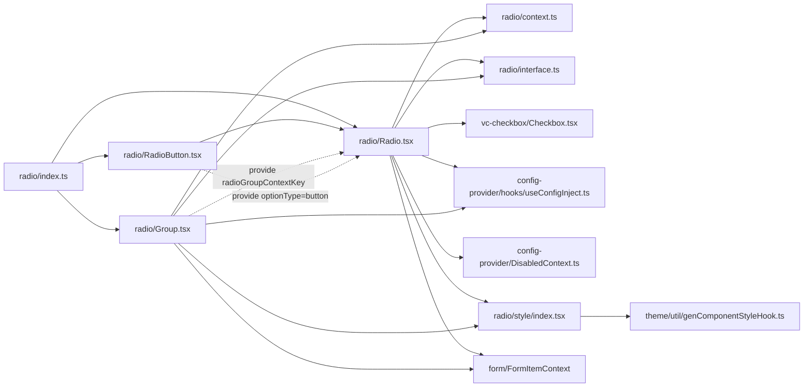
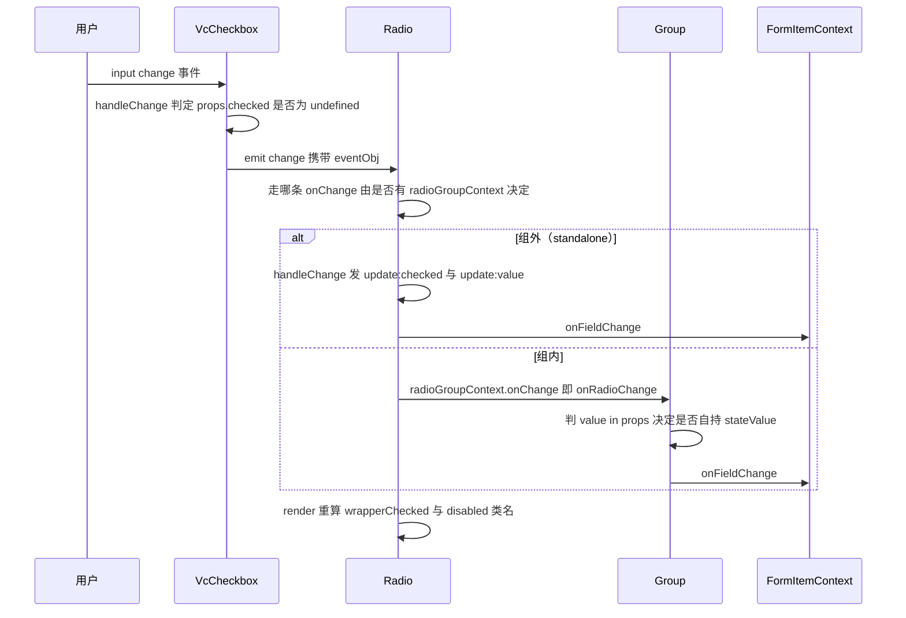
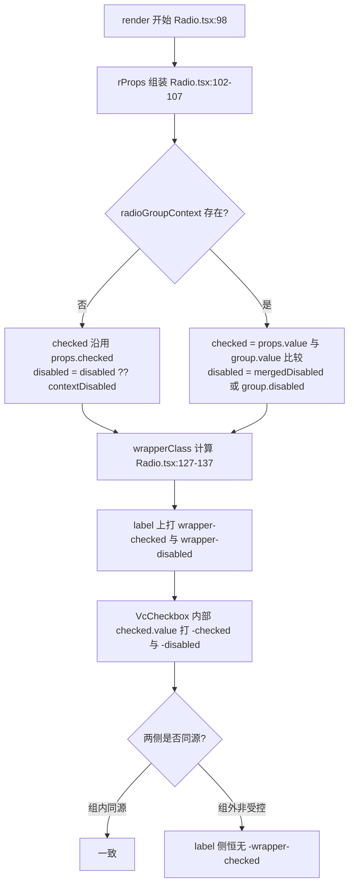

# C04-04 Radio 单选框

> **本篇解决**：Radio 的选中态与禁用态在哪几个文件之间流动、改哪一行会让整张按钮样式表静默失效、以及 Radio 与 Checkbox 同族不同口径的四处地方里哪些是有意设计、哪些是漏。
> **前置**：C04-03 Checkbox 多选框、C04-00 受控/非受控与 `useMergedState` 的一致实现　**读者坐标**：`03-components/04-form-controls` 第 4/10 篇

## 一、职责与边界

Radio 这一层只做三件事：把 `<input type="radio">` 包进 `<label>`、把「组内单选」的语义用 provide/inject 拼出来、把选中态与禁用态合成成两组类名。它**不负责** input 本体（`vc-checkbox/Checkbox.tsx` 是 radio 与 checkbox 共用的底层控件），**不负责**校验触发（走 `form/FormItemContext` 的 `onFieldChange`），**不负责**全局禁用的合成（`useConfigInject` 与 `DisabledContext` 已经算好），也**不负责**样式表的生成逻辑本身（`radio/style/index.tsx` 只声明规则，喂什么前缀给 hook 由组件决定——这正是本篇的一条独立检查点）。

依赖方向（全部可 grep 复现）：

- 向下：`radio/Radio.tsx:4` 引 `vc-checkbox/Checkbox`、`radio/Radio.tsx:6` 与 `radio/Group.tsx:6` 引 `config-provider/hooks/useConfigInject`、`radio/Radio.tsx:16` 引 `config-provider/DisabledContext`、`radio/Radio.tsx:8` 与 `radio/Group.tsx:9` 引 `form/FormItemContext`。
- 内部：`radio/Radio.tsx:11` 与 `radio/Group.tsx:10` 共用 `radio/context.ts` 的两个 InjectionKey；`radio/RadioButton.tsx:2` 直接复用 `Radio` 组件与 `radioProps`，本身不实现任何交互。
- 样式：`radio/Radio.tsx:15` 与 `radio/Group.tsx:13` 各自引同一个 `useStyle`（`radio/style/index.tsx:483` 的 `genComponentStyleHook('Radio', …)`）。
- 组合出口：`radio/index.ts:10-11` 把 `Group`/`Button` 挂成 `Radio.Group`、`Radio.Button`，`radio/index.ts:14-19` 的 `install` 走 `registerComponent`，一次注册三个标签。

明确不负责但**被误以为负责**的部分：`vc-checkbox/Checkbox.tsx` 的 props 白名单里有 `defaultChecked`、`readonly`、`required`、`tabindex`（`packages/xiaoye-ui/src/vc-checkbox/Checkbox.tsx:13-20`），而 Radio 的白名单（`packages/xiaoye-ui/src/radio/Radio.tsx:18-33`）一个都没转发——这四个键在 `<xy-radio>` 上写出来不会有任何效果，详见论点 5。

## 二、源码地图

| 文件 | 行数 | 职责 | 关键导出 / 锚点 |
| --- | --- | --- | --- |
| `packages/xiaoye-ui/src/radio/index.ts` | 26 | 出口与全局注册 | `radio/index.ts:10` 挂 `Radio.Group`，`radio/index.ts:21` 具名再导出 |
| `packages/xiaoye-ui/src/radio/Radio.tsx` | 156 | 单选项主实现（受控/非受控双出口） | `Radio.tsx:18` `radioProps()`，`Radio.tsx:37` `defineComponent`，**主入口在 `Radio.tsx:98` 的 render** |
| `packages/xiaoye-ui/src/radio/Group.tsx` | 158 | 组：`stateValue` 自持 + context 下发 | `Group.tsx:27` `radioGroupProps()`，`Group.tsx:66` `onRadioChange`，`Group.tsx:85` `useProvideRadioGroupContext` |
| `packages/xiaoye-ui/src/radio/RadioButton.tsx` | 22 | 外观切换壳，零交互逻辑 | `RadioButton.tsx:13` 提供 optionType，`RadioButton.tsx:16` 转渲染 `Radio` |
| `packages/xiaoye-ui/src/radio/context.ts` | 23 | 两个 InjectionKey 与 provide/inject 包装 | `context.ts:5` `radioGroupContextKey`，`context.ts:14` `radioOptionTypeContextKey` |
| `packages/xiaoye-ui/src/radio/interface.ts` | 31 | 事件与 context 类型 | `interface.ts:10` `RadioChangeEvent`，`interface.ts:17` `RadioGroupContext` |
| `packages/xiaoye-ui/src/radio/style/index.tsx` | 545 | 三张样式表 + Token 工厂 | `index.tsx:39` 组样式，`index.tsx:66` 基础样式，`index.tsx:258` 按钮样式，`index.tsx:483` hook 导出 |
| `packages/xiaoye-ui/src/vc-checkbox/Checkbox.tsx` | 150 | radio/checkbox 共用的 input 控件 | `Checkbox.tsx:8` props 表，`Checkbox.tsx:51` `handleChange`，`Checkbox.tsx:86` render |
| `packages/xiaoye-ui/src/radio/radio.test.js` | 44 | Radio 单件测试 | `radio.test.js:8` 复用 `focusTest`/`mountTest` |
| `packages/xiaoye-ui/src/radio/group.test.js` | 238 | 组测试（含两段被注释用例） | `group.test.js:7` `createRadioGroup`，`group.test.js:141` 起被注释 |

主实现入口是 `packages/xiaoye-ui/src/radio/Radio.tsx:98`（`setup` 返回的 render 函数），组的入口是 `packages/xiaoye-ui/src/radio/Group.tsx:86`。注意 Radio 家族**没有** `radioTypes.ts`：props 与组件写在同一文件（`Radio.tsx:18-33`、`Group.tsx:27-39`），`interface.ts` 只放事件与 context 类型。Checkbox 家族的分层不一样——它的 props 定义就住在 `checkbox/interface.ts:49` 与 `checkbox/interface.ts:78` 里。两个家族各有一份形状相同的事件类型：`radio/interface.ts:10` 的 `RadioChangeEvent` 与 `checkbox/interface.ts:16` 的 `CheckboxChangeEvent`，字段完全一致（`target`/`stopPropagation`/`preventDefault`/`nativeEvent`），谁也不复用谁。

## 三、架构与数据流

### 3.1 静态结构：谁依赖谁



`radio/RadioButton.tsx` 是一条**纯转发边**：它自己不调 `useStyle`、不渲染 input，只在 `RadioButton.tsx:13` 提供一个 `'button'` 字面量，然后 `RadioButton.tsx:16` 把 `attrs` 与 `props` 整体交给 `Radio`。因此「按钮外观」的全部实现仍住在 `Radio.tsx` 里（`Radio.tsx:63-67`），这条边是 Radio 家族唯一的「一个组件两个名字」结构。

依赖表里有一条**不对称**要记住：只有 `Radio.tsx` 直接吃 `DisabledContext`（`Radio.tsx:16`、`:57`、`:68`），`Group.tsx` 完全不碰它（`Group.tsx:51` 只解构 `prefixCls/direction/size`）。这条不对称是论点 2 的现场。

### 3.2 一次点击的完整闭环



关键分支在 `Radio.tsx:109-116`：`radioGroup` 存在与否决定了 **`onChange` 装的是哪个函数**——组内装 `onChange`（`Radio.tsx:91`，只 emit `change` 再冒泡），组外装 `handleChange`（`Radio.tsx:83`，emit 三个事件）。两条分支的 `update:checked` 与 `update:value` 出口数量不同，这是论点 4 的主题。

### 3.3 选中态与禁用态的两份合成



最后那条 `K` 分支是这张图存在的理由：**同一个「选中」被两个元素各自判定**。label 侧读 `rProps.checked`（`Radio.tsx:128`），input 侧读组件内部 `checked` ref（`vc-checkbox/Checkbox.tsx:33` 初始化、`:56` 自更新、`:117` 出类名）。组内因为 `Radio.tsx:112` 每次都从 group 重算，两侧同源；组外不绑 `v-model:checked` 时两侧立刻分叉，具体后果见论点 4 末段。

而 `disabled` 侧的分叉更直接：label 用 `rProps.disabled`（`Radio.tsx:106` 或 `:113`），input 用透传进去的同一个值（`vc-checkbox/Checkbox.tsx:118`、`:125`），这两处**同源**，但它们的取值表达式在 Radio 内部被写了两遍——见论点 2。

## 四、核心机制精读

### 论点 1：Radio 家族只有两处 `useStyle` 喂值，两处都喂「基前缀」——而按钮外观切的是类名、不是喂值

**断言**：`radio/` 目录下喂给样式 hook 的参数在两个调用点上是同一个值（`xy-radio`，可被 `prefixCls` prop 覆盖），这个「只喂基前缀、后缀交给样式文件自己拼」的约定不是风格偏好，而是 `radio/style/index.tsx` 能正确生成的**前提**；把 `Radio.tsx` 里那个已经可能是 `xy-radio-button` 的 `prefixCls` 喂进 hook，会让整张按钮样式表变成死规则。

机制源在 hook 的两行：

```ts
// packages/xiaoye-ui/src/theme/util/genComponentStyleHook.ts:47
  return (_prefixCls?: Ref<string>): UseComponentStyleResult => {
    const prefixCls = computed(() => _prefixCls?.value);
```

```ts
// packages/xiaoye-ui/src/theme/util/genComponentStyleHook.ts:69
    const componentInfo = computed(() => {
      return {
        theme: theme.value,
        token: token.value,
        hashId: hashId.value,
        path: [component, prefixCls.value, iconPrefixCls.value],
```

```ts
// packages/xiaoye-ui/src/theme/util/genComponentStyleHook.ts:85
        const mergedComponentToken = { ...defaultComponentToken, ...token.value[component] };

        const componentCls = `.${prefixCls.value}`;
```

`:74` 决定了「喂不同前缀 = 不同缓存条目」（这条的后果 C04-03 论点 6 已完整展开，此处不重复推导），`:87` 决定了更硬的一件事：**`token.componentCls` 就是喂进去的那个值加个点**，样式文件里所有选择器都从它长出来。

Radio 的两个调用点：

```tsx
// packages/xiaoye-ui/src/radio/Radio.tsx:62
    const { prefixCls: radioPrefixCls, direction, disabled } = useConfigInject('radio', props);
    const prefixCls = computed(() =>
      radioGroupContext?.optionType.value === 'button' || radioOptionTypeContext === 'button'
        ? `${radioPrefixCls.value}-button`
        : radioPrefixCls.value,
    );
    const contextDisabled = useInjectDisabled();

    // Style
    const [wrapSSR, hashId] = useStyle(radioPrefixCls);
```

```tsx
// packages/xiaoye-ui/src/radio/Group.tsx:51
    const { prefixCls, direction, size } = useConfigInject('radio', props);

    // Style
    const [wrapSSR, hashId] = useStyle(prefixCls);
```

`Radio.tsx:63-67` 有一个**同名单向派生**：局部 `prefixCls` 可能是 `xy-radio-button`，而 hook 吃的是 `radioPrefixCls`（`Radio.tsx:71`）。这不是遗漏，因为按钮样式表本来就是从基前缀拼出来的：

```tsx
// packages/xiaoye-ui/src/radio/style/index.tsx:258
const getRadioButtonStyle: GenerateStyle<RadioToken> = token => {
  const {
    radioButtonColor,
    controlHeight,
    componentCls,
// ...
    [`${componentCls}-button-wrapper`]: {
```

（`:289` 的 `-button-wrapper` 与 `:318` 的 `> ${componentCls}-button` 都在这个块里。）组的样式同理，后缀在文件内拼：

```tsx
// packages/xiaoye-ui/src/radio/style/index.tsx:39
const getGroupRadioStyle: GenerateStyle<RadioToken> = token => {
  const { componentCls, rootCls } = token;
  const groupPrefixCls = `${componentCls}-group`;

  return {
    [groupPrefixCls]: {
```

于是 `Radio.tsx:71` 一旦被「顺手统一」成 `useStyle(prefixCls)`，`componentCls` 变 `.xy-radio-button`，`:289` 展开成 `.xy-radio-button-button-wrapper`——DOM 上没人挂这个类（`Radio.tsx:103` 只把 `prefixCls.value` 交给 `VcCheckbox`，label 侧的类名是 `${prefixCls.value}-wrapper`，即 `xy-radio-button-wrapper`，`Radio.tsx:127`），整张按钮表当场失效，且**不会有任何构建期报错**。这就是本篇把喂值当独立检查点的原因：Radio 现在是干净的，但它的干净只由一个变量名维持。

把两个家族加在一起共四个 `useStyle` 调用点，再拉上 Input 家族的同形状一处，五个点里只有一个喂派生前缀：

| 调用点 | 喂进去的值 | 是不是派生前缀 |
| --- | --- | --- |
| `packages/xiaoye-ui/src/radio/Radio.tsx:71` | `radioPrefixCls` = `xy-radio` | 否 |
| `packages/xiaoye-ui/src/radio/Group.tsx:54` | `prefixCls` = `xy-radio` | 否 |
| `packages/xiaoye-ui/src/checkbox/Checkbox.tsx:40` | `prefixCls` = `xy-checkbox` | 否 |
| `packages/xiaoye-ui/src/checkbox/Group.tsx` | 修前 `groupPrefixCls` = `xy-checkbox-group`（`:23`）；2026-09-29 已改传 `prefixCls`（现 `:25`） | 修前**是**，已修（C04-03 论点 6 快照） |
| `packages/xiaoye-ui/src/input/Group.tsx:29` | `inputPrefixCls` = `getPrefixCls('input')` | 否（现取基前缀，`input/Group.tsx:28`） |

复现命令：`grep -rn "useStyle(" packages/xiaoye-ui/src/radio packages/xiaoye-ui/src/checkbox`。**Radio 家族没有第二处喂错值的地方**——`RadioButton.tsx` 全文 22 行，不 import `useStyle`（`packages/xiaoye-ui/src/radio/RadioButton.tsx:1-4` 的三条 import 里没有样式），外观全靠 `RadioButton.tsx:13` 的 context 让 `Radio.tsx:64` 切类名。

另有一条需要区分的细节：`radio/Group.tsx:54` 用的是 `useConfigInject` 出来的 `prefixCls`，它**包含**用户对 `prefixCls` prop 的定制（`config-provider/hooks/useConfigInject.ts:14` 的 `getPrefixCls(name, props.prefixCls)`），而 `input/Group.tsx:28` 用的是裸 `getPrefixCls('input')`，**不含**定制。前者在自定义前缀下样式仍跟着类名走，后者不跟。Radio 走的是对的那条。

### 论点 2：`disabled` 在 Radio 的 setup 里被注入三次、合成两遍，其中一处兜底分支恒不可达

**断言**：`Radio.tsx` 的 6 行代码里，`useInjectDisabled()` 被调了两次、`props.disabled ?? DisabledContext` 这个表达式被写了两种形式，而 `Radio.tsx:106` 的 `?? contextDisabled.value` 是**逻辑上恒不可达的兜底**——因为它的左操作数已经把同一个 context 吃进去了。

先看上游：`useConfigInject` 已经把 disabled 合成完毕。

```ts
// packages/xiaoye-ui/src/config-provider/hooks/useConfigInject.ts:43
  const disabled = computed<boolean>(() => props.disabled ?? disabledContext.value);
```

它的 `disabledContext` 来自同文件对 `useInjectDisabled()` 的调用，而 `DisabledContext` 的注入默认值是一个恒 `undefined` 的 ref：

```ts
// packages/xiaoye-ui/src/config-provider/DisabledContext.ts:7
export const useInjectDisabled = () => {
  return inject(DisabledContextKey, ref<DisabledType>(undefined));
};
```

再看 Radio 自己做了什么：

```tsx
// packages/xiaoye-ui/src/radio/Radio.tsx:53
    const formItemContext = useInjectFormItemContext();
    const formItemInputContext = FormItemInputContext.useInject();
    const radioOptionTypeContext = useInjectRadioOptionTypeContext();
    const radioGroupContext = useInjectRadioGroupContext();
    const disabledContext = useInjectDisabled();
    const mergedDisabled = computed(() => disabled.value ?? disabledContext.value);
```

```tsx
// packages/xiaoye-ui/src/radio/Radio.tsx:62
    const { prefixCls: radioPrefixCls, direction, disabled } = useConfigInject('radio', props);
```

`Radio.tsx:57` 与 `Radio.tsx:68`（`const contextDisabled = useInjectDisabled();`）拿到的是**同一个注入结果**（`DisabledContext.ts:8` 的 key 只有一个），却起了两个名字。更要紧的是 `Radio.tsx:58` 在 `:62` 之前就引用了 `disabled`：`const` 处于暂时性死区，这一行不报错**纯粹因为 `computed` 的 getter 是惰性的**，只要有人在 setup 同步路径上加一句 `mergedDisabled.value`，立刻 `ReferenceError`。

两处消费点各自用了不同形式：

```tsx
// packages/xiaoye-ui/src/radio/Radio.tsx:102
      const rProps: RadioProps = {
        prefixCls: prefixCls.value,
        id,
        ...omit(restProps, ['onUpdate:checked', 'onUpdate:value']),
        disabled: disabled.value ?? contextDisabled.value,
      };

      if (radioGroup) {
        rProps.name = radioGroup.name.value;
        rProps.onChange = onChange;
        rProps.checked = props.value === radioGroup.value.value;
        rProps.disabled = mergedDisabled.value || radioGroup.disabled.value;
```

**逐段推**：`Radio.tsx:106` 的 `disabled.value` 按 `useConfigInject.ts:43` 展开就是 `props.disabled ?? disabledContext.value`。若它为 `undefined`，说明 `props.disabled` 与 `disabledContext.value` 同时为 `undefined`；而 `contextDisabled`（`:68`）注入的就是同一个 `disabledContext`，所以右操作数也是 `undefined`。整条三元退化为 `disabled.value` 本身——**兜底分支永远不可达，且不可达的原因是恒等的**。这不是「暂时用不上」，而是「值域上不可能命中」。等价的安全写法只有一处：`Radio.tsx:113` 用的 `mergedDisabled.value`（`disabled ?? contextDisabled`）再加 `|| radioGroup.disabled.value`。

`props.disabled` 能不能真的取到 `undefined`？能——`Radio.tsx:21` 写的是 `disabled: booleanType()`，而 `booleanType` 的空参形态就是把 default 显式置空：

```ts
// packages/xiaoye-ui/src/_util/type.ts:58
export function booleanType(defaultVal?: boolean) {
  return { type: Boolean, default: defaultVal as boolean };
}
```

（`_util/type.ts:58-60`。）所以 `props.disabled` 在未传时是 `undefined`，`??` 链是活的——**这一条 Radio 没有犯 `rate/index.tsx` 那类「给兜底 prop 填默认值」的错**（该缺陷族见 C04-08）。

组这一侧是另一套：`Group.tsx:51` 只解构 `prefixCls, direction, size`，**不取 `disabled`**，而是把原始 `props.disabled` 直接包成 computed 下发（`packages/xiaoye-ui/src/radio/Group.tsx:81` 的 `disabled: computed(() => props.disabled)`）。于是「组的禁用」不吃 DisabledContext，只吃 prop；「单项的禁用」吃 context。合起来的效果是：`<xy-form disabled>` 提供的 DisabledContext 能穿过 `Radio.tsx:106/113` 落到 input 上，**但 `Group.tsx:104`、`Group.tsx:123` 用 `options` 渲染出来的子 Radio 拿到的显式 `disabled={props.disabled}` 是 `undefined` 而不是 `false`**，`??` 兜底因此不被短路——在这一步 Radio 是安全的那一侧。判断依据在 `packages/xiaoye-ui/src/radio/Group.tsx:123` 的 `disabled || props.disabled`：两个 `undefined`/`false` 相或仍可能得到 `undefined`，`booleanType()`（`packages/xiaoye-ui/src/radio/Group.tsx:32`）不带默认值，所以这条链没有硬传 `false`。

### 论点 3：Radio.Group 用「键是否存在」判受控，本仓有标准件 `useMergedState` 却没用，而且整族没有 `defaultValue`（2026-09-30 已修复并收敛）

**断言（原始评审结论）**：`radio/Group.tsx` 自己搭了一套三件套——`stateValue` 自持 + `'value' in props` 键存在性判定 + `updatingValue` 重入闸；它的判定基准是「这个键有没有被传」，而全仓另外 17 个文件用的是 `_util/hooks/useMergedState.ts` 的「值是否为 `undefined`」。**2026-09-30 修复**：探针实验证实 `'value' in props` 在 Vue 3 下**恒真**——声明过的 prop 键一律进 `props`，父组件没传时值是 `undefined`、键却存在，于是非受控分支永远不可达：不传 `value` 的 RadioGroup 点击选项内部值不更新、子项 `checked` 不变。这正是本篇当年「未在源码中找到对应实现」（原悬置标注）悬置问题的答案。修复方式是与 Checkbox.Group 一并收敛进 `_util/hooks/useGroupValue.ts` 共享内核（判据 `props.value !== undefined`，见该文件 `:36`），重入闸标准化为同文件的 `useEmitGuard`。**「整族没有 `defaultValue`」这条不变**，见本段末尾。

先看收敛后的消费点（原三件套摘录已随实现移除）：

```tsx
// packages/xiaoye-ui/src/radio/Group.tsx:56
    const { updating, lock, unlock } = useEmitGuard();
    const { internalValue, setInternalValue } = useGroupValue<any>(props, {
      // 受控值写回即解锁：那一次回流已把状态同步好，再锁着会吞掉用户的下一次真实操作
      onSync: () => unlock(),
    });
```

```tsx
// packages/xiaoye-ui/src/radio/Group.tsx:62
    const onRadioChange = (ev: RadioChangeEvent) => {
      const lastValue = internalValue.value;
      const { value } = ev.target;

      // 非受控时自己存值；受控时等父组件写回。
      // 判据是「值是否为 undefined」而不是「键是否存在」——Vue 3 会把声明过的 prop
      // 一律放进 props（父组件没传时值为 undefined），`'value' in props` 恒真。
      setInternalValue(value);
      if (!updating.value && value !== lastValue) {
        lock();
        emit('update:value', value);
        emit('change', ev);
        formItemContext.onFieldChange();
      }
    };
```

现行职责：受控/非受控判定收在内核——`useGroupValue.ts:36` 的 `props.value !== undefined`，`setInternalValue` 只在非受控时落值（`useGroupValue.ts:43-47`）；`Group.tsx:70` 的 `value !== lastValue` 是「点已选项不重复发事件」；`updating`（`useGroupValue.ts:101-115`）是「同一个 tick 内不重复发」，`lock()` 在发事件前置位、`nextTick` 自动解除、受控写回时经 `onSync` 提前解锁（`Group.tsx:59`）。与原实现相比语义等价、宿主收敛：**emit 与内部值更新仍然被两个不同的闸分别管着，但两份实现只剩一处**。

`useMergedState` 是现成的标准件：

```ts
// packages/xiaoye-ui/src/_util/hooks/useMergedState.ts:4
export default function useMergedState<T, R = Ref<T>>(
```

**Radio 与 Checkbox 两个家族原先都没用它**，同一层里并存两套受控实现（Checkbox 那套见 C04-03）；2026-09-30 起两家族收敛进 `_util/hooks/useGroupValue.ts`（判据与 `useMergedState` 同口径，但仍是独立实现），原 `'value' in props` 写法在整个 `packages/xiaoye-ui/src` 里已无命中。

这里有一个必须写清的分层差异：本仓自己有一个「这个键到底有没有被传」的判据实现，它判的是**vnode 上的原始 props**：

```ts
// packages/xiaoye-ui/src/_util/props-util/index.ts:98
  if (instance.$ && instance.$.vnode) {
    const props = instance.$.vnode.props || {};
    Object.keys(instance.$props).forEach(k => {
      const v = instance.$props[k];
      const hyphenateKey = hyphenate(k);
      if (v !== undefined || hyphenateKey in props) {
```

`_util/props-util/index.ts:100` 先取 `instance.$.vnode.props`、`:104` 再判 `in`，键存在性完全由**调用方写了什么**决定。而原 `Group.tsx:70` 判的是 `setup(props)` 收到的那个已解析 props 对象——键存在性由运行时如何物化「声明了但没传、且默认值是 `undefined`」的键决定。`value` 的声明是 `value: PropTypes.any`（`packages/xiaoye-ui/src/radio/Group.tsx:29`），经 `_util/vue-types/index.ts:3` 转发的第三方 `vue-types` 产生，物化行为不在本仓源码里。

> 已结案（2026-09-30）：探针实测显示 Vue 3 运行时确实把「声明了但没传」的键物化进 `props`（键恒存在、值为 `undefined`），原判据因此**恒走受控分支**、非受控路径不可达。修复即上文收敛；原先这条「不下结论」的悬置到此有了运行时证据。

两条可核实的事实：其一，测试作者按「键存在性」的心智在写测试——构造器刻意绕开显式 `value`：

```jsx
// packages/xiaoye-ui/src/radio/group.test.js:7
  function createRadioGroup(props) {
    return {
      props: ['value'],
      render() {
        const groupProps = { ...props };
        if (this.value !== undefined) {
          groupProps.value = this.value;
        }
```

`group.test.js:12-14` 的「只在非 undefined 时才把这个键放进对象」不是多余的谨慎：如果直接把 `value: undefined` 传下去，判定基准就可能翻转（同一段防御在 `group.test.js:88-91` 又出现一次，那是另一个手工内联的组构造器）。其二，`group.test.js` 里所有传 `value` 的用例传的都是真值（`group.test.js:74`、`:118`、`:136`、`:212`），**「显式传 `value: undefined`」这条分支原先没有任何测试保护**。在旧判据下若它翻转，症状是：受控判定恒成立、内部值停在初值，`Radio.tsx:112` 的 `checked` 恒等于「`props.value` 与那个初值是否相等」，用户看到的是点第二次以后不再有反应。2026-09-30 起该分支已被判别性用例锁定：`group.test.js:242` 的「uncontrolled group: click advances the group value and checked」在旧判据下必红（探针实测 `checked === false`）、新判据下绿，`:275` 再补受控侧「内部值跟随 props 而非点击」。

第二件事：`radio` 目录里搜不到 `defaultValue`（`grep -rn "defaultValue" packages/xiaoye-ui/src/radio` 零命中），`radioGroupProps` 的十一个键里没有它（`packages/xiaoye-ui/src/radio/Group.tsx:27-39`）。对照 Checkbox 组：`packages/xiaoye-ui/src/checkbox/Group.tsx:29-35` 经内核的 `initialValue: () => props.defaultValue` 接住了 `defaultValue`（2026-09-30 起）。所以「给单选组一个初始值」这件事在 Radio 上**仍然只有 `v-model:value` 初值一条路**；写 `default-value="A"` 会落进 attrs，被 `packages/xiaoye-ui/src/radio/Group.tsx:136` 的 `{...attrs}` 原样铺到 `<div>` 上，成为一个没有任何语义的 DOM 属性（`Group.tsx:46` 的 `inheritAttrs: false` 只拦住了自动继承，没拦住手工展开）。

### 论点 4：一个 Radio 有两个 change 出口、两个 checked 来源，`update:value` 发的是布尔

**断言**：`Radio.tsx` 里 `props.checked` 有两条互斥的来源路径，组内路径**覆盖掉**用户与 Group 各自传下来的 `checked`；两条 `onChange` 出口 emit 的事件集合不同，导致 `v-model:checked` 在组内静默失效；而 standalone 出口 emit 的 `update:value` 携带的是布尔，和 `value` prop 的「身份值」语义正相反。

```tsx
// packages/xiaoye-ui/src/radio/Radio.tsx:83
    const handleChange = (event: RadioChangeEvent) => {
      const targetChecked = event.target.checked;
      emit('update:checked', targetChecked);
      emit('update:value', targetChecked);
      emit('change', event);
      formItemContext.onFieldChange();
    };

    const onChange = (e: RadioChangeEvent) => {
      emit('change', e);
      if (radioGroupContext && radioGroupContext.onChange) {
        radioGroupContext.onChange(e);
      }
    };
```

```tsx
// packages/xiaoye-ui/src/radio/Radio.tsx:109
      if (radioGroup) {
        rProps.name = radioGroup.name.value;
        rProps.onChange = onChange;
        rProps.checked = props.value === radioGroup.value.value;
        rProps.disabled = mergedDisabled.value || radioGroup.disabled.value;
      } else {
        rProps.onChange = handleChange;
      }
```

**`checked` 的所有权**：`Radio.tsx:105` 的 `...omit(restProps, [...])` 先把用户的 `checked` prop 铺进 `rProps`，`Radio.tsx:112` 紧接着在组内分支覆盖它。被覆盖掉的不只是用户手写的 `checked`——**`Group` 自己传下来的那个也一并作废**。用 `options` 渲染时，组会算一次选中：

```tsx
// packages/xiaoye-ui/src/radio/Group.tsx:104
        children = options.map(option => {
          if (typeof option === 'string' || typeof option === 'number') {
            return (
              <Radio
                key={option}
                prefixCls={prefixCls.value}
                disabled={props.disabled}
                value={option}
                checked={internalValue.value === option}
              >
```

`Group.tsx:112` 与 `Group.tsx:125` 各发一个 `checked={internalValue.value === value}`，而子 `Radio` 在 `Radio.tsx:112` 用 `props.value === radioGroup.value.value` 又算了一遍（`radioGroup.value` 就是内核的 `internalValue`，见 `packages/xiaoye-ui/src/radio/Group.tsx:80`）。两份表达式同义，**其中一份是写而不读的**：这就是「同一逻辑的多份拷贝」在 Radio 家族里的具体位置。它今天不出错，但任何一侧改判定（例如把组的比较换成 `===` 之外的宽松比较）都只会生效一半，且 DOM 上表现为 label 的 `-wrapper-checked` 与 input 的 `-checked` 分家。

**事件出口分叉**：组内走 `onChange`（`Radio.tsx:91-96`），只 emit `change`，**不 emit `update:checked`**。所以 `<xy-radio-group>` 里的 `<xy-radio v-model:checked="x">` 永远拿不到写回——`x` 恒为初值。`Radio.tsx:31` 声明的 `'onUpdate:checked'` prop 与 `Radio.tsx:44` 声明的 `'update:checked'` emit 在这一分支上是**声明存活、实现不触发**。文档示例恰好全在组外用 `v-model:checked`（`apps/docs/examples/radio/basic.vue:2`），所以这条分叉没有暴露面。

**`update:value` 的语义反转**：`value` prop 声明的是「这个选项的身份值」——`Radio.tsx:23` 的 `value: PropTypes.any`，比较逻辑在 `Radio.tsx:112`；而 `Radio.tsx:86` 写回的是 `targetChecked`（布尔，来自 `Radio.tsx:84` 的 `event.target.checked`）。类型标注自己也承认了这点：`Radio.tsx:32` 的 `'onUpdate:value': functionType<(checked: boolean) => void>()`。于是 `<xy-radio v-model:value="v">` 把 `v` 从「任意身份值」吃成 `true`/`false`，而 `value` 又会作为 DOM input 的 `value` 属性继续传给 `packages/xiaoye-ui/src/vc-checkbox/Checkbox.tsx:130`。`Radio.tsx:105` 之所以专门把 `'onUpdate:checked'` 与 `'onUpdate:value'` 从 `restProps` 里 omit 掉，正是因为这两个键若原样透传给 `VcCheckbox`，会变成厂商层组件的未知 attrs。

**受控性在厂商层的落点**：`Radio.tsx:112` 给的是**真布尔**，于是厂商层进入受控分支——

```tsx
// packages/xiaoye-ui/src/vc-checkbox/Checkbox.tsx:51
    const handleChange = e => {
      if (props.disabled) {
        return;
      }
      if (props.checked === undefined) {
        checked.value = e.target.checked;
      }
```

`Checkbox.tsx:55-57` 在组内不成立（`checked` 是布尔），所以点击不会自更新；配合 `packages/xiaoye-ui/src/vc-checkbox/Checkbox.tsx:75-77` 把 DOM 的 `checked` 强行按回 `props.checked`，组内的单选「点不中直到 props 回流」是设计使然。反过来在组外：`props.checked` 可以是 `undefined`（`Radio.tsx:20` 的 `checked: booleanType()`，`_util/type.ts:58-60` 不给默认值），`Checkbox.tsx:33` 用 `defaultChecked` 兜底、`:56` 自更新，此时 **label 上的 `-wrapper-checked` 不再出现**（`Radio.tsx:128` 读的是 `rProps.checked`，仍是 `undefined`），而按钮外观的选中样式恰好挂在这个类上：

```tsx
// packages/xiaoye-ui/src/radio/style/index.tsx:408
      [`&-checked:not(${componentCls}-button-wrapper-disabled)`]: {
        zIndex: 1,
        color: radioCheckedColor,
        background: radioButtonCheckedBg,
        borderColor: radioCheckedColor,
```

（`:408` 在 `getRadioButtonStyle` 的 `${componentCls}-button-wrapper` 块内，展开成 `.xy-radio-button-wrapper-checked:not(...)`。）所以：不绑 `v-model:checked` 的裸 `<xy-radio-button>` 点下去，内层 span 拿到 `.xy-radio-button-checked`（`packages/xiaoye-ui/src/vc-checkbox/Checkbox.tsx:117`）——这个类在 `radio/style/index.tsx` 里**一条规则都没有**（同文件 `-checked` 只出现在 `:119`、`:205`、`:240`、`:408`、`:441`、`:472`，前三者是基形态 `.xy-radio-checked` 的后代规则），视觉上完全无变化。文档示例没有这种写法（`apps/docs/examples/radio/radioButton.vue:5-8` 全部在组内），所以它是一个未被示例与测试覆盖的边缘分支。

### 论点 5：Radio 把 attrs 全数抹在 label 上，厂商层为 input 准备的第二个白名单一个也接不到

**断言**：`Radio` 的 props 白名单（14 键）与 `VcCheckbox` 的 props 白名单（12 键）只有 7 个键重合；用户写在 `<xy-radio>` 上、但不在 Radio 白名单里的任何键都会走 `attrs → label` 这条路，永远进不到真正渲染的 `<input>`。厂商层为此准备的 `defaultChecked`、`readonly`、`required`、`tabindex` 四个能力在 Radio 上是**零可达**。

```tsx
// packages/xiaoye-ui/src/radio/Radio.tsx:18
export const radioProps = () => ({
  prefixCls: String,
  checked: booleanType(),
  disabled: booleanType(),
  isGroup: booleanType(),
  value: PropTypes.any,
  name: String,
  id: String,
  autofocus: booleanType(),
  onChange: functionType<(event: RadioChangeEvent) => void>(),
  onFocus: functionType<FocusEventHandler>(),
  onBlur: functionType<FocusEventHandler>(),
  onClick: functionType<MouseEventHandler>(),
  'onUpdate:checked': functionType<(checked: boolean) => void>(),
  'onUpdate:value': functionType<(checked: boolean) => void>(),
});
```

```tsx
// packages/xiaoye-ui/src/vc-checkbox/Checkbox.tsx:8
export const checkboxProps = {
  prefixCls: String,
  name: String,
  id: String,
  type: String,
  defaultChecked: { type: [Boolean, Number], default: undefined },
  checked: { type: [Boolean, Number], default: undefined },
  disabled: Boolean,
  tabindex: { type: [Number, String] },
  readonly: Boolean,
  autofocus: Boolean,
  value: PropTypes.any,
  required: Boolean,
};
```

两份白名单的交集是 `prefixCls/name/id/checked/disabled/value/autofocus` 七个。`defaultChecked`（`Checkbox.tsx:13`）、`tabindex`（`:16`）、`readonly`（`:17`）、`required`（`:20`）四个键厂商层会读、会落到 input 上：

```tsx
// packages/xiaoye-ui/src/vc-checkbox/Checkbox.tsx:120
      const inputProps = {
        name,
        id,
        type,
        readonly,
        disabled,
        tabindex,
        class: `${prefixCls}-input`,
        checked: !!checked.value,
        autofocus,
        value,
        ...globalProps,
        onChange: handleChange,
        onClick,
```

（`tabindex` 在 `Checkbox.tsx:126`、`required` 在 `:139`。）而 Radio 侧的落点是 label：

```tsx
// packages/xiaoye-ui/src/radio/Radio.tsx:139
      return wrapSSR(
        <label
          {...attrs}
          class={wrapperClassString}
```

```tsx
// packages/xiaoye-ui/src/radio/Radio.tsx:150
          <VcCheckbox {...rProps} type="radio" ref={vcCheckbox} />
```

`Radio.tsx:150` 只展开 `rProps`，而 `rProps` 由 `Radio.tsx:100-107` 从 **props** 组装（`restProps` 来自 `props` 解构，不含 attrs）。于是 `<xy-radio tabindex="-1">` 的结果是 `<label tabindex="-1">`——焦点顺序没被改到 input 上；`<xy-radio required>` 得到 `<label required>`，而 `required` 不是 `label` 的合法属性，静默消失。厂商层那条 `data-*` / `aria-*` / `role` 的透传白名单在这里同样够不着：

```tsx
// packages/xiaoye-ui/src/vc-checkbox/Checkbox.tsx:108
      const othersAndAttrs = { ...others, ...attrs };
      const globalProps = Object.keys(othersAndAttrs).reduce((prev, key) => {
        if (key.startsWith('data-') || key.startsWith('aria-') || key === 'role') {
          prev[key] = othersAndAttrs[key];
        }
        return prev;
      }, {});
```

`Checkbox.tsx:109-114` 这段过滤器的输入是**厂商层自己的 attrs**，Radio 从来没有把自己的 attrs 传下去，所以这段逻辑在 Radio 链路上是空转的。顺带一条对照：Checkbox 业务层自己在 label 上写了 `aria-checked`（`packages/xiaoye-ui/src/checkbox/Checkbox.tsx:137`），而整个 `radio/` 目录里 `aria-` 零命中（`grep -rn "aria-" packages/xiaoye-ui/src/radio` 无输出）——单选组的选中态完全依赖原生 input 的 `checked`，在 `optionType="button"` 下 input 被绝对定位压到 `zIndex: -1`（`packages/xiaoye-ui/src/radio/style/index.tsx:318-325`）但仍留在可访问树里，所以读屏可用，只是**用户无法通过 attrs 补任何 ARIA**。

`expose` 这一头另有一处类型与实值的错位：

```tsx
// packages/xiaoye-ui/src/radio/Radio.tsx:60
    const vcCheckbox = ref<HTMLElement>();
```

```tsx
// packages/xiaoye-ui/src/radio/Radio.tsx:73
    const focus = () => {
      vcCheckbox.value.focus();
    };

    const blur = () => {
      vcCheckbox.value.blur();
    };

    expose({ focus, blur });
```

`Radio.tsx:60` 标注 `HTMLElement`，`Radio.tsx:60` 的 `ref={vcCheckbox}` 挂在**组件**上，拿到的是 `VcCheckbox` 用 `expose` 收窄后的实例代理（`packages/xiaoye-ui/src/vc-checkbox/Checkbox.tsx:41-49`，它 expose 的正是 `focus`/`blur`，内部再走 `inputRef.value?.focus()`）。所以能跑通，但 `Radio.tsx:74` 少了厂商层有的那层可选链：在 Radio 尚未挂载时调用 `vm.focus()` 就是 `TypeError`。这条路径有测试（`packages/xiaoye-ui/src/radio/radio.test.js:8` 的 `focusTest(Radio)`，见 `packages/xiaoye-ui/tests/shared/focusTest.js:17` 的 `it('focus() and onFocus')` 与 `:28` 的 `wrapper.vm.$refs.component.focus()`），但测试是在 `await sleep()` 之后调的，**卸载后/挂载前调用的分支无测试保护**。

### 论点 6：样式面上有四条「发而不收」与「声明未填」，其中一条正好和 Checkbox 的姊妹缺陷成对

**断言**：Radio 生成的类名里有一个从未被任何规则消费（`-wrapper-in-form-item`），组的 `size` 只对按钮形态生效，Token 接口里有一个键从声明过就没被填过，而 dot 尺寸的算法中心是一个硬编码字面量。

第一条最干净，因为它有一个同族反例可做对照。Radio 会发这个类：

```tsx
// packages/xiaoye-ui/src/radio/Radio.tsx:127
      const wrapperClassString = classNames(
        {
          [`${prefixCls.value}-wrapper`]: true,
          [`${prefixCls.value}-wrapper-checked`]: rProps.checked,
          [`${prefixCls.value}-wrapper-disabled`]: rProps.disabled,
          [`${prefixCls.value}-wrapper-rtl`]: direction.value === 'rtl',
          [`${prefixCls.value}-wrapper-in-form-item`]: formItemInputContext.isFormItemInput,
        },
        attrs.class,
        hashId.value,
      );
```

而样式表里没有它：

```tsx
// packages/xiaoye-ui/src/radio/style/index.tsx:102
      [`&${componentCls}-wrapper-rtl`]: {
        direction: 'rtl',
      },

      '&-disabled': {
        cursor: 'not-allowed',
        color: token.colorTextDisabled,
      },

      // ...（同文件从 :92 起的整个 wrapper 块里没有 -in-form-item 这一支）
```

反例在隔壁：Checkbox 的**同一个类名**（`packages/xiaoye-ui/src/checkbox/Checkbox.tsx:111`）在 `packages/xiaoye-ui/src/checkbox/style/index.ts:69` 是有规则的。判形命令：`grep -rn "in-form-item" packages/xiaoye-ui/src --include='*.ts' --include='*.tsx'` 共 9 处命中，其中只有 `checkbox/style/index.ts:69` 与 `select/style/index.ts:262` 是**规则定义**，其余全是类名发射点。也就是说 Radio 在 form-item 里少了那一条本应存在的间距/对齐修正，而同族的 Checkbox 有。这个缺口是**运行时不可见**的（类名在 DOM 上，开发者以为有样式）。

第二条：`size` 的类名由组发出，规则却只长在按钮块里。

```tsx
// packages/xiaoye-ui/src/radio/Group.tsx:82
      const groupPrefixCls = `${prefixCls.value}-group`;

      const classString = classNames(
        groupPrefixCls,
        `${groupPrefixCls}-${buttonStyle}`,
        {
          [`${groupPrefixCls}-${size.value}`]: size.value,
          [`${groupPrefixCls}-rtl`]: direction.value === 'rtl',
        },
```

`Group.tsx:95` 发 `xy-radio-group-large` / `xy-radio-group-small`，而样式表里这两个后缀只出现在 `getRadioButtonStyle` 内部：

```tsx
// packages/xiaoye-ui/src/radio/style/index.tsx:357
      },

      [`${componentCls}-group-large &`]: {
        height: controlHeightLG,
        fontSize: fontSizeLG,
        lineHeight: `${controlHeightLG - lineWidth * 2}px`,
```

`:359` 与 `:375` 都嵌在 `${componentCls}-button-wrapper`（`:289`）之下，编译后是 `.xy-radio-group-large .xy-radio-button-wrapper`。基础形态的规则块（`:92` 起）里没有任何 `-group-large` 分支——所以 `<xy-radio-group size="large">` 配普通 `<xy-radio>` **只有类名、没有尺寸变化**；`size="large"` 只对 `xy-radio-button` 或在 `optionType="button"` 下有视觉。`apps/docs/examples/radio/size.vue` 演示的是按钮形态，所以这个缺口同样没有暴露面。

顺带：`Group.tsx:100` 无条件发的 `xy-radio-group-outline` 也没有规则（`grep -n "outline" packages/xiaoye-ui/src/radio/style/index.tsx` 零命中），solid 形态靠 `.xy-radio-group-solid`（`packages/xiaoye-ui/src/radio/style/index.tsx:441`）加规则、outline 靠不加规则——这是有意的默认值设计，不是缺陷，但**它让 `-outline` 这个类名变成纯调试用途**，改动时不要误删。

第三条与第四条都在 Token 层：

```tsx
// packages/xiaoye-ui/src/radio/style/index.tsx:9
interface RadioToken extends FullToken<'Radio'> {
  radioFocusShadow: string;
  radioButtonFocusShadow: string;

  radioSize: number;
  radioTop: number;
```

`radioTop` 在整个 `packages/xiaoye-ui/src` 里只出现这一行（`grep -rn "radioTop" packages/xiaoye-ui/src` 单条命中），文件末尾的 `mergeToken` 也没有它：

```tsx
// packages/xiaoye-ui/src/radio/style/index.tsx:505
  // Radio
  const radioSize = fontSizeLG;
  const dotPadding = 4; // Fixed value
  const radioDotDisabledSize = radioSize - dotPadding * 2;
  const radioDotSize = wireframe ? radioDotDisabledSize : radioSize - (dotPadding + lineWidth) * 2;
```

于是 `RadioToken` 的类型上写着一个运行时不存在的键（`radioTop`），而真正决定圆点大小的 `dotPadding` 是一个带 `// Fixed value` 注释的字面量（`:507`），它绕过了整套 Token 机制：主题改 `controlHeight`/`fontSizeLG` 时圆点跟着变，改「圆点与外圈的内边距」这类语义时**无从下手**，只能改源码。对照 `:506` 的 `radioSize = fontSizeLG` 走的是 Token——同一个块里两种口径。

最后一条属于「做对了」的对照，写在这里防误报：厂商层的三元兜底是**可达**的。

```tsx
// packages/xiaoye-ui/src/vc-checkbox/Checkbox.tsx:33
    const checked = ref(props.checked === undefined ? props.defaultChecked : props.checked);
```

`props.checked` 在 `packages/xiaoye-ui/src/vc-checkbox/Checkbox.tsx:14` 显式写着 `default: undefined`，所以 `:33` 的兜底分支能进；这与「`X !== undefined ? X : Y` 而 `X` 带非 undefined 默认值」那种恒不可达写法（`color-picker` 一族，见 C04-10）正好相反。改这行时如果把 `:14` 的 `default: undefined` 删掉或改成 `default: false`，非受控路径会立刻死掉——**`defaultChecked` 的默认值 `false` 在 `Checkbox.tsx:26-30` 的 `initDefaultProps` 里，是活的；`checked` 必须保持无默认值，也是活的**。

## 五、对外契约如何生效

**props 的四条去向**。Radio 声明了 14 个 prop（`Radio.tsx:18-33`），运行时只有四种结局：

1. **被组件自己读**：`value`（读于 `Radio.tsx:112`）、`prefixCls`（读于 `useConfigInject.ts:14`，`Radio.tsx:100` 解构后丢弃）、`disabled`（读于 `useConfigInject.ts:43`）、`id`（读于 `Radio.tsx:100` 的解构默认值）。
2. **原样透传给厂商层**：`checked`/`name`/`value`/`autofocus` 经 `Radio.tsx:105` 的 `...omit(restProps, [...])` 进入 `rProps`，再由 `Radio.tsx:150` 交给 `VcCheckbox`，最终在 `vc-checkbox/Checkbox.tsx:120-140` 落到 `<input>`。
3. **被内部实现覆盖**：`onChange`（`Radio.tsx:111`、`:115`）、`checked`（组内路径 `Radio.tsx:112`）、`disabled`（`Radio.tsx:106`、`:113` 都排在 spread 之后）。这里的「覆盖」与 JSX 属性顺序那套**不是同一件事**，别混：`rProps` 是普通对象逐字段赋值（`Radio.tsx:102-107` 建对象、`Radio.tsx:109-124` 补字段，最后在 `Radio.tsx:150` 才 `<VcCheckbox {...rProps} …>`），所以后写的 `rProps.onChange` 真的把 `...omit(restProps, [...])` 摊下来的用户 `onChange` **顶掉**，不会像 `mergeProps` 那样把事件键并成数组。这三处因此不构成事件双投递——用户的 `@change` 照样生效，但走的是 `emit('change')`（`Radio.tsx:87`、`:92`）这一个口，恰好一次。对照 `C04-07` §五 的 Slider：那边是 JSX 摊布撞显式 arrow，才真的翻倍。
4. **既不读也不落地**：`isGroup`（`Radio.tsx:22`）。全仓对它的唯一一次提及就是这行声明（`grep -rn "isGroup" packages/xiaoye-ui/src` 在本家族只命中 `radio/Radio.tsx:22` 与 `checkbox/interface.ts:57`，两处都是声明）。它因为是**已声明 prop**，连 attrs 都进不去，于是经 `rProps` 到达厂商层后被 `vc-checkbox/Checkbox.tsx:110` 的 `data-`/`aria-`/`role` 过滤器丢弃——一个键走完三层后凭空消失。Radio 真正判断是否在组里用的是 `Radio.tsx:99` 的 `radioGroupContext`，从来不是 `isGroup`。

**事件出口**。`Radio.tsx:42-51` 声明 8 个 emit，逐个都有触发点：`focus`/`blur` 在 `Radio.tsx:119`、`:122`，`click` 在 `Radio.tsx:124`，`mouseenter`/`mouseleave` 在 `Radio.tsx:142`、`:147`，`change` 在 `Radio.tsx:87`、`:92`。但 `update:checked`（`Radio.tsx:85`）与 `update:value`（`Radio.tsx:86`）**只存在于组外分支**，见论点 4。组的 4 个 emit（`Group.tsx:48`）全部有触发点：`Group.tsx:76`、`:77`、`:147`、`:150`。

`focus`/`blur`/`click` 这三个口曾经是「事件双投递」族的**形态二**站点：`rProps.onFocus`/`onBlur`/`onClick` 三个 arrow 里，`emit('x', e)` 之后各紧跟一句 `props.onX?.(e)`（被删的三行挂在修前 `:119`、`:123`、`:127`），而 `emit` 本就从 `instance.vnode.props` 取同一个 `onXxx`，「声明成 prop」并不会把这个键从 `vnode.props` 里移走，于是两条口指向同一个用户函数。**实测**：修前一次聚焦把外部 `@focus` 打 **2** 次，修后 **1** 次。修后形状：三个 arrow 只留 `emit`（`Radio.tsx:117-125`，focus 那一处留了一行注释说明不能再补直调）。回归是 `packages/xiaoye-ui/src/_util/__tests__/event-dispatch-count.test.tsx` 的「Radio 聚焦并点击一次，`@focus` 与 `@click` 各只投递一次」，判据 `toHaveBeenCalledTimes(1)`，退回修复前基线必红。为什么这么修：`emit` 已经是完整出口，直调那一跳除了把副作用型 handler（打点、请求）翻倍之外没有任何作用；注意它**与上面第 3 条不同**——`onChange` 走的是普通对象赋值所以被顶掉、从未翻倍，而这三个键是同一 arrow 里写了两跳，形状不同、结论也相反。

这里有一处约定偏离：`AGENTS.md` 的「Props 与类型（强制）」要求事件处理器用 `eventType<T>()` 定义，而 Radio 的 6 个处理器全部用 `functionType`（`Radio.tsx:27-32`）。`eventType` 的形状是 `{ type: [Function, Array] }`（`packages/xiaoye-ui/src/_util/type.ts:50`），意味着**Radio 传数组形式的多监听器会被类型拒掉**；同时 `Radio.tsx:41` 直接 `props: radioProps()`，没走 `initDefaultProps`——这一点恰好救了自己：正因为没填默认值，`disabled`/`checked` 才可能是 `undefined`，`useConfigInject.ts:43` 的 `??` 兜底与厂商层 `Checkbox.tsx:33` 的兜底才是活的（对照论点 2 与论点 6 末段）。

**slots**。三个组件都只用 default slot：`Radio.tsx:149` 把它包进一个 `<span>`，这个 `<span>` 是 label 的第二个子节点（第一个是厂商层 `Checkbox.tsx:143` 的外层 `<span class="xy-radio">`），恰好被 `radio/style/index.tsx:249` 的 `span${componentCls} + *` 选中并加上文本间距；`RadioButton.tsx:17` 原样转发插槽，`Group.tsx:139` 用 `slots.default?.()` 作 children。有一条**契约是静默的**：`Group.tsx:110` 的 `if (options && options.length > 0)` 与 `else` 分支互斥，`options` 非空时默认插槽被整段丢弃，既不报警也不合并（对照 Checkbox 组：`checkbox/Group.tsx:40` 的 `options` 是 computed 归一化，走的是另一条渲染路径）。

**expose**。Radio 只暴露 `focus`/`blur`（`Radio.tsx:81`）；`Group.tsx:49` 的 setup 上下文压根没解构 `expose`，所以组实例上没有任何公开方法（`radio/` 目录里 `expose` 只出现在 `Radio.tsx:52` 与 `Radio.tsx:81`）。副作用是测试与调用方只能靠 `$refs` 摸内部（`group.test.js:68` 的 `wrapper.vm.$refs.radioGroup.stateValue = 'B'`，详见坑 7）。

**context**。两个键、两种值类型：`radioGroupContextKey` 提供的是**含 ref 的对象**（`Group.tsx:85-91`，`value: stateValue` 是活引用，所以子 Radio 的 `Radio.tsx:112` 会随组状态重算），`radioOptionTypeContextKey` 提供的只是**裸字符串**（`RadioButton.tsx:13` 传 `'button'`，消费点 `Radio.tsx:55`、`:64`）。后者不需要响应性，因为它由组件树结构决定；前者必须，因为它是状态。`radio/interface.ts:26` 给 `optionType`（`:28`）打了 `@internal` 标记，而 `Group.tsx:36` 又把它作为公开 prop 暴露（`optionType: stringType<RadioGroupOptionType>('default')`），两处口径相反。

## 六、设计取舍

**取舍一：radio 复用 `vc-checkbox`，不建 `vc-radio`。** 收益是 input 的受控/非受控、shiftKey 补偿（`vc-checkbox/Checkbox.tsx:50`、`:58`、`:84`）与 DOM 结构只有一份（`Checkbox.tsx:142-147`），Radio 只需在 `Radio.tsx:150` 改一个 `type` 值（厂商层默认是 `Checkbox.tsx:28` 的 `'checkbox'`）。代价有三条，都已在本篇落位：白名单错位（论点 5，厂商层 12 键 vs 业务层 14 键、交集 7）；`checked` 语义在厂商层被写成 `[Boolean, Number]`（`Checkbox.tsx:14`），Radio 的 `booleanType()`（`Radio.tsx:20`）反而更窄；以及类名空间共用——厂商层发 `${prefixCls}-checked`（`Checkbox.tsx:117`）、业务层发 `${prefixCls}-wrapper-checked`（`Radio.tsx:128`），两者只靠 `prefixCls` 这一个字符串对齐，而 `prefixCls` 在按钮形态下会被 `Radio.tsx:65` 换成 `xy-radio-button`，于是内层类名跟着变成 `xy-radio-button-checked`（无规则，论点 4 末段）。**如果当初给 radio 建独立厂商层，这个类名缺口不会存在。**

**取舍二：`Radio.Button` 用 context 切外观，而不是给 Radio 加一个 `button` prop。** 收益是 `RadioButton.tsx` 全文 22 行、零逻辑（`RadioButton.tsx:6-22`），外观决策集中在 `Radio.tsx:63-67` 一处，且 `optionType="button"` 的组能复用同一个决策表达式（`Radio.tsx:64` 的两个并列条件）。代价是**类名切换与样式注册解耦**：hook 永远吃基前缀（`Radio.tsx:71`），类名却可能是 `xy-radio-button`——这个「喂值与发名不同」的差值正是论点 1 里最容易被后人改错的地方。若用 `button: boolean` prop 实现，喂值与发名会自然同源，但 `Radio.Group` 的 `optionType` 就无法让子 Radio 自动变身（必须逐个透传），所以现方案在「组级开关」这个需求下是对的。

**取舍三：`Radio.Group` 自持受控状态，不用 `useMergedState`。** 原始评估：收益是 emit 侧多了一个 `updatingValue` 重入闸，能在同一 tick 内压掉重复 `change`；代价是**必须按键存在性判受控**（原 `Group.tsx:70`），从而不能给 `value` 配 `defaultValue` 退路（论点 3），并且和同层 Checkbox 留下两套互不相通的受控实现。就本篇证据看，这笔交换是亏的——而 2026-09-30 的修复印证了这一点：`'value' in props` 判据在 Vue 3 下恒真、非受控分支不可达，是实打实的行为缺陷。现在的形态是「自持但标准化」：受控判定与值同步收进 `_util/hooks/useGroupValue.ts` 内核（判据 `!== undefined`），重入闸标准化为同文件 `useEmitGuard`（`Group.tsx:56-60` 消费），`defaultValue` 仍不提供（论点 3 末段）。原来被注释掉的回归用例（`group.test.js:141-148`）现在有了等效的活的替代：`group.test.js:242`（非受控推进）与 `:275`（受控跟随 props）。

**取舍四：把 `Group`/`Button` 挂成静态属性（`radio/index.ts:10-11`）而不是只导出独立组件。** 收益是 `<xy-radio-group>` 与 `Radio.Group` 两种写法同源，`registerComponent` 一次注册三个标签（`radio/index.ts:15-17`）。代价是 tree-shaking：静态属性赋值是副作用，只要引用 `Radio` 就把 `Group`（158 行）与 `RadioButton` 一并拉进模块图，`radio/index.ts:21` 又额外具名导出一次（`Button`、`Group`、`RadioButton`、`RadioGroup` 四个名字指向两个模块）。这三个文件的样式副作用由生成物 `src/components.ts` 统一导入，不由 `index.ts` 负责。

## 七、坑与改动指南

**坑 1：把 `useStyle` 的喂值改成组件正在发的那个前缀**

- 触发：想让 `Radio` 的按钮形态「样式跟着类名走」，把 `useStyle(radioPrefixCls)` 改成 `useStyle(prefixCls)`。
- 症状：`<xy-radio-button>` 与 `optionType="button"` 的组全部退化成无框文本；普通 `<xy-radio>` 也可能因新增一张缓存表而短暂正常，掩盖问题。
- 原因：`genComponentStyleHook.ts:87` 用喂进来的值现算 `componentCls`，`radio/style/index.tsx:289` 又在它后面拼 `-button-wrapper`，结果是 `.xy-radio-button-button-wrapper`；同时 `:74` 的 `path` 含前缀，注册身份也变了。
- 定位：`packages/xiaoye-ui/src/radio/Radio.tsx:71`、`packages/xiaoye-ui/src/radio/style/index.tsx:289`、`packages/xiaoye-ui/src/theme/util/genComponentStyleHook.ts:74`。

**坑 2：`isGroup` 是死 prop，别拿它当组内判据**

- 触发：在自定义封装里给 `<xy-radio :is-group="true">`，或在 Radio 之外读 `vm.$props.isGroup` 来判断是否被组包裹。
- 症状：外观与行为毫无变化，也不报错。
- 原因：`Radio.tsx:22` 声明后无人读取，组内判定实际用注入的 context（`Radio.tsx:99`）；这个键还会因「已声明 prop」身份绕过 attrs，最终被厂商层过滤器丢弃。
- 定位：`packages/xiaoye-ui/src/radio/Radio.tsx:22`、`packages/xiaoye-ui/src/radio/Radio.tsx:99`、`packages/xiaoye-ui/src/vc-checkbox/Checkbox.tsx:110`。

**坑 3：组内 `v-model:checked` 与 standalone `v-model:value`**

- 触发：`<xy-radio-group>` 里给子项写 `v-model:checked`；或给独立 `<xy-radio>` 写 `v-model:value`。
- 症状：前者复选框能点但绑定的变量恒为初值；后者绑定的变量被写成 `true`/`false`，把原来的身份值覆盖掉。
- 原因：组内分支只走 `onChange`（`Radio.tsx:91-96`），不 emit `update:checked`；standalone 分支 emit 的 `update:value` 携带的是 `event.target.checked`（`Radio.tsx:86`），与 `value` prop 的语义（`Radio.tsx:23`）不同名同形。
- 定位：`packages/xiaoye-ui/src/radio/Radio.tsx:85-86`、`packages/xiaoye-ui/src/radio/Radio.tsx:109-116`。**该分叉无测试保护**：`group.test.js` 只数 emit 次数（`group.test.js:80-121`），没有任何用例断言 `update:checked` 在组内是否发出。

**坑 4：`size` 与 `options` 两个「看起来支持」的开关**

- 触发：`<xy-radio-group size="large">` 配普通 `<xy-radio>`；或同时给 `options` 和默认插槽。
- 症状：尺寸毫无变化；插槽内容整段消失。
- 原因：`Group.tsx:95` 发的 `xy-radio-group-large` 只在按钮样式块里有规则（`radio/style/index.tsx:359`、`:375` 嵌在 `:289` 之下）；`Group.tsx:103` 的 `if/else` 让 `options` 与插槽互斥。
- 定位：`packages/xiaoye-ui/src/radio/Group.tsx:95`、`packages/xiaoye-ui/src/radio/Group.tsx:96`、`packages/xiaoye-ui/src/radio/style/index.tsx:359`。

**坑 5：`disabled` 的三重注入**

- 触发：为了「修 disabled 不生效」而在 `Radio.tsx` 里再加一次 `useInjectDisabled()`，或删除 `Radio.tsx:106` 的右操作数。
- 症状：现状不变（因为 `:106` 的 `??` 右侧本来就恒不可达），但改动会让 `:58` 的提前引用暴露——`mergedDisabled` 引用了 `:62` 才声明的 `disabled`，只靠 `computed` 惰性求值躲过 TDZ。
- 原因：`useConfigInject.ts:43` 已合成一次，`Radio.tsx:57`、`:68` 又各注入同一个 key。
- 定位：`packages/xiaoye-ui/src/radio/Radio.tsx:57-58`、`packages/xiaoye-ui/src/radio/Radio.tsx:68`、`packages/xiaoye-ui/src/radio/Radio.tsx:106`。安全的收敛动作是：删掉 `:57` 与 `:68` 两处注入与 `:58` 的 computed，把 `:106` 写成 `disabled.value`、`:113` 写成 `disabled.value || radioGroup.disabled.value`，然后跑 `pnpm --filter xiaoye-ui test:unit radio`。

**坑 6：`radioTop` 与 `dotPadding`**

- 触发：想通过主题 Token 调 radio 圆点大小/位置，在 `RadioToken` 里找 `radioTop`。
- 症状：设了没反应；改 `dotPadding` 才有效但要改源码。
- 原因：`radio/style/index.tsx:14` 声明了 `radioTop`，`:520-538` 的 `mergeToken` 从未填它，也没有任何规则读它；圆点尺寸实际由 `radio/style/index.tsx:507` 的 `const dotPadding = 4; // Fixed value` 决定。
- 定位：`packages/xiaoye-ui/src/radio/style/index.tsx:14`、`packages/xiaoye-ui/src/radio/style/index.tsx:507`。

**坑 7：测试面给的信心是虚的**

`radio/` 下两个测试文件按 vitest 配置（`packages/xiaoye-ui/vitest.config.mts:33` 的 `src/**/*.test.{js,ts,jsx,tsx}`）确实会被执行——注意它们是 `.js` 后缀，只 `find -name "*.test.tsx"` 会得出「Radio 没有测试」的错误结论。但里面有三类空转：

- 零断言用例：`packages/xiaoye-ui/src/radio/radio.test.js:13`（`should render correctly` 只 `mount` 不校验）、`packages/xiaoye-ui/src/radio/group.test.js:194`（名字就叫 `passes prefixCls down to radio`，函数体里没有任何 `expect`，见 `group.test.js:200-205`）。
- 恒真断言：`group.test.js:187-191` 把 `wrapper.findAll(...).forEach(...)` 整个塞进 `expect(...)` 而不接匹配器，外层永远通过；`radios` 为空时也不会失败。
- 被注释的回归：`group.test.js:141-148`（`should only trigger once when in group with options`，正是坑 3 与论点 3 的 `updatingValue` 闸门要防的场景）与 `group.test.js:150-175`（`won't fire change events when value not changes`）。后者还引用了不存在的调用形状：`group.test.js:154` 用两个参数调 `createRadioGroup`，而该函数只收一个（`group.test.js:7`）。

另有一条需要如实登记但**不在本篇下结论**：`group.test.js:68`、`:112`、`:130` 的 `wrapper.vm.$refs.radioGroup.stateValue = 'B'`。原 `Group.tsx:93` 的 setup 返回的是 render 函数，`stateValue` 不在任何公开暴露面上（`Group.tsx:49` 连 `expose` 都没解构），因此这几行写入是否真的落到那个 ref 上，取决于运行时代理的兜底行为，本篇没有可引用的仓库源码来定论。**2026-09-30 更新**：`stateValue` 这个名字已随内核收敛不复存在（现为 `internalValue`，`Group.tsx:57`），这几行写入彻底成为无操作——用例仍绿恰恰证明断言不依赖它。

> 已结案（2026-09-30）：上述「`$refs` 写入内部值是否生效」的悬置，随「补一个真正断言内部值的用例」建议一并落地——`group.test.js:242`/`:275` 直接断言 DOM `checked`，不再依赖任何内部 ref 写入。

**改动安全边界与验证命令**

- 改 `radio/style/index.tsx` 或任何喂值点：`pnpm --filter xiaoye-ui dev` 起文档站，用 IDE 的样式检查器分别看 `.xy-radio-group`、`.xy-radio-button-wrapper-checked`、`.xy-radio-wrapper-in-form-item` 三个选择器是否存在规则，再跑 `pnpm typecheck`。
- 改 `Radio.tsx`/`Group.tsx`：`pnpm --filter xiaoye-ui test:unit radio`，然后**必须**手工过一遍三个文档示例：`apps/docs/examples/radio/radioButton.vue`、`apps/docs/examples/radio/size.vue`、`apps/docs/examples/radio/radioGroup-options.vue`。快照目录 `packages/xiaoye-ui/src/radio/__snapshots__` 在本仓不存在（`ls packages/xiaoye-ui/src/radio` 无该项），所以类名改动不会被快照拦住，只能靠示例页肉眼过。
- 改目录结构（比如给 radio 补 `radioTypes.ts`）：`pnpm gen:entries` 必须跑，因为 `src/components.ts` 与 `package.json` 的 `exports` 是生成物。

## 附：本篇可证伪的三个检查点

1. **Radio 家族喂给样式 hook 的参数不含派生后缀**：跑 `grep -rn "useStyle(" packages/xiaoye-ui/src/radio`，应恰好两条命中（`Radio.tsx:71` 的 `radioPrefixCls`、`Group.tsx:54` 的 `prefixCls`），二者都不是拼过 `-group` 或 `-button` 的值；再对照 `grep -n "groupPrefixCls" packages/xiaoye-ui/src/radio/style/index.tsx` 应命中 `:41`，即后缀由样式文件自己拼。若有人把 `Radio.tsx:71` 改成喂 `prefixCls`，本条即告失效。
2. **`xy-radio-wrapper-in-form-item` 是发而不收的类名**：跑 `grep -rn "in-form-item" packages/xiaoye-ui/src/radio`，只有 `Radio.tsx:131` 一条（发射点），样式目录零命中；再跑 `grep -n "in-form-item" packages/xiaoye-ui/src/checkbox/style/index.ts`，`checkbox/style/index.ts:69` 存在规则。两者相减即为缺口。若在 radio 样式里补上该分支，本条即告失效。
3. **`isGroup` 与 `radioTop` 都是声明即终点的键**：跑 `grep -rn "isGroup" packages/xiaoye-ui/src/radio`（只有 `Radio.tsx:22` 的声明）与 `grep -rn "radioTop" packages/xiaoye-ui/src`（只有 `radio/style/index.tsx:14` 的声明），两条命令的输出都只有一行、且都在声明位置；任何一处出现读取，本条即告失效。
