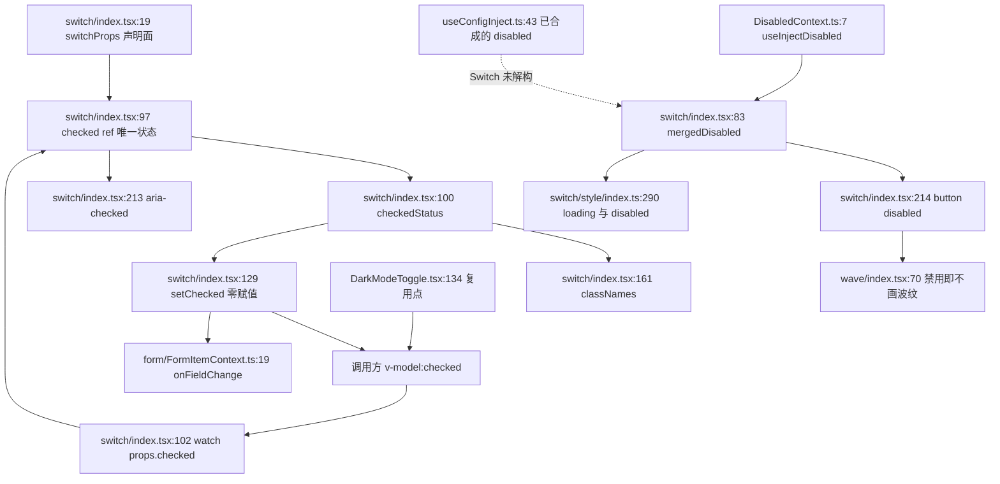
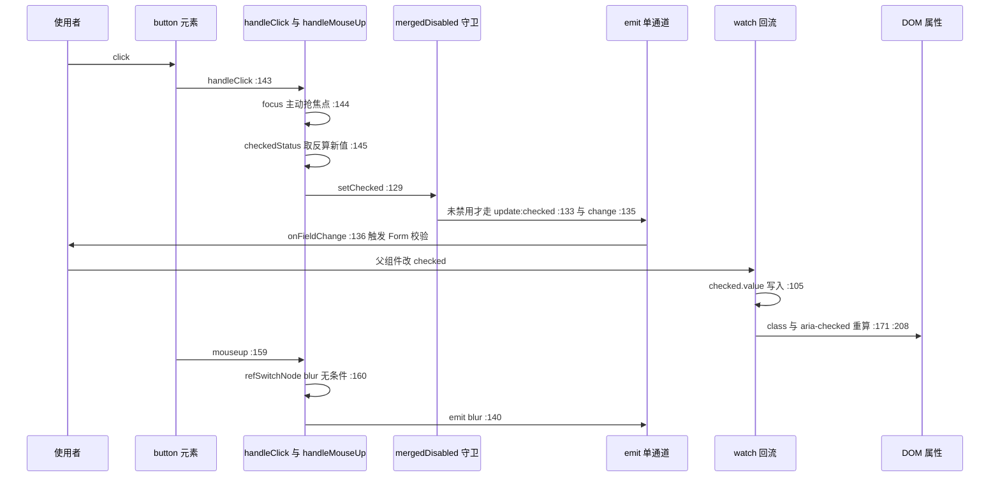
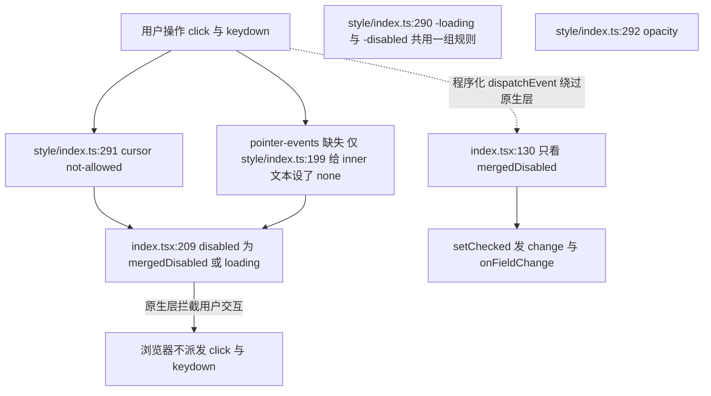

# C04-05 Switch 开关

> **本篇解决**：`Switch` 只有一个模式（受控），为什么它还留着 `defaultChecked` 的初值通路；`loading` 期间点击与键盘到底被哪一层挡住、少一层会怎样；以及改这 230 行里的哪一行会让 Form 校验、a11y 语义、DOM 属性三者同时出问题。
> **前置**：C04-00《受控/非受控与 `useMergedState` 的一致实现》、C06-01 Form 表单　**读者坐标**：`03-components/04-form-controls` 第 5 篇

## 一、职责与边界

`Switch` 负责把「一个二值状态」渲染成可点击、可键盘操作、带滑动动画的 `<button role="switch">`，并把用户的意图以 `(值, 事件)` 的形状送出去。它**不**负责记住自己的状态、不负责异步提交、不负责判断值是否合法——这三件事全部落在调用方，源码里对应的证据是：写内部状态的语句全文件只有一条，位于 props 回流 watcher 里（`packages/xiaoye-ui/src/switch/index.tsx:102`-`107`），而用户操作路径上的 `setChecked`（`packages/xiaoye-ui/src/switch/index.tsx:129`-`137`）只做 `emit`，一次赋值都没有。C04-00 论点 2 已把这一形态命名为「零回写实现」，本篇不重述其判定，只把后果算到底：零回写在受控方向是干净的，在非受控方向不是「少一个特性」而是「一条永远不动的死路」（本篇论点 1）。

边界之外的事项归本类横写篇：`v-model` 参数名分裂、`change` 载荷形状、`useMergedState` 全类零接入，见 C04-00 论点 1 与论点 4；`formItemContext.onFieldChange()` 的接入面与同值去重缺失，见 C04-00 论点 5。

依赖清单（Switch 用谁、谁用 Switch）：

| 方向 | 对象 | 证据 |
| --- | --- | --- |
| 依赖 | `useConfigInject` 取 `prefixCls` / `direction` / `size` | `packages/xiaoye-ui/src/switch/index.tsx:109` |
| 依赖 | `useInjectDisabled` 自行合成禁用 | `packages/xiaoye-ui/src/switch/index.tsx:82`-`83` |
| 依赖 | `useInjectFormItemContext` 取 `id` 与校验触发 | `packages/xiaoye-ui/src/switch/index.tsx:81`、`:136`、`:195` |
| 依赖 | `Wave` 水波纹、`useStyle`、`LoadingOutlined` | `packages/xiaoye-ui/src/switch/index.tsx:172`、`:110`、`:3` |
| 依赖 | `omit` / `getPropsSlot` / `warning` / `KeyCode` | `packages/xiaoye-ui/src/switch/index.tsx:176`、`:218`、`:86`、`:153` |
| 被依赖 | `DarkModeToggle` 的 `variant="switch"` 分支整体复用 Switch | `packages/xiaoye-ui/src/dark-mode-toggle/DarkModeToggle.tsx:4`、`:132`-`148` |

## 二、源码地图

| 文件 | 行数 | 职责 | 关键符号与锚点 |
| --- | --- | --- | --- |
| `packages/xiaoye-ui/src/switch/index.tsx` | 230 | 声明、状态、事件、渲染四合一（无独立 `index.ts`） | `switchProps` `:19`、`SwitchSizes` `:17`、主实现入口 `:59` |
| 同上 | — | 状态与回流层 | `checked` ref `:97`、`checkedStatus` `:100`、`watch` `:102` |
| 同上 | — | 行为层 | `setChecked` `:129`、`handleClick` `:144`、`handleKeyDown` `:152`、`handleMouseUp` `:162` |
| 同上 | — | 渲染层 | `classNames` `:168`、DOM 属性铺设 `:182`-`211` |
| `packages/xiaoye-ui/src/switch/style/index.ts` | 353 | 五段样式生成器与 Token 装配 | `genComponentStyleHook('Switch')` `:309`、基样式 `:255`、loading 段 `:113` |
| `packages/xiaoye-ui/src/switch/index.test.js` | 103 | 4 个 `it`（`:13`、`:31`、`:46`、`:73`）+ 两个共享用例 | `focusTest` `:10`、`mountTest` `:11` |
| `packages/xiaoye-ui/src/_util/omit.ts` | 9 | 渲染期 props 浅拷贝白名单 | `:1`-`9` |
| `packages/xiaoye-ui/src/_util/wave/index.tsx` | — | 点击水波纹与「禁用即不画」判定 | `:29`、`:58`、`:70`-`73` |
| `packages/xiaoye-ui/src/config-provider/hooks/useConfigInject.ts` | — | 已合成好的 `disabled`（Switch 未取用） | `:43`、返回处 `:69` |
| `packages/xiaoye-ui/src/theme/interface/components.ts` | — | Switch 的 Component Token 槽位 | `:132` 为 `Switch?: {}` |

组件没有 `index.ts`、没有 `*Types.ts`，props 与实现同文件（`packages/xiaoye-ui/src/switch/index.tsx:19`），因此本篇所有「声明与实现分离」类问题都只能在同一文件内左右对照；聚合入口由生成器写入 `packages/xiaoye-ui/src/components.ts:334`-`368`（`export * from './switch'` + `Switch` 默认导出 + 样式副作用），不可手改。属性清单见 `apps/docs/components/switch.md`。

## 三、架构与数据流

### 图 1：静态结构——值的持有者到底是谁



这张图要读出三件事。第一，环是**闭合在调用方身上的**：`setChecked`（`packages/xiaoye-ui/src/switch/index.tsx:129`）不指向状态节点，唯一的入边来自 `watch`（`packages/xiaoye-ui/src/switch/index.tsx:102`），而 `watch` 读的是 `props.checked`——所以图里 `INIT` 节点的写权完全在外面，组件自身没有任何一条从用户操作回到状态的边。第二，`UCI` 那条虚线是本篇论点 4 的形状：合成逻辑在 `packages/xiaoye-ui/src/config-provider/hooks/useConfigInject.ts:43` 已经存在一份，Switch 在 `packages/xiaoye-ui/src/switch/index.tsx:82`-`83` 又手写了一份语义相同的，虚线意味着两份拷贝之间没有引用关系，只靠「谁记得解构」维持一致。第三，`DOM` 与 `STY`、`WAV` 三者的入边都只来自 `MDIS`，`loading` 没有进入这张图的状态通道——它只在 `packages/xiaoye-ui/src/switch/index.tsx:214` 与 `:170` 各出现一次，这是论点 2 的落点。

### 图 2：一次鼠标点击的完整闭环（受控用法）



注意闭环的**耗时位置**：`U->>W` 这一段在库里不存在，是调用方补的。若调用方只写 `@change` 而不回写 `:checked`（C04-00 论点 2 称这类为「半受控」），图里 `W` 之后的四个节点一个都不执行，开关视觉保持原位——这不是竞态，是设计。另两处容易被忽略的顺序事实：`focus()` 写在取反之前（`packages/xiaoye-ui/src/switch/index.tsx:143`），`blur()` 挂在 `mouseup` 上且不带任何条件（`packages/xiaoye-ui/src/switch/index.tsx:160`），因此每次鼠标操作都会额外产出一条 `blur`（`packages/xiaoye-ui/src/switch/index.tsx:140`），详见论点 6。

## 四、核心机制精读

### 论点 1：内部状态只有一个写入者，而它不在用户操作路径上——非受控用法不是「不受控」，是「冻结」

判据是一条 grep，不是读一遍就下的结论：

```bash
grep -n "checked.value = " packages/xiaoye-ui/src/switch/index.tsx
```

它的输出只有 `packages/xiaoye-ui/src/switch/index.tsx:105` 一行。把这一行放回上下文看（摘录与源文件同缩进）：

```tsx
// packages/xiaoye-ui/src/switch/index.tsx:97
const checked = ref<string | number | boolean>(
  props.checked !== undefined ? props.checked : (attrs.defaultChecked as boolean),
);
const checkedStatus = computed(() => checked.value === props.checkedValue);

watch(
  () => props.checked,
  () => {
    checked.value = props.checked;
  },
);
```

`:105` 位于 `watch` 回调内部，触发条件是 `props.checked` 发生变化；也就是说，**内部 ref 只能被外部值刷新，不能被用户操作刷新**。而用户操作路径上的函数是这一份：

```tsx
// packages/xiaoye-ui/src/switch/index.tsx:129
const setChecked = (check: CheckedType, e: MouseEvent | KeyboardEvent) => {
  if (mergedDisabled.value) {
    return;
  }
  emit('update:checked', check);
  emit('change', check, e);
  props.onChange?.(check, e as MouseEvent);
  formItemContext.onFieldChange();
};
```

`setChecked` 收下了 `check` 参数，然后把它发给外部（`:133`、`:134`、`:135`），自己一行都不留。于是 `:97` 那个 `ref` 的全部作用是「保存一次初值 + 缓存外部值」，它是一个**只读缓存**，不是状态机。由此得到本篇第一个可证伪命题：`<xy-switch />` 不带 `v-model:checked`、不带 `:checked` 时，第一次点击之后 `checkedStatus`（`:100`）永远为假，开关的旋钮、`-checked` 类名（`:171`）、`aria-checked`（`:208`）三处输出全部静止——非受控模式不是「组件自己管状态」，而是「组件把状态扔了」。C04-00 论点 2 已经给出这条实现的名字与它在本类中的位置（`packages/xiaoye-ui/src/switch/index.tsx:129`-`137` 与 `segmented/src/segmented.tsx:128`-`134` 并列），并指出代价是「没有非受控模式」；本篇补上它的具体症状与量化证据：**没有非受控模式的表现是旋钮零位移，而不是位移后回弹**，因为回弹需要一次写入，而一次写入都不存在。

再看那个已经废弃的初值通路。`defaultChecked` 在 props 声明里根本不存在（`:19`-`55` 整段没有这个键，与之对照 `checked` 在 `:29`），它只从 `attrs` 里捞（`:98`），配套的废弃告警写在这里：

```tsx
// packages/xiaoye-ui/src/switch/index.tsx:85
onBeforeMount(() => {
  warning(
    !('defaultChecked' in attrs),
    'Switch',
    `'defaultChecked' is deprecated, please use 'v-model:checked'`,
  );
```

`:87` 用 `'defaultChecked' in attrs` 做存在性判定，`:98` 用 `attrs.defaultChecked` 取值——两处都按 **camelCase 键名**读 `attrs`。`attrs` 的键名是否会被 Vue 归一成 camelCase，本篇未在源码中找到归一环节，因此不下断言；能确定的是二者依赖同一个键名形状，因此**只要模板写法（例如 `default-checked`）产出的 `attrs` 键保持连字符形态，废弃告警与初值就同时落空**，用户既收不到提示也拿不到初值。验证方法附在本文末检查点 1，读者一条命令即可判定。

结论回扣：`Switch` 的受控/非受控「分岔点」在本组件里其实只有一条边——`props.checked` 是否会被外部改写。这决定了改动时的安全边界：任何「给 Switch 加内部默认值」的想法都必须同时补 `setChecked` 的写回与一个受控判定守卫，只加初值（如 `:98` 那样）产出的是一个开局就卡住的控件。库内唯一复用它的 `DarkModeToggle` 正是这么绕过去的：它自己维护状态（`packages/xiaoye-ui/src/dark-mode-toggle/DarkModeToggle.tsx:50`）并在受控判定外补了一次写回（`packages/xiaoye-ui/src/dark-mode-toggle/DarkModeToggle.tsx:84`-`86`），把 Switch 当纯展示件用（`packages/xiaoye-ui/src/dark-mode-toggle/DarkModeToggle.tsx:134`-`141`）。

### 论点 2：`loading` 只有「原生 `disabled`」一条防线，JS 守卫与 CSS 都只认 `disabled`

三条防线的覆盖面对照如下：



证据逐条落位。行为层守卫只写了一个条件：

```tsx
// packages/xiaoye-ui/src/switch/index.tsx:129
const setChecked = (check: CheckedType, e: MouseEvent | KeyboardEvent) => {
  if (mergedDisabled.value) {
    return;
  }
```

`mergedDisabled` 的定义在 `packages/xiaoye-ui/src/switch/index.tsx:83`，是 `props.disabled ?? disabledContext.value`，其中**没有 `loading` 这一项**。而 DOM 层是两者或运算：`packages/xiaoye-ui/src/switch/index.tsx:214` 的 `disabled={mergedDisabled.value || props.loading}`。样式层同样是合写的，`packages/xiaoye-ui/src/switch/style/index.ts:290`-`298` 把 `-loading` 与 `-disabled` 归到同一个选择器里，只设 `cursor`（`:291`）与 `opacity`（`:292`）以及子元素去阴影（`:294`-`:297`），**没有任何 `pointer-events`**；文件里唯一一处 `pointerEvents: 'none'` 在 `packages/xiaoye-ui/src/switch/style/index.ts:199`，作用对象是 `-inner-checked` / `-inner-unchecked` 两个文字层，与点击拦截无关。

因此结论是：**loading 期间的不可达完全由原生 `disabled` 属性这一层保证**。对真实用户输入而言这一层是够的（禁用表单控件不响应点击、且不可聚焦所以收不到 `keydown`）。风险面在于「不经过原生层」的事件路径——`dispatchEvent` 一类程序化派发是否会命中禁用元素上的监听器属于浏览器行为，本仓没有可引的源码证据，故此处仅作条件句：若该路径成立，则 loading 中派发的 `click` 会穿过 `handleClick`（`packages/xiaoye-ui/src/switch/index.tsx:143`-`150`）抵达 `setChecked`，而 `:130` 的守卫不认识 loading，于是 `emit('change')`（`:134`）与 `formItemContext.onFieldChange()`（`:136`）照发，Form 会按一个并未生效的值重跑校验。同一条件句对 `keydown` 也成立：`handleKeyDown`（`:152`）在守卫之外还会无条件 `emit('keydown', e)`（`:158`）。这层不对称是**可测试性缺陷**：`@vue/test-utils` 的 `trigger` 走的就是派发路径，而 `packages/xiaoye-ui/src/switch/index.test.js` 的 4 个用例（`:13`、`:31`、`:46`、`:73`）里没有一条设过 `loading`——`loading` 的行为分支目前处于「无测试保护」状态。

第二层缺陷与拦截无关，是**语义缺失**：`role="switch"`（`packages/xiaoye-ui/src/switch/index.tsx:212`）配 `aria-checked`（`:208`）之后，loading 期间既没有 `aria-busy` 也没有 `aria-disabled`，全文件 `aria-` 只出现 `aria-checked` 一次。表现是：视觉上开关变灰并转圈（`:214` 渲染 `LoadingOutlined`，类名 `-loading-icon` 见 `packages/xiaoye-ui/src/switch/index.tsx:219`，样式在 `packages/xiaoye-ui/src/switch/style/index.ts:118`-`127`），但读屏用户既不知道它在忙、也不知道自己按不动了；同时 `-loading` 与 `-disabled` 在 `packages/xiaoye-ui/src/switch/index.tsx:166`-`172` 是两个独立键，`classNames` 里没有把 loading 映射到 `-disabled`，所以连「看起来被禁用」这件事也没有走 `aria` 通道。

第三层，水波纹：`packages/xiaoye-ui/src/_util/wave/index.tsx:70`-`73` 会在 `node.getAttribute('disabled')`、`node.disabled`、`className.includes('disabled')` 任一成立时不注册点击特效。Switch 的 loading 通过 `:209` 落成了原生 `disabled`，于是**恰好**被第一条命中——这是一个隐式依赖：若有人把 `:209` 改成 `disabled={mergedDisabled.value}` 并改用 `aria-disabled` + CSS 来表达 loading（无障碍上更正确的做法），那么 loading 期间的波纹会回来，且 `:130` 的守卫仍然拦不住值变化。改这一行必须同时改 `:130`，两处不是独立的。

顺带记录一处同源疏漏：`autofocus` 的自动聚焦判定只看禁用不看 loading（`packages/xiaoye-ui/src/switch/index.tsx:123`：`if (props.autofocus && !mergedDisabled.value)`），而 `loading` 下元素不可聚焦，浏览器会静默忽略 `focus()`；这条与 `:124` 的 `refSwitchNode.value.focus()`（无可选链，对照 `:113`、`:163` 都用了 `?.`）叠在一起时，症状从「没聚焦」变成「抛错」，见坑 6。

> 属性清单见 `apps/docs/components/switch.md`；官方 loading 示例把重入防护写在调用方（`apps/docs/examples/switch/async-loading.vue:29`），且值要等异步成功才回写（`apps/docs/examples/switch/async-loading.vue:38`），正是论点 1 零回写的直接后果。

### 论点 3：判据「同名 computed 遮蔽同名 prop」在 Switch 上落空，但存在一个 `ref` 变体，代价落在 `aria-checked`

派工给的判据是 `grep -n "const <propName> = computed" <主文件>`。对 Switch 全量跑一遍：

```bash
grep -nE "const (checked|disabled|loading|size|id|autofocus|tabindex) = computed" packages/xiaoye-ui/src/switch/index.tsx
```

**无输出**。本组件的三个 computed 都换了名字：`checkedStatus`（`:100`）、`mergedDisabled`（`:83`）、`classNames`（`:168`），所以不存在 `packages/xiaoye-ui/src/progress/progress.tsx:60` 遮蔽 `packages/xiaoye-ui/src/progress/props.ts:50` 那种「用户传值完全无效」的形态。但同一条判据的 `ref` 变体是成立的，而且更容易被漏掉，因为遮蔽者是 `ref` 不是 `computed`：

```tsx
// packages/xiaoye-ui/src/switch/index.tsx:97
const checked = ref<string | number | boolean>(
  props.checked !== undefined ? props.checked : (attrs.defaultChecked as boolean),
);
```

`:97` 的局部 `checked` 与 `:29` 声明的 prop `checked` 同名。遮蔽本身不改变行为（`props.checked` 与 `checked.value` 是两个东西，编译器与运行时都不混淆），改变的是**读哪一份**。统计口径很干净：`props.checked` 在全文件只被读 3 次（`:98`、`:103`、`:105`），全部不在渲染路径上；渲染路径读的是局部份——`:100` 的 `checkedStatus` 与 `:208` 的 `aria-checked`。两份在受控用法下由 `:102`-`107` 保持同步，同步的代价是：只要 `props.checked` 与内部值的**类型或取值域**不一致，遮蔽就变成缺陷，而 Switch 恰好允许自定义值域：

```tsx
// packages/xiaoye-ui/src/switch/index.tsx:29
checked: PropTypes.oneOfType([PropTypes.string, PropTypes.number, PropTypes.looseBool]),
checkedValue: PropTypes.oneOfType([PropTypes.string, PropTypes.number, PropTypes.looseBool]).def(
  true,
),
// packages/xiaoye-ui/src/switch/index.tsx:100
const checkedStatus = computed(() => checked.value === props.checkedValue);
```

`:100` 是严格相等，`:30`-`37` 的默认值是 `true` / `false`。于是 `checked={1}` 或 `checked="on"` 这类「语义上想表达开」的写法，在不显式声明 `checkedValue` 时会静默判为关——`===` 不会做布尔 coercion，且没有任何 warning（文件里的 `warning` 只用了两次，`:86`、`:91`，都只管 `defaultChecked` 与 `value`）。测试恰好只覆盖了「显式配对」的正确路径：`packages/xiaoye-ui/src/switch/index.test.js:47`-`71` 与 `:73`-`102` 都同时给了 `unCheckedValue={1}` 和 `checkedValue={2}`，所以「自定义值域但不配对」这条分支没有任何用例。

真正被这个遮蔽伤到的是可访问性输出。`:208` 写的是 `aria-checked={checked.value as any}`——**渲染的是内部原始值而不是 `:100` 算出的布尔**。`role="switch"`（`:207`）的 `aria-checked` 取值域是布尔字符串，而 `checked.value` 可能是 `1`、`'on'`、`'yes'`：此时 DOM 上出现 `aria-checked="on"`，读屏软件按规范拿不到合法状态，用户听到的是「未定义」。`as any` 是这个类型窟窿的自我承认：props 类型（`:29`）允许三域值，`aria-checked` 需要的布尔在 `:100` 已经算好了，但 `:208` 没用 `checkedStatus.value`。结论回扣：遮蔽类缺陷的判据不能只查 `computed`，`ref` 与 `shallowRef` 同样能形成两份真值；而 Switch 的两份在**语义层**（视觉用布尔、a11y 用原值）分道扬镳，这是本组件里唯一一处「同一件事渲染了两遍、两遍答案不同」。

### 论点 4：`disabled` 的合成公式在仓库里抄了 15 遍，Switch 用的是「绕过 `useConfigInject`」的那一份

先给结论的量化形式。全库 `mergedDisabled = computed(...)` 共 15 处（`grep -rn "mergedDisabled" packages/xiaoye-ui/src --include=\*.tsx` 过滤 `computed` 后），去掉 `calendar`/`vc-picker` 这两个语义不同的（`packages/xiaoye-ui/src/calendar/generateCalendar.tsx:187`、`packages/xiaoye-ui/src/vc-picker/RangePicker.tsx:306`），剩下 13 处按「读谁合成的值」分三族：

| 族 | 写法 | 成员（首个声明行） |
| --- | --- | --- |
| A 用 `useConfigInject` 合成值再兜一次 | 先取 `disabled.value`，再 `??` contextDisabled | `packages/xiaoye-ui/src/select/index.tsx:166`、`packages/xiaoye-ui/src/cascader/index.tsx:162`、`packages/xiaoye-ui/src/tree-select/index.tsx:154`、`packages/xiaoye-ui/src/input-number/index.tsx:69`、`packages/xiaoye-ui/src/radio/Radio.tsx:58`、`packages/xiaoye-ui/src/upload/Upload.tsx:47` |
| B 丢掉合成值，自己拼 | `props.disabled` 直接 `??` context | `packages/xiaoye-ui/src/switch/index.tsx:83`、`packages/xiaoye-ui/src/button/button.tsx:51`、`packages/xiaoye-ui/src/dark-mode-toggle/DarkModeToggle.tsx:37` |
| C 用逻辑或且让上下文优先 | context 在前、props 在后，短路取真 | `packages/xiaoye-ui/src/menu/src/MenuItem.tsx:108`、`packages/xiaoye-ui/src/menu/src/SubMenu.tsx:136` |

上表列了 11 处，余下 2 处归不进任何一族：`packages/xiaoye-ui/src/chips/Chips.tsx:36` 是 `props.disabled` 直接 `??` 合成值（既不算 A 族的二次兜底也不算 B 族的丢弃），`packages/xiaoye-ui/src/checkbox/Checkbox.tsx:44`-`46` 则是「Group 禁用 逻辑或 合成值」，多了一个上游来源（写法差异已由 C04-00 §五记录）。13 处分 4 种写法，这一事实本身就是论点。

A 族与 B 族今天**结果相同**，这一点必须写清楚，否则就是编造缺陷：`packages/xiaoye-ui/src/config-provider/hooks/useConfigInject.ts:43` 的公式是 `props.disabled ?? disabledContext.value`，与 B 族的表达式逐字符等价，所以 A 族是把同一个 `??` 套了两层，而 `packages/xiaoye-ui/src/switch/index.tsx:83` 只套了一层。三种族的 `??` 与逻辑或的差异已由 C04-00 §五末尾归纳（`packages/xiaoye-ui/src/checkbox/Checkbox.tsx:44`-`46` 用逻辑或、`packages/xiaoye-ui/src/radio/Radio.tsx:106` 用 `??`、Switch 用 `??` 但不读合成值），本篇不重复。

真正的风险是**供给端只有一条腿**。`disabled` 上下文有两个提供者：`packages/xiaoye-ui/src/config-provider/index.tsx:218` 与 `packages/xiaoye-ui/src/form/Form.tsx:142`（注意后者用的函数名是 `useProviderDisabled`），两者都写入同一个 `DisabledContextKey`（`packages/xiaoye-ui/src/config-provider/DisabledContext.ts:5`），注入默认值是 `ref(undefined)`（`packages/xiaoye-ui/src/config-provider/DisabledContext.ts:8`）。Switch 直接读这个 key（`:82`），因此 `<xy-form disabled>` 与 `<xy-config-provider :disabled>` 对它都有效。

那 B 族错在哪？**错在一致性的维持方式**。`useConfigInject` 是 ConfigProvider 的公共出口，将来任何新增的禁用来源（例如 FormItem 级别的 `disabled`、或者 `wave.disabled` 那样的嵌套配置——`packages/xiaoye-ui/src/config-provider/hooks/useConfigInject.ts:45`-`46` 已有同类形状）只会加进 `:43` 那一行。改完之后 A 族 6 个组件自动跟随，B 族 3 个组件（含 Switch）静默落伍，而且没有任何 lint 或类型错误会提示这一点，因为 B 族的写法在类型上完全合法。对照 Switch 自己：`:109` 从 `useConfigInject` 只解构了 `prefixCls, direction, size`，同一次调用返回值里的 `disabled`（`:69` 导出）被丢弃——Switch 丢弃了这份已算好的合成值，只是因为后面补了一份才没出事。

改动指南（这一条是给未来维护者的）：把 `:82`-`:83` 两行删掉，改成 `const { prefixCls, direction, size, disabled } = useConfigInject('switch', props);`，再把 `mergedDisabled.value` 的 4 个使用点（`:123`、`:130`、`:172`、`:209`）替换成 `disabled.value`——**行为不变**，因为两边公式等价；这一改动买到的东西是「供给端只剩一条腿」。验证的最小集合是本组件的 4 个用例（`packages/xiaoye-ui/src/switch/index.test.js:14`、`:31`、`:46`、`:73`）加上 `packages/xiaoye-ui/tests/shared/focusTest.js`，它们都不设 `disabled`，所以这条重构实际上**无法被现有测试证明无回归**——需要手写一条 `<xy-form disabled>` 的断言才安全。

### 论点 5：`omit` 白名单是「反向声明」，漏项让 `size` 与 `loading` 落到 DOM，也让 `onFocus` 靠意外生效

渲染根节点的第一件事是把 props 整包铺到 `<button>` 上，再挖掉不能铺的：

```tsx
// packages/xiaoye-ui/src/switch/index.tsx:176
{...omit(props, [
  'prefixCls',
  'checkedChildren',
  'unCheckedChildren',
  'checked',
  'autofocus',
  'checkedValue',
  'unCheckedValue',
  'id',
  'onChange',
  'onUpdate:checked',
])}
{...attrs}
```

`omit` 的实现是「浅拷贝后删键」（`packages/xiaoye-ui/src/_util/omit.ts:3` 的 `Object.assign({}, obj)` 与 `:6` 的 `delete`），语义上这是**黑名单**而不是白名单：漏写一项就多铺一项，写错一项则静默。对照 `packages/xiaoye-ui/src/switch/index.tsx:19`-`55` 的声明面逐项核，19 个声明键里有 4 个既没进 omit 列表、也没被显式属性覆盖，其中两个后果可见：

- `size`（声明在 `packages/xiaoye-ui/src/switch/index.tsx:22`）被铺成 `<button size="default">`。`size` 是 `input` 与 `select` 的属性，不是 `button` 的，浏览器会原样保留这个属性而不产生任何效果——它是纯 DOM 噪声。
- `loading`（声明在 `packages/xiaoye-ui/src/switch/index.tsx:28`）被铺成 `loading="true"`。HTML 没有 `button[loading]`，同理是噪声，且与 `:209` 真正生效的 `disabled` 语义重复。
- `tabindex`（`packages/xiaoye-ui/src/switch/index.tsx:26`）铺下去是对的，但它是**唯一一个「声明了、setup 里一次都没读、却必须生效」的 prop**：`grep -n "props.tabindex" packages/xiaoye-ui/src/switch/index.tsx` 命中 0 行，它完全靠这条 spread 活着。
- `onFocus`（`packages/xiaoye-ui/src/switch/index.tsx:54`）同上，`grep -oE "props\.onFocus" ...` 命中 0 行，也没有对应的 `emit('focus')`——`emits` 数组（`:70`-`79`）里根本没有 `focus`。用户的 `@focus` 之所以还能触发，是因为 `omit` 后剩下的 `onFocus` 键被当成 DOM 监听器铺上去了。

最后一条在 2026-09-29 之前是真正的改动陷阱，现已按族规则收口：`onClick`、`onKeydown`、`onBlur`、`onMouseup` 四个当时同样没进 omit 列表，只是它们在 `packages/xiaoye-ui/src/switch/index.tsx:200`-`199` 被显式属性**写在展开之后**顶掉了（`onKeydown={handleKeyDown}`、`onClick={handleClick}`、`onBlur={handleBlur}`、`onMouseup={handleMouseUp}`），而 `handleClick` 等内部又手工补调了 `props.onClick?.(…)`（`:149`）、`props.onKeydown?.(…)`（`:159`）、`props.onBlur?.(…)`（`:141`）、`props.onMouseup?.(…)`（`:165`）——四个都有「双份保险」。**`onFocus` 是这五兄弟里唯一没有 `handleFocus` 的**，也就是说它目前靠「漏覆盖」而正确工作。哪天有人为了补 Form 的 `onFieldBlur`（C04-00 论点 5 指出 Switch 只发 `onFieldChange` 不发 `onFieldBlur`，`packages/xiaoye-ui/src/form/FormItemContext.ts:18` 声明了这条契约而组件层无人调用）加上 `onFocus={handleFocus}` 却忘记在内部补一句 `props.onFocus?.(e)`，用户传入的 `@focus` 就会静默失效——类型检查与编译都不会响。唯一的拦截来自共享用例：`packages/xiaoye-ui/src/switch/index.test.js:11` 调的 `focusTest(Switch)` 在 `packages/xiaoye-ui/tests/shared/focusTest.js:17`-`31` 断言的正是「调用 expose 的 `focus()` 之后 `onFocus` 回调被触发」，它同时依赖 `:112`-`119` 的 `expose` 与这条意外生效的 spread。换言之，本组件最重要的一条 a11y 契约由**别的文件的通用用例**守着，本目录的 4 个用例里没有任何一条提到 `focus`。这正是「props 声明与运行时读取不一致」这一缺陷族在 Switch 里的具体形状。

顺带把属性顺序链写全，因为它决定了调用方的覆盖能力。`:182` 的 props 展开在最前，`:194` 是 attrs 展开，之后 `:195` 的 `id`、`:196`-`:199` 的四个处理器、`:206` 的 `type="button"`、`:207` 的 `role="switch"`、`:208` 的 `aria-checked`、`:209` 的 `disabled`、`:210` 的 `class`、`:211` 的 `ref` 全部写在两个展开之后——因此这些键**不可被外部覆盖**（`type` / `role` / `disabled` 被锁死是有意为之，`aria-checked` 被锁死则让调用方连修正论点 3 那个非布尔值的机会都没有）。`class` 一项需要限定：`packages/xiaoye-ui/src/switch/index.tsx:215` 手工写了 `[attrs.class, classNames.value]`，而 Vue JSX 的展开合并对 `class` 是拼接语义（框架运行时行为，本仓无源码可引），所以这里是一次冗余登记而不是 bug。本仓至少 6 个组件用同一种 `[attrs.class, …]` 形状（`grep -rn "class={\`attrs.class" packages/xiaoye-ui/src --include=\*.tsx` 命中 `packages/xiaoye-ui/src/input/Input.tsx:189`、`packages/xiaoye-ui/src/alert/index.tsx:186`、`packages/xiaoye-ui/src/watermark/index.tsx:249`、`packages/xiaoye-ui/src/flex/index.tsx:49`、`packages/xiaoye-ui/src/float-button/FloatButtonContent.tsx:17` 与 Switch 自己），`packages/xiaoye-ui/src/checkbox/Checkbox.tsx:85` 走的是另一条路：它把 `class` 从 `attrs` 里解构摘走、不给根节点重复登记（口径见 C04-03）。

最后一个代价写在 `omit.ts:3`：它在**每次渲染**里拷贝并删除 10 个键，拷贝 `props` 代理会读遍全部 19 个声明键，于是渲染 effect 依赖了所有 props——只要任一 prop 变化（哪怕是与渲染无关的 `checkedChildren` 变化），整个按钮连 `aria`、`class`、事件绑定一起重算。这是「省一份白名单」换来的重渲染粒度损失，本组件的 230 行里没有任何 `memo` 或分段渲染来弥补。

### 论点 6：键盘与焦点是两条独立通路，`click` 载荷在冻结态会重复报同一个值

鼠标路径与键盘路径在源码里不共享任何计算，这是读 `:144`-`160` 时最容易漏的一点：

```tsx
（以下为修前快照：两条通道并存）
// packages/xiaoye-ui/src/switch/index.tsx:143
const handleClick = (e: MouseEvent) => {
  focus();
  const newChecked = checkedStatus.value ? props.unCheckedValue : props.checkedValue;
  setChecked(newChecked, e);
  emit('click', newChecked, e);
  props.onClick?.(newChecked, e);   // ← 修前多这一句，2026-09-29 已删
};

const handleKeyDown = (e: KeyboardEvent) => {
  if (e.keyCode === KeyCode.LEFT) {
    setChecked(props.unCheckedValue, e);
  } else if (e.keyCode === KeyCode.RIGHT) {
    setChecked(props.checkedValue, e);
  }
  emit('keydown', e);
  props.onKeydown?.(e);               // ← 修前多这一句
};
```

修后两处都只剩 `emit`（`packages/xiaoye-ui/src/switch/index.tsx:146`、`:156`），并且这四个键连同 `onChange`/`onUpdate:checked` 一起进了 omit 列表（`:180`-`:195`）——**两个动作必须一起做**：只删直调不剥摊布，`mergeProps` 仍会把摊下来的用户 handler 与显式 arrow 并成数组，次数不变。

三条差异都能直接读出后果。第一，`handleClick` 是**取反**（`:145` 读 `checkedStatus`），`handleKeyDown` 是**绝对赋值**（`:152`、`:154` 直接用 `KeyCode.LEFT`（`packages/xiaoye-ui/src/_util/KeyCode.ts:75`，值 37）与 `KeyCode.RIGHT`（`packages/xiaoye-ui/src/_util/KeyCode.ts:83`，值 39）表达「关 / 开」）。所以同一份值域（`checkedValue` / `unCheckedValue`）在两条路径上被消费两次，语义还不一样：长按右方向键会连发同一个 `checkedValue`，每次都要走完 `emit('change')` 加 `formItemContext.onFieldChange()`（`:134`、`:136`），而这条链上没有同值门槛——门槛缺失的口径见 C04-00 论点 5（`useMergedState.ts` 的 `toRaw` 比较在本类零接入）。

第二，`handleKeyDown` 对**所有**按键都无条件 `emit('keydown', e)`（`:156`），包括 Tab、Enter、Esc 与任意字母键；同时它不 `preventDefault`，全文件没有一次 `preventDefault` 调用（`grep -n "preventDefault" packages/xiaoye-ui/src/switch/index.tsx` 命中 0 行），因此在一个可滚动容器里用方向键操作开关时，滚动与切换同时发生。Enter 与 Space 的可用性则完全交给原生 `<button type="button">`（`:206`）的激活行为：它们产生 `click` 事件，于是复用 `handleClick`——这是巧合级的正确，因为 `:206` 一旦改成 `<div role="switch">`（很多弹层组件的做法），键盘就整条断掉，而 `:152` 的 `handleKeyDown` 里没有 Enter/Space 分支来接管。

第三，冻结态（论点 1 的非受控用法）下的载荷形状：`:146` 每次读到的 `checkedStatus` 都不变，因此 `emit('change', check, e)` 与 `emit('click', newChecked, e)`（`:135`、`:147`）**反复携带同一个值**，而 `packages/xiaoye-ui/src/switch/index.test.js:14`-`29` 这条名字叫「should has click wave effect」的用例恰好是零断言的——它 `trigger('click')` 之后不检查任何东西（`:27`），所以既不能证明水波纹存在，也不能证明载荷正确。这条用例是「测试面假象」在本组件的唯一实例：`grep -c "expect(" packages/xiaoye-ui/src/switch/index.test.js` 得 6，全在 `:31`、`:46`、`:73` 三条里。

焦点侧还有一条与样式联动的隐式约定。`handleClick` 第一件事是 `focus()`（`:144`，配合 `:112`-`114`，为的是 Safari 不因点击而聚焦按钮），而 `handleMouseUp` 无条件 `blur()`（`:160`），于是鼠标每按一次都会走完「聚焦—立刻失焦」，并额外产出一条 `blur` 事件（`:140`）。副作用是 `packages/xiaoye-ui/src/switch/style/index.ts:280` 的 `genFocusStyle(token)` 生成的 `:focus-visible` 描边对鼠标用户永远不可见（对键盘用户可见，因为键盘不触发 `mouseup`），同时任何依赖 `@blur` 做「离开字段就校验」的调用方会被每次点击误导——而 Form 自己的 `onFieldBlur` 通道 Switch 根本没接（`packages/xiaoye-ui/src/form/FormItemContext.ts:18`，接了它的控件名单见 C04-00 论点 5）。

## 五、对外契约如何生效

**声明面与生效面是两张表，本篇只写它们的差集。** 完整的属性清单不在这里，见 [apps/docs/components/switch.md`。

props 进入渲染有三条路：第一条是 `useConfigInject('switch', props)`（`packages/xiaoye-ui/src/switch/index.tsx:109`）与 `useStyle(prefixCls)`（`:110`），把 `prefixCls`、`size`、`direction` 变成类名成分，落点是 `classNames`（`:168`-`176`）的 7 个键——其中 `hashId.value`（`:175`）是 CSS-in-JS 的哈希类名，缺了它样式不命中，这是 `wrapSSR`（`:179`）之外的第二条样式依赖。第二条是 `getPropsSlot(slots, props, 'checkedChildren')`（`:218`、`:221`），插槽优先、props 兜底，两个内容分别包在 `-inner-checked` 与 `-inner-unchecked` 里（`:217`、`:220`），它们的可见性不由 JS 判断而由 `packages/xiaoye-ui/src/switch/style/index.ts:202`-`215` 与 `:218`-`233` 的 `margin-inline` 负值计算决定——也就是说**文案切换是纯 CSS 动画**，`:171` 的 `-checked` 类名是唯一的输入。第三条是 `omit` 展开（`:182`），已在论点 5 展开。

`emits`（`:70`-`79`）声明了 7 个事件，实际触发情况：`update:checked`（`:133`）、`change`（`:135`）、`click`（`:147`）、`keydown`（`:156`）、`blur`（`:140`）、`mouseup`（`:161`）、`mouseenter`（`:203`）、`mouseleave`（`:206`）——**8 个触发点覆盖 7 个声明**，因为 `mouseenter`/`mouseleave` 只在 `emits` 里出现而没有对应的 prop 声明（对照 `:38`-`:54` 的声明面）。

**这一段在 2026-09-29 之前描述的是双通道，现在是单通道。** 原先每个事件都有两条投递路径：`handleXxx` 里 `emit('x')` 之后紧跟一句 `props.onX?.(...)` 直调，而根节点又用 `{...attrs}` / `{...omit(props, [...])}` 把用户 handler 整包摊成 DOM 监听器（**「事件双投递」族的形态二与形态三**）。实测一次点击让外部 `@change` 与 `@click` 各跑 **2** 次。现在的形状：`setChecked`（`:132`-`137`）、`handleBlur`、`handleClick`、`handleKeyDown`、`handleMouseUp` 五处只留 `emit`，被本层桥接过的 `onClick`/`onKeydown`/`onMouseup`/`onBlur` 连同 `onChange`/`onUpdate:checked` 一起从 props 摊布里剔掉（`:180`-`:195`），`onMouseenter`/`onMouseleave` 则从 attrs 摊布里剔掉（`:196`）——两者都是必需的：`mergeProps` 会把「摊下来的一份」与「显式 arrow」并成数组，数组里那份直调、arrow 里的 `emit` 又命中同一个函数。留在摊布里的 `onFocus`（`:54`）不受影响，因为本层既没有 `emit('focus')` 也没有显式 `onFocus` arrow，它是唯一通道。计数回归：`packages/xiaoye-ui/src/_util/__tests__/event-dispatch-count.test.tsx` 的「Switch 点一次」用例，判据 `toHaveBeenCalledTimes(1)`，退回基线实测 2 次。

载荷形状仍没有统一契约：`emit('click', newChecked, e)`（`:147`）带**两个**参数，`emit('keydown', e)`（`:156`）传原生事件，而 `props.onKeydown` 的类型声明是 `(e: Event) => void`（`:44`-`:46`），`setChecked` 的形参类型却是 `MouseEvent | KeyboardEvent`（`:129`）。类型面上这套事件载荷没有一份统一契约，改任何一个 `emit` 的参数都不会被 `emits` 数组约束（数组只声明名字，不声明载荷）。

`expose` 只有 `focus` 与 `blur`（`:112`-`119`），两者都走 `refSwitchNode`（`:111`、`:211`）。注意 `:124` 的 `autofocus` 分支用了同一个 ref 却没有可选链，这是全文件 3 处 `refSwitchNode.value` 访问里唯一的裸访问（另两处 `:113`、`:163` 都带 `?.`）。

Context 侧有两条入边、一条出边：入边是 `DisabledContext`（`:82`）与 `FormItemContext`（`:81`），出边是 `formItemContext.onFieldChange()`（`:136`）与 `formItemContext.id.value` 作为 DOM `id` 的回退（`:195`）。`id` 的回退写法在本类里有三种口径，Switch 用的是 `??`，差异与 `<label for>` 关联后果见 C04-00 §五末尾，本篇不重复。

## 六、设计取舍

**取舍一：零回写换实现极简，赔掉非受控能力——但它没有做到底。** C04-00 取舍四 已经把这一条与 `Segmented` 摆在一起比较过（`packages/xiaoye-ui/src/segmented/src/segmented.tsx:47` 用 `required: true` 直接宣告「只有受控」），本篇不重述结论，只补 Switch 这条路的**成本明细**：为了保留一个非受控出口，组件必须付三笔钱——一笔是 `:97`-`99` 的三元判定（多一个 `props.checked !== undefined` 的分支，判定的对象还不是 prop 而是 attrs）；一笔是 `:86`-`90` 的废弃告警（为一个已经不能工作的通路维护提示语）；第三笔是 `:98` 从 `attrs` 取值这一步本身，它让 `defaultChecked` 游离在 `switchProps`（`:19`-`55`）之外，于是类型推导、IDE 补全、`pnpm typecheck` 三处都看不见这个入口。对照本库自己就有正确做法：`packages/xiaoye-ui/src/checkbox/interface.ts:54` 把 `defaultChecked` 正经声明成 prop，`packages/xiaoye-ui/src/vc-checkbox/Checkbox.tsx:33` 用它初始化状态并在 `:29` 声明默认值 `false`。也就是说 Switch 偏离的不是外部标准，而是**同仓库同层的另一个布尔控件**。被放弃的方案很明确：把 `defaultChecked` 提升为 prop 并在 `setChecked` 里补一次写回——那需要同时引入受控判定，而作者在 `:102`-`107` 只写了回流、没写判定，这条路就停在这儿了。

**取舍二：`Wave` 包一层换统一点击反馈，赔掉一层实例与一次 `mergeProps`。** 根节点不是 `button` 而是 `wrapSSR(<Wave><button/></Wave>)`（`packages/xiaoye-ui/src/switch/index.tsx:171`-`180`）。Wave 自身在挂载后才注册捕获阶段监听（`packages/xiaoye-ui/src/_util/wave/index.tsx:82`），并通过 `findDOMNode` 找子节点（`:47`），这意味着每个开关多一层组件实例、一次 DOM 查询、一条 `click` 捕获监听。收益是点击反馈与 `Button`（`packages/xiaoye-ui/src/button/button.tsx:51` 同族写法）以及 `DarkModeToggle` 的按钮分支（`packages/xiaoye-ui/src/dark-mode-toggle/DarkModeToggle.tsx:153`）完全一致。真正的代价出现在第 2 层：`packages/xiaoye-ui/src/_util/wave/index.tsx:70`-`73` 的抑制判定是**字符串级**的（`getAttribute('disabled')` 与 `className.includes('disabled')`），Switch 的 loading 恰好因为把 `disabled` 写进了 DOM（`packages/xiaoye-ui/src/switch/index.tsx:214`）才顺带把波纹关掉——波纹与拦截这两件不相干的事被同一行代码耦合，这是论点 2 里那条「隐式依赖」的来源。SSR 侧则由 `wrapSSR` 承担（`:179`），组件本身没有 `window`/`document` 直读（全文件仅 `:113`、`:116`、`:124`、`:163` 通过 ref 调 `focus`/`blur`，都在客户端时机），这条是合格的。

**取舍三：不做 Component Token，把尺寸公式硬钉在样式文件里。** `packages/xiaoye-ui/src/theme/interface/components.ts:126` 给 Switch 的组件级 Token 槽位是空对象（`Switch?: {}`），意味着主题侧**一个开关专属变量都改不了**；所有专属量都在 `packages/xiaoye-ui/src/switch/style/index.ts:316`-`336` 由 alias token 现场推导，其中 `switchPadding = 2` 后面跟着一条注释 `// This is magic`（`packages/xiaoye-ui/src/switch/style/index.ts:312`），`switchHeightSM` 取 `controlHeight / 2`（`:311`）。这类决定换来的是「样式只有一处真相、不会被主题分叉」，赔上的是「旋钮内边距无法调」以及四组写死的字面值：`borderRadius: 100` 两处（`packages/xiaoye-ui/src/switch/style/index.ts:188`、`:271`）、阴影色 `#00230b`（`:332`）、loading 图标色 `rgba(0, 0, 0, …)`（`:334`）、激活态 `inset` 字符串 `'-30%'`（`:335`）。这与仓库规范直接冲突（`AGENTS.md:723`「禁止在组件样式中硬编码颜色、间距等值，应使用 Token」）。更能说明问题的是 `switchBg`：它在 Token 接口里声明（`packages/xiaoye-ui/src/switch/style/index.ts:17`）、在装配时赋了值（`:326`，取 `colorBgContainer`），但**五个生成函数一次都没读过它**（`grep -n "switchBg" packages/xiaoye-ui/src/switch/style/index.ts` 只命中这两行），底色实际由 `:269` 的 `colorTextQuaternary` 决定。这是一条「为开放而准备、后来放弃」的死槽位，也是「有规则但查不到的键」这一缺陷族在样式层的具体样本。

**取舍四：`checked` 不设默认值，换来受控判定，赔上文档一致性。** `packages/xiaoye-ui/src/switch/index.tsx:29` 的 `checked` 没有 `.def(...)`，而同文件的 `checkedValue`、`unCheckedValue` 分别 `.def(true)`、`.def(false)`（`:30`-`37`）。这个不对称是必需的——`:98` 的受控判定就是 `props.checked !== undefined`，一旦给默认值，判定恒假、组件会变成「永远以为自己是受控的」。代价则落在文档侧：`apps/docs/components/switch.md:79` 的 `checked` 行把默认值写成 `false`，与实现不符（实现是「无默认」）。文档表格那一行本身也被类型分隔符切坏了（同行里出现了未对齐的竖线转义），改文档的人很难发现它讲错了默认值。这是「用默认值换判定」这笔交易里唯一真实的坏账，但它落在文档而不是运行时。

## 七、坑与改动指南

**坑 1：非受控用法点下去不动**

- 触发：`<xy-switch default-checked />`，或只写 `<xy-switch />` 指望它自己记住状态。
- 症状：视觉完全静止，旋钮不滑、类名不变，但 `@change` 每次点击都在发；调用方以为「没生效所以没发事件」，实际是事件发了、值没变。
- 原因：`setChecked` 不回写状态（`packages/xiaoye-ui/src/switch/index.tsx:129`-`137`），唯一写入在回流 watcher 里（`packages/xiaoye-ui/src/switch/index.tsx:105`），非受控时它永不触发。
- 定位：`packages/xiaoye-ui/src/switch/index.tsx:97`-`107`；`defaultChecked` 未进 props（对照声明面 `packages/xiaoye-ui/src/switch/index.tsx:19`-`55`）。另外「改 `defaultChecked` 不生效」与「置回 `undefined` 会丢值」两条已由 C04-00 坑 6 论证，此处不重复。**该分支无任何测试保护**（`packages/xiaoye-ui/src/switch/index.test.js` 的 4 个用例全是受控写法）。

**坑 2：`checked` 与 `checkedValue` 的值域不配对会静默显示为关**

- 触发：`checked={1}` 而 `checkedValue` 用默认值，或把开关绑到一个字符串枚举字段（`'on'` / `'off'`）上却没声明 `checkedValue` 与 `unCheckedValue`。
- 症状：父组件的值明明是「开」，开关显示「关」；点击后 `emit` 的是 `checkedValue`（默认 `true`，`packages/xiaoye-ui/src/switch/index.tsx:30`-`32`），于是父组件的值被改成另一种类型，下一次渲染仍不匹配。
- 原因：判定是严格相等（`packages/xiaoye-ui/src/switch/index.tsx:100`），无 coercion、无告警。
- 定位：`packages/xiaoye-ui/src/switch/index.tsx:100` 与 `:30`-`37`；已有测试只覆盖了配对正确的路径（`packages/xiaoye-ui/src/switch/index.test.js:47`、`:73`）。

**坑 3：`loading` 期间的事件可达性没有 JS 层保护**

- 触发：任何绕过原生禁用的事件路径（自动化测试的 `trigger`、程序化派发、或未来把 `:209` 的原生 `disabled` 换成 `aria-disabled` 的重构）。
- 症状：loading 中仍然发出 `change` 与 `click`，Form 跟着重跑校验（`packages/xiaoye-ui/src/switch/index.tsx:136`），而视觉仍是转圈态。
- 原因：行为守卫只读 `mergedDisabled`（`packages/xiaoye-ui/src/switch/index.tsx:130`），样式层没有 `pointer-events`（`packages/xiaoye-ui/src/switch/style/index.ts:290`-`298` 只设 cursor 与 opacity）。`props.loading` 的三个使用点是 `:170`、`:209`、`:214`，全部不在守卫路径上。
- 定位：`packages/xiaoye-ui/src/switch/index.tsx:130`；修复时 `:130` 与 `:209` 必须同改（波纹抑制依赖后者，见论点 2 第三条）。**loading 的行为分支无测试保护。**

**坑 4：读屏拿到的 `aria-checked` 可能是任意字符串，而且调用方修不了**

- 触发：自定义值域（`checkedValue="on"`）或直接把 `checked` 当枚举用。
- 症状：`role="switch"`（`packages/xiaoye-ui/src/switch/index.tsx:212`）配 `aria-checked="on"`，不符合布尔取值域；部分读屏会播报为「未定义」而不是「关」。
- 原因：渲染的是内部原值 `checked.value`（`packages/xiaoye-ui/src/switch/index.tsx:213`）而不是 `checkedStatus.value`（`:100`），且带 `as any` 绕开类型检查。
- 定位：`packages/xiaoye-ui/src/switch/index.tsx:213`。这一行写在 attrs 展开（`:194`）之后，所以外部无法通过透传 `aria-checked` 覆盖它（属性顺序链见论点 5 末段）；同时 loading 期间没有任何 `aria-busy` / `aria-disabled`（全文件 `aria-` 只有一处）。

**坑 5：`@focus` 靠 `omit` 漏项生效，新增 `handleFocus` 会静默吃掉它**

- 触发：为补 Form 的 `onFieldBlur` 而加 `onFocus={handleFocus}`（`packages/xiaoye-ui/src/form/FormItemContext.ts:18` 声明了这条契约），或把 `onFocus` 加进 omit 列表（`packages/xiaoye-ui/src/switch/index.tsx:176`-`193`）却忘了手工调用。
- 症状：用户的 `@focus` 不再触发，`expose` 出去的 `focus()`（`packages/xiaoye-ui/src/switch/index.tsx:112`）仍然有效，因此看起来「聚焦没问题」。
- 原因：`props.onFocus`（`packages/xiaoye-ui/src/switch/index.tsx:54`）在 setup 内零读取，`emits` 里也没有 `focus`（`:70`-`79`），它唯一的生效路径是 props 展开。
- 定位：`packages/xiaoye-ui/src/switch/index.tsx:54` 与 `:182`。拦截来自共享用例 `packages/xiaoye-ui/tests/shared/focusTest.js:17`-`31` 与 `:50`-`69`（Switch 在 `packages/xiaoye-ui/src/switch/index.test.js:11` 引入），改这一带必须跑 `pnpm --filter xiaoye-ui exec vitest run src/switch`。

**坑 6：`autofocus` 与 `loading` 同时给时会抛错或静默**

- 触发：`<xy-switch autofocus loading />`，或任何 `refSwitchNode` 尚未绑定就走到 `:124` 的时机（快速卸载、`Wave` 内 `findDOMNode` 拿不到节点）。
- 症状：两种都可能——浏览器静默忽略对禁用元素的聚焦（因为 `:209` 已设 `disabled`，而 `:123` 的判定不含 loading）；或者在节点缺失时抛 `Cannot read properties of undefined (reading 'focus')`。
- 原因：`:123` 只判 `mergedDisabled`，`:124` 是全文件唯一的裸 `refSwitchNode.value.focus()`，另两处（`:113`、`:163`）都写了 `?.`。
- 定位：`packages/xiaoye-ui/src/switch/index.tsx:123`-`124`。改法是一行 `?.` 加上 `&& !props.loading`；`packages/xiaoye-ui/tests/shared/focusTest.js:50` 覆盖 `autofocus`，但它不同时给 `loading`。

**坑 7：`size` 有两套词汇表，只有 `small` 有意义**

- 触发：`<xy-config-provider size="large">` 包一层，或写 `size="middle"`。
- 症状：开关尺寸不变，且没有任何告警。
- 原因：组件自己的词汇是 `SwitchSizes = tuple('small', 'default')`（`packages/xiaoye-ui/src/switch/index.tsx:17`、用于 `:22`），而注入的 `size` 来自全局 `SizeType`，取值是 `small` / `middle` / `large`（`packages/xiaoye-ui/src/config-provider/SizeContext.ts:3`），`useConfigInject.ts:39` 用 `as SizeType` 直接铸掉了类型；`classNames` 只判 `size.value === 'small'`（`packages/xiaoye-ui/src/switch/index.tsx:165`），样式侧也只有 `-small` 一条规则（`packages/xiaoye-ui/src/switch/style/index.ts:35`）。因此 `large` 与 `middle` 在 Switch 上不存在。
- 定位：`packages/xiaoye-ui/src/switch/index.tsx:165`。库内的处理方式是把差异在上一层抹平——`packages/xiaoye-ui/src/dark-mode-toggle/DarkModeToggle.tsx:139` 把非 `small` 一律映射成 `default`。

**测试现状。** 本组件目录下只有一个测试文件，且后缀是 `.js`（`packages/xiaoye-ui/src/switch/index.test.js`，103 行），按 `find -name "*.test.tsx"` 去数会得出「Switch 没有测试」的错误结论——数测试必须同时看 `.js`、`.ts`、`.tsx` 三种后缀。4 个用例分别是：零断言的水波纹用例（`:13`，只 `trigger('click')` 于 `:27`）、`value` 废弃告警（`:31`，断言在 `:40`）、自定义值域切换（`:46`，断言 `:65`、`:70`）、值域加文案（`:73`，断言 `:94`-`:95`、`:100`-`:101`）；加上两个共享用例（`packages/xiaoye-ui/tests/shared/focusTest.js`、`packages/xiaoye-ui/tests/shared/mountTest.js`）。零覆盖的面是：`loading` 行为、`disabled` 与 DisabledContext、`defaultChecked`、`onFocus` 之外的鼠标事件、键盘左右键、`-rtl`、`size` 的两套词汇、以及 `omit` 漏项导致的 DOM 属性污染。

**安全边界与验证命令。** 可以单独改的：`:130` 的守卫（加 `|| props.loading`）、`:124` 的可选链、`:208` 改用 `checkedStatus.value`、`:182`-`:193` 的 omit 列表（**只能增不能减**，减一项就多铺一个属性到 DOM）。必须成对改的：`:209` 与 `:130`（波纹抑制依赖前者）、`:82`-`:83` 与 `:109`（要么都用 `useConfigInject` 的 `disabled`，要么都自己拼，见论点 4 的改动指南）、`:169` 与 `packages/xiaoye-ui/src/switch/style/index.ts:35`（类名与规则同生同灭）。不能碰的：`src/components.ts`、`typings/global.d.ts`、`package.json` 的 `exports` 三件生成物（Switch 的入口由生成器写入 `packages/xiaoye-ui/src/components.ts:334`-`368`）。最小验证集合：

```bash
pnpm --filter xiaoye-ui exec vitest run src/switch
pnpm --filter xiaoye-ui exec vitest run src/dark-mode-toggle   # Switch 的库内唯一消费者
pnpm typecheck
```

## 附：本篇可证伪的三个检查点

1. **零回写命题。** 执行 `grep -n "checked.value = " packages/xiaoye-ui/src/switch/index.tsx`，若输出恰为 `packages/xiaoye-ui/src/switch/index.tsx:105` 一行（位于 `watch` 回调内），则论点 1 成立；若出现第二个写入点（例如 `setChecked` 内），本篇关于「非受控冻结」的全部结论作废。附带实验：临时写一条用例 `mount({ template: '<xy-switch default-checked />' })`，在 setup 里打印 `Object.keys(attrs)`，即可判定 `packages/xiaoye-ui/src/switch/index.tsx:87` 与 `:98` 依赖的 camelCase 键在模板写法下是否存在（本篇对此只给条件句，见论点 1 末段）。
2. **遮蔽判据落空命题。** 执行 `grep -nE "const (checked|disabled|loading|size|id|autofocus|tabindex) = computed" packages/xiaoye-ui/src/switch/index.tsx`，应无输出（判据落空）；再执行 `grep -n -e aria-checked -e checkedStatus packages/xiaoye-ui/src/switch/index.tsx`，若 `aria-checked` 那行读的是 `checkedStatus` 而不是 `checked.value`，则论点 3 与坑 4 同时作废。
3. **`loading` 单层防线命题。** 执行 `grep -n "props.loading" packages/xiaoye-ui/src/switch/index.tsx`，应得 `:170`、`:209`、`:214` 三行且都不是 `setChecked` 的守卫；再执行 `grep -n "pointerEvents" packages/xiaoye-ui/src/switch/style/index.ts`，应只命中 `:199`（作用对象是 `-inner` 文本层）。两条同时成立，则「loading 只靠原生 `disabled` 拦截」成立；若样式里出现针对 `-loading` 的 `pointer-events: none`，论点 2 的风险面缩到「仅 JS 守卫缺失」，坑 3 的症状描述要降级。
