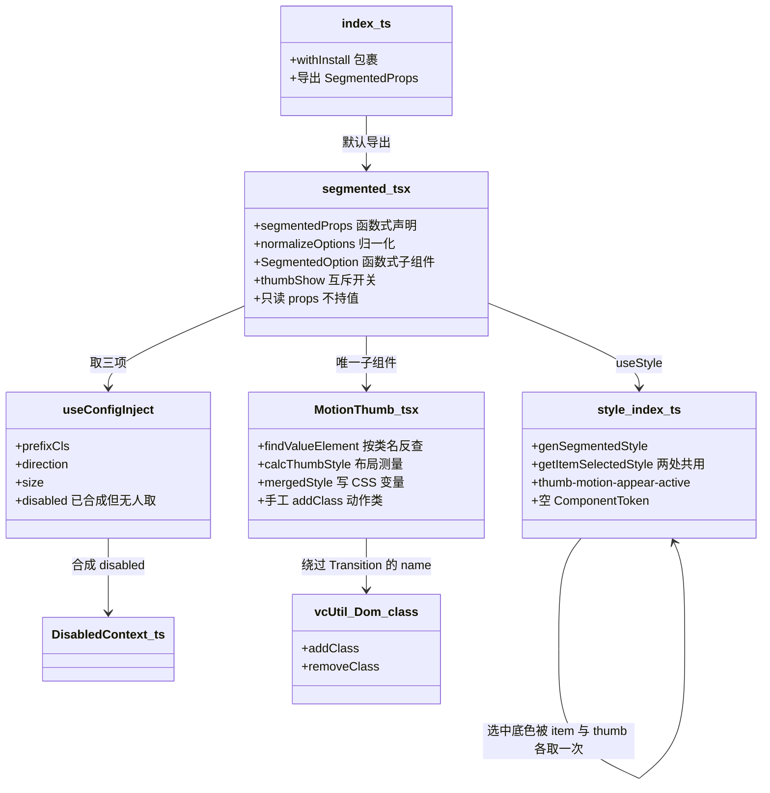
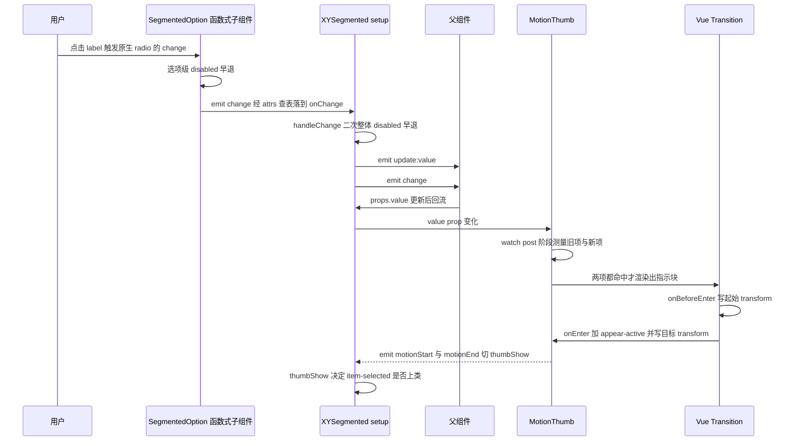
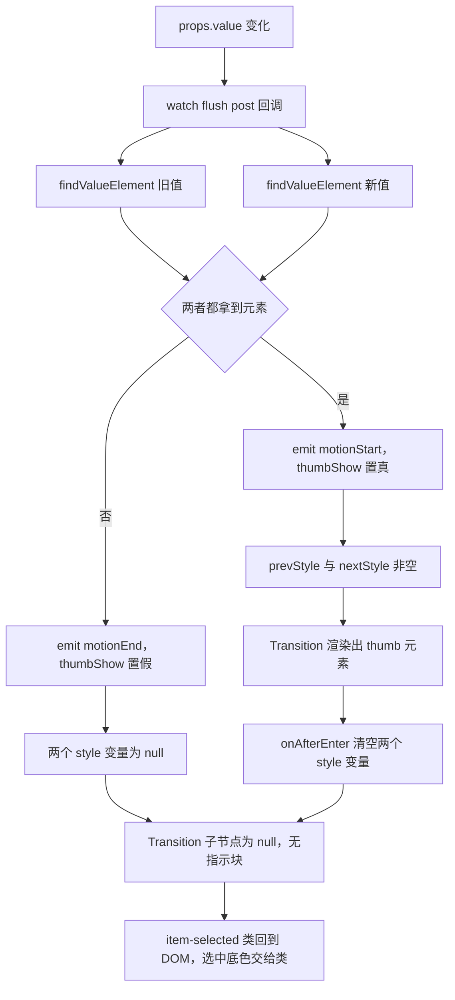
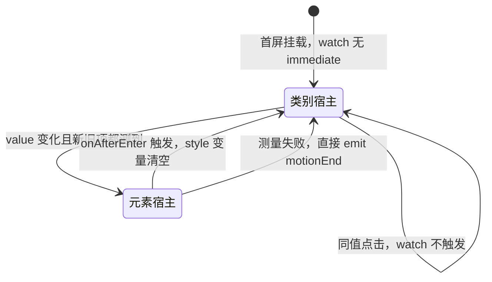

# C04-06 Segmented 分段选择

> **本篇解决**：`<xy-segmented>` 的选中块为什么会「跑位」——它的受控值、选项归一化与指示条位移三套状态如何交汇，以及 `required: true` 这条声明把它的受控模型推到了哪个极端。
> **前置**：C04-00 类横写：受控/非受控与 `useMergedState` 的一致实现　**读者坐标**：`03-components/04-form-controls` 第 6/10 篇

## 一、职责与边界

`XYSegmented` 负责把一组**互斥的、扁平的**视图选项渲染成一条可点击的胶囊带，并让「当前选中项」在视觉上以一块可位移的高亮底衬表达出来。它把「选中」表达成一个**连续动画**（底衬从旧项滑到新项），这是它与本类其它选择器最本质的差别，也是它全部复杂度的来源：整个目录只有 595 行，其中 162 行（`MotionThumb.tsx`）与 216 行（`style/index.ts`）几乎都在服务这一动画，真正的「选择」逻辑只有 189 行的 `segmented.tsx` 里的十来行（`packages/xiaoye-ui/src/segmented/src/segmented.tsx:127-134`、`packages/xiaoye-ui/src/segmented/src/MotionThumb.tsx:65-84`）。

它**不负责**的事，边界要说清：

- **不持有值**。组件没有内部值状态，`value` 被声明为 `required: true`（`packages/xiaoye-ui/src/segmented/src/segmented.tsx:47`），渲染与选中判定只读 `props.value`（同文件 `:158`、`:173`）。非受控用法在本组件不存在，这与本类其它控件的处境不同，见 C04-00 论点 1（本类零接入 `useMergedState`）；本篇只补一条该组件特有的事实：它是本类里把「必须受控」写进 props 声明的那个。
- **不做选项数据适配**。只认 `value`/`label`/`disabled`/`title`/`payload`/`className` 六个键（`packages/xiaoye-ui/src/segmented/src/segmented.tsx:13-25`），没有 `optionLabel`/`optionValue` 之类的字段映射，异构数据要调用方自己转换。
- **不做集合语义**。单选、无 `multiple`、无 `maxCount`，也不参与任何 Group 注册协议。
- **不接 Form 校验联动**。它不调用 `formItemContext.onFieldChange()`（该主题由 C04-00 论点 5 展开），也不消费 `DisabledContext`（本篇论点 5）。

**依赖清单**（全部为本仓源码，无 `vc-*` 厂商层，`OUTLINE.md` 的「底层」列给的就是 `—`）：`_util/classNames`、`_util/props-util` 的 `initDefaultProps`、`_util/type` 的 `booleanType`/`stringType`/`arrayType`/`someType`/`functionType`/`CustomSlotsType`/`anyType`、`_util/EventInterface` 的 `ChangeEvent`、`config-provider/hooks/useConfigInject`、`vc-util/Dom/class` 的 `addClass`/`removeClass`、组件自身的 `style`（`packages/xiaoye-ui/src/segmented/src/segmented.tsx:3-10`、`packages/xiaoye-ui/src/segmented/src/MotionThumb.tsx:1-5`）。被谁依赖：包根聚合入口 `packages/xiaoye-ui/src/components.ts:290-292` 与自动导入类型声明 `packages/xiaoye-ui/typings/global.d.ts:74`。

## 二、源码地图

| 文件 | 行数 | 职责 | 关键导出/符号 |
| --- | --- | --- | --- |
| `segmented/index.ts` | 6 | 包入口，套 `withInstall` | `default withInstall(Segmented)`（`:5`） |
| `segmented/src/index.ts` | 5 | 内部二级入口，只做转发 | `default Segmented`（`:5`） |
| `segmented/src/segmented.tsx` | 189 | 主实现：props、选项归一化、根渲染 | `segmentedProps`（`:40`）、`SegmentedValue`（`:11`）、`SegmentedOption` 函数式子组件（`:55`） |
| `segmented/src/MotionThumb.tsx` | 162 | 指示块的测量与位移动画 | `default MotionThumb`（`:162`）、`calcThumbStyle`（`:23`） |
| `segmented/style/index.ts` | 216 | CSS-in-JS 样式与 Token 派生 | `genComponentStyleHook('Segmented', …)`（`:194`） |
| `segmented/index.test.js` | 17 | 唯一测试文件 | 2 个 `it`，其中 1 个来自 `mountTest` |

主实现入口是 `packages/xiaoye-ui/src/segmented/src/segmented.tsx:111` 的 `defineComponent`，注册名 `XYSegmented`（同文件 `:112`）。

三点地图级的事实值得先钉住，因为它们决定了后面所有论证的读法：

1. **没有 `*Types.ts`，文件名也不合规**。props 与选项类型直接写在主文件里（`packages/xiaoye-ui/src/segmented/src/segmented.tsx:11-52`），与 `AGENTS.md` 规定的 `<component>Types.ts` 分离布局不一致；主文件名是小写的 `segmented.tsx`，模板要求的是 PascalCase 的 `<Component>.tsx`。这里要说准确：内层入口 `packages/xiaoye-ui/src/segmented/src/index.ts:1` 写的正是小写 `./segmented`，与实际文件名一致，所以**不构成**大小写解析隐患——它只是规范偏差，不是缺陷。真正需要留意的是另一件事：同一目录里 `MotionThumb.tsx` 用的是 PascalCase，`segmented.tsx` 用小写，一个组件目录内部就有两种命名法并存（`packages/xiaoye-ui/src/segmented/src/MotionThumb.tsx:1` 与 `packages/xiaoye-ui/src/segmented/src/segmented.tsx:1`）。
2. **两个 `index.ts` 是叠床架屋**。外层 `index.ts:1` 从 `./src` 取默认导出、`:5` 再包 `withInstall`；内层 `src/index.ts` 只做一次再导出（`:1`、`:5`）。`withInstall` 只在外层出现（`packages/xiaoye-ui/src/segmented/index.ts:3` 导入），所以任何直接引 `src/segmented/src` 的路径拿不到 `install` 方法。包根聚合走的是外层：`packages/xiaoye-ui/src/components.ts:290-292` 三行分别是 `export * from './segmented'`、`export { default as Segmented }`、`import './segmented/style'`（样式副作用），按需入口在 `packages/xiaoye-ui/package.json:459-463` 登记为 `./segmented` 与 `./segmented/style` 双入口。
3. **`MotionThumbInterface` 是死类型**。`packages/xiaoye-ui/src/segmented/src/MotionThumb.tsx:13-21` 导出了这个接口，但同文件的 `props` 声明（`:39-48`）用的是 `anyType` 逐项写死，两处字段靠人肉对齐；全仓再无该接口的引用点，父组件传参也不做类型约束（`packages/xiaoye-ui/src/segmented/src/segmented.tsx:155-168` 传的是 JSX 属性，`MotionThumb` 无 `emits` 之外的类型入口）。它是「类型面存在、实现面不消费」的第一个样本，论点 4 会给出同族的第二个、后果更严重的样本。

## 三、架构与数据流

### 图 1：静态结构——一个「选择」被拆成三个模块，测量与样式各占一半



这张图要读出三组不对称。第一组在 `segmented_tsx --> useConfigInject : 取三项` 这条边上：`useConfigInject` 已经把 `disabled` 合成好了（`packages/xiaoye-ui/src/config-provider/hooks/useConfigInject.ts:43` 定义、`:69` 返回），但主组件的解构只拿三件（`packages/xiaoye-ui/src/segmented/src/segmented.tsx:122`），于是 `size` 能沿 context 下来、`disabled` 不能——同一行的解构语句决定了两条通路一条通一条不通，这是论点 5 的全部依据。第二组在 `MotionThumb_tsx --> vcUtil_Dom_class` 这条边上：本仓已经有声明式的动效装配工具（`packages/xiaoye-ui/src/_util/transition.tsx:49` 用 `appearToClass` 把 `-appear` 与 `-appear-active` 交给 `Transition` 的 `name` 机制），而 `MotionThumb` 选择手工 `addClass`（`packages/xiaoye-ui/src/segmented/src/MotionThumb.tsx:112`），代价见论点 3。第三组是 `style_index_ts` 的自环：`getItemSelectedStyle` 这个函数被 `-item-selected`（`packages/xiaoye-ui/src/segmented/style/index.ts:89`）和 `-thumb`（同文件 `:138`）各调一次，选中底色因此存在两个 DOM 宿主，必须有互斥锁，这就是论点 1。

### 图 2：一次点击的完整闭环——值不在组件里走，必须出去一趟再回来



这条链上最值得盯的是「值必须出去一趟」：`emit('update:value')` 与 `emit('change')` 成对发出（`packages/xiaoye-ui/src/segmented/src/segmented.tsx:132-133`），组件内部**没有任何一行代码**把新值写回可渲染的状态——`thumbShow` 只管样式互斥（同文件 `:125`），`rootRef` 只作测量基准（`:124`、`:152`）。因此父组件若不接 `update:value`，点击的结果是「事件发了、界面不动」，指示块与 `-item-selected` 都保持原样。另一个断点是 `OP->>SG` 那一跳：`SegmentedOption` 是函数式组件且没有 `props`/`emits` 声明（`packages/xiaoye-ui/src/segmented/src/segmented.tsx:55-61`），`emit('change', event, value)`（`:77`）能不能落到父组件的 `handleChange`，取决于运行时的 attrs 查表，不取决于任何编译期约束——论点 6 会说明这种「隐式接线」如何反过来变成覆写入口。

### 图 3：指示块到底存不存在——一条四分支的判定链



关键在最后两条边：`onAfterEnter` 会把 `prevStyle`/`nextStyle` 双双置回 `null`（`packages/xiaoye-ui/src/segmented/src/MotionThumb.tsx:119-120`），而渲染函数只要这两个变量有一个为 `null` 就返回 `null` 子节点（同文件 `:156`）。也就是说**指示块是一个只在动画期间存在的一次性元素**，静止态下 DOM 里根本没有它，选中底色完全由 `-item-selected` 类承担（`packages/xiaoye-ui/src/segmented/src/segmented.tsx:177-178`）。这一点决定了整篇的读法：如果你以为「选中块」是一直在那儿滑动的，就会把所有走位问题都归因于动画时长，而真正常见的病因是「测量拿到了 `null`，指示块压根没渲染」。测量拿 `null` 的条件写在 `findValueElement` 里：`getValueIndex` 返回 `-1`（`packages/xiaoye-ui/src/segmented/src/segmented.tsx:161` 用严格 `===` 比较，字符串值对数字选项必然失配）或者元素的 `offsetParent` 为空（同文件 `MotionThumb.tsx:59`，容器被 `display: none` 隐藏时命中），两种情况都走 G 分支。

### 图 4：选中底色的交接时序——类与元素两个宿主之间的接力



`[*] --> 类别宿主` 这一条值得单独强调：`watch` 没有 `immediate: true`（`packages/xiaoye-ui/src/segmented/src/MotionThumb.tsx:65-84` 整块无 `immediate` 选项），首屏 `prevStyle`/`nextStyle` 都是初始 `null`（同文件 `:62-63`），所以**首屏不可能出现指示块**，`Transition` 上的 `appear` 属性也就没有可作用的节点。这条事实能解释一类「刷新后不滑动、点击后才正常」的现象，且它和测试的观察面正好相反——测试断言的正是类别宿主（`packages/xiaoye-ui/src/segmented/index.test.js:15` 查 `.xy-segmented-item-selected`）。

## 四、核心机制精读

### 论点 1：选中底色有两个 DOM 宿主，`thumbShow` 是它们之间的互斥锁；静止态里指示块根本不存在

断言：`XYSegmented` 的「选中」外观不是一套样式，而是两套——静止时由 `.xy-segmented-item-selected` 类画在 `<label>` 上，动画时由一个 `.xy-segmented-thumb` 绝对定位元素画；两者共用同一条样式函数，因此必须靠 `thumbShow` 保证同一时刻只有一个生效，而 `thumbShow` 的开合完全由 `MotionThumb` 的测量结果决定。

证据一，两个宿主的类名与样式都来自同一次函数调用：

```tsx
// packages/xiaoye-ui/src/segmented/src/segmented.tsx:169
            {segmentedOptions.value.map(segmentedOption => (
              <SegmentedOption
                key={segmentedOption.value}
                prefixCls={pre}
                checked={segmentedOption.value === props.value}
                onChange={handleChange}
                {...segmentedOption}
                className={classNames(segmentedOption.className, `${pre}-item`, {
                  [`${pre}-item-selected`]:
                    segmentedOption.value === props.value && !thumbShow.value,
                })}
                disabled={!!props.disabled || !!segmentedOption.disabled}
                v-slots={slots}
              />
            ))}
```

`checked` 属性（`:173`）只看 `props.value`，`-item-selected` 类（`:177-178`）却多看一个 `!thumbShow.value`。这一处「同一判定写两遍、其中一遍加锁」的结构就是本组件最容易读漏的地方：DOM 上 `<input>` 的 `checked` 是真值来源，`-item-selected` 只是它的样式投影，而这个投影在动画期间被故意关掉。关掉之后画面上仍然有底色，是因为 `MotionThumb` 的 thumb 元素顶上来了（`packages/xiaoye-ui/src/segmented/src/segmented.tsx:155-168`）。

证据二，两个宿主的样式确实同源。`-item-selected` 与 `-thumb` 都展开同一个 `getItemSelectedStyle`：

```ts
// packages/xiaoye-ui/src/segmented/style/index.ts:88
        '&-selected': {
          ...getItemSelectedStyle(token),
          color: token.labelColorHover,
        },
```

而 `packages/xiaoye-ui/src/segmented/style/index.ts:137-138` 的 `-thumb` 同样以 `...getItemSelectedStyle(token)` 开头（同文件 `:29-34` 是被两处共用的那个函数体，只含 `backgroundColor` 与 `boxShadow` 两行）。样式层还用一条兄弟选择器把动画期间的 hover 底色压掉：`packages/xiaoye-ui/src/segmented/style/index.ts:148-151` 在 `-thumb` 内部写了 `& ~ ${componentCls}-item:not(...-selected):not(...-disabled)::after { backgroundColor: 'transparent' }`。注意这条规则只在 thumb 元素**存在于 DOM 时**才可能命中——这与论点 1 前半句自洽：thumb 存在 ⟺ 正在动画。

证据三，thumb 是一次性元素，动画结束即销毁：

```tsx
// packages/xiaoye-ui/src/segmented/src/MotionThumb.tsx:118
    const onAppearEnd: TransitionProps['onAfterEnter'] = (el: HTMLDivElement) => {
      prevStyle.value = null;
      nextStyle.value = null;
      if (el) {
        el.style.transform = null;
        el.style.width = null;
        removeClass(el, `${props.motionName}-appear-active`);
      }
      emit('motionEnd');
    };
```

`prevStyle`/`nextStyle` 一旦归零，渲染函数 `!prevStyle.value || !nextStyle.value ? null : <div {...motionProps}></div>`（`packages/xiaoye-ui/src/segmented/src/MotionThumb.tsx:156`）就把子节点摘掉，`emit('motionEnd')`（同文件 `:126`）回到父组件把 `thumbShow` 置假（`packages/xiaoye-ui/src/segmented/src/segmented.tsx:165-167`），`-item-selected` 于是重新上类。整条交接链闭合。

结论回扣：这个设计换来的是「选中块滑过去」的观感，赔上的是三条推理成本——(a) 你在 DOM 里看不到静止的选中块，用元素去查「当前选中项」的调试手法会失败，只能查类名；(b) 锁的状态不由组件掌控，而由 `MotionThumb` 能否测到两个元素决定（论点 2），所以一次布局测量失败会让 `thumbShow` 停在假，画面表现为「没有动画但有正确高亮」，属于无害降级；(c) 反过来，若 `onAfterEnter` 因为动画被系统降级（`prefers-reduced-motion`）而不按预期时机触发，`thumbShow` 就有一段时间停在真，此时**新旧两项都没有 `-item-selected`**，画面会出现「一秒内没有任何选中底色」的空窗。第三条的后半句是推断，源码里能钉住的只有事实：`thumbShow` 为真时新项一定没有 `-item-selected` 类（`packages/xiaoye-ui/src/segmented/src/segmented.tsx:177-178`），且该标志只由 `onMotionStart`/`onMotionEnd` 两个回调改写（同文件 `:162-167`），没有超时兜底。

### 论点 2：指示块的位置不是样式算出来的，是「按类名反查 DOM + 数组下标」测出来的，测量基准完全由 CSS 单方面担保

断言：`MotionThumb` 与渲染层之间没有任何声明式契约，它靠一个字符串拼出来的类名选择器去查已渲染的元素，再用数组下标去取第 N 个结果。这条链上任何一环——类名、渲染顺序、`offsetParent` 链——由 CSS 或调用方数据决定，代码不作校验，也不重测。

第一步是「值 → 下标」，由父组件注入一个查询函数：

```tsx
// packages/xiaoye-ui/src/segmented/src/segmented.tsx:155
            <MotionThumb
              containerRef={rootRef}
              prefixCls={pre}
              value={props.value}
              motionName={`${pre}-${props.motionName}`}
              direction={direction.value}
              getValueIndex={val => segmentedOptions.value.findIndex(n => n.value === val)}
```

`findIndex(n => n.value === val)` 用的是严格相等（`packages/xiaoye-ui/src/segmented/src/segmented.tsx:161`），而选中判定用的也是严格相等（同文件 `:173`），两处逻辑同源。这里埋着本组件最高频的走位成因：`normalizeOptions` 对原始值只做**标签**的字符串化，**值保持原类型**——`label: option?.toString()` 与 `value: option as unknown as SegmentedBaseOption['value']` 写在同一返回对象里（`packages/xiaoye-ui/src/segmented/src/segmented.tsx:33-37`）。所以 `:options="[1, 2, 3]"` 配 `value="2"`（典型来源是路由 query、`<input>` 的值、后端 JSON 里被序列化成字符串的枚举）会得到：没有任何一项 `=== ` 成立 → 没有 `-item-selected` 类、`findIndex` 返回 `-1`、动画也不触发，而 `value` 的声明是 `someType([String, Number])`（同文件 `:47`），运行时两种类型都合法，**控制台一声不响**。

第二步是「下标 → 元素」，选择器是拼出来的：

```tsx
// packages/xiaoye-ui/src/segmented/src/MotionThumb.tsx:53
    const findValueElement = (val: SegmentedValue) => {
      const index = props.getValueIndex(val);

      const ele = props.containerRef.value?.querySelectorAll<HTMLDivElement>(
        `.${props.prefixCls}-item`,
      )[index];
      return ele?.offsetParent && ele;
    };
```

三个脆弱点都在这一段。其一，字符串 `.${props.prefixCls}-item`（`:57`）与渲染层写类的表达式 `${pre}-item`（`packages/xiaoye-ui/src/segmented/src/segmented.tsx:176`）是**两个文件里的手写副本**，靠 `prefixCls` 这个 prop 传参对齐（同文件 `:157`）；任何人改其中一处拼法（例如把 item 类改成 `-cell`），TypeScript 与测试都不会报错，表现是「动画从此不出现」。其二，`querySelectorAll(...)[index]` 假定 NodeList 的文档顺序与 `segmentedOptions` 数组顺序一致；当前实现成立，因为渲染就是同一个 `map`（`packages/xiaoye-ui/src/segmented/src/segmented.tsx:169`），且 thumb 元素自己不带 `-item` 类（`packages/xiaoye-ui/src/segmented/src/MotionThumb.tsx:142` 只给 `${props.prefixCls}-thumb`）因而不会污染 NodeList——这两条是隐式约定，改动 `map` 结构（比如加分组标题、加分隔线元素并复用 `-item` 类）会静默错位。其三，`:59` 用 `offsetParent` 兼作可见性探针：容器被 `display: none` 藏着（未激活的 tab 面板、折叠的 `collapse-panel`）时 `offsetParent` 为 `null`，于是返回假值，`calcThumbStyle` 拿到 `null` 后返回 `null`（同文件 `:23-33`），`watch` 回调因此走 `emit('motionEnd')` 分支（`:79-81`）。

第三步是「元素 → 矩形」，坐标系在这里与 CSS 焊死：

```ts
// packages/xiaoye-ui/src/segmented/src/MotionThumb.tsx:23
const calcThumbStyle = (targetElement: HTMLElement | null | undefined): ThumbRect =>
  targetElement
    ? {
        left: targetElement.offsetLeft,
        right:
          (targetElement.parentElement!.clientWidth as number) -
          targetElement.clientWidth -
          targetElement.offsetLeft,
        width: targetElement.clientWidth,
      }
    : null;
```

`offsetLeft` 的参照物是 `offsetParent`（最近的定位祖先），而 `parentElement.clientWidth` 的参照物是 DOM 父节点。两者只有在「items 的直接父节点恰好就是最近的定位祖先」时才等价——这个前提由样式表的一行 `position: relative` 提供（`packages/xiaoye-ui/src/segmented/style/index.ts:58`，选择器是 `-group`），而 thumb 自身的落位用 `inset-inline-start: 0` 的绝对定位（同文件 `:140-142`）与它相配。谁也没保证这条前提：主题覆盖、用户全局样式、或 `-group` 上再加一个 `transform`/`filter` 都可能改变 offset 参照链，结果是 `left` 与 `width` 来自不同坐标系，指示块整体平移或尺寸偏差。

还有一条与「测一次就够」相关的：`watch` 的唯一来源是 `() => props.value`（`packages/xiaoye-ui/src/segmented/src/MotionThumb.tsx:66`），目录内没有任何 ResizeObserver 或尺寸订阅（`grep -rn -e ResizeObserver -e resize-observer packages/xiaoye-ui/src/segmented/` 零命中），而本仓其实有这个标准件（`packages/xiaoye-ui/src/_util/hooks/_vueuse/useResizeObserver.ts`，被 `tabs`、`vc-overflow`、`vc-table` 使用）。后果是：字体异步加载完成、容器宽度被 flex 重新分配、`block` 模式下父容器变宽（`packages/xiaoye-ui/src/segmented/style/index.ts:75-78` 让 item `flex: 1`）之后，**下一次动画用的仍然是刚测的新值**——这一句要精确：因为测的是变化发生之后的 `flush: 'post'` 阶段（`packages/xiaoye-ui/src/segmented/src/MotionThumb.tsx:83`），所以下一次动画通常自愈；不自愈的是「上一次动画的 `onEnter` 宏任务里读到的仍是旧宽度」这种在动画过程中改容器宽度的场景，此时 thumb 会滑到一个过期位置，再由 `onAfterEnter` 的清空把类宿主交回来（同文件 `:118-127`），视觉上就是「闪一下然后高亮跳到正确项」。

RTL 分支说明一下坐标模型的另一半：`right` 字段只在 `direction === 'rtl'` 时被消费，且要取负（`packages/xiaoye-ui/src/segmented/src/MotionThumb.tsx:86-95`），`direction` 来自 `useConfigInject`（`packages/xiaoye-ui/src/segmented/src/segmented.tsx:122`）并一路透传到 `-rtl` 类（同文件 `:148`）与样式规则（`packages/xiaoye-ui/src/segmented/style/index.ts:66-68`）。`right` 的计算式（同文件 `MotionThumb.tsx:28-30`）是 `parentWidth - itemWidth - itemLeft`，即「元素右边缘到容器左偏移的反向量」，取负后配合 RTL 下 `inset-inline-start` 自动翻转成 `right: 0`（`packages/xiaoye-ui/src/segmented/style/index.ts:142`）实现镜像位移。

### 论点 3：动画靠「CSS 自定义属性 + 两个宏任务提交 + 手工加类」三件套驱动，`motionName` 是一个只能把它改坏的开关

断言：位移本身不是 Vue 的过渡类做的，也不是 CSS keyframes 做的，而是把测量结果写成四个自定义属性，再用命令式 `style` 写一句引用这些属性的 `transform`，靠「起始值在一个 task 提交、目标值与 `transition` 属性在下一个 task 提交」来触发浏览器补间。三件套里任何一件脱离默认配置都会静默失效，而 `motionName` 正是那个脱离入口。

先看介质。四个变量由一个 computed 绑定到元素的内联 `style`：

```ts
// packages/xiaoye-ui/src/segmented/src/MotionThumb.tsx:128
    const mergedStyle = computed<CSSProperties>(() => ({
      '--thumb-start-left': thumbStart.value,
      '--thumb-start-width': toPX(prevStyle.value?.width),
      '--thumb-active-left': thumbActive.value,
      '--thumb-active-width': toPX(nextStyle.value?.width),
    }));
```

`toPX` 对 `undefined` 返回 `undefined`（`packages/xiaoye-ui/src/segmented/src/MotionThumb.tsx:35`），Vue 会跳过值为 `undefined` 的样式键，于是 `var(--thumb-start-left)` 就成了无兜底的引用（同文件 `:103` 写的是 `translateX(var(--thumb-start-left))`，括号里没有第二个参数）。当前这条路径不可达，因为渲染守卫要求 `prevStyle` 与 `nextStyle` 同时非空（同文件 `:156`）——请把这个「不可达」当作约束来读：一旦有人把守卫放宽成「只要 next 存在就渲染」，得到的不是报错，而是一个停在 `inset-inline-start: 0`、`width: 0` 的隐形块（`packages/xiaoye-ui/src/segmented/style/index.ts:140-143`），即「动画看起来没了，但 DOM 里多了个元素」这类最难查的中间态。

再看两个 task 的提交节奏：

```tsx
// packages/xiaoye-ui/src/segmented/src/MotionThumb.tsx:99
    const onAppearStart: TransitionProps['onBeforeEnter'] = (el: HTMLDivElement) => {
      clearTimeout(timeid);
      nextTick(() => {
        if (el) {
          el.style.transform = `translateX(var(--thumb-start-left))`;
          el.style.width = `var(--thumb-start-width)`;
        }
      });
    };

    const onAppearActive: TransitionProps['onEnter'] = (el: HTMLDivElement) => {
      timeid = setTimeout(() => {
        if (el) {
          addClass(el, `${props.motionName}-appear-active`);
          el.style.transform = `translateX(var(--thumb-active-left))`;
          el.style.width = `var(--thumb-active-width)`;
        }
      });
    };
```

起始值写在 `nextTick` 的微任务里（`:101-105`），目标值与那个带 `transition` 的类写在 `setTimeout` 的宏任务里（`:110-115`），两者之间隔过一次宏任务边界，这是浏览器能产生补间的唯一原因；`setTimeout` 的第二个参数被省略（`:110`），即 0 毫秒，只保证「排在下一个 task」。同一批代码里还有第三处时序依赖：`clearTimeout(timeid)` 出现在起始钩子（`:100`）与 `onBeforeUnmount`（`:134-136`），说明作者知道卸载时可能仍有排队的宏任务——`timeid` 是 `setup` 内的局部变量（`:98`），所以这个清理是按实例的，没有 SSR/多实例共享问题，这一条与 DISPATCH 缺陷族清单里的「模块级可变全局量」不同型，值得记下：本组件不犯那个错。

第三件套是手工加类，而它只与**一条**样式规则对得上：

```ts
// packages/xiaoye-ui/src/segmented/style/index.ts:185
      [`${componentCls}-thumb-motion-appear-active`]: {
        transition: `transform ${token.motionDurationSlow} ${token.motionEaseInOut}, width ${token.motionDurationSlow} ${token.motionEaseInOut}`,
        willChange: 'transform, width',
      },
```

规则名里的 `thumb-motion` 是字面量（`packages/xiaoye-ui/src/segmented/style/index.ts:185`），而运行时加上的类名来自 `${props.motionName}-appear-active`（`packages/xiaoye-ui/src/segmented/src/MotionThumb.tsx:112`），`props.motionName` 又由父组件拼成 `` `${pre}-${props.motionName}` ``（`packages/xiaoye-ui/src/segmented/src/segmented.tsx:159`），其中 `props.motionName` 的默认值是 `'thumb-motion'`（同文件 `:116`）。四段字符串接力，**只有第一段能由用户改**。于是 `motionName` 这个 prop 的实际语义是：改了就等于关掉动画——新类名在样式表里查无规则。全仓 `thumb-motion` 字样只有两处，即上面这条样式规则与 `:116` 的默认值（`grep -rn -e thumb-motion packages apps` 可复现，产物目录除外），既没有 `-appear`、也没有 `-appear-from`/`-appear-to`，`transition` 属性因此无处可来，指示块直接落到终点；想「换个动画」必须自带 CSS。更反直觉的是双重前缀：用户若照渲染结果去传 `motionName="xy-segmented-thumb-motion"`，`:159` 会再叠一次前缀，得到 `xy-segmented-xy-segmented-thumb-motion-appear-active`。而 `apps/docs/components/segmented.md:64-69` 的 API 表里**根本没有 `motionName` 这一行**（只列 `block`、`disabled`、`options`、`size`、`value`、`label` 插槽），所以这个 prop 是「实现里可读、文档里不存在、改了会坏」的三合一。

对照本仓自己的做法：`packages/xiaoye-ui/src/_util/transition.tsx:49` 提供的 `getTransitionProps` 会把 `appearToClass` 声明成 `${transitionName}-appear ${transitionName}-appear-active`，交给 `<Transition>` 的 `name` 机制去加类；而 `MotionThumb` 用的是不带 `name` 的 `<Transition appear>` 加三个显式钩子（`packages/xiaoye-ui/src/segmented/src/MotionThumb.tsx:150-155`），类名自己加、变量自己写、定时器自己清。绕开标准件的净收益是能精确控制「起始矩形」这一件事（标准件只会加类，不会写 `var()`），净成本是上面那四条字符串接力的脆弱性。

最后一条与「重跑」有关：enter 钩子只在元素插入时运行，而 thumb 元素没有 `key`（`packages/xiaoye-ui/src/segmented/src/MotionThumb.tsx:139-143` 的 `motionProps` 只有 `ref`/`style`/`class` 三键）。动画进行中若 `value` 再次变化，`watch` 会把 `prevStyle`/`nextStyle` 写成新矩形（同文件 `:74-75`），元素已存在故不重跑钩子，此时**画面靠 CSS 变量重解析来挪动**（`:113` 写进去的是 `var()` 引用而非具体数值，改 `--thumb-active-left` 就等于改终点），而第一段动画的 `onAfterEnter` 仍会在它自己的时刻到来，把两个 style 变量清空（`:119-120`）并摘掉元素。这条链的每一环都有行号可查，合起来的观感是「连点两次时动画半途消失、高亮直接落位」。

### 论点 4：`value` 被声明成 `required`，本组件因此把「非受控」这条腿直接锯掉；配套的隐式事件接线只在运行时成立

断言：`XYSegmented` 不做受控/非受控双轨，它把「必须受控」写进了 props 声明。这不是风格选择而是可验证的事实——props 表里 `value` 是唯一带 `required` 的项，而 props 表里**没有 `defaultValue`**，`setup` 里**没有 ref 值**，全目录**没有 `useMergedState`**。

```ts
// packages/xiaoye-ui/src/segmented/src/segmented.tsx:40
export const segmentedProps = () => {
  return {
    prefixCls: String,
    options: arrayType<(SegmentedOption | string | number)[]>(),
    block: booleanType(),
    disabled: booleanType(),
    size: stringType<segmentedSize>(),
    value: { ...someType<SegmentedValue>([String, Number]), required: true },
    motionName: String,
    onChange: functionType<(val: SegmentedValue) => void>(),
    'onUpdate:value': functionType<(val: SegmentedValue) => void>(),
  };
};
```

「唯一」这个说法是可复现的：`grep -rn "required: true" packages/xiaoye-ui/src/{input,input-number,checkbox,radio,switch,segmented,slider,rate,color-picker}` 只命中上面这一行（`packages/xiaoye-ui/src/segmented/src/segmented.tsx:47`）。`Segmented` 没有内部值、也没有受控/非受控判定，`setup` 里读到的 `props.*` 只有 `options`、`disabled`、`block`、`value`、`motionName` 五项（`packages/xiaoye-ui/src/segmented/src/segmented.tsx:127-180`），渲染出口 `value={props.value}`（`:158`）与 `checked={... === props.value}`（`:173`）都直接指向 props。受 C04-00 论点 1 约束，本篇不重复展开本类受控拼法的分裂，只登记这一种极端形态：**它连「不传 value 也能用」这条退路都在声明层面堵死了**。后果分两层——不传 `value` 时 Vue 会给一条 missing required prop 警告，而 `apps/docs/examples/segmented/basic.vue:2` 之类写法（`v-model:value`）之所以必须，是因为除了把值更新回 props，组件没有任何自我纠正能力（`:132` 只 `emit`，不写回）。

第二层更隐蔽：`:49` 与 `:50` 这两个函数 props 在 `setup` 里一次都没被读取，`grep -n "props\.[a-zA-Z]*"` 的结果（`packages/xiaoye-ui/src/segmented/src/segmented.tsx:127-180` 之间）不含 `onChange` 与 `onUpdate:value`。**但这不是「API 面存活、实现死亡」**，恰恰相反，它们是实现的关键：`defineComponent` 的选项里没有 `emits`（同文件 `:111-121` 整块无 `emits` 键），`emit('change', val)`（`:133`）在运行时要靠事件名反查 props 表里的 `onChange` 才能落到调用方。也就是说 `:49-50` 两行的作用是**给 `emit` 铺一张可查的表**，删掉它们会静默断链——这类「看起来没人读、其实被反射机制读」的声明，是本项目最容易在清理时被误删的形态。同目录里另一处事件接线走得更远：`SegmentedOption` 是函数式组件，没有 `props` 也没有 `emits` 声明（`packages/xiaoye-ui/src/segmented/src/segmented.tsx:55-61`），它的 `emit('change', event, value)`（`:77`）要能落到父级传入的 `onChange={handleChange}`（`:174`），中间两跳全靠运行时查表，编译期零约束。

顺带记录 payload 形状在中间被**改写**过一次：函数式子组件发的是「原生事件 + 值」两个参数（`:77`），父级 `handleChange` 的第一形参命名为 `_event` 并整个丢弃（`:128`），对外只 `emit('change', val)`（`:133`）——这与 `apps/docs/components/segmented.md:75` 声明的 `function(value)` 一致，但内部签名 `(_event: ChangeEvent, val: SegmentedValue)`（`:128`）与子组件 `(_event: ChangeEvent, val: SegmentedValue) => void`（`:59`）是同一份逻辑的手写两遍，改其中一处形状要记得同步另一处，否则 `_event` 会接到值、`val` 接到 `undefined`。

`MotionThumb` 侧的 props 声明是另一个极端，七项全部用 `anyType`：

```ts
// packages/xiaoye-ui/src/segmented/src/MotionThumb.tsx:39
  props: {
    value: anyType<SegmentedValue>(),
    getValueIndex: anyType<(value: SegmentedValue) => number>(),
    prefixCls: anyType<string>(),
    motionName: anyType<string>(),
    onMotionStart: anyType<VoidFunction>(),
    onMotionEnd: anyType<VoidFunction>(),
    direction: anyType<'ltr' | 'rtl'>(),
    containerRef: anyType<Ref<HTMLDivElement>>(),
  },
```

`anyType` 的实现是 `{ validator: () => true, default }`（`packages/xiaoye-ui/src/_util/type.ts:66-67`），一个恒真的 validator 等于**关掉运行时校验**；而它的第二个形参 `required`（同文件 `:66`）在这七个 props 里一个都没传，所以 `getValueIndex` 这类**必须存在否则整条测量链抛错**的函数也没有必填保护——调用点 `props.getValueIndex(val)`（`packages/xiaoye-ui/src/segmented/src/MotionThumb.tsx:54`）是裸调用，缺失时在 `watch` 回调里炸，报错栈落在渲染阶段而不是「缺 prop」那条清晰的开发期警告上。同目录里 `emits` 的写法也分裂：`MotionThumb` 声明了 `emits: ['motionStart', 'motionEnd']`（`:49`），主组件一个都没有（`segmented.tsx:111-121`）。

还有两处只写不读的内部状态，属于缺陷族清单里的第三型，本篇如实登记：`thumbRef` 在 `MotionThumb.tsx:51` 创建、在 `:140` 挂到元素上，之后**再无任何读取**（`grep -n "thumbRef"` 只命中这两行）；`segmented.tsx:124` 的 `rootRef` 则是真被消费——既作 `ref={rootRef}`（`:152`）又作为 `containerRef` 传给测量（`:156`）。前者是重构残留，删除无行为影响；后者不能删。这两个同名不同命的 ref 恰好说明「看见 ref 就删」和「看见没人读的 props 就删」同样是危险动作。

### 论点 5：`size` 有 prop 与 context 两条通路且都通，`disabled` 只有 prop 一条——分岔点就是 `setup` 第一行的解构列表

断言：`useConfigInject` 已经把 `disabled` 与 `size` 一样合成好了并一起返回，`XYSegmented` 只解构了三件，于是 `<xy-form disabled>` 与 `<xy-config-provider :disabled>` 对它完全无效；同一段代码里 `size` 却同时吃 prop 和 context。这是「同一组件、两个语义、两条通路、一条断路」的教科书样本。

合成端与解构端各看一遍。合成端：

```ts
// packages/xiaoye-ui/src/config-provider/hooks/useConfigInject.ts:39
  const size = computed(() => (props.size as SizeType) || sizeContext.value);
  const autocomplete = computed(
    () => props.autocomplete ?? configProvider.input?.value?.autocomplete,
  );
  const disabled = computed<boolean>(() => props.disabled ?? disabledContext.value);
// ...
  return {
    configProvider,
    prefixCls,
    direction,
    size,
```

`size` 在 `:39` 合成、`:54` 返回，`disabled` 在 `:43` 合成、`:69` 返回，两者的地位在返回对象里完全对称。解构端：

```tsx
// packages/xiaoye-ui/src/segmented/src/segmented.tsx:121
    setup(props, { emit, slots, attrs }) {
      const { prefixCls, direction, size } = useConfigInject('segmented', props);
      const [wrapSSR, hashId] = useStyle(prefixCls);
      const rootRef = shallowRef<HTMLDivElement>();
      const thumbShow = shallowRef(false);

      const segmentedOptions = computed(() => normalizeOptions(props.options));
      const handleChange = (_event: ChangeEvent, val: SegmentedValue) => {
        if (props.disabled) {
          return;
        }
        emit('update:value', val);
        emit('change', val);
      };
```

`packages/xiaoye-ui/src/segmented/src/segmented.tsx:122` 这一行是全篇改动成本最低、后果最直接的一行：`size` 在里面，所以样式分支 `${pre}-lg` / `${pre}-sm` 用的是 `size.value`（同文件 `:146-147`），ConfigProvider 或 `<xy-form>` 层的尺寸能落下来；`disabled` 不在里面，于是所有禁用判定都改读 `props.disabled`——根类 `${pre}-disabled`（`:145`）、点击守卫 `if (props.disabled) return`（`:129-131`）、选项级合并 `disabled={!!props.disabled || !!segmentedOption.disabled}`（`:180`）。第三条要特别看清楚：它把「整体禁用」与「单项禁用」做了或运算，说明作者在**这个表达式上是愿意多写一层的**，只是最外层的整体禁用没有把 context 纳进来。`SegmentedOption` 内部再把 `disabled` 落到 `<input disabled>`（`:92`）与 `${prefixCls}-item-disabled` 类（`:84`），并在 `handleChange` 里做第二次早退（`:73-75`）。也就是说禁用逻辑本身写了两道闸，只是两道闸的输入源都只有 props。

禁用上下文的供给端是确实存在的：`packages/xiaoye-ui/src/config-provider/DisabledContext.ts:10` 定义 `useProviderDisabled`（`:11` 先读父级、`:14` 用 `computed(() => disabled.value ?? parentDisabled.value)` 做链式合并），`packages/xiaoye-ui/src/form/Form.tsx:142` 与 `packages/xiaoye-ui/src/config-provider/index.tsx:218` 各调用一次，`packages/xiaoye-ui/src/form/Form.tsx:69` 就是 `<xy-form disabled>` 的 prop 声明。仓库里对这个值有三种消费姿势，可以当口径记住：**解构走 `useConfigInject` 的合成值**（正确、最省，`packages/xiaoye-ui/src/radio/Radio.tsx:62`、`packages/xiaoye-ui/src/input-number/index.tsx:66`、`packages/xiaoye-ui/src/checkbox/Checkbox.tsx:36`、`packages/xiaoye-ui/src/upload/Upload.tsx:42`、`packages/xiaoye-ui/src/chips/Chips.tsx:26`）、**绕过合成自己再注入一次**（`packages/xiaoye-ui/src/switch/index.tsx:82` 注入、`:83` 手写 `mergedDisabled`，而它同样在 `:109` 调了 `useConfigInject` 却只取三件）、**完全不接**（本组件 `:122`）。本组件的新增信息只有「`:122` 加一个词即修好」这一句。

禁用之外还有一条同族的通路缺失：本组件不注入 FormItem 上下文。`packages/xiaoye-ui/src/switch/index.tsx:81` 有 `useInjectFormItemContext()`，而 `grep -rn -e formItemContext -e onFieldChange packages/xiaoye-ui/src/segmented/` 零命中，即 `Segmented` 属于 C04-00 论点 5 里点名的那类「与 Form 零耦合」控件——它在 `<xy-form>` 里能被校验器读到值（因为值在调用方），但改了值不会触发 `validateTrigger` 联动。

### 论点 6：选项对象是「被展开成 props 的数据」，于是它同时是内容源与覆写入口；`#label` 插槽只是解构默认值，对字符串选项永不生效

断言：`segmented.tsx` 把用户数据直接 `{...segmentedOption}` 展开进 JSX，而这行写在三个关键显式属性**之后**，构成缺陷族里的「JSX 属性顺序覆盖」；同一个元素里因此并存三种顺序策略。另一半是插槽：`#label` 的实现形式是解构默认值，而归一化函数会替所有原始值填上 `label`，两者相加得到「插槽对字符串/数字选项静默失效」。

先看归一化端，它决定了 props 包里会出现什么键：

```ts
// packages/xiaoye-ui/src/segmented/src/segmented.tsx:27
function normalizeOptions(options: (SegmentedOption | string | number)[]) {
  return options.map(option => {
    if (typeof option === 'object' && option !== null) {
      return option;
    }

    return {
      label: option?.toString(),
      title: option?.toString(),
      value: option as unknown as SegmentedBaseOption['value'],
    };
  });
}
```

对象选项**原样返回**（`:29-31`），不做白名单裁剪；原始值选项才走 `:33-37` 的构造，且这里已经写定了「`label` 一定非空」——这就是插槽失效的前半因。后半因在子组件的解构里：

```tsx
// packages/xiaoye-ui/src/segmented/src/segmented.tsx:61
> = (props, { slots, emit }) => {
  const {
    value,
    disabled,
    payload,
    title,
    prefixCls,
    label = slots.label,
    checked,
    className,
  } = props;
  const handleChange = (event: InputEvent) => {
    if (disabled) {
      return;
    }

    emit('change', event, value);
  };
```

`label = slots.label`（`:68`）是解构默认值，只在 `props.label === undefined` 时生效。把两段合起来读：传 `:options="['Daily','Weekly']"` 时每项都被 `:34` 填了字符串 `label`，`:175` 把它展开成 props，`:68` 的默认值路径**永不进入**，`<template #label>` 里的内容一行都不会执行；只有对象选项且**不写 `label` 键**时插槽才活。官方示例恰好全是后者（`apps/docs/examples/segmented/custom.vue:35-57` 的每一项只有 `value` 与 `payload`），所以文档看不出这条限制。同一段里还有一处不对称：`:96` 的 `title={typeof title === 'string' ? title : ''}` 意味着原始值选项有原生悬浮提示（`:35` 填过 `title`），而只写 `label` 的对象选项没有——同一份数据两种体验，文档 `apps/docs/components/segmented.md:69` 只说了插槽、没提这两条边界。

回到覆写入口。`SegmentedOption` 是函数式组件，第一个形参就是全部传入的属性包（`:61` 只从上下文取 `slots`/`emit`，体内没有任何 attrs 展开），而父级的写法是：

```tsx
// packages/xiaoye-ui/src/segmented/src/segmented.tsx:171
                key={segmentedOption.value}
                prefixCls={pre}
                checked={segmentedOption.value === props.value}
                onChange={handleChange}
                {...segmentedOption}
                className={classNames(segmentedOption.className, `${pre}-item`, {
```

`prefixCls`（`:172`）、`checked`（`:173`）、`onChange`（`:174`）写在展开（`:175`）**之前**，所以数据里的同名键会赢：一条 `onChange` 让该项点击后不再走 `handleChange`，组件既不发 `update:value` 也不发 `change`，而 DOM 上的 radio 仍然被浏览器置为选中——**视觉上勾上了、Vue 里值没变**，这是最难复现的一类不一致；一条 `checked: true` 让样式与 DOM 勾选状态指向错误的项；一条 `prefixCls` 更狠，它同时改坏 `:84`、`:90`、`:96` 三处类名**和** `MotionThumb.tsx:57` 那个按 `props.prefixCls` 拼出来的选择器，动画从此不出现。这三个键都不在选项类型声明里（`packages/xiaoye-ui/src/segmented/src/segmented.tsx:13-25` 只允许 `value`/`disabled`/`payload`/`title`/`className`/`label`），也就是「类型面禁止、运行面放行」——从别处（例如 Select 的数据源）复用数组时最容易撞上。

对照组就在同一个元素上：`className`（`:176`）与 `disabled`（`:180`）写在展开**之后**，且都显式把展开源的值重新并回去（`:176` 把 `segmentedOption.className` 放在第一位再叠 `-item`，`:180` 做 `!!props.disabled || !!segmentedOption.disabled`）。这说明作者清楚展开会覆写，只是只对「必须合并」的两个键做了处理，没有把三个内部键提到展开之前。改法是把 `{...segmentedOption}` 移到 `:171-174` 之前，或给它加一层键白名单。

最后登记一行无害但会误导人的代码：`SegmentedOption.inheritAttrs = false`（`packages/xiaoye-ui/src/segmented/src/segmented.tsx:109`）。函数式组件的属性包就是第一个形参，`:61` 起没有任何 `attrs` 展开，`:80-105` 渲染出的 `<label>` 只带 `:82-87` 那一个 `class`，所以这一行赋值不改变任何输出；它的真实副作用是让后来者以为「属性透传已经处理过了」。同源的一个结果是：选项对象上写 `id`、`data-*`、`aria-*` 都进不了 DOM，因为渲染里没有一处会把它们写出去。顺带把无障碍面钉死在这里：`grep -rn -e "role=" -e "aria-" packages/xiaoye-ui/src/segmented/` 零命中，`:89-95` 的 `<input type="radio">` 没有 `name`（浏览器按 `name` 归组，缺 `name` 就各成一组）、`-group`（`:154`）没有 `role="radiogroup"`，键盘用户得到的是「每个选项各自独立的 radio」，方向键不切换、Tab 逐项走。

## 五、对外契约如何生效

先说 `prefixCls`，因为它是本组件唯一「一个字符串被四处消费」的契约项，也是最能说明为什么不能拿它做实验的项。调用方（或 ConfigProvider）给出的前缀经 `useConfigInject('segmented', props)`（`packages/xiaoye-ui/src/segmented/src/segmented.tsx:122`）变成一个 computed，渲染里先落成局部变量 `pre`（同文件 `:136`），随后四条通路全部挂在它上面：根类与派生类（`:141-148`）、item 类（`:176`）、传给 `MotionThumb` 的 `prefixCls={pre}`（`:157`，测量端在 `packages/xiaoye-ui/src/segmented/src/MotionThumb.tsx:57` 拼选择器）、以及样式 hook 的入参 `useStyle(prefixCls)`（`packages/xiaoye-ui/src/segmented/src/segmented.tsx:123`，其内部由 `componentCls = '.' + prefixCls` 生成规则前缀，`packages/xiaoye-ui/src/theme/util/genComponentStyleHook.ts:87`）。四条里有一条被改动就整体错位，这正是论点 6 里 `prefixCls` 覆写之所以致命的结构原因。它同时也是一条**正确**的契约：改前缀时样式、类名、测量三者同步移动，所以 `ConfigProvider` 换前缀对 Segmented 有效。

`value` 的契约最短也最脆：props 声明 `required: true`（`:47`）→ 渲染 `value={props.value}` 给测量（`:158`）→ `checked` 比较（`:173`）→ `-item-selected` 比较（`:178`）。三条读点都只读 props，因此「双向绑定」在这里是硬性要求而非建议；`v-model:value` 之所以必须出现，是因为组件端唯一的写回是 `emit('update:value', val)`（`:132`）。事件面还有第二条：`emit('change', val)`（`:133`）与 `apps/docs/components/segmented.md:75` 承诺的载荷形状一致，但它同样没有 `emits` 声明托底（`:111-121` 内无该键），靠 `:49-50` 两个函数 props 提供查表目标——这条链的解释见论点 4。

属性透传的契约写在渲染函数最前面：`inheritAttrs: false`（`:113`）加上 `{...attrs}` 展开（`:139`），而 `class` 属性在 `{...attrs}` **之后**出现（`:140`），按 JSX 属性顺序规则会整块覆掉 attrs 里的 `class`——作者在 `:150` 用 `attrs.class` 把它重新并回 `classNames(...)` 的最后一个参数，所以用户的 `class` 保得住。注意这与论点 6 是同一类型问题的两种处置：根元素上做了显式补偿，item 元素上只对 `className`/`disabled` 两个键做了补偿。`style` 则因为 `class` 之后的属性里没有 `style`，`attrs.style` 能随 `{...attrs}` 原样生效（`:139`）。

插槽契约：`slots: Object as CustomSlotsType<{ label: SegmentedBaseOption }>`（`:118-120`）声明了唯一插槽 `label`，父级把整个 `slots` 对象转发下去（`:181`），子组件把它当作 `label` 缺省值使用（`:68`）并在 `:97-104` 里以「函数就用 `({value,disabled,payload,title})` 调用，否则原样渲染」两种方式消费。`label` 还可以是选项自带的一个渲染函数（类型见 `:24`，调用见 `:98-103`），于是「自定义渲染」有三条入口：插槽、选项函数、以及直接在 `label` 里放 VNode；三条的优先级由 `:68` 的解构默认值决定，实际排序是「选项 `label` 高于插槽」，这与直觉相反，详见论点 6。

命令式契约是**空的**：`setup` 的第二个参数只取 `{ emit, slots, attrs }`（`:121`），没有 `expose`，全目录 `grep -rn "expose" packages/xiaoye-ui/src/segmented/` 零命中。对照 `packages/xiaoye-ui/src/switch/index.tsx:119` 的 `expose({ focus, blur })`，`Segmented` 的模板 ref 拿不到任何方法；配合论点 6 里的「无 `name`、无 `role`、`:125-133` 把 `<input>` 收成 `width: 0 height: 0 opacity: 0`」，可编程聚焦与可读屏播报都只能靠调用方自己补。

主题契约的存在感是形式上的。`packages/xiaoye-ui/src/theme/interface/components.ts:44` 导入 `SegmentedComponentToken`、`:124` 在 `Components` 接口里开出 `Segmented?` 一格，但那个接口是空的（`packages/xiaoye-ui/src/segmented/style/index.ts:6` 的 `export interface ComponentToken {}`）；更实的一层在派生处——样式 hook 收到 `mergedToken` 后又跑了一次 `mergeToken`，把 `segmentedPaddingHorizontal` 等七个键直接写死（同文件 `:205-214`），而这一步发生在 `genComponentStyleHook` 把用户传入的组件 Token 并进来之后（`packages/xiaoye-ui/src/theme/util/genComponentStyleHook.ts:85` 合并 `token.value[component]`、`:98` 并入 `mergeToken`、`:100` 才调用 `styleFn`）。因此即使有人绕过类型强塞 `labelColor`，也会在 `:209` 被 `colorTextLabel` 覆掉。本组件的增量信息是「覆写发生在派生式里，而不只是没定义 Token」。还有一条平行轨道值得登记：`packages/xiaoye-ui/src/theme/convertLegacyToken.ts:1069-1075` 仍保留 `segmented-bg`、`segmented-hover-bg`、`segmented-selected-bg`、`segmented-label-color`、`segmented-label-hover-color` 五个旧 Token 名，而 `style/index.ts:205-214` 的新派生键与它们没有任何代码级关联，属于「旧名在册、新值另算」的双轨面。

## 六、设计取舍

**取舍一：不接 Radio 一族的按钮通道，自己下一个原生 `input`。** 先排除一条看起来成立的解释：「Segmented 是数据驱动、Radio 是子节点驱动」在本仓**不成立**——`radio/Group.tsx:31` 就声明了 `options` 数组，`:110` 起把每项映射成子组件，直到 `:139` 才回落到默认插槽，也就是说 Radio.Group 两条入口都有。真正的分岔有三处，都能落到行号。第一是选中的色彩归属：`radio/style/index.tsx:510` 写 `const radioCheckedColor = colorPrimary;`，`:408`-`:412` 的按钮选中态用它同时做 `color`、`borderColor` 与 `::before` 背景；而 Segmented 的选中是一块「浮起的纸片」——`segmented/style/index.ts:29`-`:34` 的 `getItemSelectedStyle` 只写 `backgroundColor` 与 `boxShadow` 两行，其值来自同文件 `:212`-`:213` 的 `colorFillSecondary` 与 `colorBgElevated`，整个目录里 `grep -rn "colorPrimary" packages/xiaoye-ui/src/segmented/` 零命中。要走 Radio 通道就得把那张以品牌色为轴的按钮表整张覆写掉，覆写面明显大于自绘一个 `<label>`。第二是位移载体：Radio 的切换是即时的（`radio/style/index.tsx:408` 那一族类），DOM 里没有任何可以在旧项与新项之间平移的元素，而 Segmented 的全部复杂度就在这个元素上（`packages/xiaoye-ui/src/segmented/src/MotionThumb.tsx:139`-`:143`），并且它必须是 items 的兄弟——`segmented.tsx:154`-`:168` 把 `MotionThumb` 放在 `-group` 的第一个子节点，样式靠 `-thumb ~ -item` 组合器生效（`segmented/style/index.ts:148`）。第三是账单：走 Radio 通道会**免费送**两条 Segmented 现在缺失的能力——`radio/Radio.tsx:62` 解构了合成好的 `disabled`、`radio/Group.tsx:50` 注入了 FormItem 上下文，而本组件一条都没接（`segmented.tsx:122` 只取三件；`grep -rn -e formItemContext -e onFieldChange packages/xiaoye-ui/src/segmented/` 零命中）。所以论点 5 登记的两条断路不是独立疏漏，而是这条取舍的直接代价。反过来，「把原生 `input` 收成零尺寸」这件事不构成任何分歧：Radio 用的是同一招、连数值都一样（`radio/style/index.tsx:401`-`:405` 对照 `segmented/style/index.ts:125`-`:133`）。源码里没有一行注释解释这个选择，本节按事实登记分岔，不臆断动机。

**取舍二：CheckableTag 接不上互斥，因为本仓根本没有组协议。** `tag/CheckableTag.tsx:9` 的 `checked` 是单件布尔，`:33` emit 的是 `update:checked`，`:40`-`:41` 的类也只表达「这一块自己有没有被勾上」；`grep -rl "CheckableTagGroup" packages/xiaoye-ui/src` 零命中，也就是没有任何组件负责「点一个关掉其它」。用它的代价是把互斥逻辑外包给每一个调用方，而那层互斥恰恰就是 Radio.Group 已经写过的东西——于是这条通道最终绕回取舍一。

**取舍三：不用 Space 排布，因为测量协议不接受包裹节点。** `space/index.tsx:101` 定出 `xy-space-item`，`:133` 给每个子节点包一层 `<div>`，间距走 `gap` 或 margin（`:119`、`:124`）。Segmented 一旦套进 Space，`calcThumbStyle` 的矩形基准就从 `-group` 变成那个 wrapper：`MotionThumb.tsx:28` 读的是 `targetElement.parentElement` 的 `clientWidth`，而 `MotionThumb.tsx:56`-`:58` 的 `.xy-segmented-item` 选择器在 wrapper 之下照样能命中——**不报错，只是数值从此是错的**；同时 `-thumb ~ -item` 那条兄弟规则（`segmented/style/index.ts:148`）立刻失配。更根本的是语义相反：Space 生产「彼此分离的独立块」，Segmented 生产「一条连续轨道」，轨道厚度由 `segmentedContainerPadding: lineWidthBold`（同文件 `:208`）与 `-group` 的 `alignItems: 'stretch'`（`:59`-`:62`）共同定义，中间插 margin 就没有轨道了。

**取舍四：不接 Compact 通道。** `genCompactItemStyle` 的采用面是六个组件样式入口（`input/style/index.ts`、`input-number/style/index.tsx`、`select/style/index.ts`、`date-picker/style/index.ts`、`cascader/style/index.ts`、`button/style/index.ts`，实现在 `style/compact-item.ts`），而 `grep -rn -e compact -e Compact packages/xiaoye-ui/src/segmented/` 零命中。放弃的是「在 `<xy-space-compact>`（`space/Compact.tsx:84` 注册名 `XYSpaceCompact`）里与 Input 拼成一行」的表单密度场景；承接不住的原因是圆角归属：Segmented 把圆角统一画在根节点并按尺寸覆写（`segmented/style/index.ts:156`、`:169`），而紧凑布局需要的是「首尾两端改方角」这条信息，组件里没有任何一个键能承载它。

**取舍五：不走 `_util/transition` 标准件（论点 3 的另一面）。** `_util/transition.tsx:49` 用 `appearToClass` 把类名交给 `<Transition>` 的 `name` 机制，标准件只会加类、不会写值；Segmented 需要起点矩形与终点矩形都来自 JS 测量，所以自持三个钩子（`MotionThumb.tsx:150`-`:155`）。净账单是 `motionName` 退化成一个只能把它改坏的开关（`segmented.tsx:159` 拼串加 `segmented/style/index.ts:185` 的字面量），并失去 `-appear`、`-appear-from`、`-appear-to` 这一整套标准类位。

**取舍六：指示条测量另起一份，没有复用 tabs 已经解决过的三个问题。** 仓内其实有第二条「测量式滑动指示条」——Tabs 的 inkbar。它把三件事做完了，Segmented 三件都没接：其一，小数精度——`tabs/src/TabNavList/index.tsx:67`-`:78` 的 `getTabSize` 在整数 offset 与 `getBoundingClientRect` 之间做二次校验，`:72` 的注释明写原因是「避免小数误差」，而 Segmented 只读整数（`MotionThumb.tsx:26`-`:31`）。其二，尺寸自适应——tabs 用 `ResizeObserver`（`:28` 导入、`:534` 挂在 holder 上），Segmented 目录内 `grep -rn -e ResizeObserver -e resize-observer packages/xiaoye-ui/src/segmented/` 零命中，而本仓标准件就在 `_util/hooks/_vueuse/useResizeObserver.ts`。其三，排帧与可关——tabs 用 `raf`（`:26` 导入、`:411` 排帧、`:389` 取消）并提供 `animated` prop（`tabs/src/Tabs.tsx:56`，消费点 `tabs/src/TabNavList/index.tsx:556`），Segmented 用不带延迟的 `setTimeout`（`MotionThumb.tsx:110`），props 表里没有任何关闭动画的键（`segmented.tsx:41`-`:51`）。这就是 DISPATCH 缺陷族清单里「同一逻辑的多份拷贝」在本仓的第三个落点（tabs inkbar、segmented thumb、`_util/transition` 的类名式动效），三份协议互不兼容，也没有一份被抽成公共件。

**取舍七：Token 面与类名面窄——一半是本仓多数派，一半是它自己的额外让步。** 全仓 87 个样式入口声明 `export interface ComponentToken`，其中 46 个是空的 `{}`，`segmented/style/index.ts:6` 是其中之一，所以「组件级 Token 为空」本身不构成 Segmented 的特点。它额外的窄在两处。第一处：那七个派生键全是全局别名 token 的直接改名（同文件 `:205`-`:214`，`labelColor` 取 `colorTextLabel`、`bgColor` 取 `colorBgLayout`、`bgColorSelected` 取 `colorBgElevated`），没有一个是「只有这个组件才需要、别处推导不出来」的量；而这次 `mergeToken` 发生在 `theme/util/genComponentStyleHook.ts:85` 并入用户组件 Token、`:98` 传给 `mergeToken` 之后、`:100` 才调 `styleFn`——于是即使给 `theme.components.Segmented.token` 强塞 `labelColor`，也会在 `segmented/style/index.ts:209` 被 `colorTextLabel` 覆掉。对照 `theme/interface/components.ts:44` 与 `:124` 仍为它保留了 `Segmented?` 一格：槽位在、内容空、填了也不生效。第二处：旧名平行在册（`theme/convertLegacyToken.ts:1071`-`:1075` 的 `segmented-bg` 等五个），与 `:205`-`:214` 的新派生式没有任何代码级关联。类名面同理窄：样式表里一共出现十二个不同后缀（`-group`、`-rtl`、`-block`、`-item`、`-selected`、`-label`、`-icon`、`-input`、`-thumb`、`-lg`、`-sm`、`-disabled`，对应 `segmented/style/index.ts:57`、`:66`、`:71`、`:81`、`:88`、`:113`、`:121`、`:125`、`:137`、`:155`、`:168`、`:181`），其中 `-icon` 是唯一在 `segmented/src/` 下找不到生成点的（`grep -rn "icon" packages/xiaoye-ui/src/segmented/src/` 零命中）。放弃的是「选项自带图标」这条由 children 承担的糖（`:120` 的注释自己写着 syntactic sugar），以及 `itemGap`、`trackBg` 这类只在本组件有意义的可调点。

**没有被取舍的路**：不接 `useMergedState`、不声明 `emits` 这两条已由 C04-00 论点 1 与论点 4 作为本类共性登记，源码同样没有注释，本篇不重复给结论。

## 七、坑与改动指南

先按缺陷族清单逐条筛查，命中才立坑，不命中就交判据。

1. **族：`inheritAttrs` 与 attrs 落点——命中。** 根元素是安全写法（`inheritAttrs: false` 在 `segmented.tsx:113`，`{...attrs}` 在 `:139` 在前、`class` 在 `:140` 在后、并在 `:150` 把 `attrs.class` 并回去）；不安全的是**未声明的键会原样落进 DOM**，见坑 4。函数式子组件那一行 `SegmentedOption.inheritAttrs = false`（`:109`）是空赋值，论点 6 末尾已登记。
2. **族：props 声明与运行时读取不一致——命中一处，方向相反。** 常见形态是「声明了不读」，这里是「读了没声明」：`config-provider/hooks/useConfigInject.ts:15` 无条件读 `props.direction`，而 `segmented.tsx:41`-`:51` 的 props 表里没有 `direction`，见坑 4。
3. **族：带默认值的 prop 吃掉 ConfigProvider 注入——本组件不命中该族。** 判据：`initDefaultProps` 只给两个键填默认（`segmented.tsx:114`-`:117` 的 `options: []` 与 `motionName: 'thumb-motion'`），而 `useConfigInject` 读的 `size` 与 `disabled` 两个键在 `_util/type.ts:88` 与 `:59` 展开成 `default: undefined`，于是 `useConfigInject.ts:39` 的 `||` 与 `:43` 的 `??` 兜底分支都仍然可达；`options` 与 `motionName` 两个有默认值的键不是 ConfigProvider 的注入键，且 ConfigProvider 根本没有 segmented 这一格的组件级配置（`grep -rli "segmented" packages/xiaoye-ui/src/config-provider/` 零命中）。同族活例见 C04-08 坑 1（`direction: 'ltr'`）与 C11-01 坑 2（`size`），本组件两条都躲过了。
4. **族：死类名与从不生效的 CSS 分支——命中一条。** `segmented/style/index.ts:121`-`:123` 的 `-item-icon`，见坑 8。其余十一类后缀都有生成点（逐个对到 `segmented.tsx:84`、`:90`、`:96`、`:144`-`:148`、`:154`、`:176`、`:178` 与 `MotionThumb.tsx:112`、`:142`）。
5. **族：喂给样式 hook 的 `prefixCls` 是兄弟组件的前缀——本组件不命中该族。** 判据：目录内 `grep -rn -e groupPrefixCls -e "useStyle(" packages/xiaoye-ui/src/segmented/` 只命中 `segmented.tsx:123` 一行，喂进去的正是 `:122` 由 `useConfigInject('segmented', props)` 得到的本前缀；它虽然也有一个 `-group` 子节点（`:154`），但没有把派生前缀交给 hook。对照 C04-03 的活例 `checkbox/Group.tsx:23` 与同族正确写法 `radio/Group.tsx:54`，Segmented 落在正确一侧。
6. **族：同名 computed 遮蔽同名 prop——不命中。** 判据：`grep -rn "const \(value\|options\|disabled\|size\|block\|motionName\|prefixCls\|direction\) = computed" packages/xiaoye-ui/src/segmented/` 零命中；两个 computed 名 `segmentedOptions`（`segmented.tsx:127`）与 MotionThumb 的 `thumbStart`、`thumbActive`、`mergedStyle`（`MotionThumb.tsx:86`、`:91`、`:128`）都不与任何 prop 同名。
7. **族：`X !== undefined ? X : Y` 型三元配默认值 ⇒ 兜底恒不可达——不命中，但登记一条相邻缺陷。** 判据：目录内唯一的 `!== undefined` 是 `MotionThumb.tsx:35` 的 `toPX`，其操作数是函数形参而不是带默认值的 prop。相邻缺陷是：RTL 分支先取负再交给 `toPX`（`MotionThumb.tsx:88`、`:93`），`prevStyle.value` 为 `null` 时 `-(undefined)` 得 `NaN`，于是产出的自定义属性值是字符串 `NaNpx`；当前它被渲染守卫挡住（`:156` 要求两个 style 同时非空），所以只是潜在项，见论点 3 对同一守卫的讨论。
8. **族：emits 声明但不触发 / 只写不读的状态——部分命中。** `MotionThumb` 的 `emits`（`:49`）两个事件都真的发（`:78`、`:80`、`:126`），一致；`thumbRef` 只挂不读（`:51` 创建、`:140` 赋值，之后无任何读取）已在论点 4 登记；`:146` 在测试环境写入的 `data-test-style` 全仓零读者（`grep -rn "data-test-style" packages` 只命中写入行本身），见坑 10。
9. **族：模块级可变全局量——不命中。** 判据：`timeid` 是 `setup` 内的局部变量（`MotionThumb.tsx:98`），清理按实例走（`:100`、`:135`）；`initDefaultProps` 给 `options` 填的 `[]` 确实是模块级共享实例（`_util/props-util/initDefaultProps.ts:21` 直接 `prop.default = defaultProps[k]`），但组件对它只有 `map`（`segmented.tsx:28`、`:127`），没有任何原地修改，因此不构成跨实例状态泄漏。
10. **族：读 `data-*` 属性 / locale 供给侧——不适用。** 判据：`grep -rn "getAttribute" packages/xiaoye-ui/src/segmented/` 与 `grep -rn -e locale -e aria packages/xiaoye-ui/src/segmented/` 均零命中，本组件既没有归一化读取，也没有 locale 读取点。
11. **族：测试面假象——命中。** 见坑 10 与「测试现状」。
12. **族：同一逻辑的多份拷贝——命中。** 见取舍六（tabs inkbar 与本组件 thumb 两条测量协议互不兼容）。

**坑 1：`:options` 是数字数组、`v-model:value` 回流成字符串，于是「谁都没选中」，且控制台一声不响。**
触发：值来自路由 query、`<input>`、`localStorage` 或后端 JSON 里被序列化成字符串的枚举，即 `:options="[1, 2, 3]"` 配 `value="2"`。症状：没有任何一项上 `-item-selected` 类、点击后高亮不出现、指示块动画也不出现，但 `change` 事件照常发出、父组件的值照常更新。原因：三处判定都用严格相等（`segmented.tsx:161` 的 `findIndex`、`:173` 的 `checked`、`:178` 的 `-item-selected`），而 `normalizeOptions` 对原始值只字符串化**标签**、值保持原类型（`:34`-`:36`），`someType([String, Number])`（`:47`）两种类型都放行。定位：`packages/xiaoye-ui/src/segmented/src/segmented.tsx:161`、`:173`、`:178`、`:34`-`:36`。改动边界：这三处同源，**要一起改**——只把 `:161` 放宽成 `==` 会让「测量到的项」与「高亮的项」分家，只改 `:173` 会让 DOM 勾选与类名分家；组件侧最省的改法是在 `normalizeOptions` 里对值做一次类型归一并同时影响 `value` 的比对，但那会改变 `SegmentedValue` 的公开语义，属破坏性变更。当前最安全的处置是调用方自己保证类型，判定依据见论点 2。

**坑 2：在未激活的 tab 面板或 `v-show` 隐藏的容器里点击，这一次切换永久没有指示条动画。**
触发：`<xy-segmented>` 放在 `tabs` 未激活的面板、折叠的 `collapse-panel` 或任何 `display: none` 的后代里，用户通过键盘或程序改值。症状：高亮正确落到新项，但没有滑动；把容器显示出来也不会补动画。原因：`findValueElement` 用 `offsetParent` 兼作可见性探针（`MotionThumb.tsx:59`），隐藏时它是 `null`，函数返回假值，`calcThumbStyle` 拿到 `null` 返回 `null`（`:23`-`:33`），`watch` 回调因此走 `emit('motionEnd')` 分支（`:79`-`:81`）；目录内没有任何重测机制（`grep -rn -e ResizeObserver packages/xiaoye-ui/src/segmented/` 零命中，见论点 2）。定位：`packages/xiaoye-ui/src/segmented/src/MotionThumb.tsx:59` 与 `:79`-`:81`。改动边界：组件侧要补的是「容器可见性变化时重测」，标准件是 `_util/hooks/_vueuse/useResizeObserver.ts`（tabs 已用，见取舍六），但接入点不能放在 `findValueElement` 里——那里是同步查询，要放在 `MotionThumb` 外层并把它自己包进观察对象；调用方侧的等效处置是把 Segmented 用 `v-if` 而不是 `v-show` 挂进面板。

**坑 3：动画进行中共改容器宽度或连点两次，指示块会滑向过期位置、或者半途消失。**
触发：`block` 模式下点一次再改父容器宽度；或用户在一段动画未结束时点第三项。症状：前者是「闪一下然后高亮跳到正确项」，后者是「动画半途消失、高亮直接落位」。原因：thumb 元素没有 `key`（`MotionThumb.tsx:139`-`:143` 组装的 `motionProps` 只有 `ref`、`style`、`class` 三键），元素已存在时 enter 钩子不会重跑，`watch` 只把两个 style 变量写成新矩形（`:74`-`:75`），此时靠 CSS 变量重解析挪终点；而**第一段**动画的 `onAfterEnter` 仍会在它自己的时刻到来，把两个变量双双清空（`:119`-`:120`）并摘掉元素，`thumbShow` 随之置假（`segmented.tsx:165`-`:167`）。定位：`packages/xiaoye-ui/src/segmented/src/MotionThumb.tsx:74`-`:75`、`:119`-`:120` 与 `packages/xiaoye-ui/src/segmented/src/segmented.tsx:165`-`:167`。改动边界：给 thumb 加 `key` 会让钩子重跑，但会丢掉「起点矩形」这一件事（起点由 `--thumb-start-*` 提供，元素重建后起点即终点）；正解是在 `watch` 里把 `prevStyle` 固定为**当前**指示块位置而不是重新查旧值项，那要同时改 `:68` 的旧值查询，属动画协议级改动，不要顺手做。

**坑 4：给单个 `<xy-segmented>` 写 `direction="rtl"` 完全无效，还会在 DOM 上留下一个看起来生效的属性。**
触发：`<xy-segmented direction="rtl">`，或想「只有这一块从右往左」。症状：`xy-segmented-rtl` 类不出现、排布不变、指示块仍按 LTR 测；但渲染出的根 `div` 上多了一个 `direction="rtl"` 属性，肉眼在 devtools 里容易误判为「已经生效」。原因：`useConfigInject.ts:15` 无条件读 `props.direction ?? configProvider.direction`，而 `segmented.tsx:41`-`:51` 的 props 表里没有 `direction` 这一项，于是 `props.direction` 恒为 `undefined`、永远回落到全局值；同时未声明的键会进 attrs，被 `:139` 的 `{...attrs}` 原样铺到根 `div` 上。定位：`packages/xiaoye-ui/src/segmented/src/segmented.tsx:41`-`:51`（缺声明）、`:139`（泄漏点）、`:148`（`-rtl` 判定只认 `direction.value`）。改动边界：这是三处联改——补 props 声明、保持 `:148` 的类判定、以及 `MotionThumb.tsx:86`-`:95` 的取负分支；**注意内部通道其实早就通了**（`segmented.tsx:160` 把 `direction.value` 传给子组件，`MotionThumb.tsx:46` 声明了它），缺的只是对外入口，所以只补声明、不动测量分支就能让 RTL 整条跑通。同时登记口径：「不给 `direction` 设默认值」在本仓是多数写法（`radio/Group.tsx` 与 `checkbox/Group.tsx` 同样不声明，`tabs/src/Tabs.tsx:55` 与 `date-picker/generatePicker/props.ts:92` 声明但不带默认），Segmented 的增量事实只是「attrs 泄漏成假象」，而把默认值写成 `'ltr'` 的那条错路见 C04-08 坑 1。

**坑 5：`motionName` 传任何非默认值等于关掉动画，而文档不列这个 prop。**
触发：把它当成「换一种动画名」来配，或照 devtools 里看到的类名传全名。症状：指示块瞬移到终点，没有补间；传全名时类名还会出现双重前缀。原因：类名由四段接力拼出——样式规则名是字面量（`segmented/style/index.ts:185`），运行时加的是 `${props.motionName}-appear-active`（`MotionThumb.tsx:112`），而 `props.motionName` 由 `segmented.tsx:159` 拼成 `` `${pre}-${props.motionName}` ``，默认值 `'thumb-motion'` 在 `:116`；改默认值之外的任何取值都在样式表里查无规则（全仓 `thumb-motion` 只有 `:185` 与 `:116` 两处，见论点 3）。定位：`packages/xiaoye-ui/src/segmented/src/segmented.tsx:116`、`:159` 与 `packages/xiaoye-ui/src/segmented/style/index.ts:185`。改动边界：要把它变成真正的可配项，必须让 `:185` 的规则名由 token 或 `motionName` 派生，而不是硬编码；只想「没有动画」的话不要用这个 prop，当前也没有别的开关可用（tabs 的 `animated` 那条通道本组件没有，见取舍六）。文档侧的缺口在 `apps/docs/components/segmented.md:62`-`:69` 的 API 表——那里根本没有 `motionName` 一行。

**坑 6：`size="middle"` 静默落到默认尺寸，而它是文档承诺的三个取值之一；类名后缀又与取值不同名。**
触发：写 `<xy-segmented size="middle">`，或 `<xy-config-provider size="middle">`。症状：外观与不设 size 完全一致，没有任何警告；想写 `:deep(.xy-segmented-middle)` 覆盖也命中不到。原因：`segmented.tsx:12` 的 `segmentedSize` 只有 `large` 与 `small`，类分支也只认这两个（`:146`-`:147`），样式表同样只有 `-lg`（`segmented/style/index.ts:155`）与 `-sm`（`:168`）两条尺寸规则；`grep -rn "middle" packages/xiaoye-ui/src/segmented/` 零命中。但 ConfigProvider 那一侧的 `SizeType` 是含 `middle` 的（`config-provider/SizeContext.ts:3`、`config-provider/context.ts:48`），所以全局通道会把 `middle` 原样送进来再被丢掉。定位：`packages/xiaoye-ui/src/segmented/src/segmented.tsx:12`、`:146`-`:147`、`packages/xiaoye-ui/src/segmented/style/index.ts:155`、`:168`、`apps/docs/components/segmented.md:67`（文档写的取值集）。改动边界：要么补一条 `-md` 分支并同步样式表，要么把 `middle` 归一到基线并**改文档**；两种都不影响公开 API，但别按「类名后缀等于取值」去写覆盖样式——同族的 Radio.Group 用的正是另一条命名法（`radio/Group.tsx:95` 直接取 `size.value` 拼类名），本仓两种拼法并存。

**坑 7：选项对象里带 `onChange`、`checked` 或 `prefixCls`，会覆写内部接线，出现「勾上了但值没变」。**
触发：把别处（Select 的数据源、表格行数据）的数组直接喂给 `:options`，或选项里带了看似无害的同名键。症状分三种：带 `onChange` 的项点下去 radio 视觉上被勾上、Vue 里的值不动、`change` 与 `update:value` 一个都不发；带 `checked` 的项让 DOM 勾选指向错误的项；带 `prefixCls` 的项同时改坏三处类名与测量选择器，动画从此不出现。原因：`segmented.tsx:175` 的 `{...segmentedOption}` 写在 `prefixCls`（`:172`）、`checked`（`:173`）、`onChange`（`:174`）三个显式属性**之后**，而 `SegmentedOption` 是函数式组件、没有 props 白名单（`:55`-`:61`），`normalizeOptions` 对对象选项原样返回（`:29`-`:31`）；这三个键都不在类型声明里（`:13`-`:25`），属「类型面禁止、运行面放行」。定位：`packages/xiaoye-ui/src/segmented/src/segmented.tsx:172`-`:175`、`:29`-`:31`、`:55`-`:61`；被改坏的测量端在 `MotionThumb.tsx:57`。改动边界：把 `{...segmentedOption}` 提到 `:171`-`:174` 之前，或给它加一层键白名单；后者更安全，因为 `className` 与 `disabled` 两个键**依赖**展开之后的合并语义（`:176`、`:180`，见论点 6 的对照组），单纯调顺序会让用户写在选项里的 `className` 被 `-item` 顶掉。

**坑 8：`.xy-segmented-item-icon` 是一条有规则、无生成点的死类名。**
触发：照 antd 的惯例想给选项加图标，或在文档里找这条糖。症状：组件不会替你排图标间距；如果自己手写这个类名倒是能生效，但那既没有类型约束也没有文档承诺。原因：`segmented/style/index.ts:121`-`:123` 写了 `&-icon + *` 的 `marginInlineStart`，`:120` 的注释自称是 item 图标的语法糖，但渲染层从不产出这个类——`grep -rn "icon" packages/xiaoye-ui/src/segmented/src/` 零命中，全仓也没有任何一处拼出 `segmented-item-icon`（其它组件的 `-item-icon` 各带自己的前缀，例如 `mega-menu/MegaMenu.tsx:230`）。定位：`packages/xiaoye-ui/src/segmented/style/index.ts:120`-`:123`。改动边界：这是「未完成」而不是「已放弃」，要么在 `SegmentedOption` 的 `label` 渲染里补一个图标位（`segmented.tsx:96`-`:105`），要么删掉这两行规则；**不要**把它当成公开类名保留——删除它属于破坏 `:deep()` 钩子的变更，需按语义化版本评估，同型判断见 C04-08 论点 3。

**坑 9：键盘用户 Tab 到选项时看不到任何焦点指示。**
触发：只用键盘操作 `<xy-segmented>`。症状：焦点确实落在选项上，但画面上没有任何高亮环；配合论点 6 登记的「无 `name`、无 `role`」，键盘既看不见焦点也切不了项。原因：承载焦点的 `<input>`（`segmented.tsx:89`-`:95`）被样式收成零尺寸且透明（`segmented/style/index.ts:125`-`:133`），而整张样式表里 `focus` 字样只出现在禁用态混色那一处（`:22` 的 `${cls}:focus`），没有任何焦点轮廓规则。定位：`packages/xiaoye-ui/src/segmented/style/index.ts:22`、`:125`-`:133`。改动边界：对照组就在同族里——Radio 有两条 `focus-visible` 规则（`radio/style/index.tsx:149` 给圆点、`:397` 给按钮态）；本组件要补的是 item 层的等价规则，而 `genFocusStyle`（`_shared` 与本仓 `style/` 下的公共件，被七个样式入口采用）目前没有被 `segmented/style/index.ts:1`-`:4` 导入。这条改动只碰样式表，但会让 Segmented 的焦点外观第一次依赖 token `controlOutline`，属于需要设计确认的可见变更。

**坑 10（测试面假象）：全组件只有两条可执行用例，且都不改 `value`，指示块路径零覆盖。**
触发：改动 `MotionThumb.tsx` 的测量或动画链，然后跑 `pnpm --filter xiaoye-ui test:unit`。症状：测试全绿。原因与真数见下面「测试现状」；一句话版本——唯一的断言面是类名宿主（`segmented/index.test.js:14`-`:15`），静止态的选中恰好就是类名宿主（论点 1、图 4），所以任何「只在动画期间存在」的行为都不在观察范围内。定位：`packages/xiaoye-ui/src/segmented/index.test.js:1`-`:17` 与 `packages/xiaoye-ui/tests/shared/mountTest.js:4`。改动边界：新增用例要同时满足两个前提，否则测出来是假通过——其一，必须真正改变 `value`（现有两条都没有，见 `index.test.js:11` 只传了一次字面量），`watch`（`MotionThumb.tsx:65`-`:84`）才可能进入；其二，`findValueElement` 的可见性探针依赖 `offsetParent`（`:59`），而本仓测试初始化文件里没有任何布局桩（`grep -rn -e offsetParent -e clientWidth -e getBoundingClientRect packages/xiaoye-ui/tests/setup.ts` 零命中，该文件由 `vitest.config.mts:32` 挂进 setup），jsdom 也不做布局——作者自己在 `MotionThumb.tsx:138` 留了注释说明这段代码是为测试环境写的妥协，`:145`-`:146` 那个 `data-test-style` 就是这次妥协的产物，且全仓零读者。

### 测试现状

- 按 `packages/xiaoye-ui/vitest.config.mts:33` 的 include glob（`src/**/*.test.{js,ts,jsx,tsx}`），`segmented/index.test.js` 的 `.js` 后缀在集合内会被执行；只按 `.test.tsx` 找会得出「没有测试」的错误结论。
- 三后缀并查的调用面：`grep -rln -e segmented -e Segmented --include='*.test.js' --include='*.test.ts' --include='*.test.tsx' packages apps` 只命中 1 个文件，即 `segmented/index.test.js` 本文件，没有第二处（例如 `tests/` 下的共享用例）触及它。
- 用例数：本文件行首锚定的 `it`/`test` 计 1 条（`index.test.js:8`）；工厂展开 `tests/shared/mountTest.js:4` 再贡献 1 条；合计 **2 条**。实测 `npx vitest run src/segmented/index.test.js` 输出 `Tests 2 passed`，与推算一致。
- 朴素计数的两个方向都错：`grep -c "it(" src/segmented/src/segmented.tsx` 得 3，全部是 `emit(` 子串（`:77`、`:132`、`:133`），会把实现文件读成「有三个测试」；反过来本文件字面 `it(` 为 1，若它写成 0 也不代表没有测试，因为 `mountTest` 会展开。必须用行首锚定判据复核。
- 断言面：`index.test.js:14`（item 数量）与 `:15`（选中项文本）两条 expect，加 `mountTest.js:20` 的 `not.toThrow`，共 3 条断言。**零覆盖**动画、RTL、`disabled`、键盘、`payload`、`block`、`motionName`、`size`。
- 顺带登记一条自相矛盾的测试事实：`mountTest` 不传任何 props（`mountTest.js:10`），而 `value` 是必填（`segmented.tsx:47`），于是这条用例每次运行都会打出 `[Vue warn]: Missing required prop: "value"`（实测可见）。也就是说「本组件必须受控」这条唯一的声明级约束，是由一条**不断言它**的用例在行使的——论点 4 的结论没有任何回归网。

### 安全边界与验证命令

- **可单独改、影响面只在 Segmented**：`segmented.tsx:109` 的 `inheritAttrs = false`（空赋值，删了输出不变，但会误导后来者，建议改成注释）；`MotionThumb.tsx:51` 与 `:140` 的 `thumbRef`（只挂不读，删除无行为影响，见论点 4）。
- **三处同源，必须同改**：`segmented.tsx:161`、`:173`、`:178` 的等值判定（坑 1）；`segmented.tsx:116` 的 `motionName` 默认值与 `segmented/style/index.ts:185` 的规则名（坑 5）；`segmented.tsx:146`-`:147` 与 `segmented/style/index.ts:155`、`:168`（坑 6）。
- **动 `prefixCls` 相关写法前先看四张通路**：样式 hook（`segmented.tsx:123`）、根类（`:141`-`:148`）、item 类（`:176`）、传给测量端的 prop（`:157` 对应 `MotionThumb.tsx:57`）。少动一处不会报错，只会「动画不见了」。
- **补动画或 aria 用例前**：先解决 `offsetParent` 探针（坑 2、坑 10），再动 `segmented.tsx:89`-`:95` 与 `:154`；当前 2 条用例零 aria 断言，任何无障碍改动都没有回归网。
- **改动会牵公开面的**：`-item-icon`（坑 8）与 `-lg`、`-sm` 类名（坑 6）都出现在用户可见 DOM，删除等于破坏 `:deep()` 覆盖钩子，需按语义化版本评估。

## 附：本篇可证伪的三个检查点

1. **`size` 的实现面比文档面窄，`middle` 无任何落点（坑 6）。** 跑：
   ```bash
   cd packages/xiaoye-ui/src
   grep -rn "middle" segmented/
   grep -n "segmentedSize" segmented/src/segmented.tsx
   grep -n "size.value" segmented/src/segmented.tsx
   grep -n "componentCls}-lg" segmented/style/index.ts
   grep -n "componentCls}-sm" segmented/style/index.ts
   grep -n "^| size" ../../../apps/docs/components/segmented.md
   ```
   预期第一条**无输出**；第二条命中 `segmented.tsx:12` 与 `:46`；第三条命中 `:146` 与 `:147`（只有两个分支）；第四条命中 `style/index.ts:155`、第五条命中 `:168`；第六条在 `apps/docs/components/segmented.md:67` 打出把 `size` 取值写作 large、middle、small 三个的那行。若第一条出现输出，或 `:146`-`:147` 变成三条分支，则坑 6 作废。

2. **`.xy-segmented-item-icon` 是有规则、无生成点的死类名（取舍七、坑 8）。** 跑：
   ```bash
   cd packages/xiaoye-ui/src
   grep -rn "icon" segmented/src/
   grep -rn "icon" segmented/style/index.ts
   grep -rn "segmented-item-icon" . ../../../apps
   ```
   预期第一条**无输出**（渲染层不产出该类），第二条只命中 `segmented/style/index.ts:120`（注释）与 `:121`（规则本身），第三条**无输出**（其它组件的 `-item-icon` 各带自己的前缀，不会以 `segmented-` 出现）。若第一条出现生成点、或第三条出现文档/示例引用，则「死类名」结论作废，坑 8 要改写成「已实现的图标糖」。

3. **测试面是 2 条可执行用例、指示块路径零覆盖，且朴素计数会给出假阳性（坑 10）。** 跑：
   ```bash
   cd packages/xiaoye-ui
   grep -cE "^[[:space:]]*(it|test)\(" src/segmented/index.test.js
   grep -cE "^[[:space:]]*(it|test)\(" tests/shared/mountTest.js
   grep -c "it(" src/segmented/src/segmented.tsx
   grep -n "value" src/segmented/index.test.js
   npx vitest run src/segmented/index.test.js --reporter=verbose
   ```
   预期第一、二条各为 1（合计 2 条，`index.test.js:8` 与 `mountTest.js:4`），第三条为 3（全是 `emit(` 子串，即假阳性演示），第四条只命中 `index.test.js:11` 那一行且它是传入字面量而非更新值，第五条输出 `Tests 2 passed` 并伴随一条 `[Vue warn]: Missing required prop: "value"`。只要第五条仍打不出「thumb 元素被渲染」这类断言、第四条只有一行，则「动画路径零覆盖」成立；若将来 `index.test.js` 里出现了修改 `value` 的用例，坑 10 作废，坑 2 与坑 3 也就有了回归网。
