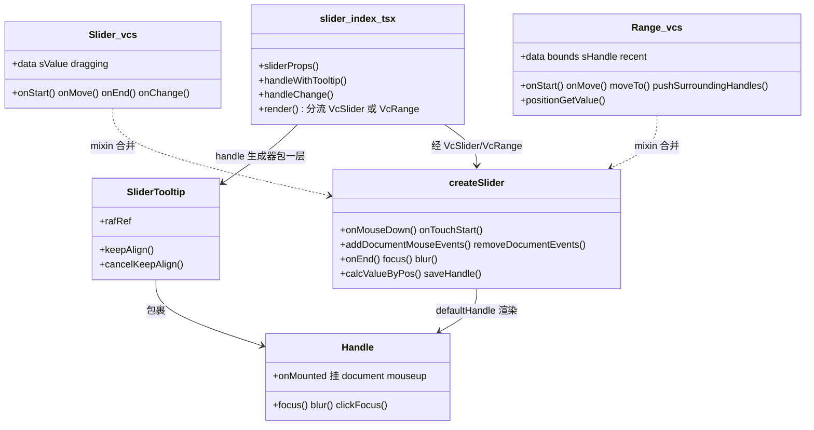
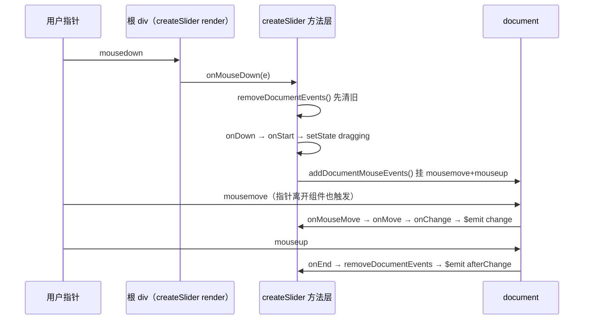
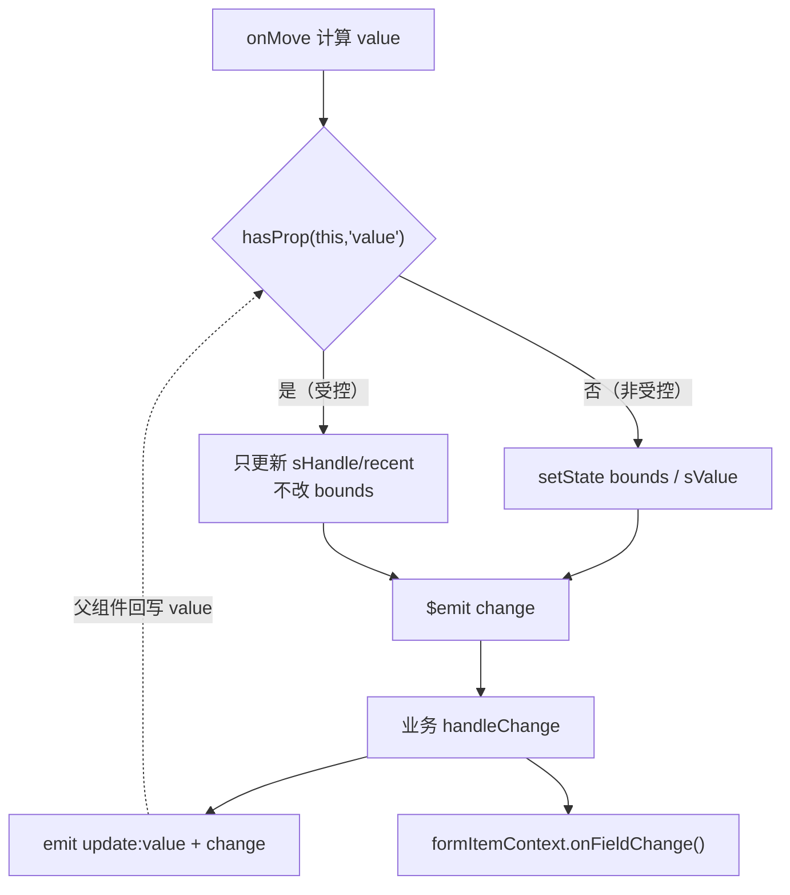

# C04-07 Slider 滑动条

> **本篇解决**：滑动条的真实状态机在哪一层？拖拽期间挂在 `document` 上的监听器是否成对注册/卸载、多实例并存会不会互相抢句柄？`draggableTrack` 与键盘 Range 导航这两条「看起来能用」的通路在源码里到底通不通？
> **前置**：C04-00 类横写：受控/非受控与 `useMergedState` 的一致实现（本篇只在「厂商层不走 `useMergedState`」这一处与它对照，不重述其共性抽象）；A07 / I02 浮层三件套（`SliderTooltip` 的弹层定位机制归那两篇，本篇只讲 `SliderTooltip` 与 rAF 的耦合点）　**读者坐标**：`03-components/04-form-controls` 第 7 篇

## 一、职责与边界

`slider` 是业务封装层（`packages/xiaoye-ui/src/slider/`，4 个文件），负责把用户可写的 `xy-slider` 属性翻译成厂商层的入参、注入前缀与 Design Token 样式、桥接 `FormItemContext`、以及把 tooltip 的显隐状态挂在 handle 上。它**不持有任何数值状态**——`value` 从 props 一路透传到底层，真正的 `bounds` / `sValue` / `dragging` 全在厂商层。

厂商层 `vc-slider`（vendor = 底层实现层，`packages/xiaoye-ui/src/vc-slider/`，`index.ts:1` 自带注释「base rc-slider 9.7.2」）才是滑动条内核：一个用 Options API mixin 搭起来的 `createSlider` 高阶组件（`vc-slider/src/common/createSlider.tsx:16`），把拖拽、document 监听、坐标换算、focus/keyboard 等所有「跨组件复用」的机制集中在这里，再用 `Slider`（单值，`vc-slider/src/Slider.tsx:9`）与 `Range`（多柄，`vc-slider/src/Range.tsx:55`）两个 mixin 填充各自的取值/边界算法。

**不负责**：弹层定位与层级（`SliderTooltip` 只是薄壳，真实机制归 A07 / I02）；表单值收集（只调 `formItemContext.onFieldChange()`，见 `packages/xiaoye-ui/src/slider/index.tsx:145`，规则归 C06 类横写）；RTL 的排版细节（只在 `index.tsx:198-200` 把 `reverse` 翻转一下）。

依赖清单（本篇范围内）：业务层依赖 `vc-slider/src/Slider`、`vc-slider/src/Range`、`vc-slider/src/Handle`（`packages/xiaoye-ui/src/slider/index.tsx:3-5`）、`tooltip`、`config-provider/hooks/useConfigInject`、`form/FormItemContext`；厂商层依赖 `_util/BaseMixin`、`vc-util/Dom/addEventListener`、`_util/supportsPassive`、`_util/props-util`。

## 二、源码地图

行数为 `wc -l` 实测（排除 `dist` 与 `node_modules`）。

| 文件 | 行数 | 职责 | 关键导出 / 主入口 |
| --- | --- | --- | --- |
| `slider/index.tsx` | 256 | 业务封装：props 定义、tooltip 显隐、range 分流 | `withInstall(Slider)`，主 render 在 `packages/xiaoye-ui/src/slider/index.tsx:182` |
| `slider/SliderTooltip.tsx` | 49 | Tooltip 薄壳 + rAF keepAlign 节流 | `packages/xiaoye-ui/src/slider/SliderTooltip.tsx:5` |
| `slider/style/index.tsx` | 344 | CSS-in-JS Design Token 样式 | `genComponentStyleHook('Slider', …)` |
| `slider/index.test.js` | 24 | 唯一测试文件 | `packages/xiaoye-ui/src/slider/index.test.js:6` |
| `vc-slider/src/common/createSlider.tsx` | 369 | 内核高阶组件：拖拽 + document 监听 + 坐标换算 | `packages/xiaoye-ui/src/vc-slider/src/common/createSlider.tsx:16` |
| `vc-slider/src/Slider.tsx` | 225 | 单值算法 mixin（`sValue`/`onStart`/`onEnd`） | `createSlider(Slider)`，`packages/xiaoye-ui/src/vc-slider/src/Slider.tsx:225` |
| `vc-slider/src/Range.tsx` | 526 | 多柄算法 mixin（`bounds`/push/allowCross） | `packages/xiaoye-ui/src/vc-slider/src/Range.tsx:55` |
| `vc-slider/src/Handle.tsx` | 150 | 单个可拖拽柄（含常驻 document mouseup） | `packages/xiaoye-ui/src/vc-slider/src/Handle.tsx:7` |
| `vc-slider/src/utils.ts` | 134 | 纯函数：坐标/精度/键盘映射 | `packages/xiaoye-ui/src/vc-slider/src/utils.ts:1` |
| `vc-slider/src/common/{Steps,Marks,Track}.tsx` | 75 / 75 / 30 | 刻度、标注、轨道渲染子件 | `Marks` 为函数式组件，读 `attrs` |
| `_util/BaseMixin`（跨组件） | — | `setState`/`__emit` 的 Options API 兼容层 | `packages/xiaoye-ui/src/_util/BaseMixin.ts:8` |
| `_util/raf.ts`（跨组件） | 53 | rAF 包装 + 模块级 id 表 | `packages/xiaoye-ui/src/_util/raf.ts:21` |

主实现入口不是业务 `index.tsx` 而是厂商层 `createSlider.tsx`：它同时是渲染宿主（`render()` 在 `packages/xiaoye-ui/src/vc-slider/src/common/createSlider.tsx:281`）与事件宿主（`addDocumentMouseEvents`/`removeDocumentEvents` 在 `packages/xiaoye-ui/src/vc-slider/src/common/createSlider.tsx:229`/`:233`），`Slider` 与 `Range` 只提供 `onStart`/`onMove`/`onEnd`/`renderSlider` 等被它回调的方法。

## 三、架构与数据流

### 图 1 · 静态结构（classDiagram）



`slider/index.tsx` 只依赖 `createSlider`（通过 `VcSlider`/`VcRange` 两个已被 `createSlider(...)` 包裹的成品组件）；`Slider` 与 `Range` 不直接对外，它们是 `createSlider(Component)` 的入参（`packages/xiaoye-ui/src/vc-slider/src/Slider.tsx:225` 的 `export default createSlider(Slider)`，Range 同构）。这条链解释了「为什么业务层看不到一个拖拽相关的函数」——全部沉在 mixin 里。

### 图 2 · 拖拽生命周期（sequenceDiagram，document 监听成对性）



关键点：`mousemove`/`mouseup` 挂在 **document** 而非组件根（`packages/xiaoye-ui/src/vc-slider/src/common/createSlider.tsx:230-231`），所以指针滑出组件矩形仍能继续拖拽——这是滑动条必须的「跨边界」行为，也正是「全局监听器」风险的来源。图 2 里成对性靠三处保证：`onMouseDown` 进门先 `removeDocumentEvents()`（`:143`）、拖拽结束的 `onEnd` 里 `removeDocumentEvents()`（`Slider.tsx:90`、`Range.tsx:204`）、卸载时 `beforeUnmount` 再兜一次（`:88`）。

### 图 3 · 取值数据流与受控分叉（flowchart TD）



这张图是 C04-00「受控/非受控」主题在滑动条上的**反例形状**：厂商层判定用 Options API 的 `hasProp(this, 'value')`（`packages/xiaoye-ui/src/vc-slider/src/Slider.tsx:65`、`packages/xiaoye-ui/src/vc-slider/src/Range.tsx:146`），**没有走 `useMergedState`**，状态也存在 `data()`/`$data` 而非 `ref`。因此滑动条不受本仓类横写里「统一 `useMergedState`」约束，改它时不能假设受控逻辑与其它表单控件同构（机制细节见 C04-00，此处只标注分叉）。

## 四、核心机制精读

### 论点 1：滑动条是「双层契约」，真状态只在厂商层，且不走 `useMergedState`

断言：业务 `Slider` 对 `value` 完全无状态，只把 props 原样透传并回抛 `update:value`；受控/非受控的判定与状态存储都发生在厂商层 mixin，用的是 Options API 的 `hasProp` + `$data`，与本仓横写篇（C04-00）说的 `useMergedState` 是两套机制。

业务层 `handleChange` 只做三件事——回抛 `update:value`、回抛 `change`、通知 FormItem（`packages/xiaoye-ui/src/slider/index.tsx:143-147`）：

```tsx
// packages/xiaoye-ui/src/slider/index.tsx:143
    const handleChange = (val: SliderValue) => {
      emit('update:value', val);
      emit('change', val);
      formItemContext.onFieldChange();
    };
```

注意这里没有 `value.value = val` 之类的本地写入——业务层根本没有存 value 的地方。`props.value` 随 `{...restProps}` 落到厂商层：单值分支的 `VcSlider`（`packages/xiaoye-ui/src/slider/index.tsx:232-250`）与 range 分支的 `VcRange`（`packages/xiaoye-ui/src/slider/index.tsx:210-228`），两处摊布现在都包了一层 `omit`，但剥掉的只有 `onChange` 与 `onBlur`，`value` 仍原样透传（见 §五 第二条）。真正把它接住的是厂商层。单值路径 `Slider.tsx`：

```tsx
// packages/xiaoye-ui/src/vc-slider/src/Slider.tsx:64
    onChange(state) {
      const isNotControlled = !hasProp(this, 'value');
      const nextState = state.sValue > this.max ? { ...state, sValue: this.max } : state;
      if (isNotControlled) {
        this.setState(nextState);
      }

      const changedValue = nextState.sValue;
      this.$emit('change', changedValue);
    },
```

逐段解释：`isNotControlled = !hasProp(this, 'value')` 是受控判定的唯一开关——用户有没有往 `VcSlider` 传 `value`，决定内部 `sValue` 要不要自更新；`setState` 来自 `_util/BaseMixin.ts:8`，本质是 `Object.assign(this.$data, newState)` + `$forceUpdate`。这与 `useMergedState` 的「合并入参与内部 ref」写法完全不同：这里没有 `ref`，状态在 `$data` 上，更新靠 mixin 的 `setState`。Range 更绕一层——受控时**只更新句柄归属、不改 `bounds`**（`packages/xiaoye-ui/src/vc-slider/src/Range.tsx:145-161`）：

```tsx
// packages/xiaoye-ui/src/vc-slider/src/Range.tsx:145
    onChange(state) {
      const isNotControlled = !hasProp(this, 'value');
      if (isNotControlled) {
        this.setState(state);
      } else {
        const controlledState = {};
        ['sHandle', 'recent'].forEach(item => {
          if (state[item] !== undefined) {
            controlledState[item] = state[item];
          }
        });
        if (Object.keys(controlledState).length) {
          this.setState(controlledState);
        }
      }
```

结论回扣：滑动条的「受控」不是「值以外部为准」这么轻——在受控态下 Range 内部 `bounds` 完全不由拖拽写入，必须由父组件把新 `value` 传回来才会变（`packages/xiaoye-ui/src/vc-slider/src/Range.tsx:94-101` 的 `watch.value` 深监听再跑 `setChangeValue`）。所以「拖不动」在受控 Range 上往往不是 bug，而是没回写 `value`。

### 论点 2：拖拽的 document 监听器成对且实例内聚——多实例不互相抢句柄，但触屏路径与卸载时机有偏差

断言：核心 `addDocumentMouseEvents`/`removeDocumentEvents` 是逐实例闭包，配对完整，因此页面上放多个滑动条不会互相截获对方的拖拽事件；但 `onTouchStart` 不像 `onMouseDown` 那样进门先清，且 `beforeUnmount` 的清理被包在 `$nextTick` 里。

注册与卸载函数（`packages/xiaoye-ui/src/vc-slider/src/common/createSlider.tsx:224-241`）：

```tsx
// packages/xiaoye-ui/src/vc-slider/src/common/createSlider.tsx:224
      addDocumentTouchEvents() {
        // just work for Chrome iOS Safari and Android Browser
        this.onTouchMoveListener = addEventListener(this.document, 'touchmove', this.onTouchMove);
        this.onTouchUpListener = addEventListener(this.document, 'touchend', this.onEnd);
      },
      addDocumentMouseEvents() {
        this.onMouseMoveListener = addEventListener(this.document, 'mousemove', this.onMouseMove);
        this.onMouseUpListener = addEventListener(this.document, 'mouseup', this.onEnd);
      },
      removeDocumentEvents() {
        /* eslint-disable no-unused-expressions */
        this.onTouchMoveListener && this.onTouchMoveListener.remove();
        this.onTouchUpListener && this.onTouchUpListener.remove();

        this.onMouseMoveListener && this.onMouseMoveListener.remove();
        this.onMouseUpListener && this.onMouseUpListener.remove();
        /* eslint-enable no-unused-expressions */
      },
```

逐段解释：`this.onMouseMoveListener` 等是**实例属性**（Options API `this` 上），不是模块作用域的 `let`，因此每个 `createSlider` 实例各存一份句柄，`remove()` 只解自己的绑。`addEventListener` 来自 `packages/xiaoye-ui/src/vc-util/Dom/addEventListener.js:3`，它对 falsy 的 `target` 直接跳过绑定但仍返回带 `remove` 的对象（`packages/xiaoye-ui/src/vc-util/Dom/addEventListener.js:4`、`:15-21`）——所以 `this.document` 万一没设上（见下）也不会崩，只是拖拽静默失效。

配对链路的三处锚点：鼠标路径 `onMouseDown` 先 `removeDocumentEvents()` 再 `onDown` 再 `addDocumentMouseEvents()`（`packages/xiaoye-ui/src/vc-slider/src/common/createSlider.tsx:138-148`），保证重复按下不叠加；拖拽结束 `onEnd` 内部第一行就是 `this.removeDocumentEvents()`（`packages/xiaoye-ui/src/vc-slider/src/Slider.tsx:88-90`、`packages/xiaoye-ui/src/vc-slider/src/Range.tsx:202-204`）。卸载兜底 `beforeUnmount`（`packages/xiaoye-ui/src/vc-slider/src/common/createSlider.tsx:85-90`）：

```tsx
// packages/xiaoye-ui/src/vc-slider/src/common/createSlider.tsx:85
    beforeUnmount() {
      this.$nextTick(() => {
        // if (super.componentWillUnmount) super.componentWillUnmount()
        this.removeDocumentEvents();
      });
    },
```

偏差一：`onTouchStart`（`packages/xiaoye-ui/src/vc-slider/src/common/createSlider.tsx:149-157`）直接 `onDown` + `addDocumentTouchEvents()`，**没有**像 `onMouseDown` 那样先 `removeDocumentEvents()`。在既支持触摸又支持鼠标的混合设备上，若上一次鼠标拖拽的监听还挂着（例如 mouseup 落在窗口外未触发），一次触摸会把 touch 系列再叠上去，形成短暂的「一次拖拽多处响应」。偏差二：`beforeUnmount` 把清理放进 `$nextTick`，虽然 document 对象不随组件销毁、监听器闭包仍引用实例、`remove()` 依旧生效，但这一层 `nextTick` 是多余包装，语义上把「卸载前清理」推迟到了「卸载后一个微任务」，属于可读性/时机隐患而非硬泄漏。

`this.document` 在 `mounted` 的 `$nextTick` 里才赋值（`packages/xiaoye-ui/src/vc-slider/src/common/createSlider.tsx:74-83`：`this.document = this.sliderRef && this.sliderRef.ownerDocument`）。这意味着极早期的一次 `onMouseDown`（理论上 `$nextTick` 尚未 flush）会向 `addEventListener(undefined, …)` 注册，静默失败——但真实指针事件不会快过一帧，故此路径实践中难以复现，列为「条件性隐患」而非已证实缺陷。

### 论点 3：两处「模块级可变全局量」——`Handle` 的常驻 document mouseup 是实例内聚的安全形状，`_util/raf.ts` 才是真全局共享面

断言：滑动条把 `document` 监听分成两类。一类挂在 `Handle`，**整段挂载期常驻**（不随拖拽起止），但句柄存在 `setup` 闭包里、卸载即解，属实例内聚；另一类经 `SliderTooltip` 落到 `_util/raf.ts` 的模块级 `rafUUID`/`rafIds`，被全仓所有实例共享，且 `cancel` 有已登记的键错位泄漏。

`Handle.tsx` 的常驻监听（`packages/xiaoye-ui/src/vc-slider/src/Handle.tsx:66-72`）：

```tsx
// packages/xiaoye-ui/src/vc-slider/src/Handle.tsx:66
    let onMouseUpListener = null;
    onMounted(() => {
      onMouseUpListener = addEventListener(document, 'mouseup', handleMouseUp);
    });
    onBeforeUnmount(() => {
      onMouseUpListener?.remove();
    });
```

逐段解释：这里的 `let onMouseUpListener` 写在 `setup()` 函数体内，作用域是**每次 `setup` 调用**（即每实例），不是文件顶层，所以多实例各持一份、互不覆盖；`handleMouseUp`（`packages/xiaoye-ui/src/vc-slider/src/Handle.tsx:31-35`）读 `document.activeElement === handle.value` 来决定要不要置 `clickFocused`。注册/卸载严格成对（`onMounted`/`onBeforeUnmount`）。真正的代价不是「抢句柄」而是**常驻**：一个 Range 有两个 handle，就常驻两个 document `mouseup` 监听，与是否在拖拽无关；一个表单里放 N 个 Range，全局 `mouseup` 监听就是 2N，直到组件卸载才回收。这是可接受的但值得知道的固定开销。

注意 `Handle` 用的是裸 `document`（`packages/xiaoye-ui/src/vc-slider/src/Handle.tsx:68`），而 `createSlider` 用的是 `sliderRef.ownerDocument`（`packages/xiaoye-ui/src/vc-slider/src/common/createSlider.tsx:77`）——同一条链上两种取 document 的方式不一致，前者对 Shadow DOM / 非默认 document 场景不友好，属分层遗留的口径分叉。

另一处才是本仓反复登记的「模块级可变全局量」形状（`packages/xiaoye-ui/src/_util/raf.ts:14-15`）：

```ts
// packages/xiaoye-ui/src/_util/raf.ts:14
let rafUUID = 0;
const rafIds = new Map<number, number>();
```

`SliderTooltip` 每次 tooltip 打开 / title 变化都会 `raf(...)` 排一帧 `forcePopupAlign`（`packages/xiaoye-ui/src/slider/SliderTooltip.tsx:20-31`），而 `raf.cancel` 的键错位问题（写表用逻辑 `id`、`cancel` 里 `cleanup(realId)` 删浏览器句柄）已由 `OUTLINE.md`「已知待办」登记在 `_util/raf.ts:48-51`，本篇不重新论证，只标注：由于 `rafIds` 是**模块级、跨实例共享**，滑动条越多、tooltip 开合越频繁，那笔「每次 cancel 泄漏一个死表项」的累积越快。`SliderTooltip` 自己用 `rafRef` 只跟踪最新一帧（`packages/xiaoye-ui/src/slider/SliderTooltip.tsx:13`），无法反映也不会放大 `rafIds` 的全局增长，增长速率由 `raf.ts` 决定。

### 论点 4：`draggableTrack` 是一条静态可证的死路（调用不存在的 `this.getValue()`），Range 键盘导航有源码自述的 `setState`-异步 hack

断言：业务层把 `range={{ draggableTrack: true }}` 一路接到 `onDown`，`onDown` 转而调用 `positionGetValue`，而 `positionGetValue` 里的 `this.getValue()` 在整个 `vc-slider` 的 mixin 链里**没有定义**——一旦真的拖拽轨道即抛 `TypeError`。这条「API 面存活、实现死亡」的通路可直接 grep 证实。

触发链：业务层从 `range` 对象里抠出 `draggableTrack` 并透传（`packages/xiaoye-ui/src/slider/index.tsx:203-214`）：

```tsx
// packages/xiaoye-ui/src/slider/index.tsx:204
      let draggableTrack: boolean | undefined;
      if (typeof range === 'object') {
        draggableTrack = range.draggableTrack;
      }
```

厂商层 `onDown` 用它做守卫并调 `positionGetValue`（`packages/xiaoye-ui/src/vc-slider/src/common/createSlider.tsx:110-112`）：

```tsx
// packages/xiaoye-ui/src/vc-slider/src/common/createSlider.tsx:110
        const value = draggableTrack && this.positionGetValue ? this.positionGetValue(p) || [] : [];

        const inPoint = utils.isEventFromHandle(e, this.handlesRefs);
```

守卫 `this.positionGetValue` 对 Range 是 truthy 的（方法存在），于是进入 `positionGetValue`（`packages/xiaoye-ui/src/vc-slider/src/Range.tsx:168-172`）：

```tsx
// packages/xiaoye-ui/src/vc-slider/src/Range.tsx:168
    positionGetValue(position) {
      const bounds = this.getValue();
      const value = this.calcValueByPos(position);
      const closestBound = this.getClosestBound(value);
      const index = this.getBoundNeedMoving(value, closestBound);
```

第二行 `this.getValue()` 是关键：全 `vc-slider` 目录里 `getValue` 仅在此出现一次，无任何定义点（`this.getValue` 因此是 `undefined`，`undefined()` 抛错）。`Range` 的 mixin 只有 `[BaseMixin]` 与 `createSlider` 合入，`BaseMixin` 仅暴露 `setState`/`__emit`（`packages/xiaoye-ui/src/_util/BaseMixin.ts:27`、`:26`），均无 `getValue`。因此开启 `draggableTrack` 并在轨道空白处按下的那条分支，是静态可判定的崩溃路径。（`draggableTrack` 是否真在其它地方被重新定义需以「附录检查点 2」的 grep 复核为准。）

Range 键盘导航则是**作者自己写注释承认的时序 hack**（`packages/xiaoye-ui/src/vc-slider/src/Range.tsx:333-343`）：

```tsx
// packages/xiaoye-ui/src/vc-slider/src/Range.tsx:333
      if (isFromKeyboardEvent) {
        // known problem: because setState is async,
        // so trigger focus will invoke handler's onEnd and another handler's onStart too early,
        // cause onBeforeChange and onAfterChange receive wrong value.
        // here use setState callback to hack，but not elegant
        this.$emit('afterChange', nextBounds);
        this.setState({}, () => {
          this.handlesRefs[nextHandle].focus();
        });
        this.onEnd();
      }
```

逐段解释：因为 `setState` 内部 `nextTick` 才回调（`packages/xiaoye-ui/src/_util/BaseMixin.ts:21-23`），键盘换柄时 `focus()` 会连锁触发旧柄 `onBlur→onEnd` 与新柄 `onFocus→onStart`，早于状态落定，导致 `beforeChange`/`afterChange` 拿到错值。作者用「先手动 `$emit('afterChange')`、再把 `focus()` 塞进 `setState` 回调、最后 `onEnd()` 收尾」的顺序把三个动作重新排布。这是有效但脆的补偿——改 `setState` 语义或换 `useMergedState` 都会让它错位。

### 论点 5：两个「产出但查不到规则」的类名——`-handle-dragging` 与 CSS 选择器键位错位，`-handle-click-focused` 完全无规则

断言：厂商层在运行时给 handle 挂两个类名，但样式表都接不住。其一，Range 拖拽时给当前柄加 `xy-slider-handle-dragging`，而样式规则写的是嵌套的 `.xy-slider-handle .xy-slider-dragging`，选择器键位对不上，拖拽提层（`z-index:1`）永不生效。其二，`Handle` 点击聚焦时加 `xy-slider-handle-click-focused`，全 `style/` 目录零规则，是纯死类名。

运行时产出（`packages/xiaoye-ui/src/vc-slider/src/Range.tsx:482-488`）：

```tsx
// packages/xiaoye-ui/src/vc-slider/src/Range.tsx:482
        const dragging = sHandle === i;
        return handleGenerator({
          class: classNames({
            [handleClassName]: true,
            [`${handleClassName}-${i + 1}`]: true,
            [`${handleClassName}-dragging`]: dragging,
          }),
```

`handleClassName = ${prefixCls}-handle`（`packages/xiaoye-ui/src/vc-slider/src/Range.tsx:476`），故实际类名是 `xy-slider-handle-dragging`（连字符接在 `-handle` 之后）。

样式表侧（`packages/xiaoye-ui/src/slider/style/index.tsx:86-94`）：

```tsx
// packages/xiaoye-ui/src/slider/style/index.tsx:86
      [`${componentCls}-handle`]: {
        position: 'absolute',
        width: token.handleSize,
        height: token.handleSize,
        outline: 'none',

        [`${componentCls}-dragging`]: {
          zIndex: 1,
        },
```

逐段解释：`componentCls` 即 `.xy-slider`，`:92` 嵌在 `:86` 里，编译成后代选择器 `.xy-slider-handle .xy-slider-dragging`——它要求存在一个 class 为 `.xy-slider-dragging` 的**后代**元素。但运行时那个类名叫 `.xy-slider-handle-dragging`，且就在 `.xy-slider-handle` **自身**上，不是后代。两条都违约，规则命不中。后果是 Range 两柄重叠/相邻时，被拖的柄不会因拖拽被抬到上层，视觉上可能被另一柄的 ::after 圆点压住（这正是 `z-index:1` 想解决的问题）。单值 `Slider` 更彻底：它的 `renderSlider` 只给 `class: ${prefixCls}-handle`（`packages/xiaoye-ui/src/vc-slider/src/Slider.tsx:186`），连 `-dragging` 都不产出。

死类名侧（`packages/xiaoye-ui/src/vc-slider/src/Handle.tsx:102-104`）：

```tsx
// packages/xiaoye-ui/src/vc-slider/src/Handle.tsx:102
      const className = classNames(attrs.class, {
        [`${prefixCls}-handle-click-focused`]: clickFocused.value,
      });
```

`grep -rn "click-focused" packages/xiaoye-ui/src/slider/style/` 零命中：样式表根本没为 `xy-slider-handle-click-focused` 写过任何规则。该类的实际视觉效果完全由 `:hover/:active/:focus` 伪类承担（`packages/xiaoye-ui/src/slider/style/index.tsx:127`），`clickFocused` 状态与这个类名一起沦为「算得出、渲染了、但没人读」的死 CSS，形态与 `OUTLINE.md` 登记的 `xy-tooltip-arrow-content` 一致。同一族还有 `xy-slider-dot-reverse`（`packages/xiaoye-ui/src/vc-slider/src/common/Steps.tsx:65` 产出，`grep -rn "dot-reverse" packages/xiaoye-ui/src/slider/style/` 零命中）——反向刻度的区分被完全交给内联 `style`，类名是纯残留。

### 论点 6：像素↔百分比是一处双向量换算，reverse / 缩放 / 负长度都在里面归一，SSR 隐患也集中在这里

断言：滑动条把「屏幕像素坐标」和「组件百分比位置」用两个互逆函数来回换算——`calcValue`（像素偏移→数值）与 `calcOffset`（数值→百分比），reverse 只体现在符号与起止边；坐标读取又叠加了 `visualViewport` 缩放除法。这套换算是全组件唯一直接碰 `window` 的地方，SSR 与除零风险都在此。

像素→数值（`packages/xiaoye-ui/src/vc-slider/src/common/createSlider.tsx:257-268`）：

```tsx
// packages/xiaoye-ui/src/vc-slider/src/common/createSlider.tsx:257
      calcValue(offset) {
        const { vertical, min, max } = this;
        const ratio = Math.abs(Math.max(offset, 0) / this.getSliderLength());
        const value = vertical ? (1 - ratio) * (max - min) + min : ratio * (max - min) + min;
        return value;
      },
      calcValueByPos(position) {
        const sign = this.reverse ? -1 : +1;
        const pixelOffset = sign * (position - this.getSliderStart());
        const nextValue = this.trimAlignValue(this.calcValue(pixelOffset));
        return nextValue;
      },
```

数值→百分比（同文件 `:269-273`）：

```tsx
// packages/xiaoye-ui/src/vc-slider/src/common/createSlider.tsx:269
      calcOffset(value) {
        const { min, max } = this;
        const ratio = (value - min) / (max - min);
        return Math.max(0, ratio * 100);
      },
```

逐段解释：`reverse` 不改几何、只改 `sign`（`:264`）——把「从起点向右为正」翻成「从终点向左为正」，再配合 `getSliderStart` 读 `rect.left` 还是 `rect.right`（`packages/xiaoye-ui/src/vc-slider/src/common/createSlider.tsx:206-214`）。渲染侧 `calcOffset` 出百分比，交给 `Handle`/`Track`/`Steps` 做内联定位。缩放归一在坐标源头 `getMousePosition`（`packages/xiaoye-ui/src/vc-slider/src/utils.ts:41-47`）：

```ts
// packages/xiaoye-ui/src/vc-slider/src/utils.ts:41
export function getMousePosition(vertical: boolean, e: MouseEvent) {
  let zoom = 1;
  if (window.visualViewport) {
    zoom = +(window.visualViewport.width / document.body.getBoundingClientRect().width).toFixed(2);
  }
  return (vertical ? e.clientY : e.pageX) / zoom;
}
```

`window.visualViewport.width / document.body.getBoundingClientRect().width` 是浏览器缩放补偿：页面被放大时 `pageX` 与实际布局像素不成 1:1，用比值把指针坐标折回布局坐标系。代价有二：其一，`document.body` 宽度为 0（尚未布局 / `display:contents`）时 `zoom` 变 `Infinity`，坐标被压成 0，拖拽定位跳变；其二，函数体直接读 `window`/`document`，在 SSR 下若被误调即崩（正常渲染路径不调它，故侥幸安全，见「设计取舍 4」）。

负长度归一在 `Track`（`packages/xiaoye-ui/src/vc-slider/src/common/Track.tsx:5-9`）：当 `length < 0`（如 Range 两端被拖成交叉序），翻转 `reverse`、取绝对值、并把 offset 换成 `100 - offset`，保证轨道永远正向量渲染。这与论点 5 的「单值 Slider 不产出 `-dragging`」呼应——很多边界归一被分散在多个函数里，改坐标模型时四处都要跟。

### 论点 7：Range 的多柄冲突有两套互斥模型——`pushable` 挤压 与 `allowCross` 排序，默认走后者，前者在业务 API 下是哑火开关

断言：`moveTo` 用 `pushable`/`allowCross` 两个 prop 决定相邻柄如何相互影响，但两者语义相反且互斥；本仓 `Range` 默认 `pushable: false`、`allowCross: true`（`packages/xiaoye-ui/src/vc-slider/src/Range.tsx:62-63`），于是默认路径永远是「排序允许跨界」而非「挤压保持间距」。

核心分支（`packages/xiaoye-ui/src/vc-slider/src/Range.tsx:316-332`）：

```tsx
// packages/xiaoye-ui/src/vc-slider/src/Range.tsx:316
    moveTo(value, isFromKeyboardEvent) {
      const nextBounds = [...this.bounds];
      const { sHandle, recent } = this;
      const handle = sHandle === null ? recent : sHandle;
      nextBounds[handle] = value;
      let nextHandle = handle;
      if (this.$props.pushable !== false) {
        this.pushSurroundingHandles(nextBounds, nextHandle);
      } else if (this.$props.allowCross) {
        nextBounds.sort((a, b) => a - b);
        nextHandle = nextBounds.indexOf(value);
      }
      this.onChange({
        recent: nextHandle,
        sHandle: nextHandle,
        bounds: nextBounds,
      });
```

逐段解释：`pushable !== false` 时才进 `pushSurroundingHandles` 的递归推挤链（`packages/xiaoye-ui/src/vc-slider/src/Range.tsx:346-369` → `pushHandle` `:370-384` → `pushHandleOnePoint` `:385-405`，后者还要 `getPoints()` 逐点跳）。默认 `pushable:false` 使这一整段成为「非默认才走」的死分支；默认 `allowCross:true` 走 `nextBounds.sort(...)` 后 `indexOf(value)` 重算 `nextHandle`——即两柄可以互换前后次序，柄的身份随排序滑动。`pushable:false` 且 `allowCross:false` 的组合则落到顶层 `trimAlignValue` 的区间钳制（`packages/xiaoye-ui/src/vc-slider/src/Range.tsx:26-33`，把值夹在相邻柄 ±threshold 内）。

关键在于这两个开关都不在业务 `sliderProps()` 里（`packages/xiaoye-ui/src/slider/index.tsx:55-88` 无 `pushable`/`allowCross`/`count`）。它们只能靠 `range` 之外的属性经 `attrs` 兜底落到 `VcRange`（业务 render 的 `{...attrs}` 在最前，`packages/xiaoye-ui/src/slider/index.tsx:173`，而 `VcRange` 声明了这些 prop 才会被接走）。因此「挤压式 Range」在本库文档面里没有正规入口——用户即便想启用 `pushable`，也要绕过业务类型、靠属性透传，属「实现活着、契约面半死」的形状。改这套逻辑时最易踩的雷是：把 `allowCross` 误设 true 又给 `pushable` 传了阈值，此时 `moveTo` 只走 push 分支、`allowCross` 被静默忽略，行为与预期相反（`packages/xiaoye-ui/src/vc-slider/src/Range.tsx:322-327` 的 `else if` 互斥）。

## 五、对外契约如何生效

**props 声明与 emits 选项脱节**：`sliderProps()` 把 `onChange`/`onAfterChange`/`onFocus`/`onBlur`/`'onUpdate:value'` 全声明成函数 props（`packages/xiaoye-ui/src/slider/index.tsx:83-87`），但组件的 `emits` 数组被整行注释掉（`packages/xiaoye-ui/src/slider/index.tsx:99` 的 `// emits: ['update:value', 'change', 'afterChange', 'blur'],`，`grep -n "emits" packages/xiaoye-ui/src/slider/index.tsx` 只命中这一行注释）。组件仍然 `emit('update:value'/'change'/'blur')`（`packages/xiaoye-ui/src/slider/index.tsx:143-148`）——在 Vue 3 里未声明 emits 也能触发：`emit` 不查 `emits` 选项，它从 `instance.vnode.props` 里按 `onXxx` 取处理器，而「声明成 prop」并不会把这个键从 `vnode.props` 里移走。代价是这些事件不进 DevTools 的 events 记录，也拿不到 emits 校验；而更要紧的一点是：`emit` 已经是完整出口，组件内部只要再补第二条投递口，同一个用户函数就会被打两次——本组件撞的正是这件事，见下面第二条。

**`change` 与 `blur` 曾经各被投递两次（2026-09-29 已修）。** 本篇原来把这条写成「JSX 属性顺序覆盖」形状（业务 render 先 `{...restProps}`、再把 `onChange={handleChange}`、`onBlur={handleBlur}` 写在其后，因此后者的**覆盖**前者）——**这个判读是错的，本轮按实测改正**：Vue 的 JSX 走 `mergeProps`，重复的 `on*` 事件键不是后者覆盖前者，而是**并成数组**，数组里两个处理函数都会被抓到。修前形状：`restProps` 从 `props` 解构（`packages/xiaoye-ui/src/slider/index.tsx:183-188`）时把用户的 `onChange`/`onBlur` 一起带进摊布，同一元素又显式绑了桥接 arrow（修前 arrow 在 `:247-248` 位置），`VcSlider` 因此收到 `onChange: [用户函数, handleChange]` 两份；厂商层每次 `emit('change')` 都走这个数组，`handleChange` 里再 `emit('change')`（`packages/xiaoye-ui/src/slider/index.tsx:143-147`）又投一次。**实测**：修前键盘步进一次把外部 `@change` 打 **2** 次、失焦一次把 `@blur` 打 **2** 次。修后形状：两处摊布各包一层 `omit`，只剥本层已经桥接过的两个键——`packages/xiaoye-ui/src/slider/index.tsx:212` 与 `:234` 的 `{...omit(restProps, ['onChange', 'onBlur'])}`（`omit` 是本轮新增的 import，见 `:6`），显式 arrow 留在原位（`:225-226`、`:247-248`），修后各 **1** 次。回归在 `packages/xiaoye-ui/src/_util/__tests__/event-dispatch-count.test.tsx` 的 Slider 用例，判据 `toHaveBeenCalledTimes(1)`。这就是「事件双投递」族的**形态三**，与 `C03-05` 论点 6 的 Tabs 是同一条机制、同一个修法。为什么这么修而不是删掉显式 arrow：`handleChange` 还带 `formItemContext.onFieldChange()` 这条表单副作用，arrow 是本层的合法出口，用户的裸 `onChange` 才是重复的那一份。两条纪律要记下：新增事件键必须同步这两份 omit 清单，否则翻倍立刻回来；而**没有**被本层桥接的键（`onAfterChange`、`onFocus`）留在摊布里才是对的——本层不发它们，剥掉就等于把用户回调彻底丢掉。

**`afterChange` 与 `focus` 走的是另一条路，未被本轮改动。** 这两个键只出现在 `{...omit(restProps, …)}` 里、不经业务处理器，作为 prop 一路落到 `VcSlider`/`VcRange`，由厂商层 `$emit('afterChange'/'focus')` 直接调起（`packages/xiaoye-ui/src/vc-slider/src/Slider.tsx:92`、`packages/xiaoye-ui/src/vc-slider/src/common/createSlider.tsx:165`）。于是 `afterChange` **不经过** `handleChange`、也就不会触发 `formItemContext.onFieldChange()`——表单只在 `change` 时被通知，这是有意的分工，但改 `onAfterChange` 语义的人常忽略这点。厂商层 `createSlider.tsx` 自己也有「摊布 + 显式 arrow」的同形状扫描命中，但实测一次 `focus`/`blur` 外部 handler 修前修后都只有 **1** 次，所以那一层没有动。

**`tooltipOpen` 与废弃 `tooltipVisible` 的兜底**：`handleWithTooltip` 里 `const { tipFormatter, tooltipOpen = props.tooltipVisible, ... } = props;`（`packages/xiaoye-ui/src/slider/index.tsx:159`）——解构默认值只在 `tooltipOpen === undefined` 时回落到 `tooltipVisible`，所以显式 `tooltipOpen=false` 仍生效；dev 下用 `devWarning` 提示废弃（`packages/xiaoye-ui/src/slider/index.tsx:106-114`）。显隐真值由 `open = tooltipOpen || (tooltipOpen === undefined && isTipFormatter)` 决定，`isTipFormatter` 又取决于业务自持的 `visibles[index]`（hover 时 `toggleTooltipOpen` 写，`packages/xiaoye-ui/src/slider/index.tsx:124-126`、`:158-159`）——这是全组件唯一一处「业务层自持的 UI 状态」，与数值无关，故不受论点 1 的「业务无状态」约束。

**expose**：`expose({ focus, blur })`（`packages/xiaoye-ui/src/slider/index.tsx:151-154`）代理到 `sliderRef`，后者是厂商实例，其 `focus()` 只聚焦 `handlesRefs[0]`（`packages/xiaoye-ui/src/vc-slider/src/common/createSlider.tsx:242-247`）——对 Range 意味着外部 `sliderRef.focus()` 永远聚焦**左柄**。

**slots**：`mark` 与 `default` 声明于 `packages/xiaoye-ui/src/slider/index.tsx:100-103`；`mark` 经 `v-slots` 透传给厂商层并由 `Marks` 消费（`packages/xiaoye-ui/src/vc-slider/src/common/Marks.tsx:19`、`:31-33`），`default` 由 `createSlider` render 末尾的 `getSlot(this)` 追加（`packages/xiaoye-ui/src/vc-slider/src/common/createSlider.tsx:364`）。

**事件频率契约**：`change` 与 `afterChange` 不是同频事件。`change` 在拖拽的每一帧都发——`onMouseMove` → `onMove` → `onChange` → `$emit('change')`（`packages/xiaoye-ui/src/vc-slider/src/Slider.tsx:96-103`、`:64-73`），经业务 `handleChange` 变成每帧一次的 `update:value` + `onFieldChange`；`afterChange` 只在收尾发一次——鼠标/触摸抬起走 `onEnd` 的 `$emit('afterChange')`（`packages/xiaoye-ui/src/vc-slider/src/Slider.tsx:88-95`），或键盘换柄时手动补发（`packages/xiaoye-ui/src/vc-slider/src/Range.tsx:338`）。因此「提交/落库」类副作用应挂 `onAfterChange` 而非 `onChange`，否则一次拖拽会触发成百上千次副作用；而表单实时校验要的是 `change` 的高频流。这条频率差在源码里没有任何注释或类型标注保护，只能靠读事件发射点确认，是滑动条契约上最容易用错的一处。

## 六、设计取舍

**取舍 1：厂商层保留 Options API mixin（`createSlider`）而非 Composition API。** 换来的是拖拽/document 监听/坐标换算这套逻辑被 `Slider` 与 `Range` 以 mixin 方式复用一次（`packages/xiaoye-ui/src/vc-slider/src/common/createSlider.tsx:44` 的 `mixins: [BaseMixin, Component]`），且因为句柄（`this.onMouseMoveListener` 等）挂在实例上，天然规避了「多实例抢模块级句柄」——这正是派工单点名的风险，而本层把它化解在了实例内聚里（见论点 2）。赔上的是：`this` 上散落大量非响应式实例字段（`sliderRef`、`handlesRefs`、`dragOffset`、`startBounds`、`dragTrack`、`prevMovedHandleIndex`、`internalPointsCache`），无法被 `setup` 的类型收窄覆盖，改签名要靠 grep 全目录；且它依赖 `_util/BaseMixin` 的 `setState`+`$forceUpdate` 兼容层（`packages/xiaoye-ui/src/_util/BaseMixin.ts:8`），与业务层 Composition API 风格割裂。

**取舍 2：没有并入 C04-00 的统一受控基座（`useMergedState`）。** 滑动条是全类少见的「不跟本仓表单控件同构」者：受控判定用 `hasProp(this,'value')`、状态在 `$data`（论点 1）。这样做的直接收益是把拖拽中间态（`bounds` 随指针高频变化）与「受控/非受控合并」解耦——若走 `useMergedState`，每帧拖拽都会触发一次入参合并逻辑。代价是维护者读其它表单控件建立的「受控心智模型」在这里失效，Range 受控态下 `bounds` 干脆不由拖拽写入，是本文「坑 2」的根源。

**取舍 3：tree-shaking 让位于「一次 import 两个成品」。** 业务 `index.tsx` 顶部同时 `import VcSlider` 与 `import VcRange`（`packages/xiaoye-ui/src/slider/index.tsx:3-4`），render 里按 `range` 真值二选一（`packages/xiaoye-ui/src/slider/index.tsx:208`、`:231`）。即使用户只用单值滑动条，`Range.tsx` 的 526 行推挤/跨界逻辑也进了打包。这是移植自 `rc-slider`（`packages/xiaoye-ui/src/vc-slider/index.ts:1` 标注 base 版本）的结构，换来 API 对齐，赔上体积。

**取舍 4：SSR 与 document 口径不统一。** `_util/supportsPassive.ts` 在**模块求值期**就 `window.addEventListener('testPassive', …)`（顶层 `let supportsPassive`，包 try/catch），`vc-slider/src/utils.ts:43-46`、`:61` 的 `getMousePosition`/`getHandleCenterPosition` 直接读 `window.visualViewport`、`window.scrollX`。厂商层虽有 `this.document = ownerDocument` 的抽象（`packages/xiaoye-ui/src/vc-slider/src/common/createSlider.tsx:77`），但 `Handle.tsx:68`、`utils.ts:44` 又用裸 `document`。这套不一致意味着 SSR 端靠 try/catch 与「渲染期不调用这些函数」侥幸过关，而非真正做过 server-safe 设计；`supportsPassive` 求值期访问 `window` 被 try/catch 吞掉后恒为 `false`，则 touch 事件名回落 `onTouchstart`（非 passive），行为仍可用但偏离浏览器优化。

## 七、坑与改动指南

**坑 1 · `range={{ draggableTrack: true }}` 一拖就崩。**
触发：给 Range 开启 `draggableTrack` 并在两柄之间的轨道空白处按下鼠标。症状：控制台 `TypeError: this.getValue is not a function`，拖拽中断。原因：`onDown` 调 `positionGetValue`，后者调 `this.getValue()`，而该方法在 `vc-slider` 全目录无定义（见论点 4）。定位：`packages/xiaoye-ui/src/vc-slider/src/Range.tsx:169`、调用点 `packages/xiaoye-ui/src/vc-slider/src/common/createSlider.tsx:110`、业务开关提取 `packages/xiaoye-ui/src/slider/index.tsx:205`。**该分支无测试保护**（`vc-slider` 目录零 `.test.*`）。

**坑 2 · 受控 Range「拖不动」。**
触发：`v-model:value` 绑定数组，但 `@change`/`@update:value` 里没把新值写回绑定源。症状：拖拽有 `change` 事件、柄却弹回原位。原因：受控态下 `Range.onChange` 只更新 `sHandle/recent`、不改 `bounds`（`packages/xiaoye-ui/src/vc-slider/src/Range.tsx:136-161`），`bounds` 只能等 `watch.value` 深监听回灌（`packages/xiaoye-ui/src/vc-slider/src/Range.tsx:94-101`）。定位：同左。这不是 bug，是受控语义，但缺注释极易误判。

**坑 3 · 拖拽中的柄不会被抬到最上层。**
触发：Range 两柄数值接近或重叠时拖动其中之一。症状：被拖的柄视觉上可能被相邻柄的圆点（`::after`）压住。原因：样式想给拖拽柄 `z-index:1`，但选择器 `.xy-slider-handle .xy-slider-dragging`（`packages/xiaoye-ui/src/slider/style/index.tsx:92`）与运行时类名 `xy-slider-handle-dragging`（`packages/xiaoye-ui/src/vc-slider/src/Range.tsx:487`）键位错位，规则命不中（见论点 5）。定位：改任一侧类名使之对齐即可修复；单值 `Slider` 因不产出 `-dragging`（`packages/xiaoye-ui/src/vc-slider/src/Slider.tsx:186`）本坑不适用。

**坑 4 · 键盘微调 Range 时 `beforeChange`/`afterChange` 值错位。**
触发：Tab 聚焦某个柄后用方向键连续调整。症状：偶发 `afterChange` 收到上一次的值，或两个柄事件串扰。原因：作者已在源码注释里承认 `setState` 异步导致换柄的 `onEnd`/`onStart` 触发过早，用 `setState` 回调 + 手动 `$emit` 打补丁（`packages/xiaoye-ui/src/vc-slider/src/Range.tsx:333-343`）。定位：同左。改动 `BaseMixin.setState` 的回调时机或把该组件迁到 `useMergedState` 前先跑此序列回归。

**坑 5 · 大量 Range 常驻全局 `mouseup` 监听。**
触发：单页渲染很多滑动条（表格行内编辑器等）。症状：每个柄一个 document `mouseup`，Range 两个柄即两份常驻监听，卸载前不回收。原因：`Handle` 在 `onMounted` 无条件注册、`onBeforeUnmount` 才解（`packages/xiaoye-ui/src/vc-slider/src/Handle.tsx:66-72`），与拖拽无关。定位：同左。注册/卸载成对、不泄漏，但这是可感知的固定开销；混合设备上还需留意 `onTouchStart` 不预清导致 mouse/touch 监听短暂叠加（`packages/xiaoye-ui/src/vc-slider/src/common/createSlider.tsx:149-157`，对照 `onMouseDown` 的 `:143`）。

**坑 6 · Range 上 `sliderRef.focus()` 永远聚焦左柄，右柄无法通过 expose 获得焦点。**
触发：外部拿模板 ref 调 `slider.focus()` 想让 Range 进入可键盘操作态。症状：只有 `bounds[0]` 那个柄拿到焦点，右柄纹丝不动，用户按方向键调的是左界。原因：expose 的 `focus` 代理到厂商实例（`packages/xiaoye-ui/src/slider/index.tsx:137-139`、`:150-153`），而 `createSlider.focus()` 写死 `this.handlesRefs[0]?.focus()`（`packages/xiaoye-ui/src/vc-slider/src/common/createSlider.tsx:242-247`）——只认索引 0。定位：同左。`blur()` 反而是遍历所有 `handlesRefs`（`:249-256`），focus/blur 覆盖面不对称。欲聚焦指定柄，只能从 `visibles`/`handlesRefs` 之外另找 DOM 手动 focus，本层无「按索引聚焦」的公开口子。

**测试现状与改动安全边界。** 唯一测试是 `packages/xiaoye-ui/src/slider/index.test.js`（24 行）：`mountTest(Slider)`（`packages/xiaoye-ui/src/slider/index.test.js:7`）确有一条真断言 `expect(...).not.toThrow()`（`packages/xiaoye-ui/tests/shared/mountTest.js`），但它只覆盖单值非受控挂载；第二个用例「should show tooltip when hovering slider handler」（`packages/xiaoye-ui/src/slider/index.test.js:8-23`）**断言数为 0**——`mouseenter`/`mouseleave` 后只跑空的 `asyncExpect(() => {}, 1000)`（`packages/xiaoye-ui/src/slider/index.test.js:22`），从不 `expect` tooltip 是否可见。整个 `vc-slider` 目录（含 Range 推挤、跨界、拖拽、键盘、`draggableTrack`）**没有任何 `.test.{js,ts,tsx}`**（`packages/xiaoye-ui/vitest.config.mts:33` 的 `src/**/*.test.{js,ts,jsx,tsx}` glob 下仅命中 `slider/index.test.js`）。改拖拽/受控/Range 分支时不要指望回归网兜底，务必手动验证「附录」序列。

## 附：本篇可证伪的三个检查点

1. **document 拖拽监听成对且实例内聚**。跑：
   ```bash
   grep -n "removeDocumentEvents\|addDocumentMouseEvents\|addDocumentTouchEvents" packages/xiaoye-ui/src/vc-slider/src/common/createSlider.tsx packages/xiaoye-ui/src/vc-slider/src/Slider.tsx packages/xiaoye-ui/src/vc-slider/src/Range.tsx
   ```
   预期：`onMouseDown` 内先 `removeDocumentEvents()` 再 `addDocumentMouseEvents()`（`createSlider.tsx:143`/`:147`），`onEnd` 首行 `removeDocumentEvents()`（`Slider.tsx:90`、`Range.tsx:204`），`beforeUnmount` 再兜一次（`createSlider.tsx:88`）。若这三处齐，则论点 2「成对」成立；句柄写 `this.onXxxListener` 而非文件顶层 `let`，即可排除多实例抢句柄。

2. **`draggableTrack` 调用不存在的 `getValue`**。跑：
   ```bash
   grep -rn "getValue" packages/xiaoye-ui/src/vc-slider
   ```
   预期：**只有** `Range.tsx:169` 一处（调用点），无任何 `getValue() {` 或 `getValue =` 定义行。这直接支撑论点 4 / 坑 1 的静态可证性。若某天出现第二处（定义），则该崩溃结论作废、需回改本篇。

3. **拖拽/聚焦类名与样式规则键位错位**。跑：
   ```bash
   grep -rn "dragging" packages/xiaoye-ui/src/vc-slider/src/Range.tsx packages/xiaoye-ui/src/slider/style/index.tsx
   grep -rn "click-focused" packages/xiaoye-ui/src/slider/style
   ```
   预期：第一条里 `Range.tsx` 侧是 `${handleClassName}-dragging`（即 `xy-slider-handle-dragging`），而 `style/index.tsx:92` 侧是嵌在 `-handle` 内的 `${componentCls}-dragging`（即后代 `.xy-slider-dragging`），两侧键名不同；第二条对 `click-focused` **零命中**。二者共同证伪论点 5：`z-index:1` 提层与 `-handle-click-focused` 都是接不住的死规则/死类名。
