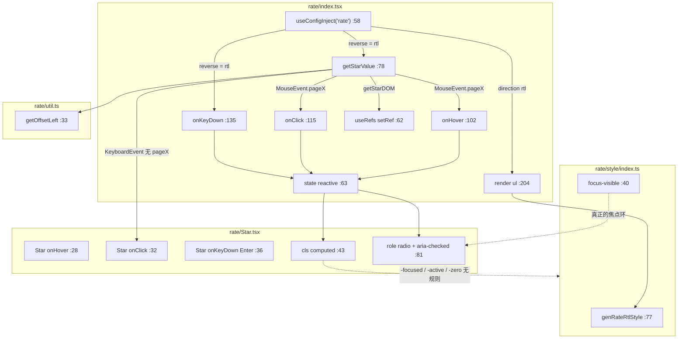
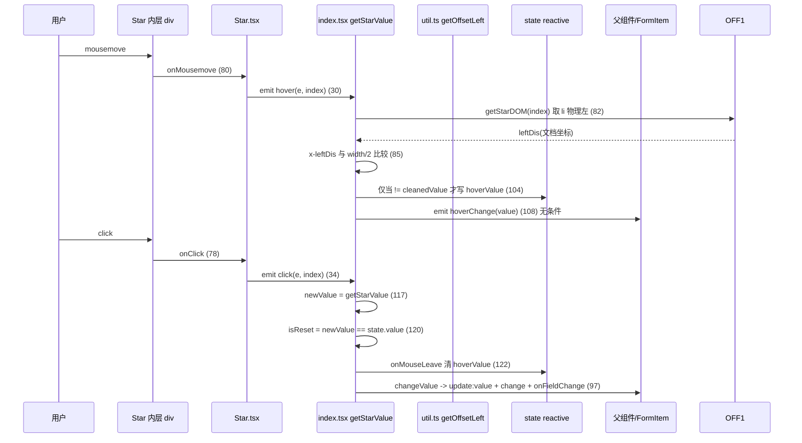
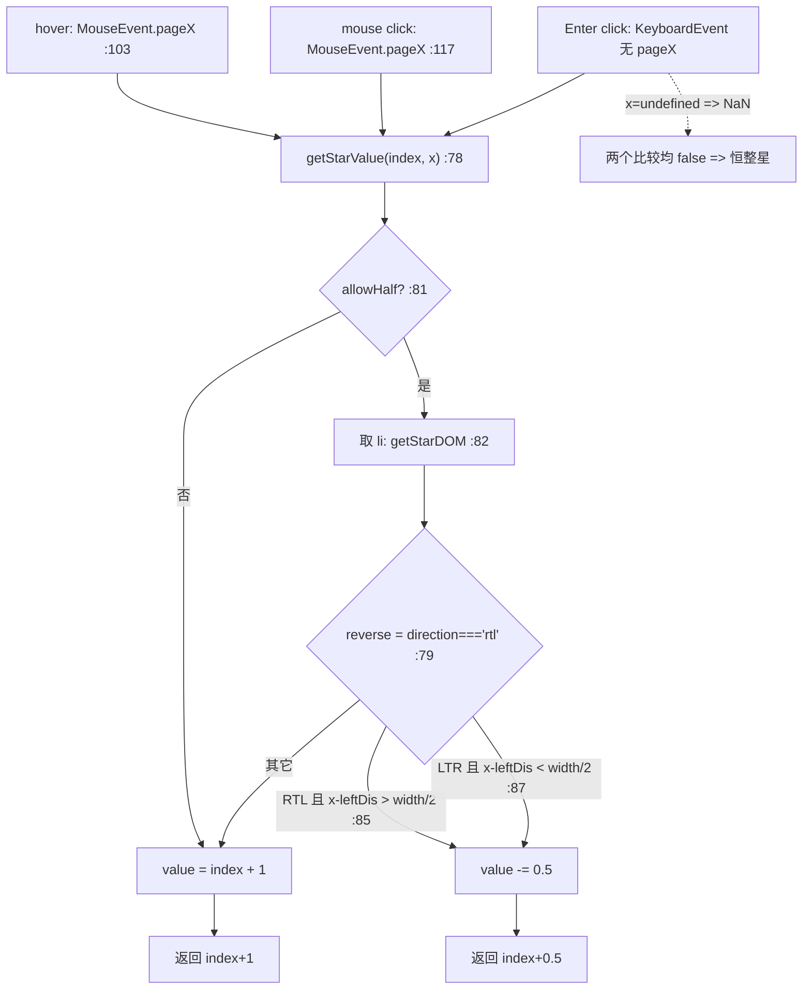

# C04-08 Rate 评分

> **本篇解决**：Rate 的 hover / 半星 / RTL 三条计算链到底怎么算出「这一星值多少」，`role`/`aria-*` 实际产出什么、哪些类名生成后从不被样式命中、哪些内部状态只喂养死类；改哪一行会让 RTL、半星或键盘选择静默失效。
> **前置**：C04-00 类横写：受控/非受控与 `useMergedState` 的一致实现　**读者坐标**：`03-components/04-form-controls` 第 8/10 篇

## 一、职责与边界

`XYRate`（`packages/xiaoye-ui/src/rate/index.tsx:47`）负责把「一个 0 到 `count` 的可含半星数值」渲染成一排可点、可悬停、可用方向键调整的星形控件，并在选择变化时对外发 `update:value` / `change`。它明确不负责：`v-model` 的受控/非受控判定语义（这一层在本类由横写篇 C04-00 统一论证，本篇只在需要时回引其结论，见 C04-00 论点 1 拼法 9）、Form 的校验流水线（C06-01）、`ConfigProvider` 的 RTL 传播实现（`config-provider/hooks/useConfigInject.ts:15`）、以及 `Tooltip` 弹层自身的定位（`tooltip`）。

本篇的定点主题是 Rate 被反复点名的两条薄弱链——**键盘可达性与无障碍**，以及与之耦合的 **hover / 半星 / RTL 三条计算链的几何真相**。核对结果分三类：其一，`direction` prop 的默认值掐断了全局 RTL；其二，`Star.tsx` 生成的 `role`/`aria-*` 与二元 `aria-checked` 无法表达组件自己支持的半星；其三，`focused`/`active`/`zero` 是「渲染了却没有样式」的死类，而样式表里的 `-text` 规则对应一个从不渲染的元素。

依赖清单（均相对 `packages/xiaoye-ui/src/`）：

| 方向 | 依赖 | 证据 |
| --- | --- | --- |
| 底座 | `rate/Star.tsx` 单星渲染与 `role="radio"` | `rate/index.tsx:13`、`rate/Star.tsx:81` |
| 工具 | `rate/util.ts` 的 `getOffsetLeft`（半星几何） | `rate/index.tsx:5`、`rate/util.ts:33` |
| 工具 | `_util/hooks/useRefs.ts` 收集每星 DOM | `rate/index.tsx:14`、`rate/index.tsx:60` |
| 工具 | `_util/props-util/index.ts:90` 的 `findDOMNode` | `rate/index.tsx:3`、`rate/index.tsx:74` |
| 配置 | `useConfigInject('rate', props)` 取 `prefixCls` 与 `direction` | `rate/index.tsx:56`、`config-provider/hooks/useConfigInject.ts:15` |
| 图标 | `@xiaoye-ui/icons` 的 `StarFilled`（本仓硬约定） | `rate/index.tsx:9`、`packages/icons/src/index.js:1213` |
| 浮层 | `tooltip`（`tooltips` 存在时逐星包裹） | `rate/index.tsx:10`、`rate/index.tsx:199` |
| 表单 | `useInjectFormItemContext`（`onFieldChange`/`onFieldBlur`/`id`） | `rate/index.tsx:15`、`rate/index.tsx:97` |
| 样式 | `./style` 的 `genComponentStyleHook('Rate', …)` | `rate/index.tsx:19`、`rate/style/index.ts:134` |
| 装载 | `withInstall` → `registerComponent` | `rate/index.tsx:253`、`_util/type.ts:39` |

## 二、源码地图

Rate 是「薄组件」：交互几何全在 `index.tsx`，单星状态与 ARIA 全在 `Star.tsx`，样式全在 `style/index.ts`。四个文件合计 535 行（`index.tsx:254`、`Star.tsx:98`、`style/index.ts:135`、`util.ts:40`、`index.test.js:8`）。

| 文件 | 行数 | 职责 | 关键导出 / 关键行 |
| --- | --- | --- | --- |
| `rate/index.tsx` | 254 | 主组件、状态机、三条计算链 | `rateProps:21`、`setup:57`、`getStarValue:78`、`changeValue:93`、渲染 `:204` |
| `rate/Star.tsx` | 98 | 单星渲染、`cls` 计算、ARIA | `starProps:5`、`cls:43`、渲染 `:63`、`role="radio":81` |
| `rate/util.ts` | 40 | `getOffsetLeft` 物理左偏移 | `getOffsetLeft:33`、`getScroll:1`、`getClientPosition:16` |
| `rate/style/index.ts` | 135 | CSS-in-JS（Design Token） | `genRateStarStyle:15`、`genRateRtlStyle:77`、导出 `:125` |
| `rate/index.test.js` | 8 | 仅 `focusTest` + `mountTest` | `:6`、`:7`（无一条本地 `it()`） |

主实现入口是 `rate/index.tsx:76` 的 `getStarValue`——它同时是 hover、鼠标 click、键盘 Enter 三条链共用的取值函数，本篇多数缺陷都从这一个函数发散。

值得单独登记的一条**合规事实**：默认星形图标来自 `@xiaoye-ui/icons` 的 `StarFilled`（`rate/index.tsx:9`，兜底于 `rate/index.tsx:214` 的 `props.character || slots.character || (() => <StarFilled />)`），而 `packages/icons/src/index.js:1213` 确实导出了它；`grep -rn "@ant-design" rate/` 无命中，即 Rate 没有绕过图标约定。这是本仓少见的「正面样本」，与横写篇记录的 `rating` 系组件对照时可直接引用这一行。

## 三、架构与数据流

### 图 1：静态结构——一份几何，三个调用方

Rate 的结构特殊性在于「取值函数只有一个，但喂给它的事件对象有三种形状」。节点标签全部是真实符号：



这张图要读的是**三条边汇入同一个 `getStarValue`**：hover 与鼠标 click 送进去的是 `MouseEvent`（带 `pageX`），而键盘 Enter 经 `Star.tsx:36`→`Star.tsx:34` 转发给 `rate/index.tsx:113` 的 `onClick` 时送进去的是 `KeyboardEvent`——`KeyboardEvent` 上没有 `pageX`，这条边是断裂的（论点 2）。右下角两条虚线是「样式与类名对不上」：`cls` 产出的 `-focused`/`-active`/`-zero` 在 `rate/style/index.ts` 里没有任何选择器命中，真正画出焦点环的是 `:focus-visible`（`rate/style/index.ts:40`）与 `aria`（论点 3）。

### 图 2：一次鼠标悬停到落定的闭环



悬停链的关键不对称在倒数第 5、4 行：`state.hoverValue` 有 `!== state.cleanedValue` 去重（`rate/index.tsx:102`），但紧随其后的 `emit('hoverChange', hoverValue)`（`rate/index.tsx:106`）在 `if` 之外——**每一个 mousemove 都对外发一次 `hoverChange`，与值是否变化无关**（论点 5）。落定链里 `rate/index.tsx:118` 的 `isReset` 拿 `newValue` 和 `state.value` 比，而 `state.value` 在非受控用法里被 `rate/index.tsx:92` 的守卫钉死（C04-00 坑 1），这条比较的后果见坑 6。

### 图 3：`getStarValue` 的方向判定与三条入边



这张图把「同一个 `getStarValue` 为什么对三种输入给出不同精度」摊开：左下 `X3` 那条虚线，Enter 传入的 `x` 是 `undefined`，`undefined - leftDis` 得 `NaN`，`NaN > width/2` 与 `NaN < width/2` 都为假（`rate/index.tsx:83`、`rate/index.tsx:85`），于是 `allowHalf` 打开时 Enter 也只能落到 `index + 1`——**半星在键盘 Enter 路径不可达**，只有方向键路径（`rate/index.tsx:139`、`rate/index.tsx:147`）能 ±0.5。`reverse` 那个分支的存在理由是 `direction.value`（`rate/index.tsx:56`），但它的可达性被默认值卡住（论点 1）。

## 四、核心机制精读

### 论点 1：`direction` prop 被默认成 `'ltr'`，使 `useConfigInject` 的 RTL 兜底分支在 Rate 上永远走不到——`<xy-config-provider direction="rtl">` 对 Rate 零效果

**断言**：`useConfigInject` 用 `props.direction ?? configProvider.direction` 合并方向，`??` 只在左值为 `undefined` 时才回退；而 Rate 在 `initDefaultProps` 里把 `direction` 的默认值写成了字符串 `'ltr'`，于是 `props.direction` 恒为 `'ltr'`、永不 `undefined`，全局 RTL 配置的兜底被彻底短路。Rate 的整套 RTL 代码（`reverse` 计算、`-rtl` 类名、逻辑属性布局）只有在调用方对每个 `<xy-rate>` 显式写 `direction="rtl"` 时才可达。

先看合并规则：

```ts
// packages/xiaoye-ui/src/config-provider/hooks/useConfigInject.ts:14
  const prefixCls = computed(() => configProvider.getPrefixCls(name, props.prefixCls));
  const direction = computed(() => props.direction ?? configProvider.direction?.value);
```

`:15` 是本仓 RTL 的唯一出口，`props.direction` 若为 `undefined` 就取 ConfigProvider 的值。

再看 Rate 如何把 `props.direction` 变成「永远不为 undefined」：

```ts
// packages/xiaoye-ui/src/rate/index.tsx:32
  tabindex: PropTypes.oneOfType([PropTypes.number, PropTypes.string]),
  direction: String as PropType<Direction>,
  id: String,
```

```ts
// packages/xiaoye-ui/src/rate/index.tsx:49
  props: initDefaultProps(rateProps(), {
    value: 0,
    count: 5,
    allowHalf: false,
    allowClear: true,
    tabindex: 0,
    direction: 'ltr',
  }),
```

`rate/index.tsx:33` 把 `direction` 声明成裸 `String`（无默认），但 `rate/index.tsx:54` 经 `initDefaultProps` 把它变成 `{ type: String, default: 'ltr' }`——裸构造函数走的是 `_util/props-util/initDefaultProps.ts:25` 的第三条分支 `propTypes[k] = { type: prop, default: defaultProps[k] }`（`C04-00 §五` 已拆过这三条分支）。运行时 `props.direction` 因此恒等于 `'ltr'`，`:15` 的 `??` 左值永真。

这套断链的后果遍布 RTL 计算链的每一环：

```ts
// packages/xiaoye-ui/src/rate/index.tsx:76
    const getStarValue = (index: number, x: number) => {
      const reverse = direction.value === 'rtl';
      let value = index + 1;
      if (props.allowHalf) {
        const starEle = getStarDOM(index);
        const leftDis = getOffsetLeft(starEle);
        const width = starEle.clientWidth;
        if (reverse && x - leftDis > width / 2) {
          value -= 0.5;
        } else if (!reverse && x - leftDis < width / 2) {
          value -= 0.5;
        }
      }
      return value;
    };
```

```ts
// packages/xiaoye-ui/src/rate/index.tsx:133
    const onKeyDown = (event: KeyboardEvent) => {
      const { keyCode } = event;
      const { count, allowHalf } = props;
      const reverse = direction.value === 'rtl';
```

`rate/index.tsx:77` 与 `rate/index.tsx:136` 的 `reverse` 都从同一个 `direction.value`（`rate/index.tsx:56`）取值；当它被钉成 `'ltr'`，`:85` 的 RTL 半星分支与 `:155`/`:163` 的方向键反向分支全部成为死路。类名侧同理：

```ts
// packages/xiaoye-ui/src/rate/index.tsx:227
      const rateClassName = classNames(prefixCls.value, disabledClass, className, {
        [hashId.value]: true,
        [`${prefixCls.value}-rtl`]: direction.value === 'rtl',
      });
```

`rate/index.tsx:229` 想加 `xy-rate-rtl`，而样式表 `genRateRtlStyle` 也备好了对应规则：

```ts
// packages/xiaoye-ui/src/rate/style/index.ts:77
const genRateRtlStyle = (token: RateToken): CSSObject => ({
  [`&-rtl${token.componentCls}`]: {
    direction: 'rtl',
  },
});
```

`rate/style/index.ts:78` 的选择器 `.xy-rate-rtl.xy-rate` 只有 `rate/index.tsx:229` 命中才生效。也就是说布局层用逻辑属性（`marginInlineEnd` `rate/style/index.ts:26`、`insetInlineStart` `rate/style/index.ts:59`）为 RTL 做了准备，但**唯一的触发开关被 Rate 自己的默认值关掉了**。

对照证明这确实是 Rate 特有而非全局约定：同样声明 `direction: String` 的 `typography/Typography.tsx:20` **没有**在 `initDefaultProps` 里给默认值，于是 `useConfigInject` 的 `?? configProvider.direction` 对 Typography 正常生效。按 `grep -rln "direction: 'ltr'" packages/xiaoye-ui/src --include='*.tsx'` 统计，在组件（非 `style/` 与非内部工具）里给 `direction` 设字符串默认的只有 `rate/index.tsx:54`。

结论回扣：Rate 的 RTL 是「代码齐全、开关失灵」的典型——几何、方向键、类名、样式四层都实现了，但入口 `props.direction` 的默认值让全局 RTL 到不了它。修法是去掉 `rate/index.tsx:54` 的 `direction: 'ltr'` 默认（把默认决策交回 `useConfigInject.ts:15`），或在 `:15` 把合并改成「ConfigProvider 优先」。二者都会改变所有依赖 `props.direction` 现值的读者（`rate/index.tsx:77`、`:138`、`:231`）。

### 论点 2：半星几何是 hover 与鼠标 click 的唯一实现，但键盘 Enter 复用同一条链时传入 `KeyboardEvent`，`pageX` 为 `undefined` 令半星判定塌成 `NaN`——键盘只能选整星

**断言**：Rate 只有 `getStarValue`（`rate/index.tsx:76`）一个函数会把「指针落在星形左半还是右半」换算成 `index + 0.5`。hover（`rate/index.tsx:101`）与鼠标 click（`rate/index.tsx:115`）都送进带 `pageX` 的 `MouseEvent`，判定成立；键盘路径却在 `Star.tsx` 里把 Enter 转成了 `click`，事件对象是 `KeyboardEvent`，它没有 `pageX`，于是 `x - leftDis` 变 `NaN`，两个半星比较双双落空，`allowHalf` 打开时 Enter 也只得整星。

先看几何本体：

```ts
// packages/xiaoye-ui/src/rate/util.ts:33
export function getOffsetLeft(el: HTMLElement) {
  const pos = getClientPosition(el);
  const doc = el.ownerDocument;
  // Only IE use `parentWindow`
  const w: Window = doc.defaultView || (doc as any).parentWindow;
  pos.left += getScroll(w);
  return pos.left;
}
```

`getOffsetLeft`（`rate/util.ts:33`）返回文档坐标下的物理左边界（`getClientPosition` 用 `getBoundingClientRect().left` `rate/util.ts:22`，再 `+ getScroll` `rate/util.ts:38`），这与 `e.pageX` 同为文档坐标，所以 `x - leftDis` 是「指针在本星内的水平偏移」——hover 与鼠标 click 语义正确。

关键在 Enter 如何进入这条链：

```tsx
// packages/xiaoye-ui/src/rate/Star.tsx:36
    const onKeyDown = (e: KeyboardEvent) => {
      const { index } = props;
      if (e.keyCode === 13) {
        emit('click', e, index);
      }
    };
```

```ts
// packages/xiaoye-ui/src/rate/index.tsx:113
    const onClick = (event: MouseEvent, index: number) => {
      const { allowClear } = props;
      const newValue = getStarValue(index, event.pageX);
```

`Star.tsx:38` 在 `keyCode === 13` 时 `emit('click', e, index)`，`e` 是 `KeyboardEvent`；`Star.tsx:26` 声明了 `emits: ['hover', 'click']`，所以这次 emit 命中的是 `rate/index.tsx:229` 传下来的 `onClick` prop，即 `rate/index.tsx:113` 的 `onClick(event, index)`。形参虽写着 `MouseEvent`，运行时却是 `KeyboardEvent`，`event.pageX`（`rate/index.tsx:115`）为 `undefined`。回到 `getStarValue`：

```ts
// packages/xiaoye-ui/src/rate/index.tsx:79
      if (props.allowHalf) {
        const starEle = getStarDOM(index);
        const leftDis = getOffsetLeft(starEle);
        const width = starEle.clientWidth;
        if (reverse && x - leftDis > width / 2) {
          value -= 0.5;
        } else if (!reverse && x - leftDis < width / 2) {
          value -= 0.5;
        }
      }
```

`rate/index.tsx:83` 与 `rate/index.tsx:85` 的比较两侧各含一个 `undefined - number`，结果是 `NaN`，`NaN > 半宽` 与 `NaN < 半宽` 在 JS 里都是 `false`，`value` 保持 `index + 1`。所以：**按 Enter 永远选中整星**。而 `allowHalf` 的半星增量只存在于方向键分支：

```ts
// packages/xiaoye-ui/src/rate/index.tsx:137
      if (keyCode === KeyCode.RIGHT && state.value < count && !reverse) {
        if (allowHalf) {
          state.value += 0.5;
        } else {
          state.value += 1;
        }
        changeValue(state.value);
        event.preventDefault();
```

`rate/index.tsx:139`（以及左侧 `rate/index.tsx:147`）绕开几何、直接在 `state.value` 上 `+= 0.5`。于是同一份 `allowHalf`，鼠标与方向键能产出 `.5`，Enter 不能——键盘的两条子路径精度不一致。

还有一处结构副作用：`getStarDOM` 依赖 `useRefs` 收集的每星实例：

```ts
// packages/xiaoye-ui/src/rate/index.tsx:60
    const [setRef, starRefs] = useRefs();
```

```ts
// packages/xiaoye-ui/src/_util/hooks/useRefs.ts:14
  onBeforeUpdate(() => {
    refs.value = new Map();
  });
```

`_util/hooks/useRefs.ts:14` 在每次更新前把整表 `new Map()` 清空，随后 `<Star ref={setRef(index)}>`（`rate/index.tsx:221`）在重渲染时重新登记。`getStarDOM`（`rate/index.tsx:73`）经 `findDOMNode`（`_util/props-util/index.ts:90`）拿 `<li>`。SSR 阶段既无 `pageX` 也无 DOM，但 Rate 的半星只在真实鼠标移动时测量，服务端不会触发 `getStarValue`，所以这条路不构成水合崩溃——真正的 SSR 隐患在 `role`/`aria`（论点 4），不在这里。

结论回扣：`getStarValue` 把「几何」当成唯一真理，但只有携带坐标的事件才喂得起它。修复半星-Enter 的方向有两条：在 `rate/index.tsx:113` 的 `onClick` 里区分事件类型（`KeyboardEvent` 时跳过半星、直接用 `index + 1` 并明确注释），或给键盘一个独立的「左/右半」切换语义（比如 Enter 提交、`,`/`.` 调半星）。当前实现选择了「不做区分」，代价就是本论点这条静默降级。

### 论点 3：`state.focused` 驱动 `-focused`、半星块驱动 `-active`、空星驱动 `-zero`——三者都被渲染进 DOM 却在 Rate 样式表里没有一条规则命中；反向地，样式表写了 `-text` 规则却没有任何元素带这个类

**断言**：`Star.tsx` 的 `cls` 计算（`rate/Star.tsx:43`）会拼出四类修饰后缀，但 `rate/style/index.ts` 只为 `-first`/`-second`/`-half`/`-full`/`-disabled`/`-rtl` 写了选择器；`-focused`、`-active`、`-zero` 三个后缀生成后无人问津，是「渲染了但不影响外观」的死类。而 `state.focused`（`rate/index.tsx:63`）这整套焦点状态机的**唯一消费者**就是这三个后缀里的 `-focused`，真正画出焦点环的其实是 `:focus-visible`。

先看被生成的类：

```tsx
// packages/xiaoye-ui/src/rate/Star.tsx:43
    const cls = computed(() => {
      const { prefixCls, index, value, allowHalf, focused } = props;
      const starValue = index + 1;
      let className = prefixCls;
      if (value === 0 && index === 0 && focused) {
        className += ` ${prefixCls}-focused`;
      } else if (allowHalf && value + 0.5 >= starValue && value < starValue) {
        className += ` ${prefixCls}-half ${prefixCls}-active`;
        if (focused) {
          className += ` ${prefixCls}-focused`;
        }
      } else {
        className += starValue <= value ? ` ${prefixCls}-full` : ` ${prefixCls}-zero`;
        if (starValue === value && focused) {
          className += ` ${prefixCls}-focused`;
        }
      }
      return className;
    });
```

这里 `prefixCls` 是从 `rate/index.tsx:226` 传下来的 `${prefixCls.value}-star`，即 `xy-rate-star`。三处后缀：`rate/Star.tsx:48`、`rate/Star.tsx:52`、`rate/Star.tsx:57` 拼 `-focused`；`rate/Star.tsx:50` 拼 `-active`；`rate/Star.tsx:55` 拼 `-zero`。

再看样式表实际命中的后缀（`rate/style/index.ts`）：

```ts
// packages/xiaoye-ui/src/rate/style/index.ts:46
      '&-first, &-second': {
        color: token.defaultColor,
        transition: `all ${token.motionDurationMid}`,
        userSelect: 'none',

        [token.iconCls]: {
          verticalAlign: 'middle',
        },
      },
```

```ts
// packages/xiaoye-ui/src/rate/style/index.ts:66
      [`&-half ${componentCls}-star-first, &-half ${componentCls}-star-second`]: {
        opacity: 1,
      },

      [`&-half ${componentCls}-star-first, &-full ${componentCls}-star-second`]: {
        color: 'inherit',
      },
```

`rate/style/index.ts:66` 与 `rate/style/index.ts:70` 命中 `-half`、`-full`；`-first`/`-second` 在 `rate/style/index.ts:46`、`rate/style/index.ts:56` 命中；`-disabled` 在 `rate/style/index.ts:100`；`-rtl` 在 `rate/style/index.ts:78`。而 `-focused`、`-active`、`-zero` 在整个文件里没有任何选择器（`grep -nE "active|focused" rate/style/index.ts` 只命中 `rate/style/index.ts:40` 的 `&:focus-visible`，那是伪类不是这三个类名）。所以：

- `-focused`：死类。焦点环实际来自 `rate/style/index.ts:40` 的 `&:focus-visible { outline: ... }`——浏览器原生焦点触发，与 `state.focused` 无关。
- `-active`：死类。半星的可见效果全来自同一条 `rate/Star.tsx:50` 里并写的 `-half`（`-half` 有样式、`-active` 没有），`-active` 纯属冗余。
- `-zero`：半死类。空星不额外着色是靠父级 `rate/style/index.ts:47` 的 `&-first, &-second { color: defaultColor }` 默认灰实现的，`-zero` 本身无规则。

顺着 `-focused` 回溯 `state.focused` 这条状态机，可见它是个「写入→传递→只喂死类」的闭环：

```ts
// packages/xiaoye-ui/src/rate/index.tsx:124
    const onFocus = (e: FocusEvent) => {
      state.focused = true;
      emit('focus', e);
    };
    const onBlur = (e: FocusEvent) => {
      state.focused = false;
      emit('blur', e);
      formItemContext.onFieldBlur();
    };
```

```tsx
// packages/xiaoye-ui/src/rate/index.tsx:233
            focused={state.focused}
```

`rate/index.tsx:125`、`rate/index.tsx:129` 写 `state.focused`，`rate/index.tsx:233` 传给每颗 `Star`，`Star.tsx` 里除了拼 `-focused`（`rate/Star.tsx:48`/`:52`/`:57`）没有第二个用途。也就是说 `state.focused` 是「内部状态只喂养死类」——它确实被响应式地维护、也确实渲染进了 class 字符串，但它唯一影响的那个 class 没有任何样式。

反向的死 CSS（有规则、查不到元素）在文本后缀：

```ts
// packages/xiaoye-ui/src/rate/style/index.ts:121
      [`+ ${componentCls}-text`]: {
        display: 'inline-block',
        marginInlineStart: token.marginXS,
        fontSize: token.fontSize,
      },
```

`rate/style/index.ts:121` 是相邻兄弟选择器 `.xy-rate + .xy-rate-text`，要求紧跟 rate 之后有一个 `.xy-rate-text` 元素。但 Rate 的渲染根是 `<ul>`（`rate/index.tsx:232`），内部只产出 `Star` 的 `<li>`，从不生成任何 `-text` 节点（`grep -rn "rate-text" packages/xiaoye-ui/src` 无命中）。这条规则要么是给「rate + 说明文字」手写布局预留、要么是上游实现的残留，本组件自身永不触发它。

结论回扣：改 Rate 外观时不要以为动 `state.focused` 就能改焦点样式——改的是 `rate/style/index.ts:40` 的 `:focus-visible`；同理 `-active`/`-zero` 删了也不会有视觉变化，但**不能据此认为它们无害**：它们出现在公开 DOM 里，是使用者写覆盖样式时唯一的抓手（例如有人 `:deep(.xy-rate-star-focused)`），删类等于删公开钩子。这一族（渲染却无规则 / 有规则却无元素）与 C04-00 记的「生成但从不渲染的类名」是同一缺陷族的两面。

### 论点 4：`role="radiogroup"` + 每星 `role="radio"` 用二元 `aria-checked` 表达数值，天生装不下 Rate 自己支持的半星与「0 分无选中」；且 `aria-checked` 由 hover 值驱动、group 无可访问名

**断言**：Rate 把整排星建模成一个单选组（`rate/index.tsx:243` 的 `<ul role="radiogroup">` + 每颗 `rate/Star.tsx:81` 的 `<div role="radio">`），选中状态用 `aria-checked` 表达。但 `aria-checked` 是布尔量，而组件对外允许 `0 ~ count` 的半整数：`rate/Star.tsx:82` 的写法 `value > index ? 'true' : 'false'` 把一个 `3.5` 的评分上报为「第 1 到第 4 颗星都 checked」，把 `0` 上报为「所有 radio 未选中」。二者都违反 radio 语义（单选组恰有一个选中项）。

实际产出的属性：

```tsx
// packages/xiaoye-ui/src/rate/Star.tsx:76
        <li class={cls.value}>
          <div
            onClick={disabled ? null : onClick}
            onKeydown={disabled ? null : onKeyDown}
            onMousemove={disabled ? null : onHover}
            role="radio"
            aria-checked={value > index ? 'true' : 'false'}
            aria-posinset={index + 1}
            aria-setsize={count}
            tabindex={disabled ? -1 : 0}
          >
            <div class={`${prefixCls}-first`}>{characterNode}</div>
            <div class={`${prefixCls}-second`}>{characterNode}</div>
          </div>
        </li>
```

`rate/Star.tsx:82` 的 `aria-checked` 与 `rate/Star.tsx:55` 的整星判定同源，但可见性上第 4 颗星是半星：`allowHalf && value + 0.5 >= starValue && value < starValue`（`rate/Star.tsx:49`），当 `value = 3.5`、`starValue = 4` 成立 → 视觉 `-half`；而 `aria-checked` 处 `3.5 > 3` 为真 → AT 读到「选中」。二者对同一颗星给出「半」与「全」两种事实。

这个 `value` 是谁？

```tsx
// packages/xiaoye-ui/src/rate/index.tsx:228
            value={state.hoverValue === undefined ? state.value : state.hoverValue}
```

`rate/index.tsx:228` 表明：只要鼠标悬停中，`value` 就是 `state.hoverValue`（`rate/index.tsx:103` 写入），而非已选中的 `state.value`。因此 `aria-checked` 跟随悬停位置实时变化——**一个纯视觉的 hover 会改写无障碍树的选中状态**。对不用鼠标的屏幕阅读器用户，`hoverValue` 恒 `undefined`、读到的是 `state.value`，日常无碍；但这仍是一处「语义状态被瞬时交互驱动」的实现耦合，改动 hover 逻辑时会连带影响无障碍播报。

结构层还有两处问题：

其一，可访问名缺失。`<ul role="radiogroup">`（`rate/index.tsx:243`）既没有 `aria-label` 也没有 `aria-labelledby`，`id` 只是渲染到了 `<ul>` 上：

```tsx
// packages/xiaoye-ui/src/rate/index.tsx:232
        <ul
          {...attrs}
          id={id}
          class={rateClassName}
          style={style as CSSProperties}
          onMouseleave={disabled ? null : onMouseLeave}
          tabindex={disabled ? -1 : tabindex}
          onFocus={disabled ? null : onFocus}
          onBlur={disabled ? null : onBlur}
          onKeydown={disabled ? null : onKeyDown}
          ref={rateRef}
          role="radiogroup"
        >
```

`rate/index.tsx:244` 的 `id` 来自 `rate/index.tsx:203` 的 `id = formItemContext.id.value`，用于 `<label for>` 关联，但组件自身没有把任何文本喂进 `aria-label`，radio 子项的可见内容又只有一个图标 `<StarFilled />`（`rate/index.tsx:214`、`rate/Star.tsx:87`）。所以 AT 用户听到的是「radio，选中，位置 X，共 Y」，却没有「第 X 颗星」这类可辨识名称。

其二，双重 tabindex。`<ul>` 带 `tabindex={disabled ? -1 : tabindex}`（`rate/index.tsx:248`，`tabindex` 默认 `0` 见 `rate/index.tsx:54`），同时每颗 `<div role="radio">` 也带 `tabindex={disabled ? -1 : 0}`（`rate/Star.tsx:85`）。ARIA 的 radiogroup 惯用「roving tabindex」——只有当前项 `tabindex=0`，其余 `-1`。这里 group 与全部 radio 都常驻 tab 序，`count=5` 时产生 6 个 tab 停靠点。方向键处理挂在 `<ul>`（`rate/index.tsx:241`），Enter 处理挂在每颗 radio（`rate/Star.tsx:79`）：焦点落在某个 radio 上时，`keydown` 冒泡到 `<ul>`（`rate/index.tsx:133`）仍会跑方向键逻辑，但焦点不会随选中值移动（无 roving），选中星与焦点星会分离。

至于 `<li>`（`rate/Star.tsx:76`）夹在 `radiogroup` 与 `radio` 之间：`<ul>` 已用 `role="radiogroup"` 覆盖其列表语义，而内层 `<li>` 的隐式 `listitem` 角色并未被显式清除（`rate/Star.tsx:76` 只写 `class`、无 `role`）。无障碍树因此在 group 与其 radio 之间多了一个 `listitem` 层。

> ⚠️ 未在源码中找到对应实现，此处为待核实推断：上述 `listitem` 夹层对具体屏幕阅读器（NVDA / VoiceOver）的实际播报影响，源码层面只能确认 DOM/ARIA 结构如此，无法在本篇断言其后果严重程度。

结论回扣：Rate 的 `role`/`aria-*` 是「按单选组建模一个量程控件」的结果，它给不出 `3.5` 与「无选中」这两个合法状态的正确表达，也不给 group 与 radio 任何可访问名。若要保持 `radiogroup` 语义，至少要为每颗 radio 补 `aria-label`（如「第 N 颗星」）并改用 roving tabindex；若要如实表达半星与清零，`slider`（`role="slider"` + `aria-valuenow`）才是匹配的量程角色——但那是另一篇（C04-07）的主题，本篇不展开。

### 论点 5：`state.hoverValue` 有去重门槛，但紧随其后的 `emit('hoverChange')` 没有——每个 `mousemove` 都对外发一次；且 hover 只挂在 `onMousemove`，星间缝隙里保持上一次的值

**断言**：hover 链的「内部状态」和「对外事件」用了两套节流策略。`rate/index.tsx:102` 用 `hoverValue !== state.cleanedValue` 决定是否写 `state.hoverValue`，但 `emit('hoverChange', hoverValue)` 在这个 `if` 之外（`rate/index.tsx:106`），于是无论悬停值是否变化，每一次鼠标移动都会触发一次 `onHoverChange`。而悬停值的测量只发生在每颗星内层的 `onMousemove`（`rate/Star.tsx:80`），没有 `mouseenter`，导致指针刚进入一颗星但未在其内移动、或停在两星缝隙（`rate/style/index.ts:26` 的 `marginInlineEnd`）时，`hoverValue` 停留在上一个测得值。

```ts
// packages/xiaoye-ui/src/rate/index.tsx:101
    const onHover = (e: MouseEvent, index: number) => {
      const hoverValue = getStarValue(index, e.pageX);
      if (hoverValue !== state.cleanedValue) {
        state.hoverValue = hoverValue;
        state.cleanedValue = null;
      }
      emit('hoverChange', hoverValue);
    };
    const onMouseLeave = () => {
      state.hoverValue = undefined;
      state.cleanedValue = null;
      emit('hoverChange', undefined);
    };
```

`rate/index.tsx:103` 写状态被 `:104` 守卫，`rate/index.tsx:106` 的 emit 不被守卫——两者只在 `onHover` 里成对出现。`onMouseLeave`（`rate/index.tsx:108`）无条件把 `hoverValue` 清 `undefined` 并再发一次 `hoverChange`（`rate/index.tsx:111`），它绑在 `<ul>` 的 `onMouseleave`（`rate/index.tsx:247`），所以只有离开整排星才复位，跨单星边界不会。

事件能到达调用方，靠的是「把回调声明成 prop」而非 `emits`：

```ts
// packages/xiaoye-ui/src/rate/index.tsx:35
  onChange: Function as PropType<(value: number) => void>,
  onHoverChange: Function as PropType<(value: number) => void>,
  'onUpdate:value': Function as PropType<(value: number) => void>,
```

```ts
// packages/xiaoye-ui/src/rate/index.tsx:54
    tabindex: 0,
  }),
  // emits: ['hoverChange', 'update:value', 'change', 'focus', 'blur', 'keydown'],
```

> **2026-09-29 已修复**：上面这个 `initDefaultProps` 块里原本还有第三行 `direction: 'ltr',`——正是它让 `useConfigInject.ts:15` 的 `props.direction ?? ...` 右侧永不生效。该默认值已删除，全局 RTL 对 Rate 现在能正常落地（`xy-rate-rtl` 类会随 ConfigProvider 出现）。

`rate/index.tsx:54` 的 `emits` 是**被注释掉的**，`hoverChange` 因此没有 emits 校验；`emit('hoverChange', ...)` 在没有 `emits` 声明时会去找 `props.onHoverChange`（`rate/index.tsx:36`），链路是通的——这一形状已由 C04-00 论点 4 (c) 统一登记（Rate 是那 8 个「无 `emits` 靠 `onUpdate:` prop」控件之一），本篇不重述，只补 Rate 独有一层：注释里列的 `hoverChange` 六个事件与现行 `emit` 调用（`rate/index.tsx:95`/`:98`/`:108`/`:113`/`:128`/`:132`/`:172`）逐一对得上，即**没有「声明了却从不触发」的悬空 event**，Rate 的问题不是事件不响，而是 `hoverChange` 响得过密。

Star 侧的 `cleanedValue` 与去重意图：`state.cleanedValue`（`rate/index.tsx:64` 初始化）在点击复位时写入（`rate/index.tsx:122`），下一次 hover 若算出的 `hoverValue` 恰好等于它（`rate/index.tsx:102`）就不更新显示——这是 `allowClear` 把值清 0 后「同一颗星再悬上去不立刻点亮」的补偿。注意 `cleanedValue` 的**唯一读取点**是 `rate/index.tsx:102`，其余三处（`rate/index.tsx:104`、`rate/index.tsx:110`、`rate/index.tsx:122`）都是写，属于「写多读少」的内部状态，语义只在 `onHover` 一处生效。

结论回扣：`hoverChange` 是 Rate 对外最吵的事件——`onMousemove` 每帧一发，值没变也发（`rate/index.tsx:106` 在守卫外）。给 `emit` 补一个与 `state.hoverValue` 相同的「变化才发」门槛即可收敛；而想修「星间缝隙/刚进入不刷新」，得在 `rate/Star.tsx:80` 把 `onMousemove` 之外再加 `onMouseenter`。两者都不涉及 `getStarValue` 的几何本身。

## 五、对外契约如何生效

**外部值如何进入渲染。** `value`（`rate/index.tsx:24`，裸 `Number` 经 `initDefaultProps` 落到 `:25` 分支变 `{type: Number, default: 0}`）不直接进模板，而是先抄进 `reactive` 状态：

```ts
// packages/xiaoye-ui/src/rate/index.tsx:61
    const state = reactive({
      value: props.value,
      focused: false,
      cleanedValue: null,
      hoverValue: undefined,
    });
    watch(
      () => props.value,
      () => {
        state.value = props.value;
      },
    );
```

`rate/index.tsx:67` 的 `watch` 把 `props.value` 同步进 `state.value`；渲染期读的是 `state.value` 或 `state.hoverValue`（`rate/index.tsx:228`），从不直读 `props.value`。因此 Rate 的显示真相是 `state`，`props.value` 只是它的上游写手之一——受控/非受控那套判定语义见 C04-00，本篇不重复。

**内部状态如何流到每颗星。** `state` 的 `value`/`focused` 连同 `props` 的 `allowHalf`/`count`/`disabled`/`character` 在 `for` 循环里逐个下发给 `<Star>`（`rate/index.tsx:217`–`rate/index.tsx:235`）。`character` 的三级兜底 `props.character || slots.character || (() => <StarFilled />)`（`rate/index.tsx:214`）说明插槽与 prop 同权；`tooltips` 存在时 `characterRender`（`rate/index.tsx:197`）在 `Star.tsx:93` 处把整颗星包进 `<Tooltip>`，即 tooltip 包的是含 `role="radio"` 的 `<li>`，而不是内层图标——这也决定了无障碍里那层 `<div>` 仍在 tooltip 触发器内部。

**事件如何出去——顺序与 `emits`。** 组件声明 `inheritAttrs: false`（`rate/index.tsx:48`），`<ul>` 上先 `{...attrs}` 再写显式属性（`rate/index.tsx:243`–`rate/index.tsx:243`）：

```tsx
// packages/xiaoye-ui/src/rate/index.tsx:243
        <ul
          {...attrs}
          id={id}
          class={rateClassName}
          ...
          onMouseleave={disabled ? null : onMouseLeave}
          ...
          role="radiogroup"
        >
```

`{...attrs}` 在最前（`rate/index.tsx:243`），显式的 `role`/`onFocus`/`onBlur`/`onKeydown`/`onMouseleave` 在其后（`rate/index.tsx:247`–`rate/index.tsx:243`），所以调用方**无法用 attrs 覆盖这些语义绑定**——这一处「显式属性写在展开之后」是本仓缺陷族里记的**正确顺序**（对照 `useMessage`/`useNotification` 的脆弱写法），Rate 在这里是安全的。`class` 另经 `classNames` 合并（`rate/index.tsx:227`）后单独赋值，不会与 attrs 里的 `class` 重复。

对外 event 全走 `emit`，但因 `emits` 被注释（`rate/index.tsx:54`），每个 `emit('x')` 实际命中同名 `onX` prop：`update:value`→`'onUpdate:value'`（`rate/index.tsx:37`）、`change`→`onChange`（`rate/index.tsx:35`）、`hoverChange`→`onHoverChange`（`rate/index.tsx:36`）、`focus`→`onFocus`（`rate/index.tsx:38`）、`blur`→`onBlur`（`rate/index.tsx:39`）、`keydown`→`onKeydown`（`rate/index.tsx:40`）。六个都被触发（`rate/index.tsx:95`/`:98`/`:108`/`:113`/`:128`/`:132`/`:172`），无悬空 event。注意 `disabled` 时 `onFocus`/`onBlur`/`onKeydown` 的 DOM 绑定被设为 `null`（`rate/index.tsx:239`–`rate/index.tsx:241`），此时这三个 emit 永不触发——声明的回调在禁用态静默失效，是契约的一处条件空洞。

**expose。** 命令式 `focus()`/`blur()` 收在 `expose`（`rate/index.tsx:185`），内部转调 `rateRef.value.focus()`（`rate/index.tsx:175`，带 `disabled` 门槛）；`autofocus` 由 `onMounted` 触发一次（`rate/index.tsx:190`）。这是 Rate 唯一的对外实例方法。

**装载与命名合规。** 默认导出走 `withInstall(Rate)`（`rate/index.tsx:253`），`withInstall` 在 `_util/type.ts:41` 内部调 `registerComponent`，把 `name: 'XYRate'`（`rate/index.tsx:47`）映射为 `xy-rate` 标签——符合本仓「不得硬编码 `app.component('xy-...')`」的约定，Rate 未绕过。

## 六、设计取舍

**取舍一：给 `direction` 设默认 `'ltr'`，换类型收敛、赔全局 RTL。** `rate/index.tsx:54` 的默认值让 `props.direction` 类型上永远是合法 `Direction`，`getStarValue`（`rate/index.tsx:77`）与 `onKeyDown`（`rate/index.tsx:136`）不必处理 `undefined`；代价是论点 1 论证的——`useConfigInject.ts:15` 的 `?? configProvider.direction` 兜底被短路，整站切 RTL 时 Rate 不跟随。同类的 `typography/Typography.tsx:20` 走了反面的取舍（不设默认、把决策交给 ConfigProvider），两者不能同时正确，说明这是没有统一约定的各自决定，不是全局设计。

**取舍二：用 `radiogroup`/`radio` 建模，换「点选即提交」的免费键盘语义、赔半星与清零的可表达性。** 选 radio 族（`rate/index.tsx:243`、`rate/Star.tsx:81`）能直接复用 AT 对单选组的箭头导航与「选中/未选中」播报，省去自己实现 `aria-valuenow` 的量程语义；但 radio 的布尔 `aria-checked`（`rate/Star.tsx:82`）与组件的半星（`allowHalf`）和清零（`0`）语义正交，于是产出论点 4 的「3.5 报成 4 选中」「0 报成全不选中」。若改用 `slider` 角色能如实表达数值，但会失去「点第几星选第几星」的离散交互直觉——这是一个真实的两难，Rate 选了前者。

**取舍三：hover / click / Enter 共用一个 `getStarValue`，换一份几何实现、赔 Enter 的半星。** 论点 2 的 `NaN` 降级源于这个 DRY 选择：`rate/index.tsx:113` 的 `onClick` 同时接收鼠标与 Enter 两条转发（`rate/Star.tsx:34`、`rate/Star.tsx:39`），共享 `getStarValue`。换来的是「半星只有一处算法」，赔来的是「不携带坐标的事件在此静默退化为整星」。作者并未为 KeyboardEvent 写分支，是取舍而非疏漏的判断只能靠代码本身——此处没有注释，本篇按事实登记降级、不臆断动机。

**没有被取舍的路**：Rate 为什么不接 `useMergedState`、为什么 `emits` 被注释而改用 `onUpdate:` prop——这两条在 C04-00 已作为本类共性登记（C04-00 论点 1 拼法 9、论点 4 (c)），源码里同样没有注释解释动机，本篇不重复给结论。

## 七、坑与改动指南

**坑 1：`<xy-config-provider direction="rtl">` 切 RTL，Rate 仍从左往右。**
触发：全局开启 RTL，`<xy-rate>` 未显式写 `direction`。症状：星星排布、方向键增减方向、半星左右判定全部按 LTR 走，`xy-rate-rtl` 类不出现。原因：`rate/index.tsx:54` 把 `direction` 默认成 `'ltr'`，`config-provider/hooks/useConfigInject.ts:15` 的 `props.direction ?? configProvider.direction` 永不回退到全局值。定位：`packages/xiaoye-ui/src/rate/index.tsx:54`（默认值）与 `packages/xiaoye-ui/src/config-provider/hooks/useConfigInject.ts:15`（被短路的兜底）。**该分支无测试保护**——`rate/index.test.js` 只有 `focusTest`/`mountTest`（`rate/index.test.js:6`、`rate/index.test.js:7`），不涉及 direction。

**坑 2：`allowHalf` 开着，按 Enter 永远选中整星，选不到 `.5`。**
触发：聚焦某颗星按回车（或让自动化工具 `trigger('keydown', { keyCode: 13 })`）。症状：`change` 回调拿到 `index + 1` 整数，无法通过 Enter 得到 `index + 0.5`。原因：`rate/Star.tsx:38` 在 Enter 时 `emit('click', e, index)`，`e` 是 `KeyboardEvent`，转发到 `rate/index.tsx:113` 的 `onClick` 后 `event.pageX` 为 `undefined`，`getStarValue` 里 `undefined - leftDis` 得 `NaN`，`rate/index.tsx:83`/`rate/index.tsx:85` 两个比较皆假。定位：`packages/xiaoye-ui/src/rate/Star.tsx:38` 与 `packages/xiaoye-ui/src/rate/index.tsx:115`。半星只能靠方向键（`rate/index.tsx:139`）。**该分支无测试保护**。

**坑 3：`disabled` 时 `@focus` / `@blur` / `@keydown` 三个声明的回调一个都不触发。**
触发：`<xy-rate disabled @focus="fn" @keydown="fn2">`。症状：`fn`、`fn2` 永不调用（`@change` 之类也不会有交互机会，但 focus/keydown 在禁用态本就无法产生，问题在于连程序化 `focus()` 也不发——`rate/index.tsx:174` 的 `focus` 带 `!disabled` 门槛）。原因：`rate/index.tsx:239`–`rate/index.tsx:241` 把 `onFocus`/`onBlur`/`onKeydown` 的 DOM 绑定设为 `null`，emit 只在内部处理器里发生，处理器没绑即不发。定位：`packages/xiaoye-ui/src/rate/index.tsx:239`。

**坑 4：屏幕阅读器把一个 `3.5` 分读成「4 颗星已选中」，把 `0` 分读成「没有选中项」。**
触发：AT 用户进入 `<xy-rate :allow-half="true" :value="3.5">`。症状：`role="radio"` 子项的 `aria-checked` 为真的有 4 个（第 4 颗星视觉是半星）；`:value="0"` 时所有 radio 的 `aria-checked` 均为 `false`，与 `radiogroup` 必有一选中的语义冲突。原因：`rate/Star.tsx:82` 的 `aria-checked={value > index}` 是布尔截断，无法表达半值或空值；且 `rate/index.tsx:243` 的 group 无 `aria-label`。定位：`packages/xiaoye-ui/src/rate/Star.tsx:82`、`packages/xiaoye-ui/src/rate/index.tsx:243`。**该分支无测试保护**（`focusTest`/`mountTest` 不查 aria）。

**坑 5：`hoverChange` 在鼠标移动期间每帧触发一次，即使悬停值没变。**
触发：绑了 `@hover-change` 的 Rate，鼠标在星上划过。症状：处理函数被高频调用（每个 `mousemove` 一次），做重算/请求时炸量。原因：`rate/index.tsx:103` 写 `state.hoverValue` 有 `!== state.cleanedValue` 守卫，`rate/index.tsx:106` 的 `emit('hoverChange', hoverValue)` 在守卫之外无条件执行。定位：`packages/xiaoye-ui/src/rate/index.tsx:106`。次生现象：hover 只绑 `onMousemove`（`rate/Star.tsx:80`），指针停在两星缝隙（`rate/style/index.ts:26` 的 margin）时不重新测量，`hoverValue` 停在上一个值。

**坑 6：非受控用法下 `allowClear`「再点同一星清零」失效。**
触发：`<xy-rate :allow-half="false" :allow-clear="true">` 不绑 `v-model`，点第 3 星两次想清零。症状：第二次点击不回到 0。原因：`value` 默认 `0` 使 `rate/index.tsx:92` 的 `props.value === undefined` 永假（见 C04-00 坑 1），鼠标路径不写 `state.value`，`state.value` 停在 0；`rate/index.tsx:118` 的 `isReset = newValue === state.value` 即 `3 === 0`，永假，于是 `rate/index.tsx:121` 永远发的是 `newValue` 而非 `0`。定位：`packages/xiaoye-ui/src/rate/index.tsx:118`。

**坑 7（测试面假象）：`focusTest` 的 `autofocus` 用例看着覆盖了 autofocus，其实断言分支没跑。**
触发：`<xy-rate autofocus>`。症状：测试 `it('autofocus')` 通过，但通过的原因不是 DOM 上的 `[autofocus]` 属性。原因：`rate/index.tsx:31` 声明了 `autofocus` prop，`rate/index.tsx:190` 的 `onMounted` 用命令式 `focus()` 实现自动聚焦，从不渲染 `autofocus` DOM 属性；于是共享用例 `tests/shared/focusTest.js:61` 的 `wrapper.findAll('[autofocus]')` 恒空、`if (focusEle.length)`（`tests/shared/focusTest.js:62`）分支不执行，`expect(handleFocus).toBeCalled()`（`tests/shared/focusTest.js:65`）靠 `onMounted` 已触发的 `@focus` 通过。定位：`packages/xiaoye-ui/src/rate/index.tsx:190` 与 `packages/xiaoye-ui/tests/shared/focusTest.js:61`。

### 测试现状

- 按 `packages/xiaoye-ui/vitest.config.mts:33` 的 include glob（`src/**/*.test.{js,ts,jsx,tsx}`），`rate/index.test.js`（`.js` 后缀）会被执行。
- `rate/index.test.js` 全文 8 行（`rate/index.test.js:1`–`rate/index.test.js:8`），自身 `grep -c "it("` 为 **0**；实际跑起来的 `it` 来自两个助手：`tests/shared/focusTest.js` 提供 3 条（`focusTest.js:17`、`focusTest.js:33`、`focusTest.js:50`）、`tests/shared/mountTest.js` 提供 1 条（`mountTest.js:4`），合计 **4 条**，全部只测 focus/blur/autofocus/挂载卸载，**零覆盖** hover、半星、RTL、方向键、`aria-*`。
- 与 C04-00 坑 1 的口径差异需登记：C04-00 说 Rate「没有任何一条 `it()`」，严格讲是「本文件无字面 `it`，但经助手展开后有 4 条可执行 `it`」；这不改变「关键分支无测试」的结论，只是数字口径，供协调者统一表述。

### 安全边界与验证命令

- **可单独改、影响面只在 Rate**：`rate/index.tsx:106`（给 `hoverChange` 加变化门槛，坑 5）、`rate/Star.tsx:38`（Enter 分支改走整数提交并注释、或让键盘独立处理半星，坑 2）。改完跑 `pnpm --filter xiaoye-ui test:unit rate`——但注意现有 4 条测试不会拦住这两类回归，需手工验。
- **改一处牵全局 RTL 语义**：`rate/index.tsx:54` 删 `direction: 'ltr'` 默认会同时改变 `:79`、`:138`、`:231` 三处 `direction.value` 的实际取值，且可能让 `props.direction` 变成 `undefined` 传入其它读它的分支。务必 `pnpm --filter xiaoye-ui test:unit` 全量 + 手工验 RTL。
- **改一处牵公开类名**：`rate/Star.tsx` 的 `-focused`/`-active`/`-zero`（论点 3）虽无样式，但出现在用户可见 DOM，删除等于破坏 `:deep()` 覆盖钩子，属破坏性变更，需按语义化版本评估。
- **动 ARIA 前先补测试**：`role`/`aria-*`（坑 4）当前零测试，任何「加 aria-label」「改 tabindex 为 roving」的改动都没有回归网，建议先在 `rate/` 下补带 `aria` 断言的用例再改 `rate/Star.tsx:81`–`rate/Star.tsx:85`。

## 附：本篇可证伪的三个检查点

1. **`<xy-config-provider direction="rtl">` 对 Rate 无效，因为 `rate/index.tsx` 自带 `direction: 'ltr'` 默认（论点 1、坑 1）。** 跑：
   ```bash
   cd packages/xiaoye-ui/src
   grep -n "direction: 'ltr'," rate/index.tsx
   grep -n "?? configProvider.direction" config-provider/hooks/useConfigInject.ts
   grep -n "direction: String" typography/Typography.tsx
   grep -rn "direction:" typography/*.ts* | grep -i "ltr"
   ```
   预期前三条分别命中 `rate/index.tsx:54`、`config-provider/hooks/useConfigInject.ts:15`、`typography/Typography.tsx:20`，第四条**无输出**（Typography 不给 direction 设 `'ltr'` 默认，作对照）。若第四条有了输出，或 `rate/index.tsx:54` 不再是 `direction: 'ltr',`，则「全局 RTL 对 Rate 短路」结论作废。

2. **半星在键盘 Enter 路径不可达（`KeyboardEvent` 无 `pageX` → `NaN`）（论点 2、坑 2）。** 跑：
   ```bash
   cd packages/xiaoye-ui/src
   grep -n "emit('click', e, index)" rate/Star.tsx
   grep -n "getStarValue(index, event.pageX)" rate/index.tsx
   grep -n "x - leftDis > width / 2" rate/index.tsx
   grep -n "x - leftDis < width / 2" rate/index.tsx
   ```
   预期命中 `rate/Star.tsx:39`、`rate/index.tsx:115`、`rate/index.tsx:83`、`rate/index.tsx:85`。这证明 Enter 与鼠标共用 `getStarValue`。若 `rate/Star.tsx` 的 Enter 分支不再 `emit('click', e, index)`（改成带 index 的整数提交），或 `onClick` 里对 `KeyboardEvent` 做了分流，则坑 2 作废。

3. **`-focused`/`-active`/`-zero` 是「渲染却无样式」的死类，`-text` 是「有规则却无元素」的反向死 CSS（论点 3）。** 跑：
   ```bash
   cd packages/xiaoye-ui/src
   grep -n "focused\|active\|zero" rate/Star.tsx
   grep -nE "star-(focused|active|zero)" rate/style/index.ts
   grep -n "componentCls}-text" rate/style/index.ts
   grep -rn "rate-text" . --include='*.tsx' --include='*.ts' --include='*.vue' | grep -v style
   ```
   预期第一条命中 `rate/Star.tsx:48`/`rate/Star.tsx:50`/`rate/Star.tsx:55`/`rate/Star.tsx:57`；第二条**无输出**（样式表不为这三个类写规则）；第三条命中 `rate/style/index.ts:121`；第四条**无输出**（无元素渲染 `-text`）。若第二条出现规则、或第四条出现元素，对应结论作废。
