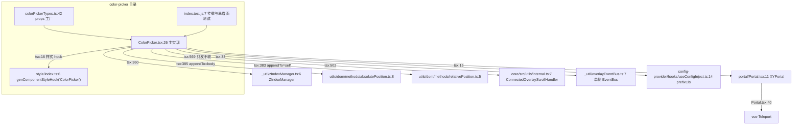
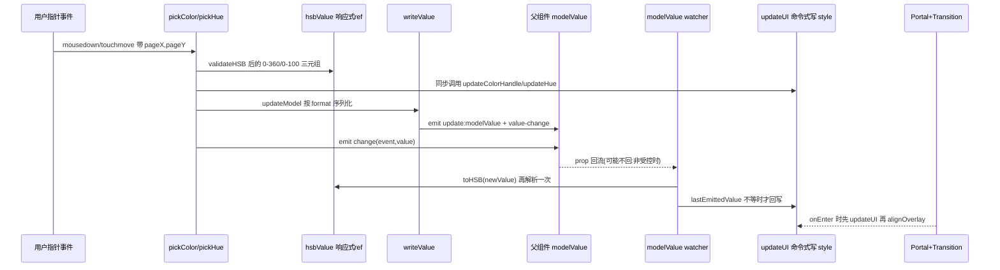
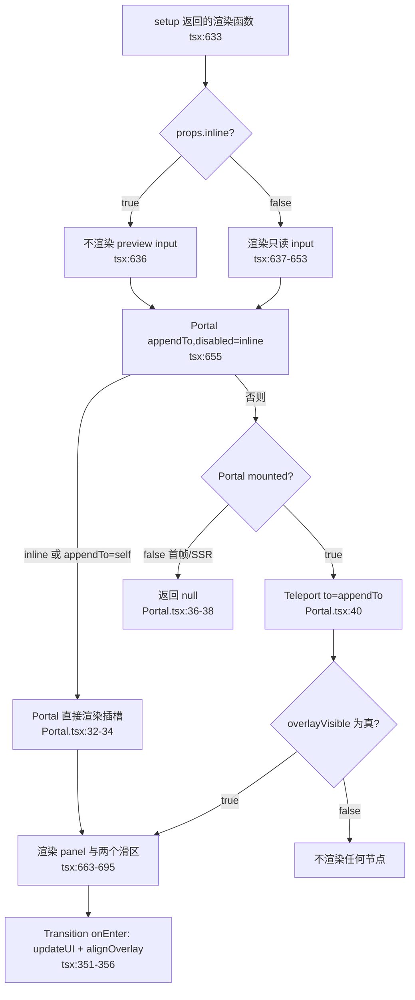

# C04-10 ColorPicker 颜色选择

> **本篇解决**：ColorPicker 如何把「用户拖动出来的像素坐标」与「对外交换的颜色字符串」这两套坐标系对接起来，以及内部 HSB 三元组在其中承担的唯一真相角色——为什么改 `hsbValue` 不会移动把手、为什么 `defaultValue` 到不了面板、为什么一次拖拽会把 `#ff5252` 变成 `ff5252`。
> **前置**：C12-06《Portal 传送门》、I10《z-index 层级编排》、C04-00（本类横写：受控/非受控）、C03-09《ContextMenu 右键菜单》　**读者坐标**：`03-components/04-form-controls` 第 10/10 篇
>
> **读法**：按论点顺序读；每条断言后面都跟了 `文件:行号`，可以直接跳过去核对。

## 一、职责与边界

`XYColorPicker`（`packages/xiaoye-ui/src/color-picker/ColorPicker.tsx:27`）负责且只负责一件事：把一块 **150×150 像素的饱和度/明度方块**与一条 **17×150 像素的色相条**上的指针位置，换算成 HSB 三元组，再按调用方声明的 `format` 序列化成 `hex` / `rgb` / `hsb` 三种对外形状之一（`packages/xiaoye-ui/src/color-picker/colorPickerTypes.ts:7`），并在反向只保留唯一一条入口——`props.modelValue` 的 watcher（`packages/xiaoye-ui/src/color-picker/ColorPicker.tsx:576-594`）。围绕这条「像素 ↔ 颜色」的往返，组件还顺带承担了浮层生命周期：打开时对齐、绑三类全局监听、分配 z-index，关闭时逐项回收。

明确**不负责**的部分同样重要，因为它们是这个组件最容易让人误判的地方：

- **没有 alpha 通道**。全组件的值域只有 `h/s/b` 三个分量（`packages/xiaoye-ui/src/color-picker/colorPickerTypes.ts:17-21`），既没有透明度滑杆，也不会输出 `rgba`。仓库里 `color-picker` 目录内唯一出现 `rgba` 的地方是方块底纹的两条渐变（`packages/xiaoye-ui/src/color-picker/style/index.ts:90-91`），与颜色值模型无关。
- **不做颜色解析与校验**。它不认识 CSS 颜色关键字，也不处理 `#f00` 这类三位缩写；`HEXtoRGB` 只做一次 `parseInt(..., 16)` 加位移（`packages/xiaoye-ui/src/color-picker/ColorPicker.tsx:87-94`），坏输入会静默变成黑色（见本篇坑 3）。
- **不接管表单状态**。`props.name`（`packages/xiaoye-ui/src/color-picker/colorPickerTypes.ts:53`）与 `props.invalid`（同文件 `:51`）声明了但主实现里没有任何读取点，`grep -n "props.name\|props.invalid" packages/xiaoye-ui/src/color-picker/ColorPicker.tsx` 的退出码为 1，即零命中；组件也从不读取 `DisabledContext`（`packages/xiaoye-ui/src/color-picker/ColorPicker.tsx:69` 自己包了一层 `props.disabled`）。
- **不接 `vc-trigger` / `vc-align` 那套浮层基座**，弹出用的是公开组件 `Portal`（`packages/xiaoye-ui/src/color-picker/ColorPicker.tsx:15`），两套挂载路线互不相通这件事由 C12-06《Portal 传送门》论点 1 论证，本篇不重复展开，只补 ColorPicker 自己这一侧的新证据。
- **不接 `useMergedState`**。「受控/非受控」在本类的 9 种拼法已由 C04-00 横写篇论点 1 建立坐标系，本篇只在论点 3 里补该组件特有的两个后果（回声抑制与只写不读的 `d_value`），不重述横写结论。

依赖清单（全部为源码可直接跳读的位置）：`portal`（`packages/xiaoye-ui/src/color-picker/ColorPicker.tsx:15`）、`_util/overlayEventBus`（同文件 `:14`）、`_util/zIndexManager`（同文件 `:21`）、`@xiaoye-ui/utils/dom` 的三个定位函数（同文件 `:12`）、`@xiaoye-ui/core/utils` 的 `ConnectedOverlayScrollHandler`（同文件 `:13`）、`useConfigInject`（同文件 `:17`）、`genComponentStyleHook` 生成的样式 hook（`packages/xiaoye-ui/src/color-picker/style/index.ts:6`）。反向被依赖两处：包级聚合入口 `packages/xiaoye-ui/src/components.ts:84-86` 与主题侧 token 登记 `packages/xiaoye-ui/src/theme/interface/components.ts:14`。

## 二、源码地图

组件目录一共 5 个文件、1151 行，其中主实现占 702 行——这个比例在本类是极端值，C04-00 已指出「除 `color-picker` 外受控逻辑全部落在每个控件主文件前 130 行内」，本篇所有机制断言都因此可以在单文件内闭环。

| 文件 | 行数 | 职责 | 关键导出/符号 |
| --- | --- | --- | --- |
| `packages/xiaoye-ui/src/color-picker/ColorPicker.tsx` | 702 | 主实现：色彩转换、坐标换算、浮层生命周期、渲染 | `default defineComponent`（`:26`）、`isClient`（`:24`） |
| `packages/xiaoye-ui/src/color-picker/colorPickerTypes.ts` | 83 | Props 工厂与三种值形状的类型 | `colorPickerProps`（`:42`）、`ColorPickerFormat`（`:7`） |
| `packages/xiaoye-ui/src/color-picker/index.ts` | 21 | 入口：类型再导出 + `install` | `ColorPicker`（`:21`）、`install`（`:16`） |
| `packages/xiaoye-ui/src/color-picker/style/index.ts` | 132 | CSS-in-JS 样式与组件 token 声明 | `genComponentStyleHook('ColorPicker', ...)`（`:6`） |
| `packages/xiaoye-ui/src/color-picker/index.test.js` | 213 | 单测：挂载、渲染类名、暴露面、无障碍属性 | `mountTest(ColorPicker)`（`:7`） |

主实现内部按功能切成四段，段间没有抽象层，全靠闭包共享 8 个 DOM ref：

- **色彩换算段** `packages/xiaoye-ui/src/color-picker/ColorPicker.tsx:79-225`：`validateHSB`、`HEXtoRGB`、`RGBtoHSB`、`HSBtoRGB`、`RGBtoHEX`、`toHSB`。注释自称「纯函数，无 DOM 依赖」（`:78`），但 `toHSB` 例外（见论点 1）。
- **像素→值段** 同文件 `:228-282`：`pickColor`、`pickHue`，是面板坐标与 HSB 的唯一换算点。
- **值→像素段** 同文件 `:311-348`：`updateColorSelector`、`updateColorHandle`、`updateHue`、`updateInput`、`updateUI`，四条全部绕开响应式、直接改 `style`。
- **浮层与监听段** 同文件 `:351-573`：`onOverlayEnter` / `onOverlayLeave` / `onOverlayAfterLeave` / `alignOverlay`，以及三组 `bind*` / `unbind*` 成对函数。

组件目录之外必须一起读的文件：`packages/xiaoye-ui/src/portal/Portal.tsx:25-55`（挂载决策）、`packages/xiaoye-ui/src/_util/zIndexManager.ts:10-22`（层级记账）、`packages/utils/src/dom/methods/absolutePosition.ts:8-60` 与 `relativePosition.ts:5-58`（两套对齐算法的分叉点）、`packages/core/src/utils/internal.ts:7-64`（滚动关闭）、`packages/xiaoye-ui/src/_util/overlayEventBus.ts:1-9`（跨组件点击协调）。

## 三、架构与数据流

第一张图是静态结构：ColorPicker 的浮层能力全部来自目录外的五个共享模块，其中三条（`utils/dom`、`core/utils`、`_util/zIndexManager`）是「同类实现各自抽一次」的产物，`ZIndexManager` 文件头注释直接写明它抽取自 `context-menu / color-picker / galleria / block-ui`（`packages/xiaoye-ui/src/_util/zIndexManager.ts:1-2`）。注意箭头方向：`OverlayEventBus` 是单例总线（`packages/xiaoye-ui/src/_util/overlayEventBus.ts:7`），ColorPicker 只生产事件、不订阅，消费者在 `data-table` 里。



第二张图是主数据流闭环。它的重点是三条**不对称**：入向只走 `modelValue` 一条 watcher（`packages/xiaoye-ui/src/color-picker/ColorPicker.tsx:576`），出向一次拖拽却同时触发三个事件（同文件 `:301-308`）；而「把手画到正确位置」这件事根本不经过 Vue 的渲染管线，是命令式写 `style`（`packages/xiaoye-ui/src/color-picker/ColorPicker.tsx:322-335`），所以渲染函数里看不到手柄坐标，改 `hsbValue` 也不会自己动。



第三张图解释 `overlayVisible` 与渲染分支的关系，它决定了两件事：面板在不在 DOM 里、以及面板挂在哪里。`props.inline` 同时短路了 `Portal` 的传送（`packages/xiaoye-ui/src/portal/Portal.tsx:25`，其 `disabled` 由 `packages/xiaoye-ui/src/color-picker/ColorPicker.tsx:655` 传入）与 `<input>` 触发器的渲染（同文件 `:636`），而 `appendTo === 'self'` 只让 `Portal` 放弃传送，定位这一步仍然执行、但换一条函数（`packages/xiaoye-ui/src/color-picker/ColorPicker.tsx:382-386`）——因为 `relativePosition` 写的是相对偏移（`packages/utils/src/dom/methods/relativePosition.ts:26-44` 里的负值与 0），而 `absolutePosition` 写的是页面绝对坐标（`packages/utils/src/dom/methods/absolutePosition.ts:30-45`）。内联模式则连定位都不需要，因为它的 `position` 被样式改成了 `static`（`packages/xiaoye-ui/src/color-picker/style/index.ts:29-34`）。



三张图对应本篇的三组论点：图一讲依赖来源，图二讲**坐标 ↔ 颜色**的往返（论点 1、2、3），图三讲**打开/关闭**这条与颜色无关的生命周期线（论点 4、5）。

## 四、核心机制精读

### 论点 1：组件内部唯一真相是 HSB 三元组，但 `toHSB` 不是它自称的「纯函数」——它靠一个组件级 `localHue` 记忆来修补 HSB 在灰轴上的信息丢失，于是「解析外部值」这个动作会顺带改写内部色相状态

`packages/xiaoye-ui/src/color-picker/ColorPicker.tsx:78` 有一行分段注释：`// ============ 颜色转换函数（纯函数，无 DOM 依赖） ============`。这个描述对其下 6 个函数里的 5 个成立，对承担入向解析的 `toHSB` 不成立：

```tsx
// packages/xiaoye-ui/src/color-picker/ColorPicker.tsx:197
    function toHSB(value: any): ColorPickerHSBValue {
      let hsb: ColorPickerHSBValue;
      if (value) {
        switch (props.format) {
          case 'hex':
            hsb = HEXtoHSB(value);
            break;
          case 'rgb':
            hsb = RGBtoHSB(value);
            break;
          case 'hsb':
            hsb = value;
            break;
          default:
            hsb = HEXtoHSB(props.defaultColor);
            break;
        }
      } else {
        hsb = HEXtoHSB(props.defaultColor);
      }

      if (hsb.s === 0 || hsb.b === 0) {
        hsb.h = localHue.value;
      } else {
        localHue.value = hsb.h;
      }

      return hsb;
    }
```

三段解释。第一，`switch (props.format)`（`:200`）是**入向唯一的格式判定点**，它把 `hex`/`rgb`/`hsb` 三条解析路径并进同一个函数；`default` 分支（`:210-212`）以及 `value` 为假值的分支（`:214-216`）都退回 `props.defaultColor`，而 `defaultColor` 的默认值是 `'ff0000'`（`packages/xiaoye-ui/src/color-picker/colorPickerTypes.ts:55`）。这意味着**格式名写错时组件不会报错，而是静默显示红色并丢弃真值**——`updateModel` 里的对偶 `switch`（`packages/xiaoye-ui/src/color-picker/ColorPicker.tsx:286-298`）的 `default` 分支什么都不赋，于是 `value` 保持 `undefined`，最终 `writeValue(undefined, ...)`（`:304-309`）把 `undefined` 原样 emit 出去。一进一出两个 `switch` 必须同时改，这一点没有任何类型或测试保护（`packages/xiaoye-ui/src/color-picker/index.test.js` 全文没有出现 `format: 'hsb'` 或 `format: 'rgb'` 的用例，只有 `:143` 的 `format: 'hex'`）。

第二，`localHue` 的存在理由是 HSB 表示本身的退化：当 `s === 0` 或 `b === 0` 时，颜色落在灰轴/黑点上，色相在数学上是不可辨识的。`RGBtoHSB` 在这种情形下把 `hsb.h` 置为 `-1` 再乘 60、加 360，得到一个固定的伪值 300（`packages/xiaoye-ui/src/color-picker/ColorPicker.tsx:113-120`），而不是「保持上一次色相」。所以 `toHSB` 尾部的这个 `if/else`（`:218-222`）实际是在补一层「灰轴穿过的颜色不该让色相条跳回品红」的语义。它的工作方式是：**读的时候改写 `hsb.h`（`:219`），不读的时候把 `localHue` 更新（`:221`）**——一个函数同时是转换器和状态写入者。

第三，`localHue` 声明在 `packages/xiaoye-ui/src/color-picker/ColorPicker.tsx:52`，初值 `0`。因此「外部先给一个灰色、内部尚未产生任何真实色相」时，色相被判成 0（红）；此后每次经过非灰色都会被 `:221` 覆盖，构成一条隐式的「最近一次有效色相」历史。这条历史不参与序列化输出（`updateModel` 的 `hex`/`rgb` 分支只读 `hsbValue`，`:288`/`:291`），也不被 `expose` 暴露（`packages/xiaoye-ui/src/color-picker/ColorPicker.tsx:620-631` 的清单里没有 `localHue`），所以它是一层**外部不可观测、却能改变 UI 的私有记忆**。`pickHue` 也读写同一个变量：拖动色相条时先算 `localHue`（`packages/xiaoye-ui/src/color-picker/ColorPicker.tsx:270`），再把它塞回 `hsbValue`（`:272-276`），此时 `s`/`b` 从旧值兜底 `?? 0`。

结论回扣：`ColorPicker` 的对外格式有三种，对内只有一种（HSB），这个收敛本身是合理设计；但收敛点 `toHSB` 同时是状态写入点，导致**同一个 `modelValue` 在不同时间喂进来会得到不同的 `h`**（取决于此前有没有出现过非灰颜色）。写依赖这个组件做「颜色历史回退」的人必须知道：`h` 不是无状态解码出来的。

### 论点 2：像素与 HSB 的换算不读元素尺寸，而是把 CSS 里写死的 `150px` 抄进 JS 的六个算式；反向「值→像素」不经过 Vue 渲染，是命令式改 `style`，于是 `updateUI` 的三个调用点构成一条手工一致性契约

```tsx
// packages/xiaoye-ui/src/color-picker/ColorPicker.tsx:228
    function pickColor(event: MouseEvent | TouchEvent) {
      if (!isClient || !colorSelectorEl.value) return;

      const rect = colorSelectorEl.value.getBoundingClientRect();
      const top =
        rect.top +
        (window.pageYOffset || document.documentElement.scrollTop || document.body.scrollTop || 0);
      const left = rect.left + document.body.scrollLeft;
      const pageX =
        'touches' in event
          ? (event as TouchEvent).changedTouches[0].pageX
          : (event as MouseEvent).pageX;
      const pageY =
        'touches' in event
          ? (event as TouchEvent).changedTouches[0].pageY
          : (event as MouseEvent).pageY;

      const saturation = Math.floor((100 * Math.max(0, Math.min(150, pageX - left))) / 150);
      const brightness = Math.floor((100 * (150 - Math.max(0, Math.min(150, pageY - top)))) / 150);

      hsbValue.value = validateHSB({
        h: localHue.value,
        s: saturation,
        b: brightness,
      });

      updateColorHandle();
      updateInput();
      updateModel(event);
    }
```

先看 `rect` 的用途。它**只提供原点，不提供量程**：`rect.top`/`rect.left` 决定「方块的 0 像素在哪」，而「150 像素等于 100%」这件事来自三处 `150` 字面量（`:245`、`:246`，色相条另算 `:270`）。这个 `150` 的权威定义在样式里——方块的 `width: '150px', height: '150px'`（`packages/xiaoye-ui/src/color-picker/style/index.ts:83-84`）与色相条的 `height: '150px'`（同文件 `:112`）。也就是说，同一个几何常量以两种形态存在于两个文件、共 6 个 JS 读取点（`packages/xiaoye-ui/src/color-picker/ColorPicker.tsx:245`、`:246`、`:270`、`:324`、`:326`、`:333`）与 3 个量程声明点（`style/index.ts:83`、`:84`、`:112`；另有两处把手初值 `:97`、`:120`），中间没有任何派生关系：`getBoundingClientRect()` 拿到的 `width`/`height` 在这段代码里被完全丢弃。改样式尺寸不会让换算自适应，只会让「可点区域」与「可表达值域」脱钩——超出 `150` 的像素被 `Math.min(150, ...)` 截断，于是拖到边缘以外的行为是「饱和钉死在 100」，而不是「按实际宽度归一化」。

再看两个方向的不对称。正向（像素→值）在 `pickColor` 末尾一次性做三件事：写 `hsbValue`（`:248-252`）、把把手画上去（`updateColorHandle()`，`:254`）、把值送出去（`updateModel(event)`，`:256`）。反向（值→像素）由四个 `update*` 函数承担，它们全部绕开响应式系统：

```tsx
// packages/xiaoye-ui/src/color-picker/ColorPicker.tsx:322
    function updateColorHandle() {
      if (colorHandleEl.value) {
        colorHandleEl.value.style.left = Math.floor((150 * (hsbValue.value?.s ?? 0)) / 100) + 'px';
        colorHandleEl.value.style.top =
          Math.floor((150 * (100 - (hsbValue.value?.b ?? 0))) / 100) + 'px';
      }
    }

    function updateHue() {
      if (hueHandleEl.value) {
        hueHandleEl.value.style.top =
          Math.floor(150 - (150 * (hsbValue.value?.h ?? 0)) / 360) + 'px';
      }
    }

    function updateInput() {
      if (inputEl.value && hsbValue.value) {
        inputEl.value.style.backgroundColor = '#' + HSBtoHEX(hsbValue.value);
      }
    }
```

`colorHandleEl` 与 `hueHandleEl` 的 `left`/`top` 是**直接赋给 DOM 的行内样式**（`:324`、`:326`、`:333`），渲染函数里那两个节点是空 `<div>`（`packages/xiaoye-ui/src/color-picker/ColorPicker.tsx:681`、`:692`），没有任何 `:style` 绑定。这带来一个必须被记住的后果：**改 `hsbValue` 不会移动把手**。整个组件里能让把手动起来的只有显式调用 `updateUI()`（`packages/xiaoye-ui/src/color-picker/ColorPicker.tsx:343-348`），而它的调用点恰好三个：`onOverlayEnter`（`:352`）、`modelValue` watcher 的非回声分支（`:590`）、`onMounted`（`:604`）。第一个调用点存在的原因是面板是 `v-if` 式条件渲染（`:662`），打开前 `colorHandleEl.value` 是 `undefined`，`:323` 的守卫会让写入静默失败——所以「先算好值、等面板出现再补画」是这条链路的正常形态，而不是异常。

`updateColorSelector`（`packages/xiaoye-ui/src/color-picker/ColorPicker.tsx:311-320`）值得单独说一句，因为它说明了方块为什么能只有两张静态渐变。它把**纯 hue 色**写进方块元素的 `backgroundColor`（`:318`），而白色→透明的横向渐变与黑色→透明的纵向渐变是 CSS 里写死的（`packages/xiaoye-ui/src/color-picker/style/index.ts:87-92`，`background` 值为两条 `linear-gradient`）。所以「S/B 二维平面」是**一行 JS 底色 + 两条静态 CSS 渐变**叠出来的，JS 每次只需要重绘一个纯色层。同理，`updateInput` 把色块刷到那个 `readonly` 的 `<input>` 上（`:339`），预览块并不是 `<div>` 而是被样式化成方块的输入框（`style/index.ts:45-53` 给了它 `width: '2rem'`、`padding: 0`、`border: '0 none'`）。

`top` 与 `left` 两行的算法还**不一致**：`:233-235` 的纵向用的是 `window.pageYOffset || document.documentElement.scrollTop || document.body.scrollTop || 0` 这种三段兜底，`:235` 的横向只写了 `document.body.scrollLeft`。仓库里其实有一个正确的横向取滚动量的函数 `getWindowScrollLeft()`，它读的是 `window.pageXOffset || getScrollLeft(documentElement)` 并减去 `doc.clientLeft`（`packages/utils/src/dom/methods/getWindowScrollLeft.ts:3-6`），ColorPicker 没有用它。后果见本篇坑 1。

结论回扣：这是一个「几何常量靠约定、DOM 位置靠命令式写入」的实现。它的优点是拖拽路径上没有 Vue 调度开销（一次 `mousemove` 只产生 `hsbValue` 的一次赋值与三次直写样式），代价是**任何新增的赋值路径都必须自己记得调 `updateUI`**，而编译器与测试都不会提醒它。

### 论点 3：受控回流用「值比较」而不是「布尔标志」来抑制回声，代价是每次回流都跑一遍 `JSON.stringify`；而真正的非受控通道根本不存在——`defaultValue` 写进了 `d_value`，但 `d_value` 在整个组件里没有读取点

先看写入侧。一次拖拽的值出口集中在 `writeValue`：

```tsx
// packages/xiaoye-ui/src/color-picker/ColorPicker.tsx:284
    function updateModel(event: MouseEvent | TouchEvent) {
      let value: any;
      switch (props.format) {
        case 'hex':
          value = HSBtoHEX(hsbValue.value!);
          break;
        case 'rgb':
          value = HSBtoRGB(hsbValue.value!);
          break;
        case 'hsb':
          value = hsbValue.value;
          break;
        default:
          break;
      }

      writeValue(value, event);
      emit('change', { event: event as unknown as Event, value });
    }

    function writeValue(value: any, _event: MouseEvent | TouchEvent) {
      d_value.value = value;
      lastEmittedValue.value = value;
      emit('update:modelValue', value);
      emit('value-change', value);
    }
```

`writeValue`（`:304-309`）做四件事，其中两件是记账：把值塞进 `d_value`，把值塞进 `lastEmittedValue`。注释在 `packages/xiaoye-ui/src/color-picker/ColorPicker.tsx:53-55` 说得很直白：「记录组件自身最近一次 emit 出去的值，用于在 modelValue 回传时判断是否需要回写 UI。相比布尔标志，值比较不会在非受控（父组件未用 v-model）场景下残留状态。」读取侧只有一处：

```tsx
// packages/xiaoye-ui/src/color-picker/ColorPicker.tsx:576
    watch(
      () => props.modelValue,
      newValue => {
        d_value.value = newValue;
        hsbValue.value = toHSB(newValue);

        const emitted = lastEmittedValue.value;
        lastEmittedValue.value = undefined;

        // 值由组件自身 emit 产生时 UI 已是最新，跳过回写；否则按外部值刷新 UI
        if (emitted !== undefined && JSON.stringify(emitted) === JSON.stringify(newValue)) {
          return;
        }

        updateUI();
      },
      // rgb/hsb 格式下 modelValue 是对象，父组件原地修改也需要感知
      { immediate: true, deep: true },
    );
```

逐段看。第一，回声抑制**只抑制 `updateUI()`**，不抑制 `hsbValue` 的重新解析——`:580` 无条件跑 `toHSB(newValue)`，发生在 `:586` 的早退之前。所以「自己的值回来了」这条路径仍然要重新解析一次外部值，并**顺带再改写一次 `localHue`**（`packages/xiaoye-ui/src/color-picker/ColorPicker.tsx:218-222`）。对 `hex` 格式这是幂等的，对灰轴颜色则不是：拖到 `s === 0` 时，`updateModel` 发出的 hex 是灰，回流后 `toHSB` 又把 `h` 换回 `localHue`，两处逻辑刚好对上，看不出问题；但把同样的值从**另一个** ColorPicker 实例复制过来（例如共享一个 `ref` 做双向绑定），两个实例的 `localHue` 历史不同，`h` 就可能不同，进而 `updateColorSelector` 刷出的底色不同（`packages/xiaoye-ui/src/color-picker/ColorPicker.tsx:311-320`）。

第二，判定式 `emitted !== undefined && JSON.stringify(emitted) === JSON.stringify(newValue)`（`:586`）有两个隐含前提。其一是**单槽假设**：`lastEmittedValue` 只有一个位置，且在比较前就被清成 `undefined`（`:583`）。同一次拖拽里 `pickColor` 会连续调用 `updateModel`（`packages/xiaoye-ui/src/color-picker/ColorPicker.tsx:256`），Vue 的 prop 回流要等父组件重渲染，因此若父组件把值同时喂给两个绑定或做了节流，第二次回流的 `emitted` 已经是 `undefined`，判定必然失败、必然重跑 `updateUI()`。其二是**用 `JSON.stringify` 做结构相等**：`{ r: 1, g: 2, b: 3 }` 与 `{ b: 3, g: 2, r: 1 }` 因为键序不同会被判成不等（`:586` 没有做键排序），这不影响正确性（结果只是多跑一次 `updateUI`），但意味着「值没变就别动 DOM」这个优化在 `rgb`/`hsb` 格式下不可靠。`format: 'hex'` 是字符串比较，无此问题。

第三，`{ immediate: true, deep: true }`（`:593`）。`immediate` 是初始化的唯一来源——组件没有任何地方在 `setup` 里主动调用 `toHSB` 填 `hsbValue`，它的初值是 `null`（`packages/xiaoye-ui/src/color-picker/ColorPicker.tsx:51`）。`deep` 则配合 `:592` 的注释，服务于「父组件原地改 `value.r`」这种用法。也就是说：**`modelValue` 是 `ColorPicker` 唯一的状态注入点**。

由此得到本论点最实际的一条结论：`defaultValue` 是非受控模式的声明，但它到不了渲染。它的唯一去处是 `d_value`——初始化时读一次（`packages/xiaoye-ui/src/color-picker/ColorPicker.tsx:56`）以及一个只写 `d_value` 的 watcher（`:596-601`）。而 `d_value` 的全部出现位置是 `:56`、`:305`、`:579`、`:599`（四次赋值）与 `:630`（一次 `expose`），**没有任何一处读取它参与计算或渲染**（可复现命令：`grep -n "d_value" packages/xiaoye-ui/src/color-picker/ColorPicker.tsx`，输出 5 行，全部是写或暴露）。所以不传 `modelValue` 时，面板显示的永远是 `defaultColor`（`packages/xiaoye-ui/src/color-picker/ColorPicker.tsx:215` 走 `HEXtoHSB(props.defaultColor)`），已有测试正是按这个行为断言的：`packages/xiaoye-ui/src/color-picker/index.test.js:154-165` 只传 `defaultColor: '00ff00'` 就期望 `hsbValue.h` 为 120。附带一条初始化细节：`:56` 的三元判定是 `props.defaultValue !== undefined`，而 `defaultValue` 的 prop 默认值是 `null`（`packages/xiaoye-ui/src/color-picker/colorPickerTypes.ts:47`，经 `anyType` 展开成 `{ default: null }`，见 `packages/xiaoye-ui/src/_util/type.ts:66-77`），所以不传时该条件为真、`d_value` 初值为 `null` 而不是回落到 `modelValue`；随后 `:579` 的 `immediate` watcher 会把它覆盖成 `modelValue`。这里曾与 C04-00 论点 1 的表述相反（对方原写「不传 `defaultValue` 时落到 `modelValue`」），**2026-09-29 复裁：本篇正确，C04-00 拼法 7 已按此更正**，并补了一条本篇未写到的后果——那个 `null` 初值其实活不过一帧，因为 `:575` 的 `immediate` watcher 随即把 `d_value` 覆盖成 `modelValue`，所以这条非受控通道是「判定写反 + 目标变量无人读取」的双重死亡。

结论回扣：`ColorPicker` 的「受控」是**单通道的**——只有 `modelValue` 能进，`defaultValue` 只能进 `d_value` 这条死胡同。回声抑制用值比较换来了「非受控场景不留脏标志」，代价是每次回流一次字符串化比较，且把「要不要重绘 UI」和「要不要重新解析」这两件事解耦得不彻底（解析无条件发生）。

### 论点 4：「面板打开」的执行体不是 `overlayVisible = true`，而是 `Transition` 的 `onEnter` 回调；层级记账的申请与释放共用同一个可变 prop `autoZIndex`，而 `props.baseZIndex || zIndex` 这个写法把两个默认 0 的值串成了「基准恒为 0」

`overlayVisible` 只是一个布尔（`packages/xiaoye-ui/src/color-picker/ColorPicker.tsx:49`），改它只影响渲染条件（`:662`）。所有真正需要 DOM 存在才能做的事都被挂到了 `Transition` 的钩子上：

```tsx
// packages/xiaoye-ui/src/color-picker/ColorPicker.tsx:351
    function onOverlayEnter(el: HTMLElement) {
      updateUI();
      alignOverlay();
      bindOutsideClickListener();
      bindScrollListener();
      bindResizeListener();

      if (props.autoZIndex) {
        const zIndex = ($xiaoyeUI as any)?.config?.zIndex?.overlay ?? 0;
        ZIndexManager.set('overlay', el, props.baseZIndex || zIndex);
      }

      emit('show');
    }

    function onOverlayLeave() {
      unbindOutsideClickListener();
      unbindScrollListener();
      unbindResizeListener();
      emit('hide');
    }

    function onOverlayAfterLeave(el: HTMLElement) {
      if (props.autoZIndex) {
        ZIndexManager.clear(el);
      }
    }
```

三个后果。第一，**这两行都必须在 `enter` 时刻执行，而不是在 `overlayVisible` 翻转的时刻执行**：面板是条件渲染（`:662`），`alignOverlay` 要读 `pickerEl`（`:380` 的守卫就是为「元素还没进 DOM」准备的），`updateUI` 要写把手样式（`:312`、`:323`、`:331`、`:338` 四个守卫同理）。但这两行**彼此的先后不承重**——`alignOverlay` 读的是面板的 `element.offsetWidth/offsetHeight`（`packages/utils/src/dom/methods/absolutePosition.ts:14-16`），而这两个值由样式表固定为 193×166（`packages/xiaoye-ui/src/color-picker/style/index.ts:67-68`），与 `updateUI` 写进去的背景色和把手位置互不影响；把 `:352` 与 `:353` 调换在功能上看不出差别。读到这里应该记住的是守卫的位置，而不是顺序。第二，`emit('show')` 在 `:363` 的最后，也就是「已经对齐、已经绑好监听、已经拿到层级」之后才发；但由于 `xy-anchored-overlay` 这个动画名在全仓没有任何 CSS 实现（含该名的文件只有四个 `.tsx`，其中本组件是 `packages/xiaoye-ui/src/color-picker/ColorPicker.tsx:657`），入场实际上没有可等待的时长，`onEnter` 与内容插入几乎同帧——这件事在 C03-09 论点 6 里已系统论证，本篇只补 ColorPicker 是其中之一这条证据。第三，`show` / `hide` 与整条 `enter` 链路只在**从关闭切到打开**时成立：`props.inline` 为真时 `Portal` 走内联分支（`packages/xiaoye-ui/src/portal/Portal.tsx:32-34`），而 `Transition` 没有写 `appear`（`packages/xiaoye-ui/src/color-picker/ColorPicker.tsx:656-661`），所以内联面板作为首帧内容插入时**不走 enter**，`show`、`alignOverlay`、`ZIndexManager.set` 三件事在挂载路径上都不发生——内联面板的 `position` 被样式改回 `static`（同上的 `style/index.ts:29-34`），因此「不对齐、不给层级」正是它需要的行为。唯一的边缘路径是运行期由非内联切成内联且面板此刻需要新插入：此时 `enter` 会跑，`alignOverlay` 因为 `appendTo` 仍是默认值 `'body'` 而选到 `absolutePosition`（`:382-386`），把页面绝对坐标写进行内 `top`，而静态定位元素忽略 `top`/`left`，所以没有视觉后果——是「巧合正确」，不是「设计过」。

层级这条链子内部分支都在 12 行以内，但三个默认值叠在一起后，「基准」这个概念在这里是空转的：

```tsx
// packages/xiaoye-ui/src/color-picker/ColorPicker.tsx:379
    function alignOverlay() {
      if (!isClient || !inputEl.value || !pickerEl.value) return;

      if (props.appendTo === 'self') {
        relativePosition(pickerEl.value, inputEl.value);
      } else {
        absolutePosition(pickerEl.value, inputEl.value);
      }
    }
```

`autoZIndex` 默认 `true`（`packages/xiaoye-ui/src/color-picker/colorPickerTypes.ts:63`）、`baseZIndex` 默认 `0`（同文件 `:65`）。于是 `props.baseZIndex || zIndex`（`packages/xiaoye-ui/src/color-picker/ColorPicker.tsx:360`）在默认配置下是 `0 || zIndex`，而 `zIndex` 取自 `inject('$xiaoyeUI', undefined)`（`:36`）再读 `?.config?.zIndex?.overlay ?? 0`（`:359`）。`'$xiaoyeUI'` 这个 inject 键在本仓没有任何提供者，这件事由 I10《z-index 编排》论点 5 用全仓统计证明，本篇独立复核的结论一致：`grep -rn "xiaoyeUI" packages apps` 排除 `node_modules` 与 `dist` 后，全部命中都是 `inject` 消费点或 `(window as any)?.$xiaoyeUI` 这种全局读取（如 `packages/xiaoye-ui/src/tree-table/TreeTable.tsx:743`），没有一处 `provide`，因此 `:359` 恒为 `0`，传给 `ZIndexManager.set` 的基准恒为 `0`。再叠加 `set` 自身的规则——「注册表非空时取栈尾 +1，只有注册表为空时才用 base」——默认配置下第一个受管浮层拿到的行内 `z-index` 是 `1`（`packages/xiaoye-ui/src/_util/zIndexManager.ts:10-16`，此后果的通用形态见 I10 论点 1）。ColorPicker 这一侧的**新**证据是那个 `||`：即使调用方显式传 `:base-z-index="0"`，它也会被当成假值丢弃、去读一个恒为 0 的注入值；换句话说这里没有「显式 0」和「没传」的区别。

不对称的回收是这条链上唯一能被调用方触发的故障：`set` 与 `clear` 各自判一次 `props.autoZIndex`（`:358` 与 `:374`），中间没有任何记忆。若在面板打开期间把 `autoZIndex` 从 `true` 改成 `false`（例如它绑到了某个全局开关上），`onOverlayAfterLeave` 的守卫失败、`ZIndexManager.clear(el)` 不执行，`zIndexRecords` 里那条记录就永久留在栈尾（`packages/xiaoye-ui/src/_util/zIndexManager.ts:14`），此后**所有**共用这个管理器的组件（`context-menu`、`galleria`、`block-ui`、`data-table/ColumnFilter`）分到的层级都会偏高一层。`clear` 按「元素此刻的行内值」反查记录这一点由 I10 论点 4 论证，本篇不重复。组件自己的 `onBeforeUnmount` 兜了一道 `ZIndexManager.clear(pickerEl.value)`（`packages/xiaoye-ui/src/color-picker/ColorPicker.tsx:614-616`），但它同样带 `props.autoZIndex` 守卫——同一处不对称在卸载路径上再复制一次。

结论回扣：浮层的正确性依赖「`Transition` 钩子 + 三个 bind + 一次层级申请」这五行代码的顺序与配对，而 `emit('show')` 恰好放在最后，说明作者知道这四件事都可能在异常路径上失败；一旦 `Portal` 或 `Transition` 被替换（例如迁到 `vc-trigger`），这五行要整体重挂到新的生命周期上，而不是简单删掉。

### 论点 5：外部监听按两条互不相同的归属线管理——三条「浮层期」监听跟着 `onEnter/onLeave` 成对，两条「拖拽期」监听跟着指针按下/抬起成对；前者用捕获阶段注册，后者只在鼠标路径上挂到 document

```tsx
// packages/xiaoye-ui/src/color-picker/ColorPicker.tsx:474
    function bindOutsideClickListener() {
      if (!isClient) return;
      if (!outsideClickListener) {
        outsideClickListener = (event: MouseEvent) => {
          if (
            overlayVisible.value &&
            pickerEl.value &&
            !pickerEl.value.contains(event.target as Node) &&
            !isInputClicked(event)
          ) {
            overlayVisible.value = false;
          }
        };
        document.addEventListener('click', outsideClickListener, true);
      }
    }
```

捕获阶段的第三参数是这里最关键的一个字符：`true`（`:487`），解绑时同样传 `true`（`:494`）。注册在捕获阶段意味着这段代码**先于**触发器自己的 `onClick`（`:650`）执行，于是「面板已开、再点一次触发器」的时序是：捕获回调看到 `target` 就是 `inputEl`，被 `isInputClicked`（`:459-461`）挡下不关；随后 `onInputClick` 把 `overlayVisible` 取反（`:391`）完成关闭。若换成冒泡阶段，回调会在 `onInputClick` 之后跑，此时值已翻成 `false`，条件 `overlayVisible.value` 失败——单看这一格是等价的，但 `isInputClicked` 用的是 `inputEl.value.isSameNode(event.target)`（`:460`）而不是 `contains`，所以只要触发器被包进一层带点击目标的容器（`<label>`、带 `pointer-events` 的子元素），`target` 就不再是 `inputEl` 本身，捕获阶段的这条豁免链会断，表现为「点触发器时面板关不掉」。同一段代码里的 `pickerEl.value.contains(event.target as Node)`（`:481`）用的却是 `contains`——面板内部节点是 `target` 的祖先，所以那里必须用 `contains`。两个判据形态不同是**正确**的，但它意味着面板与触发器在「什么算自己人」这件事上是两套规则。

第二条归属线是拖拽。`onColorMousedown`（`:413-417`）与 `onHueMousedown`（`:445-449`）各自调 `bindDragListeners()`（`:464-467`）把 `mousemove` / `mouseup` 挂到 `document`（绑定体分别为 `:536-542`、`:552-558`），`onDragEnd`（`:438-443`）再解绑（`:469-472`）。触摸路径完全不同：`onTouchmove` 与 `onTouchend` 直接绑在两个滑区元素上（`packages/xiaoye-ui/src/color-picker/ColorPicker.tsx:677-678` 与 `:689-690`），**从不**经过 `bindDragListeners`。因此「桌面能拖出框外继续取值（document 级 `mousemove`，`:539`）、手机不行」这种直觉在这里不成立——touch 事件按规范始终派发给 `touchstart` 的初始目标，元素级绑定等价于文档级。真正的不对称在清理侧：`onDragEnd` 无条件调 `unbindDragListeners()`（`:442`），触摸结束时那两个 document 监听本就是 `null`，`if (documentMouseMoveListener)` 的守卫让解绑静默跳过（`:544-550`、`:560-566`）——不报错，但说明这套 bind/unbind 是先为鼠标写的、触摸是后加的适配（`pickColor` 里用 `'touches' in event` 现场分流取 `changedTouches[0]`，`:236-243`，也是同一痕迹）。

再看三个「浮层期」监听里唯一带设备判断的一个：

```tsx
// packages/xiaoye-ui/src/color-picker/ColorPicker.tsx:516
    function bindResizeListener() {
      if (!isClient) return;
      if (!resizeListener) {
        resizeListener = () => {
          if (overlayVisible.value && !isTouchDevice()) {
            overlayVisible.value = false;
          }
        };
        window.addEventListener('resize', resizeListener);
      }
    }
```

`!isTouchDevice()`（`:520`）让触屏设备上的窗口尺寸变化**不**关闭面板。`isTouchDevice` 的判据是 `'ontouchstart' in window || navigator.maxTouchPoints > 0`（`packages/utils/src/dom/methods/isTouchDevice.ts:2-6`），这是「设备能力」判断而非「本次输入方式」判断——在触屏笔记本上用鼠标点开会话时，缩放窗口不会关闭面板，也不会重定位，因为整个组件只有 `onOverlayEnter` 调过一次 `alignOverlay`（`packages/xiaoye-ui/src/color-picker/ColorPicker.tsx:353`），面板会与触发器错位。与之配对的是滚动：`ConnectedOverlayScrollHandler` 从 `containerEl` 往上遍历可滚动祖先并绑 `scroll`（`packages/xiaoye-ui/src/color-picker/ColorPicker.tsx:501-509` → `packages/core/src/utils/internal.ts:18-23` 与 `:52-59`），回调同样是「关闭而不是重定位」（`:502-506`）。这是一个明确的选择：**ColorPicker 不与页面同步移动，只选择消失**。也因为它绑的是触发器所在子树的祖先，而面板已被 `Teleport` 移到挂载目标（`packages/xiaoye-ui/src/portal/Portal.tsx:54`），面板自己的滚动父级从来不在监听集合里——这个不对称在「关闭策略」下无害，一旦改成「跟随重定位」就会立刻变成缺陷。

卸载兜底在 `onBeforeUnmount`（`:607-617`）：四类监听一次全解，并把 `scrollHandler` 置 `null`（`:612`）。这一步是必要的，因为 `bindScrollListener` 用 `if (!scrollHandler && containerEl.value)` 做懒初始化（`:501`），不清零的话组件重挂载时会复用持有旧 DOM 引用的 handler。其余四个监听变量的置空分散在各自的 unbind 函数里（`:495`、`:532`、`:548`、`:564`），所以卸载路径是完整的；唯一的例外是 `scrollHandler` 的祖先集合——`bindScrollListener()` 每次都重算并覆盖 `this.scrollableParents`（`packages/core/src/utils/internal.ts:19`），若两次 bind 之间容器被移动过 DOM，旧祖先上的 `scroll` 监听无法再被解绑（`packages/core/src/utils/internal.ts:25-29` 解的是当前数组）。本组件的调用序列是 enter 绑、leave 解，正常路径不会触发，属于「共享工具留下来的边界」而非 ColorPicker 自己的缺陷。

结论回扣：本组件的浮层行为有相当一部分由这五个手工注册的外部监听实现，而它们的存在期由两套不同的事件对（`enter/leave` 与 `mousedown/mouseup`）分别决定。改动其中任何一个 bind 都必须去对应的另一处找 unbind，编译器不会帮你配对；`packages/xiaoye-ui/src/color-picker/index.test.js` 里也没有任何一条用例会走到 `onOverlayLeave`——该文件对打开路径的操作只有直接调 `onInputClick`（`:105`、`:118`）与 `keydown`（`:207`），断言只到 `overlayVisible` 布尔本身。

## 五、对外契约如何生效

**props 的四条去向**。17 个 prop 里的 `prefixCls`（`packages/xiaoye-ui/src/color-picker/colorPickerTypes.ts:43`）只去一个地方：`useConfigInject('colorpicker', props)`（`packages/xiaoye-ui/src/color-picker/ColorPicker.tsx:33`）→ `configProvider.getPrefixCls('colorpicker', props.prefixCls)`（`packages/xiaoye-ui/src/config-provider/hooks/useConfigInject.ts:14` → `packages/xiaoye-ui/src/config-provider/index.tsx:70-75`）→ 样式侧的 `componentCls = '.' + prefixCls.value`（`packages/xiaoye-ui/src/theme/util/genComponentStyleHook.ts:87`）。它**不到 DOM**：渲染函数里 12 处类名全是字面量（`packages/xiaoye-ui/src/color-picker/ColorPicker.tsx:73`、`:74`、`:75`、`:635`、`:641`、`:665`、`:671`、`:674`、`:680`、`:681`、`:686`、`:692`，可用 `grep -c "xy-colorpicker" packages/xiaoye-ui/src/color-picker/ColorPicker.tsx` 复核，输出 12）。默认配置下两边数值相等所以缺陷不可见；换掉 `ConfigProvider` 的 `prefixCls` 后样式规则改名为 `.my-colorpicker*` 而 DOM 仍是 `xy-colorpicker*`。同一形态的缺陷在 C03-09 论点 6 已系统论证，本篇不重复展开，只登记 ColorPicker 是本类另一个实例。附带一条容易被拼错的对应关系：注册出来的标签名是 `xy-color-picker`（`packages/xiaoye-ui/src/_util/registerComponent.ts:6-11` 的 `toXYTagName('XYColorPicker')`，即 `:27` 声明的组件名经 `xy-` 替换与驼峰切分），而 CSS 前缀是 `xy-colorpicker`——**中间少一个连字符**，两者来自不同的字符串（组件名 vs `useConfigInject` 的实参）。

其余 props 的去向分三类。第一类是**渲染期直读**：`disabled`（`:69` 包一层 computed，用于 `:390`、`:414`、`:420`、`:446`、`:452` 五处早退 + `:644`、`:649` 两个 DOM 属性）、`inline`（`:636` 决定是否渲染触发器、`:655` 决定 `Portal.disabled`、`:666-668` 决定三个 aria 属性是否输出）、`format`（`:200`、`:286` 两个 switch）、`appendTo`（`:382` 选定位算法、`:655` 传给 `Teleport to`）、`tabindex`/`inputId`/`ariaLabel`（`:643`、`:639`、`:645`、`:667`）、`panelClass`/`overlayClass`（合并进同一个 `class` 数组，`:665`）。第二类是**只进状态、不进渲染**：`modelValue`（`:576` 的 watcher）、`defaultColor`（`:211`、`:215`）。第三类是**没有任何读取点**：`name`（声明于 `packages/xiaoye-ui/src/color-picker/colorPickerTypes.ts:53`）、`invalid`（同文件 `:51`）——`grep -rn "props.name\|props.invalid" packages/xiaoye-ui/src/color-picker/ColorPicker.tsx` 的退出码为 1，即零命中，因此表单里的 `invalid` 视觉态与 `name` 字段名都不会落到那个 `<input>` 上（该元素的属性清单见 `packages/xiaoye-ui/src/color-picker/ColorPicker.tsx:637-653`，其中没有 `name`）。同一族还有一个只写不读的模板 ref `colorBackgroundEl`：声明于 `:43`、绑定于 `:680`，全文件再无读取点。

**slots：一个都没有。** `setup` 的第二个解构参数只取了 `expose` 与 `emit`（`:32`），组件选项里没有 `slots:` 声明，`grep -rn "slots" packages/xiaoye-ui/src/color-picker/` 的退出码为 1。后果是父组件写在 `<xy-color-picker>` 标签内的任何内容都会被静默丢弃，包括看起来最合理的默认插槽；面板内部那 6 个 `div` 是硬编码结构（`:671-693`），没有任何插槽出口可以替换它。

**attrs：整体丢弃。** `inheritAttrs: false`（`:28`）配合渲染函数里从不展开 `attrs`（`:633-700` 全文没有 `attrs` 标识符，且 `:32` 就没解构它），意味着调用方写的 `class`、`style`、`data-*`、`id`、原生事件监听器全部无处可落——`class` 也不会像默认行为那样合到根元素上，因为根元素的 class 数组是手工拼的（`:635`）。要加类名只有 `panelClass` / `overlayClass` 两个入口，且它们只作用于面板（`:665`），不作用于触发器。这与 C03-09 论点 1 描述的是同一族后果，本组件的特别之处在于**它连 `input` 级的类名入口都没有**：`xy-colorpicker-preview` 是写死的单值字符串（`:641`）。

**events：声明与发射一一对应，但载荷形状不统一。** `emits: ['change', 'show', 'hide', 'update:modelValue', 'value-change']`（`:31`）。`update:modelValue` 与 `value-change` 发射同一个裸值（`:307`、`:308`），`change` 发射 `{ event, value }` 包装（`:301`）——同一份值在一个手势里以两种形状各发一次，且 `change` 的 `event` 被 `as unknown as Event` 强转（`:301`）以绕过 `MouseEvent`/`TouchEvent` 与 `Event` 的类型差。`show`（`:363`）与 `hide`（`:370`）无载荷。内联模式下这两个都不会发（论点 4）。此外组件还向全局总线发一个 `overlay-click`（`:569`），载荷里的 `target` 是**容器**而不是面板（`:571`）；这一发的消费者只有 `data-table` 两处（`packages/xiaoye-ui/src/data-table/ColumnFilter.tsx:321` 与 `packages/xiaoye-ui/src/data-table/BodyCell.tsx:213`），它的作用是让嵌套在过滤菜单里的浮层把自己的点击上报，从而把外层菜单的 `selfClick` 置真、避免外层误判为外部点击（`packages/xiaoye-ui/src/data-table/ColumnFilter.tsx:315-319`）。ColorPicker 自己不订阅这条总线。

**expose：暴露的是私有实现，不是操作接口。** 清单在 `:620-631`，共 10 项，注释是 `// Expose for testing`。它给出的是内部状态（`overlayVisible`、`hsbValue`、`d_value`）与内部方法（`pickColor`、`pickHue`、`writeValue`、`updateUI`、`onInputClick`、`onColorMousedown`、`onHueMousedown`），因此模板 ref 上能拿到的恰好是这 10 项，**没有** `focus()` / `blur()`，也没有任何元素引用（`inputEl` 未暴露，`:40`）——想以编程方式打开面板只能调 `onInputClick()`，想聚焦只能自己再 `querySelector` 那个 `.xy-colorpicker-preview`。这与根目录 `AGENTS.md` 的组件模板建议（`expose({ focus, blur })`）不一致，属于「测试需要驱动私有路径，于是把私有路径升格成了公开契约」。

**样式契约**：`genComponentStyleHook('ColorPicker', ...)`（`packages/xiaoye-ui/src/color-picker/style/index.ts:6`）里的 `'ColorPicker'` 是组件 token 的键名，与主题接口登记在 `packages/xiaoye-ui/src/theme/interface/components.ts:14` 对齐；但该文件导出的 `ComponentToken` 是空接口（`packages/xiaoye-ui/src/color-picker/style/index.ts:4`），组件样式里也没有任何 `buttonPaddingHorizontal` 式的自定义 token——面板几何全部是 px 字面量（`:67-68`、`:81-84`、`:109-112`）。结论：**ColorPicker 无法通过 Design Token 定制尺寸**，能定制的只有颜色（`colorBgContainer`、`colorBorder`、`colorText`、`borderRadius`、`boxShadow`，取自 `:8-15` 的解构）。

## 六、设计取舍

**取舍一：自带一套面板与定位，还是复用 `vc-trigger` + `vc-align`。** 组件选了自带：`Portal` + 手写 `alignOverlay`（`packages/xiaoye-ui/src/color-picker/ColorPicker.tsx:379-387`）+ 手写外部点击/滚动/缩放三件套（`:474-534`）。换来的是拖拽语义完全可控——`Trigger` 系的点击开合、placement 表、`builtinPlacements` 那套坐标体系对一个「按住就连续取值」的面板几乎没有价值，而 `pickColor` 每帧要读一次 `getBoundingClientRect()`（`:231`），放在 trigger 的定位回调里反而多一层调度。赔上的是：浮层公共行为的六个已知缺陷在这里都以独立副本存在（动画名无样式实现、`$xiaoyeUI` 基准恒 0、`clear` 按行内值反查、`show` 事件时序），修公共基座不会修到它。C12-06 论点 1 已经把「两条挂载路线互不相通」作为公开事实登记过，本篇不重复判定它是否应该合并。

**取舍二：把几何常量写死在 CSS，还是让 JS 读真实尺寸。** 现在的答案是 CSS 写死（`packages/xiaoye-ui/src/color-picker/style/index.ts:83-84`）+ JS 抄一份（`packages/xiaoye-ui/src/color-picker/ColorPicker.tsx:245-246`、`:324-326`、`:333`）。更正确的做法是把 `rect.width`/`rect.height` 代进换算式，让面板尺寸可变。作者没这么做，最可能的成本是：换算式里有 `Math.floor` 与把手的 `-5px` 外描边补偿（`style/index.ts:100` 的 `margin: '-5px 0 0 -5px'`），改成比例式需要同时重算把手定位与色相条把手的 `marginTop: '-5px'`（同文件 `:124`），而不改不影响任何现有用法。代价是把「改个尺寸」变成了六处 JS + 五处 CSS（`packages/xiaoye-ui/src/color-picker/style/index.ts:83`、`:84`、`:97`、`:112`、`:120`）的同步动作，且没有任何编译期或测试期约束。

**取舍三：`hex` 输出不带 `#`。** `RGBtoHEX` 直接 `hex.join('')`（`packages/xiaoye-ui/src/color-picker/ColorPicker.tsx:190`），而内部两处需要 CSS 可用形式时都手工补前缀：`'#' + HSBtoHEX(...)`（`:318`、`:339`）。这保留了输入的原始风格（传 `'ff0000'` 出去还是 `'ff0000'`），但**不保留带 `#` 的输入风格**：传 `'#ff0000'`（`packages/xiaoye-ui/src/color-picker/index.test.js:23` 就是这么传的）进去，一次拖拽后 `modelValue` 变成不带 `#` 的 `'ff0000'`，因为它要过一遍 `toHSB` → `HSBtoHEX`（`:202`、`:288`）。本仓自己的示例在渲染时补了这个前缀（`apps/docs/examples/color-picker/preset-colors.vue:8`），可以视为该取舍已被文档侧吸收，但它对使用者仍然是一个需要知道的不对称。

**取舍四：命令式写 DOM，换取拖拽帧内无 Vue 调度。** 见论点 2。这条在 SSR 上是安全的：所有写入点都有元素存在性守卫（`:312`、`:323`、`:331`、`:338`）与 `isClient` 常量守卫（`:24`、`:229`、`:260`、`:380`），服务端首帧 `Portal` 直接返回 `null`（`packages/xiaoye-ui/src/portal/Portal.tsx:36-38`），因此不存在 hydration 结构差异。这条 SSR 安全机制本身归 C12-06《Portal 传送门》论点 2，本篇只确认 ColorPicker 没有绕过它（`:655-661` 的面板内容全部在 `Portal` 的插槽里）。

**取舍五：树摇与打包。** 8 个换算函数（`validateHSB`、`HEXtoRGB`、`RGBtoHSB`、`HEXtoHSB`、`HSBtoRGB`、`RGBtoHEX`、`HSBtoHEX`、`toHSB`）全部以闭包形式定义在 `setup` 内部（`packages/xiaoye-ui/src/color-picker/ColorPicker.tsx:79-225`），而不是提到模块顶层。后果是每挂载一个实例都要重新创建这 8 个函数对象，同时它们也无法被单独 import 复用——仓库里想复用 `HSBtoRGB` 的组件只能复制一份，`grep -rn "function HSBtoRGB" packages/xiaoye-ui/src` 只命中 `packages/xiaoye-ui/src/color-picker/ColorPicker.tsx:132` 一处。对一页只有一个取色器的场景无所谓，对「表格里 200 行各带一个取色器」的场景则是 200 份函数对象与 200 份 `zIndexRecords` 竞争。

## 七、坑与改动指南

以下 9 条按「触发 → 症状 → 原因 → 定位」写，定位一律给到可以直接跳的行号。

1. **横向滚动量取错来源，拖拽取值整体横偏**
   触发：页面存在横向滚动（标准模式下横向滚动条挂在 `documentElement` 上，`document.body.scrollLeft` 恒为 0），滚动后再在方块上按下或拖动。
   症状：选出的饱和度 `s` 与指针实际位置不一致，偏差量正好等于横向滚动的像素数换算成的百分比；纵向不受影响。
   原因：`packages/xiaoye-ui/src/color-picker/ColorPicker.tsx:235` 只加了一个来源 `rect.left + document.body.scrollLeft`，而同一函数里纵向的 `:233-234` 用的是 `window.pageYOffset || documentElement.scrollTop || body.scrollTop || 0` 三段兜底；同仓已有正确写法 `getWindowScrollLeft()`（`packages/utils/src/dom/methods/getWindowScrollLeft.ts:3-6`，它读 `window.pageXOffset` 并减掉 `doc.clientLeft`），本组件只 import 了 `absolutePosition`/`relativePosition`/`isTouchDevice` 三个（`packages/xiaoye-ui/src/color-picker/ColorPicker.tsx:12`）。
   定位：`packages/xiaoye-ui/src/color-picker/ColorPicker.tsx:235`。**该分支无测试保护**——`packages/xiaoye-ui/src/color-picker/index.test.js` 全文没有一次 `pickColor` 调用。

2. **`format` 与值形状不匹配时，NaN 会灌满整条链并且不被钳制拦住**
   触发：`format: 'rgb'` 时外部把 `modelValue` 设成字符串（`:580` 的 watcher 会走 `RGBtoHSB(字符串)`，`:205`），或反过来 `format: 'hex'` 时设成对象。
   症状：把手停在方块右上角（`style.left = "NaNpx"` 是非法声明、被浏览器丢弃，于是回落到 CSS 里 `left: '150px'` 的默认值，`packages/xiaoye-ui/src/color-picker/style/index.ts:94-97`），预览块背景变成字符串 `"#NaNNaNNaN"`，emit 出去的值为 `{r:NaN,g:NaN,b:NaN}` 或 `"NaNNaNNaN"`。
   原因：`toHSB` 的 `switch` 不校验值形状（`packages/xiaoye-ui/src/color-picker/ColorPicker.tsx:199-213`），`validateHSB` 对 NaN 无效（`:81-83`，`Math.min(360, Math.max(0, NaN))` 仍是 NaN），`RGBtoHEX` 的补零分支只覆盖 `length === 1`（`:184-189`）。三条 JS 语义已实测：`Math.min(undefined,1,2)` 为 `NaN`、`Math.min(360,Math.max(0,NaN))` 为 `NaN`、`NaN.toString(16)` 为 `"NaN"`（长度 3）。
   定位：`packages/xiaoye-ui/src/color-picker/ColorPicker.tsx:197-225`。补充：从「watcher 触发」到「NaN 出现在 emit 载荷里」这一段是静态推演，未跑过组件实例；每一步的读取位置均已给出。

3. **三位 hex 缩写被按六位解析，非法串静默变黑**
   触发：`v-model` 传入 `'#f00'` 这类缩写，或传入含非十六进制字符的串。
   症状：`'#f00'` 显示为暗绿 `#000f00` 而不是红色；非法串显示为纯黑；随后任何一次拖拽都会把这个错误解析的结果写回父组件。
   原因：`HEXtoRGB` 只做「有没有 `#`」的判断就 `parseInt(..., 16)` 再按 24 位拆三段（`packages/xiaoye-ui/src/color-picker/ColorPicker.tsx:87-94`）；缩写串 `parseInt('f00', 16)` 得 3840 即 `0x000F00`，而 `parseInt('zz', 16)` 得 NaN、`NaN >> 16` 按 ToInt32 归 0（两个算式均已实测）。
   定位：`packages/xiaoye-ui/src/color-picker/ColorPicker.tsx:88`。

4. **输出的 hex 不带 `#`，与输入的容忍度不对称**
   触发：把 `modelValue` 直接写进 CSS（例如 `:style="{ background: color }"`），且初值带了 `#`。
   症状：首帧正常，用户一拖动背景就失效；再次传入同一个字符串也不会恢复，因为组件已经把它规范化成裸串。
   原因：`RGBtoHEX` 返回 `hex.join('')`（`packages/xiaoye-ui/src/color-picker/ColorPicker.tsx:183-191`），组件内部两处需要 CSS 可用形式时是手工补的前缀（`'#' + HSBtoHEX(...)`，见 `:318`、`:339`）。输入侧容忍 `#`（`:88` 的 `indexOf('#') > -1` 判断），输出侧不产生 `#`。
   定位：`packages/xiaoye-ui/src/color-picker/ColorPicker.tsx:190`。本仓文档示例自己补前缀的写法见 `apps/docs/examples/color-picker/preset-colors.vue:8`，可作为该不对称需要调用方补偿的旁证。

5. **`defaultValue` 完全不生效：非受控通道是空的**
   触发：只传 `default-value`、不传 `v-model`，期望它作为初始色。
   症状：面板显示的仍是 `defaultColor`（默认 `'ff0000'`，`packages/xiaoye-ui/src/color-picker/colorPickerTypes.ts:55`）。
   原因：`defaultValue` 唯一的去处是 `d_value`（`packages/xiaoye-ui/src/color-picker/ColorPicker.tsx:56` 与 `:596-601`），而 `d_value` 在组件里只被写、不被读；`hsbValue` 的四个赋值点是 `:51`、`:248`、`:272`、`:580`，外部值只可能从 `:580` 进来。
   定位：`packages/xiaoye-ui/src/color-picker/ColorPicker.tsx:56`、`:596-601`。若要修复，正确做法是让 `:596-601` 的 watcher 也走 `hsbValue.value = toHSB(newValue)` 并补 `updateUI()`，但要先决定它与 `modelValue` watcher 的优先级（`packages/xiaoye-ui/src/color-picker/colorPickerTypes.ts:47` 的 `null` 默认值会让 `:56` 的三元总是取左支）。

6. **面板打开期间翻转 `autoZIndex`，会永久泄漏一条全局层级记录**
   触发：把 `:auto-z-index` 绑到运行时会变的值（或全局开关），并在面板处于打开态时把它从 `true` 改成 `false`。
   症状：面板关闭后，同一页面里其它受管浮层（`context-menu`、`galleria`、`block-ui`、`data-table` 的列过滤）拿到的层级比预期高 1，反复触发会累积。
   原因：申请与回收各自判一次当前 prop 值——`packages/xiaoye-ui/src/color-picker/ColorPicker.tsx:358-361` 与 `:373-377`——中间没有把「这次打开是否申请过」记成局部变量；卸载兜底 `:614-616` 带同样的守卫，所以换不来补偿。
   定位：`packages/xiaoye-ui/src/color-picker/ColorPicker.tsx:358`、`:374`、`:614`；账本本体是模块级数组 `packages/xiaoye-ui/src/_util/zIndexManager.ts:4`。回收算法按「元素此刻行内值」反查的缺陷由 I10 论点 4 覆盖，本篇不重复。

7. **触屏设备上缩放窗口不关闭面板，浮层与触发器错位**
   触发：带触摸屏的笔记本/桌面（`navigator.maxTouchPoints > 0`），用鼠标点开后缩放窗口或唤起软键盘。
   症状：面板留在原地不跟随，也不会关闭；滚动会关闭它，缩放不会。
   原因：`packages/xiaoye-ui/src/color-picker/ColorPicker.tsx:519-523` 的关闭条件带 `!isTouchDevice()`，而 `isTouchDevice` 判的是设备能力而非本次输入方式（`packages/utils/src/dom/methods/isTouchDevice.ts:2-6`）；同时组件从不重定位——`alignOverlay` 的唯一调用点在 `packages/xiaoye-ui/src/color-picker/ColorPicker.tsx:353`。
   定位：`packages/xiaoye-ui/src/color-picker/ColorPicker.tsx:520`。

8. **自定义 `ConfigProvider` 前缀后组件整体失样**
   触发：应用侧改了 `prefixCls`（`packages/xiaoye-ui/src/config-provider/index.tsx:70-75` 的合并逻辑）。
   症状：样式规则生成成 `.my-colorpicker*`（`packages/xiaoye-ui/src/theme/util/genComponentStyleHook.ts:87`），而 DOM 上仍是 12 处 `xy-colorpicker*` 字面量，方块与色相条的绝对定位全部失效，面板退化成堆叠的裸 `div`。
   原因：类名未走 `prefixCls` 拼接，见 §五 的 props 段。
   定位：`packages/xiaoye-ui/src/color-picker/ColorPicker.tsx:635`（根元素）与 `:641`、`:665`、`:671`、`:674`、`:680`、`:681`、`:686`、`:692` 以及 `:73-75` 的三个状态类键名。同族缺陷的完整论证在 C03-09 论点 6。

9. **写在标签上的 `class` / `style` / 原生监听全部静默丢弃**
   触发：`<xy-color-picker class="mt-2" @click="onPick">`。
   症状：类名不出现在任何节点上，`@click` 不触发，且没有任何开发期告警。
   原因：`inheritAttrs: false`（`packages/xiaoye-ui/src/color-picker/ColorPicker.tsx:28`）而 `setup` 没有解构 `attrs`（`:32`），渲染函数也没有展开它（`:633-700`）。
   定位：`packages/xiaoye-ui/src/color-picker/ColorPicker.tsx:28`。修复时注意根元素的 class 是数组手工拼的（`:635`），补 `{...attrs}` 时要确认 `panelClass`/`overlayClass`（`:665`）不会与外来 class 重复施加。

**测试现状。** `packages/xiaoye-ui/src/color-picker/index.test.js` 有 18 条 `it` 加一条共享挂载用例（`packages/xiaoye-ui/src/color-picker/index.test.js:7`），覆盖的是：根容器与预览输入的存在性（`:21-58`）、`disabled` 类名（`:60-68`）、面板结构类名（`:70-81`）、`expose` 面（`:83-97`）、`overlayVisible` 开关（`:99-121`）、`writeValue` 的三个出口（`:123-139`）、`hsbValue` 初始化两例（`:141-165`）、三个 aria 属性（`:167-199`）、Space 键（`:201-212`）。这份文件确实被执行：`packages/xiaoye-ui/vitest.config.mts:33` 的 include 为 `src/**/*.test.{js,ts,jsx,tsx}`，`.js` 在列。**未被任何测试覆盖的路径**：`pickColor`/`pickHue` 的全部坐标换算（坑 1、2 都在这里）、`toHSB` 的 `rgb`/`hsb`/`default` 三个分支（坑 2、3）、`onOverlayEnter`/`onOverlayLeave`/`onOverlayAfterLeave`（坑 6、7 与五对 `bind*`/`unbind*`）、`alignOverlay` 的两条分支、`Escape`/`Tab` 两个键盘分支（`packages/xiaoye-ui/src/color-picker/ColorPicker.tsx:400-403`）、触摸路径四个 handler。

**安全边界与验证命令。** 可以整段搬到模块顶层、行为不变的只有 `packages/xiaoye-ui/src/color-picker/ColorPicker.tsx:79-195` 这七个纯函数（`toHSB` 因读写 `localHue` 与 `props.format` 不能一起搬，见论点 1）。要动换算式（坑 1、2）时，先补三条最小用例再改：一次 `pickColor` 的像素→值断言、一次 `writeValue`→watcher→`updateUI` 的回环断言、一次 `format` 与值形状不匹配的容错断言。跑法：`pnpm --filter xiaoye-ui test:unit -- color-picker`（脚本定义在 `packages/xiaoye-ui/package.json:40`，根脚本 `package.json:23` 是同一入口）。改几何前按顺序核对三处：`packages/xiaoye-ui/src/color-picker/style/index.ts:83-84`、`:112` 与 JS 侧的 6 个字面量（`packages/xiaoye-ui/src/color-picker/ColorPicker.tsx:245`、`:246`、`:270`、`:324`、`:326`、`:333`）。改浮层前，先确认 `Portal` 的两个分支语义（`packages/xiaoye-ui/src/portal/Portal.tsx:46-54`），它由 C12-06《Portal 传送门》专篇覆盖。

## 附：本篇可证伪的三个检查点

1. **`d_value` 是只写字段**。执行 `grep -n "d_value" packages/xiaoye-ui/src/color-picker/ColorPicker.tsx`，预期恰好 5 行输出：`:56`、`:305`、`:579`、`:599` 为赋值或初始化、`:630` 为 `expose`；若出现第 6 处且位于渲染函数体内，则论点 3 关于「非受控通道不存在」的结论失效。
2. **面板几何常量是 CSS 与 JS 两源**。执行 `grep -n "150" packages/xiaoye-ui/src/color-picker/ColorPicker.tsx` 与 `grep -n "150px" packages/xiaoye-ui/src/color-picker/style/index.ts`，前者给出 JS 侧 6 个换算字面量（`:245`、`:246`、`:270`、`:324`、`:326`、`:333`），后者给出 CSS 侧 5 个含 `150px` 的声明（量程：`:83`、`:84`、`:112`；把手初值：`:97`、`:120`）；两边都没有 `getBoundingClientRect().width` 这类派生读取，因此坑 1 与「改尺寸要同步 6 处 JS + 5 处 CSS」的断言成立。
3. **`'$xiaoyeUI'` 在本仓只有消费者**。执行 `grep -rn "xiaoyeUI" packages apps | grep -v node_modules | grep -v /dist/ | grep -c provide`，预期输出 `0`；再执行 `grep -n "inject('\$xiaoyeUI'\|inject<any>('\$xiaoyeUI'" packages/xiaoye-ui/src/color-picker/ColorPicker.tsx`，预期命中 `packages/xiaoye-ui/src/color-picker/ColorPicker.tsx:36`。两条同时成立时，`packages/xiaoye-ui/src/color-picker/ColorPicker.tsx:359` 的 `?? 0` 兜底分支就是唯一路径，论点 4 的「基准恒为 0」成立。
