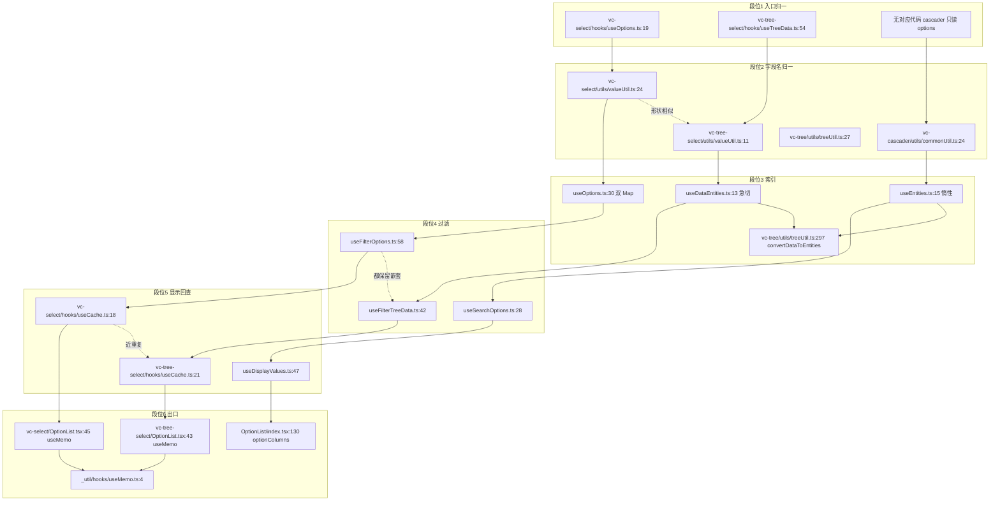
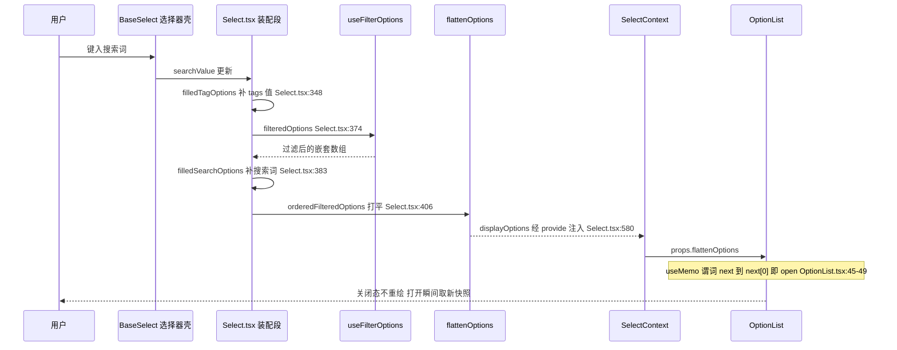
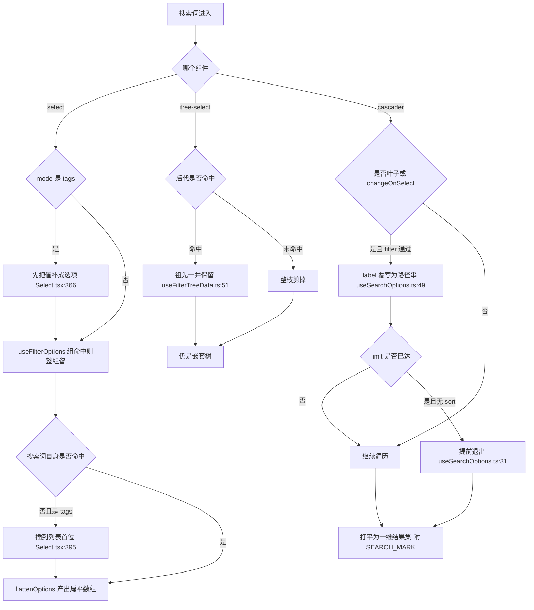

# C05-00 类横写：select/cascader/tree-select 共用的选项流水线

> **本篇解决**：`select`、`cascader`、`tree-select` 从 `options`/`children`/`treeData` 到下拉里可点击的那份数据，中间六段流水线里究竟哪几段真的共用代码、哪几段只是形状相似各写一遍，以及改哪一行会同时打到另外两个组件。
> **前置**：A07《交互基础设施总览：一个浮层是怎么拼起来的》（已完成）、I02《vc-trigger 弹出时序与事件穿透》（已完成）　**读者坐标**：`03-components/05-picker` 类横写篇，本类共 1+8 篇

本篇是 C05 的横写篇，只写三个组件选项数据管道的共用与分叉。逐行论证在各自组件篇：C05-01《Select 选择器》、C05-03《Cascader 级联选择》、C05-04《TreeSelect 树选择》（可能并行撰写，本篇只写编号与标题，不总结其内容）。凡需要组件内部结论时，只写「编号+标题」并给一行交叉引用。虚拟化见 I08《虚拟化双实现：vc-virtual-list 与 virtual-scroller》，受控状态见 I13《响应式内核 hooks》，日期面板计算见 I07《日期计算内核》——三者均不在本篇主题内。

## 一、职责与边界

本篇只回答一个问题：**`select`、`cascader`、`tree-select` 从「调用方给的选项数据」到「下拉里能点的那些东西」，中间这条路到底共用了多少**。答案是「比文档让人以为的少得多」，而少在哪几处、为什么少，就是本篇的全部内容。

把这条路切成六段来看，边界最清楚：

| 段 | 输入 | 输出 | 本篇论点 | 复用情况 |
| --- | --- | --- | --- | --- |
| 入口归一 | `options` / `children` / `treeData` | 规范化 data | 论点 1 | 形状一致，代码三份 |
| 字段名归一 | `fieldNames` | 内部字段名对象 | 论点 3 | 四份互不兼容实现 |
| 索引 | 规范化 data | 可查询表 | 论点 2 | 仅 tree-select 与 cascader 共用一个函数 |
| 过滤 | 索引 + 搜索词 | 存活选项 | 论点 4 | 三套算法，形状都不同 |
| 显示回查 | 已选值 + 索引 | `displayValues` | 论点 5 | 两份近重复 `useCache` + cascader 另一套 |
| 出口快照 | `displayValues` 与末端列表 | 渲染输入 | 论点 6 | select 与 tree-select 共用同一条谓词 |

明确**不负责**的部分，以及归属：

- **弹出、点外关闭、pending 状态机**：I02《vc-trigger 弹出时序与事件穿透》已成篇。本篇只在论点 6 引用它与 `useMemo` 谓词相关的结论，不重述 trigger 的 visible 状态机。浮层怎么拼起来（trigger + align + portal + zIndex）归 A07《交互基础设施总览：一个浮层是怎么拼起来的》。
- **下拉列表的虚拟化**：`vc-select/OptionList.tsx:9` 直接 import `vc-virtual-list` 作为列表容器；`vc-tree-select/OptionList.tsx:3` 只 import 了它的**类型**（`import type { ScrollTo } from '../vc-virtual-list/List'`），实际渲染交给 `vc-tree/Tree`（同文件 `:8`）。cascader 两者都不走：它按列渲染，每列是普通 `ul` 与 `li`（`packages/xiaoye-ui/src/vc-cascader/OptionList/Column.tsx:58`、`:104`）。I08《虚拟化双实现：vc-virtual-list 与 virtual-scroller》已证 `vc-virtual-list` 只被 `vc-select`、`vc-tree`、`vc-tree-select` 三处消费，本篇不展开选型，见 I08。因此「选项多了会不会卡」这三个组件的答案不同。
- **受控/非受控与 value 回流**：`useMergedState` 一条链归 I13《响应式内核 hooks》。本篇只标出三个主实现各自 import 它的位置（`packages/xiaoye-ui/src/vc-select/Select.tsx:49`、`packages/xiaoye-ui/src/vc-tree-select/TreeSelect.tsx:27`、`packages/xiaoye-ui/src/vc-cascader/Cascader.tsx:12`），不比较三者的受控判定。
- **样式与 Token**：三个组件的 `style/index.ts` 与 `genComponentStyleHook` 归 A03《Design Token 四层体系》、A04《cssinjs 样式引擎与 SSR 注水》。
- **各组件自身的交互特例**：`mode` 语义、`maxTagCount` 与 `vc-overflow`、`showCheckedStrategy`、`loadData` 异步加载、`displayRender` 的 VNode 混排，全部归各自组件篇（C05-01、C05-03、C05-04），本篇只在机制分叉处一行带过。同层并行撰写的篇目（C05-02、C05-05…C05-08）本篇不总结。
- **属性清单与用法**：见 `apps/docs/components/select.md`、`apps/docs/components/cascader.md`、`apps/docs/components/tree-select.md`，本篇不写 Props 表。

依赖关系（只列本篇论证用到的边，逐条落到行号）：

- 三个 vc-* 共用的**外壳层**（不是数据层）：`packages/xiaoye-ui/src/vc-tree-select/TreeSelect.tsx:18`（`baseSelectPropsWithoutPrivate`）、`:24`（`BaseSelect`）、`:26`（`useId`），`packages/xiaoye-ui/src/vc-cascader/Cascader.tsx:5`（同一个 `baseSelectPropsWithoutPrivate`）、`:11`（同一个 `useId`）。也就是说 tree-select 与 cascader 都把 `vc-select/BaseSelect.tsx` 当作选择器基座，**复用的是「怎么显示已选、怎么收键盘、怎么开合」，不是「选项怎么算出来」**。
- 三者共用的**传导内核**：`packages/xiaoye-ui/src/vc-tree-select/TreeSelect.tsx:29`（`conductCheck`）与 `packages/xiaoye-ui/src/vc-cascader/Cascader.tsx:19`（同名同路径），二者又都 import `packages/xiaoye-ui/src/vc-tree-select/TreeSelect.tsx:32` 与 `packages/xiaoye-ui/src/vc-cascader/Cascader.tsx:24` 的 `useMaxLevel`（实现在 `vc-tree/useMaxLevel`）。
- 索引段的唯一跨组件调用：`packages/xiaoye-ui/src/vc-tree-select/hooks/useDataEntities.ts:1` 与 `packages/xiaoye-ui/src/vc-cascader/hooks/useEntities.ts:1`，两处都从 `packages/xiaoye-ui/src/vc-tree/utils/treeUtil.ts:297` 取 `convertDataToEntities`。
- 谁依赖本类：`packages/xiaoye-ui/src/select/index.tsx:5`（`RcSelect`、`Option`、`OptGroup`）、`packages/xiaoye-ui/src/tree-select/index.tsx:4`（`VcTreeSelect`）、`packages/xiaoye-ui/src/cascader/index.tsx:2`（`VcCascader`）；`auto-complete`、`transfer`、`mentions` 一类组件复用 `vc-select` 的选项通道，它们的取舍归各自篇（C05-02、C05-05）。
- 包装层之间唯一的跨组件复用是图标：`packages/xiaoye-ui/src/tree-select/index.tsx:19` 与 `packages/xiaoye-ui/src/cascader/index.tsx:8` 都 import `../select/utils/iconUtil`。**外壳与图标都复用了，数据流水线却没有**——这个反差是本篇的落点。

## 二、源码地图

行数由 `find packages/xiaoye-ui/src/<dir> -type f | xargs wc -l` 现场取得，排除 `demo/` 与 `style/`。下表只列参与流水线或作为主实现/入口的文件；某个组件缺某一段时表里就不出现对应行，缺失清单见本节末的第二点。

| 文件 | 行数 | 流水线段位 | 关键导出 |
| --- | --- | --- | --- |
| `vc-select/hooks/useOptions.ts` | 58 | 入口归一 + 索引 | `default`（返回 `options`/`valueOptions`/`labelOptions`） |
| `vc-select/utils/legacyUtil.ts` | 61 | 入口归一 | `convertChildrenToData` |
| `vc-select/utils/valueUtil.ts` | 130 | 字段名 + 末端打平 | `fillFieldNames` `flattenOptions` `injectPropsWithOption` `getSeparatedContent` |
| `vc-select/hooks/useFilterOptions.ts` | 86 | 过滤 | `default` |
| `vc-select/hooks/useCache.ts` | 55 | 显示回查 | `default`（返回 `[filledLabeledValues, getOption]`） |
| `vc-select/Select.tsx` | 684 | 全链装配 | `default`、`selectProps` |
| `vc-select/SelectContext.ts` | 36 | 出口 | `useProvideSelectContext` `useSelectProps`，字段 `flattenOptions:15` |
| `vc-select/OptionList.tsx` | 390 | 出口快照 + 渲染 | `default`（内部名 `OptionList`） |
| `vc-select/BaseSelect.tsx` | 970 | 外壳（归 I02/A07） | `BaseSelect` `baseSelectPropsWithoutPrivate` `DisplayValueType` |
| `vc-select/hooks/useBaseProps.ts` | 24 | 外壳读取 | `useProvideBaseSelectProps` `default` |
| `vc-select/utils/warningPropsUtil.ts` | 135 | 开发态校验 | `default` |
| `vc-select/index.ts` | 13 | 入口 | `Select` `Option` `OptGroup` `BaseSelect` `useBaseProps` |
| `vc-tree-select/hooks/useTreeData.ts` | 74 | 入口归一 | `default`，内含 `parseSimpleTreeData` |
| `vc-tree-select/utils/legacyUtil.tsx` | 180 | 入口归一 + 兼容伪装 | `convertChildrenToData` `fillLegacyProps` `fillAdditionalInfo` |
| `vc-tree-select/utils/valueUtil.ts` | 50 | 字段名 + 键集合 | `fillFieldNames` `toArray` `getAllKeys` `isNil` `isCheckDisabled` |
| `vc-tree-select/hooks/useDataEntities.ts` | 42 | 索引 | `default`（`valueEntities`/`keyEntities`） |
| `vc-tree-select/hooks/useFilterTreeData.ts` | 63 | 过滤 | `default` |
| `vc-tree-select/hooks/useCache.ts` | 43 | 显示回查 | `default`（只返回 `[newFilledValues]`） |
| `vc-tree-select/hooks/useCheckedKeys.ts` | 38 | 传导 | `default` |
| `vc-tree-select/utils/strategyUtil.ts` | 48 | 显示策略 | `formatStrategyValues` `SHOW_ALL` `SHOW_PARENT` `SHOW_CHILD` |
| `vc-tree-select/TreeSelect.tsx` | 791 | 全链装配 | `default`、`treeSelectProps` |
| `vc-tree-select/OptionList.tsx` | 262 | 出口快照 + 渲染 | `default`（内部名 `OptionList`） |
| `vc-tree-select/index.tsx` | 10 | 入口 | `TreeSelect` `TreeNode` 三个 SHOW_* 常量 |
| `vc-cascader/utils/commonUtil.ts` | 51 | 字段名 + 路径键 | `fillFieldNames` `toPathKey` `toPathKeys` `VALUE_SPLIT` `isLeaf` |
| `vc-cascader/utils/treeUtil.ts` | 60 | 显示回查 + 策略 | `toPathOptions` `formatStrategyValues` |
| `vc-cascader/hooks/useEntities.ts` | 36 | 索引 | `default`（`pathKeyEntities`） |
| `vc-cascader/hooks/useSearchOptions.ts` | 77 | 过滤 | `default`，含 `SEARCH_MARK:5` |
| `vc-cascader/hooks/useDisplayValues.ts` | 63 | 显示回查 | `default` |
| `vc-cascader/hooks/useMissingValues.ts` | 26 | 传导补全 | `default` |
| `vc-cascader/hooks/useSearchConfig.ts` | 41 | 搜索配置归一 | `default` |
| `vc-cascader/Cascader.tsx` | 597 | 全链装配 | `default`、`internalCascaderProps`、两个 SHOW_* |
| `vc-cascader/OptionList/index.tsx` | 245 | 出口（列渲染） | `default` |
| `vc-cascader/OptionList/Column.tsx` | 181 | 单列渲染 | `default`、`FIX_LABEL:8` |
| `vc-cascader/OptionList/useKeyboard.ts` | 193 | 键盘 | `default` |
| `vc-cascader/index.tsx` | 16 | 入口 | `Cascader` `cascaderProps` `FieldNames` 类型 |
| `select/index.tsx` | 337 | 公开层 | `XYSelect`、`Option`、`OptGroup` |
| `cascader/index.tsx` | 353 | 公开层 | `XYCascader` |
| `tree-select/index.tsx` | 367 | 公开层 | `XYTreeSelect` |
| `_util/hooks/useMemo.ts` | 21 | 出口快照原语 | `default` |

主实现入口定位：`packages/xiaoye-ui/src/vc-select/Select.tsx:165`（`export default defineComponent({`）、`packages/xiaoye-ui/src/vc-tree-select/TreeSelect.tsx:208`、`packages/xiaoye-ui/src/vc-cascader/Cascader.tsx:189`；装配段的四个关键行是 `packages/xiaoye-ui/src/vc-select/Select.tsx:207`（字段名）、`:227`（`useOptions`）、`:374`（`useFilterOptions`）、`:406`（`displayOptions`），tree-select 侧对应 `packages/xiaoye-ui/src/vc-tree-select/TreeSelect.tsx:237`、`:434`，cascader 侧对应 `packages/xiaoye-ui/src/vc-cascader/Cascader.tsx:202`。

三点必须标注。其一，**三个 vc-* 目录的首页都写着上游版本**：`packages/xiaoye-ui/src/vc-select/index.ts:1` 是 `// base rc-select 14.1.1`，`packages/xiaoye-ui/src/vc-tree-select/index.tsx:1` 是 `// base rc-tree-select@5.4.0`，`packages/xiaoye-ui/src/vc-cascader/index.tsx:1` 是 `// rc-cascader@3.4.2`。这三行是**上游实现的版本标记**，不是本库的当前版本号；它们解释了为什么六个阶段里有五个「各写一遍」——上游本来就是三个独立包，各自带着自己的流水线。格式也不统一（前两条有 `base` 前缀、第三条没有）。其二，cascader 侧**没有** `legacyUtil`、没有 `useOptions`、没有 `useCache`、没有 `warningPropsUtil`（可用 `ls packages/xiaoye-ui/src/vc-cascader/hooks` 复核，见附检查点 3），这四项都是 select 与 tree-select 有而 cascader 无。其三，`vc-cascader/hooks/useSearchConfig.ts` 承担「搜索配置归一」，select 与 tree-select 没有对应文件，它们的搜索配置散在主实现的 `computed` 里。

测试现状（判定依据是 `packages/xiaoye-ui/vitest.config.mts:33` 的 include，它有**两条** glob：`tests/**/*.test.{js,ts,jsx,tsx}` 与 `src/**/*.test.{js,ts,jsx,tsx}`，所以只查 `src/` 会漏）。整条流水线能被执行的测试只有三个文件——`packages/xiaoye-ui/src/select/index.test.js`（224 行）、`packages/xiaoye-ui/src/cascader/index.test.js`（215 行）、`packages/xiaoye-ui/src/tree-select/index.test.js`（**8 行**，内容只有 `focusTest(TreeSelect)` 与 `mountTest(TreeSelect)` 两次调用，见该文件 `:1-8`）。用第二条路径交叉验证负面结论：`find packages/xiaoye-ui/tests packages/xiaoye-ui/src -name "*.test.*" | grep -i "select\|cascader"` 的命中里没有一条来自 `packages/xiaoye-ui/tests/`（该目录只有 `entry-generator.test.js`、`index.test.js` 两个基建测试与 `shared/`、`__mocks__/`），即**没有散落在包级测试目录里的选择器测试**。另外，六个目录（三个 `vc-*` 与三个公开层）下**没有任何 `__tests__` 子目录**：`find packages/xiaoye-ui/src/vc-select packages/xiaoye-ui/src/vc-cascader packages/xiaoye-ui/src/vc-tree-select packages/xiaoye-ui/src/select packages/xiaoye-ui/src/cascader packages/xiaoye-ui/src/tree-select -type d -name "__tests__"` 输出为空。**也就是说本篇六个论点涉及的分支没有一个有单元测试保护**，尤其是 tree-select 的流水线完全没有测试。

## 三、架构与数据流

### 图 1：静态结构——六个段位与四条真实复用边

这张图是本篇的结论图。横向是数据流向（上入下出），纵向按组件分三条泳道；**实线是函数级复用（真的 import 同一个符号），虚线只是形状相似（各写一遍）**。看图时注意：三条泳道之间只有四条实线，全部集中在中间偏下，顶端（入口归一）与中段（字段名）一条实线都没有。



说明三个细节。第一，`convertDataToEntities`（`packages/xiaoye-ui/src/vc-tree/utils/treeUtil.ts:297`）是唯一被两个组件同时调用的**数据段**函数，但它带来的只是遍历与父子链，两个调用方各自塞的索引表不同（`useDataEntities.ts:19` 的 `valueEntities: Map` 对 `useEntities.ts:21-26` 的 `pathKeyEntities: Record`）。第二，段位 2 画了四个框：第四个是 `vc-tree/utils/treeUtil.ts:27`，tree-select 与 cascader 传给 `convertDataToEntities` 的 fieldNames 会再被它解释一次，所以本类实际存在**四份字段名归一**而不是三份。第三，`useMemo` 这条边只连 select 与 tree-select，cascader 的出口框到 `optionColumns` 就结束，这正是论点 6。

### 图 2：数据流闭环——一次搜索词从输入框到下拉重绘



这条链的关键在最后两行：**数据一路算到了 `displayOptions`，但渲染层不立即采纳**。`packages/xiaoye-ui/src/vc-select/OptionList.tsx:45-49` 的 `useMemo` 用 `next => next[0]` 把刷新条件收窄到 `open` 变化，依赖项里虽然列了 `props.flattenOptions`（`:47`），它只负责触发 watch、不负责放行更新。这样做的必要性看 `packages/xiaoye-ui/src/_util/hooks/useMemo.ts:10-18`：去掉第三参会让任一依赖变化都重算。tree-select 是同一条链的另一份实例（`packages/xiaoye-ui/src/vc-tree-select/OptionList.tsx:43-47`）。cascader 不走这张图：它的 `optionColumns` 是普通 `computed`（`packages/xiaoye-ui/src/vc-cascader/OptionList/index.tsx:130`），搜索态直接换成 `useSearchOptions` 的扁平结果，没有冻结阶段。

### 图 3：过滤段的形状分叉——为什么三个组件的下拉里出现的东西不一样



这张图解释三个只有读源码才能得到的可见差异。其一，select 的 tags 模式会把「搜索词本身」做成选项插到列表最前（`packages/xiaoye-ui/src/vc-select/Select.tsx:354-367`），这个短路条件在 `:388` 的比较里——它读的是 `props.optionFilterProp || 'value'`，因此**改了 `optionFilterProp` 会同时改变「搜索词是否已被命中」的判定字段**，两处逻辑共享一个 prop。其二，tree-select 会保留命中节点的全部祖先（`packages/xiaoye-ui/src/vc-tree-select/hooks/useFilterTreeData.ts:51`），select 不会（`packages/xiaoye-ui/src/vc-select/hooks/useFilterOptions.ts:70-75`：子项全不命中就不 push 分组），所以「搜到子项但看不到父级分组名」在两个组件里行为不同。其三，cascader 会**改写 label**（`packages/xiaoye-ui/src/vc-cascader/hooks/useSearchOptions.ts:49-54`）并提前截断（`:31-33`），这是唯一一个搜索结果与原始 `options` 里的文本不一致的组件——因为它把整条路径拼进 label 里，默认分隔符是 `' / '`（`:11`）。

## 四、核心机制精读

### 论点 1：流水线的「入口归一段」在三个组件里是三份互不调用的代码，只有 select 与 tree-select 共享同一份 hook 形状

三个组件都要求调用方能用两种方式表达同一份数据（数组 prop 或子节点），因此都需要一段「原始输入 → 规范化 data」的代码。这段代码在 `vc-select` 与 `vc-tree-select` 里是**结构相同、实现独立**的两个 hook，在 `vc-cascader` 里**整段不存在**。

`packages/xiaoye-ui/src/vc-select/hooks/useOptions.ts:19-29`：

```ts
  watch(
    [options, children],
    () => {
      if (options.value) {
        tempMergedOptions.value = toRaw(options.value).slice();
      } else {
        tempMergedOptions.value = convertChildrenToData(children.value);
      }
    },
    { immediate: true, deep: true },
  );
```

`packages/xiaoye-ui/src/vc-tree-select/hooks/useTreeData.ts:54-72`：

```ts
  watch(
    [simpleMode, treeData, children],
    () => {
      const simpleModeValue = simpleMode.value;
      if (treeData.value) {
        mergedTreeData.value = simpleMode.value
          ? parseSimpleTreeData(toRaw(treeData.value), {
              id: 'id',
              pId: 'pId',
              rootPId: null,
              ...(simpleModeValue !== true ? simpleModeValue : {}),
            })
          : toRaw(treeData.value).slice();
      } else {
        mergedTreeData.value = convertChildrenToData(toRaw(children.value));
      }
    },
    { immediate: true, deep: true },
  );
```

逐段对照：

- 两者都是 `watch` 源数组 + `{ immediate: true, deep: true }`，都先把 `toRaw()` 剥掉响应式代理再 `.slice()` 浅拷贝一份，目的是**不让规范化结果反向持有调用方的 reactive 数组**（`useOptions.ts:23`、`useTreeData.ts:66`）。差别在源数组长度：tree-select 多监听一个 `simpleMode`，因为扁平 `id/pId` 列表到父子树的连接只在这一支发生（`useTreeData.ts:8-42`）。
- 两者的 `else` 分支各自调用**同名不同文件**的 `convertChildrenToData`：`packages/xiaoye-ui/src/vc-select/utils/legacyUtil.ts:27` 与 `packages/xiaoye-ui/src/vc-tree-select/utils/legacyUtil.tsx:11`。两个函数没有相互 import（全仓 grep `convertChildrenToData` 只有这两处定义、四处引用：`useOptions.ts:4`、`useTreeData.ts:4`、`vc-select/utils/warningPropsUtil.ts:2`、递归自调用 `legacyUtil.ts:56`），因此「共享」仅指形状一致，不是代码复用。
- 产出形状也不同。select 版对分组节点写的键是 `options`，并把 label 兜底到 `key`（`packages/xiaoye-ui/src/vc-select/utils/legacyUtil.ts:52-57`）：

```ts
      return {
        key: `__RC_SELECT_GRP__${key === null ? index : String(key)}__`,
        ...props,
        label,
        options: convertChildrenToData(child || []),
      } as any;
```

  tree-select 版写的键是 `children`，且只在真的有子节点时才挂这个键（`packages/xiaoye-ui/src/vc-tree-select/utils/legacyUtil.tsx:50-53`）：

```ts
      const parsedChildren = dig(children);
      if (parsedChildren.length) {
        dataNode.children = parsedChildren;
      }
```

  这处长度守卫**不改变叶子判定**。`vc-tree` 判叶子读的是 entity 上 children 的长度：`packages/xiaoye-ui/src/vc-tree/TreeNode.tsx:78-83` 的 `return !!(children || []).length;`，再在 `packages/xiaoye-ui/src/vc-tree/TreeNode.tsx:85-96` 合成 `isLeaf || (!loadData && !has) || (loadData && loaded.value && !has)`——`children: []` 与根本不写 `children` 在这条判定上结果相同（`has` 都是 false），决定「还没加载的节点算不算叶子」的是 `loadData` 而不是这个键。所以 `legacyUtil.tsx:51` 省掉的只是一个空数组键，差别体现在把规范化结果与调用方自写的 `treeData` 做浅比较或快照时。select 侧没有这层考虑，`legacyUtil.ts:56` 无条件挂 `options`。

- 子节点识别方式也是两套。select 用 VNode 的 `type.isSelectOptGroup` 判别分组（`packages/xiaoye-ui/src/vc-select/utils/legacyUtil.ts:37-47`），tree-select 用 `type.isTreeSelectNode`（`packages/xiaoye-ui/src/vc-tree-select/utils/legacyUtil.tsx:8-10`）。两个标识分别是**组件对象上的静态布尔位**：`packages/xiaoye-ui/src/vc-select/OptGroup.tsx:13` 的 `OptGroup.isSelectOptGroup = true;` 与 `packages/xiaoye-ui/src/vc-tree-select/TreeNode.tsx:14` 的 `TreeNode.isTreeSelectNode = true;`（后者是个 `FunctionalComponent` 空函数，`TreeNode.tsx:11`）。因此**子节点写法在这两个组件之间不可互换**：`<xy-tree-select>` 里放 select 的 option 会被 `warning` 丢弃（`packages/xiaoye-ui/src/vc-tree-select/utils/legacyUtil.tsx:15-18`）。值得注意的是 `isSelectOptGroup` 不止 `vc-select` 在用——`packages/xiaoye-ui/src/auto-complete/OptGroup.tsx:12` 也设了同名标识，所以这条判别实际是 select 与 auto-complete 共用的通道（归 C05-02）。
- cascader 没有这一段。`packages/xiaoye-ui/src/vc-cascader/Cascader.tsx:73` 照样声明了 `children: Array as PropType<VueNode[]>`，但**这个 prop 从不参与选项生成**——它的选项来源只有一行：`packages/xiaoye-ui/src/vc-cascader/Cascader.tsx:211` 的 `const mergedOptions = computed(() => props.options || []);`，随后直接进 `useEntities`（`:221`）。也就是说 cascader 的 children 分支是**声明了但没有实现**的入口，它不像另两个组件那样有 children → data 的转换函数，也没有对应的 `useOptions`/`useTreeData`；`packages/xiaoye-ui/src/vc-cascader/` 目录下不存在 `legacyUtil`（可用附检查点 3 的命令复核）。所以「三种组件共用的选项流水线」准确说法是**两段共用形状 + 一段只有一段没有**，本篇后续所有论点都在描述这个不对称。

结论回扣：本篇不复用「一个共享的 normalizeOptions」这样的描述——源码里根本没有这个符号。三个组件真正共用的东西在下一段（字段名归一）与后面的索引段。

### 论点 2：索引段才是真正共用的地方，但共用只发生在 tree-select 与 cascader 之间——select 自带一套 Map 索引，两边在同一个 hook 里造不同形状

流水线第二段把「规范化 data」变成可查询索引。这里出现本篇唯一一条**真实的跨组件代码复用**：`vc-tree-select` 与 `vc-cascader` 都 import 同一个 `convertDataToEntities`（来自 `vc-tree`），而 `vc-select` 不调用它，自己在 `useOptions` 里手写双 Map。

`packages/xiaoye-ui/src/vc-tree-select/hooks/useDataEntities.ts:10-21`：

```ts
export default (treeData: ShallowRef<any>, fieldNames: Ref<FieldNames>) => {
  const valueEntities = shallowRef(new Map<RawValueType, DataEntity>());
  const keyEntities = shallowRef<Record<string, DataEntity>>({});
  watchEffect(() => {
    const fieldNamesValue = fieldNames.value;
    const collection = convertDataToEntities(treeData.value, {
      fieldNames: fieldNamesValue,
      initWrapper: wrapper => ({
        ...wrapper,
        valueEntities: new Map(),
      }),
```

`packages/xiaoye-ui/src/vc-cascader/hooks/useEntities.ts:13-26`：

```ts
/** Lazy parse options data into conduct-able info to avoid perf issue in single mode */
export default (options: Ref<DefaultOptionType[]>, fieldNames: Ref<InternalFieldNames>) => {
  const entities = computed(() => {
    return (
      convertDataToEntities(options.value as any, {
        fieldNames: fieldNames.value,
        initWrapper: wrapper => ({
          ...wrapper,
          pathKeyEntities: {},
        }),
        processEntity: (entity, wrapper: any) => {
          const pathKey = entity.nodes.map(node => node[fieldNames.value.value]).join(VALUE_SPLIT);

          wrapper.pathKeyEntities[pathKey] = entity;
```

逐段解释：

- **同一个函数的两种扩展点**。`convertDataToEntities` 接受 `initWrapper` 与 `processEntity` 两个回调，调用方借此往遍历结果里塞自己的索引表。tree-select 塞的是 `valueEntities: Map`（键 = 节点 `value`，`useDataEntities.ts:19`、`:35`），cascader 塞的是 `pathKeyEntities: Record`（键 = 整条路径用 `VALUE_SPLIT` 连接，`useEntities.ts:21-26`）。所以「共用内核」指的是遍历与父子链建立，**索引键的语义完全由各组件自己定**，这两张表不能互相替换。
- **路径键是 cascader 独有的补丁**。`useEntities.ts:28-30` 直接改写 entity 自身的 key：

```ts
          // Overwrite origin key.
          // this is very hack but we need let conduct logic work with connect path
          entity.key = pathKey;
```

  注释自陈 hack。原因是半选/全选传导（conduct）依赖 `entity.key` 在父子链上可比对，而 cascader 的唯一标识天然是路径而非单点值，于是把路径塞回 `entity.key`。改动 `VALUE_SPLIT`（`packages/xiaoye-ui/src/vc-cascader/utils/commonUtil.ts:8`）或 `toPathKey`（同文件 `:12-14`）会同时影响这里与 `useMissingValues`、`Cascader.tsx` 的传导逻辑。
- **响应式策略相反**。tree-select 用 `shallowRef` + `watchEffect`（`useDataEntities.ts:11-13`）＝**急切计算**，每次 treeData/fieldNames 变化就在 effect 里全量重建；cascader 用 `computed`（`useEntities.ts:15`）＝**惰性计算**，其注释明确写出动机：`Lazy parse options data into conduct-able info to avoid perf issue in single mode`。也就是说 cascader 认为单选场景不该付这张表的构建成本，tree-select 没有做这个取舍。
- **`process.env.NODE_ENV` 分支只在 tree-select 侧**。`useDataEntities.ts:25-34` 在开发态校验三件事：value 不得为 nil、树内 value 不得重复、`key` 与 `value` 必须一致。cascader 的同名 hook 里没有任何开发态校验（整文件 36 行，无 `warning` import）。这是 cascader 允许「同值不同路径」合法存在、tree-select 不允许的必然结果——tree-select 的索引是单值 Map，重复值会静默覆盖。
- select 侧的对应物在 `packages/xiaoye-ui/src/vc-select/hooks/useOptions.ts:30-52`，一个 `watchEffect` 里递归建两张普通 Map：

```ts
  watchEffect(() => {
    const newOptions = tempMergedOptions.value;

    const newValueOptions = new Map<RawValueType, OptionType>();
    const newLabelOptions = new Map<any, OptionType>();
    const fieldNamesValue = fieldNames.value;
    function dig(optionList: OptionType[], isChildren = false) {
      // for loop to speed up collection speed
      for (let i = 0; i < optionList.length; i += 1) {
        const option = optionList[i];
        if (!option[fieldNamesValue.options] || isChildren) {
          newValueOptions.set(option[fieldNamesValue.value], option);
          newLabelOptions.set(option[fieldNamesValue.label], option);
        } else {
          dig(option[fieldNamesValue.options], true);
        }
      }
    }
    dig(newOptions);
    mergedOptions.value = newOptions;
    valueOptions.value = newValueOptions;
    labelOptions.value = newLabelOptions;
  });
```

  注意 `useOptions.ts:40-45` 的分支条件：带子 `options` 的节点（即分组）**不进索引**，只递归下去。这跟 tree-select/cascader 相反——后两者的 entity 表里父节点必须存在，否则传导算不出来。第二张表 `labelOptions`（`:42`）是 select 特有的：它按 label 反查 option，服务于 `labelInValue` 与 `optionLabelProp` 的回查（见论点 5）；tree-select 与 cascader 都没有 label→option 的索引。
- 三套索引各自还有一个「全量键集合」的辅助遍历：select 用 `flattenOptions` 生成渲染数组（`packages/xiaoye-ui/src/vc-select/utils/valueUtil.ts:39-86`），tree-select 用 `getAllKeys`（`packages/xiaoye-ui/src/vc-tree-select/utils/valueUtil.ts:29-46`，同样是递归 dig），cascader 依赖 `pathKeyEntities` 的键集合。**三个函数没有共用任何一行代码。**

结论回扣：把「选项流水线」当成一个共享模块是错的。共享的只有 `convertDataToEntities` 一个函数、只覆盖两个组件；select 从一开始就不在这条共享轨道上。

### 论点 3：字段名归一这一步有四份 `fillFieldNames`，返回形状互不兼容，其中一份的默认 label 取决于另一个入参

三个组件都允许调用方改字段名（`fieldNames`），因此都需要「用户给的字段名 → 内部固定字段名」这一步。这一步在本类里是**四份独立实现**，签名和返回形状都不一样，没有任何一个共用工具。

`packages/xiaoye-ui/src/vc-select/utils/valueUtil.ts:24-32`：

```ts
export function fillFieldNames(fieldNames: FieldNames | undefined, childrenAsData: boolean) {
  const { label, value, options } = fieldNames || {};

  return {
    label: label || (childrenAsData ? 'children' : 'label'),
    value: value || 'value',
    options: options || 'options',
  };
}
```

`packages/xiaoye-ui/src/vc-tree-select/utils/valueUtil.ts:11-22`：

```ts
export function fillFieldNames(fieldNames?: FieldNames) {
  const { label, value, children } = fieldNames || {};

  const mergedValue = value || 'value';

  return {
    _title: label ? [label] : ['title', 'label'],
    value: mergedValue,
    key: mergedValue,
    children: children || 'children',
  };
}
```

`packages/xiaoye-ui/src/vc-cascader/utils/commonUtil.ts:24-33`：

```ts
export function fillFieldNames(fieldNames?: FieldNames): InternalFieldNames {
  const { label, value, children } = fieldNames || {};
  const val = value || 'value';
  return {
    label: label || 'label',
    value: val,
    key: val,
    children: children || 'children',
  };
}
```

`packages/xiaoye-ui/src/vc-tree/utils/treeUtil.ts:27-37`（tree-select 与 cascader 的索引段最终交给 `vc-tree` 的 `convertDataToEntities`，见论点 2，所以第四份也会被本类间接消费）：

```ts
export function fillFieldNames(fieldNames?: FieldNames): Required<FieldNames> {
  const { title, _title, key, children } = fieldNames || {};
  const mergedTitle = title || 'title';

  return {
    title: mergedTitle,
    _title: _title || [mergedTitle],
    key: key || 'key',
    children: children || 'children',
  };
}
```

逐段解释：

- **键名集合就不同**。select 版返回 `{label, value, options}`（子集合字段叫 `options`），tree-select 版与 cascader 版返回带 `children`，tree-select 版**没有 `label` 字段**，改用 `_title: string[]` 表示「按顺序尝试多个候选字段」。这正是 `vc-tree` 的节点标题回退链形状（`vc-tree/utils/treeUtil.ts:32-33`），select 侧不需要它，因为 option 只有一个标题字段。
- **select 版是四份里唯一带第二个入参的**：`childrenAsData` 决定默认 label 落在 `'children'` 还是 `'label'`（`vc-select/utils/valueUtil.ts:28`）。它的实参来自 `packages/xiaoye-ui/src/vc-select/Select.tsx:207`，即 `fillFieldNames(props.fieldNames, childrenAsData.value)`。这带来的直接后果是：**同一个 `{}`（未配置 fieldNames）在 select 与 tree-select 里得到的 label 字段名可能不同**，取决于 select 那侧 `mode` 是否走 children-as-data 分支。跨组件迁移数据时这一条最容易漏。
- **tree-select 版把 `value` 与 `key` 绑成同一个字段**（`vc-tree-select/utils/valueUtil.ts:18-19`，`key: mergedValue`），cascader 版同样如此（`vc-cascader/utils/commonUtil.ts:29-30`）。而 `vc-tree` 版把 `key` 保持为独立的 `'key'`（`vc-tree/utils/treeUtil.ts:34`）。也就是说：**同一份 fieldNames 配置喂给 tree 与喂给 tree-select，`key` 字段读的不是同一个属性**，这与论点 2 里 `useDataEntities.ts:31-33` 那条「`key` 或 `value` 必须一致」的开发态告警是同一个约束的两面。
- 消费点各一处，无交叉：`vc-select/Select.tsx:207`、`vc-tree-select/TreeSelect.tsx:237`、`vc-cascader/Cascader.tsx:202`、`vc-tree/Tree.tsx:128`。四份都用 `computed` 包住（例如 `const mergedFieldNames = computed<InternalFieldName>(() => fillFieldNames(props.fieldNames));`，`packages/xiaoye-ui/src/vc-tree-select/TreeSelect.tsx:237`），因此调用方整体替换 `fieldNames` 对象才会重算，改对象内部属性依赖外层响应式深度。
- 这四份没有一份下沉到 `_util`。想合并的话，最小障碍不是默认值，而是**返回形状**：`_title` 数组与 `options`/`children` 的字段名之争会同时波及 `flattenOptions`（读 `fieldOptions`，`vc-select/utils/valueUtil.ts:49`）、`useFilterTreeData`（读 `fieldChildren`，`vc-tree-select/hooks/useFilterTreeData.ts:23`）、`useSearchOptions`（读 `fieldNames.value.children`，`vc-cascader/hooks/useSearchOptions.ts:36`）三个过滤段。

结论回扣：「选项流水线」的第一道共用点，实际是**四道并行且不互通的适配器**。文档层面统一叫 `fieldNames`，源码层面是四个同名函数。

### 论点 4：过滤段是三套语义不同的算法，只有 cascader 会把树打平——另外两个必须保持原始嵌套形状给渲染层

流水线第三段是「搜索词进来后哪些选项还活着」。三个组件的这一段返回**形状不同**，这是本类最容易误改的一步。

select 侧（`packages/xiaoye-ui/src/vc-select/hooks/useFilterOptions.ts:58-84`）：

```ts
    options.value.forEach(item => {
      // Group should check child options
      if (item[fieldOptions]) {
        // Check group first
        const matchGroup = filterFunc(searchValueVal, wrapOption(item));
        if (matchGroup) {
          filteredOptions.push(item);
        } else {
          // Check option
          const subOptions = item[fieldOptions].filter((subItem: DefaultOptionType) =>
            filterFunc(searchValueVal, wrapOption(subItem)),
          );
          if (subOptions.length) {
            filteredOptions.push({
              ...item,
              [fieldOptions]: subOptions,
            });
          }
        }

        return;
      }

      if (filterFunc(searchValueVal, wrapOption(item))) {
        filteredOptions.push(item);
      }
    });
```

tree-select 侧（`packages/xiaoye-ui/src/vc-tree-select/hooks/useFilterTreeData.ts:42-61`）：

```ts
    function dig(list: DefaultOptionType[], keepAll = false) {
      const res = [];
      for (let index = 0, len = list.length; index < len; index++) {
        const dataNode = list[index];
        const children = dataNode[fieldChildren];

        const match = keepAll || filterOptionFunc(searchValueVal, fillLegacyProps(dataNode));
        const childList = dig(children || [], match);

        if (match || childList.length) {
          res.push({
            ...dataNode,
            [fieldChildren]: childList,
          });
        }
      }
      return res;
    }

    return dig(treeData.value);
```

cascader 侧（`packages/xiaoye-ui/src/vc-cascader/hooks/useSearchOptions.ts:28-56`）：

```ts
    function dig(list: DefaultOptionType[], pathOptions: DefaultOptionType[]) {
      list.forEach(option => {
        // Perf saving when `sort` is disabled and `limit` is provided
        if (!sort && (limit as number) > 0 && filteredOptions.length >= (limit as number)) {
          return;
        }

        const connectedPathOptions = [...pathOptions, option];
        const children = option[fieldNames.value.children];

        // If current option is filterable
        if (
          // If is leaf option
          !children ||
          children.length === 0 ||
          // If is changeOnSelect
          changeOnSelect.value
        ) {
          if (filter(search.value, connectedPathOptions, { label: fieldNames.value.label })) {
            filteredOptions.push({
              ...option,
              [fieldNames.value.label as 'label']: render({
                inputValue: search.value,
                path: connectedPathOptions,
                prefixCls: prefixCls.value,
                fieldNames: fieldNames.value,
              }),
              [SEARCH_MARK]: connectedPathOptions,
            });
          }
        }
```

逐段解释：

- **两者只有一处真正相似**：都保留 `{...item, [子字段]: 过滤后的子集}` 的**嵌套形状**，因为下游渲染层按层级消费。select 的分组分支是「组命中则整组留下、否则按子项筛」（`useFilterOptions.ts:62-75`），组本身命中时**不裁剪子项**；tree-select 的 `keepAll` 参数把同一语义写成了向下传递的布尔开关（`useFilterTreeData.ts:48`：父命中则子全命中）。两者行为一致但表达完全不同，改一个不会带动另一个。
- **tree-select 多一条「祖先保留」规则**：`useFilterTreeData.ts:51` 的 `if (match || childList.length)` 意味着只要后代命中，父节点就保留。select 侧没有这一条——分组里所有子项都不命中时整个分组被丢弃（`useFilterTreeData.ts` 与 `useFilterOptions.ts` 的差异常被误认为 bug）。
- **cascader 是唯一打平的一支**，且它的产物不是「过滤后的树」而是**扁平搜索结果列表**：每条结果被覆写 label（`useSearchOptions.ts:49-54`，用 `render` 生成 `A / B / C` 串，默认 render 见 `:10-11`），并额外挂一个 `SEARCH_MARK` 键存完整路径（`:55`，常量定义在 `:5`）。这个标记位随后成为点击/激活时的真实值来源，`vc-cascader/OptionList/index.tsx` 与 `Column.tsx` 都要读它。**删掉 `SEARCH_MARK` 会让搜索态下的选项全部丢路径。**
- **cascader 独有 `limit` 与提前退出**。`useSearchOptions.ts:31-33` 在 `sort` 关闭时用 `filteredOptions.length >= limit` 直接 `return` 跳出当前层的 forEach；`limit` 默认 50（`:22` 解构默认值）。select 与 tree-select 的过滤函数没有任何截断逻辑。默认值写在 hook 内部而不是 props，所以文档里 `showSearch.limit` 的默认值不在 props 定义处，改默认值只能改 `:22`。
- **只有 cascader 会命中「非叶子也可能入选」的分支**：`changeOnSelect.value` 参与可过滤判定（`useSearchOptions.ts:44`）。这解释了同一个搜索词在 cascader 里出现中间层级结果、在 tree-select 里不出现。
- **自定义回调的入参形状三家不同**：select 的 `filterOption` 收到 `option` 前会先经 `injectPropsWithOption`（`useFilterOptions.ts:54-56` → `packages/xiaoye-ui/src/vc-select/utils/valueUtil.ts:91-106`，用 `Object.defineProperty` 造一个 `props` getter 并在读取时 `warning`）；tree-select 用 `fillLegacyProps`（`useFilterTreeData.ts:48`，实现在 `packages/xiaoye-ui/src/vc-tree-select/utils/legacyUtil.tsx:62`）做同样的「把 data 伪装成组件实例」的事；cascader 的 `filter` 收到的是**整条路径数组**（`useSearchOptions.ts:46`）。三个组件的 `filterXxx` 回调签名不兼容，这是「换组件时自定义过滤必须重写」的根因。
- select 的过滤只是它四段派生链的一环，完整链在 `packages/xiaoye-ui/src/vc-select/Select.tsx:338-402`：`filledTagOptions`（tags 模式把当前值补成选项，`:348-372`）→ `filteredOptions`（`:374-380`）→ `filledSearchOptions`（搜索词本身补成选项，`:383-396`）→ `orderedFilteredOptions`（`filterSort`，`:398-404`）→ `displayOptions`（`flattenOptions`，`:406-411`）。四段全是独立 `computed`/`watchEffect`，**任何一段都能单独短路**，`Select.tsx:385` 的 `props.mode !== 'tags'` 与 `Select.tsx:399` 的 `!props.filterSort` 都是这种短路。

结论回扣：所谓「共用的选项流水线」，过滤段是三条分叉最明显的支路。共用只到「保留嵌套形状」这一层约定为止，cascader 从形状上就退出了这条流水线。

### 论点 5：流水线的尾段「值→标签回查」有三套实现，select 与 tree-select 的两个 `useCache` 是近重复而非复用，且其中一份的实现与自己的注释不符

尾段解决同一件事：调用方给的 value 在选项集里找不到时（选项被删、异步还没到、tags 自定义值），已选中的标签不能突然变空。三个组件各自解决了一次。

`packages/xiaoye-ui/src/vc-select/hooks/useCache.ts:13-49`：

```ts
  const cacheRef = shallowRef({
    values: new Map<RawValueType, LabelInValueType>(),
    options: new Map<RawValueType, DefaultOptionType>(),
  });

  const filledLabeledValues = computed(() => {
    const { values: prevValueCache, options: prevOptionCache } = cacheRef.value;

    // Fill label by cache
    const patchedValues = labeledValues.value.map(item => {
      if (item.label === undefined) {
        return {
          ...item,
          label: prevValueCache.get(item.value)?.label,
        };
      }

      return item;
    });

    // Refresh cache
    const valueCache = new Map<RawValueType, LabelInValueType>();
    const optionCache = new Map<RawValueType, DefaultOptionType>();

    patchedValues.forEach(item => {
      valueCache.set(item.value, item);
      optionCache.set(
        item.value,
        valueOptions.value.get(item.value) || prevOptionCache.get(item.value),
      );
    });

    cacheRef.value.values = valueCache;
    cacheRef.value.options = optionCache;

    return patchedValues;
  });
```

`packages/xiaoye-ui/src/vc-tree-select/hooks/useCache.ts:9-41`：

```ts
export default (values: Ref<LabeledValueType[]>): [Ref<LabeledValueType[]>] => {
  const cacheRef = shallowRef({
    valueLabels: new Map<RawValueType, any>(),
  });
  const mergedValues = shallowRef();
  watch(
    values,
    () => {
      mergedValues.value = toRaw(values.value);
    },
    { immediate: true },
  );
  const newFilledValues = computed(() => {
    const { valueLabels } = cacheRef.value;
    const valueLabelsCache = new Map<RawValueType, any>();

    const filledValues = mergedValues.value.map(item => {
      const { value } = item;
      const mergedLabel = item.label ?? valueLabels.get(value);

      // Save in cache
      valueLabelsCache.set(value, mergedLabel);

      return {
        ...item,
        label: mergedLabel,
      };
    });

    cacheRef.value.valueLabels = valueLabelsCache;

    return filledValues;
  });
  return [newFilledValues];
};
```

逐段解释：

- **两个 hook 名字相同、签名不同、返回元数不同**：select 版返回 `[filledLabeledValues, getOption]`（`useCache.ts:12`、`:54`），第二个返回值 `getOption`（`:51-52`）用于「值→原始 option」的回查，被 `Select.tsx:300` 接走；tree-select 版只返回 `[newFilledValues]`（`useCache.ts:42`），因为它不需要 option 对象，只需要标签。因此二者不可互换。
- **写缓存的时机不同**：select 版在 `computed` 内部**直接改写 `cacheRef.value` 的两个字段**（`useCache.ts:45-46`），tree-select 版同样在 computed 内改写（`:38`）。`shallowRef` 的对象属性被就地改，不会触发自身更新——两处都是「缓存只对下一次求值可见」的设计，也就是一次求值内不会自我放大。
- **`?? ` 与 `=== undefined` 的判定不同**：tree-select 用 `item.label ?? valueLabels.get(value)`（`:27`），`null` 会被当作需要回查；select 用 `if (item.label === undefined)`（`:23`），`null` 标签会**保留为 null**。这个差别直接对应到 `Select.tsx:302-312` 那段「`null` 需要显示成 placeholder」的特判——select 把 null 留给上层处理，tree-select 把它当缺失处理。
- **tree-select 的 hook 注释与实现不符**。`packages/xiaoye-ui/src/vc-tree-select/hooks/useCache.ts:5-8` 写着：

```ts
/**
 * This function will try to call requestIdleCallback if available to save performance.
 * No need `getLabel` here since already fetch on `rawLabeledValue`.
 */
```

  但函数体（`:9-43`，全文件共 43 行）里没有任何 `requestIdleCallback` 调用。按两种独立方法交叉验证：`grep -rn "requestIdleCallback" packages --include='*.ts' --include='*.tsx'` 在全仓 ts/tsx 源码里只有这一处命中，即注释本身；该文件也没有任何 `import` 引入 idle 调度。**结论：这是一条遗留注释，当前实现是同步 computed。**
- **第二处遗留：`TreeSelect.tsx:379` 有一行注释掉的旧调用**：

```ts
    // const [mergedValues] = useCache(rawLabeledValues);
    const rawValues = computed(() => rawLabeledValues.value.map(item => item.value));
```

  真正生效的是 `packages/xiaoye-ui/src/vc-tree-select/TreeSelect.tsx:427` 的 `const [cachedDisplayValues] = useCache(displayValues);`。传入的对象从 `rawLabeledValues` 换成了 `displayValues`，配合上面注释第二句「No need `getLabel` here since already fetch on `rawLabeledValue`」可以还原改动脉络：标签回查前移到了 `displayValues` 内部（`TreeSelect.tsx:407-413` 的 `rawLabeledValues.value.find(...)` 反查原始 label），`useCache` 因此退化成纯缓存层。**读这段代码时不要把 `:386` 当成生效路径。**
- **cascader 完全不参与这一段的复用**，它没有 `useCache`。对应职责拆成两处：路径回查在 `packages/xiaoye-ui/src/vc-cascader/hooks/useDisplayValues.ts:47-53`：

```ts
    return rawValues.value.map(valueCells => {
      const valueOptions = toPathOptions(valueCells, options.value, fieldNames.value);

      const label = mergedDisplayRender({
        labels: valueOptions.map(({ option, value }) => option?.[fieldNames.value.label] ?? value),
        selectedOptions: valueOptions.map(({ option }) => option),
      });
```

  `toPathOptions` 来自 `packages/xiaoye-ui/src/vc-cascader/utils/treeUtil.ts`，它按 value 数组逐层下钻，命不中时 `option?` 为 undefined，于是 `?? value` 直接把原始值当标签输出（`:51`）——**cascader 的兜底是「显示缺失的值本身」，select 与 tree-select 的兜底是「显示上次缓存的标签」**，两种策略用户可见差别明显。缺失值列表的另一处职责在 `packages/xiaoye-ui/src/vc-cascader/hooks/useMissingValues.ts`（26 行），它服务的是传导（conduct），不是显示回查。
- 三家的 displayValues 都做了同一个 nil 特判，但写法三份：`Select.tsx:304-312`（`!props.mode && length===1 && value===null && label 为 null/undefined → 返回 []`）、`TreeSelect.tsx:418-420`（`!mergedMultiple && isNil(firstVal.value) && isNil(firstVal.label) → []`）、cascader 侧无此特判。

结论回扣：尾段是本类第三次出现「同一问题、三份实现」。唯一收敛的迹象是 select 与 tree-select 都用了 `shallowRef` + `computed` 就地写缓存这一条相同手法——这是形状约定，不是代码复用。

### 论点 6：流水线的出口只被两个组件用同一个快照 hook 接住，cascader 从这一步也退出了——它按列渲染，还把空态伪装成一条选项

前五个论点里的 `useMemo`（`packages/xiaoye-ui/src/_util/hooks/useMemo.ts:4-21`）全仓只有三个消费方：`vc-select/OptionList.tsx`、`vc-tree-select/OptionList.tsx`、`vc-picker/hooks/useValueTexts.ts`。其中两个属于本类。这两个 OptionList 的调用形状逐字符同构，这一条已由 I02《vc-trigger 弹出时序与事件穿透》记录（其结论覆盖 `packages/xiaoye-ui/src/vc-select/OptionList.tsx:45-48` 与 `packages/xiaoye-ui/src/vc-tree-select/OptionList.tsx:43-46` 共用同一条谓词），本篇不重复论证，只补 I02 未展开的两件事：**这个 hook 冻结的到底是流水线的哪一段输出**，以及**cascader 为什么接不住**。

先看被冻结的数据来自哪里。`packages/xiaoye-ui/src/vc-select/OptionList.tsx:45-49`：

```tsx
    const memoFlattenOptions = useMemo(
      () => props.flattenOptions,
      [() => baseProps.open, () => props.flattenOptions],
      next => next[0],
    );
```

`packages/xiaoye-ui/src/vc-tree-select/OptionList.tsx:43-47`：

```tsx
    const memoTreeData = useMemo(
      () => context.treeData,
      [() => baseProps.open, () => context.treeData],
      next => next[0],
    );
```

被快照的值一个是 `flattenOptions`、一个是 `treeData`，但两者都是各自流水线的**末端产物**：select 侧 `flattenOptions` 是 `SelectContext` 上声明的字段（`packages/xiaoye-ui/src/vc-select/SelectContext.ts:15`），由 `packages/xiaoye-ui/src/vc-select/Select.tsx:549` 的 `flattenOptions: displayOptions` 注入，即论点 4 里四段派生链的最终 `displayOptions`；tree-select 侧同理，末端产物经 context 传给 OptionList。因此这条 `useMemo` 的实际语义是：**整条选项流水线的输出在下拉关闭期间被冻结**，`shouldUpdate` 返回 `next[0]`（`packages/xiaoye-ui/src/_util/hooks/useMemo.ts:12`，即新的 `open` 值，依赖项声明在 `:10`），只有 `open` 变为 true 的那次触发才重新取值。

第三参必须存在的原因在 hook 本体（`packages/xiaoye-ui/src/_util/hooks/useMemo.ts:10-18`）：

```ts
  watch(condition, (next, pre) => {
    if (shouldUpdate) {
      if (shouldUpdate(next, pre)) {
        cacheRef.value = getValue();
      }
    } else {
      cacheRef.value = getValue();
    }
  });
```

  没有 `shouldUpdate` 时，condition 数组里**任一**源变化都会重算——把 `flattenOptions` 列入依赖（`vc-select/OptionList.tsx:47` 的第二项）就会让每次搜索都重建快照，冻结失效。谓词的作用正是把「数据变化」这一维依赖关掉。

cascader 为什么接不住：它的数据出口不是扁平数组或树，而是**二维的列集合**。`packages/xiaoye-ui/src/vc-cascader/OptionList/index.tsx:130` 定义 `const optionColumns = computed(() => {`，渲染时按列铺（`:210-211`）。这段渲染里还有两个 select/tree-select 没有的处理（`packages/xiaoye-ui/src/vc-cascader/OptionList/index.tsx:188-197`）：

```tsx
      // >>>>> Empty
      const isEmpty = !optionColumns.value[0]?.options?.length;

      const emptyList: DefaultOptionType[] = [
        {
          [fieldNames.value.value as 'value']: '__EMPTY__',
          [FIX_LABEL as 'label']: notFoundContent,
          disabled: true,
        },
      ];
```

  配合 `:211` 的 `const mergedOptionColumns = isEmpty ? [{ options: emptyList }] : optionColumns.value;`，空态不是一段独立渲染分支，而是**造一条 value 为 `'__EMPTY__'`、`disabled: true` 的假选项塞进列里**，`notFoundContent` 通过 `FIX_LABEL` 绕过 `fieldNames.label` 的自定义字段名（常量定义在 `packages/xiaoye-ui/src/vc-cascader/OptionList/Column.tsx:8`，读取处在同文件 `:62` 的 `option[FIX_LABEL] ?? option[fieldNames.value.label]`，导入关系见 `OptionList/index.tsx:18`）。这样列容器与键盘导航（`packages/xiaoye-ui/src/vc-cascader/OptionList/useKeyboard.ts`）不需要为空态特判。代价是：**任何读取列数据的代码都必须知道 `'__EMPTY__'` 这个魔法值**，且它不受 `fieldNames.value` 改名影响（键名写死为 `value`，`OptionList/index.tsx:193`）。

由此得到本类三者在「出口冻结」上的真实分布：select 与 tree-select 共享同一条 `useMemo` 谓词与同一种冻结语义；cascader 既不冻结（纯 `computed`，`OptionList/index.tsx:130`），也不共享数据形状。

结论回扣：把本篇六个论点串起来看，「选项流水线」在三个组件之间只有四处真实的复用点或形状约定——`convertDataToEntities`（唯一跨组件函数调用，见论点 2）、`useBaseProps` 的 context 读取（`packages/xiaoye-ui/src/vc-select/hooks/useBaseProps.ts:22-24`）、末端 `useMemo` 谓词（本论点）、以及「过滤后保留嵌套形状」的约定（论点 4）；其余五个阶段——入口归一、字段名归一、索引形状、显示回查、列渲染——全部各写一遍。

## 五、对外契约如何生效

这一段讲的是**外部写下的每个选项相关配置，在哪一行进入流水线**，而不是清单。目的是让改动者能反查：「我改这个 prop，会经过哪几个函数」。

**子节点到选项的那条路只有 select 与 tree-select 有**。公开层把默认插槽当作 children 交下去：`packages/xiaoye-ui/src/select/index.tsx:311` 的 `children={slots.default?.()}`。进了 `vc-select` 之后，第一件事不是转换，而是**判断该用哪个默认 label 字段**：`packages/xiaoye-ui/src/vc-select/Select.tsx:197` 的 `const childrenAsData = computed(() => !!(!props.options && props.children));`。这个布尔量随后被投给字段名归一（`Select.tsx:216`）、末端打平（`Select.tsx:409`）并挂进 context（`Select.tsx:590`）。于是「用 `options` 还是用子节点」这个选择，实际改变了 `label` 字段的默认名（`packages/xiaoye-ui/src/vc-select/utils/valueUtil.ts:28`）——这是本类里唯一一处**入口方式影响字段语义**的地方，tree-select 与 cascader 都没有这个耦合（tree-select 的 `fillFieldNames` 无第二入参，`packages/xiaoye-ui/src/vc-tree-select/utils/valueUtil.ts:11`）。

**「用哪个字段当显示标签」这一个诉求有三个 prop 名、三条生效点**，全部落在流水线的显示回查段：

- select：`optionLabelProp`，声明在 `packages/xiaoye-ui/src/vc-select/Select.tsx:140`，生效在 `packages/xiaoye-ui/src/vc-select/Select.tsx:230` 的 `rawLabel = option?.[props.optionLabelProp || mergedFieldNames.value.label]`。它的优先级是**压过 fieldNames.label**，但只在「用 value 反查到 option 且 label 未提供」时才用到——判定链在 `Select.tsx:255` 的 `valueOptions.value.get(rawValue)`，也就是论点 2 里 select 自建的那张 Map。所以 `optionLabelProp` 想生效，必须先让 `valueOptions` 命中；选项已被移除时由 `useCache` 的缓存兜底（`packages/xiaoye-ui/src/vc-select/hooks/useCache.ts:51-52`），此时读的是缓存里的旧 option，`optionLabelProp` 依然生效但值可能过期。
- tree-select：`treeNodeLabelProp`，声明在 `packages/xiaoye-ui/src/vc-tree-select/TreeSelect.tsx:145`，生效在 `TreeSelect.tsx:292-293` 的 `if (props.treeNodeLabelProp) { return item[props.treeNodeLabelProp]; }`。它读的是 tree 节点对象本身，不经过 `valueOptions`，所以没有 select 那层「选项被删就取缓存」的行为，取而代之的是 `TreeSelect.tsx:404` 的 `keyEntities.value[key]?.node?.[...]`。
- cascader：没有 label-prop，取而代之是 `displayRender`（`packages/xiaoye-ui/src/vc-cascader/hooks/useDisplayValues.ts:22-45` 的默认实现）与搜索态的 `showSearch.render`（`packages/xiaoye-ui/src/vc-cascader/hooks/useSearchOptions.ts:10-11`）。这两个回调拿到的是**整条路径**，不是单个 option，所以 cascader 的显示定制能力比另两个强，但**没法用「换个字段名」这种声明式配置达到同样效果**。

**事件与插槽基本不参与流水线**。三个组件的 `onChange` 走的是各自的 `triggerChange`（`packages/xiaoye-ui/src/vc-select/Select.tsx:405`、`packages/xiaoye-ui/src/vc-tree-select/TreeSelect.tsx:423`），它们消费流水线的**输出**（`displayValues`/`rawValues`），不写回选项数据。`vc-select` 里有两条把值倒灌回流水线的边，且都由 `mode` 把关：一条进**入口段**——tags 模式把当前值补成临时选项（`packages/xiaoye-ui/src/vc-select/Select.tsx:329-353`，读取 `mergedValues` 在 `:361`）；另一条进**过滤段**——combobox 模式把当前值写回 `searchValue`（`:323-334`，`{ flush: 'post' }`），该值随后作为 `useFilterOptions` 的搜索词入参（`:377`）。除这两处外没有找到第三条。

**开发态校验的覆盖面不一致**。select 与 tree-select 各自把 props 交给一份 `warningPropsUtil` 复核：调用点分别在 `packages/xiaoye-ui/src/vc-select/Select.tsx:567` 与 `packages/xiaoye-ui/src/vc-tree-select/TreeSelect.tsx:232`，两份文件是 135 行与 35 行，前者会检查 value/label 冲突、`labelInValue` 误用等，后者只做基础检查。cascader 完全没有这一层（`vc-cascader/` 下无 `warningPropsUtil`）。同时 `packages/xiaoye-ui/src/vc-select/Select.tsx:254-260` 有一段被整块注释掉的 label 一致性告警，注释首行写着 `// Warning if label not same as provided`——**这条契约目前在开发态也没有提示**。索引段那侧的开发态校验（`packages/xiaoye-ui/src/vc-tree-select/hooks/useDataEntities.ts:25-34`）反而活着，且被 `process.env.NODE_ENV !== 'production'` 包着，构建期会被摇掉。

## 六、设计取舍

**为什么四条 `fillFieldNames` 不合并成一份。** 被放弃的路是「抽一个 `_util/fillFieldNames`，让 `fieldNames` prop 类型统一」。走不通的原因不在实现而在**类型面**：三个组件各自导出了一个不同的 `FieldNames` 接口——`packages/xiaoye-ui/src/vc-select/Select.tsx:82`（对应返回 `{label, value, options}`）、`packages/xiaoye-ui/src/vc-tree-select/interface.ts:97`（含 `children`，且 `packages/xiaoye-ui/src/vc-tree-select/TreeSelect.tsx:237` 把结果标注为 `InternalFieldName`）、`packages/xiaoye-ui/src/vc-cascader/Cascader.tsx:41`（对应返回 `InternalFieldNames`，并经 `packages/xiaoye-ui/src/vc-cascader/index.tsx:10` 对外再导出）。三个都是公开类型别名，合并返回形状等于同时改三处已发布的公开类型，收益是省两百行内部代码，代价是 breaking change。当前形态换来的是各组件独立演进（select 敢加 `childrenAsData` 这种第二入参，`packages/xiaoye-ui/src/vc-select/utils/valueUtil.ts:24`），赔上的是「同一份业务数据在三个组件间迁移时字段名要重写一遍」这件事由使用者承担。

**为什么 select 不接 `convertDataToEntities`。** 被放弃的路是「select 也用 DataEntity 表」。代价很具体：`convertDataToEntities`（`packages/xiaoye-ui/src/vc-tree/utils/treeUtil.ts:297`）产出的是带 `level`、`children`、`parent` 与 `nodes` 路径的实体对象，而 select 的选项最深层只有「分组 → 选项」两级（`packages/xiaoye-ui/src/vc-select/utils/legacyUtil.ts:52-57` 造的 `options` 键），它需要的是 value→option 与 label→option 两次点查，`Map` 就够（`packages/xiaoye-ui/src/vc-select/hooks/useOptions.ts:33-34`）。接 entity 表要为每个选项多分配一个对象并维护父子指针，而 select 恰恰是本类里最常承载大列表的那个组件。cascader 的取舍是同一顾虑的另一面：它确实需要父子链（做传导），但仍然把建表推迟到 `computed` 里，注释直写动机——`Lazy parse options data into conduct-able info to avoid perf issue in single mode`（`packages/xiaoye-ui/src/vc-cascader/hooks/useEntities.ts:13`）。**同一条「要不要现在就建表」的判断题，两个组件给出了相反答案**：tree-select 急切建（`packages/xiaoye-ui/src/vc-tree-select/hooks/useDataEntities.ts:13` 的 `watchEffect`，mount 即建），cascader 惰性建（`packages/xiaoye-ui/src/vc-cascader/hooks/useEntities.ts:15` 的 `computed`，无人读就不建）。cascader 侧 `pathKeyEntities` 的消费点集中在主实现里（`packages/xiaoye-ui/src/vc-cascader/Cascader.tsx:212`、`:272`、`:286`、`:308`、`:381`、`:389`、`:398`），本篇未逐一判定每个消费点的触发条件，因此不下「单选一定读不到」的结论；能确定的是两者的**建表时机**不同，而 cascader 自己给出了理由（上面那句注释）。

**为什么要冻结末端快照。** 被放弃的路是「`displayOptions` 变了就重绘列表」。代价在 `flattenOptions` 是每次全量重算（`packages/xiaoye-ui/src/vc-select/utils/valueUtil.ts:39-86`，递归 push 进新数组），加上 `vc-select/OptionList.tsx` 内部还要按 `memoFlattenOptions` 找可激活项（`packages/xiaoye-ui/src/vc-select/OptionList.tsx:66`）。冻结的代价同样真实：**下拉打开期间异步替换 `options`，列表要到下一次开合才更新**，这是本类三个组件共同的行为，而源码里没有任何注释说明它是刻意的。修复它的正确位置是 `useMemo` 的谓词而不是加依赖（`packages/xiaoye-ui/src/_util/hooks/useMemo.ts:11-17`），但该 hook 同时被 `vc-picker/hooks/useValueTexts.ts` 使用，属于跨类影响面。

**为什么 cascader 把空态做成一条假选项。** 被放弃的路是「列渲染里加一个 `isEmpty` 分支输出空态节点」。代价是列容器 `Column.tsx` 与键盘导航 `useKeyboard.ts` 都要为空态各写一遍分支；选在现在这条路上，只造一条 `disabled: true` 的记录（`packages/xiaoye-ui/src/vc-cascader/OptionList/index.tsx:191-197`）就能复用整条列渲染。赔上的东西有两个：一个跨模块可见的魔法值 `'__EMPTY__'`（写死在 `:193`，不受 `fieldNames` 改名影响），以及一个必须靠 `FIX_LABEL` 才能绕开 `fieldNames.label` 的标签注入（`packages/xiaoye-ui/src/vc-cascader/OptionList/Column.tsx:62`）。这两处都是「为了少写分支而引入的隐式契约」。

**分层上的实际收益在哪。** 三个 vc-* 目录来自三个上游独立包（版本标记见 `packages/xiaoye-ui/src/vc-select/index.ts:1`、`packages/xiaoye-ui/src/vc-tree-select/index.tsx:1`、`packages/xiaoye-ui/src/vc-cascader/index.tsx:1`，均为上游实现的历史标记），所以数据段天然重复；本库确实动了刀，但动的是**外壳层**：`vc-select/BaseSelect.tsx`（970 行）被 tree-select 与 cascader 直接 import 为基座（`packages/xiaoye-ui/src/vc-tree-select/TreeSelect.tsx:24`、`packages/xiaoye-ui/src/vc-cascader/Cascader.tsx:23`），传导内核则复用 `vc-tree` 的 `conductCheck`（`packages/xiaoye-ui/src/vc-tree-select/TreeSelect.tsx:29`、`packages/xiaoye-ui/src/vc-cascader/Cascader.tsx:19`）。从产物体积看，重复的是那批 50-90 行的 hook，不重复的是两个 970 行与 790 行级文件——这个选择是理性的。**代价是读代码的人无法从目录名判断哪些能力是共享的**：`vc-cascader` 里没有 `hooks/useCache.ts`，但它并不是没有缓存需求，而是把这件事交给了 `useMissingValues`（`packages/xiaoye-ui/src/vc-cascader/hooks/useMissingValues.ts`，26 行）与 `useDisplayValues` 的组合。

## 七、坑与改动指南

以下每条按「触发 → 症状 → 原因 → 定位」写，定位一律给到行号。

**坑 1：下拉打开期间换 `options`，列表不动。**

- 触发：异步请求替换选项数组，且此时下拉已经展开；或选中一项后列表被上层重新生成。
- 症状：新选项要等到关一次再开一次才出现；搜索框里的旧结果仍在。
- 原因：末端产物经 `useMemo` 冻结，谓词 `next => next[0]` 只放行 `open` 变化那一次，数据依赖只触发 watch 不放行更新。
- 定位：`packages/xiaoye-ui/src/vc-select/OptionList.tsx:45-49`、`packages/xiaoye-ui/src/vc-tree-select/OptionList.tsx:43-47`、判定分支 `packages/xiaoye-ui/src/_util/hooks/useMemo.ts:10-18`。
- 改动边界：要放开这个冻结，**必须改谓词而不是加依赖项**，且该 hook 的第三个消费方是 `packages/xiaoye-ui/src/vc-picker/hooks/useValueTexts.ts`，改动跨出本类；cascader 不受影响（纯 `computed`，`packages/xiaoye-ui/src/vc-cascader/OptionList/index.tsx:130`）。该分支无测试保护。

**坑 2：把 `fieldNames` 配置从 select 直接抄到 tree-select 或 cascader。**

- 触发：三个组件共用一份数据源，配置对象也共用。
- 症状：子集合读不到（select 认 `options`，另两个认 `children`）；或标题读空（tree-select 只认 `_title` 回退链里的 `title`/`label`，见 `packages/xiaoye-ui/src/vc-tree-select/utils/valueUtil.ts:17`）。
- 原因：四份 `fillFieldNames` 的返回键集合互不兼容（论点 3），select 那份的默认 label 还随入口方式变化（`packages/xiaoye-ui/src/vc-select/utils/valueUtil.ts:28` + `packages/xiaoye-ui/src/vc-select/Select.tsx:197`）。
- 定位：四份定义 `packages/xiaoye-ui/src/vc-select/utils/valueUtil.ts:24`、`packages/xiaoye-ui/src/vc-tree-select/utils/valueUtil.ts:11`、`packages/xiaoye-ui/src/vc-cascader/utils/commonUtil.ts:24`、`packages/xiaoye-ui/src/vc-tree/utils/treeUtil.ts:27`。
- 改动边界：新增字段名支持只动对应那一份；**不要**试图「兼容另一个组件的键名」而在某份里多加别名，`_title` 数组形状会被 `convertDataToEntities` 直接消费（`packages/xiaoye-ui/src/vc-tree-select/hooks/useDataEntities.ts:15-17`）。

**坑 3：改 `optionFilterProp` 会连带改变 tags 模式的补全行为。**

- 触发：`mode: 'tags'` 且设置 `optionFilterProp: 'label'`。
- 症状：搜索词本应作为新标签出现在首位，却不再出现（或反过来重复出现）。
- 原因：判定「搜索词是否已存在」的代码复用了同一个 prop —— `filteredOptions.value.some(item => item[props.optionFilterProp || 'value'] === mergedSearchValue.value)`，它拿 `label` 字段去和搜索词做**全等**比较，而过滤阶段用的是 `includes` 子串匹配，两个判定不等价。
- 定位：`packages/xiaoye-ui/src/vc-select/Select.tsx:354-367`（尤其 `:388`），对比 `packages/xiaoye-ui/src/vc-select/hooks/useFilterOptions.ts:41-42`。
- 改动边界：这里要动就同时考虑 `createTagOption` 的字段写入方式（`packages/xiaoye-ui/src/vc-select/Select.tsx:329-335`，它同时写 `value` 与 `label` 两个字段名）。该分支无测试保护。

**坑 4：tree-select 的 `key` 与 `value` 不一致，生产环境静默丢节点。**

- 触发：`treeData` 里同一 value 出现两次，或给了 `key` 且 `String(key) !== String(value)`。
- 症状：开发态有告警，生产环境后写覆盖先写，选中一个节点另一个也显示选中。
- 原因：索引是单值 `Map`，`wrapper.valueEntities.set(val, entity)` 无冲突处理（`packages/xiaoye-ui/src/vc-tree-select/hooks/useDataEntities.ts:35`），三条校验整体包在 `process.env.NODE_ENV !== 'production'` 里（`:25-34`），构建期被摇掉。
- 定位：`packages/xiaoye-ui/src/vc-tree-select/hooks/useDataEntities.ts:25-35`，字段名把 `key` 绑到 `value` 的那行是 `packages/xiaoye-ui/src/vc-tree-select/utils/valueUtil.ts:19`。
- 改动边界：cascader 允许同值不同路径（它的键是路径连接，`packages/xiaoye-ui/src/vc-cascader/hooks/useEntities.ts:24`），**不要**把 select/tree-select 的重复值校验照搬到 cascader。

**坑 5：cascader 的搜索结果 label 是被改写过的，不能拿去回显。**

- 触发：搜索后选中一条结果，再读取已选中的展示文本；或上层用 `displayRender` 依赖原始 label。
- 症状：已选标签显示成 `A / B / C` 形式的拼接串，而不是原始字段值。
- 原因：过滤阶段直接把拼接结果写回选项对象的 label 字段（`packages/xiaoye-ui/src/vc-cascader/hooks/useSearchOptions.ts:49-54`，默认拼接在 `:10-11`），显示阶段又优先读缓存的 label（`packages/xiaoye-ui/src/vc-cascader/hooks/useDisplayValues.ts:51`）。
- 定位：`packages/xiaoye-ui/src/vc-cascader/hooks/useSearchOptions.ts:49-54`、`packages/xiaoye-ui/src/vc-cascader/hooks/useDisplayValues.ts:47-56`。
- 改动边界：`showSearch.render` 返回 VNode 是合法路径（默认实现会为 VNode 补 key，`packages/xiaoye-ui/src/vc-cascader/hooks/useDisplayValues.ts:34-44`），自定义 render 不要只返回字符串就假定能拿到原始 label。

**坑 6：六个魔法字符串构成了流水线的隐式协议。**

- 触发：任何自行遍历下拉数据、或按 label/value 做去重/统计的上层代码与快照测试。
- 症状：分组标题、空态行、搜索结果行出现在预期之外的位置；快照里冒出无法解释的键。
- 原因与定位：`__RC_SELECT_GRP__`（分组键包装，`packages/xiaoye-ui/src/vc-select/utils/legacyUtil.ts:53`）、`rc-index-key-`（无 key 时的兜底索引键，`packages/xiaoye-ui/src/vc-select/utils/valueUtil.ts:21`）、`VALUE_SPLIT` 即 `__RC_CASCADER_SPLIT__`（`packages/xiaoye-ui/src/vc-cascader/utils/commonUtil.ts:8`）、`SEARCH_MARK` 即 `__rc_cascader_search_mark__`（`packages/xiaoye-ui/src/vc-cascader/hooks/useSearchOptions.ts:5`）、`FIX_LABEL` 即 `__cascader_fix_label__`（`packages/xiaoye-ui/src/vc-cascader/OptionList/Column.tsx:8`）与 `'__EMPTY__'` 空态 value（`packages/xiaoye-ui/src/vc-cascader/OptionList/index.tsx:193`）。
- 改动边界：这些常量都是**写死的字符串**，改名会同时打断递归解析（`legacyUtil.ts:56` 自调用）、传导计算（`useEntities.ts:24` 依赖 `VALUE_SPLIT`）与列渲染（`Column.tsx:62`）。`rc-index-key-` 一处尤其容易被忽视：`flattenOptions` 里没给 key 的选项会拿到它，而它同时是下拉列表渲染 key 的唯一来源（`packages/xiaoye-ui/src/vc-select/utils/valueUtil.ts:59`）。

**坑 7：三处遗留物会把读代码的人带到死路径上。**

- 触发：按 `useCache` 或 `TreeSelect.tsx` 的注释推断实际数据流。
- 症状：以为显示回查走了空闲调度，或以为 `rawLabeledValues` 是被缓存的那一份。
- 原因：`packages/xiaoye-ui/src/vc-tree-select/hooks/useCache.ts:6` 的注释声明会 `requestIdleCallback`，但同文件 `:9-43` 的实现是同步 `computed`（全仓 ts/tsx 源码里 `requestIdleCallback` 只出现在这一行注释中）；`packages/xiaoye-ui/src/vc-tree-select/TreeSelect.tsx:379` 是注释掉的旧调用，生效版本在 `:434`。同类问题第三处：`packages/xiaoye-ui/src/vc-select/Select.tsx:254-260` 整块注释掉的 label 一致性告警，导致 `labelInValue` 与选项 label 不一致时**没有任何提示**。
- 定位与改动边界：这三处都只应删注释或补实现，不要顺着注释新增分支。**注意别把这三处当成 bug 顺手「修复」**：`:386` 一旦被恢复会与 `:434` 形成两次缓存写入，`Select.tsx:263` 的告警被注释掉的原因未在源码中说明。

**坑 8：cascader 的空态与半选状态不在同一处判定。**

- 触发：`showSearch` 且 `notFoundContent` 定制；或多选下检查列内容。
- 症状：空态行可聚焦但不可选；定制内容显示位置偏移。
- 原因：空态由 `!optionColumns.value[0]?.options?.length` 判定（`packages/xiaoye-ui/src/vc-cascader/OptionList/index.tsx:189`），只检查第一列；多选列的 `multiple` 还被同一处反推（`:200` 的 `multiple: !isEmpty && multiple`）。
- 定位：`packages/xiaoye-ui/src/vc-cascader/OptionList/index.tsx:189-211`。**该分支无测试保护**（`packages/xiaoye-ui/src/cascader/index.test.js` 共 215 行，不覆盖空态伪装成选项这条路径）。

**测试现状与安全边界。** 本类可执行的测试只有三个文件：`packages/xiaoye-ui/src/select/index.test.js`（224 行）、`packages/xiaoye-ui/src/cascader/index.test.js`（215 行）、`packages/xiaoye-ui/src/tree-select/index.test.js`（8 行，仅 `focusTest` 与 `mountTest`）。三个 `vc-*` 目录**没有任何测试文件**（判定依据是 `packages/xiaoye-ui/vitest.config.mts:33` 的 glob 与目录实测），所以论点 1-6 描述的每一条分支都在无保护状态下。改流水线前的最小安全动作：

```bash
# 1. 建立行为基线（改动前后各跑一次）
pnpm --filter xiaoye-ui test:unit -- select cascader tree-select
# 2. 类型面：三份 FieldNames 与四个 fillFieldNames 的返回形状最容易先炸
pnpm typecheck
# 3. 生成物不受影响（未新增/删除组件目录时）
pnpm check:entries
```

改数据段代码时优先加测试而不是靠文档站点手点：`tree-select` 的流水线目前完全没有测试，任何「顺手修」都可能直接把回归带进发布产物。

## 附：本篇可证伪的三个检查点

**检查点 1：索引段的全仓唯一跨组件复用是 `convertDataToEntities`，且在本类内只覆盖 tree-select 与 cascader。**

```bash
cd /Users/xiaoye/Desktop/publish/xiaoye-ui-vue
grep -rn "convertDataToEntities(" packages/xiaoye-ui/src --include='*.ts' --include='*.tsx' | grep -v "export function"
```

预期恰好 5 行调用点：`vc-tree/Tree.tsx:172`、`directory-tree/DirectoryTree.tsx:100`、`table/hooks/useSelection.tsx:119`、`vc-tree-select/hooks/useDataEntities.ts:15`、`vc-cascader/hooks/useEntities.ts:17`；定义只有 1 处（`vc-tree/utils/treeUtil.ts:297`）。**`vc-select` 一条都不出现**，这证伪了「三个选择器共用同一套选项索引」。若哪天 select 侧出现该调用，本篇论点 2 需改写。

**检查点 2：字段名归一在本类是四份实现，不是一份加三个调用。**

```bash
cd /Users/xiaoye/Desktop/publish/xiaoye-ui-vue
grep -rn "export function fillFieldNames" packages/xiaoye-ui/src --include='*.ts' --include='*.tsx'
```

预期恰好 4 行，且四个不同文件：`vc-tree/utils/treeUtil.ts:27`、`vc-tree-select/utils/valueUtil.ts:11`、`vc-select/utils/valueUtil.ts:24`、`vc-cascader/utils/commonUtil.ts:24`。再单看 select 那份的签名 `fillFieldNames(fieldNames: FieldNames | undefined, childrenAsData: boolean)`，即可确认论点 3 「select 版是唯一带第二入参的」成立；若出现第五份或某份被删，论点 3 与坑 2 的行号需同步更新。

**检查点 3：整条数据段没有任何单元测试保护。**

```bash
cd /Users/xiaoye/Desktop/publish/xiaoye-ui-vue
find packages/xiaoye-ui/src/vc-select packages/xiaoye-ui/src/vc-cascader packages/xiaoye-ui/src/vc-tree-select -name "*.test.*" | wc -l
ls packages/xiaoye-ui/src/vc-cascader/hooks
```

第一条预期输出 `0`（判定标准是 `packages/xiaoye-ui/vitest.config.mts:33` 的 include，两条 glob 都要考虑：`tests/**/*.test.{js,ts,jsx,tsx}` 与 `src/**/*.test.{js,ts,jsx,tsx}`；三个 `vc-*` 目录实测无命中，且 `packages/xiaoye-ui/tests/` 下也没有选择器相关测试）。第二条预期 5 个文件：`useDisplayValues.ts`、`useEntities.ts`、`useMissingValues.ts`、`useSearchConfig.ts`、`useSearchOptions.ts`——其中**没有** `useCache.ts` 与 `useOptions.ts`，这同时证实论点 1（cascader 无入口归一段）与论点 5（cascader 不参与显示回查复用）。若后续补了测试，§七「测试现状」需重写。
