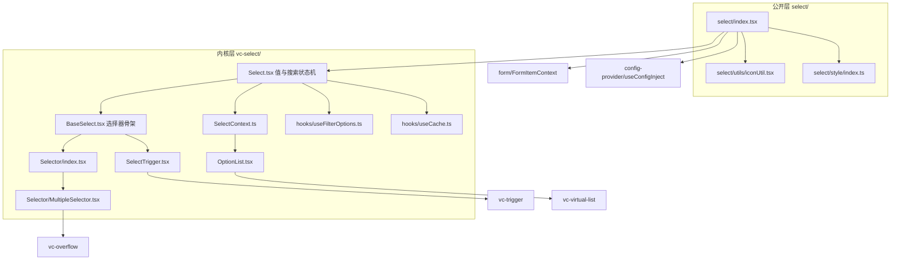
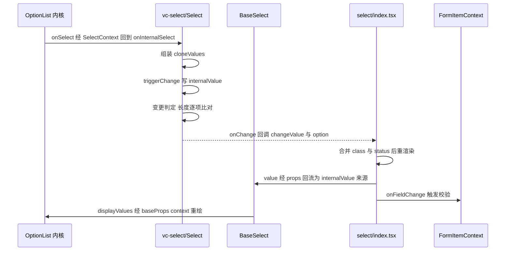
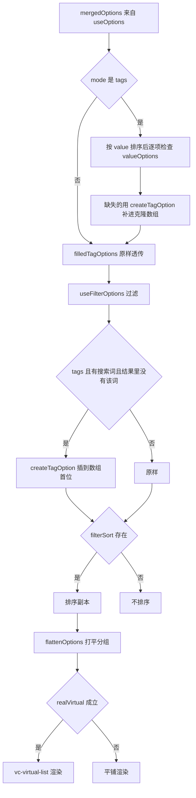

# C05-01 Select 选择器

> **本篇解决**：`<xy-select>` 的 337 行公开层到底把哪些决定权交给了 `vc-select`，选项与搜索词在哪些行被改写、标签模式的值由哪三条通道提交、Form 的校验状态从哪三行流进类名——以及改哪一行会让三份 props 删除清单失去同步。
> **前置**：C05-00《类横写：select/cascader/tree-select 共用的选项流水线》、I02《vc-trigger 弹出时序与事件穿透》、I13《响应式内核 hooks》、I08《虚拟化双实现》　**读者坐标**：`03-components/05-picker` 第 2/9 篇

## 一、职责与边界

`<xy-select>` 由两个物理分层组成：`packages/xiaoye-ui/src/select/`（337 行，公开层）与 `packages/xiaoye-ui/src/vc-select/`（4,084 行，内核层；双投递修复轮之前是 4,105 行）。公开层只做四件事：**把 Design Token 与 ConfigProvider 的语境翻译成内核 props**、**把内核的 emit 回流接到 Form 的字段生命周期**、**把 `mode` 的公开取值收窄**、**装配图标与非空态**（`packages/xiaoye-ui/src/select/index.tsx:43-67`）。选项规范化、搜索过滤、键盘导航、虚拟化、下拉定位全部在 `vc-select/` 内，公开层一行也没有重写。

本篇负责的是「外壳如何把控制权交出去、又如何把语境塞回来」这条边界线，具体是：

- 公开 props 如何由内核 props 派生并做减法（`omit` 双清单：`index.tsx:44-50` 与 `index.tsx:262-273`）；
- `combobox` 为什么在公开层被拆成两个字符串常量，以及这条转换边界的物理位置（`index.tsx:131-143`）；
- 多选/标签模式下，标签数组、输入态、测量态分别归谁持有（`vc-select/Selector/MultipleSelector.tsx`）；
- Form 校验态如何经 `FormItemInputContext` 落到类名与图标位（`index.tsx:117-118`、`196`）。

本篇明确**不负责**：

- select/cascader/tree-select 共用的选项流水线（入口归一 → 索引 → 字段名 → 过滤 → 值标签回查），已在 C05-00《类横写：select/cascader/tree-select 共用的选项流水线》展开，本篇只引用其结论；
- 浮层的受控/非受控开合、pending 状态机与 align 握手，见 I02《vc-trigger 弹出时序与事件穿透》，本篇只标出 `vc-select` 把控制权交出去的调用点；
- 虚拟滚动的两套实现取舍，见 I08《虚拟化双实现》；
- `useMergedState` 与 `useState` 的横写实现，见 I13《响应式内核 hooks》；`<xy-auto-complete>` 如何复用同一内核，见 C05-02《AutoComplete 自动完成》（尚未落盘，本篇只给编号与标题，不预设其结论）。

依赖清单（`select/` 出边）：`vc-select`（内核）、`form/FormItemContext`、`config-provider/hooks/useConfigInject`、`config-provider/DisabledContext`、`_util/statusUtils.tsx`（注意后缀是 `.tsx`，导入路径写作 `'../_util/statusUtils'`，见 `select/index.tsx:20`）、`_util/transition`、`space/Compact`、`vc-util/devWarning`、`select/style`（CSS-in-JS）。其中前三条是「公开层专属」的，后四条是语境类基础设施，被每个组件各接一次。


## 二、源码地图

行数由 `find select vc-select vc-overflow -type f | xargs wc -l | sort -n` 取得（`select/` 合计 1,562 行，`vc-select/` 合计 4,084 行；双投递修复轮从 `vc-select/` 净删 21 行，故上一版此处写的是 4,105）。

### 公开层 `packages/xiaoye-ui/src/select/`

| 文件 | 行数 | 职责 | 关键导出/符号 |
| --- | --- | --- | --- |
| `select/index.tsx` | 337 | 公开层唯一实现文件（**没有独立 `*Types.ts`**，props 与类型同文件） | `selectProps`（`:43`）、`Select`（`:72`）、`SelectOption`（`:330`）、`SelectOptGroup`（`:331`）、`LabeledValue`（`:36`）、`SelectValue`（`:41`） |
| `select/utils/iconUtil.tsx` | 65 | 按 `mode`/`hasFeedback`/`showArrow` 装配四个图标 | `getIcons`（默认导出，`:10`） |
| `select/style/index.ts` | 342 | 样式 hook 与 Token 组装 | `SelectToken`（`:14`）、`ComponentToken`（`:10`）、`genSelectorStyle`（`:20`）、`genStatusStyle`（`:59`）、`genBaseStyle`（`:126`）、`genSelectStyle`（`:248`）、`genComponentStyleHook`（`:329`） |
| `select/style/single.ts` | 192 | 单选 selector 样式 | 默认导出 `genSingleStyle`（`:135`） |
| `select/style/multiple.ts` | 238 | 多选 selector 与标签样式 | 默认导出 `genMultipleStyle`（`:194`）、`FIXED_ITEM_MARGIN`（`:6`） |
| `select/style/dropdown.ts` | 164 | 下拉面板样式 | `genItemStyle`（`:14`）、内部 `genSingleStyle`（`:32`）、默认导出（`:164`）；被 `style/index.ts:4` 以 `genDropdownStyle` 别名引入 |
| `select/index.test.js` | 224 | 该目录唯一测试文件（`js` 而非 `tsx`，无快照） | — |

主实现入口：`packages/xiaoye-ui/src/select/index.tsx:72`（`defineComponent`），渲染函数从 `:222` 开始，`:284` 起整棵子树只渲染一个 `RcSelect`。

### 内核层 `packages/xiaoye-ui/src/vc-select/`

| 文件 | 行数 | 职责 |
| --- | --- | --- |
| `vc-select/Select.tsx` | 673 | 内核主组件：值/选项状态机、搜索、键盘、过滤流水线接线（修前 684，删掉 `callEvent` helper 与四条直调） |
| `vc-select/BaseSelect.tsx` | 960 | 选择器骨架：开合、点击外部、输入框 ref、图标与非空态渲染（修前 970，删掉 13 处 `callEvent` 直调，helper 与 `onMousedown` 那条保留） |
| `vc-select/OptionList.tsx` | 390 | 下拉内容：虚拟化分支、active 项滚动、分组渲染 |
| `vc-select/Selector/index.tsx` | 293 | 两分支分派：`multiple`/`tags` 用 MultipleSelector，其余（含 `combobox`）用 SingleSelector（`:273-278`）；`compositionStatus` 在此维护（`:127`） |
| `vc-select/Selector/MultipleSelector.tsx` | 301 | 多选与标签模式的输入、测量、溢出 |
| `vc-select/Selector/SingleSelector.tsx` | 186 | 单选显示与内联搜索输入 |
| `vc-select/Selector/Input.tsx` | 178 | 输入元素本体；`:50` 注入 `VCSelectContainerEvent`，在 `:158`/`:164` 旁路调用容器的 focus/blur |
| `vc-select/SelectTrigger.tsx` | 192 | 与 `vc-trigger` 的唯一握手点 |
| `vc-select/SelectContext.ts` | 36 | 向 `OptionList` 下发选项数据与 `onSelect`（`useSelectProps` 默认导出 `:34`，Symbol 键 `:28`） |
| `vc-select/Option.tsx` / `OptGroup.tsx` | 18 / 15 | 渲染 `null` 的类型标记（`Option.tsx:15`、`OptGroup.tsx:12`），靠 `isSelectOption`/`isSelectOptGroup`（`:16`、`:13`）被 `utils/legacyUtil.ts` 的 children 归一识别 |
| `vc-select/utils/valueUtil.ts` | 130 | 值规范化与标签推断（C05-00 尾段） |
| `vc-select/utils/warningPropsUtil.ts` | 135 | 开发期 props 合法性告警 |
| `vc-select/hooks/useFilterOptions.ts` | 86 | 过滤段（C05-00 第四段） |
| `vc-select/hooks/useCache.ts` | 55 | 值→标签回查缓存（C05-00 尾段） |
| `vc-select/hooks/useId.ts` | 30 | 全库三份 `getUUID` 之一（`getUUID` 在 `:10`），另两份的位置见 I02 |
| `vc-select/index.ts` | 13 | 内核聚合入口 |

### 跨层依赖

`vc-overflow`（`Overflow.tsx`、`Item.tsx`、`RawItem.tsx`、`context.ts`、`index.ts`）在 select 这一侧只被 `Selector/MultipleSelector.tsx:10` 一处消费（全库另有三个消费者在 menu 里：`menu/src/Menu.tsx`、`menu/src/SubMenu.tsx`、`menu/src/MenuItem.tsx`，不属于本篇范围）；`vc-util` 被三层各接一处：`vc-select/BaseSelect.tsx:35`（`isMobile`）、`vc-select/utils/valueUtil.ts:2` 与 `vc-select/utils/warningPropsUtil.ts:1`（`warning`）、`select/index.tsx:27`（`devWarning`）。


## 三、架构与数据流

### 图 1：静态结构——公开层的单一出口与内核层的注入件



边全部来自真实 import：`select/index.tsx:5`（`RcSelect`）、`:8`（`getIcons`）、`:13`（`FormItemContext`）、`:10`（`useConfigInject`）；`vc-select/Select.tsx` 渲染唯一的 `BaseSelect`（`:645`），`BaseSelect.tsx:3-5` 引入 `SelectTrigger` 与 `Selector`，`Selector/MultipleSelector.tsx:10` 引入 `vc-overflow`，`SelectTrigger.tsx:1` 引入 `vc-trigger`，`OptionList.tsx:9` 引入 `vc-virtual-list`。

图上最容易看错的是 `E --> I` 这条边**不存在**：`BaseSelect` 不 import `OptionList`，它只声明一个 `OptionList: PropTypes.any` 的 prop（`vc-select/BaseSelect.tsx:145`），渲染时当作组件用（`:823`）；真正的 `OptionList` 由 `Select.tsx:663` 以 `OptionList={OptionList}` 塞进去。也就是说下拉内容是**注入件**而非依赖件——`vc-tree-select/TreeSelect.tsx:24` 与 `vc-cascader/Cascader.tsx:23` 都从 `'../vc-select'` 取走同一个 `BaseSelect`（前者在 `:759` 渲染），换掉的正是这个 prop。公开层 `select/index.tsx` 碰不到它。

第二处要单拎出来讲：`K --> I`（`SelectContext.ts` → `OptionList.tsx`）。`Select.tsx:566-581` 把 `displayOptions`、`onSelect`、`rawValues`、`virtual`、`listHeight` 等一次性 `useProvideSelectProps`，`OptionList` 自己不接 props（`vc-select/OptionList.tsx:40` 的 `setup(_, { expose, slots })` 丢弃了第一个参数），全靠这个 context 与 `useBaseProps()`（`:41-42`）取数。所以「下拉里显示什么」由 `Select.tsx` 决定，「下拉怎么滚、怎么高亮」由 `OptionList` 决定，两者之间没有 prop 通道。

### 图 2：数据流闭环——一次点击从内核回到 Form



闭环的真实形状是**值先落地、事件后外发**的两步回流（这里的「两步」不是说同一事件发两遍，内核每层的事件通道现在只有一条，口径见 §五）：

1. 内核 `Select.tsx` 自己先落地状态——下拉侧 `OptionList.tsx:137-139` 的 `onSelectValue` 调 `props.onSelect(value, { selected: !props.rawValues.has(value) })`，这里的 `props` 是 context（`:42`），落到 `Select.tsx:572` 注册的 `onInternalSelect`（`:480`），算出 `cloneValues` 后交给 `triggerChange`（`:404`），后者第一行就是 `setInternalValue(labeledValues)`（`:406`）。这一步不受调用方是否受控影响，`useMergedState` 的语义是「外部 `value` 存在时以外部为准，但仍保留内部槽」，所以点击永远先有内部反馈。受控交接点在 `vc-select/Select.tsx:263-265`，也就是 I02 记录 `useMergedState` 的那一处（I02 写作 `:283`，双投递修复后该文件净删 11 行，现落在 `:273`）。
2. 事件才往外走——**只有 `emit('change', changeValue, changeOption)` 一条通道**（`:429`），它被包在「值真的变了」的判定里（`:409-412`）。修前这里还压着第二行 `callEvent(props.onChange, changeValue, changeOption)`（旧 `:439`），`emit` 本来就会从 `instance.vnode.props` 取 `onChange`，两条通道指向同一个用户函数，所以点一次选项外部 `@change` 收两次；2026-09-29 已删，只留 `emit`，原位补了一行说明注释。公开层的 `triggerChange`（`select/index.tsx:201-205`）收到后做三件事：`emit('update:value')`、`emit('change')`、`formItemContext.onFieldChange()`。**第三件是 Form 接线的唯一入口**，公开层不做，校验就不会被触发。

`autoClearSearchValue` 之类的清理动作挂在 `onInternalSelect` 尾部（`:495-502`），在事件发出**之后**，所以 `search` 事件的最后一次值仍是用户看到的词。

### 图 3：选项注入分叉——tags 模式为什么会多出一条选项



四个分叉点全部在 `vc-select/Select.tsx`：`filledTagOptions`（`:337-362`）、`filteredOptions`（`:364-370`）、`filledSearchOptions`（`:373-386`）、`orderedFilteredOptions`（`:388-394`）与 `displayOptions`（`:396-401`）。**tags 模式对选项数组做了两次注入**，一次按已选值、一次按搜索词，中间夹着过滤——这决定了「先注入再过滤」还是「先过滤再注入」的语义差别（论点 3）。末端 `realVirtual`（`:563-565`）是虚拟化开关，条件里带了 `dropdownMatchSelectWidth`，见坑 5。


## 四、核心机制精读

### 论点 1：公开 props 不是手写清单，而是「内核 props 摊平后删五项」，且层级边界由三份互不复用的删除清单共同维持——没有任何类型检查能保住它们同步

```tsx
// packages/xiaoye-ui/src/select/index.tsx:43
export const selectProps = () => ({
  ...omit(vcSelectProps<SelectValue>(), [
    'inputIcon',
    'mode',
    'getInputElement',
    'getRawInputElement',
    'backfill',
  ]),
  value: someType<SelectValue>([Array, Object, String, Number]),
  defaultValue: someType<SelectValue>([Array, Object, String, Number]),
  notFoundContent: PropTypes.any,
  suffixIcon: PropTypes.any,
  itemIcon: PropTypes.any,
  size: stringType<SizeType>(),
  mode: stringType<'multiple' | 'tags' | 'SECRET_COMBOBOX_MODE_DO_NOT_USE'>(),
  bordered: booleanType(true),
  transitionName: String,
  choiceTransitionName: stringType(''),
  popupClassName: String,
  /** @deprecated Please use `popupClassName` instead */
  dropdownClassName: String,
  placement: stringType<SelectCommonPlacement>(),
  status: stringType<InputStatus>(),
  'onUpdate:value': functionType<(val: SelectValue) => void>(),
});
```

三个事实按顺序落在这 25 行里：

1. **派生而非声明**。`vcSelectProps` 来自 `vc-select/index.ts:10` 的再导出，实体在 `vc-select/Select.tsx:103-157`，它自身又是 `...baseSelectPropsWithoutPrivate()`（`:108`，实体 `vc-select/BaseSelect.tsx:158-240`）加上值/选项/搜索三段。也就是说公开层的 props 是**两层摊平的结果**，新增一个内核 props 会自动出现在 `<xy-select>` 的接收面上——`omit` 是唯一的人工闸门。
2. **被删的五项各有理由，且理由不同**：`inputIcon`（`BaseSelect.tsx:203`）被删是因为公开层改名成 `suffixIcon` 再由 `getIcons` 装配回 `inputIcon`（`select/index.tsx:297`）；`mode` 被删是为了换一个更窄的取值域；`backfill` 被删是内核里它只对 combobox 生效（`vc-select/Select.tsx:435`），公开层不想暴露；`getInputElement`/`getRawInputElement`（`BaseSelect.tsx:188-190`）带 `@private` 注释但**依然出现在 `baseSelectPropsWithoutPrivate` 的返回值里**，即「私有」只存在于注释、不存在于结构，真正把它们挡在公开 API 之外的就是这里的两行字符串。
3. **删除清单一共三份，形态各异**。除 `:44-50` 外，还有渲染时的 `omit(props, [...])`（`select/index.tsx:262-273`，删 10 项：`prefixCls`、四个图标、`size`、`bordered`、`status`、`onChange`、`onBlur`）与内核自己的 `pickProps`（`vc-select/Select.tsx:593-631`，删 27 项）。第一份管「能不能声明」，第二份管「能不能往下传」，第三份管「哪些接线 props 不许从外部混进 BaseSelect」。三份清单的键有重叠（如 `mode`、`prefixCls`、`value`、`onChange`），重叠不是错误而是**必要冗余**——第三份把 `id` 也删了（`:606`），因为 `id` 要在 `:649` 用 `mergedId` 重新赋值，与公开层传下来的 `id`（`select/index.tsx:307`）并非同源。

结论：改 `vc-select` 的 props 面，必须同步检查这三份清单；只改一处会出现「公开层收得到、内核收不到」或「内核改了名、公开层还在传旧键」的单向断层，而 `omit` 的返回值类型是 `Omit<T, K>`（`_util/omit.ts:1`），`K extends keyof T` 只在 `T` 真键上成立——传错一个不存在的键不会报错，`delete` 空操作（`_util/omit.ts:4-7`）。


### 论点 2：`combobox` 在公开 API 上不存在，但在类型面上存在——它由一对互为镜像的字符串常量在 `computed` 里做双向翻译，翻译点只有一个

```tsx
// packages/xiaoye-ui/src/select/index.tsx:131
    const mode = computed(() => {
      const { mode } = props;

      if ((mode as any) === 'combobox') {
        return undefined;
      }

      if (mode === SECRET_COMBOBOX_MODE_DO_NOT_USE) {
        return 'combobox';
      }

      return mode;
    });
```

这个 `computed` 是全篇唯一的「API 边界物理位置」，配套三处：常量定义 `select/index.tsx:71`、组件静态属性 `:99`（`SECRET_COMBOBOX_MODE_DO_NOT_USE` 挂在组件对象上，供 `Select.SECRET_COMBOBOX_MODE_DO_NOT_USE` 访问）、类型声明 `:336`（导出类型里保留该字段）。它的两半不对称：

- **正向**（用户传 `'combobox'`）：`(mode as any) === 'combobox'` → 返回 `undefined`，即退化成单选。注意这一支用了 `as any` 断言，因为 `:57` 的类型域里根本没有 `'combobox'`——类型系统认定这是非法值，运行时代码却专门处理它。
- **反向**（内部组件传哨兵串）：`=== SECRET_COMBOBOX_MODE_DO_NOT_USE` → 返回真正的 `'combobox'`。组件层唯一的调用者是 `auto-complete/index.tsx:146` 的 `mode: Select.SECRET_COMBOBOX_MODE_DO_NOT_USE`；`select/index.test.js:78` 与 `:100` 也用同一个常量构造 combobox 场景（反证命令见附 检查点 2）。也就是说这条通道**不是留给用户的，是留给同层组件的**，但它没有做任何访问控制，用户照样能传（类型面上 `:57` 明确把它列进了合法取值）。

`mode` 一共被声明三次，三份取值域互不相同：`vc-select/BaseSelect.tsx:175` 用 `Mode`（定义在 `:66`，`'multiple' | 'tags' | 'combobox'`）、`vc-select/Select.tsx:150` 用字面量联合 `'combobox' | 'multiple' | 'tags'`、`select/index.tsx:57` 用 `'multiple' | 'tags' | 'SECRET_COMBOBOX_MODE_DO_NOT_USE'`。由于对象字面量后写覆盖先写，`selectProps` 里的 `mode` 生效；而内核 `Select.tsx:150` 那一份在摊平链里被公开层删掉再重建（`:46`）。

翻译后的 `mode` 决定两件公开层自己的派生值：`isMultiple`（`:215`，`multiple` 或 `tags`）与 `mergedShowArrow`（`:216-220`，单选才默认显示箭头，combobox 也不显示）。内核拿到 `mode` 后**并不分三岔**：`Selector/index.tsx:273-278` 只有两个分支——`multiple`/`tags` 进 `MultipleSelector`，其余（含 `undefined` 与 `combobox`）一律进 `SingleSelector`。所以 combobox 在渲染层是 single 的变体，而不是第三种形态；它的特殊性全在状态层（`BaseSelect.tsx:324-332` 与 `vc-select/Select.tsx:286-295`，见论点 4）。

`backfill` 被公开层删除（`:49`）后并没有消失：内核仍读 `props.backfill`（`vc-select/Select.tsx:435`），而 `backfill` 同时也在 `pickProps` 的删除清单里（`:609`）。**这条链的准确结论要分成两篇来说，本篇初稿把它写成一刀切，已由 C05-02 反证并在此更正**：其一，`pickProps`（`:604-609`）挡的是 vc-select **继续往 BaseSelect 传**，它挡不住 vc-select 自己在 `:445` 读这个 prop；其二，公开层删声明也不等于运行时拿不到——`select/index.tsx:289` 有 `{...attrs}` 中继，用户手写的 `:backfill="true"` 会以 attr 身份抵达内核。所以 `backfill` 在 `<xy-select>` 上真正不可达的原因是**第三个**：`:445` 的判据是 `props.backfill && props.mode === 'combobox'`，而 `<xy-select>` 的 `mode` 取值域是 `'multiple' | 'tags' | 'SECRET_COMBOBOX_MODE_DO_NOT_USE'`（`:57`），那个内部常量字符串要在 `:138-140` 才被翻译成 `'combobox'`，公开写法拿不到 combobox 形态，于是与 `mode` 合取的那半边恒假。**反过来，`<xy-auto-complete>` 是真的能拿到**：它自己声明了 `backfill`（`auto-complete/index.tsx:34`），并在 `:146` 固定传 `mode: Select.SECRET_COMBOBOX_MODE_DO_NOT_USE`，经上面那段翻译后 `props.mode === 'combobox'` 成立，`:445` 的条件第一次有可能整条为真。本篇初稿「它复用的正是这个公开层组件，所以也一样拿不到」这句作废：复用公开层不等于继承公开层的取值域，AutoComplete 恰恰是通过使用那个「不许用户用」的取值来绕开的。


### 论点 3：tags 模式的「可自由输入」不是一份独立状态，而是两次把值/搜索词**注入选项数组**；提交动作有三条互不调用的通道，去重都靠同一个 `Set`

以下为**修前快照（2026-09-29 已改）**，保留两条通道只为对照，行号不再指向当前源码（当时是 `BaseSelect.tsx` 的 586-604）：

```tsx
      if (props.disabled) {
        return;
      }
      const searchVal = mergedSearchValue.value;
      if (searchVal) {
        // `tags` mode should move `searchValue` into values
        if (props.mode === 'tags') {
          emit('search', searchVal, { source: 'submit' });
          callEvent(props.onSearch, searchVal, { source: 'submit' });
        } else if (props.mode === 'multiple') {
          // `multiple` mode only clean the search value but not trigger event
          emit('search', '', {
            source: 'blur',
          });
          callEvent(props.onSearch, '', {
            source: 'blur',
          });
        }
      }
```

当前真实形状（每条通道只剩 `emit`，原位留一行注释说明为什么不能再补一句直调）：

```tsx
// packages/xiaoye-ui/src/vc-select/BaseSelect.tsx:578
      if (props.disabled) {
        return;
      }
      const searchVal = mergedSearchValue.value;
      if (searchVal) {
        // `tags` mode should move `searchValue` into values
        if (props.mode === 'tags') {
          // emit 已覆盖 vnode 上的 props.onSearch，紧跟着再调一次就是双投
          emit('search', searchVal, { source: 'submit' });
        } else if (props.mode === 'multiple') {
          // `multiple` mode only clean the search value but not trigger event
          // emit 已覆盖 vnode 上的 props.onSearch，再调一次就是双投
          emit('search', '', {
            source: 'blur',
          });
        }
      }
```

这段在 `onContainerBlur` 尾部，是**第二条提交通道**。`source` 字段是通道之间的唯一语言：`'submit'` 表示「把输入框里的词落成值」，`'blur'` 表示「只清搜索词，不产生任何值变化」。`multiple` 与 `tags` 在此处走了相反分支——同一个 blur，前者静默清空、后者强制入库。接收端在 `vc-select/Select.tsx:518-543` 的 `onInternalSearch`：`source === 'submit'` 分支（`:523`）先 `trim()`、非空才 `[...rawValues.value, formatted]` 经 `Array.from(new Set(...))` 去重（`:527`）再 `triggerChange`，随后 `setSearchValue('')`（`:530`）；`source !== 'blur'` 才会往外发 `search` 事件（`:536-542`），所以 `multiple` 的清空**不会**让用户看到一次 `search('')` 回调。**`search` 这条链修前是双层四通道**：`BaseSelect` 与 `Select` 各留了一条 `emit` 加一条直调（`Select.tsx` 那一份是 `emit('search', searchText)` 紧跟 `props.onSearch?.(searchText)`，属「不发 helper、直接点 props」的形态②，旧 `:552`，现已删，只留 `:541` 的 `emit`），两层相乘后 tags 模式打一个字外部 `@search` 收 **4** 次；修后 **1** 次，实测用例是 `_util/__tests__/event-dispatch-count.test.tsx:258`。

第一条通道是回车，且在 **Selector 层**而非值层：`vc-select/Selector/index.tsx:153-162`，条件写死 `which === ENTER && mode === 'tags' && !compositionStatus && !props.open`，注释直说「菜单没开时 OptionList 不会触发值变化，所以这里自己 emit」。`!props.open` 意味着下拉展开时回车由 OptionList 接管、这条分支不生效。`!compositionStatus` 挡住输入法候选词回车——`compositionStatus` 是 `Selector/index.tsx:127` 的局部 `ref`，由 `onInputCompositionStart/End`（`:186-196`）维护，**不在 Select 也不在 BaseSelect 手里**。

第三条通道是下拉点击，走 `onInternalSelect`（`vc-select/Select.tsx:471-493`），`multiple` 时才读 `info.selected`（`:484`），否则一律当选中。

至于「输入的词为什么在下拉里看得见」，答案是**它被造成为一条选项**：`createTagOption`（`:328-334`）用 `mergedFieldNames` 拼出一个只含 value/label 的裸对象；`filledTagOptions`（`:338-362`）在 tags 下把**已选值**里不存在的补进克隆数组（判据是 `valueOptions.value.has(val)`，`:348`）；`filledSearchOptions`（`:373-386`）在过滤**之后**再检查 `filteredOptions` 中是否有 `item[optionFilterProp || 'value'] === mergedSearchValue`，没有就把搜索词插到首位（`:385`）。顺序是「按值注入 → 过滤 → 按词注入」，两次注入夹一次过滤，因此语义差别很明确：**已选值补出来的标签项会被过滤掉**（注入发生在过滤之前，搜索词不匹配它就消失），而**搜索词自己补出来的那条永远过滤不掉**（注入发生在过滤之后，`:377-379` 的判据只是「避免重复插入」）。后者还要继续接受 `filterSort`（`:388-394`）与 `flattenOptions`（`:396-401`）处理，所以它在有分组/排序的面板里位置可能不是第一位。

标签模式的值集合还与 `tokenSeparators` 有关：`onInternalSearchSplit`（`:545-562`）在非 tags 模式下要把词按 **label** 反查成 value（`labelOptions.value.get(word)`，`:551`），查不到就丢弃（`:554`）；tags 模式则原样收词（`:548-549`）。同一个函数里两种语义，去重同样落在 `:557` 的 `Set`。


### 论点 4：「开合」在 `BaseSelect` 里是三个变量而不是一个，且**刻意不用** `useMergedState`；输入框状态则被切成四片分给四个文件，没有任何一层持有完整真相

```tsx
// packages/xiaoye-ui/src/vc-select/BaseSelect.tsx:334
    // ============================== Open ==============================
    const initOpen = props.open !== undefined ? props.open : props.defaultOpen;
    const innerOpen = shallowRef(initOpen);
    const mergedOpen = shallowRef(initOpen);
    const setInnerOpen = (val: boolean) => {
      innerOpen.value = props.open !== undefined ? props.open : val;
      mergedOpen.value = innerOpen.value;
    };
    watch(
      () => props.open,
      () => {
        setInnerOpen(props.open);
      },
    );

    // Not trigger `open` in `combobox` when `notFoundContent` is empty
    const emptyListContent = computed(() => !props.notFoundContent && props.emptyOptions);

    watchEffect(() => {
      mergedOpen.value = innerOpen.value;
      if (
        props.disabled ||
        (emptyListContent.value && mergedOpen.value && props.mode === 'combobox')
      ) {
        mergedOpen.value = false;
      }
    });

    const triggerOpen = computed(() => (emptyListContent.value ? false : mergedOpen.value));
```

29 行里有三个「开合」：

- `innerOpen`（`:336`）：纯内部意图，`setInnerOpen` 每次写入时先判断 `props.open !== undefined`（`:339`），受控就把外部值盖掉内部值——这是一份手写的受控/非受控合并。
- `mergedOpen`（`:337`）：**渲染真相**，`watchEffect`（`:352-360`）在派生条件成立时强行改回 `false`，两个条件是 `props.disabled` 与「combobox 且 `notFoundContent` 为空且选项空」（`emptyListContent`，`:350`）。`grep -c mergedOpen vc-select/BaseSelect.tsx` 得 18（含声明与写入），读者包括类名 `${prefixCls}-open`（`:838`）、`onToggleOpen` 的去重判定（`:365`、`:367`）、键盘下压是否转发给下拉（`:517`、`:527`）、Selector 的 `open`（`:895`）与 mockFocused 的兜底渲染（`:931`）。
- `triggerOpen`（`:362`）：**传给浮层的真相**，比 `mergedOpen` 多剥掉一层 `emptyListContent`。它只有四个读者：`useSelectTriggerControl`（`:670`）、`SelectTrigger` 的 `visible`（`:849`）、`BaseSelect` 自己提供的 context 里的 `triggerOpen` 字段（`:656`、`:675`，类型见 `hooks/useBaseProps.ts:11`），以及 `:658` 的分支。**`onToggleOpen` 读的是 `mergedOpen` 而不是 `triggerOpen`**（`:365`），所以「面板被 `emptyListContent` 压制时，内部意图仍可能是开的」，两者一旦分叉，`dropdownVisibleChange` 事件（`:370`）报的是 `mergedOpen` 侧的意图，弹层显示的是 `triggerOpen` 侧的结果——这是论点 4 的真正落点：**同一语义两个真值，靠四个变量维护**。顺带一句：修前这里是两行——`emit('dropdownVisibleChange', nextOpen)` 在旧 `:369`，紧跟 `callEvent(props.onDropdownVisibleChange, nextOpen)` 在旧 `:370`，现在只留 `emit`（现 `:370`），原位补了一行说明注释；该事件的外层双投口径见 C05-04 与 C05-00。

不用 `useMergedState` 的原因是结构性的：那个 hook 的派生点是 `postState`（用法见 `vc-select/Select.tsx:209-214`），只能改写**值本身**，而这里的抑制条件依赖**另外两个 props**（`disabled`、`notFoundContent`+`emptyOptions`）且要求「外部没传 open 时也要被压制」，只能靠额外的 `watchEffect` 表达。这正好接上 I13 记录的现状：同一个 `vc-select/Select.tsx` 里 `useMergedState`（`:209`、`:273`）与 `useState`（`:434`、`:435`）并存——**值与搜索词**用统一 hook，**无障碍临时态**用简化版，**开合**干脆手写。三种写法在同一个功能簇里共存，不是风格漂移而是派生条件复杂度不同。

输入框侧同样是分片的，四片各属一个文件：

- `mergedSearchValue` 属 `Select.tsx:209`，且被 `:273` 的兄弟 `internalValue` 供养——combobox 下它反过来从值里取（`BaseSelect.tsx:324-332`：非 combobox 直接用 `props.searchValue`，combobox 则取 `displayValues[0].value` 并 `String()` 化），再加 `Select.tsx:313-324` 的 `watchEffect(flush: 'post')` 把值同步回搜索词，构成一个**受控回路**：值变 → 搜索词变 → 选项过滤变。
- `compositionStatus` 属 `Selector/index.tsx:127`，被 `MultipleSelector` 读来抑制 placeholder（`Selector/MultipleSelector.tsx:292`）。
- `targetValue` 与 `inputWidth`、`focused` 属 `Selector/MultipleSelector.tsx:96`、`:83`、`:84`。其中 `inputValue` 是 `computed`（`:89-91`，条件 `props.open || props.mode === 'tags'`）而不是状态，说明多选框里的文字在**关闭且非 tags** 时是被强制视为空的；`targetValue` 只是它的本地镜像（`:97-99` 的 `watchEffect`），存在的目的是让测量节点（`:270-272` 的 mirror span）能在 `onMounted` 注册的 `watch(targetValue, …, { flush: 'post' })`（`:101-109`）里读 `measureRef.value.scrollWidth` 来设定输入框宽度（`:242` 的 `style.width`）。
- `mergedOpen`/`triggerOpen` 属 `BaseSelect.tsx`，但**由 `Select` 通过 props 喂给它**的只有值与搜索词，开合完全是 `BaseSelect` 自己的。

结论：问「输入框现在的文字是什么」需要同时知道四个文件的状态，顺序不能省——`Select` 的 `mergedSearchValue` → `BaseSelect` 的 `mergedSearchValue` 改写（combobox 分支）→ `Selector` 的 `inputValue` 条件 → `MultipleSelector` 的 `targetValue` 镜像。


### 论点 5：与 Form 的接线只有三个触点，全部在公开层；校验态**不改内核任何行为**，只改类名与图标位，而 `status=""` 会被静默降级为「继承 Form」

```tsx
// packages/xiaoye-ui/src/select/index.tsx:187
    const mergedClassName = computed(() =>
      classNames(
        {
          [`${prefixCls.value}-lg`]: mergedSize.value === 'large',
          [`${prefixCls.value}-sm`]: mergedSize.value === 'small',
          [`${prefixCls.value}-rtl`]: direction.value === 'rtl',
          [`${prefixCls.value}-borderless`]: !props.bordered,
          [`${prefixCls.value}-in-form-item`]: formItemInputContext.isFormItemInput,
        },
        getStatusClassNames(prefixCls.value, mergedStatus.value, formItemInputContext.hasFeedback),
        compactItemClassnames.value,
        hashId.value,
      ),
    );
    const triggerChange: SelectProps['onChange'] = (...args) => {
      emit('update:value', args[0]);
      emit('change', ...args);
      formItemContext.onFieldChange();
    };
    const handleBlur: SelectProps['onBlur'] = e => {
      emit('blur', e);
      formItemContext.onFieldBlur();
    };
```

三个触点是：

1. **变更上报**：`:204` 的 `formItemContext.onFieldChange()`。它没有参数，也不读 `args`——校验器要重算必须自己回读 model，这条边只负责「通知有事发生」。`useInjectFormItemContext()`（`select/index.tsx:116`）在脱离 `<xy-form-item>` 时拿到的是默认桩：`onFieldChange: () => {}`（`form/FormItemContext.ts:71`，同文件 `:69` 的 `id` 桩、`:70` 的 `onFieldBlur` 桩），所以公开层不需要判空。
2. **失焦上报**：`:208` 的 `formItemContext.onFieldBlur()`，与 `emit('blur')` 同批。注意 `handleBlur` 只在 `:306` 被挂到内核的 `onBlur`，而内核的 `onBlur` 触发点在 `vc-select/BaseSelect.tsx:590`（修前是 `emit('blur', ...args)` + `callEvent(props.onBlur, ...args)` 两行，旧 `:606-607`，现在只剩 `emit`）——那里前面还压着 tags 的提交（`:584-586`）。**顺序是「先落值、后报失焦」**，所以「失焦即校验」的表单在 tags 模式下校验到的是已含新标签的值。
3. **状态消费**：`:118` 的 `mergedStatus = getMergedStatus(formItemInputContext.status, props.status)` 与 `:196` 的 `getStatusClassNames`。后者只产 5 个类名（`_util/statusUtils.tsx:13-19`：`-status-success`/`-status-warning`/`-status-error`/`-status-validating`/`-has-feedback`），由 `select/style/index.ts` 消费：`genStatusStyle`（`:59`）生成 status 组，`-has-feedback` 在 `:239`，`-status-error` 出现在 `:303` 的覆盖清单里。内核侧没有对应物——`grep -rn "status" vc-select/` 在排除 `dist` 后只命中一处注释（`vc-select/BaseSelect.tsx:547`，写的是 focus 而非校验态），既没有 `status` prop 也没有分支。也就是说校验态是纯样式层事实，内核既不为 error 改变行为，也不为 validating 禁用交互。

`:194` 的 `-in-form-item` 与 `:197` 的 `compactItemClassnames` 是同一处类名计算里的另外两件事，前者来自 `formItemInputContext.isFormItemInput`，其样式在 `select/style/index.ts:262`（`&${componentCls}-in-form-item` 嵌套块），后者来自 `useCompactItemContext`（`select/index.tsx:163`）。三者共用一个 `classNames` 调用，意味着**表单态与紧凑态在 CSS 上是同级选择器**，改优先级只能改样式文件。

图标位被 Form 抢占是第 4 个隐触点：`:315` 的 `showArrow={hasFeedback || showArrow}`——只要 `hasFeedback` 为真，即使调用方 `:show-arrow="false"`，公开层也会把 `showArrow` 置真，因为 `getIcons` 需要箭头容器来放校验反馈图标（`select/utils/iconUtil.tsx:10` 起，`hasFeedback`/`feedbackIcon` 由 `:255-257` 注入）。**副作用是 `mergedShowArrow`（`:216-220`）的语义在这里被绕过了一次**：它算出的值只用于 `getIcons` 的 `showArrow` 入参（`:257`），传给内核的却是 `hasFeedback || showArrow`（`:315`），两者可以不同。

`getMergedStatus` 的实现是 `customStatus || contextStatus`（`_util/statusUtils.tsx:22-23`），用的是 `||` 而不是 `??`。而 `InputStatus` 的合法取值里含空串（`:4` 的 `['warning', 'error', ''] as const`），所以 `status=""` 会**落到 contextStatus**——想「在表单里压掉继承来的 error」是做不到的，能用的只有 `status` 缺省（`undefined`）或显式 `'success'`。这一条在 `:118` 处不可见，必须打开 `statusUtils.tsx` 才看得出来。

### 论点 6：内核的下拉内容与无障碍通道都不走 props 而走 context，但两个 context 的键一套是 `Symbol`、一套是裸字符串；且 `id` 是一次性快照，不是响应式值

```tsx
// packages/xiaoye-ui/src/vc-select/hooks/useBaseProps.ts:10
export interface BaseSelectContextProps extends BaseSelectProps {
  triggerOpen: boolean;
  multiple: boolean;
  toggleOpen: (open?: boolean) => void;
}

const BaseSelectContextKey: InjectionKey<BaseSelectContextProps> = Symbol('BaseSelectContextKey');

export function useProvideBaseSelectProps(props: BaseSelectContextProps) {
  return provide(BaseSelectContextKey, props);
}

export default function useBaseProps() {
  return inject(BaseSelectContextKey, {} as BaseSelectContextProps);
}
```

这是内核里**规范**的那条 context：`InjectionKey<T>` 泛型（`:16`）+ `inject` 带默认值（`:23`），拿不到就退化成空对象而不是报错。它由 `BaseSelect.tsx` 提供（`:671-680` 组装 `open`/`triggerOpen`/`multiple`/`toggleOpen` 后调用 `useProvideBaseSelectProps`，该符号在 `:11` 引入），被 `OptionList.tsx:41` 与 `Selector/*` 消费。

另一条是裸字符串键：`BaseSelect.tsx:605` 的 `provide('VCSelectContainerEvent', { focus: onContainerFocus, blur: onContainerBlur })`，消费点唯一——`Selector/Input.tsx:50` 用 `inject('VCSelectContainerEvent') as any` 取出，在 `:158`、`:164` 调用。同一个 `BaseSelect` 文件里，一条通道有类型、一条通道靠 `as any`，且键名拼写是**跨文件字符串匹配**：改一处必改另一处，`typecheck` 抓不到。

为什么需要第二条？因为 `Input` 是叶子渲染层，它自己触发原生 `focus`/`blur` 时不能走 DOM 冒泡去碰容器（会与 `mockFocused` 的延时逻辑打架——该状态由 `useDelayReset` 产生（`vc-select/BaseSelect.tsx:310`），容器侧的 `onContainerFocus`/`onContainerBlur` 在 `:549-598`），只能旁路回调。这是「context 当事件总线用」的实例。

下拉内容侧的接口形态更极端：`OptionList` 的 `setup(_, { expose, slots })`（`vc-select/OptionList.tsx:40`）**第一个参数是丢弃的下划线**，即它不声明任何 props，全部数据来自 `useBaseProps()`（`:41`）与 `useSelectProps()`（`:42`，实体 `vc-select/SelectContext.ts`，默认导出 `:34`、Symbol 键 `:28`）。供给端在 `vc-select/Select.tsx:566-581`：`useProvideSelectProps(toReactive({ ...parsedOptions, flattenOptions: displayOptions, onSelect: onInternalSelect, rawValues, fieldNames: mergedFieldNames, virtual: realVirtual, listHeight, listItemHeight, childrenAsData }))`。注意 `virtual` 传的是 `realVirtual`（`:563-565`）而不是 `props.virtual`，这条改写是坑 5 的源头。另外 `vc-select/SelectContext.ts:2` 的文件头注释写着「BaseSelect provide some parsed data into context」，实际提供者是 `Select.tsx:566`——按注释去 `BaseSelect.tsx` 找这个 `provide` 会找不到，`BaseSelect` 只提供了 `useBaseProps` 那一半（`hooks/useBaseProps.ts:18`）。

`id` 的链路则暴露了第三个问题。公开层每轮渲染都重新取 `id = formItemContext.id.value`（`select/index.tsx:231`）并传下去（`:307`）；但内核 `Select.tsx:194` 的 `const mergedId = useId(toRef(props, 'id'))` 是**setup 期一次性求值**——`useId` 直接 `return id.value || innerId`（`hooks/useId.ts:29`），返回的是普通字符串而不是 `computed`。而 `pickProps` 又把 `id` 从透传清单里删了（`Select.tsx:606`），渲染时用 `id={mergedId}` 覆盖（`:649`）。结果是：**首渲染时没有 `id`、后来才由 FormItem 赋上 `id` 的场景里，传下去的仍是 `rc_select_N` 快照**，`activeDescendantId`（`:667`）也随之固定。DOM 上的 `id` 与事件里读到的 props 从此不一致，且 `hooks/useId.ts:10` 的 `getUUID` 在 SSR 下恒返回 `'TEST_OR_SSR'`（`:15-20`），多实例的 `innerId` 会撞车——这一点 I13 论点 3 已登记为三份 `getUUID` 之一（本句原文误记为 I02，2026-09-29 按 `grep -ln getUUID docs/column/02-infrastructure/*.md` 唯一命中 I13 更正），本篇只补它在 Select 上的具体后果。

## 五、对外契约如何生效

契约的入口是 `select/index.tsx:72-113` 的四件声明：`props`（`:78`，`initDefaultProps(selectProps(), { listHeight: 256, listItemHeight: 24 })`）、`emits`（`:82-98`，15 个事件名）、`slots`（`:100-113`，12 个槽位含 `default`）、`inheritAttrs: false`（`:77`）。四件里最容易误读的是 `emits`：它声明了 `update:value`，而 props 侧 `:66` 又显式声明了 `'onUpdate:value'` 的类型——`v-model:value` 需要两者之一成立，这里同时写了两遍。

props 的流出路径只有一条：渲染函数先解构少数几个需要加工的键（`:223-234`：`notFoundContent`、`listHeight`、`listItemHeight`、`popupClassName`、`dropdownClassName`、`virtual`、`dropdownMatchSelectWidth`、`id`、`placeholder`、`showArrow`），再把剩余的原样 `omit` 后交给内核（`:262-273` 与 `:288`），最后用**具名覆盖**收尾（`:290-316`）。因此同名键的优先级是「显式覆盖 > 展开 props > `attrs`」——`:289` 的 `{...attrs}` 排在 `:288` 的 `{...selectProps}` **之后**，所以未经声明的属性（走 `attrs`）能覆盖已声明但未被显式重写的 props；`class` 被单独取出来做合并（`:302`），避免被 `attrs.class` 顶掉。

语境注入要分清**两种合并位置**。一种是「在公开层当场写 `??`」，只有 `showSearch` 一处：`:290` 写作 `props.showSearch ?? select?.value?.showSearch`，`select` 来自 `useConfigInject('select', props)` 的解构（`:161`），实体是 `config-provider/hooks/useConfigInject.ts:70` 的 `select: configProvider.select`。另一种是「在 hook 里先把 props 折进去」：`prefixCls`（公开层 `:295`，hook 内 `useConfigInject.ts:14`）、`direction`（公开层 `:296`，hook 内 `:15`）、`getPopupContainer`（公开层 `:303`，hook 内 `:26-28`，写作 `props.getContainer ?? props.getPopupContainer ?? configProvider.getPopupContainer?.value`）——这三处公开层看似用 CP 值**无条件覆盖**了传下来的 props，实际 `?? props.x` 已经在 hook 里，所以调用方的 props 不会被丢掉。读 `select/index.tsx` 时看不出这一点，必须打开 hook 才知道优先级链。

`disabled` 是第三种情形，而且写得**冗余**：`:166` 的 `mergedDisabled = disabled.value ?? contextDisabled.value`，左边是 `useConfigInject` 的 `disabled`（其定义为 `props.disabled ?? disabledContext.value`，`useConfigInject.ts:43`，`disabledContext` 就是 `useInjectDisabled()`，`:9`），右边 `contextDisabled` 是公开层自己又调一次 `useInjectDisabled()`（`select/index.tsx:165`）。两个操作数同源，第二个 `??` 永远不改变结果（`DisabledContext.ts:8` 的默认值是 `ref(undefined)`）。这条链里**ConfigProvider 根本不参与**，`<xy-select>` 在 `<xy-form-item disabled>` 下变灰靠的是 DisabledContext；同样的冗余在 `tree-select/index.tsx:154` 逐字重复了一遍。

**但 `virtual` 与 `dropdownMatchSelectWidth` 是真的漏接**：`useConfigInject` 明确合并了这两项（`:30-38`，`virtual` 的定义里已经内嵌了 `&& dropdownMatchSelectWidth.value !== false`），`tree-select/index.tsx:144-145` 把它们解构出来并在 `:301-302` 传给内核；而 `select/index.tsx:153-162` 的解构清单里**没有这两项**，`:286-287` 传的是从 `props` 解构的原始值（`:229-230`）。后果见坑 10。

事件回流是**双向命名**的：内核 `emit('change', ...)`（`vc-select/Select.tsx:419`，`select` 与 `deselect` 同理，分别在 `:471` 与 `:475`）之后公开层同时发 `update:value` 与 `change`（`select/index.tsx:202-203`），其中 `update:value` 只取 `args[0]`，即 option 参数被丢弃——`v-model:value` 拿不到 option，想拿必须听 `change`。`focus`/`blur`/`mouseenter`/`mouseleave`/`keydown`/`keyup`/`inputKeyDown`/`popupScroll`/`dropdownVisibleChange` 里除 `blur` 被 `:306` 改写为 `handleBlur` 外，其余靠 `attrs` 透传（`:289`）；`@update:value` 则只能靠 `:66` 的 props 声明。

**内核侧每个事件现在只做一件事——`emit(...)`（2026-09-29 双投递修复轮的口径）。** 修前的形状是「`emit` 之后紧跟一句直调」，`vc-select/BaseSelect.tsx` 有 13 处（旧 `:562-563` 的 focus、旧 `:606-607` 的 blur、旧 `:526-527` 的 keydown 都是这一对），`vc-select/Select.tsx` 有 4 处 `emit` + `callEvent` 加 1 处 `emit` + `props.onSearch?.()`；机理是 Vue 的 `emit` 本来就从 `instance.vnode.props` 取 `onXxx`，两条通道指向同一个用户函数，所以 `@change` 与 `:on-change` 两种写法都生效——但**同时也各被投了两次**。修复后每处只留 `emit`，并在上方留一行注释「emit 已覆盖 vnode 上的 props.onXxx，再调一次就是双投」；实测口径见 `_util/__tests__/event-dispatch-count.test.tsx:94`（点一次选项，`@change` 与 `@select` 各 1 次）与 `:258`（tags 输入一次 `@search`，修前 4 次、修后 1 次）。

**唯一保留的直调是 `vc-select/BaseSelect.tsx:634` 的 `callEvent(props.onMousedown, event, ...restArgs)`，不要顺手删。** 判据是它没有对端的 `emit`：本组件把 `mousedown` 写进了 `emits` 数组（`:277`），但全文件从未 `emit('mousedown')`，所以那条直调是 `onMousedown` 的**唯一**投递通道，删掉就会丢事件。helper 定义 `:281-289` 也因为这一处而必须留着（`Select.tsx` 那份 helper 已经整块删除）。顺带登记一条观察：`emits` 里声明了 `mousedown` 却从不发，属于「声明面与生效面两张表」族——`emits` 声明不等于该事件真会发出去，判存活要同时看 `emit` 调用点与 props 直调点。

slot 的落地统一是「转成 render 函数再交内核」：`v-slots={{ option: slots.option }}`（`:309`）、`children={slots.default?.()}`（`:311`，注意这是**调用后的节点**而非 slot 对象，内核 `useOptions` 的 children 归一段见 C05-00）、`tagRender={props.tagRender || slots.tagRender}`（`:312`）、`optionLabelRender={slots.optionLabel}`（`:313`）、`maxTagPlaceholder={props.maxTagPlaceholder || slots.maxTagPlaceholder}`（`:314`）、`dropdownRender={selectProps.dropdownRender || slots.dropdownRender}`（`:308`）。四处「prop 优先于 slot」写法一致，意味着**同名功能同时给 prop 和 slot 时 slot 静默失效**，没有任何告警——`warningPropsUtil.ts` 的 135 行里没有关于这一项的检查。

`expose` 只有三件：`blur`、`focus`、`scrollTo`（`:210-214`），全部转发给 `selectRef`（`:115`）；内核链上 `vc-select/BaseSelect.tsx:318-322` 暴露 `focus`/`blur`/`scrollTo`，`vc-select/Select.tsx:593-603` 原样再包一层，所以 `scrollTo` 最终打到 `listRef`（即 `OptionList` 实例，`vc-select/OptionList.tsx:52` 的 `listRef` 与 `:58-62` 的 `scrollIntoView`）。`<xy-select-option>` / `<xy-select-opt-group>` 由 `install` 一并注册（`select/index.tsx:323-328`，走 `registerComponent`），组件对象挂在 `Select.Option`/`Select.OptGroup`（`:330-331` 又导出为 `SelectOption`/`SelectOptGroup`），实体是 `vc-select/Option.tsx` 与 `vc-select/OptGroup.tsx`——**公开层没有为它们包一层**，这是「公开层只包主组件」的直接证据。

## 六、设计取舍

**取舍 1：包一层，而不是直接导出内核。** 备选路径是把 `vc-select` 的 `Select` 直接注册成 `<xy-select>`（`vc-select/index.ts:10` 已经导出了 `BaseSelect` 与 `selectProps`，技术上可行）。现方案换来四件内核不该知道的事：Form 的 `onFieldChange`/`onFieldBlur`（`select/index.tsx:204`、`:208`）、ConfigProvider 的 `showSearch` 兜底（`:290`）、`status` 类名（`:196`）、compact 类名（`:197`）。赔上的是**三份手工同步的删除清单**（论点 1）与「`vc-select` 每加一个 prop，`<xy-select>` 的公开面就自动变大一点」这一不可逆的默认行为。这条默认行为比清单本身更危险：清单是显式的，自动摊平是隐式的。

**取舍 2：combobox 用哨兵字符串，而不是给 AutoComplete 单独做组件。** 现方案的实际收益可在 `auto-complete/index.tsx:146` 一处看出——它只要写 `mode: Select.SECRET_COMBOBOX_MODE_DO_NOT_USE`，就免费继承尺寸、状态、图标、表单接线全套。代价是三笔：公开 props 的类型域里出现了一个语义为「不要用」的字符串（`select/index.tsx:57`）；组件对象上永久挂着一个静态常量（`:99`、`:336`），删除它属于破坏性变更；正向翻译需要 `as any` 才能编译（`:134`）。被放弃的替代方案有两个：其一让 AutoComplete 直接用内核（则上述四件事要在 AutoComplete 里重写一遍）；其二给 Select 加一个真正的 `combobox` 取值（则公开 API 多一个模式，文档与测试面翻倍）。**现方案是三者中源码改动量最小的**，但可发现性最差——`select/index.tsx:71` 的常量定义上没有任何注释。

**取舍 3：`OptionList` 做成注入件（`vc-select/BaseSelect.tsx:145` 声明、`:823` 使用）而不是 import。** 换来 `vc-tree-select`、`vc-cascader` 复用同一个 `BaseSelect` 的 960 行开合/焦点/清除逻辑（三者共用 `BaseSelect` 这一事实由 C05-00 展开，本篇不重复论证）。赔上两点：`OptionList: PropTypes.any` 使下拉组件的契约**没有任何静态约束**，参数名写错不会报错；公开层无法替换下拉实现，`select/index.tsx:308` 的 `dropdownRender` 只能改面板内容，不能改面板渲染器。

**取舍 4：状态放内核，而不是公开层。** 值、搜索词、开合全在 `vc-select` 内（`vc-select/Select.tsx:263`、`:209`、`vc-select/BaseSelect.tsx:336-337`），公开层只保留一个 `selectRef`（`select/index.tsx:115`）——它是**零内部状态**的外壳。换来内核可脱离主题与表单独立测试、被三个组件复用；赔上「受控/非受控」在两层各实现一次且写法不同：值用 `useMergedState`，开合用 `shallowRef`+`watch`+`watchEffect` 三件套（论点 4）。这不是疏忽而是表达能力差异：`useMergedState` 的派生点 `postState` 只能改写值本身，无法引用其它 props。

**取舍 5：样式按渲染形态拆三个文件，但没有管命名。** `select/style/index.ts:4-6` 同时导入 `./dropdown`、`./multiple`、`./single`，其中 `dropdown.ts` 的默认导出函数名叫 `genSingleStyle`（`select/style/dropdown.ts:32`，导出点 `:164`），而 `single.ts` 的默认导出也叫 `genSingleStyle`（`select/style/single.ts:135`）——靠 `index.ts:4` 的别名 `genDropdownStyle` 才没撞车。换来的是每个文件 160-240 行的可控体量，赔上的是「读 `dropdown.ts` 时容易误判成单选样式」。这属于纯命名债务，没有行为代价，但每次改样式都要求读者先核对导入别名。

**未证实的推断（如实标注）：`realVirtual` 为什么要把虚拟滚动与 `dropdownMatchSelectWidth` 绑定（`vc-select/Select.tsx:552-554`）。** 该处没有注释，`vc-select/utils/warningPropsUtil.ts` 也没有对应告警。本篇只能确认「绑定存在」与「`virtual` 传给 context 的是 `realVirtual` 而非 `props.virtual`」（`:576`），**不能确认设计动机**——是否与 `vc-virtual-list` 的高度测量前提有关，需读 I08 的结论再判。

> ⚠️ 未在源码中找到对应实现，上一条的动机部分为待核实推断。

## 七、坑与改动指南

以下每条按「触发 → 症状 → 原因 → 定位」写，定位一律给到行号。

**坑 1：给内核加了个 prop，`<xy-select>` 就自动多一个公开 API。**

- 触发：在 `vc-select/BaseSelect.tsx:158-240` 或 `vc-select/Select.tsx:103-157` 新增任意 props，然后只在其中一处做屏蔽。
- 症状：新键在 `<xy-select>` 上直接可用（文档没有它）；或者反过来，你在公开层删了键但内核仍从 `attrs` 收到它，行为时好时坏。
- 原因：公开 props 是 `...omit(vcSelectProps(), [...])` 的摊平结果（`select/index.tsx:44-50`），默认全量继承；渲染时还有第二份删除清单（`select/index.tsx:262-273`），内核又有第三份（`vc-select/Select.tsx:593-631`）；而 `{...attrs}` 排在 `{...selectProps}` 之后（`select/index.tsx:288-289`），未经声明的键走 `attrs` 通道仍能覆盖被删的语义。
- 定位：`packages/xiaoye-ui/src/select/index.tsx:44`、`:262`、`:288`，`packages/xiaoye-ui/src/vc-select/Select.tsx:593`。
- 改动边界：三份清单任一改动都要交叉核对另外两份；`omit` 对不存在的键静默无操作（`packages/xiaoye-ui/src/_util/omit.ts:4-7`），所以清单里的拼写错误不会报错。该同步约束**没有任何测试或类型保护**。

**坑 2：`mode="combobox"` 或拼错的 mode 会静默退化成单选。**

- 触发：调用方写 `mode="combobox"`，或写 `mode="multible"` 之类的拼写错误。
- 症状：渲染成单选且不报错；`showSearch` 的默认值也随之改变（`select/index.tsx:216-220` 只在非多选非 combobox 时默认显示箭头）。
- 原因：`'combobox'` 被正向翻译为 `undefined`（`select/index.tsx:134-136`），未知字符串则原样下传，内核用 `isMultiple(mode)` 判定（`vc-select/BaseSelect.tsx:256-258`），非 `multiple`/`tags` 一律走 `SingleSelector`（`vc-select/Selector/index.tsx:273-278`）。
- 定位：`packages/xiaoye-ui/src/select/index.tsx:131-143`、`packages/xiaoye-ui/src/vc-select/Selector/index.tsx:274`。
- 改动边界：`vc-select/utils/warningPropsUtil.ts` 全文 135 行**没有任何一处校验 mode 取值合法性**——文件里出现的 7 次 `mode` 比较全是与 `'combobox'`/`'tags'` 的等值判断（`:29`、`:34`、`:40`、`:45`、`:49`、`:55`、`:60`），没有白名单枚举。要加告警只能加在该文件的 `mode` 解构之后（`:11`）。改这里不影响 `select/`，但 `warningProps` 由 `vc-select/Select.tsx:574-579` 的开发态 `watchEffect` 调用，生产构建整体摇掉。

**坑 3：`status=""` 不是「清除状态」，而是「继续跟随 Form」。**

- 触发：在带校验状态的 `<xy-form-item>` 内写 `:status="''"`，或把 `status` 绑到一个可能为空串的响应式值。
- 症状：`-status-error` 类名仍在，红框不掉。
- 原因：`getMergedStatus` 写作 `customStatus || contextStatus`（`_util/statusUtils.tsx:22-23`），空串是假值直接被跳过；而 `InputStatus` 的合法取值本身就包含空串（`_util/statusUtils.tsx:4-6`），类型面上合法、逻辑面上等价于未传。
- 定位：`packages/xiaoye-ui/src/_util/statusUtils.tsx:22`，调用点 `packages/xiaoye-ui/src/select/index.tsx:118`，类名产出 `packages/xiaoye-ui/src/_util/statusUtils.tsx:13-19`。
- 改动边界：改成 `??` 会连带影响 input、cascader、tree-select 等所有用 `getMergedStatus` 的组件（该函数是公共工具），**不属于本篇范围**；Select 侧的安全做法是只传 `undefined` 或显式状态串。

**坑 4：带反馈图标的表单项里，`:show-arrow="false"` 失效。**

- 触发：`<xy-form-item has-feedback>` 包一个 `:show-arrow="false"` 的 Select。
- 症状：箭头位仍然渲染（实际装的是校验图标），且 `mergedShowArrow` 计算的 false 不起作用。
- 原因：传给内核的是 `hasFeedback || showArrow`（`select/index.tsx:315`），而不是 `mergedShowArrow`（`:216-220`）；后者只作为 `getIcons` 的入参（`:257`）参与图标选择。两条路径同源但不同值。
- 定位：`packages/xiaoye-ui/src/select/index.tsx:315` 与 `:216-220`、`packages/xiaoye-ui/src/select/utils/iconUtil.tsx:10`。
- 改动边界：想让 `showArrow=false` 赢，必须同时处理 `select/style/index.ts:239` 的 `-has-feedback` 块，否则图标位空占。

**坑 5：`dropdownMatchSelectWidth` 设成 `false` 会连带关掉虚拟滚动。**

- 触发：需要「下拉比触发器宽」而下拉面板选项很多，写 `:dropdown-match-select-width="false"`。
- 症状：面板变成全量 DOM 渲染，长列表明显卡顿；`virtual` 显式设 `true` 也救不回来。
- 原因：`realVirtual` 的定义是 `props.virtual !== false && props.dropdownMatchSelectWidth !== false`（`vc-select/Select.tsx:552-554`），进 context 的键名是 `virtual` 但值是 `realVirtual`（`:576`），`OptionList` 读它来二选一（`vc-select/OptionList.tsx:249` 解构、`:274` 渲染 `List`）。公开层原样透传该键（`select/index.tsx:230`、`:287`）。
- 定位：`packages/xiaoye-ui/src/vc-select/Select.tsx:552-554`、`:576`，`packages/xiaoye-ui/src/vc-select/OptionList.tsx:249`。
- 改动边界：解开绑定在 Select 一侧是局部改动，**但不是跨组件共用的一条链**——`grep -rn "realVirtual" packages/xiaoye-ui/src` 只命中 `vc-select/Select.tsx:552` 与 `:576` 两处：tree-select 是在自己的 `vc-tree-select/OptionList.tsx:232` 里**另写了一份同式判断**（`virtual={virtual !== false && dropdownMatchSelectWidth !== false}`），cascader 一侧 `grep -rn "virtual" packages/xiaoye-ui/src/vc-cascader/` 零命中，根本没有这个耦合。所以三处要分别改三遍，漏改不会报错、只会表现不一致（同口径见 `C05-04 坑 8` 与 `C05-00` §一，虚拟化本身的正确性前提归 I08，本篇不判断）；**该分支无测试保护**（`select/index.test.js` 的 8 个用意见下）。

**坑 6：tags 模式下回车是否入库，取决于「下拉是否开着」和「输入法是否在组合」。**

- 触发：下拉关闭时按回车（走 Selector 分支），或下拉展开时按回车（走 OptionList 分支），或用拼音输入完按回车确认候选词。
- 症状：三种路径产生的值不同——前两者分别由 `onSearchSubmit` 与 `onSelect` 决定，第三种在组合期**不提交**，且下拉展开时如果 `props.open` 为真，Selector 分支被 `!props.open` 挡掉（`vc-select/Selector/index.tsx:153-162`）。IME 组合期按回车还会命中 `!compositionStatus` 的短路。
- 原因：提交通道有三条且互不调用（论点 3），`compositionStatus` 只在 `Selector/index.tsx:127` 维护，`Select`/`BaseSelect` 都不持有。
- 定位：`packages/xiaoye-ui/src/vc-select/Selector/index.tsx:153-162`、`:127`、`:186-196`，`packages/xiaoye-ui/src/vc-select/BaseSelect.tsx:578-594`，`packages/xiaoye-ui/src/vc-select/Select.tsx:518-543`。
- 改动边界：任何「统一回车语义」的改动必须同时覆盖三条通道，否则 blur 提交与 Enter 提交会分叉；`useSelectTriggerControl`（`vc-select/hooks/useSelectTriggerControl.ts`）不参与这条链，勿误改。

**坑 7：`id` 在 setup 期定终身，异步写入的 `id` 不会更新到 DOM。**

- 触发：Select 先渲染、`<xy-form-item>` 后知后觉才把 `id` 给下来（或上层用异步计算属性绑定 `id`）。
- 症状：DOM 上的 `id` 停在 `rc_select_N`，`aria-activedescendant` 也跟着固定，读屏与 label 关联错位。
- 原因：`useId` 返回普通字符串而非 `computed`（`vc-select/hooks/useId.ts:25-30`，`return id.value || innerId` 在 setup 执行一次），`Select.tsx:194` 取的就是这个快照，且 `pickProps` 删掉了 `id`（`:606`）后在 `:649` 用快照覆盖。
- 定位：`packages/xiaoye-ui/src/vc-select/hooks/useId.ts:25`、`packages/xiaoye-ui/src/vc-select/Select.tsx:194`、`:606`、`:649`。
- 改动边界：改成响应式要新增 `computed`，会牵动 `activeDescendantId`（`:667`）与 `OptionList` 的无障碍属性；SSR 下 `getUUID` 恒返回 `'TEST_OR_SSR'`（`:10-23`），多实例会撞 id——该问题 I02 已登记，此处只给 Select 侧后果。

**坑 8：`vc-select` 并不是纯内核，它硬依赖 `vc-tree-select` 的 legacy context。**

- 触发：重构或删除 `vc-tree-select/LegacyContext.tsx`，或以为「Select 的下拉与 tree 无关」而跳过这个文件。
- 症状：`<xy-select>` 多选标签的自定义 slot 静默失效（值仍对但显示回退），严重时 `vc-select` 编译不过。
- 原因：`Selector/MultipleSelector.tsx:13` 与 `Selector/SingleSelector.tsx:7` 都 `import useInjectLegacySelectContext from '../../vc-tree-select/LegacyContext'`，`BaseSelect.tsx:41` 是第三处；渲染时用 `legacyTreeSelectContext.keyEntities`（`MultipleSelector.tsx:158-159`、`SingleSelector.tsx:128`）与 `customSlots`（`SingleSelector.tsx:130-131`）来决定标签显示。脱离 tree-select 时 `inject` 的默认值是空对象（`vc-tree-select/LegacyContext.tsx:64`），靠 `if (legacyTreeSelectContext.keyEntities)` 的守卫兜住，所以普通 Select 不会崩但**这条路永远为假**。
- 定位：`packages/xiaoye-ui/src/vc-select/Selector/MultipleSelector.tsx:13`、`:85`、`:158-159`，`packages/xiaoye-ui/src/vc-select/Selector/SingleSelector.tsx:7`、`:126`、`:128-131`，`packages/xiaoye-ui/src/vc-select/BaseSelect.tsx:41`。
- 改动边界：这是**内核层之间的横向依赖**，方向与「`vc-*` 只依赖 `_util`」的分层预期相反；要摘掉它必须给 `BaseSelect` 增加一个显式的可选 slot 通道，属于跨 `vc-select`/`vc-tree-select` 的改动。C05-00 讲的选项流水线不含这条边，故在此处补记。

**坑 9：`children` 里塞任意元素，告警会响但元素仍被当成选项。**

- 触发：`<xy-select>` 的默认插槽里放 `<div>`、文本节点之外的自定义组件（合法子节点只有 `<xy-select-option>` 与 `<xy-select-opt-group>`）。
- 症状：开发态收到 `` `children` should be `Select.Option` or `Select.OptGroup` `` 告警，但生产环境该元素照样出现在下拉里：`value` 取它的 `key`（`vc-select/utils/legacyUtil.ts:20`），`label` 是否显示取决于 `childrenAsData`（C05-00 论点 3 已论证「select 的默认 label 随入口方式变化」，此处只补 children 侧后果）——只写插槽时 `childrenAsData` 为真（`vc-select/Select.tsx:196`）故读 `children` 字段，同时给了 `options` 数组时为假、改读 `label` 字段（`vc-select/utils/valueUtil.ts:28`），于是显示为空。
- 原因：告警与转换是两套互不阻断的代码——告警在 `vc-select/utils/warningPropsUtil.ts:84-126`，转换在 `vc-select/utils/legacyUtil.ts:47`（`if (optionOnly || !isSelectOptGroup) return convertNodeToOption(node)`），只要不是 OptGroup 就一律走 `convertNodeToOption`（`:6-25`，`:20` 令 `value = value ?? key`、`:22` 令 `disabled || disabled === ''` 以支持空属性写法）。判定用的标记是 `isSelectOption` / `isSelectOptGroup`（`vc-select/Option.tsx:16`、`vc-select/OptGroup.tsx:13`），两个组件本体都是 `() => null` 的占位函数式组件（`Option.tsx:15`、`OptGroup.tsx:12`），**不渲染任何东西**，只当类型标签用。
- 定位：`packages/xiaoye-ui/src/vc-select/utils/legacyUtil.ts:47`、`packages/xiaoye-ui/src/vc-select/utils/warningPropsUtil.ts:119-126`。
- 改动边界：`legacyUtil.ts:22` 的行内注释残留一个本库不存在的标签写法（上游实现遗留，本库对应标签是 `<xy-select-option>`），照抄该注释会写出非法标签；改名 `isSelectOption` 会同时打断 `Option.tsx:12` 的接口声明、`legacyUtil.ts:38`/`:47` 与 `warningPropsUtil.ts:91-96` 四处读取。

**坑 10：`<xy-config-provider :virtual="false">` 对 Select 无效，对 TreeSelect 有效。**

- 触发：全局关闭虚拟滚动（ConfigProvider 的 `virtual` 与 `dropdownMatchSelectWidth` 都是它的合法顶层配置项，`packages/xiaoye-ui/src/config-provider/context.ts:94-95`；组件名 `XYConfigProvider`，`packages/xiaoye-ui/src/config-provider/index.tsx:65`），期望所有选择类组件一起退出虚拟化。
- 症状：`<xy-tree-select>` 变成平铺，`<xy-select>` 仍然走 `vc-virtual-list`；排查时容易误判成「CP 的 virtual 有时序问题」。
- 原因：`useConfigInject` 已经把这两项合并好了（`config-provider/hooks/useConfigInject.ts:30-38`），但 `select/index.tsx:153-162` 的解构清单里没有它们，渲染时传的是 props 原始值（`:229-230` 解构、`:286-287` 传递）；`tree-select/index.tsx:144-145` 解构了并在 `:301-302` 用 `.value` 传下去。两个同类公开层组件对同一个 hook 的取用面不一致。
- 定位：`packages/xiaoye-ui/src/select/index.tsx:153-162`、`:286-287`，对照 `packages/xiaoye-ui/src/tree-select/index.tsx:144-145`、`:301-302`、`packages/xiaoye-ui/src/config-provider/hooks/useConfigInject.ts:30-38`。
- 改动边界：补齐 select 侧的解构属于**行为变更**——一旦接上 CP 的 `virtual`，全站 Select 的渲染路径可能一起切换，需要与坑 5 的 `realVirtual`（`vc-select/Select.tsx:552-554`）合并考虑，因为 hook 里那条定义已经内含 `dropdownMatchSelectWidth !== false` 的判断，两处逻辑会重叠。该分支无测试保护。

### 测试现状与验证命令

`select/index.test.js` 有 7 个 `it`（`:31`、`:53`、`:74`、`:95`、`:119`、`:162`、`:208`）外加两个共享套件（`focusTest` 于 `:18`、`mountTest` 于 `:20`）：4 条覆盖 `notFoundContent` 的四分支（对应 `select/index.tsx:239-247`），1 条覆盖 `open` 受控，1 条覆盖面板关闭时的 blur，1 条覆盖自定义图标。**没有覆盖**：multiple/tags、Form 接线、`status`、虚拟化、`optionFilterProp`。值变更与 `update:value` 这一项在 2026-09-29 之后有了**部分**覆盖，但不在本文件里，而在跨组件的投递次数回归 `_util/__tests__/event-dispatch-count.test.tsx`：`:94` 钉「点一次选项，`@change` 与 `@select` 各只投递一次」，`:258` 钉「tags 模式输入一次，`@search` 只投递一次」（修前实测 4 次）。注意这两条用的是 `toHaveBeenCalledTimes(1)`，`select/index.test.js` 原有的 `toHaveBeenCalledWith` 类断言照不出双投。测试文件后缀是 `.js` 而非 `.tsx`，仍在 vitest 的收集 glob 内（`packages/xiaoye-ui/vitest.config.mts:33` 的 `src/**/*.test.{js,ts,jsx,tsx}`）——只用 `*.test.tsx` 去 grep 会误判成「Select 没有测试」。

```bash
cd /Users/xiaoye/Desktop/publish/xiaoye-ui-vue/packages/xiaoye-ui
pnpm vitest run src/select/index.test.js      # 行为基线，改动前后各跑一次
pnpm typecheck                                 # 类型面：三份 omit 清单与 mode 联合类型最易先炸
grep -rn "mode === 'combobox'" src/select src/vc-select | head   # 确认 combobox 分支只在内核
```

安全边界：**只动 `select/` 目录**（337 行 + 65 行图标 + 936 行样式）不会波及其他组件，因为 `vc-select` 不反向 import 公开层（`grep -rn "from '../../select'" packages/xiaoye-ui/src/vc-select` 无命中）。**动 `vc-select` 的 props 面或 `BaseSelect` 的开合逻辑**则同时波及 `vc-tree-select`、`vc-cascader`、`auto-complete`，必须跑这三者的测试再谈合并。

## 附：本篇可证伪的三个检查点

1. **三份 props 删除清单各自只有一处落点。** 跑

   ```bash
   cd /Users/xiaoye/Desktop/publish/xiaoye-ui-vue
   grep -n "omit(" packages/xiaoye-ui/src/select/index.tsx packages/xiaoye-ui/src/vc-select/Select.tsx
   ```

   预期恰好 3 行：`select/index.tsx:44`（声明期删 5 项）、`select/index.tsx:262`（下传期删 10 项）、`vc-select/Select.tsx:594`（内核接线期删 27 项）。若某天变成 4 行或某行的清单变长，论点 1 的「同步靠人肉」结论就要重算。

2. **`combobox` 的唯一内部消费者是 AutoComplete。** 跑

   ```bash
   cd /Users/xiaoye/Desktop/publish/xiaoye-ui-vue
   grep -rn "SECRET_COMBOBOX_MODE_DO_NOT_USE" packages --include='*.tsx' --include='*.ts' --include='*.js' \
     | grep -v "/dist/" | grep -v "src/select/"
   ```

   预期只有 1 行：`packages/xiaoye-ui/src/auto-complete/index.tsx:146`。取舍 2 里「这条通道只给同层组件用」的强度取决于这个数量；若出现第二个消费者，说明哨兵常量正在变成事实上的公开 API。

3. **校验态确实不进内核。** 跑

   ```bash
   cd /Users/xiaoye/Desktop/publish/xiaoye-ui-vue
   grep -rn "status" packages/xiaoye-ui/src/vc-select | grep -v "/dist/"
   ```

   预期只有 1 行命中：`packages/xiaoye-ui/src/vc-select/BaseSelect.tsx:547`，且那是一句关于 focus 的注释（`/** Record real focus status */`），不是 `status` prop。若内核里出现读 `status` 的分支，论点 5 的「校验态是纯样式层事实」即被推翻。可用 `pnpm --filter xiaoye-ui vitest run src/select/index.test.js` 复核公开层行为基线（该文件只有 7 个 `it`，见坑 9 上方的测试现状）。
