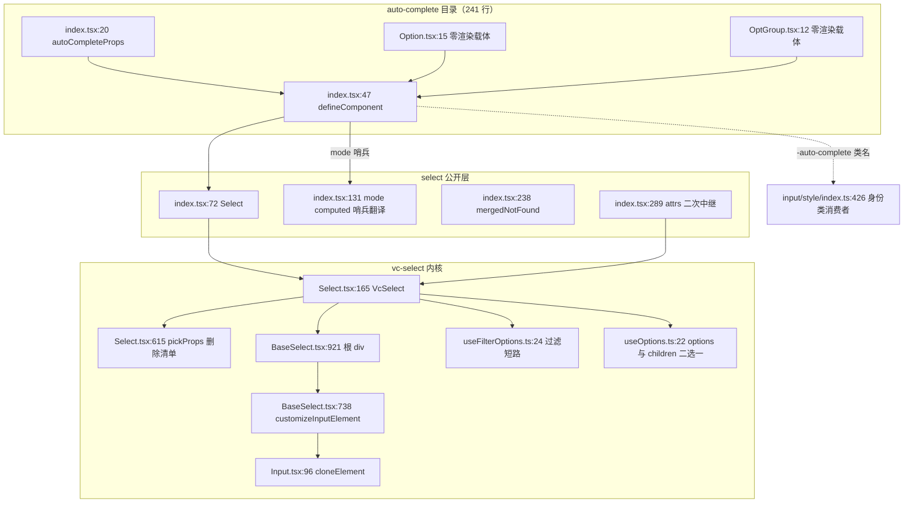
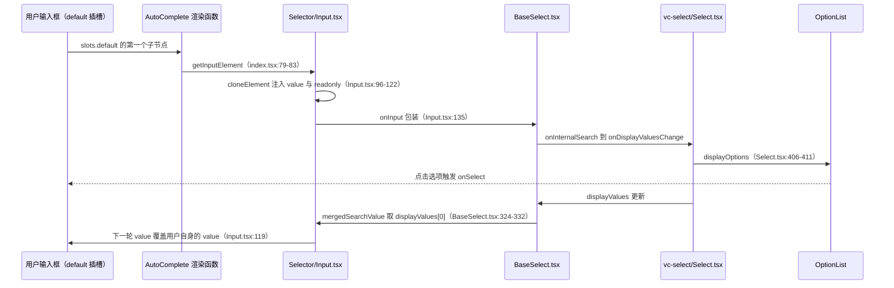
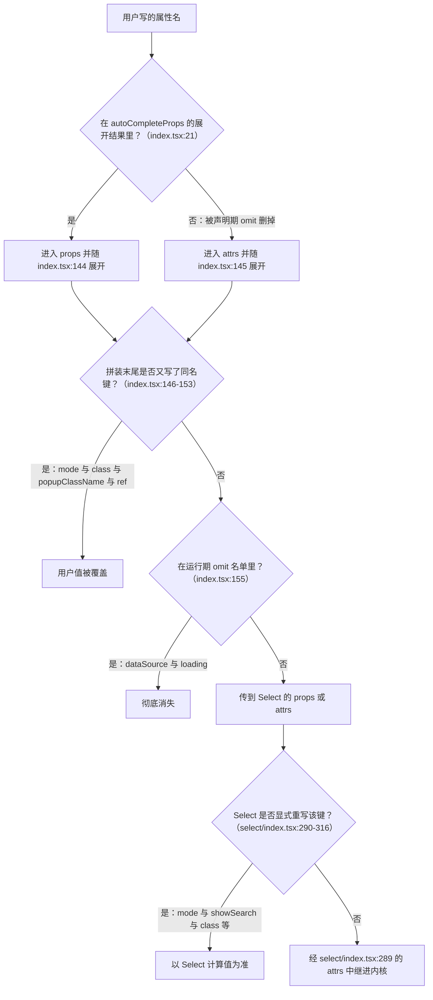

# C05-02 AutoComplete 自动完成

> **本篇解决**：`<xy-auto-complete>` 声称「把 Select 的下拉与 Input 的输入拼起来」，本篇查清它到底改了哪一层——它自己没有任何状态，全部行为差异压缩在一次渲染期对象拼装里；两份删除清单（声明期与运行期）力度不同，导致四个被删的名字里只有两个真死；自定义输入框的接缝不在 AutoComplete 目录内，而在内核的 `Input.tsx` 里。
> **前置**：C05-01 Select 选择器、C05-00 类横写（select/cascader/tree-select 共用的选项流水线）　**读者坐标**：`03-components/05-picker` 第 2/9 篇

## 一、职责与边界

AutoComplete 的职责只有一个：**把用户写的一个输入框元素塞进 Select 的下拉骨架里，并把 Select 的公开 API 面裁剪成「单选、可输入、无 label 概念」的形状**。它不实现下拉、不实现过滤、不实现开合、不实现键盘导航，也不实现输入框——这些能力全部在内核 `vc-select` 里（三个代表位置：`packages/xiaoye-ui/src/vc-select/BaseSelect.tsx:921` 的容器 div、`packages/xiaoye-ui/src/vc-select/hooks/useFilterOptions.ts:28` 的过滤短路、`packages/xiaoye-ui/src/vc-select/Selector/Input.tsx:96` 的 `cloneElement`）。它也不负责样式：整个组件目录下没有 `style/` 子目录，`packages/xiaoye-ui/src/auto-complete/index.tsx:97` 直接以 `'select'` 为前缀名向 `useConfigInject` 取值，因此它连自己的 CSS 类名前缀都没有。

明确不负责的还有：`options` 到下拉项的解析（`packages/xiaoye-ui/src/vc-select/hooks/useOptions.ts:22`）、`value` 的双向同步（由 Select 的 `update:value` 负责，`packages/xiaoye-ui/src/select/index.tsx:202`）、Form 接线（`packages/xiaoye-ui/src/select/index.tsx:204` 的 `formItemContext.onFieldChange`）。这三处 AutoComplete 一行都没写。

被谁依赖：`packages/xiaoye-ui/src/components.ts:21` 与 `:22` 两行聚合导出，`packages/xiaoye-ui/typings/global.d.ts:9` 的全局组件类型；此外没有任何组件 import 它（`grep -rn "auto-complete'" packages/xiaoye-ui/src` 只命中 `packages/xiaoye-ui/src/components.ts` 的两行聚合导出）。它依赖谁：`packages/xiaoye-ui/src/auto-complete/index.tsx:3` 的 `Select` 与 `selectProps`、`:4-9` 的六个内部模块（props-util、warning、两个选项载体、omit、registerComponent）、`:11-12` 的配置注入与状态类型。这是一条**单向、只有两个出口**（`Select` 与 `attrs`）的依赖，也是本篇所有结论的前提。

## 二、源码地图

组件目录只有四个文件、共 241 行，是 05-picker 类里最薄的一个：

| 文件 | 行数 | 职责 | 关键导出 |
| --- | --- | --- | --- |
| `packages/xiaoye-ui/src/auto-complete/index.tsx` | 176 | props 裁剪表、渲染期拼装、`dataSource` 兼容、focus/blur 代理 | `autoCompleteProps`、默认导出、`AutoCompleteOption`、`AutoCompleteOptGroup` |
| `packages/xiaoye-ui/src/auto-complete/Option.tsx` | 17 | 零渲染数据载体，只挂 `isSelectOption` 标记 | `Option`（`packages/xiaoye-ui/src/auto-complete/Option.tsx:15`） |
| `packages/xiaoye-ui/src/auto-complete/OptGroup.tsx` | 14 | 同上，挂 `isSelectOptGroup` | `OptGroup`（`packages/xiaoye-ui/src/auto-complete/OptGroup.tsx:12`） |
| `packages/xiaoye-ui/src/auto-complete/index.test.js` | 34 | 唯一用例：自定义 `<input>` 加三条 `options` | 无 |

主实现入口是 `packages/xiaoye-ui/src/auto-complete/index.tsx:47` 的 `defineComponent`，渲染函数在 `:98`；props 表在 `:20-39`，其中 18 个键里有 12 个来自对 `selectProps()` 的展开与删除（`:21`）。上游被复用的适配层与内核文件：

| 文件 | 行数 | 在 AutoComplete 链上承担什么 |
| --- | --- | --- |
| `packages/xiaoye-ui/src/select/index.tsx` | 337 | 收 AutoComplete 拼装的产物；`combobox` 哨兵翻译（`:131-143`）、空内容兜底（`:238-247`）、attrs 二次中继（`:289`） |
| `packages/xiaoye-ui/src/vc-select/Select.tsx` | 684 | 选项流水线与 `backfill`/`labelInValue` 的真实读取点（`:455`、`:423`） |
| `packages/xiaoye-ui/src/vc-select/BaseSelect.tsx` | 970 | 开合、根类名、自定义输入框的启用判定（`:758-759`、`:840-851`） |
| `packages/xiaoye-ui/src/vc-select/Selector/Input.tsx` | 178 | 把用户的输入框元素 `cloneElement` 成受控组件（`:83`、`:96-122`） |
| `packages/xiaoye-ui/src/vc-select/hooks/useOptions.ts` | 58 | `options` 与 `children` 二选一（`:22-26`） |
| `packages/xiaoye-ui/src/vc-select/utils/legacyUtil.ts` | 61 | 把 `Option` 载体反解析成数据（`:6-25`） |
| `packages/xiaoye-ui/src/vc-select/hooks/useFilterOptions.ts` | 86 | `filterOption === false` 的短路（`:28`） |
| `packages/xiaoye-ui/src/vc-select/utils/warningPropsUtil.ts` | 135 | 12 条开发期告警，其中三条专门盯 combobox 与自定义输入（`:39-57`） |
| `packages/xiaoye-ui/src/select/style/index.ts` | 342 | `-show-search` 的光标规则（`:33-40`）与被 `-customize-input` 整块跳过的入口（`:136-137`） |
| `packages/xiaoye-ui/src/input/style/index.ts` | — | 唯一读取 `-select-auto-complete` 身份类的样式，共三处（`:426`、`:452`、`:467`） |

两个要提前登记的地图事实：其一，`Option` 与 `OptGroup` 是把内核同名文件**逐行复制**后只改 `displayName` 的产物——`packages/xiaoye-ui/src/auto-complete/Option.tsx:14-16` 与 `packages/xiaoye-ui/src/vc-select/Option.tsx:15-17` 除名字外完全相同；其二，`AutoComplete` 没有样式文件，`package.json` 的 `exports` 里因此只有 `./auto-complete` 一个入口，没有配套的 `./auto-complete/style`（`packages/xiaoye-ui/src/components.ts:21-22` 也只有两行）。

## 三、架构与数据流

### 图 1：静态结构——一个没有状态的适配层挂在另一个适配层上



这张图要说明的是**边只有一条是 AutoComplete 自己造的**：`index.tsx:142-156` 的对象拼装。图中 `auto-complete` 子图里没有任何 computed、watch 或状态 hook（`packages/xiaoye-ui/src/auto-complete/index.tsx:2` 只导入了 `defineComponent, ref`，唯一的 `ref` 是 `:78` 的模板引用），所以它不是「有状态的壳」而是「有键顺序的壳」。第二件要说清的事：`-auto-complete` 这个身份类（`packages/xiaoye-ui/src/auto-complete/index.tsx:107`）在 `select` 子图与 `vc-select` 子图里都没有消费者，唯一读它的是 `input` 族的样式（`packages/xiaoye-ui/src/input/style/index.ts:426`、`:452`、`:467`）——两族拼接在样式层的接缝是**单向**的。

### 图 2：数据流闭环——一次键入从自定义输入框到下拉再回到输入框



闭环的关键分支在最后一跳：**输入框显示的文本永远来自内核的 `displayValues[0]`，不来自插槽元素自己的 `value`**。因为 `packages/xiaoye-ui/src/vc-select/Selector/Input.tsx:101` 先展开用户元素的原始 props、`:119` 再写 `value: editable ? value : ''`，后者胜出。这条链路解释了为什么 AutoComplete 不需要自己的受控状态——它把「输入值」这件事整个外包给了 Select 的单选显示值管道（C05-01 论点 4 已论证输入框状态被切成四片，此处只补一跳：`packages/xiaoye-ui/src/vc-select/BaseSelect.tsx:324-332` 在 combobox 分支下直接从 `displayValues` 反推搜索词）。

### 图 3：一个 prop 名在三处被判定命运



这张图是本篇的主轴。它存在的理由：`:21` 与 `:155` 都是「删除」，但**删除发生在不同阶段，效果完全不同**——前者只把名字移出 props 白名单，值会改走 `attrs` 通道在 `:145` 原地复活；后者发生在拼装完成之后，是真的删。第三节的结论先给在这里：AutoComplete 声明删了四个名字（`loading`、`mode`、`optionLabelProp`、`labelInValue`），实际死掉两个（`loading` 由 `:155` 补刀、`mode` 由 `:146` 覆盖），另外两个仍然活着并继续被内核读取。

## 四、核心机制精读

### 论点 1：AutoComplete 不产生任何状态，它的「实现」就是 15 个键的写入顺序

断言：`packages/xiaoye-ui/src/auto-complete/index.tsx` 里没有一个响应式派生、没有副作用、没有生命周期，组件的全部语义等价于一次对象字面量组装加一个 `cls` 判定；因此「改 AutoComplete 的行为」在实践中只有两个落点——`:20-39` 的 props 表与 `:142-158` 的拼装，别处改的都是 Select 或内核。

```tsx
// packages/xiaoye-ui/src/auto-complete/index.tsx:142
      const selectProps = omit(
        {
          ...props,
          ...(attrs as any),
          mode: Select.SECRET_COMBOBOX_MODE_DO_NOT_USE,
          // optionLabelProp,
          getInputElement,
          notFoundContent,
          // placeholder: '',
          class: cls,
          popupClassName: props.popupClassName || props.dropdownClassName,
          ref: selectRef,
        },
        ['dataSource', 'loading'],
      );
      return (
        <Select {...selectProps} v-slots={omit(slots, ['default', 'dataSource', 'options'])}>
```

逐段看：`:144` 展开 `props`、`:145` 展开 `attrs`，两次的先后决定「未声明属性可以顶掉已声明属性」（因为 `attrs` 后展开）；`:146-153` 的九个具名键写在两次展开**之后**，所以这九个键用户无法通过任何写法覆盖——包括写在 attrs 里的；`:155` 再对成品做一次删除。整个文件里唯一的状态是 `:78` 的 `const selectRef = ref()`，且只用于 `:86`、`:90` 的 focus/blur 代理。反证命令：对 `packages/xiaoye-ui/src/auto-complete/index.tsx` 跑 `grep -n -e "computed(" -e "watch(" -e "watchEffect" -e "useState" -e "useMergedState"`，零命中（实测退出码 1）；`grep -n "ref(" ` 只命中 `:78`。

反证一句以免误读：`cls` 对象（`:102-108`）看起来像派生态，但它每次渲染重算、不缓存、不参与依赖收集，只是把 `attrs.class` 字符串当键用的字典（这个用法的坑见坑 1）。结论回扣论点：**这是一个纯词法层，审查它的唯一手段是读键顺序**，而不是读逻辑。

### 论点 2：两份删除清单力度不同——四个被删的名字里两个真死、两个假活，且假活的那两个还在 dev 告警名单上

断言：`:21` 的声明期 `omit` 只影响 props 白名单，值从 `attrs` 绕回；只有 `:155` 的运行期 `omit` 与 `:146` 的显式键是真的。于是 `loading` 被两处合杀（彻底不可用），`mode` 被显式键覆盖（彻底不可改），而 `optionLabelProp`、`labelInValue` 完整穿透到内核并被读取——AutoComplete 的「裁剪」在这一点上是纯类型面表演。

```ts
// packages/xiaoye-ui/src/auto-complete/index.tsx:20
export const autoCompleteProps = () => ({
  ...omit(selectProps(), ['loading', 'mode', 'optionLabelProp', 'labelInValue']),
  dataSource: Array as PropType<{ value: any; text: any }[] | string[]>,
```

被删的四个名字在源头都是真实存在的：`loading` 来自 `packages/xiaoye-ui/src/vc-select/BaseSelect.tsx:179`（经 `baseSelectPropsWithoutPrivate` 的 `:158` 进入 `selectProps`），`optionLabelProp` 来自 `packages/xiaoye-ui/src/vc-select/Select.tsx:140`，`labelInValue` 来自 `:151`，`mode` 在公开层被重新声明为 `packages/xiaoye-ui/src/select/index.tsx:57`。四个都被 `:21` 移出 AutoComplete 的 props；用户仍写它们时，Vue 把无法匹配的名字放进 `attrs`，而 `:145` 又原样展开回来。

差别就在有没有第二刀。`loading` 的第二刀在 `:155`，`mode` 的第二刀在 `:146`，`optionLabelProp` 与 `labelInValue` **没有第二刀**：它们随 `selectProps` 进 Select，Select 声明着这两个名字（`:44-50` 的删除清单里没有它们），于是成为 Select 的 props，再经 `packages/xiaoye-ui/src/select/index.tsx:262-273` 的 `omit`（清单里没有它们）进入内核，最终被 `packages/xiaoye-ui/src/vc-select/Select.tsx:230` 的 `option?.[props.optionLabelProp || mergedFieldNames.value.label]` 与 `:423` 的 `const returnValues = props.labelInValue` 读取。

```tsx
// packages/xiaoye-ui/src/vc-select/Select.tsx:249
            rawLabel = option?.[props.optionLabelProp || mergedFieldNames.value.label];
```

这不是「源码里没写警告所以是漏洞」：内核专门为它写了开发期告警。

```ts
// packages/xiaoye-ui/src/vc-select/utils/warningPropsUtil.ts:38
  // `combobox` should not use `optionLabelProp`
  warning(
    mode !== 'combobox' || !optionLabelProp,
    '`combobox` mode not support `optionLabelProp`. Please set `value` on Option directly.',
  );
```

因为 AutoComplete 的 mode 恒为 combobox（`:146`），任何用户在 `<xy-auto-complete>` 上写 `option-label-prop` 都会命中这条告警——告警能触发本身就证明这个值**已经抵达内核**（`:10-26` 的解构读的是 RcSelect 的 props）。所以准确的口径是：`optionLabelProp` 在 AutoComplete 上是「有告警的可用项」，而不是「不可用项」；文档面（`:21` 的删除）与运行面（告警）在这里给出了两个不同的答案。

`loading` 的处境相反，且更值得记：它在 Select 上是有完整实现的——`packages/xiaoye-ui/src/select/index.tsx:219` 用 `props.loading` 参与 `mergedShowArrow` 判定，`packages/xiaoye-ui/src/select/utils/iconUtil.tsx:11` 与 `:30` 用 `loading` 决定箭头位渲染什么，内核还额外渲染 `-arrow-loading` 与 `-loading` 两个类名（`packages/xiaoye-ui/src/vc-select/BaseSelect.tsx:783`、`:847`）。AutoComplete 只是在 `:155` 把通往这一整套实现的门关掉了，而没有实现任何替代物：**加载中态在 AutoComplete 上无处安放**，这与它的核心场景（异步搜索）直接冲突，见坑 2。

### 论点 3：`default` 插槽在这里语义翻转，选项被赶到两条互斥的通道上，而两条通道的判据不一样

断言：在 Select 里 default 插槽是选项集合（`packages/xiaoye-ui/src/select/index.tsx:311` 的 `children={slots.default?.()}`），在 AutoComplete 里 default 插槽是**输入框本体**；选项必须走 `options` prop 或 `dataSource` prop，而 AutoComplete 判断「该不该建选项」用 `props.options === undefined`，内核判断「用不用 children」用 `if (options.value)` 的真值——两套判据组合出四种结果，其中两种是静默的。

```tsx
// packages/xiaoye-ui/src/auto-complete/index.tsx:79
    const getInputElement = () => {
      const children = flattenChildren(slots.default?.());
      const element = children.length ? children[0] : undefined;
      return element;
    };
```

`:81` 只取 `children[0]`，其余子节点被丢弃且不告警；`:158` 又把 `default`、`dataSource`、`options` 三个插槽从转发名单里剔掉（`v-slots={omit(slots, ['default', 'dataSource', 'options'])}`），所以 Select 的 default 插槽收到的是 `:159` 的 `optionChildren`。这条 getInputElement 只有在内核判定 mode 为 combobox 时才生效：

```tsx
// packages/xiaoye-ui/src/vc-select/BaseSelect.tsx:736
      // ============================= Input ==============================
      // Only works in `combobox`
      const customizeInputElement: any =
        (mode === 'combobox' && getInputElement && getInputElement()) || null;
```

选项侧的判据分叉在这里：

```ts
// packages/xiaoye-ui/src/vc-select/hooks/useOptions.ts:19
  watch(
    [options, children],
    () => {
      if (options.value) {
        tempMergedOptions.value = toRaw(options.value).slice();
      } else {
        tempMergedOptions.value = convertChildrenToData(children.value);
      }
    },
```

AutoComplete 侧对应的是 `packages/xiaoye-ui/src/auto-complete/index.tsx:109` 的 `if (props.options === undefined)`。两者对 `null` 与 `[]` 的处理相反：`options=[]` 时 AutoComplete 不建 children、内核用空数组，下拉为空（一致）；`options=null` 配 `dataSource=['a','b']` 时，AutoComplete 因为 `null !== undefined` 而不建 children，内核因为 `if (null)` 为假而去读 children——children 恰好是空的，于是 `dataSource` 被完全跳过，下拉零选项且无任何告警。这就是坑 3 的成因。

`dataSource` 这条兼容通道自身也有两处硬约束。它把每一项映射成零渲染载体：

```tsx
// packages/xiaoye-ui/src/auto-complete/index.tsx:126
                  case 'object':
                    return (
                      <Option key={item.value} value={item.value}>
                        {item.text}
                      </Option>
                    );
                  default:
                    throw new Error(
                      'AutoComplete[dataSource] only supports type `string[] | Object[]`.',
                    );
```

`item.text`（`:129`）不是 `item.label`，所以 `dataSource={[{ value: 'x', label: 'X' }]}` 渲染出的是空文本项；`typeof item` 为 `number` 时走 `default` 分支直接抛错（`:132-135`），`dataSource={[1, 2]}` 会在渲染期抛。载体 `Option` 本身 `() => null`（`packages/xiaoye-ui/src/auto-complete/Option.tsx:14`），内容不靠它渲染，而靠 `packages/xiaoye-ui/src/vc-select/utils/legacyUtil.ts:17-24` 从 VNode 的 `children.default` 与 `props.value` 反解析——这是「JSX 写数据、内核读数据」的声明式手法，也是 `Option.tsx` 与内核那份逐行相同的原因（两文件唯一差异是 `displayName`，`packages/xiaoye-ui/src/auto-complete/Option.tsx:16` 与 `packages/xiaoye-ui/src/vc-select/Option.tsx:17`）。判据 `isSelectOptionOrSelectOptGroup`（`packages/xiaoye-ui/src/auto-complete/index.tsx:16-18`）检查的是 `child.type.isSelectOption`，而两份 Option 都把这个标记设成 `true`，所以它对「是 Select 的 Option 还是 AutoComplete 的 Option」毫无区分能力。

### 论点 4：自定义输入框真正的接缝不在 auto-complete 目录，而在内核的 `Input.tsx`——同一个对象字面量里，`type` 让给用户、`autofocus` 与 `value` 抢走

断言：AutoComplete 只是把元素交出去（`:148` 的 `getInputElement`），真正把这个元素改造成「受控搜索框」的是 `packages/xiaoye-ui/src/vc-select/Selector/Input.tsx:96` 的 `cloneElement`。改造规则的完整形态是一张**按字面顺序生效的覆盖表**：写在 `...inputProps` 之前的键用户可覆盖，写在之后的键用户不可覆盖。这是派工共则里「JSX 属性顺序覆盖」这一族最集中的样本。

```tsx
// packages/xiaoye-ui/src/vc-select/Selector/Input.tsx:83
      let inputNode: any = inputElement || <BaseInput></BaseInput>;

      const inputProps = inputNode.props || {};
      const {
        onKeydown: onOriginKeyDown,
        onInput: onOriginInput,
        onFocus: onOriginFocus,
        onBlur: onOriginBlur,
        onMousedown: onOriginMouseDown,
        onCompositionstart: onOriginCompositionStart,
        onCompositionend: onOriginCompositionEnd,
        style,
      } = inputProps;
      inputNode = cloneElement(
        inputNode,
        Object.assign(
          {
            type: 'search',
            ...inputProps,
            id,
            ref: inputRef,
            disabled,
            tabindex,
            lazy: false,
            autocomplete: autocomplete || 'off',
            autofocus,
            class: classNames(`${prefixCls}-selection-search-input`, inputNode?.props?.class),
```

覆盖表要逐键读：`type: 'search'`（`:100`）排在 `...inputProps`（`:101`）**之前**，所以用户在插槽里写的 `type="text"` 会胜出，不写则得到 `type="search"`（浏览器原生带一个清除按钮，与 `allowClear` 并存）；`autofocus`（`:108`）排在之后，所以用户在插槽 `<input autofocus>` 上写的 autofocus **被组件的 prop 值（通常 undefined）覆盖**——想自动聚焦只能在 `<xy-auto-complete autofocus>` 上设，而这个键在 `packages/xiaoye-ui/src/auto-complete/index.tsx:33` 有声明、经 `:144` 与 `packages/xiaoye-ui/src/select/index.tsx:288` 两层展开抵达 `packages/xiaoye-ui/src/vc-select/BaseSelect.tsx:167`，再由 `packages/xiaoye-ui/src/vc-select/Selector/index.tsx` 与 `packages/xiaoye-ui/src/vc-select/Selector/SingleSelector.tsx:153` 逐级传到这一行。`class` 在 `:109` 做了显式合并（用户的 class 保留），`style` 在 `:122` 也做了合并，两者是仅有的「双向保留」键。

事件不是覆盖而是**包装**：

```tsx
// packages/xiaoye-ui/src/vc-select/Selector/Input.tsx:123
            onKeydown: (event: KeyboardEvent) => {
              onKeydown(event);
              if (onOriginKeyDown) {
                onOriginKeyDown(event);
              }
            },
```

`:123-128`（keydown）与 `:135` 起的（input）都是先跑内核再跑用户处理器，因此插槽元素自带的 `@keypress`（文档示例 `apps/docs/examples/auto-complete/custom.vue:13` 就写了 `@keypress`）不会被吞。但 `value` 不是包装而是覆盖：`:119` 的 `value: editable ? value : ''` 排在 `...inputProps` 之后，于是插槽上 `v-model` 编译出的 `value` 被无条件替换成内核的搜索值，而它的 `onInput` 仍被保留（`:135-140`）——写回方向通、写出方向死，这正是坑 6 的机理。`editable` 来自 `packages/xiaoye-ui/src/vc-select/Selector/SingleSelector.tsx:155`，combobox 下为真，所以取的是 `value`（即图 2 里的 `mergedSearchValue`）。

### 论点 5：输入框显示的文本没有独立真相，它由 `displayValues[0]` 反推；而列表为空时下拉被强制关上，因为 combobox 的 `notFoundContent` 默认是 `null`

断言：AutoComplete 场景里「搜索词」与「当前值」是同一个东西，内核用一行反推实现这一点；同时这一行与 `notFoundContent` 的默认值共同决定了「异步等待期用户看不到任何东西」。

```ts
// packages/xiaoye-ui/src/vc-select/BaseSelect.tsx:324
    const mergedSearchValue = computed(() => {
      if (props.mode !== 'combobox') {
        return props.searchValue;
      }

      const val = props.displayValues[0]?.value;

      return typeof val === 'string' || typeof val === 'number' ? String(val) : '';
    });
```

`:331` 的 `String(val)` 意味着 `displayValues[0].value` 若是对象（例如把 `labelInValue` 硬塞进来，见论点 2）会被转成 `"[object Object]"` 显示在输入框里。搜索词的这一份实现解释了为什么 AutoComplete 不需要 `searchValue` 也能工作，也解释了为什么它在 combobox 下**不会**保留与值不同的中间态。

开合侧的闸门是另一处：

```ts
// packages/xiaoye-ui/src/vc-select/BaseSelect.tsx:349
    // Not trigger `open` in `combobox` when `notFoundContent` is empty
    const emptyListContent = computed(() => !props.notFoundContent && props.emptyOptions);

    watchEffect(() => {
      mergedOpen.value = innerOpen.value;
      if (
        props.disabled ||
        (emptyListContent.value && mergedOpen.value && props.mode === 'combobox')
      ) {
        mergedOpen.value = false;
      }
    });
```

`:350` 判的是 `notFoundContent` 的**真假**而非是否为 undefined，而 AutoComplete 链路上这个值恰好被算成 `null`：`packages/xiaoye-ui/src/auto-complete/index.tsx:99` 的解构默认值只处理 undefined，`:149` 原样传给 Select，`packages/xiaoye-ui/src/select/index.tsx:243-244` 在 `mode.value === 'combobox'` 分支里显式给 `mergedNotFound = null`。于是「选项还没到」= 「下拉打不开」，`:362` 的 `triggerOpen` 也跟着是 false。用户能改的唯一入口是给 `notFoundContent` 传一个真值（prop 或 `#notFoundContent` 插槽，后者在 `packages/xiaoye-ui/src/auto-complete/index.tsx:99` 被提前求值）。这条闸门没有任何测试保护（`packages/xiaoye-ui/src/auto-complete/index.test.js` 只有一个用例，见 §七 测试现状）。

### 论点 6：三处默认值被就地改写、两处是死默认、一处类名与真值不一致

断言：AutoComplete 的 props 表（`:20-39`）不是「透传声明」，其中四个键的**默认值与 Select 不同**，而它们的有效性各不相同：一个真改变了行为（`filterOption`）、一个是三重冗余（`dropdownMatchSelectWidth`）、两个根本无人读取（`choiceTransitionName`、`dropdownMenuStyle`）。另有一个类名（`-show-search`）被无条件写死，与内核真值脱钩。

```ts
// packages/xiaoye-ui/src/auto-complete/index.tsx:28
  dropdownMatchSelectWidth: { type: [Number, Boolean], default: true },
  prefixCls: String,
  showSearch: { type: Boolean, default: undefined },
  transitionName: String,
  choiceTransitionName: { type: String, default: 'zoom' },
  autofocus: { type: Boolean, default: undefined },
  backfill: { type: Boolean, default: undefined },
  // optionLabelProp: PropTypes.string.def('children'),
  filterOption: { type: [Boolean, Function], default: false },
  defaultActiveFirstOption: { type: Boolean, default: true },
```

`filterOption` 的默认值是真改动。内核声明的是 `packages/xiaoye-ui/src/vc-select/Select.tsx:134-137`（`default: undefined`），公开层不加默认（`packages/xiaoye-ui/src/select/index.tsx:78-81` 的 `initDefaultProps` 只补 `listHeight` 与 `listItemHeight`），所以 `<xy-select>` 走的是 `packages/xiaoye-ui/src/vc-select/hooks/useFilterOptions.ts:37-52` 的按 label 或 value 匹配；而 `:36` 把 AutoComplete 的默认改成 `false`，命中 `packages/xiaoye-ui/src/vc-select/hooks/useFilterOptions.ts:28` 的第一行短路直接返回全量：

```ts
// packages/xiaoye-ui/src/vc-select/hooks/useFilterOptions.ts:28
    if (!searchValueVal || filterOptionValue === false) {
      return options.value;
    }
```

后果：**本地 `options` 不会随键入收窄**。这是异步搜索的正确默认（`apps/docs/examples/auto-complete/custom.vue:25-28` 的示例正是自己在 `@search` 里重造 options），但对「想拿它当带补全的下拉用」的读者是反直觉的，而且要显式设 `:filter-option="true"` 才有本地过滤（`packages/xiaoye-ui/src/vc-select/hooks/useFilterOptions.ts:34` 区分函数与布尔）。

`dropdownMatchSelectWidth` 是三重冗余的默认：`packages/xiaoye-ui/src/auto-complete/index.tsx:28` 给 true、`packages/xiaoye-ui/src/vc-select/Select.tsx:174` 的 `initDefaultProps` 给 true、`packages/xiaoye-ui/src/vc-select/SelectTrigger.tsx:96` 又 `.def(true)`。三处不改变任何行为，但都参与同一件事——`packages/xiaoye-ui/src/vc-select/SelectTrigger.tsx:12` 的 `const adjustX = dropdownMatchSelectWidth === true ? 0 : 1;` 让这个默认值进入对齐计算，于是「谁先给默认」在三层层层覆盖里变成一个真实需要对齐的约束（另一处读取见 `packages/xiaoye-ui/src/vc-select/Select.tsx:555`，C05-01 坑 5 已论证它与虚拟滚动的绑定，不重述）。

`choiceTransitionName` 与 `dropdownMenuStyle` 是死默认与死声明。前者在 `:32` 被给了 `'zoom'`，而 Select 的声明是 `packages/xiaoye-ui/src/select/index.tsx:60` 的 `stringType('')`；它在内核的整个 Selector 家族里**零读取点**——`packages/xiaoye-ui/src/vc-select/Selector/index.tsx:55` 与 `:110`、`packages/xiaoye-ui/src/vc-select/Selector/MultipleSelector.tsx:30` 与 `:53`、`packages/xiaoye-ui/src/vc-select/BaseSelect.tsx:172` 五处全是接口或 props 声明，唯一的另一处出现是 `packages/xiaoye-ui/src/vc-select/BaseSelect.tsx:54` 把它列进 `DEFAULT_OMIT_PROPS`、在 `:776-778` 从 DOM 属性里删掉。后者在 `:23-26` 有完整声明（含 `default: undefined as CSSProperties`），而全仓唯一的另一处出现是内核把它列为**已移除的废弃 API** 的注释：

```ts
// packages/xiaoye-ui/src/vc-select/Select.tsx:14
 * Remove deprecated api:
 * - multiple
 * - tags
 * - combobox
 * - firstActiveValue
 * - dropdownMenuStyle
```

也就是说 `dropdownMenuStyle` 的声明与告警名单同时存在，文档 `apps/docs/components/auto-complete.md:106` 还在宣传它，而实现路径为零（可复现命令见附 检查点 1）。

类名不一致指 `-show-search`。`packages/xiaoye-ui/src/auto-complete/index.tsx:106` 把它写成常量 true，而真值是内核的 `packages/xiaoye-ui/src/vc-select/BaseSelect.tsx:291-294`：

```ts
// packages/xiaoye-ui/src/vc-select/BaseSelect.tsx:291
    const mergedShowSearch = computed(() =>
      props.showSearch !== undefined
        ? props.showSearch
        : multiple.value || props.mode === 'combobox',
    );
```

两者都会被渲染到同一个根元素上（AutoComplete 的 `cls` 经 `packages/xiaoye-ui/src/select/index.tsx:302` 汇入 attrs.class，内核在 `packages/xiaoye-ui/src/vc-select/BaseSelect.tsx:830` 与 `:850` 再合一次）。于是显式设 `:show-search="false"` 时内核那份类名消失、AutoComplete 那份仍在，样式表 `packages/xiaoye-ui/src/select/style/index.ts:33-40` 的 `cursor: text` 与 `input { cursor: auto }` 继续命中；但该规则挂在 `packages/xiaoye-ui/src/select/style/index.ts:136-137` 的 `&:not(${componentCls}-customize-input) ${componentCls}-selector` 之下，一旦用户给了自定义输入框（`-customize-input` 由 `packages/xiaoye-ui/src/vc-select/BaseSelect.tsx:829` 加上）整块样式被跳过，说谎的类名就没有可见后果。这条链决定了它的症状范围很窄但真实：不带插槽、设 `show-search=false` 时，光标样式与不可搜索的实际行为矛盾。

## 五、对外契约如何生效

**props 面**：进入组件的键分三条路。声明保留的（`value`、`options`、`status`、`backfill`、`filterOption` 等）走 `packages/xiaoye-ui/src/auto-complete/index.tsx:144`；被 `:21` 删出白名单的（`loading`、`mode`、`optionLabelProp`、`labelInValue`）走 `:145` 的 attrs；两者在 `:146-153` 的九个具名键与 `:155` 的运行期删除处被重新裁决（论点 2 的图 3）。`status` 是「声明即生效」的正例：`:38` 声明、经 `:144` 到 Select、由 `packages/xiaoye-ui/src/select/index.tsx:118` 与 Form 的注入态合并、最后由 `:196` 的 `getStatusClassNames` 落成类名——AutoComplete 自己一行都没写。`size` 是「同一逻辑两份实现」的正例：`:99` 解构的是**裸 props**，`:104-105` 据此加 `-lg`/`-sm`，而 Select 的 `packages/xiaoye-ui/src/select/index.tsx:164` 用的是 `compactSize || contextSize`，其中 contextSize 已含 props（`packages/xiaoye-ui/src/config-provider/hooks/useConfigInject.ts:39`）与 Space 紧凑上下文；两条路径产出的类名同名，所以多数情况看不出差别，差别在「AutoComplete 自己那份不认 compact 与 ConfigProvider」。

`backfill` 值得单列，它是「靠 attrs 中继才活着」的典型：AutoComplete 在 `:34` 正常声明，Select 却把它删出白名单（`packages/xiaoye-ui/src/select/index.tsx:49`），于是值落进 Select 的 attrs、由 `packages/xiaoye-ui/src/select/index.tsx:289` 的 `{...attrs}` 原样中继回内核，内核既声明它（`packages/xiaoye-ui/src/vc-select/Select.tsx:112`）又读它（`:455` 的 `if (props.backfill && props.mode === 'combobox' && active !== null && source === 'keyboard')`），并且因为 AutoComplete 的 mode 恒为 combobox，`packages/xiaoye-ui/src/vc-select/utils/warningPropsUtil.ts:45` 那条「`backfill` only works with `combobox` mode」的告警在这条链上不会响。本篇按逐跳读出的链路登记这个结论；`apps/docs/components/auto-complete.md:97` 对 `backfill` 的承诺是有效的，与 `loading`（坑 2）恰好相反。

**事件面**：`packages/xiaoye-ui/src/auto-complete/index.tsx:52` 的 `emits` 是注释状态，AutoComplete 不拥有任何事件。用户写的 `@change`、`@search`、`@select` 要么命中声明过的 props（`onChange` 见 `packages/xiaoye-ui/src/vc-select/Select.tsx:154`、`onSearch` 见 `:121`、`onSelect` 见 `:125`）从而与 props 同路，要么走 attrs 中继；最终调用点全在内核：`packages/xiaoye-ui/src/vc-select/Select.tsx:439`（change）、`:481`（select）、`:552`（search）。`v-model:value` 能成立是因为 `selectProps` 自带 `'onUpdate:value'`（`packages/xiaoye-ui/src/select/index.tsx:66`）且 `:21` 的删除清单没碰它，触发点是 `packages/xiaoye-ui/src/select/index.tsx:202`。契约后果：**AutoComplete 无法拦截、改写或补发任何事件**，任何「在 change 上做加工」的需求都要改 Select，波及面立刻超出本篇。

**插槽面**：类型声明只列六个（`packages/xiaoye-ui/src/auto-complete/index.tsx:53-61`：`option`、`options`、`default`、`notFoundContent`、`dataSource`、`clearIcon`），而 Select 声明十二个（`packages/xiaoye-ui/src/select/index.tsx:100-113`，多出 `suffixIcon`、`itemIcon`、`removeIcon`、`dropdownRender`、`placeholder`、`tagRender`、`maxTagPlaceholder`、`optionLabel`）。运行时反而是宽的：`:158` 的 `omit(slots, ['default', 'dataSource', 'options'])` 把除这三项外的全部插槽转给 Select，所以 `#suffixIcon` 实际能用、类型面上会被 `vue-tsc` 拒绝。三个被剔掉的插槽里 `default` 被换成 `:159` 的 `optionChildren`、`dataSource` 与 `options` 已在 `:110` 被就地求值成 VNode 数组，同时 `:63-72` 为这两者发出废弃告警（指向 props `options`）。

**expose 面**：`packages/xiaoye-ui/src/auto-complete/index.tsx:93-96` 只暴露 `focus`、`blur`，而 Select 暴露 `blur`、`focus`、`scrollTo`（`packages/xiaoye-ui/src/select/index.tsx:210-214`），内核还额外有 `scrollTo` 的真实现（`packages/xiaoye-ui/src/vc-select/BaseSelect.tsx:318-322`）。也就是说 `scrollTo` 的能力整条链路都在，只在 AutoComplete 这一跳被吞（坑 9）。

**注册与类型面**：`packages/xiaoye-ui/src/auto-complete/index.tsx:167-175` 用 `Object.assign` 挂上 `Option`、`OptGroup` 与 `install`，`install` 里注册三个组件；标签名由 `packages/xiaoye-ui/src/_util/registerComponent.ts:18` 的 `comp.displayName || comp.name` 决定——两个子组件是函数组件、没有 `name`，靠 `packages/xiaoye-ui/src/auto-complete/Option.tsx:16` 与 `packages/xiaoye-ui/src/auto-complete/OptGroup.tsx:13` 的 `displayName` 得到 `xy-auto-complete-option`、`xy-auto-complete-optgroup`。生成物 `packages/xiaoye-ui/typings/global.d.ts:9` 只声明了 `XYAutoComplete`，全文件没有任何 `Option` 级声明（`grep -n "Option" packages/xiaoye-ui/typings/global.d.ts` 零命中），所以这是聚合入口的系统性行为、不是本篇的孤例，但后果落在 AutoComplete 头上：运行时可用的两个子标签在模板类型检查里不存在。

## 六、设计取舍

**取舍 1：套壳 Select，而不是直连 `vc-select`。** 收益是量级上的：176 行、零响应式状态（论点 1）、零样式文件、`status` 与 Form 接线与图标位与尺寸与 RTL 全部免费（§五 的 `status` 链路一行未写）。C05-01 取舍 2 已从被调用方（哨兵字符串）的角度论证过同一件事，此处只补代价的三笔具体账。第一笔是 **props 面要靠两份人工维护、力度还不同的删除清单来表达**（`:21` 与 `:155`），这份不对称已经造成四个名字里两个被误判（论点 2）。第二笔是**继承面失控**：Select 在 `packages/xiaoye-ui/src/select/index.tsx:290-316` 用二十多个具名键收尾，AutoComplete 拼好的东西在这里被二次改写，任何一行的顺序变动都是 AutoComplete 的行为变动，而 AutoComplete 目录里没有一行代码提示这层依赖存在。第三笔是**无法拥有 Select 没有的东西**：`loading` 就是被这条路径逼死的——它需要的只是「让 `packages/xiaoye-ui/src/select/utils/iconUtil.tsx:30` 那个 spinner 出现在箭头位」，但 AutoComplete 无法越过 Select 的 `mergedShowArrow`（`packages/xiaoye-ui/src/select/index.tsx:216-220`）单独提供加载态，于是选择把名字删掉（`:21`）并补一刀（`:155`），留下异步搜索无加载态的空缺（坑 2）。被放弃的方案是直连内核：那样 `loading` 与 `notFoundContent` 与 `showArrow` 都要在 AutoComplete 里重做，但也就不会有图 3 那张三段判定。

**取舍 2：样式寄生在 `select` 前缀上，不建自己的 style 目录。** `packages/xiaoye-ui/src/auto-complete/index.tsx:97` 传的是 `'select'`，全目录没有 `style/index.ts`，`package.json` 的 `exports` 里因此只有 `./auto-complete` 一个入口、没有 `./auto-complete/style`（实测 `node -e` 读 exports 键，`/auto/i` 只命中一条），`packages/xiaoye-ui/src/components.ts:21-22` 也只有两行、没有样式副作用导入。换来的是零样式维护与零 token 面积；赔上的是**这个组件在主题系统里没有身份**：`-auto-complete` 类名（`:107`）在 `select` 的样式表里查不到任何规则，唯一读它的是 Input 族的 compact 规则（`packages/xiaoye-ui/src/input/style/index.ts:426`、`:452`、`:467`），而那三处都要求组件被包在 input-group 里。想给 AutoComplete 单独调一个间距，唯一的路是改 Select 的样式表并祈祷不波及其他选择类组件。

**取舍 3：`dataSource` 兼容层保留，且类型错误在渲染期抛错。** 同一个文件里同时存在两种失败策略：三个废弃项走 `warning`（`packages/xiaoye-ui/src/auto-complete/index.tsx:63-77`，只打日志），而 `dataSource` 的元素类型不合法直接 `throw new Error`（`:132-135`）。选择抛错换来「写错立刻知道」，代价是**一个数字项让整棵组件树在渲染期崩**，且该分支没有测试（`packages/xiaoye-ui/src/auto-complete/index.test.js:18` 用的是 `options` 通路）。同一处还有第二种静默失败：`item.text`（`:129`）与今天惯用的 `label` 不同名，写 `label` 不抛错也不告警，只渲染出空文本——兼容层的两半一严一松。

> ⚠️ 未在源码中找到对应实现：`dropdownMatchSelectWidth` 为何要在 AutoComplete 上重复第三次默认值、`:27` 与 `:35` 两行被注释掉的 `optionLabelProp` 声明是在哪个版本被摘掉的。源码与告警名单都没有给出动机，本篇只登记它们当前的状态（冗余默认、注释残留）。

## 七、坑与改动指南

**坑 1：`class` 用数组或对象写法时，用户类名被 `String()` 打扁。**
触发：`<xy-auto-complete :class="['light','bamboo']">` 或 `:class="{ custom: true }">`。
症状：DOM 上出现 `class="light,bamboo ..."` 或 `class="[object Object] ..."`，两条用户样式全不生效；用空格分隔的字符串写法反而正常。
原因：`packages/xiaoye-ui/src/auto-complete/index.tsx:101-103` 把 `attrs.class` 当成对象**键**来用（`[className as string]: !!className`），键必须是字符串，于是数组被 join 成 `"light,bamboo"`、对象被转成 `"[object Object]"`；随后 `:151` 用这个 `cls` 覆盖 `class`，真类名已不可恢复。
定位：`packages/xiaoye-ui/src/auto-complete/index.tsx:101`、`:151`。复现命令（不依赖浏览器）：

```bash
node --input-type=module -e "import { normalizeClass } from 'vue'; const c=['light','bamboo']; console.log(normalizeClass({ [c]: !!c, 'xy-select-show-search': true }));"
# 输出：light,bamboo xy-select-show-search
```

改动边界：把这里改成 `classNames(className, {...})` 是安全的（`packages/xiaoye-ui/src/select/index.tsx:302` 已用数组形式合并），但要同步检查 `attrs.class` 在 `:145` 已展开过一次、`:151` 的覆盖是必需的。

**坑 2：`loading` 在 AutoComplete 上零效果，异步搜索没有加载态。**
触发：`<xy-auto-complete :loading="true">`，或搜索结果未回来时想转圈。
症状：无 spinner、无 `-loading` 类名、箭头位不变；同样的写法在 `<xy-select>` 上是有效的。
原因：`packages/xiaoye-ui/src/auto-complete/index.tsx:21` 把 `loading` 移出 props 白名单后，值虽然走 `:145` 的 attrs 回来，却被 `:155` 的运行期 `omit` 二次删除；而 Select 侧的实现是活的（`packages/xiaoye-ui/src/select/index.tsx:219`、`packages/xiaoye-ui/src/select/utils/iconUtil.tsx:11` 与 `:30`、`packages/xiaoye-ui/src/vc-select/BaseSelect.tsx:783` 与 `:847`）。
定位：`packages/xiaoye-ui/src/auto-complete/index.tsx:155`。
测试现状：该分支无测试保护，且 `apps/docs/components/auto-complete.md` 的属性表里根本没有 `loading` 一行，属于「删了名字、没删文档预期」的中间态（对照 `:96`、`:97`、`:106` 三行仍在宣传 `autofocus`、`backfill`、`dropdownMenuStyle`）。

**坑 3：`:options="null"` 会把 `dataSource` 整条通道关掉。**
触发：`<xy-auto-complete :options="null" :data-source="['a','b']">`，或 `options` 初值为 `null` 再异步赋值。
症状：下拉零选项，且不告警、不抛错。
原因：`packages/xiaoye-ui/src/auto-complete/index.tsx:109` 的判据是 `props.options === undefined`，`null` 不满足，于是 `optionChildren` 不构建；而内核 `packages/xiaoye-ui/src/vc-select/hooks/useOptions.ts:22` 的判据是 `if (options.value)` 真值，`null` 落入 else 去读 children，children 正是空。两套判据在 `null` 上反向。
定位：`packages/xiaoye-ui/src/auto-complete/index.tsx:109` 与 `packages/xiaoye-ui/src/vc-select/hooks/useOptions.ts:22`（另见 `packages/xiaoye-ui/src/vc-select/utils/warningPropsUtil.ts:30` 的 `options || convertChildrenToData(children)`，又是第三种判法）。

**坑 4：`dataSource` 的对象项只认 `text`，且 `number[]` 抛错。**
触发：`data-source=[{ value: 'x', label: 'X' }]`，或 `data-source=[1,2]`。
症状：前者渲染出可点但空白的选项，后者在渲染期抛 `AutoComplete[dataSource] only supports type` 并打崩父树。
原因：`packages/xiaoye-ui/src/auto-complete/index.tsx:119-136` 的 `switch (typeof item)` 只有 `string`、`object` 两分支，`object` 分支硬取 `item.text`。
定位：`packages/xiaoye-ui/src/auto-complete/index.tsx:129`、`:132-135`。迁移动作见 `apps/docs/components/auto-complete.md:132-148`（文档教的是把 `dataSource` 换成 `options`）。

**坑 5：自定义输入框上的 `autofocus` 与 `v-model` 一半有效一半无效。**
触发：`<xy-auto-complete><input v-model="text" autofocus /></xy-auto-complete>`。
症状：打字时 `text` 会更新，但 `text.value = 'x'` 改不动输入框；插槽上的 `autofocus` 也不生效。
原因：`packages/xiaoye-ui/src/vc-select/Selector/Input.tsx:100-108` 与 `:119` 的键顺序——`autofocus` 与 `value` 都写在 `...inputProps` 之后，被组件值覆盖；`onInput` 走 `:135-140` 的包装所以仍回写；覆盖后的 `value` 来自 `packages/xiaoye-ui/src/vc-select/BaseSelect.tsx:324-332` 的 `displayValues[0]`。
定位：`packages/xiaoye-ui/src/vc-select/Selector/Input.tsx:108`、`:119`。正确写法是把 `autofocus` 提到 `<xy-auto-complete>` 上、用 `v-model:value` 绑组件而不是绑插槽元素（`:144` 的 `value` 会传下去，触发点见 `packages/xiaoye-ui/src/select/index.tsx:202`）。

**坑 6：选项为空时下拉根本不弹，用户以为组件坏了。**
触发：`options` 为空数组或异步结果还没回；点输入框。
症状：无浮层、无「加载中」占位、无「无数据」文案。
原因：`packages/xiaoye-ui/src/select/index.tsx:243-244` 在 combobox 下把 `mergedNotFound` 算成 `null`，`packages/xiaoye-ui/src/vc-select/BaseSelect.tsx:350` 的 `emptyListContent` 因此为真，`:352-359` 强制 `mergedOpen = false`，`:362` 的 `triggerOpen` 同假。
定位：`packages/xiaoye-ui/src/vc-select/BaseSelect.tsx:350`。规避：给 `notFoundContent`（prop 或插槽）传真值，插槽会被 `packages/xiaoye-ui/src/auto-complete/index.tsx:99` 提前求值。该分支无测试保护。

**坑 7：`allowClear` 与 `placeholder` 同时用在自定义输入场景会触发内核告警。**
触发：`<xy-auto-complete :options="o" allow-clear placeholder="x"><input /></xy-auto-complete>`。
症状：控制台一条 `noteOnce`：自定义 `getInputElement` 应自行实现清除与占位；同时清除按钮与占位的表现由内核而不是插槽元素决定。
原因：`packages/xiaoye-ui/src/vc-select/utils/warningPropsUtil.ts:53-57` 的判定要求 `mode === 'combobox'` 且 `getInputElement` 存在，而 AutoComplete 恰好恒满足两条（`packages/xiaoye-ui/src/auto-complete/index.tsx:146`、`:148`）；告警在 `packages/xiaoye-ui/src/vc-select/Select.tsx:567` 的 dev 分支里调用。
定位：`packages/xiaoye-ui/src/vc-select/utils/warningPropsUtil.ts:55`。附带一条同源风险：`packages/xiaoye-ui/src/vc-select/Selector/Input.tsx:100` 默认给插槽元素打 `type="search"`，与 `allowClear` 的自绘清除按钮并存时会出现两个清除入口。

**坑 8：`dropdownMenuStyle` 与 `choiceTransitionName` 是文档活着、实现死了的声明。**
触发：按 `apps/docs/components/auto-complete.md:106` 设 `dropdownMenuStyle`。
症状：无任何效果（`choiceTransitionName` 同样，且它连 Select 都不读）。
原因与定位：`packages/xiaoye-ui/src/auto-complete/index.tsx:23-26` 与 `:32` 的声明；内核在 `packages/xiaoye-ui/src/vc-select/Select.tsx:19` 明确把 `dropdownMenuStyle` 列为已移除 API，`choiceTransitionName` 在 vc-select 全目录零读取（仅 `packages/xiaoye-ui/src/vc-select/BaseSelect.tsx:54` 的删除名单里出现一次）。
改法建议：从 props 表删声明并同步删文档行；如果保留，就得给 `dropdownMenuStyle` 接到 `packages/xiaoye-ui/src/vc-select/SelectTrigger.tsx:148-153` 的 `popupStyle` 上（那是唯一还活着的下拉样式入口，`dropdownStyle` 在 `:124` 被解构后只在 `:148` 参与合并）。

**坑 9：`ref` 上拿不到 `scrollTo`。**
触发：`autoRef.value.scrollTo({ index: 3 })` 想让高亮项可见。
症状：方法不存在（类型报错、运行期 undefined）。
原因与定位：`packages/xiaoye-ui/src/auto-complete/index.tsx:93-96` 的 `expose` 只列两项，对照 `packages/xiaoye-ui/src/select/index.tsx:210-214` 与 `packages/xiaoye-ui/src/vc-select/BaseSelect.tsx:318-322`。补一行的成本是零，但要先确认 combobox 的列表渲染路径可用（虚拟化判定见 `packages/xiaoye-ui/src/vc-select/Select.tsx:555`，口径归 C05-01 坑 5）。

### 测试现状与安全边界

本篇范围内的测试总量是 **1 个自定义输入用例 + `focusTest` 的 3 个焦点用例**。`packages/xiaoye-ui/src/auto-complete/index.test.js` 全文 34 行、只有 `:11` 一个 `it`、断言为 `:27`（input 数量）、`:32`（下拉项数量）两次 `expect`；`:7` 引入的 `packages/xiaoye-ui/tests/shared/focusTest.js` 是 `.js` 后缀（三个 `it` 在 `:17`、`:33`、`:50`），只按 `find -name "*.test.tsx"` 统计会得出「AutoComplete 没有焦点测试」的错误结论。第三个用例 `packages/xiaoye-ui/tests/shared/focusTest.js:50-65` 恰好覆盖组件级 `autofocus`，但它对 `[autofocus]` 属性的存在性**没有直接断言**（`:61-64` 的 `if (focusEle.length)` 只决定是否 trigger，断言的是回调被调过）——如果哪天 autofocus 不再落到 DOM，这个用例仍可能因其他 focus 路径而通过。没有快照文件、没有 `__tests__` 目录。上述坑 2、坑 3、坑 6、坑 8、坑 9 全部无测试保护；`options` 通路（`packages/xiaoye-ui/src/auto-complete/index.test.js:18`）与 `dataSource` 通路（`:114-137`）里后者零覆盖。`apps/docs/examples/auto-complete/custom.vue:9` 用 `xy-textarea` 作自定义输入框，`packages/xiaoye-ui/src/vc-select/Selector/Input.tsx:96` 的 `cloneElement` 会把 `role="combobox"`、`aria-expanded`、`value`、`readonly` 一并注到组件 vnode 上（`:111-121`），而这条组合在测试里从未出现过。

改动安全边界：**只动 `packages/xiaoye-ui/src/auto-complete/` 四个文件不影响任何其他组件**（无人 import，`grep -rn "from '../auto-complete'" packages/xiaoye-ui/src` 零命中，`packages/xiaoye-ui/src/components.ts:21-22` 是唯一出口）。但动 `:21` 或 `:155` 任一份清单都是**公开 API 变更**：前者改变类型面与 `pnpm gen:entries` 生成的 `packages/xiaoye-ui/typings/global.d.ts:9`，后者改变运行时。动 `packages/xiaoye-ui/src/select/index.tsx:290-316` 的具名键顺序则同时波及 Select、TreeSelect、Cascader 与本组件，验证面至少包括：

```bash
pnpm --filter xiaoye-ui test:unit -- auto-complete select
node docs/column/tools/verify-refs.mjs --excerpt docs/column/03-components/05-picker/C05-02-auto-complete-自动完成.md
pnpm typecheck
```

## 附：本篇可证伪的三个检查点

1. **`dropdownMenuStyle` 是零实现的死声明。** 跑
   `grep -rn "dropdownMenuStyle" packages/xiaoye-ui/src`
   预期恰好两处命中：`packages/xiaoye-ui/src/auto-complete/index.tsx:23`（声明）与 `packages/xiaoye-ui/src/vc-select/Select.tsx:19`（把它列为已移除 API 的注释）。若出现第三处读取点，则论点 6 与坑 8 的定性作废。
2. **AutoComplete 是零状态适配层。** 跑
   `grep -n -e "computed(" -e "watch(" -e "watchEffect" -e "useState" -e "useMergedState" packages/xiaoye-ui/src/auto-complete/index.tsx`
   预期无输出（退出码 1）；`grep -n "ref(" packages/xiaoye-ui/src/auto-complete/index.tsx` 预期只命中 `:78`。任一击中即说明它不再只是词法层，图 1 与论点 1 需要重写。
3. **`-auto-complete` 身份类的解释权在 Input 族手里。** 跑
   `grep -rn "\-auto-complete" packages/xiaoye-ui/src`
   预期四处命中：生产者 `packages/xiaoye-ui/src/auto-complete/index.tsx:107`，消费者 `packages/xiaoye-ui/src/input/style/index.ts:426`、`:452`、`:467`；`select/style` 目录零命中。若在 `packages/xiaoye-ui/src/select/style` 里出现 `-auto-complete`，则取舍 2 的「主题系统里没有身份」结论失效。

