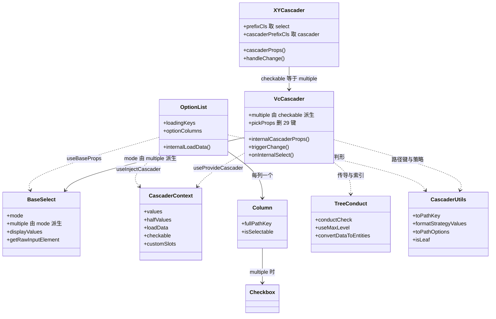
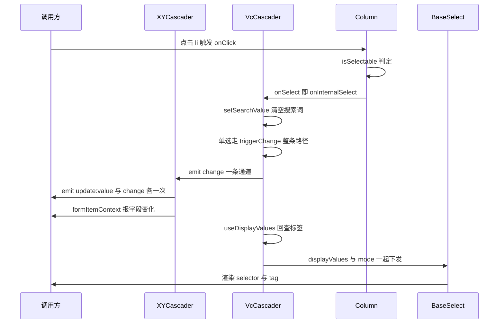
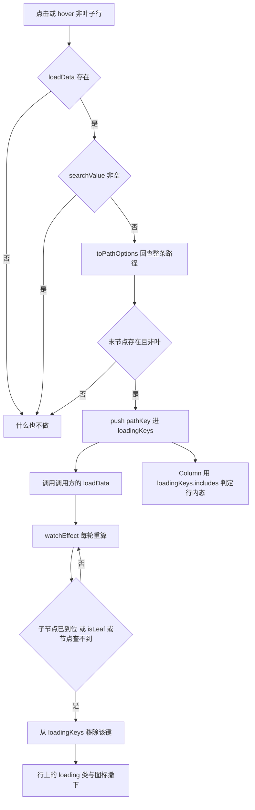

# C05-03 Cascader 级联选择

> **本篇解决**：Cascader 的「路径数组」值语义在源码里如何被拆解、回填与校验；`loadData` 异步展开的「加载中」态由谁持有、如何落到菜单项上；多选形态的勾选与 tag 渲染走的是哪条通道。
> **前置**：C05-00《类横写：select/cascader/tree-select 共用的选项流水线》、C05-01《Select 选择器》　**读者坐标**：`03-components/05-picker` 第 3/9 篇

## 一、职责与边界

`cascader` 负责把一棵嵌套的 `options` 树渲染成**多列并排的菜单**，并把「用户点了哪条路径」翻译成对外那一份**路径数组**。它明确不负责三件事：选项数据的流水线形状（`fillFieldNames` / `convertDataToEntities` / `conductCheck` 的算法本体，见 C05-00《类横写》与 C09-01《Tree 树形控件》）、选择器外壳的显示与开合（`vc-select/BaseSelect.tsx`，见 C05-01《Select 选择器》）、浮层定位与层叠（A07）。

本篇负责的是**这三者交界处的那些翻译层**：`multiple` 如何被翻译成 `checkable` 再翻译成 `mode`（四跳，三种表示法，没有一层持有完整真相）、单选路径与多选路径数组如何在同一个 `ValueType` 上分叉、`loadData` 的加载态为什么由下拉列表自己持有而不是主实现、tag 上的删除叉为什么反而回到「选中」那条函数。

依赖清单（`grep -n "^import" packages/xiaoye-ui/src/vc-cascader/Cascader.tsx` 与 `packages/xiaoye-ui/src/cascader/index.tsx` 可复现）：

- 向上游借的三块基座：`vc-select/BaseSelect.tsx`（`packages/xiaoye-ui/src/vc-cascader/Cascader.tsx:5`、`:23`）、`vc-tree/utils/conductUtil` 的 `conductCheck`（`:19`）、`vc-tree/useMaxLevel`（`:25`）与 `vc-tree/utils/treeUtil` 的 `convertDataToEntities`（`packages/xiaoye-ui/src/vc-cascader/hooks/useEntities.ts:1`）。
- 公开层向 Select 借的两块：样式表 `select/style`（`packages/xiaoye-ui/src/cascader/index.tsx:29`）与图标工厂 `select/utils/iconUtil`（`:8`）。
- 公开层向 Form 借的两条：`useInjectFormItemContext`（`:22`）与 `FormItemInputContext`（`:26`）。
- 被谁依赖：`apps/docs` 的 cascader 示例、生成物 `src/components.ts` 的聚合导出；`vc-cascader` 只被 `cascader` 一处消费（`packages/xiaoye-ui/src/cascader/index.tsx:2`）。

## 二、源码地图

| 文件 | 行数 | 职责 | 关键导出 |
| --- | --- | --- | --- |
| `vc-cascader/utils/commonUtil.ts` | 51 | 路径键与叶子判定 | `VALUE_SPLIT:8` `toPathKey:12` `toPathValueStr:20` `fillFieldNames:24` `isLeaf:35` `scrollIntoParentView:39` |
| `vc-cascader/utils/treeUtil.ts` | 60 | 策略裁剪与路径回查 | `formatStrategyValues:11` `toPathOptions:28` |
| `vc-cascader/hooks/useEntities.ts` | 36 | 路径键索引 | default（`pathKeyEntities`） |
| `vc-cascader/hooks/useMissingValues.ts` | 26 | 值存在性分箱 | default |
| `vc-cascader/hooks/useDisplayValues.ts` | 63 | 值→显示标签 | default |
| `vc-cascader/hooks/useSearchOptions.ts` | 77 | 打平搜索 | default `SEARCH_MARK:5` |
| `vc-cascader/context.ts` | 36 | 15 键下拉上下文 | `useProvideCascader:30` `useInjectCascader:34` |
| `vc-cascader/Cascader.tsx` | 590 | 全链装配（双投递修复轮之前是 597） | default `ValueType:53` `internalCascaderProps:159` `singleCascaderProps:137` `multipleCascaderProps:147` |
| `vc-cascader/OptionList/index.tsx` | 245 | 列出口与加载态 | default |
| `vc-cascader/OptionList/Column.tsx` | 181 | 单列渲染 | default `FIX_LABEL:8` |
| `vc-cascader/OptionList/Checkbox.tsx` | 44 | 勾选方块 | default |
| `vc-cascader/OptionList/useActive.ts` | 31 | 高亮路径 | default |
| `cascader/index.tsx` | 353 | 公开层 | default `XYCascader` `cascaderProps:103` |
| `cascader/style/index.ts` | 165 | 仅弹层样式 | `ComponentToken:7` |
| `cascader/index.test.js` | 215 | 唯一测试 | 见 §七 |

三个定位锚点：公开层主实现入口 `packages/xiaoye-ui/src/cascader/index.tsx:127`（`const Cascader = defineComponent({`）；vendor 层入口 `packages/xiaoye-ui/src/vc-cascader/Cascader.tsx:189`；vendor 首页写着上游版本标记 `packages/xiaoye-ui/src/vc-cascader/index.tsx:1`（`// rc-cascader@3.4.2`，属**上游实现**的历史标记，不是本库版本）。

三点必须标注。其一，**没有 `cascaderTypes.ts`**：公开层的 props 定义在 `index.tsx:103`，vendor 层的 props 定义在 `Cascader.tsx:66`，两者同文件同构，与 AGENTS.md「Props 类型文件独立」的约定不符（对照 `button/buttonTypes.ts` 形状）。其二，**没有 `index.ts`**：公开层入口是 `index.tsx`，因此 `pnpm gen:entries` 生成的 `package.json` 子路径入口指向 `.tsx` 而非 `.ts`。其三，**样式表只管弹层**：`cascader/style/index.ts` 里唯一作用于控件本体的规则是 `:33-35` 的 `width`，其余全部嵌在 `${componentCls}-dropdown` 之下（`:41`），控件外观整体由 `select/style` 提供。

## 三、架构与数据流

### 3.1 静态结构：四个名字表示同一件事



这张图要读出的不是「谁调用谁」，而是**同一个业务概念在四跳里换了四个名字**：调用方写 `multiple`（`packages/xiaoye-ui/src/cascader/index.tsx:106`）→ 公开层把它折叠成 `checkable={!!multiple}`（同文件 `:315`）→ vendor 层再从 `checkable` 反向派生出一个叫 `multiple` 的 computed（`packages/xiaoye-ui/src/vc-cascader/Cascader.tsx:196`）→ 最后以 `mode` 的名义交给选择器基座（同文件 `:570`）→ 基座再从 `mode` 派生回 `multiple`（`packages/xiaoye-ui/src/vc-select/BaseSelect.tsx:280`）。名字在 `multiple` 与 `checkable` 之间来回两次，中间借道 `mode`。图里三个 `..>` 是 context 注入边，不是函数调用：下拉内容**完全不走 props**，走 `CascaderContext`（`packages/xiaoye-ui/src/vc-cascader/context.ts:29` 的 Symbol 键）与 `BaseSelectContext`（`packages/xiaoye-ui/src/vc-select/hooks/useBaseProps.ts:15`）两套并行上下文。

### 3.2 单选一次点击的完整闭环



图上 `VC->>XY` 那一行现在是**一条**通道：修前这里写的是两条（`emit('change', ...)` 之后紧跟 `callEvent(props.onChange, ...)`，同文件旧 `:339-340`），2026-09-29 已删直调、只留 `emit`（现 `:333`）。同一形状也挂在开合事件上，而且那条量过实测——点一次级联选择器展开，修前外部 `@dropdown-visible-change` 收到 **2** 次，修后 **1** 次（展开由 mousedown 之后的 click 触发，只发 click 到不了 `onToggleOpen`；用例见 `_util/__tests__/event-dispatch-count.test.tsx:272`）。

分支为什么在这里分叉：`Column` 的 `onClick` 里那句 `if (!multiple || isMergedLeaf)`（`packages/xiaoye-ui/src/vc-cascader/OptionList/Column.tsx:122-124`）决定「点行」是否等于「选中」，多选时点非叶子行**只展开不勾选**，勾选必须落在 `Checkbox` 自己的 `onClick` 上（同文件 `:147-150`，带 `stopPropagation`）。`onInternalSelect` 的 `if (!multiple.value)`（`packages/xiaoye-ui/src/vc-cascader/Cascader.tsx:340`）决定值是「一条路径」还是「路径数组」；关闭下拉的判定在另一处（`packages/xiaoye-ui/src/vc-cascader/OptionList/index.tsx:112-117`），条件是 `!baseProps.multiple` —— 也就是说**同一个「是不是多选」的问题在三个文件里问了三次**，而且第二、第三次问的是基座派生的 `baseProps.multiple`，不是 vendor 的 `multiple.value`。

### 3.3 异步展开的加载态状态机



`loadingKeys` 是**下拉列表组件的私有 `shallowRef`**（`packages/xiaoye-ui/src/vc-cascader/OptionList/index.tsx:45`），不在 props 面上，也不在 context 面上——主实现 `Cascader.tsx` 完全不知道哪些路径在加载。这条决定的后果写在论点 4。图上 `C` 那个分支（搜索态直接不触发 `loadData`，同文件 `:48`）与 `E` 那个分支（末节点已是叶子就不触发，同文件 `:56`）是两个静默出口：调用方看到的症状都是「点了没反应」，但两条出口都不报错、也不留下任何可观测状态。

## 四、核心机制精读

### 论点 1：单选值与多选值共用一个类型，写入按「值的形状」判别、读出按 `checkable` 决定，两个判据不是同一件事

值的类型只有两行，但这两行是整篇的语义根源（`packages/xiaoye-ui/src/vc-cascader/Cascader.tsx:51`、`:53`）：`SingleValueType = (string | number)[]` 是**一条路径**，`ValueType = SingleValueType | SingleValueType[]` 是**一条路径或多条路径**。两种形状在类型面上完全同形——都是数组，联合类型自己无法区分，所以判别必须落到运行时：

```tsx
// packages/xiaoye-ui/src/vc-cascader/Cascader.tsx:173
function isMultipleValue(value: ValueType): value is SingleValueType[] {
  return Array.isArray(value) && Array.isArray(value[0]);
}

function toRawValues(value: ValueType): SingleValueType[] {
  if (!value) {
    return [];
  }

  if (isMultipleValue(value)) {
    return value;
  }

  return (value.length === 0 ? [] : [value]).map(val => (Array.isArray(val) ? val : [val]));
}
```

逐段看。`:173` 的唯一判据是**首元素是不是数组**：`['zhejiang','hangzhou']` 首元素是字符串 → 一条路径；`[['zhejiang'],['hangzhou']]` 首元素是数组 → 路径数组。判据只看首元素，不看后续元素，所以形状混杂的输入（如 `['a', ['b','c']]`）会被判成「一条路径」，然后 `:185` 的 `.map` 把 `'a'` 包成 `['a']`、把 `['b','c']` 原样留下，产出一个语义上不存在的东西且不报错。`:177-179` 的 `if (!value) return []` 把**一切 falsy 输入当作空值**：`value={0}` 与 `value={''}` 都直接返回空数组，而 props 声明（`:76`）明确允许 `String` 与 `Number` 两种标量，`SingleValueType` 也明确允许 `number`——也就是「用数字 `0` 当唯一层级的选项值」是一条合法输入，但它永远回显为空。`:185` 的 `value.length === 0 ? [] : [value]` 是同一行的另一半：空数组走前者，非空标量走 `[value]` 再包一层，这一步让 `value="a"` 这种「连路径都不是的裸标量」也能工作，代价是把「值的合法性」完全交给运行时形状。

读出方向的判据**换了一个**。`triggerChange` 决定 emit 出去的载荷形状时读的是 `multiple.value`，而 `multiple.value` 是 `!!props.checkable`（`:196`）：

```tsx
// packages/xiaoye-ui/src/vc-cascader/Cascader.tsx:329
        const triggerValues = multiple.value ? nextRawValues : nextRawValues[0];
        const triggerOptions = multiple.value ? valueOptions : valueOptions[0];
```

`:329` 的三元意味着：**写入方向宽容、读出方向由 `checkable` 单点决定**。两者不一致时（受控值是多选形状但 `checkable` 为假），内部 `rawValues` 会按 `:181-182` 原样持有全部路径，而 emit 面只回吐 `nextRawValues[0]`——调用方第二次交互拿到的载荷形状与它自己传进来的形状不同，多出来的那些路径既不报错也不回显。还有一条顺序语义藏在这个数组拼接里：

```ts
// packages/xiaoye-ui/src/vc-cascader/Cascader.tsx:297
    const deDuplicatedValues = computed(() => {
      const checkedKeys = toPathKeys(checkedValues.value);
      const deduplicateKeys = formatStrategyValues(
        checkedKeys,
        pathKeyEntities.value,
        props.showCheckedStrategy,
      );
      return [...missingCheckedValues.value, ...getValueByKeyPath(deduplicateKeys)];
    });
```

`:304` 把 `missingCheckedValues`（查不到的值）**恒定放在数组前面**，点击顺序在这里被丢弃；`:397` 的 `triggerChange([...nextMissingValues, ...nextCheckedValues])` 是同一写法的第二份。结论回扣：`v-model:value` 拿到的数组顺序由「哪些值不在当前已载树上」决定，不由用户的点选顺序决定；要靠顺序做 diff 的调用方必须自己排序。

### 论点 2：`multiple` 从未抵达 vendor 层——它在公开层就被折叠成 `checkable`，vendor 层再造一个同名 computed，基座再造第三个

公开层的 props 是「vendor props 摊平后删三项」，那三项是 `customSlots`、`checkable`、`options`：

```ts
// packages/xiaoye-ui/src/cascader/index.tsx:103
export function cascaderProps<DataNodeType extends CascaderOptionType = CascaderOptionType>() {
  return {
    ...omit(vcCascaderProps(), ['customSlots', 'checkable', 'options']),
    multiple: { type: Boolean, default: undefined },
    size: String as PropType<SizeType>,
    bordered: { type: Boolean, default: undefined },
    placement: { type: String as PropType<SelectCommonPlacement> },
    suffixIcon: PropTypes.any,
    status: String as PropType<InputStatus>,
    options: Array as PropType<DataNodeType[]>,
    popupClassName: String,
    /** @deprecated Please use `popupClassName` instead */
    dropdownClassName: String,
    'onUpdate:value': Function as PropType<(value: ValueType) => void>,
  };
}
```

`checkable` 被删掉（`:105`）不是遗漏，而是**故意的能力收窄**：调用方拿不到「可勾选但不多选」这种组合，勾选形态只能由 `multiple` 表达。表达方式是渲染时的一次折叠（`packages/xiaoye-ui/src/cascader/index.tsx:315` 的 `checkable={!!multiple}`），同时 `multiple` 在 `:244` 被解构出 `restProps`、此后**再也没有作为 prop 传给 `VcCascader`**（`:284-336` 的显式属性里没有 `multiple`，只有 `checkable`；`:273` 那次出现是喂给图标工厂 `getIcons` 的入参，不是 prop）。于是 vendor 层根本不知道 `multiple` 这个概念存在：它的 props 面里就没有这一项（`packages/xiaoye-ui/src/vc-cascader/Cascader.tsx:66-126` 的 `baseCascaderProps` 全文只有 `checkable`，见 `:82`）。

vendor 层的补偿动作是再造一个：`const multiple = computed(() => !!props.checkable)`（`packages/xiaoye-ui/src/vc-cascader/Cascader.tsx:196`），再把这个再造值以 `mode` 的名义交给选择器基座：

```tsx
// packages/xiaoye-ui/src/vc-cascader/Cascader.tsx:551
      return (
        <BaseSelect
          {...pickProps.value}
          {...attrs}
          // MISC
          ref={selectRef}
          id={mergedId}
          prefixCls={props.prefixCls}
          dropdownMatchSelectWidth={dropdownMatchSelectWidth}
          dropdownStyle={{ ...mergedDropdownStyle.value, ...dropdownStyle }}
          // Value
          displayValues={displayValues.value}
          onDisplayValuesChange={onDisplayValuesChange}
          mode={multiple.value ? 'multiple' : undefined}
```

`:559-560` 是两个展开，`:570` 是写在它们**之后**的显式属性——按 JSX 属性顺序覆盖规则，后写的键赢。所以 `<VcCascader mode="multiple">` 这类绕过公开层的写法会被静默丢弃：`mode` 会先进 `attrs`（vendor 的 props 面在 `:68` 就把 `mode` 从基座 props 里删掉了，`...omit(baseSelectPropsWithoutPrivate(), ['tokenSeparators', 'mode', 'showSearch'])`），再被 `:570` 用 `multiple.value ? 'multiple' : undefined` 覆盖掉。基座拿到 `mode` 后又派生回第三个 `multiple`（`packages/xiaoye-ui/src/vc-select/BaseSelect.tsx:280` 的 `computed(() => isMultiple(props.mode))`，`isMultiple` 见同文件 `:256-257`），下拉列表读的是这一个（`packages/xiaoye-ui/src/vc-cascader/OptionList/index.tsx:106`、`:113`、`:185`）。

结论回扣：一个布尔开关被翻译了四次（`multiple` → `checkable` → vendor 的 `multiple` → `mode` → 基座的 `multiple`），三种名字分布在四个文件里，**没有任何一层持有完整真相**，与 C05-01 论点 4 记录的「开合在基座里是三个变量」是同一形状的问题。改这里的正确顺序是：先确认现象读的是哪一个名字——行内勾选与「点父节点不关闭」用 `baseProps.multiple`（`packages/xiaoye-ui/src/vc-cascader/OptionList/Column.tsx:122`、`:141`），值形状与 tag 用 vendor 的 `multiple.value`（`packages/xiaoye-ui/src/vc-cascader/Cascader.tsx:329`、`:570`），显示标签只取末级用同一个 `multiple.value`（`packages/xiaoye-ui/src/vc-cascader/hooks/useDisplayValues.ts:26`）。

### 论点 3：`loadData` 的加载态是下拉列表的私有 `shallowRef`，键以拼接字符串存储；选项上的 `loading` 字段声明了、文档示例在写、源码无人读

```tsx
// packages/xiaoye-ui/src/vc-cascader/OptionList/index.tsx:44
    // ========================= loadData =========================
    const loadingKeys = shallowRef<string[]>([]);
    const internalLoadData = (valueCells: Key[]) => {
      // Do not load when search
      if (!loadData.value || baseProps.searchValue) {
        return;
      }

      const optionList = toPathOptions(valueCells, options.value, fieldNames.value);
      const rawOptions = optionList.map(({ option }) => option);
      const lastOption = rawOptions[rawOptions.length - 1];

      if (lastOption && !isLeaf(lastOption, fieldNames.value)) {
        const pathKey = toPathKey(valueCells);

        loadingKeys.value = [...loadingKeys.value, pathKey];
        loadData.value(rawOptions);
      }
    };
```

`:45` 声明状态就在这里，不在主实现里——`Cascader.tsx` 全文没有任何 `loadingKeys` 的踪迹（`grep -n "loadingKeys" packages/xiaoye-ui/src/vc-cascader/Cascader.tsx` 为空）。类型标注是 `string[]`，因为键来自 `toPathKey`，而 `toPathKey` 就是 `value.join(VALUE_SPLIT)`（`packages/xiaoye-ui/src/vc-cascader/utils/commonUtil.ts:12-13`）。`:48` 的第二个条件 `baseProps.searchValue` 是文档那句「`loadData` 与 `showSearch` 无法一起使用」的实现本体（见 `apps/docs/components/cascader.md:137`），但它只是一句注释加一个静默 return，**没有 devWarning**：搜索态下点父节点既不加载也不提示。`:49` 的 `if (!loadData.value ...) return;` 之外再无幂等保护——`:59` 无条件把 `pathKey` **追加**进数组，不查 `includes`，所以同一个父节点被连点三次就是三次 `loadData` 调用、数组里三个重复键；撤销靠 `:81` 的 `filter(key => key !== loadingKey)` 一次性删掉所有同名项，症状只在加载期间（图标与 `-loading` 类重复出现的时间窗）。

卸载条件在另一个 `watchEffect` 里：

```tsx
// packages/xiaoye-ui/src/vc-cascader/OptionList/index.tsx:64
    watchEffect(() => {
      if (loadingKeys.value.length) {
        loadingKeys.value.forEach(loadingKey => {
          const valueStrCells = toPathValueStr(loadingKey);
          const optionList = toPathOptions(
            valueStrCells,
            options.value,
            fieldNames.value,
            true,
          ).map(({ option }) => option);
          const lastOption = optionList[optionList.length - 1];

          if (
            !lastOption ||
            lastOption[fieldNames.value.children] ||
            isLeaf(lastOption, fieldNames.value)
          ) {
            loadingKeys.value = loadingKeys.value.filter(key => key !== loadingKey);
          }
        });
      }
    });
```

关键在于 `:67`：加载态的判定要把字符串键**反解回路径**（`toPathValueStr` 即 `pathKey.split(VALUE_SPLIT)`，`commonUtil.ts:20-22`），反解的结果必然是字符串数组，于是 `:68-73` 必须以 `stringMode = true` 调用 `toPathOptions`，其比较退化成 `String(val) === String(valueCell)`（`packages/xiaoye-ui/src/vc-cascader/utils/treeUtil.ts:46`）。同一个组件里因此存在两套相等判据：列渲染与选中态走严格比较（`packages/xiaoye-ui/src/vc-cascader/OptionList/index.tsx:136` 的 `option[fieldNames.value.value] === activeValueCell`），加载态走字符串比较。数字 `1` 与字符串 `'1'` 在两处判据下结论相反——这是 `VALUE_SPLIT` 这个「用 join 当主键」的设计（`commonUtil.ts:13`）的必然代价，`useEntities` 也按同一方式造键（`packages/xiaoye-ui/src/vc-cascader/hooks/useEntities.ts:24`）。`:78` 用 `lastOption[fieldNames.value.children]` 的**真值**判断到位与否，所以 `children: []` 也算到位（空数组为真），配合 `isLeaf` 的 `!option[children]?.length`（`commonUtil.ts:36`）不会卡住。

而 `CascaderOptionType` 上那个 `loading?: boolean`（`packages/xiaoye-ui/src/cascader/index.tsx:99`）在本组件域内**没有任何读取点**：`grep -rn "\.loading" packages/xiaoye-ui/src/cascader packages/xiaoye-ui/src/vc-cascader --include='*.ts' --include='*.tsx'` 的三条命中分别是组件级 `props.loading`（同文件 `:230`，用于箭头显隐）、`loadingKeys.value`（`OptionList/index.tsx:59`）与 `loadingIcon`（`Column.tsx:53`），没有一条读的是选项对象的 `loading`。文档示例 `apps/docs/examples/cascader/lazy.vue:29` 与 `:33` 正在写 `targetOption.loading = true/false`，而 `apps/docs/components/cascader.md:178-186` 的 `Option` 接口里根本没有 `loading` 这一项——**类型声明、示例代码、文档接口三处互不同步**，示例之所以看起来正常，是因为真正的转圈由 `loadingKeys` 驱动（`Column.tsx:112`、`:157-159`），与那句赋值无关。

### 论点 4：多选的一次勾选不是「加一个值」，而是「重算整棵勾选集」；未在树上的值被排除在重算之外

```tsx
// packages/xiaoye-ui/src/vc-cascader/Cascader.tsx:358
          const nextRawCheckedKeys = existInChecked
            ? checkedPathKeys.filter(key => key !== pathKey)
            : [...checkedPathKeys, pathKey];

          // Conduction by selected or not
          let checkedKeys: Key[];
          if (existInChecked) {
            ({ checkedKeys } = conductCheck(
              nextRawCheckedKeys,
              { checked: false, halfCheckedKeys: halfCheckedPathKeys },
              pathKeyEntities.value,
              maxLevel.value,
              levelEntities.value,
            ));
          } else {
            ({ checkedKeys } = conductCheck(
              nextRawCheckedKeys,
              true,
              pathKeyEntities.value,
              maxLevel.value,
              levelEntities.value,
            ));
          }

          // Roll up to parent level keys
          const deDuplicatedKeys = formatStrategyValues(
            checkedKeys,
            pathKeyEntities.value,
            props.showCheckedStrategy,
          );
```

`:371-373` 先改键集合，`:377-393` 按「勾」与「取消」分别调用 `conductCheck` 两次形态之一——取消时传入的是 `{ checked: false, halfCheckedKeys: halfCheckedPathKeys }`（`:380`），勾选时传 `true`（`:388`）——`:396-400` 再按 `showCheckedStrategy` 裁一遍。`conductCheck` 的算法本体与「它只有一份实现、树外 key 会被丢弃」这两条结论归 C09-00《类横写：树数据的三种可视化形态》与 C09-01《Tree 树形控件》，本篇只用它的**调用现场**：入参第三个是 `pathKeyEntities.value`（`:381`），而这个索引只由**当前已载 `options`** 生成（`packages/xiaoye-ui/src/vc-cascader/hooks/useEntities.ts:15-33`）。与它配套的是分箱：

```ts
// packages/xiaoye-ui/src/vc-cascader/hooks/useMissingValues.ts:15
    rawValues.value.forEach(valueCell => {
      const pathOptions = toPathOptions(valueCell, options.value, fieldNames.value);
      if (pathOptions.every(opt => opt.option)) {
        existsValues.push(valueCell);
      } else {
        missingValues.push(valueCell);
      }
    });
```

`:17` 的判据是 `every(opt => opt.option)`——**路径上任何一级在已载数据里查不到，整条路径就归入 missing**。归入 missing 的代价写在装配处：`packages/xiaoye-ui/src/vc-cascader/Cascader.tsx:266-295` 的 `watchEffect` 只在 `existValues` 上跑传导（`:285-294`），missing 原样回填（`:293`），于是 `showCheckedStrategy`（默认 `SHOW_PARENT`，见 `:83`）对这些路径**完全不生效**：异步场景里「父节点已勾、子节点还没载出来」时，那条子路径不会因为策略而被折叠进父节点，它压根没进策略函数的入参。这就是 `SHOW_PARENT` 在 `loadData` 场景下看起来「不听话」的根因。

勾选结果的可视化落在 `Checkbox` 上，而 `Checkbox` 的外观由公开层的插槽决定：

```tsx
// packages/xiaoye-ui/src/vc-cascader/OptionList/Checkbox.tsx:21
  const mergedCheckable = checkable.value !== false ? customSlots.value.checkable : checkable.value;
  const customCheckbox =
    typeof mergedCheckable === 'function'
      ? mergedCheckable()
      : typeof mergedCheckable === 'boolean'
        ? null
        : mergedCheckable;
```

`:21` 只有两种实际走向。`checkable` 在 props 面是 `Boolean`（`packages/xiaoye-ui/src/vc-cascader/Cascader.tsx:82`），公开层又恒定传布尔（`packages/xiaoye-ui/src/cascader/index.tsx:315`），所以 `:22-27` 里那个「既不是 function 也不是 boolean 就用原值当节点」的第三分支在 `<xy-cascader>` 上没有合法入口——尽管 context 的类型写着 `Ref<boolean | VueNode>`（`packages/xiaoye-ui/src/vc-cascader/context.ts:18`）、`singleCascaderProps`/`multipleCascaderProps` 还各自把它标成 `PropType<false>`/`PropType<true>`（`Cascader.tsx:141`、`:150`，纯类型标注，运行时仍是 `Boolean`）。`:30-35` 的类名里 `-indeterminate` 由 `halfChecked` 驱动（同文件 `:33`），但行上的无障碍属性只写了布尔的 `aria-checked`（`packages/xiaoye-ui/src/vc-cascader/OptionList/Column.tsx:118`）与恒定的 `role="menuitemcheckbox"`（同文件 `:116`）——**半选态到了 class 却没到 ARIA**，读屏拿不到 mixed。

结论回扣：多选语义由三处独立判定拼出来，且互相不一致。鼠标点行受 `if (!multiple || isMergedLeaf)` 约束（`packages/xiaoye-ui/src/vc-cascader/OptionList/Column.tsx:122-124`），非叶子行只展开；勾选必须走 `Checkbox` 自己那个带 `stopPropagation` 的 `onClick`（同文件 `:147-150`）；键盘 `ENTER` 走的是另一条通道——`packages/xiaoye-ui/src/vc-cascader/OptionList/useKeyboard.ts:163-177` 直接调 `onKeyBoardSelect`，只过 `isSelectable`（`packages/xiaoye-ui/src/vc-cascader/OptionList/index.tsx:152-156`），而 `isSelectable` 在多选下对非叶子返回真（同文件 `:106` 的 `baseProps.multiple`）。**同一个父节点：鼠标点不动，回车能勾。** 另外，多选打开面板时不会把高亮路径同步到已有值上，因为那条同步被 `!baseProps.multiple` 挡住了（`packages/xiaoye-ui/src/vc-cascader/OptionList/useActive.ts:22`）。

### 论点 5：tag 的 `value` 是拼接后的字符串主键、`option` 恒为 undefined；点叉回到「勾选」那条函数；`displayRender` 的告警与实现互相矛盾

多选形态显示的是 `displayValues` 数组，一份由 vendor 直接交给基座的产物：

```ts
// packages/xiaoye-ui/src/vc-cascader/hooks/useDisplayValues.ts:47
    return rawValues.value.map(valueCells => {
      const valueOptions = toPathOptions(valueCells, options.value, fieldNames.value);

      const label = mergedDisplayRender({
        labels: valueOptions.map(({ option, value }) => option?.[fieldNames.value.label] ?? value),
        selectedOptions: valueOptions.map(({ option }) => option),
      });
      const value = toPathKey(valueCells);
      return {
        label,
        value,
        key: value,
        valueCells,
      };
    });
```

`:54` 把整条路径压成 `toPathKey(valueCells)`，即 `join('__RC_CASCADER_SPLIT__')`（`packages/xiaoye-ui/src/vc-cascader/utils/commonUtil.ts:12-13`）；`:59` 额外挂了一个 `valueCells`，而基座的 `DisplayValueType` 里并没有这个字段（`packages/xiaoye-ui/src/vc-select/BaseSelect.tsx:87-93` 只有 `key/value/label/disabled/option`）——所以 vendor 自己回读时得靠显式断言：`packages/xiaoye-ui/src/vc-cascader/Cascader.tsx:403` 的 `as DisplayValueType & { valueCells: SingleValueType }`。渲染侧只把六个键交出去：

```tsx
// packages/xiaoye-ui/src/vc-select/Selector/MultipleSelector.tsx:163
          {props.tagRender({
            label: content,
            value,
            disabled: itemDisabled,
            closable,
            onClose,
            option: originData,
          })}
```

`:163-170` 的载荷里没有 `valueCells`——**它在进入 `tagRender` 之前就被丢掉了**。`value` 于是是那个拼接串，而分隔符常量 `VALUE_SPLIT` 没有从入口导出（`packages/xiaoye-ui/src/vc-cascader/index.tsx:15` 只导出 `cascaderProps`、`SHOW_PARENT`、`SHOW_CHILD`），调用方要还原路径只能自己按字面量 `'__RC_CASCADER_SPLIT__'` 去 split。`option` 这一项也没兑现：`:156` 的 `originData = option`，而 `option` 来自 `:176` 对同一条 display value 的解构——cascader 的产物里根本没有它；`:158-159` 那条补救分支读的是 TreeSelect 的 legacy context（`packages/xiaoye-ui/src/vc-select/Selector/MultipleSelector.tsx:13` 从 `vc-tree-select/LegacyContext` 导入），与 cascader 无关。于是文档里那句「自定义 tag 内容，多选时生效」（`apps/docs/components/cascader.md:153`）实际给出的入参是 `{label, value: 字符串主键, disabled, closable, onClose, option: undefined}`。

删除通道的走向也值得单独记：叉号的 `onClose` 调 `props.onRemove?.(valueItem)`（`packages/xiaoye-ui/src/vc-select/Selector/MultipleSelector.tsx:190-193`），基座把它转成 `onDisplayValuesChange`，vendor 再转回**勾选**那条函数：

```tsx
// packages/xiaoye-ui/src/vc-cascader/Cascader.tsx:402
    const onDisplayValuesChange: BaseSelectProps['onDisplayValuesChange'] = (_, info) => {
      if (info.type === 'clear') {
        triggerChange([]);
        return;
      }

      // Cascader do not support `add` type. Only support `remove`
      const { valueCells } = info.values[0] as DisplayValueType & { valueCells: SingleValueType };
      onInternalSelect(valueCells);
    };
```

`:411-413` 让清空按钮直接落成空数组；`:416` 只取 `info.values[0]`，配合 `:415` 那句注释（不支持 `add`）——也就是说**删 tag 与点勾选框共用 `onInternalSelect`**，包括共用里面那次全量 `conductCheck`（`:377-393`）。语义上正确，代价是删一个 tag 也要重算整棵勾选集，深树上「删」的开销与「全选后删一个」同量级。

最后一条与文档面直接相关：公开层在多选时告警 `displayRender` 无效：

```tsx
// packages/xiaoye-ui/src/cascader/index.tsx:170
      watchEffect(() => {
        devWarning(
          !props.multiple || !props.displayRender || !slots.displayRender,
          'Cascader',
          '`displayRender` not work on `multiple`. Please use `tagRender` instead.',
        );
      });
```

`:172` 的条件说的是「多选且给了 `displayRender` 就告警」，但 `displayRender` 仍然被无条件传给 vendor（`packages/xiaoye-ui/src/cascader/index.tsx:330`），vendor 也照用不误（`packages/xiaoye-ui/src/vc-cascader/hooks/useDisplayValues.ts:22-25`、`:50`）；多选下唯一的差别是默认渲染器只取末级标签（`useDisplayValues.ts:26` 的 `multiple.value ? labels.slice(-1) : labels`），自定义的 `displayRender` 拿到的是**完整 `labels` 与 `selectedOptions`**、返回值成为 tag 的内容。换句话说这句 devWarning 描述的是默认渲染器的截断行为，却被写成「`displayRender` 不起作用」，而实现与它相反。同一段里还有第三份 `' / '` 字面量：搜索行的分隔符在 `packages/xiaoye-ui/src/cascader/index.tsx:83`（`optionList.push(' / ')`）、默认标签的分隔符在 `useDisplayValues.ts:27`、vendor 默认搜索渲染在 `packages/xiaoye-ui/src/vc-cascader/hooks/useSearchOptions.ts:11`（`join(' / ')`）——三份拷贝没有任何一处引用同一常量，改分隔符要同时改三个文件。

## 五、对外契约如何生效

**前缀是两条独立的水轨。** 公开层同时持有两个 prefix：`cascaderPrefixCls` 来自 `useConfigInject('cascader', props)`（`packages/xiaoye-ui/src/cascader/index.tsx:148-157`，取到 `xy-cascader`），`prefixCls` 却是自己算的 `getPrefixCls('select', props.prefixCls)`（同文件 `:158`，取到 `xy-select`）。二者分工明确：传给 vendor 的 `prefixCls={prefixCls.value}`（`:285`）决定**控件**用哪套样式（`useSelectStyle(prefixCls)` 在 `:164`），传给 vendor 的 `dropdownPrefixCls={cascaderPrefixCls.value}`（`:317`）与 `dropdownClassName`（`:316`，拼 `${cascaderPrefixCls}-dropdown`）决定**弹层**用哪套样式（`useStyle(cascaderPrefixCls)` 在 `:165`）。根节点的 class 数组同时挂两套前缀：`cascaderPrefixCls.value` 打头，后面全是 `${prefixCls.value}-lg|-sm|-rtl|-borderless|-in-form-item`（`:286-303`）。仓库自己的测试就是按这个分裂写选择器的——开合点 `.xy-select-selector`（`packages/xiaoye-ui/src/cascader/index.test.js:50`），点选项找 `.xy-cascader-menu-item`（同文件 `:114`）。

这套水轨有一个具体后果：`:262` 造 loading 图标时用的是**控件前缀**，`<span class={`${prefixCls.value}-menu-item-loading-icon`}>` 产出 `xy-select-menu-item-loading-icon`；而菜单项前缀在弹层侧是 `xy-cascader`（`packages/xiaoye-ui/src/vc-cascader/OptionList/Column.tsx:41`），它的样式表里只有 `.xy-cascader-menu-item-loading-icon`（`packages/xiaoye-ui/src/cascader/style/index.ts:18`、`:21`、`:130`）。全仓 `grep -rn "menu-item-loading-icon" packages apps --include='*.ts' --include='*.tsx' --include='*.vue'` 只命中 `:262` 这一行——**类名被生成，但没有任何规则读它**。视觉仍正常是因为外层那个 `div` 由 `Column.tsx:158` 用正确前缀包着。同一段里的 keyword 类名反而是对的：`highlightKeyword` 用的 `prefixCls` 是搜索配置回调传进来的那个（`:58`），其来源是 `computed(() => props.dropdownPrefixCls || props.prefixCls)`（`packages/xiaoye-ui/src/vc-cascader/Cascader.tsx:244`），即弹层前缀。同一个文件里两个类名，一个走控件前缀、一个走弹层前缀，只有一个落地。

**props 面：三份删除清单。** 公开层 `omit(vcCascaderProps(), ['customSlots', 'checkable', 'options'])`（`:105`）；vendor 层 `omit(baseSelectPropsWithoutPrivate(), ['tokenSeparators', 'mode', 'showSearch'])`（`packages/xiaoye-ui/src/vc-cascader/Cascader.tsx:68`）；vendor 交基座前再 `omit(props, [...29 项])`（同文件 `:495-542`，键数可由 `node -e` 数出，见附检查点 3）。三份清单互不引用，没有任何类型约束能保住它们同步（同一形状见 C05-01 论点 1）。

**事件面：`emits` 未声明。** 公开层 `defineComponent` 只写了 `compatConfig`、`name`、`inheritAttrs`、`props`（`packages/xiaoye-ui/src/cascader/index.tsx:127-135`），没有 `emits` 字段；`update:value` 反而被声明成 **prop**（`:116`）。事件的实际出口在 `handleChange` 与 `handleBlur`（`:220-228`），它们被写成 JSX 显式属性挂在 vendor 上（`:333-334`），位置在 `{...restProps}` 与 `{...attrs}`（`:282-283`）之后，因此父级传来的同名 `onChange` 会被覆盖、不会被双挂。

**vendor 侧的 `emits` 声明了四个（`packages/xiaoye-ui/src/vc-cascader/Cascader.tsx:194`），每个事件现在只走 `emit(...)` 一条通道**（`change` 见 `:333`，`search` 见 `:238`，`dropdownVisibleChange` 与 `popupVisibleChange` 见 `:448` 与 `:449`）。**修前的形状是四条 `emit` 之后各补一句 `callEvent(props.onXxx, ...)`**：`change` 在旧 `:339-340`、`search` 在旧 `:244-245`、开合那两个在旧 `:453-456`（同一段里连发两次 `emit` 再连发两次 `callEvent`），helper 定义在旧 `:195-201`——四处直调与 helper 都已在 2026-09-29 删除，原位只留一行注释说明「`emit` 已覆盖 vnode 上的 `props.onXxx`，再调一次就是双投」。机理与前文一致：Vue 的 `emit` 本来就从 `instance.vnode.props` 取 `onXxx`，两条通道查的是同一个函数引用（`onChange` 既是声明的 prop，也是 vnode 上的监听器），所以**一次事件确实会调用调用方两次**——这一条本篇初稿只敢写成条件句，现在已经量过：点一次级联选择器展开，外部 `@dropdown-visible-change` 修前收 **2** 次、修后 **1** 次，回归用例是 `_util/__tests__/event-dispatch-count.test.tsx:272`（该用例注释里同时记了「先 mousedown 再 click 才会触发展开，只发 click 到不了 `onToggleOpen`」这个前置条件）。把 13 个改动文件退回基线复跑，这一条会红，判别性成立。

**slot 与 prop 双入口。** 五个渲染项同时接受 prop 与 slot：`notFoundContent`（`:242`）、`expandIcon`（`:243`）、`tagRender`/`displayRender`/`maxTagPlaceholder`（`:329-331`，一律 `props.x || slots.x`）。`customSlots` 则由全部 slot 展开而来，并在最后**硬覆盖 `checkable` 一个键**（`:325-328`：`checkable: () => <span class={...-checkbox-inner} />`），所以调用方给出的 `#checkable` 插槽不可能生效——它被同名字面量挤掉，这正是 JSX 顺序规则的又一处体现。

**expose 面只有两个方法。** `focus`/`blur` 转发给 `selectRef`（`:211-218`），`selectRef` 挂在 vendor 上（`:336`）；vendor 自己另外暴露 `scrollTo`（`packages/xiaoye-ui/src/vc-cascader/Cascader.tsx:483-485`），但公开层的 `CascaderRef` 接口没有它（`packages/xiaoye-ui/src/cascader/index.tsx:122-125`），文档的方法表也只列 `blur()`/`focus()`（`apps/docs/components/cascader.md:190-195`）。OptionList 上那个 `context.expose({ onKeydown })`（`packages/xiaoye-ui/src/vc-cascader/OptionList/useKeyboard.ts:114-116`）是基座内部用的，同文件 `:115` 还留着一条被注释掉的 `scrollTo`。

**Form 接线三个触点。** `formItemContext.id.value` 作为默认 `id`（`packages/xiaoye-ui/src/cascader/index.tsx:249`）、`onFieldChange()`（`:223`）、`onFieldBlur()`（`:227`）；校验态只改类名与图标（`getMergedStatus` 于 `:147`、`getStatusClassNames` 于 `:295-299`、`hasFeedback` 于 `:271` 与 `:332`），与 C05-01 论点 5 记录的 Select 口径一致。`useInjectDisabled` 与 ConfigProvider 的 `disabled` 合成 `mergedDisabled`（`:161-162`），最终以显式属性覆盖 restProps（`:304`）。

## 六、设计取舍

**为什么多选要绕 `checkable` 而不是直接传 `multiple`。** vendor 层的 `checkable` 是**语义更强的单一真相**：它同时决定三件事——是否渲染勾选方块（`packages/xiaoye-ui/src/vc-cascader/OptionList/Column.tsx:141`）、是否走父子传导（`packages/xiaoye-ui/src/vc-cascader/Cascader.tsx:269`）、以及 emit 的载荷形状（`:329`）。公开层把自己的 `multiple` 折叠进它（`packages/xiaoye-ui/src/cascader/index.tsx:315`），换来的是「公开 API 不可能出现 `multiple` 与 `checkable` 相互矛盾的状态」，即状态空间被裁剪了一半。赔上的是：`checkable` 在 vendor props 里被公开层删除（`:105`），于是 vendor 的那个更强能力——只渲染勾选框而不改值形状——在本库彻底不可达（`Checkbox.tsx:22-27` 的第三分支成了死支）。另一条代价是基座只认 `mode`（`packages/xiaoye-ui/src/vc-select/BaseSelect.tsx:280`），多一次翻译就多一处会漏的地方：`multiple` 在 `useDisplayValues.ts:26` 是 vendor 派生值，在 `Column.tsx:122` 是基座派生值，两处一旦不同步（例如未来给 `mode` 加第三种取值）行为就会分叉。

**路径主键为什么用字符串 join 而不是嵌套 Map。** `toPathKey` 的 `join`（`packages/xiaoye-ui/src/vc-cascader/utils/commonUtil.ts:12-13`）换来三件便宜事：能直接进 `Set`（`packages/xiaoye-ui/src/vc-cascader/OptionList/index.tsx:88-89`）、能当 DOM 属性 `data-path-key` 反查（同文件 `:170`）、能被 `conductCheck` 当作与 Tree 同构的 key（`hooks/useEntities.ts:26-30` 那句 `entity.key = pathKey` 的注释自陈「this is very hack」）。赔上的是值的类型信息在键里被抹平：加载态判定必须反解字符串并降级成字符串比较（`OptionList/index.tsx:67-73` 与 `utils/treeUtil.ts:46`），而选中态仍是严格比较（`OptionList/index.tsx:136`）；分隔符虽然极难撞上，但**任何**含 `__RC_CASCADER_SPLIT__` 的选项值都会与别的路径共用同一个键，而 `VALUE_SPLIT` 又不是公开导出（`vc-cascader/index.tsx:15`），调用方无从察觉这个约束。

**加载态为什么放在 OptionList。** 放这里的收益是主实现零成本——`Cascader.tsx` 不持有任何加载状态，也不因加载中而重渲染整棵装配链（`grep -n "loadingKeys" packages/xiaoye-ui/src/vc-cascader/Cascader.tsx` 为空）。代价是这份状态**没有任何对外入口**：既不在 props（`Cascader.tsx:66-126`）、也不在 context（`context.ts:11-27`），所以外部无法查询「哪条路径正在加载」、无法阻止重复点击、也无法在 `loadData` 失败时把它摘掉——`:76-80` 的三个撤销条件里没有任何「失败」形状，调用方若不给 `children`、不设 `isLeaf`，那条键会**永久留在 loadingKeys 里**（`watchEffect` 只在条件成立时才删）。这一条与 C09-01 论点 4 记录的 Tree 侧「`loadingKeys` 根本没有对外入口」是同一形状，两处独立发生，说明它是这套分层的选择而非笔误。

**为什么 `tagRender` 交出字符串主键。** 因为 `displayValues` 的 `value` 必须满足基座对「一条展示值」的通用形状（`packages/xiaoye-ui/src/vc-select/BaseSelect.tsx:87-93`），而基座内部要用它做 `key`、做删除定位（`Selector/MultipleSelector.tsx:190-193`）。把路径数组直接放进 `value` 会让基座的比较语义崩掉。代价是 Cascader 特有的信息在跨过基座时被压扁——`valueCells` 只在 vendor 内部靠类型断言取回（`Cascader.tsx:403`），到 `tagRender` 就没了（`Selector/MultipleSelector.tsx:163-170`）。文档示例恰好只用到 `data.label`、把 `data.value` 当 `:key`（`apps/docs/examples/cascader/tagRender.vue:9-10`），所以这条缺口一直没被示例暴露。

## 七、坑与改动指南

**坑 1：数字 `0` 或空串作为路径值时被静默清空。**
触发：`options` 里某一级用 `value: 0` 或 `value: ''`，且这是该路径的唯一值，以 `:value="0"` 传入。
症状：选择框显示为空、`v-model` 看起来没写进去，但不报错也不告警。
原因：`toRawValues` 的第一步是 `if (!value) return [];`，把一切 falsy 输入当空值；而 props 声明允许 `String` 与 `Number` 标量，类型面并不禁止这种输入。
定位：`packages/xiaoye-ui/src/vc-cascader/Cascader.tsx:177-179`（判空），`packages/xiaoye-ui/src/vc-cascader/Cascader.tsx:76`（props 允许标量），`packages/xiaoye-ui/src/vc-cascader/Cascader.tsx:51`（`SingleValueType` 允许 `number`）。

**坑 2：多选下鼠标点父节点行「不勾选」，键盘回车却勾上了。**
触发：`multiple` 为真，用户想勾一个父节点。
症状：鼠标点行只展开下一级，勾不上；必须精确点到行首的方块；而键盘用户按回车直接勾上。二者行为不一致且都无提示。
原因：鼠标通道额外过了一道 `if (!multiple || isMergedLeaf)` 门禁，键盘通道不过——`ENTER` 直接调 `onKeyBoardSelect`，后者只判 `isSelectable`，而 `isSelectable` 在多选下对非叶子返回真。
定位：`packages/xiaoye-ui/src/vc-cascader/OptionList/Column.tsx:122-124`（鼠标门禁），`packages/xiaoye-ui/src/vc-cascader/OptionList/Column.tsx:147-150`（方块自己的 onClick），`packages/xiaoye-ui/src/vc-cascader/OptionList/useKeyboard.ts:163-177`（ENTER 分支），`packages/xiaoye-ui/src/vc-cascader/OptionList/index.tsx:152-156` 与 `:106`（键盘侧判据）。

**坑 3：`loadData` 没有回写 `children` 也没设 `isLeaf`，转圈永久停不下来。**
触发：`loadData` 请求失败，或回调里什么都不写。
症状：该行的 `-loading` 类与加载图标一直在，展开图标被顶掉，再点会叠加更多重复项。
原因：加载态只有三个撤销条件（节点查不到、`children` 为真、`isLeaf` 为真），没有失败通道；追加时也不查 `includes`，故重复点击叠加重复键。
定位：`packages/xiaoye-ui/src/vc-cascader/OptionList/index.tsx:76-82`（三个撤销条件），`:59`（无幂等的追加），`packages/xiaoye-ui/src/vc-cascader/OptionList/Column.tsx:154-159`（图标互斥切换处）。

**坑 4：`loadData` 与 `showSearch` 同时用，加载静默不发生。**
触发：`showSearch` 打开且用户输入过关键字，随后点一个未加载的父节点。
症状：不加载、不报错、不告警，看起来「组件卡住了」。关闭搜索后同一次点击又正常。
原因：`internalLoadData` 的第二道短路读的是 `baseProps.searchValue`，命中即 return；文档写了这条限制（`apps/docs/components/cascader.md:137`），代码里却只有一句英文注释、没有 devWarning。
定位：`packages/xiaoye-ui/src/vc-cascader/OptionList/index.tsx:47-50`，配合 `packages/xiaoye-ui/src/vc-cascader/Cascader.tsx:228-231`（`mergedSearchValue` 的来源）。

**坑 5：`tagRender` 里拿不到路径数组，`option` 恒为 undefined。**
触发：多选下用 `#tagRender` 想按整条路径自定义 tag（比如拼「省 / 市」或读 `option.level`）。
症状：`data.value` 是 `'zhejiang__RC_CASCADER_SPLIT__hangzhou'` 这种串，`data.option` 是 `undefined`；分隔符常量在包外也拿不到。
原因：展示值的 `value` 被压成 `toPathKey` 字符串，`valueCells` 只在 vendor 内部用类型断言取回，跨进基座时被丢掉；`option` 一项由 TreeSelect 的 legacy context 分支才补得上。
定位：`packages/xiaoye-ui/src/vc-cascader/hooks/useDisplayValues.ts:54-60`（产出形状），`packages/xiaoye-ui/src/vc-select/Selector/MultipleSelector.tsx:163-170`（载荷六键），`:156-159`（`option` 的两个来源），`packages/xiaoye-ui/src/vc-cascader/utils/commonUtil.ts:12-13`（拼接），`packages/xiaoye-ui/src/vc-cascader/index.tsx:15`（未导出 `VALUE_SPLIT`）。

**坑 6：`SHOW_PARENT` 在异步数据下不折叠，值里冒出一堆子路径。**
触发：`multiple` + `loadData` + 默认 `showCheckedStrategy`，先勾父再展开子。
症状：`v-model` 数组里既有父路径也有子路径，与「只显示父节点」的文档描述不符（`apps/docs/components/cascader.md:146`）。
原因：策略只作用于「在已载树上」的值；路径任一级查不到就被归入 missing 并原样前置回填，压根不进 `formatStrategyValues` 的入参。
定位：`packages/xiaoye-ui/src/vc-cascader/hooks/useMissingValues.ts:15-22`（分箱判据），`packages/xiaoye-ui/src/vc-cascader/Cascader.tsx:269-276`（非多选/空值分支）、`:293`（missing 原样回填）、`:304`（拼接顺序），`packages/xiaoye-ui/src/vc-cascader/utils/treeUtil.ts:18-25`（策略本体只两层判断）。

**坑 7：改 `cascader/style` 以为能改控件，其实控件归 Select 的样式表。**
触发：想调 cascader 输入框的高度、边框、tag 间距，改的是 `cascader/style/index.ts`。
症状：没变化，或只在弹层里变了；有时只有宽度变了。
原因：控件类名全部是 `xy-select-*`（`packages/xiaoye-ui/src/cascader/index.tsx:158`、`:285-303`），样式来自 `useSelectStyle(prefixCls)`（`:164`，导入于 `:29`）；cascader 自己的表里只有一条作用于控件的规则（`packages/xiaoye-ui/src/cascader/style/index.ts:33-35` 的 `width`），其余全在 `-dropdown` 之下（`:41`）。同一元素同时挂 `xy-cascader` 与 `xy-select-in-form-item` 时，宽度还会被 Select 表里那条两种类名的规则盖掉（`packages/xiaoye-ui/src/select/style/index.ts:262-263`）。
定位：上面五处；判断归属只需跑 `grep -n "componentCls" packages/xiaoye-ui/src/cascader/style/index.ts`——命中的八行里，`:17` 与 `:18` 是取值、`:33` 是唯一作用于控件本体的规则，其余四处（`:50`、`:64`、`:65`、`:149`）都在 `:41` 那条 `${componentCls}-dropdown` 之下或其后。

**坑 8：`option.loading` 与 `displayRender` 的告警口径都反了。**
触发：照 `apps/docs/examples/cascader/lazy.vue:29` 写 `targetOption.loading = true`；或多选下用 `#displayRender` 看到告警就改用它法。
症状：前者写进去没有任何读取点（转圈其实由 `loadingKeys` 驱动，所以「看起来有效」）；后者的告警说「多选下 `displayRender` 无效」，而实现照用，且自定义函数拿到的是完整 `labels`。
原因：`CascaderOptionType.loading` 是声明残留；`displayRender` 的告警条件描述的是默认渲染器只取末级这一行为，被写成了「prop 不起作用」。
定位：`packages/xiaoye-ui/src/cascader/index.tsx:99`（声明处），读取点缺失可用 `grep -rn "\.loading" packages/xiaoye-ui/src/cascader packages/xiaoye-ui/src/vc-cascader --include='*.ts' --include='*.tsx'` 复核；告警在 `packages/xiaoye-ui/src/cascader/index.tsx:170-177`，实际使用在 `packages/xiaoye-ui/src/vc-cascader/hooks/useDisplayValues.ts:22-25` 与 `:50`。

**坑 9（类型面）：`MultipleCascaderProps` 是复制粘贴产物，指向 single。**
触发：直接引 vendor 类型做多选 props 标注。
症状：`onChange` 的载荷被标成单条路径，与运行时（多选给数组的数组）相反，且不报错。
原因：定义体引用的是 `singleCascaderProps` 而不是 `multipleCascaderProps`。
定位：`packages/xiaoye-ui/src/vc-cascader/Cascader.tsx:156-158`，对照 `:147-153`。同一文件里 `singleCascaderProps`、`multipleCascaderProps` 及其两个类型别名在 src 内**零消费**（`grep -rn "singleCascaderProps" packages apps --include='*.ts' --include='*.tsx' --include='*.vue'` 排除 `dist` 后只剩定义处 `:137`、`:145`、`:156`），也没从 `packages/xiaoye-ui/src/vc-cascader/index.tsx:8-15` 导出——属于「留在源码里给人误用」的形状。

**测试现状。** 唯一测试是 `packages/xiaoye-ui/src/cascader/index.test.js`（215 行），本文件声明 9 个 `it`，另由 `:58` 的 `focusTest(Cascader)` 带入 `tests/shared/focusTest.js` 里的 3 个。其中两个用例**零断言**：`:82-90` 的受控模式用例只 `setProps` 后 await，`:108-130` 的「can be selected」逐级点了三次但没有任何 `expect`，所以它们只保证「不抛异常」。`:155-161` 是一段被注释掉的断言块（退格后应收合面板），意味着这条行为当前无人看守。按 `packages/xiaoye-ui/vitest.config.mts:33` 的两条 include（`tests/**` 与 `src/**`）判定它会被执行；vendor 侧则完全没有测试——`find packages/xiaoye-ui/src/vc-cascader -name "*.test.*"` 输出 0 个文件，`grep -rln "vc-cascader" packages/xiaoye-ui/tests` 亦为空（两种方法交叉验证）。**结论：本篇 5 个论点里的多选、传导、异步加载、tag 载荷四条主线全部无测试保护**，尤其 `conductCheck` 的两个调用现场（`packages/xiaoye-ui/src/vc-cascader/Cascader.tsx:281-287` 与 `:377-393`）一次都没有被跑过。

**改动安全边界。** 动 `vc-cascader/*` 时同时影响 `<xy-cascader>` 一处消费者——`grep -rn "from '../vc-cascader'" packages/xiaoye-ui/src --include='*.tsx'` 只命中 `packages/xiaoye-ui/src/cascader/index.tsx:1` 与 `:6`，这是全家族里最少的一位，改起来比 `vc-select/BaseSelect.tsx`（被三个组件共享，见 C05-00 §一）安全得多。反过来，动 `vc-tree/utils/conductUtil` 与 `vc-tree/useMaxLevel` 就不是本组件范围：它们同时服务 Tree、TreeSelect、Table 行选择，归 C09-01 的边界。公开层里三处高风险点：`cascader/index.tsx:105` 的删除清单（改它等于开或关一项 vendor 能力）、`:315` 的 `checkable={!!multiple}`（改成透传 `multiple` 会让 `:570` 与 `BaseSelect.tsx:280` 两侧同时失配）、`:327` 硬覆盖 `customSlots.checkable`（删掉这行，`Checkbox.tsx:25` 的 `boolean` 分支会返回 `null`，勾选方块整体消失）。验证命令按风险递增排序：`pnpm --filter xiaoye-ui test:unit -- cascader`（只有 12 个用例，覆盖极窄，绿灯不代表安全）、`pnpm typecheck`（能抓到 `:155-157` 那类别名指错）、`pnpm gen:entries` 后 `pnpm check:entries`（`index.tsx` 入口被生成物按目录名索引，改文件名要重跑）。

## 附：本篇可证伪的三个检查点

1. **`multiple` 从未作为 prop 抵达 vendor 层**（论点 2）。跑 `grep -n "multiple" packages/xiaoye-ui/src/cascader/index.tsx`，应恰好得到 6 行命中（`:106` 声明、`:172` 与 `:174` 的 devWarning 条件、`:230` 的箭头判据、`:244` 的解构、`:273` 喂给 `getIcons` 的入参），且**没有一行**写成 `multiple={`；再跑 `grep -n "checkable" packages/xiaoye-ui/src/cascader/index.tsx`，只应命中 `:105`（删除清单里的 `checkable`）、`:315`（`checkable={!!multiple}`）与 `:327`（`customSlots` 覆盖）三处。若哪天出现 `multiple={...}` 的显式传递，本篇关于「四跳翻译」的结论就作废。
2. **`xy-select-menu-item-loading-icon` 是被生成但无人读取的类名**（论点 5 与 §五、坑 7）。跑 `grep -rn "menu-item-loading-icon" packages apps --include='*.ts' --include='*.tsx' --include='*.vue'`，全仓只应命中 `packages/xiaoye-ui/src/cascader/index.tsx:262` 这一处，也就是类名的**生成现场**本身；对照 `grep -n "loading-icon" packages/xiaoye-ui/src/cascader/style/index.ts` 与 `packages/xiaoye-ui/src/vc-cascader/OptionList/Column.tsx:158` 可见样式表与渲染层用的都是 `xy-cascader` 前缀。任何人补上 `.xy-select-menu-item-loading-icon` 规则，本条即被推翻。
3. **vendor 交基座前的删除清单是 29 项**（§五「三份删除清单」）。跑
   `node -e "const s=require('fs').readFileSync('packages/xiaoye-ui/src/vc-cascader/Cascader.tsx','utf8').split('\n').slice(494,542).join('\n');console.log([...s.matchAll(/'([a-zA-Z]+)'/g)].length)"`
   应输出 `29`。另两处删除点用 `grep -n "omit(" packages/xiaoye-ui/src/vc-cascader/Cascader.tsx packages/xiaoye-ui/src/cascader/index.tsx` 一并可见：公开层删 3 项（`packages/xiaoye-ui/src/cascader/index.tsx:105`）、vendor 对基座删 3 项（`packages/xiaoye-ui/src/vc-cascader/Cascader.tsx:68`）、vendor 出基座前删 29 项（同文件 `:495`）——三份清单不同源、无同步机制这一论点就建立在这三个数上。
