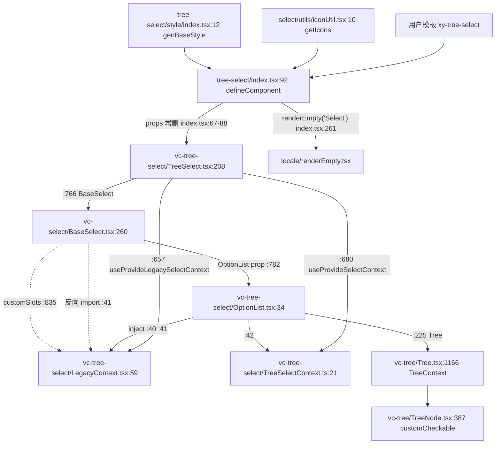
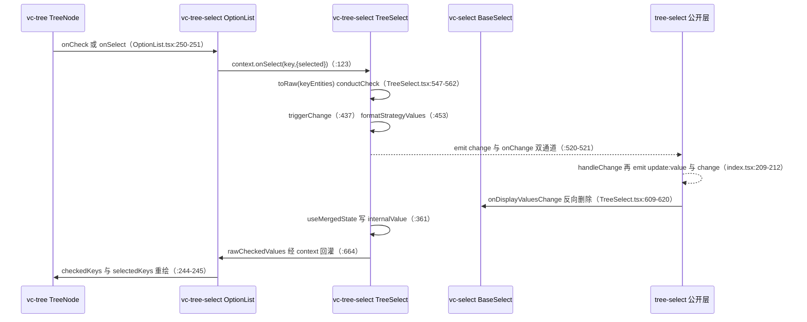
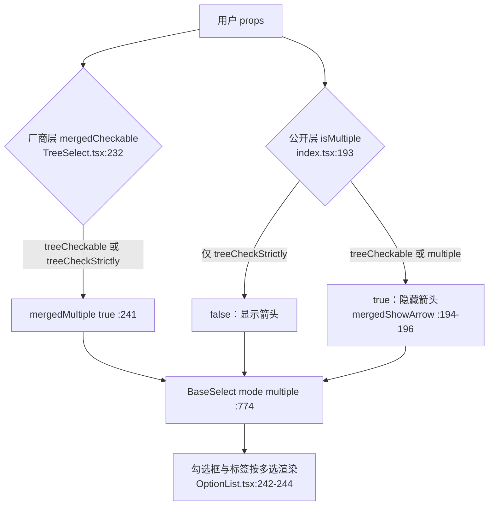

# C05-04 TreeSelect 树选择

> **本篇解决**：TreeSelect 同时踩在 `vc-select` 与 `vc-tree` 两条链上，适配层到底把哪些键传给下层、哪些键改名或漏传，以及「树」的交互语义在哪一层被翻译成「选择」的数据语义。
> **前置**：C05-00 类横写：select/cascader/tree-select 共用的选项流水线、C05-01 Select 选择器、C09-01 Tree 树形控件　**读者坐标**：`03-components/05-picker` 第 4/9 篇

## 一、职责与边界

`tree-select/` 这一层只负责三件事：把公开 props 翻成厂商 props、把 ConfigProvider 与 FormItem 的注入接上、把 `update:value`/`update:treeExpandedKeys`/`update:searchValue` 三个 v-model 通道补出来（`packages/xiaoye-ui/src/tree-select/index.tsx:85-87`、`:209-221`）。所有「树」的语义——勾选传导、展开、异步加载、过滤、值与标签的双向翻译——都在 `packages/xiaoye-ui/src/vc-tree-select/TreeSelect.tsx` 里，而下拉里那棵树本身又是 `packages/xiaoye-ui/src/vc-tree-select/OptionList.tsx:225-257` 现场拼给 `vc-tree` 的。

明确不负责：选项行的虚拟滚动与弹层定位由 `vc-select/BaseSelect.tsx` 与 `vc-trigger` 持有；树节点的键盘导航转发给 `vc-tree/Tree.tsx`（`OptionList.tsx:149`）；样式则由 Select 与 Tree 两个组件的样式生成器拼装（`tree-select/style/index.tsx:5`、`:27`、`:47`）。

依赖清单（被谁依赖 / 依赖谁）：

- 依赖 `vc-tree-select`（`tree-select/index.tsx:4-10`）、`vc-select` 的 `BaseSelectRef` 类型与图标工具（`:25`、`:19`）、`tree/utils/iconUtil` 的 `renderSwitcherIcon`（`:21`）、`form/FormItemContext`（`:24`）、`space/Compact`（`:38`）、`config-provider/DisabledContext`（`:39`）、`select/style` 与 `./style`（`:36-37`）。
- 被 `vc-select` 反向依赖：`BaseSelect.tsx:41`、`Selector/SingleSelector.tsx:7`、`Selector/MultipleSelector.tsx:13` 都从 `vc-tree-select/LegacyContext` 注入上下文——下层组件为了支持 TreeSelect 而 import 上层文件，这是本篇第五节要画的一条反向边。
- 与同类的关系：`select/cascader/tree-select` 共用的选项流水线见 C05-00（论点 1、3、5 已把四份 `fillFieldNames`、两份 `useCache` 论证过，本篇不重述）；Select 自身的 props 删除清单与开合三变量见 C05-01；`<xy-tree>` 的 `showLine` 对象形态与 `switcherIcon` 四分支见 C09-01。

## 二、源码地图

| 文件 | 行数 | 职责 | 关键导出 |
| --- | --- | --- | --- |
| `packages/xiaoye-ui/src/tree-select/index.tsx` | 367 | 公开适配层：props 增删、图标、类名、v-model 事件 | `TreeSelect`、`treeSelectProps`（`:62`）、`TreeSelectProps`（`:90`） |
| `packages/xiaoye-ui/src/tree-select/index.test.js` | 8 | 全库唯一的 TreeSelect 测试文件 | 仅 `focusTest` + `mountTest` |
| `packages/xiaoye-ui/src/tree-select/style/index.tsx` | 74 | 把 Tree 与 Checkbox 的样式生成器装进下拉作用域 | `genComponentStyleHook('TreeSelect')`（`:68`） |
| `packages/xiaoye-ui/src/vc-tree-select/TreeSelect.tsx` | 791 | 主实现：值/标签/传导/策略/事件（`:229` 起 setup） | `treeSelectProps`（`:110`）、默认组件（`:208`） |
| `packages/xiaoye-ui/src/vc-tree-select/OptionList.tsx` | 262 | 下拉里的树：context → vc-tree props 的改名表 | 默认组件（`:34`） |
| `packages/xiaoye-ui/src/vc-tree-select/LegacyContext.tsx` | 65 | 19 键 Symbol context，被 `vc-select` 三个文件消费 | `useProvideLegacySelectContext`（`:59`） |
| `packages/xiaoye-ui/src/vc-tree-select/TreeSelectContext.ts` | 26 | 8 键 Symbol context，只服务 OptionList | `useProvideSelectContext`（`:21`） |
| `packages/xiaoye-ui/src/vc-tree-select/interface.ts` | 101 | `FieldNames`/`Key`/`DefaultOptionType` 等内部类型 | `FieldNames`（公开层 `:14` 引用） |
| `packages/xiaoye-ui/src/vc-tree-select/utils/legacyUtil.tsx` | 180 | `fillAdditionalInfo`/`fillLegacyProps` 遗留第三参 | 供 `TreeSelect.tsx:482`、`:582` |
| `packages/xiaoye-ui/src/vc-tree-select/utils/warningPropsUtil.ts` | 35 | dev 期 props 组合告警 | `warningProps`（`TreeSelect.tsx:232`） |
| `packages/xiaoye-ui/src/vc-tree-select/utils/valueUtil.ts` | 50 | `toArray`/`fillFieldNames`/`getAllKeys`/`isCheckDisabled` | `fillFieldNames`（`:11`） |
| `packages/xiaoye-ui/src/vc-tree-select/hooks/useCheckedKeys.ts` | 38 | 受控勾选键的传导入口 | `useCheckedKeys` |
| `packages/xiaoye-ui/src/vc-select/BaseSelect.tsx` | 970 | 下层的开合/输入/触发器与 `baseSelectPropsWithoutPrivate`（`:158`） | `BaseSelect` |
| `packages/xiaoye-ui/src/vc-tree/Tree.tsx` | 1250 | 真正渲染树的组件 | `Tree`（`OptionList.tsx:8` 直接 import） |

主实现入口是 `packages/xiaoye-ui/src/vc-tree-select/TreeSelect.tsx:229` 的 `setup`；公开层的渲染出口是 `packages/xiaoye-ui/src/tree-select/index.tsx:309` 那个 `<VcTreeSelect>` 单标签。`vc-tree-select` 自身没有测试文件，也没有对外入口——`packages/xiaoye-ui/package.json` 的 `exports` 只有 `./tree-select` 与 `./tree-select/style` 两个键，`src/components.ts:379-381` 也只聚合 `./tree-select`。

## 三、架构与数据流

### 图 1：静态结构——三个段位与两条反向边



图里两条虚线是本组件族的结构性特征：`vc-select/BaseSelect.tsx:41` 与 `packages/xiaoye-ui/src/vc-select/Selector/SingleSelector.tsx:7`、`packages/xiaoye-ui/src/vc-select/Selector/MultipleSelector.tsx:13` 都从上层 `vc-tree-select/LegacyContext` import 注入函数，因此「下层不认识树、上层把树塞进 context」这件事不是靠 props 而是靠一次反向 import 完成的（详见 `packages/xiaoye-ui/src/vc-select/Selector/SingleSelector.tsx:126-131` 读 `customSlots`、`packages/xiaoye-ui/src/vc-select/Selector/MultipleSelector.tsx:158-159` 读 `keyEntities`）。实线 `:782` 则是「OptionList 作为一个组件被当 prop 注入」的下发通道，对应 `packages/xiaoye-ui/src/vc-tree-select/TreeSelect.tsx:768`。

### 图 2：一次点击节点，从 vc-tree 回流到 v-model



闭环的关键在于**状态不存在第二份**：`OptionList` 自己不持有勾选键，它每次都从 `legacyContext.checkedKeys` 读（`packages/xiaoye-ui/src/vc-tree-select/OptionList.tsx:65`、`:119`、`:124`），而这个键是 `TreeSelect.tsx:376` 的 `useCheckedKeys` 产物。图倒数第二行的反向删除通道是唯一能把值改回「空」的路径之一，它绕过了 `onOptionSelect`（`packages/xiaoye-ui/src/vc-tree-select/TreeSelect.tsx:612`）。

### 图 3：「是不是多选」在两层各有算法



公开层用 `treeCheckable || multiple`（`packages/xiaoye-ui/src/tree-select/index.tsx:193`），厂商层用 `treeCheckable || treeCheckStrictly || multiple`（`packages/xiaoye-ui/src/vc-tree-select/TreeSelect.tsx:232` 与 `:241`）。两条表达式的差集就是 `treeCheckStrictly`，右侧分支因此走不通——这是论点 4 的主题。`packages/xiaoye-ui/src/vc-tree-select/utils/warningPropsUtil.ts:25` 只检查 `value` 的数组形状，不检查图标层与数据层的分歧。

## 四、核心机制精读

### 论点 1：公开 props 是「厂商 props 摊平后删 6 项再加 12 项」，而其中 4 项在同一个 render 里被原地重写、1 项彻底没有写入点——用户传它们不会报错，只会被 JSX 顺序覆盖

```tsx
// packages/xiaoye-ui/src/tree-select/index.tsx:66
  return {
    ...omit(vcTreeSelectProps<ValueType, OptionType>(), [
      'showTreeIcon',
      'treeMotion',
      'inputIcon',
      'getInputElement',
      'treeLine',
      'customSlots',
    ]),
    suffixIcon: PropTypes.any,
    size: stringType<SizeType>(),
    bordered: booleanType(),
    treeLine: someType<TreeProps['showLine']>([Boolean, Object]),
    replaceFields: objectType<FieldNames>(),
    placement: stringType<SelectCommonPlacement>(),
    status: stringType<InputStatus>(),
    popupClassName: String,
    /** @deprecated Please use `popupClassName` instead */
    dropdownClassName: String,
    'onUpdate:value': functionType<(value: any) => void>(),
    'onUpdate:treeExpandedKeys': functionType<(keys: Key[]) => void>(),
    'onUpdate:searchValue': functionType<(value: string) => void>(),
  };
// packages/xiaoye-ui/src/tree-select/index.tsx:88
```

`packages/xiaoye-ui/src/tree-select/index.tsx:67-74` 这条名单是唯一把「厂商 API」与「公开 API」隔开的东西，它没有对应的类型护栏：`treeSelectProps` 的返回类型由 `omit` 与对象展开推出来，删错一项或漏删一项都不会有任何信号。名单里实删 6 个键，其中 `treeLine` 在 `packages/xiaoye-ui/src/tree-select/index.tsx:78` 又被加回来且换成了更宽的类型（`someType<TreeProps['showLine']>([Boolean, Object])`）——**这一项的删除只是为了改类型**；剩下 5 项（`showTreeIcon`、`treeMotion`、`inputIcon`、`getInputElement`、`customSlots`）才是真的「不给用户入口」。新增的 12 项在 `packages/xiaoye-ui/src/tree-select/index.tsx:75-87`，其中三项是 v-model 通道（`:85-87`）。

这 5 项在厂商层都还活着：`showTreeIcon`、`treeMotion`、`customSlots` 声明在 `packages/xiaoye-ui/src/vc-tree-select/TreeSelect.tsx:180-198`，`inputIcon` 与 `getInputElement` 继承自 `packages/xiaoye-ui/src/vc-select/BaseSelect.tsx:188`、`:203`。于是适配层必须自己给其中 4 项赋值：`packages/xiaoye-ui/src/tree-select/index.tsx:322`（`treeLine={!!treeLine}`）、`:311`（`inputIcon={suffixIcon}`）、`:324`（`showTreeIcon={treeIcon as any}`）、`:327`（`treeMotion={null}`）、`:340-343`（`customSlots={{…}}`）。

而渲染的写法是 `{...attrs}`（`packages/xiaoye-ui/src/tree-select/index.tsx:310`）在最前、`{...selectProps}`（`:299`）在第二、这 4 个显式属性在 `:310-343`。按共则 §3 的「JSX 属性顺序覆盖」判形：**写在 spread 之后即不可被覆盖**。`attrs` 里恰恰可能带着用户写的 `show-tree-icon`、`tree-motion`、`input-icon`、`custom-slots`——它们在公开白名单里不存在，所以落进 `attrs`，然后被显式赋值静默吃掉。半角连字符与驼峰两种写法都吃：`tree-motion` 与 `treeMotion` 是同一个 attr 名。

但这条判形有一个必须分出的例外：**`on*` 键不是覆盖而是并成数组**。JSX 的展开加显式属性会编译成 Vue 的 `mergeProps`，它对事件键做收集而非替换；本篇跑到组件自带的测试时观察到了它留下的运行时证据（原文见第五节）——`packages/xiaoye-ui/src/tree-select/index.tsx:343` 的 `onBlur={handleBlur}` 与 `{...selectProps}` 里用户自己的 `onBlur` 合成一个数组，落到厂商层的 `onBlur: { type: Function }` 声明（`packages/xiaoye-ui/src/vc-select/BaseSelect.tsx:227`）上，直接触发 prop 类型校验失败。厂商层的 `callEvent` 之所以逐元素遍历（`packages/xiaoye-ui/src/vc-tree-select/TreeSelect.tsx:230-236`），正是为了吃下这个数组形状。

还有一个更彻底的例子：`getInputElement`。`packages/xiaoye-ui/src/vc-select/BaseSelect.tsx:739` 读它，但只在 `mode === 'combobox'` 分支里，而 TreeSelect 的 `mode` 由 `packages/xiaoye-ui/src/vc-tree-select/TreeSelect.tsx:760` 硬设为 `'multiple'` 或 `undefined`，永远不等于 `combobox`，所以这条键连「被吃掉」的机会都没有——它在 TreeSelect 上彻底不可达。

结论：这一层删的是「入口」，不是「能力」。要判断某个键是否真的被禁用，必须同时看名单（`:67-74`）与渲染段（`:298-347`）两处，只看名单会得出「用户可以传 `customSlots`」的错误结论（实际会被 `packages/xiaoye-ui/src/tree-select/index.tsx:352` 整体替换成 `slots` 加一个 `treeCheckable`）。

### 论点 2：厂商层的 40 项 `omit` 名单与 87 键的声明面手工分离，两个键漏删后直接铺到 DOM 上；其中 `dropdownPopupAlign` 是全仓零读者的死 API

```tsx
// packages/xiaoye-ui/src/vc-tree-select/TreeSelect.tsx:691
      const restProps = omit(props, [
        'id',
        'prefixCls',
        'customSlots',
        // ...
        // Options
        'virtual',
        'listHeight',
        'listItemHeight',
        'onDropdownVisibleChange',

        // Tree
        'treeLine',
        'treeIcon',
        'showTreeIcon',
        'switcherIcon',
        'treeMotion',
      ]);
      return (
        <BaseSelect
          v-slots={slots}
          ref={selectRef}
          {...attrs}
          {...restProps}
// packages/xiaoye-ui/src/vc-tree-select/TreeSelect.tsx:756
```

`packages/xiaoye-ui/src/vc-tree-select/TreeSelect.tsx:698-757` 数出 40 个被删键，而组件实际可用的键是 `packages/xiaoye-ui/src/vc-tree-select/TreeSelect.tsx:114-199` 的 49 个自声明键加 `packages/xiaoye-ui/src/vc-select/BaseSelect.tsx:159-239` 继承来的 47 个（去掉被 `packages/xiaoye-ui/src/vc-tree-select/TreeSelect.tsx:115` 删掉的 `mode`），共 87 个候选。两份名单必须靠人肉对齐，本篇用一个脚本把差集算了出来，落在 `BaseSelect` 不认识的两个键上：

- `treeExpandAction`：声明在 `packages/xiaoye-ui/src/vc-tree-select/TreeSelect.tsx:184`，正常消费路径是 context——`packages/xiaoye-ui/src/vc-tree-select/TreeSelect.tsx:648` 取出、`:689` 注入、`packages/xiaoye-ui/src/vc-tree-select/OptionList.tsx:184` 读出、`:255` 改名成 `expandAction` 交给 `vc-tree`。但它**不在** `:705-764` 的名单里，于是同一份值又跟着 `{...restProps}`（`packages/xiaoye-ui/src/vc-tree-select/TreeSelect.tsx:756`）进了 `BaseSelect`。
- `dropdownPopupAlign`：声明在 `packages/xiaoye-ui/src/vc-tree-select/TreeSelect.tsx:197`，同样不在名单里。它不在 `packages/xiaoye-ui/src/vc-select/BaseSelect.tsx:159-239` 的任何一个键里，也没有任何 context 通道。

漏删之后会发生什么，`BaseSelect` 说得很清楚：`packages/xiaoye-ui/src/vc-select/BaseSelect.tsx:735` 把 `{...props, ...attrs}` 合成一个对象，`:764-766` 取剩余项做 `domProps`，`:776-778` 只删 `DEFAULT_OMIT_PROPS`（定义在 `packages/xiaoye-ui/src/vc-select/BaseSelect.tsx:45-60`，14 项，不含这两个键），`:780-782` 再删调用方自备的 `omitDomProps`——TreeSelect 从未传 `omitDomProps`（全仓唯一写入点在 `packages/xiaoye-ui/src/vc-select/BaseSelect.tsx:725` 的解构里）。因此这两个键会作为未知 attribute 出现在下拉触发元素上。

`dropdownPopupAlign` 的读者数量用两种方法核过：

```bash
grep -rn "dropdownPopupAlign" packages apps --include='*.ts' --include='*.tsx' --include='*.js' --include='*.vue'
grep -rl "dropdownPopupAlign" . | grep -v node_modules | grep -v "/dist/"
```

两条命令的命中集合相同，只有 `packages/xiaoye-ui/src/vc-tree-select/TreeSelect.tsx` 一个文件，且只指向 `:197` 的声明本身。它属于共则 §3 第一条「API 面存活、实现死亡」，且与 `OUTLINE.md` 已知待办里登记的 `Components.rangeItem`、`progressStatus` 同族，但形状更糟：**它连"漏在 omit 名单外"这一步都会把名字带到 DOM**。半年后想清理它的人看不到任何 TS 错误，只能靠 grep。

### 论点 3：下拉里的树是 OptionList 现搭的一张「九键改名表」，改名全靠手写字面量，唯一的类型声明只覆盖前三个键

```tsx
// packages/xiaoye-ui/src/vc-tree-select/OptionList.tsx:208
      const treeProps: Partial<TreeProps> = {
        fieldNames: context.fieldNames,
      };
      if (treeLoadedKeys) {
        treeProps.loadedKeys = treeLoadedKeys;
      }
      if (mergedExpandedKeys.value) {
        treeProps.expandedKeys = mergedExpandedKeys.value;
      }
      // ...
// packages/xiaoye-ui/src/vc-tree-select/OptionList.tsx:225
          <Tree
            ref={treeRef}
            focusable={false}
            prefixCls={`${prefixCls}-tree`}
            treeData={memoTreeData.value as TreeDataNode[]}
            height={listHeight}
            itemHeight={listItemHeight}
            virtual={virtual !== false && dropdownMatchSelectWidth !== false}
            multiple={multiple}
            icon={treeIcon}
            showIcon={showTreeIcon}
            switcherIcon={switcherIcon}
            showLine={treeLine}
            loadData={searchValue ? null : (loadData as any)}
            motion={treeMotion}
            activeKey={activeKey.value}
            // We handle keys by out instead tree self
            checkable={checkable}
            checkStrictly
// packages/xiaoye-ui/src/vc-tree-select/OptionList.tsx:244
```

改名对照表（左为 TreeSelect 侧键名，右为 `vc-tree` 侧键名，全部来自 `packages/xiaoye-ui/src/vc-tree-select/OptionList.tsx:225-257` 与 `:212`、`:215`）：`treeIcon`→`icon`（`:234`）、`showTreeIcon`→`showIcon`（`:235`）、`treeLine`→`showLine`（`:237`）、`treeMotion`→`motion`（`:239`）、`treeLoadedKeys`→`loadedKeys`（`:212`）、`treeExpandedKeys`→`expandedKeys`（`:215`）、`treeDefaultExpandAll`→`defaultExpandAll`（`:246`）、`treeExpandAction`→`expandAction`（`:255`）、`onTreeLoad`→`onLoad`（`:253`）。语义换向的还有一个：不可勾选时 `checkedKeys` 被直接当选中态用——`selectedKeys={!checkable ? checkedKeys : []}`（`:245`）。

这张表没有任何一处是编译器能查的。`Partial<TreeProps>` 只贴在 `packages/xiaoye-ui/src/vc-tree-select/OptionList.tsx:208` 那个三键小对象上，其余 20 个键写在 JSX 字面量里，而 `<Tree>` 是 `packages/xiaoye-ui/src/vc-tree-select/OptionList.tsx:8` 直接 import 的厂商组件，它自己的 `props` 是宽对象；改一个键名（比如上游把 `motion` 换成 `vcTreeMotion`）在这里既不报错也不警告，只会静默变成 attrs。

真正写死的是 `packages/xiaoye-ui/src/vc-tree-select/OptionList.tsx:243` 的 `checkStrictly`——它不带值，恒为真。原因在上一层：勾选传导算法由 TreeSelect 自己做，`packages/xiaoye-ui/src/vc-tree-select/TreeSelect.tsx:547-562` 直接调 `conductCheck`，`packages/xiaoye-ui/src/vc-tree-select/hooks/useCheckedKeys.ts:25-33` 在受控值进来时再导一次。如果 `vc-tree` 也自己导一遍，父子状态会被算两遍并互相覆盖，所以这一行是**必须的**而不是遗漏；它带来的代价是 `checkStrictly` 这条公开能力在 TreeSelect 的下拉里不可用，对外只以 `treeCheckStrictly` 的名义提供另一套语义（`packages/xiaoye-ui/src/vc-tree-select/TreeSelect.tsx:233` 用它反推 `labelInValue`）。

注入侧也有一个对不上账的地方：`packages/xiaoye-ui/src/vc-tree-select/LegacyContext.tsx:12-38` 声明了 19 个键，`packages/xiaoye-ui/src/vc-tree-select/TreeSelect.tsx:651-671` 只 provide 了 18 个，缺的那一个正是 `customCheckable`（`packages/xiaoye-ui/src/vc-tree-select/LegacyContext.tsx:15`）。这个缺口被 `packages/xiaoye-ui/src/vc-tree-select/TreeSelect.tsx:671` 的 `as unknown as LegacyContextProps` 双重断言吃掉了——换成单重断言，TS 会直接报缺属性。`customCheckable` 的真实住户在另一棵树上：`packages/xiaoye-ui/src/vc-tree/contextTypes.ts:46` 声明、`packages/xiaoye-ui/src/vc-tree/Tree.tsx:1176` 用 `slots.checkable` 写入、`packages/xiaoye-ui/src/vc-tree/TreeNode.tsx:387` 消费。LegacyContext 里这一行是从 tree 侧接口复制过来的残留。

### 论点 4：公开层算出的「多选」只管一件事——箭头显不显示；它的另一半产物 `itemIcon` 在同一个 render 里就被丢弃，而 `omit` 名单还为它留着一行

```tsx
// packages/xiaoye-ui/src/tree-select/index.tsx:193
    const isMultiple = computed(() => !!(props.treeCheckable || props.multiple));
    const mergedShowArrow = computed(() =>
      props.showArrow !== undefined ? props.showArrow : props.loading || !isMultiple.value,
    );
    // ...
// packages/xiaoye-ui/src/tree-select/index.tsx:244
      const { suffixIcon, removeIcon, clearIcon } = getIcons(
        {
          ...props,
          multiple: isMultiple.value,
          showArrow: mergedShowArrow.value,
          hasFeedback,
          feedbackIcon,
          prefixCls: prefixCls.value,
        },
        slots,
      );
      // ...
// packages/xiaoye-ui/src/tree-select/index.tsx:264
      const selectProps = omit(props as typeof props & { itemIcon: any; switcherIcon: any }, [
        'suffixIcon',
        'itemIcon',
        'removeIcon',
        'clearIcon',
        'switcherIcon',
```

`getIcons` 返回五个键（`packages/xiaoye-ui/src/select/utils/iconUtil.tsx:59-64`），其中 `itemIcon` 由 `multiple` 决定：多选给 `CheckOutlined`、单选给 `null`（`packages/xiaoye-ui/src/select/utils/iconUtil.tsx:43-50`）。`packages/xiaoye-ui/src/tree-select/index.tsx:244` 的解构只取三个名字，`itemIcon` 就地丢弃。对照同一份工具在 Select 里的用法：`packages/xiaoye-ui/src/select/index.tsx:250` 解构了它并在 `packages/xiaoye-ui/src/select/index.tsx:298` 改名成 `menuItemSelectedIcon` 下发——那个键的真实读者是 `packages/xiaoye-ui/src/vc-select/OptionList.tsx:249`，而 TreeSelect 用 `packages/xiaoye-ui/src/vc-tree-select/TreeSelect.tsx:768` 把整个 `OptionList` 换掉了，所以这条通道在 TreeSelect 上本来就没有终点。少传一步是对的，但 `packages/xiaoye-ui/src/tree-select/index.tsx:278` 仍在 `omit` 里删 `itemIcon`：`itemIcon` 既不在 `packages/xiaoye-ui/src/tree-select/index.tsx:66-88` 的白名单里，也不在 `packages/xiaoye-ui/src/vc-tree-select/TreeSelect.tsx:114-199` 里，这一行删的是一个**不可能存在的键**。同一批里 `:267`、`:268` 的 `removeIcon`、`clearIcon` 倒是真的在白名单里（继承自 `packages/xiaoye-ui/src/vc-select/BaseSelect.tsx:205-207`），`:269` 的 `switcherIcon` 也在（`packages/xiaoye-ui/src/vc-tree-select/TreeSelect.tsx:181`）。一行死删除项不坏事，但它会误导后来的人以为 `itemIcon` 是个真入口。

于是 `isMultiple` 的全部生效面收敛成一个：`showArrow` 进入 `packages/xiaoye-ui/src/select/utils/iconUtil.tsx:20-25` 的 `getSuffixIconNode`，在那里 `showArrow !== false && arrowIcon` 只决定**箭头字形画不画**；承载它的 `arrowNode` 是否存在由 `packages/xiaoye-ui/src/vc-select/BaseSelect.tsx:775-776` 独立算：`showArrow !== undefined ? showArrow : loading || (!multiple.value && mode !== 'combobox')`，其中 `multiple` 来自 `packages/xiaoye-ui/src/vc-select/BaseSelect.tsx:280` 的 `isMultiple(props.mode)`，`mode` 是 `packages/xiaoye-ui/src/vc-tree-select/TreeSelect.tsx:760` 用 `mergedMultiple` 现算的。公开层为了不让自己的结论被覆盖，在 `packages/xiaoye-ui/src/tree-select/index.tsx:358` 写了 `showArrow={hasFeedback || showArrow}`——这是「有校验反馈时强制保留 `arrowNode`」的补丁，不是给用户的语义。

结果就是图 3 的那个分叉：**只给 `treeCheckStrictly`、不给 `treeCheckable` 也不给 `multiple` 时，两层结论相反**。公开层 `isMultiple` 为假（`packages/xiaoye-ui/src/tree-select/index.tsx:193` 的表达式不含它），厂商层 `mergedMultiple` 为真（`packages/xiaoye-ui/src/vc-tree-select/TreeSelect.tsx:232` 与 `:241`：`mergedCheckable = treeCheckable || treeCheckStrictly`），下拉进多选渲染分支（`packages/xiaoye-ui/src/vc-tree-select/OptionList.tsx:242-244` 的 `checkable={checkable}` 直接吃 `mergedCheckable`），而 `BaseSelect` 拿到 `mode='multiple'` 之后把整个 `arrowNode` 判掉。公开层算出的那个箭头没有机会出现。`packages/xiaoye-ui/src/vc-tree-select/utils/warningPropsUtil.ts:25` 的 `if (treeCheckStrictly || multiple || treeCheckable)` 只校验 `value` 是不是数组；`packages/xiaoye-ui/src/tree-select/index.tsx:121-125` 的 `devWarning` 只盯 `multiple === false && treeCheckable` 这一对。没有任何一处告诉使用者 `treeCheckStrictly` 会把组件变成多选。

`props.loading` 也是同族：它在公开层的唯一读者是 `packages/xiaoye-ui/src/tree-select/index.tsx:195`（`mergedShowArrow` 的分支），而 spinner 实际由 `packages/xiaoye-ui/src/select/utils/iconUtil.tsx:30-31` 的 `loading` 分支画，读的是 `{...props}` 里的原值。也就是说 `loading` 在两层各有用途，两层之间没有仲裁者。

### 论点 5：`prefixCls` 有两条派生路径，只在默认值下重合；一旦给组件单独写 `prefixCls`，下拉里那棵树的类名与生成的 CSS 就对不上

```tsx
// packages/xiaoye-ui/src/tree-select/index.tsx:175
    const treePrefixCls = computed(() => getPrefixCls('select-tree', props.prefixCls));
    const treeSelectPrefixCls = computed(() => getPrefixCls('tree-select', props.prefixCls));

    // style
    const [wrapSelectSSR, hashId] = useSelectStyle(prefixCls);
    const [wrapTreeSelectSSR] = useStyle(treeSelectPrefixCls, treePrefixCls);
    // ...
// packages/xiaoye-ui/src/tree-select/index.tsx:346
            v-slots={{
              ...slots,
              treeCheckable: () => <span class={`${prefixCls.value}-tree-checkbox-inner`} />,
```

CSS 侧：`packages/xiaoye-ui/src/tree-select/style/index.tsx:27` 用 `genTreeStyle(treePrefixCls, …)` 生成树的规则，`:47` 用 `` getCheckboxStyle(`${treePrefixCls}-checkbox`, token) `` 生成勾选框规则（两个生成器分别 import 自 `packages/xiaoye-ui/src/tree-select/style/index.tsx:5` 与 `:2`），全部挂在 `:21` 的 `${componentCls}-dropdown` 作用域里。

DOM 侧：`packages/xiaoye-ui/src/vc-tree-select/OptionList.tsx:228` 给 `vc-tree` 的是 `` prefixCls={`${prefixCls}-tree`} ``，这里的 `prefixCls` 取自 `baseProps`（`packages/xiaoye-ui/src/vc-tree-select/OptionList.tsx:178`），即 select 前缀——公开层在 `packages/xiaoye-ui/src/tree-select/index.tsx:318` 交出去的是 `prefixCls.value`，来自 `useConfigInject('select', props)`（`packages/xiaoye-ui/src/config-provider/hooks/useConfigInject.ts:14`）。勾选框本体类名在 `packages/xiaoye-ui/src/vc-tree/TreeNode.tsx:380` 拼成 `${prefixCls}-checkbox`，内框在 `packages/xiaoye-ui/src/tree-select/index.tsx:348` 拼成 `${prefixCls.value}-tree-checkbox-inner`。

默认值下两条路径算出的字符串一样：`getPrefixCls('select-tree')` = `xy-select-tree`，`${prefixCls}-tree` = `xy-select` 再拼 `-tree` = `xy-select-tree`——**相等纯属巧合**，一边是「root 加 select-tree」，另一边是「root-select 再加 -tree」。分叉发生在 `props.prefixCls` 被单独设置时：`packages/xiaoye-ui/src/config-provider/index.tsx:72` 的 `if (customizePrefixCls) return customizePrefixCls;` 让 `getPrefixCls` 的第二参直接短路，于是 `treePrefixCls` 与 `treeSelectPrefixCls` 双双塌成用户写的那一个值（`packages/xiaoye-ui/src/tree-select/index.tsx:175-176`），CSS 生成 `.my-ts-treenode`、`.my-ts-checkbox-inner`；而 DOM 侧 `prefixCls.value` 同样被短路成 `my-ts`，`OptionList.tsx:228` 拼出 `my-ts-tree`，节点类名是 `my-ts-tree-treenode`。两边只差一个 `-tree`，不报错、不回退，只是样式静默丢失。

同一处还有第二个不对称：`packages/xiaoye-ui/src/tree-select/index.tsx:290` 写的是 `!customizePrefixCls && treeSelectPrefixCls.value`——自定义前缀时根类名不再挂 `xy-tree-select`，但 `:182-190` 的 `mergedDropdownClassName` 照旧无条件拼 `${treeSelectPrefixCls}-dropdown`。类名策略在「根节点让位、弹层不让位」上并不一致，改这块的人不能只改一处。

### 论点 6：dev 期告警里有一条永不触发的分支，因为它读的键不在任何白名单上

```ts
// packages/xiaoye-ui/src/vc-tree-select/utils/warningPropsUtil.ts:5
function warningProps(props: TreeSelectProps & { searchPlaceholder?: string }) {
  const { searchPlaceholder, treeCheckStrictly, treeCheckable, labelInValue, value, multiple } =
    props;

  warning(
    !searchPlaceholder,
    '`searchPlaceholder` has been removed, please use `placeholder` instead',
  );

  if (treeCheckStrictly && labelInValue === false) {
    warning(false, '`treeCheckStrictly` will force set `labelInValue` to `true`.');
  }
// packages/xiaoye-ui/src/vc-tree-select/utils/warningPropsUtil.ts:16
```

调用点在 `packages/xiaoye-ui/src/vc-tree-select/TreeSelect.tsx:230-234`，被 `process.env.NODE_ENV !== 'production'` 包着，在 `watchEffect` 里跑，输入是 `props` 本身。`searchPlaceholder` 只在类型面上存在——靠 `packages/xiaoye-ui/src/vc-tree-select/utils/warningPropsUtil.ts:5` 那个交叉类型 `& { searchPlaceholder?: string }`；运行时面上不存在：`packages/xiaoye-ui/src/vc-tree-select/TreeSelect.tsx:114-199` 的 49 个键里没有它，`packages/xiaoye-ui/src/tree-select/index.tsx:75-87` 新增的 12 个里也没有。Vue 只会把未声明的 `search-placeholder` 放进 `attrs`（`packages/xiaoye-ui/src/tree-select/index.tsx:116` 的 `setup(props, { attrs … })`），而 `attrs` 不是 `props`。所以 `packages/xiaoye-ui/src/vc-tree-select/utils/warningPropsUtil.ts:9-12` 的 `warning(!searchPlaceholder, …)` 条件恒真、恒不输出——`warning(valid, msg)` 的语义是「valid 为假才报」（`packages/xiaoye-ui/src/vc-util/warning.ts:4`）。判形命令：

```bash
grep -rn "searchPlaceholder" packages apps --include='*.ts' --include='*.tsx' --include='*.vue' \
  | grep -v "/locale/" | grep -v "date-picker" | grep -v "vc-picker"
```

排除语言包与日期类实现后，命中只剩 `packages/xiaoye-ui/src/vc-tree-select/utils/warningPropsUtil.ts` 与 `transfer` 自己的两个文件；`packages/xiaoye-ui/src/transfer/index.tsx:98` 里 `searchPlaceholder` 是真声明、真读取（`packages/xiaoye-ui/src/transfer/list.tsx:42`、`:226`）。同一个键名在 Transfer 上活着，在 TreeSelect 上只剩一句永不执行的警告。

同段里的 `:14-16` 反而是这篇唯一会明确告诉用户「值形状变了」的地方：它是**无条件 `warning(false, …)`**，触发条件是 `treeCheckStrictly && labelInValue === false`，依据是 `packages/xiaoye-ui/src/vc-tree-select/TreeSelect.tsx:233` 的 `mergedLabelInValue = treeCheckStrictly || labelInValue`。注意它并没有真的把 `labelInValue` 改掉，而是让读值时按 `true` 处理，返回值形状由 `packages/xiaoye-ui/src/vc-tree-select/TreeSelect.tsx:504-506` 的三元决定；`halfChecked` 这个只在 `treeCheckStrictly` 下有意义的字段声明在 `packages/xiaoye-ui/src/vc-tree-select/interface.ts:11-12`，回填点在 `packages/xiaoye-ui/src/vc-tree-select/TreeSelect.tsx:459-465`。

## 五、对外契约如何生效

### 值：一条 v-model，两条内部形状

`v-model:value` 靠三件事拼出来：props 面声明 `'onUpdate:value'`（`packages/xiaoye-ui/src/tree-select/index.tsx:85`），渲染前把它从下传的 `selectProps` 里删掉（`packages/xiaoye-ui/src/tree-select/index.tsx:284`），然后用 `emit('update:value', args[0])` 补回来（`packages/xiaoye-ui/src/tree-select/index.tsx:210`）。`emit` 查的是 vnode 上的原始 `onUpdate:value`，因此删 prop 不等于删监听。

值的形状由厂商层决定，用户拿到的可能是四种：`packages/xiaoye-ui/src/vc-tree-select/TreeSelect.tsx:504-508` 先按 `mergedLabelInValue` 决定「对象数组还是裸值数组」，再按 `mergedMultiple` 决定「数组还是标量」。`packages/xiaoye-ui/src/vc-tree-select/TreeSelect.tsx:233` 让 `treeCheckStrictly` 单方面把 `labelInValue` 顶成真，所以这条四分支里有一支是用户没写也会走到的。`halfChecked` 字段只在 `packages/xiaoye-ui/src/vc-tree-select/TreeSelect.tsx:459-465` 回填，来源声明见 `packages/xiaoye-ui/src/vc-tree-select/interface.ts:11-12` 的注释「Only works on `treeCheckStrictly`」。

显示用的值另走一条路：`packages/xiaoye-ui/src/vc-tree-select/TreeSelect.tsx:386-418` 的 `displayValues` 会把勾选键先按 `showCheckedStrategy` 过滤（`packages/xiaoye-ui/src/vc-tree-select/utils/strategyUtil.ts:12-48`，三种策略分别是「留叶子」「留父」「全留」），再回查标签。同一份 `formatStrategyValues` 在事件路径上又算一次（`packages/xiaoye-ui/src/vc-tree-select/TreeSelect.tsx:439`），两次入参不同（`:403` 传 `rawCheckedValues`，`:453` 传 `newRawValues`），所以**标签上显示的东西和 `change` 回调里拿到的东西在 SHOW_PARENT/SHOW_CHILD 下并不总是同一份**（值集合相同，但 `:415` 回填 label 时用的是 `rawLabeledValues`，而事件侧用 `:442` 的 `convert2LabelValues(newRawValues)`）。

### 事件：两层各自的双通道，2026-09-29 分两批清完（一次点击修前实测投 4 遍）

厂商层**原来**对每个事件都写两遍：模式统一是 `emit('x', …)` 紧跟 `callEvent(props.onX, …)`，六处成对出现在（修前行号）`:520-521`（change）、`:582-586`（select/deselect）、`:263-264`（search）、`:601-602`（dropdownVisibleChange）、`:606-607`（treeLoad）、`:611-612`（treeExpand），`callEvent` 定义在修前的 `packages/xiaoye-ui/src/vc-tree-select/TreeSelect.tsx:230-236`。这一族写法在 `vc-select` 里同样存在，可见是全族约定而不是 TreeSelect 的孤例。**现在的形状**：`emits` 声明七个事件（`packages/xiaoye-ui/src/vc-tree-select/TreeSelect.tsx:220-228`），落点是 `:257`（search）、`:514`（change）、`:576`/`:579`（select/deselect）、`:595`（dropdownVisibleChange）、`:600`（treeLoad）、`:605`（treeExpand），每个只有一条 `emit`，helper 已随全族清理删除。

但**只清厂商层不够**——本组件是「形态三」（外层整包摊布撞显式 arrow）的教科书样本，而这一半是本轮（2026-09-29 收尾）才发现并修的。公开层在 `packages/xiaoye-ui/src/tree-select/index.tsx:342-345` 连着绑了四个桥接 arrow（`onChange`/`onBlur`/`onSearch`/`onTreeExpand`，函数体在 `:209`、`:214`、`:218`、`:222`），而 `:305` 的 `{...selectProps}` 里已经带着用户自己写的同名 handler；JSX 的「展开加显式属性」编译成 Vue 的 `mergeProps`，事件键被**并成数组**而不是后者覆盖前者。于是数组里那份直调一次、arrow 里的 `emit` 再命中同一个函数一次；叠上厂商层原来的两条通道，一次点击相乘成 **4** 次。修法是把这四个键从摊布里剥掉（`packages/xiaoye-ui/src/tree-select/index.tsx:264-280` 的 `omit` 清单）。

这条以前只是「能跑出来的形状问题」，现在有**两个可复跑的判别信号**：

```bash
# 信号一：mergeProps 数组会让 Vue 打 prop 类型告警
npx vitest run src/tree-select/index.test.js 2>&1 | grep -c "Expected Function, got Array"
#   修后 0；把 index.tsx 退回本轮基线复跑 = 2
```

```bash
# 信号二：调用次数（判据只能是这样，toHaveBeenCalledWith 照不出来）
npx vitest run src/_util/__tests__/event-dispatch-count.test.tsx -t "TreeSelect"
#   「TreeSelect 点一次树节点，@change 与 @select 各只投递一次」，断言 toHaveBeenCalledTimes(1)
#   把 tree-select/index.tsx 与 vc-tree-select/TreeSelect.tsx 同时退回基线 → 实测 4 次，用例红
```

`at <TreeSelect …>` 那一帧的名字是厂商层的 `name: 'TreeSelect'`（`packages/xiaoye-ui/src/vc-tree-select/TreeSelect.tsx:210`），数组的两个元素一个是用户传入的 mock、另一个是公开层的 `handleBlur`（`packages/xiaoye-ui/src/tree-select/index.tsx:222-225`），而 `onBlur` 的声明类型是 `Function`（`packages/xiaoye-ui/src/vc-select/BaseSelect.tsx:227`）——告警本身是这个数组形状的直接产物。

一个反直觉的对照：`@select` 修前修后**都是 1 次**。因为公开层没有包装 `onSelect`/`onDeselect`/`onDropdownVisibleChange`/`onTreeLoad`，它们只有一条路——随 `{...selectProps}` 摊下去，再由厂商层的 `emit('select')` 从 vnode props 上命中同一个函数（`packages/xiaoye-ui/src/vc-tree-select/TreeSelect.tsx:576`、`:579`）。**「没有被公开层重挂」反而使它免于翻倍**，这条区分对判断「改哪一层」很关键：只有本层显式绑了 arrow 的键才需要进 omit 清单，其余的必须留在摊布里，否则用户回调会一次都收不到。

### 插槽：三份内容相同的映射，各走一条通道

| 通道 | 写入点 | 读者 | 是否可达 |
| --- | --- | --- | --- |
| `v-slots`（Vue 真插槽） | `packages/xiaoye-ui/src/tree-select/index.tsx:346-349` | `packages/xiaoye-ui/src/vc-tree-select/TreeSelect.tsx:753` → `OptionList.tsx:182` 的 `slots.notFoundContent` 与 `:256` 的 `...slots` | 可达 |
| `customSlots`（普通 prop） | `packages/xiaoye-ui/src/tree-select/index.tsx:352-355` | `packages/xiaoye-ui/src/vc-tree-select/TreeSelect.tsx:645` 取出、`:677` 注入 → `OptionList.tsx:256` 读 `treeCheckable`；另有 `BaseSelect.tsx:825` 与 `SingleSelector.tsx:126-131` | 可达 |
| `default` 插槽（旧 children API） | `packages/xiaoye-ui/src/tree-select/index.tsx:304-306` | `packages/xiaoye-ui/src/vc-tree-select/TreeSelect.tsx:734` 的 `children` → `hooks/useTreeData.ts` | 可达但已废弃（`packages/xiaoye-ui/src/tree-select/index.tsx:117-120` 有告警） |

三份映射里唯一真正区分的是 `treeCheckable`：`packages/xiaoye-ui/src/tree-select/index.tsx:348` 与 `:342` 各造了一个闭包，内容完全相同（`<span class="xy-select-tree-checkbox-inner" />`），但只有 `:342` 那份会被读——全仓 `treeCheckable` 这个键名的唯一读者是 `packages/xiaoye-ui/src/vc-tree-select/OptionList.tsx:256`（判形：`grep -rn "treeCheckable" packages/xiaoye-ui/src --include='*.tsx' --include='*.ts'`）。`:336` 那份随着 `v-slots` 进 `BaseSelect`，没有任何一处按名字取它。

勾选框的完整链有五跳，值得单独记：`packages/xiaoye-ui/src/tree-select/index.tsx:354` → `packages/xiaoye-ui/src/vc-tree-select/TreeSelect.tsx:670` → `packages/xiaoye-ui/src/vc-tree-select/OptionList.tsx:256`（改名 `checkable`）→ `packages/xiaoye-ui/src/vc-tree/Tree.tsx:1176`（改名 `customCheckable`）→ `packages/xiaoye-ui/src/vc-tree/TreeNode.tsx:387`（渲染进 `${prefixCls}-checkbox` 这个带状态类的 span 内，`:378-388`）。也就是说 TreeSelect 下拉里的勾选框**外框是 Tree 画的、内框是 Select 侧塞进去的**，两半的类名前缀来自不同的构造式（论点 5）。同一条链在 `OptionList.tsx:256` 上没有可选链保护，而 `SingleSelector.tsx:126` 读同一个键时写了 `if (item && legacyTreeSelectContext.customSlots)`——一个键、两个读者、一处防护一处没有。

### expose 与类型面不对齐

厂商层交出三个方法：`packages/xiaoye-ui/src/vc-tree-select/TreeSelect.tsx:686-696` 的 `focus` / `blur` / `scrollTo`（`scrollTo` 转发给 `BaseSelect`，最终落到 `packages/xiaoye-ui/src/vc-select/BaseSelect.tsx:321` 的 `listRef`）。公开层只交出两个：`packages/xiaoye-ui/src/tree-select/index.tsx:199-207` 只有 `focus` 与 `blur`。但对外类型是 `packages/xiaoye-ui/src/tree-select/index.tsx:60` 的 `RefTreeSelectProps = BaseSelectRef`，而 `BaseSelectRef` 有三个必填键（`packages/xiaoye-ui/src/vc-select/BaseSelect.tsx:95-99`）。**类型面比实现面宽一个 `scrollTo`**：`<xy-tree-select ref="t">` 上 `t.value.scrollTo({ key })` 类型检查通过、运行时是 `undefined`。另外 `packages/xiaoye-ui/src/tree-select/index.tsx:201` 写的是 `treeSelectRef.value.focus?.()`——只保护了方法存在，没保护 `value` 本身，挂载前调用会抛 TypeError；厂商层对应位置是 `selectRef.value?.focus()`（`packages/xiaoye-ui/src/vc-tree-select/TreeSelect.tsx:688`），带了那一层。

### 空态：TreeSelect 走的是 Select 的分支

`packages/xiaoye-ui/src/tree-select/index.tsx:261` 调 `renderEmpty('Select')`。`packages/xiaoye-ui/src/config-provider/renderEmpty.tsx:17` 的 `case 'TreeSelect'` 与 `:16` 的 `case 'Select'` 共用同一个 return（`:21`），所以这条 case 既零调用、也零差异（全库零调用的取证见 C01-07，本篇不重复论证）。字面实参的分布可以用一条命令复核：

```bash
grep -rhoE "renderEmpty\('[A-Za-z]+'\)" packages apps --include='*.ts' --include='*.tsx' --include='*.vue' \
  | sort | uniq -c
```

本仓跑出的集合只有 `Select`、`Transfer`、`Table`、`List`、`Cascader` 五种，没有 `TreeSelect` 也没有 `Mentions`。

## 六、设计取舍

**取舍一：下拉内容用 context 注入而不是 props。** `packages/xiaoye-ui/src/vc-tree-select/TreeSelect.tsx:650-684` 把 18 个键塞进两个 Symbol context，`OptionList` 作为「被当 prop 下发的组件」（`:782`）拿不到常规 props 通道，这是它必须这么做的直接原因。换来的是「下拉实现可以被整体替换」，赔上的是三件事：一是 `vc-select` 反过来 import `vc-tree-select/LegacyContext`（`packages/xiaoye-ui/src/vc-select/BaseSelect.tsx:41`、`packages/xiaoye-ui/src/vc-select/Selector/SingleSelector.tsx:7`、`packages/xiaoye-ui/src/vc-select/Selector/MultipleSelector.tsx:13`），分层方向被扭了一次——这条反向边已由 C05-01 坑 8 登记，本篇只补 TreeSelect 侧的三个读点，不重复论证；二是注入点与消费点之间的对应关系完全靠人维持，`LegacyContext.tsx:15` 那个从不 provide 的 `customCheckable` 就是漏网的证据；三是 `as unknown as`（`packages/xiaoye-ui/src/vc-tree-select/TreeSelect.tsx:671`）把仅存的一次类型对齐机会也消掉了。

**取舍二：勾选传导自己做，代价是放弃 `vc-tree` 的传导能力。** `packages/xiaoye-ui/src/vc-tree-select/OptionList.tsx:243` 硬设 `checkStrictly`，因为 `packages/xiaoye-ui/src/vc-tree-select/TreeSelect.tsx:547-562` 已经调过 `conductCheck`，`packages/xiaoye-ui/src/vc-tree-select/hooks/useCheckedKeys.ts:25-33` 在受控值进来时又调一次。好处是「显示策略」与「勾选状态」能分开（`showCheckedStrategy` 只影响显示、不影响内部键集合），代价是同一份树数据在 `treeConduction` 为真时被遍历两到三遍（`useCheckedKeys` 的 `watchEffect` + `onOptionSelect` + `displayValues`），且 `keyEntities` 每次数据变化都要重建（`packages/xiaoye-ui/src/vc-tree-select/hooks/useDataEntities.ts`）。`packages/xiaoye-ui/src/vc-tree-select/TreeSelect.tsx:523-524` 特意用 `toRaw` 剥掉响应式壳，就是这个开销的直接证据。

**取舍三：多选时放弃虚拟滚动的开关绑定在宽度 API 上。** `packages/xiaoye-ui/src/vc-tree-select/OptionList.tsx:232` 写的是 `virtual={virtual !== false && dropdownMatchSelectWidth !== false}`。宽度为 `false` 时列表要按内容自适应，而虚拟列表依赖固定尺寸度量——意图可以理解，但它把一个性能开关挂在了一个外观开关上，且没有任何注释说明。公开层的 `dropdownMatchSelectWidth` 来自 ConfigProvider（`packages/xiaoye-ui/src/tree-select/index.tsx:145` 的解构与 `:302` 的下发），所以这是一次**全局配置改一个外观值、顺带关掉整棵树的虚拟化**的联动。

**取舍四：展开动画被整条删掉。** 公开层把 `treeMotion` 从白名单删除（`packages/xiaoye-ui/src/tree-select/index.tsx:69`）并硬置 `null`（`:327`），厂商层原样转给 `vc-tree` 的 `motion`（`packages/xiaoye-ui/src/vc-tree-select/OptionList.tsx:239`）。注意 `null` 与「不传」不等价：`packages/xiaoye-ui/src/vc-tree/NodeList.tsx:178` 的判据是 `props.motion === undefined`，`null` 走的是另一支。对照独立 `<xy-tree>` 保留了这条能力（`packages/xiaoye-ui/src/tree/Tree.tsx:221` 的 `motion = props.openAnimation`、`:245` 下发），可见这是**为了弹层内的度量稳定而主动放弃动画**，不是遗漏。

**取舍五：`omit` 黑名单而不是显式白名单。** 公开层（`packages/xiaoye-ui/src/tree-select/index.tsx:67-74`）与厂商层（`packages/xiaoye-ui/src/vc-tree-select/TreeSelect.tsx:698-757`）都用「全部继承再删几项」。好处是下层新增 prop 时上层零改动即可透传；代价是下层新增 prop 时**上层也无法拦住它**，而厂商层想「不外传」的意图只能靠一份手写名单维持同步——论点 2 的两个漏删键就是这份名单的实测误差。C05-01 论点 1 对 Select 记过同族的一条（三份互不复用的删除清单），TreeSelect 这里多了一个变体：删掉之后又加回来改类型（`treeLine`）。

## 七、坑与改动指南

以下每条按「触发 → 症状 → 原因 → 定位」写，定位一律给到行号。

**坑 1：给单个 `<xy-tree-select>` 写 `prefixCls`，下拉里的整棵树失去样式。**

- 触发：`<xy-tree-select prefix-cls="my-ts">`，或为了让某处样式隔离而临时改前缀（注意 `<xy-config-provider prefix-cls>` 是安全的，两条路径只在组件级 `prefixCls` 上分叉）。
- 症状：勾选框、缩进线、节点 hover、展开箭头全部丢样式，弹层本身正常；控制台无警告，DOM 里类名齐全。
- 原因：CSS 侧 `treePrefixCls` 走 `getPrefixCls('select-tree', props.prefixCls)`，被 `config-provider/index.tsx:72` 短路成用户值本身；DOM 侧走 `${prefixCls}-tree` 拼接，两者在自定义前缀下差一个 `-tree`（完整推导见论点 5）。
- 定位：`packages/xiaoye-ui/src/tree-select/index.tsx:175`、`:176`、`:336`，`packages/xiaoye-ui/src/vc-tree-select/OptionList.tsx:228`，`packages/xiaoye-ui/src/tree-select/style/index.tsx:27`、`:47`，短路点 `packages/xiaoye-ui/src/config-provider/index.tsx:72`。
- 改动边界：两处拼接必须同时改；`packages/xiaoye-ui/src/tree-select/index.tsx:290` 的 `!customizePrefixCls &&` 是第三种策略（根类名让位），改前三处对齐，否则 `<xy-tree-select>` 的公开样式入口会一起漂。**该分支无测试保护**。

**坑 2：只开 `treeCheckStrictly` 时，下拉箭头不出现，且值形状同时发生变化。**

- 触发：`<xy-tree-select v-model:value="v" tree-check-strictly>`，不写 `tree-checkable` 也不写 `multiple`（`treeCheckStrictly` 常被单独用来拿「父子独立」的值）。
- 症状：箭头消失（多选标签与勾选框照常出现，容易被误判成配置坏了）；`v` 变成 `{label, value, halfChecked}` 数组而不是标量；dev 下另外打一条 `treeCheckStrictly will force set labelInValue to true`。
- 原因：`mergedCheckable = treeCheckable || treeCheckStrictly`（`packages/xiaoye-ui/src/vc-tree-select/TreeSelect.tsx:232`）与公开层 `isMultiple = treeCheckable || multiple`（`packages/xiaoye-ui/src/tree-select/index.tsx:193`）不同集；`mode='multiple'` 落到 `BaseSelect` 后 `mergedShowArrow` 判假（`packages/xiaoye-ui/src/vc-select/BaseSelect.tsx:775-776`），整个 `arrowNode` 不渲染。
- 定位：`packages/xiaoye-ui/src/vc-tree-select/TreeSelect.tsx:232-234`、`:774`，`packages/xiaoye-ui/src/tree-select/index.tsx:193`、`:346`。
- 改动边界：把 `treeCheckStrictly` 补进公开层的 `isMultiple` 只是让两层**看起来**一致，真正决定箭头的是 `BaseSelect` 那条表达式；公开层唯一能强制它的入口是 `packages/xiaoye-ui/src/tree-select/index.tsx:358` 的 `hasFeedback || showArrow`，动它等于同时改动所有带校验反馈的表单项。

**坑 3：任何绑定了 `@change`/`@blur`/`@search`/`@tree-expand` 的 TreeSelect，dev 下都会打一条 prop 类型校验警告。**

- 触发：模板里写 `@change="fn"`（或 `@blur`、`@search`、`@tree-expand`），跑开发服务器或跑 `packages/xiaoye-ui/src/tree-select/index.test.js`。
- 症状：`[Vue warn]: Invalid prop: type check failed for prop "onBlur". Expected Function, got Array`，警告的组件名是 `TreeSelect`（厂商层），不是 `XYTreeSelect`，排查时容易找错文件。功能不受影响，所以长期被忽略。
- 原因：`{...selectProps}` 已带用户的 `onBlur`，`packages/xiaoye-ui/src/tree-select/index.tsx:343` 又写了一遍；Vue JSX 用 `mergeProps` 合并，事件键**收集成数组**而非后者覆盖，而厂商层的声明是 `Function`（`packages/xiaoye-ui/src/vc-select/BaseSelect.tsx:227`）。这与共则 §3 的「JSX 属性顺序覆盖」在 `on*` 键上是相反的行为。
- 定位：`packages/xiaoye-ui/src/tree-select/index.tsx:311`、`:330-333`，接收方 `packages/xiaoye-ui/src/vc-tree-select/TreeSelect.tsx:210`（`name`）、消费方 `packages/xiaoye-ui/src/vc-tree-select/TreeSelect.tsx:230-236`（数组遍历）。
- 改动边界：修法是让公开层不再「同时」经两条路给出同一个键（把 `handleBlur` 之类从显式属性改成从 `attrs` 里包装，或把厂商层的 `onBlur` 类型放宽为 `[Function, Array]`）；后者与 C05-01 论点 1 记的「三份互不复用的删除清单」是同一族同步问题，改一处要同看 `select/index.tsx` 与 `cascader/` 的对应写法。

**坑 4：想要下拉里的展开/折叠动画，做不到。**

- 触发：从 `<xy-tree>` 迁到 `<xy-tree-select>` 并沿用 `open-animation`，或试图写 `:tree-motion="{ motionName: '...' }"`。
- 症状：节点展开是硬切；`tree-motion` 写了没有任何反应也不报错。
- 原因：`treeMotion` 不在公开白名单（`packages/xiaoye-ui/src/tree-select/index.tsx:69` 删掉了它），因此落进 `attrs`，但被 `packages/xiaoye-ui/src/tree-select/index.tsx:339` 的 `treeMotion={null}` 覆盖（普通键确实是覆盖，见论点 1）；`null` 又与「不传」不等价，`packages/xiaoye-ui/src/vc-tree/NodeList.tsx:178` 用 `props.motion === undefined` 做判据。
- 定位：`packages/xiaoye-ui/src/tree-select/index.tsx:69`、`:327`，`packages/xiaoye-ui/src/vc-tree-select/OptionList.tsx:239`，`packages/xiaoye-ui/src/vc-tree/NodeList.tsx:178`，对照实现 `packages/xiaoye-ui/src/tree/Tree.tsx:221`。
- 改动边界：`:327` 的硬置是有意的（弹层内度量与动画冲突），要恢复动画必须同时验证虚拟列表滚动位置不被动画中间态污染；`packages/xiaoye-ui/src/vc-tree/Tree.tsx:869` 的「motion 进行中不要响应」注释是已知的相互作用点。

**坑 5：`ref` 上的 `scrollTo` 类型存在但运行时不存在；挂载前调 `focus()` 抛 TypeError。**

- 触发：`treeSelectRef.value.scrollTo({ key: 'p-1' })`，或在 `onBeforeMount` 里调 `focus()`。
- 症状：前者 `scrollTo is not a function`，TS 却不报错；后者抛 `Cannot read properties of undefined (reading 'focus')`。
- 原因：公开层只 `expose` 了 `focus` 与 `blur`（`packages/xiaoye-ui/src/tree-select/index.tsx:199-207`），而对外类型是含三键的 `BaseSelectRef`（`packages/xiaoye-ui/src/tree-select/index.tsx:60` 与 `packages/xiaoye-ui/src/vc-select/BaseSelect.tsx:95-99`）；厂商层其实交出了 `scrollTo`（`packages/xiaoye-ui/src/vc-tree-select/TreeSelect.tsx:686-688`），断链只发生在公开层这一跳。`:201` 写的是 `treeSelectRef.value.focus?.()`，保护的是方法不是 `value`，对照厂商层的 `selectRef.value?.focus()`（`packages/xiaoye-ui/src/vc-tree-select/TreeSelect.tsx:688`）。
- 定位：`packages/xiaoye-ui/src/tree-select/index.tsx:199-207`、`:60`、`:201`。
- 改动边界：补 `scrollTo` 转发即可对齐；`tree-select/index.tsx` 没有测试覆盖 `expose` 面（`packages/xiaoye-ui/tests/shared/focusTest.js:28` 只调 `focus()`、`:45` 只调 `blur()`），**该分支无测试保护**。

**坑 6：节点 `value` 全树唯一是硬约束，生产构建里违反了不报错、只是勾选互串。**

- 触发：`treeData` 用同一批 id 生成父子节点，或把 `fieldNames` 指向一个可重复的字段（例如用「部门名」当 `value`）。
- 症状：勾一个节点，同值的另一个节点也变勾选；`expandedKeys` 与视觉展开态不一致；dev 下有警告、生产构建完全没有反馈。
- 原因：`fillFieldNames` 把内部 `key` 直接绑到 `value` 字段（`packages/xiaoye-ui/src/vc-tree-select/utils/valueUtil.ts:16-21`，`key: mergedValue`），于是 `keyEntities` 与 `valueEntities` 是同一个键空间（`packages/xiaoye-ui/src/vc-tree-select/hooks/useDataEntities.ts:22`、`:35`）。重复值与 `key`/`value` 不匹配的 dev 告警确实存在（`packages/xiaoye-ui/src/vc-tree-select/hooks/useDataEntities.ts:29-33`），但整块包在 `process.env.NODE_ENV !== 'production'`（`:25`）里。
- 定位：`packages/xiaoye-ui/src/vc-tree-select/utils/valueUtil.ts:19`，`packages/xiaoye-ui/src/vc-tree-select/hooks/useDataEntities.ts:22-35`。
- 改动边界：`FieldNames` 类型里没有 `key` 位（`packages/xiaoye-ui/src/vc-tree-select/interface.ts:97-101` 只有 `value`、`label`、`children`），想让 key 与 value 分离属于改公开契约；传导算法 `conductCheck`（`packages/xiaoye-ui/src/vc-tree-select/TreeSelect.tsx:547-562`）与显示策略 `formatStrategyValues`（`packages/xiaoye-ui/src/vc-tree-select/utils/strategyUtil.ts:12-35`）都按 key 索引，两处同时受影响。

**坑 7：搜索态下异步子节点加载被摘掉。**

- 触发：`treeData` 只有根层、靠 `loadData` 懒加载，同时在搜索框里输入内容。
- 症状：过滤后的节点展开时不再触发 `loadData`，看起来像「搜索结果不全」；清空搜索词后恢复正常。
- 原因：`loadData={searchValue ? null : (loadData as any)}`（`packages/xiaoye-ui/src/vc-tree-select/OptionList.tsx:238`）——一旦有搜索词就把加载函数换成 `null`。配套的还有搜索时全量展开：`packages/xiaoye-ui/src/vc-tree-select/OptionList.tsx:88-98` 用 `getAllKeys` 把所有键灌进 `searchExpandedKeys`。
- 定位：`packages/xiaoye-ui/src/vc-tree-select/OptionList.tsx:238`、`:88-98`，过滤实现 `packages/xiaoye-ui/src/vc-tree-select/hooks/useFilterTreeData.ts`（该 hook 与 select/cascader 的同名机制由 C05-00 论点 4 论证，本篇不重述）。
- 改动边界：`treeLoadedKeys` 是受控键（`packages/xiaoye-ui/src/vc-tree-select/TreeSelect.tsx:627`、`OptionList.tsx:211-213`），要在搜索态保留加载能力，得同时决定已加载键在过滤树上如何映射——`vc-tree` 侧的装配见 C09-01 论点 4。

**坑 8：`dropdownMatchSelectWidth` 关掉等宽会顺带关掉虚拟化——TreeSelect 侧是这条规则的第二份实现。**

- 触发：`:dropdown-match-select-width="false"`，或全局 `<xy-config-provider :dropdown-match-select-width="false">`（公开层从 context 取值并直接下传，`packages/xiaoye-ui/src/tree-select/index.tsx:145`、`:302`）。
- 症状：树很长时下拉变成全量 DOM，滚动明显变卡；显式 `:virtual="true"` 也救不回来。
- 原因：`virtual={virtual !== false && dropdownMatchSelectWidth !== false}`（`packages/xiaoye-ui/src/vc-tree-select/OptionList.tsx:232`）。Select 侧的同一条规则写在 `vc-select/Select.tsx:565-567` 的 `realVirtual`，已由 C05-01 坑 5 论证；TreeSelect 不经过 `vc-select/Select.tsx`（它是 `packages/xiaoye-ui/src/vc-tree-select/TreeSelect.tsx:752` 直接把 `BaseSelect` 当渲染器用，再用 `:782` 换掉 `OptionList`），所以这条表达式是**独立的一份**，改 Select 那份不会影响 TreeSelect。
- 定位：`packages/xiaoye-ui/src/vc-tree-select/OptionList.tsx:232`，对照 `packages/xiaoye-ui/src/vc-select/Select.tsx:565-567`。
- 改动边界：`virtual` 与 `dropdownMatchSelectWidth` 的 context 优先级差异见 C05-01 坑 10（`<xy-config-provider :virtual="false">` 对 Select 无效、对 TreeSelect 有效）；本篇补一条同源事实：TreeSelect 的 `virtual` 取值点是 `packages/xiaoye-ui/src/tree-select/index.tsx:144` 与 `:301`。

**坑 9：`vc-tree-select` 全目录零测试，公开层只有 8 行冒烟。**

- 触发：改 `packages/xiaoye-ui/src/vc-tree-select/` 下任何文件后跑 `pnpm test:unit`。
- 症状：全绿，但什么都没测到。
- 原因：唯一的测试文件是 `packages/xiaoye-ui/src/tree-select/index.test.js`（8 行），只有 `focusTest` 与 `mountTest` 两个助手（`packages/xiaoye-ui/tests/shared/focusTest.js:17-48` 三个 `it`、`packages/xiaoye-ui/tests/shared/mountTest.js:4-17` 一个 `it`），实测运行输出 `✓ src/tree-select/index.test.js (4 tests)` 与 `Tests  4 passed (4)`；对 `treeData`、`value` 形状、`showCheckedStrategy`、`filterTreeNode`、`loadData` 的断言数为 0。`find packages/xiaoye-ui/src/vc-tree-select -name "*.test.*"` 为 0 个文件（同时匹配 `.js`/`.ts`/`.tsx` 三种后缀后再确认，判形见共则 §3）。
- 症状补充：`packages/xiaoye-ui/vitest.config.mts:33` 的 include 是 `src/**/*.test.{js,ts,jsx,tsx}`，因此 `index.test.js` 确实会被收集，不是「有文件没跑」。
- 定位：`packages/xiaoye-ui/src/tree-select/index.test.js:1-8`。
- 改动边界：值形状（坑 2）、类名（坑 1）、expose 面（坑 5）、搜索态加载（坑 7）四条都在无保护路径上；改前建议先补一条「`treeCheckStrictly` 单开时 `mode` 与 `showArrow` 的取值」用例，因为它是唯一横跨两层的判定。

## 附：本篇可证伪的三个检查点

1. **厂商层 omit 名单漏删的两个键。** 跑

   ```bash
   grep -c "'treeExpandAction'" packages/xiaoye-ui/src/vc-tree-select/TreeSelect.tsx
   grep -c "'dropdownPopupAlign'" packages/xiaoye-ui/src/vc-tree-select/TreeSelect.tsx
   ```

   两条都应为 `0`（`omit` 名单里的键一律写成带引号的字符串，`:705-764` 共 40 项），而声明分别存在于 `:184` 与 `:197`——即「已声明、未删除」。若哪天把任一键补进名单，本条断言（论点 2）作废。

2. **`customCheckable` 在 LegacyContext 里是幽灵键。** 跑

   ```bash
   grep -rn "customCheckable" packages/xiaoye-ui/src
   ```

   应得 4 处命中：`vc-tree/contextTypes.ts:46`、`vc-tree/Tree.tsx:1176`、`vc-tree/TreeNode.tsx:387`（这三处构成真实链路）与 `vc-tree-select/LegacyContext.tsx:15`（只有声明）。若 `vc-tree-select/TreeSelect.tsx` 里出现 `customCheckable`，说明注入侧补上了，论点 3 末段的「19 声明 / 18 注入」即需更正。

3. **事件键被 `mergeProps` 并成数组，可跑出来。** 跑

   ```bash
   cd packages/xiaoye-ui && npx vitest run src/tree-select/index.test.js
   ```

   预期：`Tests  4 passed (4)`，且 stderr 里出现 `Invalid prop: type check failed for prop "onBlur". Expected Function, got Array` 与 `at <TreeSelect …>` 帧（坑 3）。至于「同一次 change 里 `handleChange` 被调用两次」，本命令无法判定——它需要一个统计调用次数的新用例，本篇没有写、也没有把它当结论用（见第五节的条件句）。
