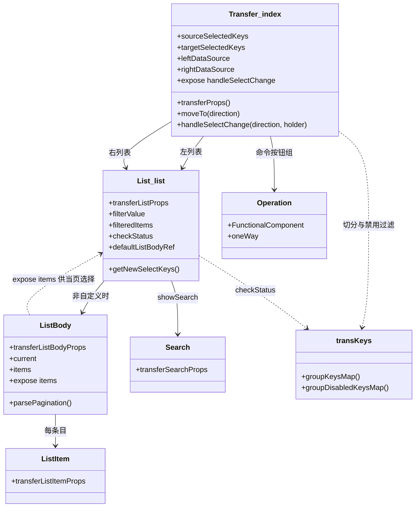
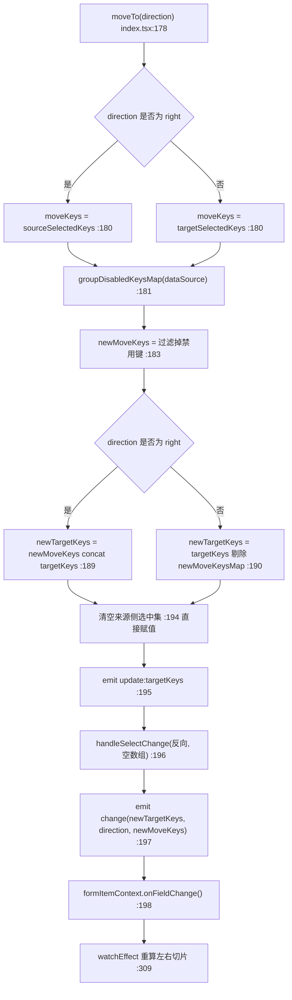
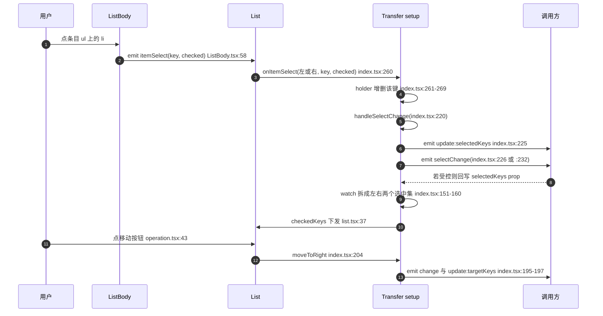

# C05-05 Transfer 穿梭框

> **本篇解决**：Transfer 把「两个列表 + 一组跨列表命令」塞进一个组件后，移动算法的三段集合（选中集 / 目标集 / 剩余集）在源码里究竟怎么算、哪些开关真的被读取、哪些只是声明。
> **前置**：C05-01 Select 选择器、C05-00 类横写（select/cascader/tree-select 共用的选项流水线）　**读者坐标**：`03-components/05-picker` 第 5/9 篇

## 一、职责与边界

Transfer 负责的事情只有一件：**维护「一个全集被一个键集合切成两半」这个不变量**，并把「把选中集从一侧搬到另一侧」这个动作做成一条可回滚的事件链。它的所有复杂度都来自这个复合形状——一个组件里塞了两个列表、两个搜索框、两套选中态、一组跨列表命令按钮，而持久化的值只有 `targetKeys` 一个数组（`packages/xiaoye-ui/src/transfer/index.tsx:86`）。

它**不负责**的事同样重要，越界改动前要先看这段：

- 不负责数据本身。`dataSource` 是唯一的全集来源，组件只在内存里给它补 `key` 字段（`packages/xiaoye-ui/src/transfer/index.tsx:316-318`），不会向上回写数据内容；移动改变的是「哪些 key 属于右侧」，而不是任何一条记录。
- 不负责选项的归一化与匹配流水线。Transfer 用的是自己的条目结构 `TransferItem`（`packages/xiaoye-ui/src/transfer/index.tsx:46-52`），和 Select/Cascader/TreeSelect 那套选项流水线没有任何代码交集，因此 C05-00《类横写：select/cascader/tree-select 共用的选项流水线》讲过的 label/value 归一化、字段映射在这里全部不成立——Transfer 只有一个 `rowKey` 函数（`packages/xiaoye-ui/src/transfer/index.tsx:101`）和一个 `render` 函数（`:88`）。
- 不负责排序策略的最终裁定。右侧顺序由 `targetKeys` 的下标决定，左侧顺序由 `dataSource` 的遍历顺序决定（`packages/xiaoye-ui/src/transfer/index.tsx:320-326`），两个方向的移动会产生不同的落位结果，见论点 2。
- 不负责无限滚动或按需加载。`lazy` 这个开关在本组件的实现里不存在，它只出现在测试夹具对象里（`packages/xiaoye-ui/src/transfer/index.test.js:26`、`:43`、`:87`、`:431` 与 `packages/xiaoye-ui/src/transfer/list.test.js:23`，共五处），见论点 5。
- 不负责校验与错误文案，只把 Form 的状态类名接进根节点（`packages/xiaoye-ui/src/transfer/index.tsx:150`、`:369`），并在其中一条变更路径上通知 Form（`packages/xiaoye-ui/src/transfer/index.tsx:198`），另一条路径漏了（`packages/xiaoye-ui/src/transfer/index.tsx:279-284`），见坑 2。

**依赖清单**（全部是同层或基础设施，无 vendor 层依赖）：`_util/type` 的 props 辅助与 `withInstall`、`_util/props-util` 的 `getPropsSlot` 与 `splitAttrs`、`_util/classNames`、`_util/statusUtils`、`_util/transKeys`（`packages/xiaoye-ui/src/_util/transKeys.ts:1-17`，本篇的键映射全在这 17 行里）、`config-provider/hooks/useConfigInject`、`form/FormItemContext`、`locale-provider/LocaleReceiver`、`locale/en_US`、以及四个业务组件 `checkbox` / `menu` / `dropdown` / `pagination`（`packages/xiaoye-ui/src/transfer/list.tsx:5-7`、`packages/xiaoye-ui/src/transfer/ListBody.tsx:5`）。值得注意的是它**不依赖** `list` 组件也不依赖 `table` 组件——列表体是自己画的 `ul`（`packages/xiaoye-ui/src/transfer/ListBody.tsx:154-161`），但样式表却为「用 Table 当自定义列表」这条路预留了整段 hook 规则（`packages/xiaoye-ui/src/transfer/style/index.tsx:38-52`）。被谁依赖：包级聚合入口与 `apps/docs/examples/transfer/` 下的示例，组件内部没有任何其他组件反向引用 Transfer。

## 二、源码地图

| 文件 | 行数 | 职责 | 关键导出与主入口行号 |
| --- | --- | --- | --- |
| `packages/xiaoye-ui/src/transfer/index.tsx` | 455 | 唯一持久化状态与切分派生、移动算法、事件回流 | `transferProps` 定义于 `:81`，组件体 `:122`，`setup` `:139` |
| `packages/xiaoye-ui/src/transfer/list.tsx` | 422 | 单侧列表：筛选、计数、表头下拉菜单 | `transferListProps` `:32`，组件体 `:67` |
| `packages/xiaoye-ui/src/transfer/ListBody.tsx` | 169 | 分页切片与条目渲染 | `transferListBodyProps` `:10`，组件体 `:46` |
| `packages/xiaoye-ui/src/transfer/ListItem.tsx` | 95 | 单条目：复选框或删除按钮 | `transferListItemProps` `:15`，组件体 `:29` |
| `packages/xiaoye-ui/src/transfer/operation.tsx` | 65 | 中间命令按钮组（唯一无 props 白名单的一层） | 函数式组件 `:22` |
| `packages/xiaoye-ui/src/transfer/search.tsx` | 50 | 搜索框，清空时也发一次 change | `transferSearchProps` `:8`，组件体 `:19` |
| `packages/xiaoye-ui/src/transfer/interface.ts` | 8 | 只有 `PaginationType` 一个类型 | `:1-8` |
| `packages/xiaoye-ui/src/transfer/style/index.tsx` | 377 | CSS-in-JS 样式与 Component Token | 样式 hook `:349`，ComponentToken `:7-11` |
| `packages/xiaoye-ui/src/_util/transKeys.ts` | 17 | 键到下标、禁用键两张表 | `groupKeysMap` `:1`、`groupDisabledKeysMap` `:9` |

三个体量信号要先记下。第一，`index.tsx` 一个文件同时承担 props 契约（`:81-118`）、类型（`:37-79`）、算法（`:178-331`）与渲染（`:335-443`），本篇所有机制类断言都落在这四段里。第二，主实现的对外导出只有 `withInstall(Transfer)` 这一个默认导出（`packages/xiaoye-ui/src/transfer/index.tsx:455`），`List` / `ListBody` / `ListItem` / `Operation` / `Search` 四个子组件在包级**不可达**——`index.tsx:33-35` 只 `export type` 它们的 Props 类型，不导出组件本身，所以外部无法单独组装一个 Transfer 列表。第三，`list.tsx`、`ListBody.tsx`、`ListItem.tsx`、`search.tsx` 四层的 props 定义风格互不统一：只有主组件用函数式 `transferProps()`（`:81`），子层全是裸对象常量（`packages/xiaoye-ui/src/transfer/list.tsx:32`、`packages/xiaoye-ui/src/transfer/ListBody.tsx:10`、`packages/xiaoye-ui/src/transfer/ListItem.tsx:15`），这与 `AGENTS.md` 规定的「Props 必须使用函数式定义」不符，但因为是内部层所以类型面没有暴露后果。

## 三、架构与数据流

三张图分别对应本篇的三个层次：静态组成结构、移动算法的分支、一次点击的完整闭环。

### 图 1：静态组成（谁持有谁）



图里三个分支值得单独解释。`Transfer_index` 指向 `List_list` 两次是**同一个组件的两条实例**（`packages/xiaoye-ui/src/transfer/index.tsx:379` 与 `:416`，两个 `key` 分别是 `leftList` 和 `rightList`），它们共用 props 形状但拿到的数据切片、选中集、以及 `direction` 值都不同——这是本篇多处混乱的根源。`List_list` 指向 `ListBody` 是**条件边**：只有 `renderList`（即 `children` 插槽产物）过滤后为空时才走内置列表（`packages/xiaoye-ui/src/transfer/list.tsx:83-93`）。`ListBody ..> List_list` 那条虚线是唯一的**自下而上**数据流：`ListBody` 通过 `expose({ items })`（`packages/xiaoye-ui/src/transfer/ListBody.tsx:103`）把「当前页渲染条目」交回 `list.tsx`，供「全选当页 / 反选当页 / 删除当页」三个菜单项取键（`packages/xiaoye-ui/src/transfer/list.tsx:319-321`、`:355-357`、`:369-371`）。这条反向通道一旦被破坏，分页模式下的批量选择就会崩溃，见坑 3。

### 图 2：moveTo 的三段集合与方向分支



这里最关键的分支是 `:189` 与 `:190` 的**不对称**：右移是 `concat`（把新来的键放在 `targetKeys` 前面），左移是 `filter`（从原数组里剔除）。两条分支产出的顺序语义完全不同，直接决定用户看到的落位，详见论点 2。第二个关键分支是 `:194`：它绕过受控守卫，详见论点 3。末尾的 `:309` 那个节点不是可选步骤——`targetKeys` 变了之后，左右两个列表的数据切片靠 `watchEffect` 重新派生，中间没有任何「把条目从左数组移到右数组」的语句，这一点常被误读。

### 图 3：一次点击的完整闭环



这张图刻意画了两处「回流分叉」。第 8 步的 `watch` 只在 `props.selectedKeys` 引用变化时才重跑（`packages/xiaoye-ui/src/transfer/index.tsx:151-160`），而第 4 步内部已经先写过一次本地选中集——非受控时 `handleSelectChange` 里的 `if (!props.selectedKeys)` 守卫（`:222`、`:228`）让内部状态成为唯一真源；受控时守卫不成立，内部状态只能等父组件回写才被刷新。两处对同一个 `sourceSelectedKeys` 变量负责，是这个组件最容易写出 bug 的地方。第 10 步起的移动路径**不经过** `watch` 之外的一切校验：`moveTo` 自己清空来源侧（`:194`），所以受控场景下点一次移动，选中集就按图 2 的走法丢了，见坑 1。

## 四、核心机制精读

### 论点 1：整棵树里只有 `targetKeys` 是「值」，左右两个列表都是它的派生视图，剩余集从不独立存储

这是理解 Transfer 一切行为的第一个前提，也是最容易被 UI 形状骗过去的一点：屏幕上明明有两个列表，源码里却没有任何一处把「左侧集合」当作可变状态来写。

```tsx
// packages/xiaoye-ui/src/transfer/index.tsx:306
    const leftDataSource = ref([]);
    const rightDataSource = ref([]);

    watchEffect(() => {
      const { dataSource, rowKey, targetKeys = [] } = props;

      const ld = [];
      const rd = new Array(targetKeys.length);
      const targetKeysMap = groupKeysMap(targetKeys);
      dataSource.forEach(record => {
        if (rowKey) {
          record.key = rowKey(record);
        }

        // rightData should be ordered by targetKeys
        // leftData should be ordered by dataSource
        if (targetKeysMap.has(record.key)) {
          rd[targetKeysMap.get(record.key)!] = record;
        } else {
          ld.push(record);
        }
      });

      leftDataSource.value = ld;
      rightDataSource.value = rd;
    });
```

逐段解释。`ld` 与 `rd` 是每次副作用重跑时新建的局部数组（`:312-313`），函数末尾才整体赋回 `leftDataSource.value` / `rightDataSource.value`（`:329-330`），所以两个 `ref` 只是**缓存**，不具备「移过去一条就少一条」的语义；`dataSource` 与 `targetKeys` 任一变化都会完整重算。`targetKeysMap` 来自 `groupKeysMap`，它的 value 是**键在 `targetKeys` 里的下标**：

```ts
// packages/xiaoye-ui/src/_util/transKeys.ts:1
export const groupKeysMap = (keys: string[]) => {
  const map = new Map<string, number>();
  keys.forEach((key, index) => {
    map.set(key, index);
  });
  return map;
};
```

于是 `:323` 的 `rd[targetKeysMap.get(record.key)!] = record` 一次性解决了「右侧按 `targetKeys` 排序」这件事——不需要额外的排序函数，落位下标就是键在 `targetKeys` 中的位置。这是本篇看到的第一个「用一个索引表代替一次排序」的取舍，代价在下面两句里。

**代价一：`rd` 是稀疏数组。** 它的长度被 `new Array(targetKeys.length)` 钉死在 `targetKeys` 的长度上（`:313`），但填充依赖 `dataSource` 里确实存在对应记录。若 `targetKeys` 含有 `dataSource` 中不存在的键（例如业务侧删了数据却没同步 `targetKeys`），那个下标永远不会被写，`rd` 留下一个洞。这个洞不会抛错——消费方 `list.tsx` 用 `props.dataSource.forEach`（`packages/xiaoye-ui/src/transfer/list.tsx:113`）遍历，而 `Array.prototype.forEach` 按规范跳过空洞，所以空洞里的项既不进 `filteredItems` 也不进 `filteredRenderItems`。真正的后果是**两条判空口径分叉**：表头全选框的可用语境用「含洞的物理长度」判定（`props.dataSource?.length === 0`，`packages/xiaoye-ui/src/transfer/list.tsx:155`），而列表体是否渲染空态用的是过滤后的实数（`filteredItems.value.length`，`packages/xiaoye-ui/src/transfer/list.tsx:247`），`Pagination` 的 `total` 同样取过滤后实数（`packages/xiaoye-ui/src/transfer/ListBody.tsx:125`）。于是当右侧的 `targetKeys` 全是空洞时，界面会同时出现「空态文案」与「一个没有禁用的全选框」。这条推导只到「可观察到的口径差」为止；更严重的后果需要业务侧真的交出不同步的两个数组才会显形，而组件层完全不设防——`targetKeys` 与 `dataSource` 的一致性校验、以及任何 dev 期告警，在整个 transfer 目录里都不存在（`grep -rn -e warning -e console --include="*.tsx" --include="*.ts" packages/xiaoye-ui/src/transfer` 只命中样式文件里那条 `-status-warning` 规则）。

**代价二：`record.key = rowKey(record)` 就地改写调用方传入的对象。** `:316-318` 直接给 `record` 赋 `key`，而 `record` 是 `props.dataSource` 数组里的元素引用，没有拷贝。也就是说组件会**修改父组件的数据对象**，向它注入一个 `key` 字段。这在 `rowKey` 存在时必然发生，且发生在响应式副作用里，因此若 `rowKey` 读取的字段与 `key` 冲突（例如数据本身就有 `key: 1` 这种数字键），会被覆盖成字符串返回值。改这里最安全的思路是先把 `key` 算到局部 Map 里而不回写记录，但那需要同步改掉 `list.tsx`、`ListBody.tsx`、`ListItem.tsx` 三处对 `item.key` 的读取。

结论回扣：**「移动」在本库里不是数组间的搬运，而是对单个 `targetKeys` 数组的一次增删**。所以任何「右侧少了两项」的现象都应当先在 `watchEffect` 之外找原因（`dataSource` 是否被换掉、`targetKeys` 是否被父层重置），而不是怀疑切分逻辑。

### 论点 2：`moveTo` 的三段集合是「选中集 → 过滤禁用 → 目标集」，但两个方向的落位规则不对称

三段集合的完整实现只有 22 行，是本篇密度最高的一段。

```tsx
// packages/xiaoye-ui/src/transfer/index.tsx:178
    const moveTo = (direction: TransferDirection) => {
      const { targetKeys = [], dataSource = [] } = props;
      const moveKeys = direction === 'right' ? sourceSelectedKeys.value : targetSelectedKeys.value;
      const dataSourceDisabledKeysMap = groupDisabledKeysMap(dataSource);
      // filter the disabled options
      const newMoveKeys = moveKeys.filter(key => !dataSourceDisabledKeysMap.has(key));
      const newMoveKeysMap = groupKeysMap(newMoveKeys);

      // move items to target box
      const newTargetKeys =
        direction === 'right'
          ? newMoveKeys.concat(targetKeys)
          : targetKeys.filter(targetKey => !newMoveKeysMap.has(targetKey));

      // empty checked keys
      const oppositeDirection = direction === 'right' ? 'left' : 'right';
      direction === 'right' ? (sourceSelectedKeys.value = []) : (targetSelectedKeys.value = []);
      emit('update:targetKeys', newTargetKeys);
      handleSelectChange(oppositeDirection, []);
      emit('change', newTargetKeys, direction, newMoveKeys);
      formItemContext.onFieldChange();
    };
```

**选中集**取自内部状态而非 props（`:180`），所以它读的是「当前视觉上被勾选的那些」，与 `props.selectedKeys` 无直接关系。**禁用过滤**在 `:181-183`：

```ts
// packages/xiaoye-ui/src/_util/transKeys.ts:9
export const groupDisabledKeysMap = <RecordType extends any[]>(dataSource: RecordType) => {
  const map = new Map<string, number>();
  dataSource.forEach(({ disabled, key }, index) => {
    if (disabled) {
      map.set(key, index);
    }
  });
  return map;
};
```

注意它的入参是**全量 `dataSource`**，不是本次要移动的那一侧。这意味着「禁用」是以键为全局命名空间的：如果左列表里有一个 `disabled: true` 的条目 `key='x'`，而右列表里恰好也有 `key='x'`（业务侧键不唯一时可能），右移会被过滤、左移也会被过滤。禁用判定的粒度是「键」而不是「条目」，这是 `groupDisabledKeysMap` 用 `Map<string, number>` 而非直接读 `record.disabled` 换来的代价。另一处一致性来自这里：`ListItem` 的禁用判定读的是条目自身的 `item.disabled`（`packages/xiaoye-ui/src/transfer/ListItem.tsx:40`、`:75`），也就是**渲染层看条目、移动层看键表**，两套口径在键唯一时等价、不唯一时表现不同。

**目标集**是 `:187-190` 的两条分支，这也是本篇最需要被记住的不对称：

- 右移：`newMoveKeys.concat(targetKeys)`——新来的键**排在最前**，原有键整体后移。多次移动的可见结果是「最后移动的那批浮在最上面」，而不是按 `dataSource` 顺序。
- 左移：`targetKeys.filter(...)`——只是把键从右集合里删掉，条目回到左侧后的位置**由 `dataSource` 的遍历顺序决定**（`:325` 的 `ld.push(record)`）。

于是同一条数据「右移再左移」之后不会回到它右移前的视觉位置，除非它本来就在 `dataSource` 的那个相对次序上。想做「左移也保持原序」的需求必须改成「左移时按原下标重排 `targetKeys`」，改动点就在 `:190`，但要注意 `newMoveKeysMap` 只记录了「是否移动」，没记录原始下标，需要另建表。

**剩余集**在 `moveTo` 里根本不存在——`emit('update:targetKeys')`（`:195`）之后由论点 1 的 `watchEffect` 重算。这解释了图 2 末尾那个节点为什么必须画。

`:196` 的 `handleSelectChange(oppositeDirection, [])` 是「另一侧保持原选中」的写法：它把空数组当作**目标侧**的新选中集传下去，内部再拼上另一侧（见论点 3）。而 `:197` 的 `change` 事件参数顺序是 `(newTargetKeys, direction, newMoveKeys)`，其中第三个是**过滤禁用之后**的 `newMoveKeys`（`:183` 的产物），不是用户原本选中的 `moveKeys`。所以「选中 3 项、其中 1 项禁用」时 `onChange` 只报 2 项——这与 `AGENTS.md` 之外的直觉一致，但值得在封装二次组件时明确：想让调用方知道「用户选了几项」，只能靠 `selectChange`，不能靠 `change` 的第三个参数。

### 论点 3：选中集有两个写入者，受控守卫只写在其中一条路径上

`sourceSelectedKeys` / `targetSelectedKeys` 是组件内仅有的两个可变选中状态（`packages/xiaoye-ui/src/transfer/index.tsx:145-146`），它们被两条独立路径写入，而「是否受控」的守卫只出现在第二条路径里。

```tsx
// packages/xiaoye-ui/src/transfer/index.tsx:220
    const handleSelectChange = (direction: TransferDirection, holder: string[]) => {
      if (direction === 'left') {
        if (!props.selectedKeys) {
          sourceSelectedKeys.value = holder;
        }
        emit('update:selectedKeys', [...holder, ...targetSelectedKeys.value]);
        emit('selectChange', holder, toRaw(targetSelectedKeys.value));
      } else {
        if (!props.selectedKeys) {
          targetSelectedKeys.value = holder;
        }
        emit('update:selectedKeys', [...holder, ...sourceSelectedKeys.value]);
        emit('selectChange', toRaw(sourceSelectedKeys.value), holder);
      }
    };
```

守卫的意图很清楚：受控时不把局部计算结果写进内部状态，等 `watch` 从 props 同步。与之配对的是这段一次性拆分的 watch：

```tsx
// packages/xiaoye-ui/src/transfer/index.tsx:151
    watch(
      () => props.selectedKeys,
      () => {
        sourceSelectedKeys.value =
          props.selectedKeys?.filter(key => props.targetKeys.indexOf(key) === -1) || [];
        targetSelectedKeys.value =
          props.selectedKeys?.filter(key => props.targetKeys.indexOf(key) > -1) || [];
      },
      { immediate: true },
    );
```

两个问题都出在「`watch` 只在 `props.selectedKeys` 变化时跑，而 `moveTo` 的清空不看守卫」这条缝隙上。

其一，`moveTo` 里的 `:194` 是**无条件直接赋值**：`direction === 'right' ? (sourceSelectedKeys.value = []) : (targetSelectedKeys.value = [])`。在受控用法（传了 `selectedKeys`）下，`handleSelectChange` 走 `:222` 分支不会覆盖它，于是内部选中集被清空后**没有任何机制再填回来**——因为父组件的 `selectedKeys` 数组引用没变（父组件通常只在 `update:selectedKeys` 事件里回写，而 `:225` 发出的新数组恰好等于「清空后的值」，父层若照写，`props.selectedKeys` 变成 `[]`，`watch` 才会跑一次，结果仍是空）。净效果与上游实现一致：移动后选中态清空。真正的坑在另一种父层写法：如果调用方在 `update:selectedKeys` 里**拒绝回写**（想保留选择），组件内部已经清空，界面照旧丢选中，见坑 1。

其二，`:155` 与 `:157` 用 `props.targetKeys.indexOf(key)` 做**线性查找**给每个选中键定侧，复杂度是 `选中数 × targetKeys 长度`；同一份数据在 `watchEffect` 里明明已经建过 `targetKeysMap`（`:314`），但 `watch` 拿不到它——它写在另一个副作用里。这里不是 bug，而是「两段逻辑各自造同一张表」的重复实现形状：一个用 `Map`（`:314`），一个用 `indexOf`（`:155`）。数据量大（选中上百项、`targetKeys` 上千）时，这段 watch 是组件里最容易先劣化的地方。

顺带记录一个不对称：`:226` 与 `:232` 各有一个 `toRaw(...)` 包裹，而同一行的展开写法 `[...holder, ...targetSelectedKeys.value]`（`:225`、`:231`）却没有。`toRaw` 只作用在 `selectChange` 的参数上，意味着**给调用方的两个事件，一个是原始对象、一个是响应式代理**，深比较或结构化克隆时行为会不同。这属于本仓「同一逻辑的多份拷贝」族里的一个轻量实例：语义等价、实现两套。

结论回扣：Transfer 的受控边界是「**值受控、选中半受控**」——`targetKeys` 有完整的 `update:` 通道与派生链路，`selectedKeys` 的受控性只在 `handleSelectChange` 这一条路径上被尊重。任何绕过 `handleSelectChange` 直接写 `sourceSelectedKeys` 的新代码（目前只有一处，即 `:194`）都会破坏这个半受控约定。

### 论点 4：`direction` 这个名字在这条链上有三种含义，并且在同一文件里发生形参遮蔽

`direction` 是 Transfer 里最危险的标识符。它在同一个 `setup` 作用域里同时是：ConfigProvider 注入的**书写方向**（`'ltr'` 与 `'rtl'`），以及移动命令的**运动方向**（`'left'` 与 `'right'`），下发给子组件后还额外变成第三个含义「**视觉在哪一侧**」。

遮蔽现场在 `setup` 内部。第 140 行拿到的是 ref：

```tsx
// packages/xiaoye-ui/src/transfer/index.tsx:140
    const { configProvider, prefixCls, direction } = useConfigInject('transfer', props);
```

紧接着，从 `:178` 起有七个函数用**同名形参**把它整片盖掉——`moveTo`（`:178`）、`onItemSelectAll`（`:208`）、`handleSelectChange`（`:220`）、`handleFilter`（`:236`）、`handleClear`（`:248`）、`onItemSelect`（`:260`）、`handleScroll`（`:286`），以及最后一个 `handleListStyle`（`:296-298`）：

```tsx
// packages/xiaoye-ui/src/transfer/index.tsx:286
    const handleScroll = (direction: TransferDirection, e: UIEvent) => {
      emit('scroll', direction, e);
    };

    const handleLeftScroll = (e: UIEvent) => {
      handleScroll('left', e);
    };
    const handleRightScroll = (e: UIEvent) => {
      handleScroll('right', e);
    };
    const handleListStyle = (
      listStyle: ((style: ListStyle) => CSSProperties) | CSSProperties,
      direction: TransferDirection,
    ) => {
      if (typeof listStyle === 'function') {
        return listStyle({ direction });
      }
      return listStyle;
    };
```

这些函数里读到 `direction` 都**是对的**——它们要的就是运动方向，类型是 `TransferDirection`（`:37`）。危险集中在两处。第一处是 `renderTransfer`（`:335` 起）：它**不是**带形参遮蔽的函数，所以那里的 `direction` 是 `:140` 那个 ref，必须写 `.value`（`:367`、`:395`、`:413`、`:433` 四处全都带 `.value`）。在这个函数里新增一行而误用 `direction === 'rtl'`（漏 `.value`）或误把它当字符串比较，编译器不会拦住，因为 `ComputedRef` 与字符串的比较在 `strictNullChecks: false` 的配置下不报类型错。第二处是判据形如「同一个标识符在 A 处是 ref、在 B 处是裸字符串」，这正是共则 §3 列出的「同名字段互相遮蔽」形状的一个非 computed 变体。

三个含义的分工可以逐行核对：

- 含义一「书写方向」：只用在根类名 `-rtl`（`packages/xiaoye-ui/src/transfer/index.tsx:367`）与箭头翻转（`:413` 传给 `Operation`，读取点 `packages/xiaoye-ui/src/transfer/operation.tsx:44`、`:54`）。
- 含义二「运动方向」：`moveTo` 与全部 select/search/scroll 通道，见上。
- 含义三「视觉在哪一侧」：下发给 `List` 的 `direction` prop，且**做了取反映射**——左列表在 RTL 时拿到 `'right'`（`packages/xiaoye-ui/src/transfer/index.tsx:395`），右列表在 RTL 时拿到 `'left'`（`:433`）。

第三个含义的唯一读取点非常隐蔽，在 `list.tsx` 里取 `notFoundContent` 的下标：

```tsx
// packages/xiaoye-ui/src/transfer/list.tsx:207
    const notFoundContentEle = computed(() =>
      Array.isArray(props.notFoundContent)
        ? props.notFoundContent[props.direction === 'left' ? 0 : 1]
        : props.notFoundContent,
    );
```

于是「`notFoundContent` 传数组」这个用法的语义在 RTL 下**整体翻转**：`notFoundContent[0]` 本意是「左侧空态文案」，但 RTL 时左列表的 `direction` 是 `'right'`（`:395` 的取反），于是 `[0]` 落到了右列表上。这是**含义三污染含义一**的实例：书写方向的适配逻辑，把一个本该只表示「源侧还是目标侧」的 prop 变成了「视觉左还是视觉右」，而它唯一的用途恰好是索引一个按语义（源/目标）排列的数组。修复方向是把 `list.tsx:209` 的判据换成组件自己知道的身份（例如新增一个 `side: 'source' - 'target'` 之类的 prop），而不是继续调整取反的位置。该分支**无测试保护**：三个测试文件里 `rtl` 与 `notFoundContent` 数组形态都零命中（见论点 5 的命令）。

另外顺带记录一处命名反直觉但目前正确的使用：`leftActive` / `rightActive` 描述的是**按钮**可用性而不是「哪侧有选中」，所以定义是交叉的——`leftActive` 读右侧选中集、`rightActive` 读左侧选中集：

```tsx
// packages/xiaoye-ui/src/transfer/index.tsx:357
      const renderItem = props.render || slots.render;
      const leftActive = targetSelectedKeys.value.length > 0;
      const rightActive = sourceSelectedKeys.value.length > 0;
```

`Operation` 侧的读取点与之一一咬合：`rightActive` 决定「右移按钮」的 `disabled`（`packages/xiaoye-ui/src/transfer/operation.tsx:42`），`leftActive` 决定「左移按钮」（`:52`）。改名成 `canMoveLeft` / `canMoveRight` 之前，任何人都不要按字面理解这两行。

### 论点 5：把开关逐个核到读取点，会得到「两个真开关、一个假开关、两类死类名」

这是本篇最该被复用的方法论结论：对每个声明的开关跑「声明行 → 解构行 → 读取行 → 渲染或条件行 → 样式行」五级链，链断在哪一级，开关就在哪一级失效。下表按链核对，全部行号来自本次 grep 与定点 Read。

`oneWay` 是**真开关**，链路完整且只有两条腿：

```tsx
// packages/xiaoye-ui/src/transfer/index.tsx:402
          <Operation
            key="operation"
            class={`${prefixCls.value}-operation`}
            rightActive={rightActive}
            rightArrowText={operations[0]}
            moveToRight={moveToRight}
            leftActive={leftActive}
            leftArrowText={operations[1]}
            moveToLeft={moveToLeft}
            style={operationStyle}
            disabled={disabled}
            direction={direction.value}
            oneWay={oneWay}
          />
```

腿一：`:414` 传给 `Operation`，读取点 `packages/xiaoye-ui/src/transfer/operation.tsx:48` 的 `{!oneWay && (`，效果是**不渲染左移按钮**（`:49-58`）。腿二：`:436` 的 `showRemove={oneWay}` 下发给右列表，读取点三处——`packages/xiaoye-ui/src/transfer/list.tsx:308` 的 `!showRemove && !pagination` 决定表头全选框是否渲染、`:311` 决定表头下拉菜单换成「删除当页 / 删除全部」、`packages/xiaoye-ui/src/transfer/ListItem.tsx:52` 决定条目渲染删除按钮而非复选框。两条腿合起来就是单向模式的全部实现：**没有任何一行 `moveTo` 相关代码读过 `oneWay`**。想「在 oneWay 下禁止左移」去改 `moveTo` 是改不到的，因为左移按钮已经不存在（`:48`），但 `moveToLeft` 函数仍被照常创建并通过 `:410` 传下去——它只是没有入口。样式表也配合这条腿写了规则，注释直接点名开关：

```tsx
// packages/xiaoye-ui/src/transfer/style/index.tsx:250
      // Do not change hover style when `oneWay` mode
      [`&-show-remove ${componentCls}-list-content-item:not(${componentCls}-list-content-item-disabled):hover`]:
        {
          background: 'transparent',
          cursor: 'default',
        },
```

`lazy` 是**假开关**：它在本篇的 props 声明里根本不存在——`transferProps()` 的完整字段清单在 `packages/xiaoye-ui/src/transfer/index.tsx:81-118`，`transferListProps` 在 `packages/xiaoye-ui/src/transfer/list.tsx:32-63`，两处都没有 `lazy`；实现文件里也零命中。它唯一的五处出现全在测试夹具里（`packages/xiaoye-ui/src/transfer/index.test.js:26`、`:43`、`:87`、`:431` 与 `packages/xiaoye-ui/src/transfer/list.test.js:23`，每处都是同一句 `lazy: false`），由于三个组件都设了 `inheritAttrs: false`（`packages/xiaoye-ui/src/transfer/index.tsx:125`、`packages/xiaoye-ui/src/transfer/list.tsx:70`、`packages/xiaoye-ui/src/transfer/ListItem.tsx:32`），未知属性落入 `attrs` 且 `list.tsx` 只把 `attrs.style` 与 `splitAttrs(attrs).onEvents` 取用（`packages/xiaoye-ui/src/transfer/list.tsx:234`、`:403`），`lazy` 最终谁也不读。结论要如实降级：这五份夹具证明的是**测试作者以为存在这个开关**（并且把它抄进了四个不同的夹具对象，是共则 §3「同一逻辑的多份拷贝」在测试侧的镜像），不能证明组件曾支持懒加载。复现口径：

```bash
grep -rn --include='*.tsx' --include='*.ts' "lazy" packages/xiaoye-ui/src/transfer   # 0 命中
grep -rc "lazy" packages/xiaoye-ui/src/transfer/index.test.js packages/xiaoye-ui/src/transfer/list.test.js
# 4 与 1，合计 5
```

`status` 是**部分生效开关**。链路为：声明 `packages/xiaoye-ui/src/transfer/index.tsx:107` → 合并 `:150`（`getMergedStatus(formItemInputContext.status, props.status)`，实现见 `packages/xiaoye-ui/src/_util/statusUtils.tsx:22-23`，**自有 prop 优先**）→ 类名 `:369` 调用 `getStatusClassNames`，该函数一次可能产出四个类（`packages/xiaoye-ui/src/_util/statusUtils.tsx:14-17`：`-status-success`、`-status-warning`、`-status-error`、`-status-validating`）→ 样式表只写了其中两个（`packages/xiaoye-ui/src/transfer/style/index.tsx:77` 与 `:80`）。所以 `status="success"` 与 `status="validating"` 在 Transfer 上**只挂类名、零视觉**，属于「有类名但查不到规则」的一半形状；另一半是下面这两条死规则。

死类名有两族，方向恰好相反。

族一「样式有规则、组件不发类名」：

```tsx
// packages/xiaoye-ui/src/transfer/style/index.tsx:229
        [`&:not(${componentCls}-list-content-item-disabled)`]: {
          '&:hover': {
            backgroundColor: token.controlItemBgHover,
            cursor: 'pointer',
          },

          [`&${componentCls}-list-content-item-checked:hover`]: {
            backgroundColor: controlItemBgActiveHover,
          },
        },

        '&-checked': {
          backgroundColor: controlItemBgActive,
        },
```

`:240-242` 编译出的完整选择器是 `xy-transfer-list-content-item-checked`，而条目的类名只由 `ListItem` 决定：

```tsx
// packages/xiaoye-ui/src/transfer/ListItem.tsx:37
      const { renderedText, renderedEl, item, checked, prefixCls, showRemove } = props;
      const className = classNames({
        [`${prefixCls}-content-item`]: true,
        [`${prefixCls}-content-item-disabled`]: disabled || item.disabled,
      });
```

`checked` 在 `:37` 被解构出来，却在 `:38-41` 的类名表里一次都没被使用——它只流向了 `Checkbox` 的 `checked`（`packages/xiaoye-ui/src/transfer/ListItem.tsx:84`）。全仓对 `content-item-checked` 的命中只有样式文件那一处：

```bash
grep -rn "content-item-checked" packages/xiaoye-ui/src --include='*.tsx' --include='*.ts'
# 仅 packages/xiaoye-ui/src/transfer/style/index.tsx:235
```

症状因此非常具体：**已选中条目没有背景高亮**，选中态完全依赖那个 `Checkbox` 的勾，`:229` 的 hover 特例（选中项悬停时用 `controlItemBgActiveHover`）也永远走不到。`:235` 与 `:240-242` 是两条写好了却查不到的规则。

族二「组件发了类名、样式零规则」：`packages/xiaoye-ui/src/transfer/list.tsx:257` 在 `showSearch` 为真时给容器追加 `-body-with-search`，`packages/xiaoye-ui/src/transfer/list.tsx:245` 给自定义列表体包一层 `-body-customize-wrapper`（而且 `:243` 的注释写着「should wrap customize list body in a classNamed div to use flex layout」，但这条 flex 意图实际由父级 `-customize-list` 规则 `packages/xiaoye-ui/src/transfer/style/index.tsx:29-35` 承担）。两个类名在本文件里都是**唯一一次出现**，样式表零命中：

```bash
grep -c "with-search" packages/xiaoye-ui/src/transfer/style/index.tsx      # 0
grep -c "customize-wrapper" packages/xiaoye-ui/src/transfer/style/index.tsx # 0
```

它们不产生 bug，但会让任何「按类名写业务样式」的人误以为有默认布局可依。

最后是本篇最成体系的一条测试面结论。三个测试文件的用例分布是：`index.test.js` 15 个 `it`（`packages/xiaoye-ui/src/transfer/index.test.js:92` 起），其中 **5 个 `it.skip`**——`:192`（全选）、`:211`（取消全选）、`:302`（搜索后全选）、`:333`（搜索后移动）、`:372`（带搜索文本时的勾选正确性）；`list.test.js` 只有 2 个 `it`，且第一个 `'should render correctly'`（`packages/xiaoye-ui/src/transfer/list.test.js:27-32`）**一个断言都没有**，只 `mount` 一次；`search.test.js` 2 个 `it`、2 个 `expect(`（`:17`、`:28`）。把这三条合起来看：**被 skip 的恰好就是表头批量选择的全部路径**，也就是论点 6 里那段 `getNewSelectKeys` 与 `checkStatus` 的组合逻辑；而 `pagination`、`oneWay`、`showRemove`、`status`、`rtl` 五个关键词在三个测试文件里零命中：

```bash
grep -rn -e pagination -e oneWay -e showRemove -e status -e rtl packages/xiaoye-ui/src/transfer/index.test.js packages/xiaoye-ui/src/transfer/list.test.js packages/xiaoye-ui/src/transfer/search.test.js
# 0 命中
```

另有一处断言被注释掉：`packages/xiaoye-ui/src/transfer/index.test.js:471` 保留了对根节点样式的断言，`:472-474` 三行分别针对 `listSource`、`listTarget`、`operation` 的断言被注释——即 `listStyle` 的**函数形态**（`packages/xiaoye-ui/src/transfer/index.tsx:296-304` 的按方向求值）没有通过中的测试。所以「测试文件存在」在这里给出的安全感是假的，实跑用例覆盖的是移动、单击勾选、搜索过滤、`targetKeys` 排序与根样式五件事，表头批操作与分页完全在外。

### 论点 6：表头批量操作的集合运算收在一个函数里，但它混用了「过滤后可见集」与「全部选中集」两个口径

`list.tsx` 的表头有三类批量入口：全选框（`:153-168`）、下拉菜单的「全选所有 / 全选当页 / 反选当页」（`:341-393`），它们的键集合运算全部收敛到同一个函数：

```tsx
// packages/xiaoye-ui/src/transfer/list.tsx:129
    const checkStatus = computed(() => {
      const { checkedKeys } = props;
      if (checkedKeys.length === 0) {
        return 'none';
      }
      const checkedKeysMap = groupKeysMap(checkedKeys);
      if (filteredItems.value.every(item => checkedKeysMap.has(item.key) || !!item.disabled)) {
        return 'all';
      }
      return 'part';
    });

    const enabledItemKeys = computed(() => {
      return getEnabledItemKeys(filteredItems.value);
    });

    const getNewSelectKeys = (keys, unCheckedKeys) => {
      return Array.from(new Set([...keys, ...props.checkedKeys])).filter(
        key => unCheckedKeys.indexOf(key) === -1,
      );
    };
```

`getNewSelectKeys`（`:145-149`）的形状值得细看：入参 `keys` 是「要新增选中的键」，先与**当前全部** `props.checkedKeys` 求并集（`Array.from(new Set(...))`），再用 `unCheckedKeys.indexOf(key) === -1` 剔除要取消的键。它没有「只保留本侧」的概念——本侧之外的键靠 `props.checkedKeys` 天然携带，因为 `index.tsx:385` 与 `:422` 下发的就是各自那一侧的选中集（`sourceSelectedKeys` / `targetSelectedKeys`）。四个调用点各自传法不同：全选框传 `(未选中则取可见启用键, 已全选则取当前全部)`（`packages/xiaoye-ui/src/transfer/list.tsx:163-165`）、「全选所有」与「全选当页」传 `(键, [])`（`:347`、`:358`）、「反选当页」自己先做一轮分类再传（`:380-387`）。这套「并集再取补」的写法，正确性完全依赖 `unCheckedKeys` 的构造；`:164` 那处在已全选时传的是 `props.checkedKeys` 自身，于是并集与补集同源，结果必然为空数组，等价于「清空本侧」——逻辑成立，但读起来要靠脑补，是本文件里最难维护的三行。

`checkStatus`（`:129-139`）的口径是**过滤后**的 `filteredItems`，这符合直觉：搜索状态下全选框应该反映可见项。但表头文案用的是另一个口径：

```tsx
// packages/xiaoye-ui/src/transfer/list.tsx:408
            <span class={`${prefixCls}-header-selected`}>
              <span>{getSelectAllLabel(checkedKeys.length, filteredItems.value.length)}</span>
              <span class={`${prefixCls}-header-title`}>{slots.titleText?.()}</span>
            </span>
```

分子 `checkedKeys.length` 是**本侧全部选中**（含被搜索过滤掉的），分母 `filteredItems.value.length` 是**当前可见条目数**（`getSelectAllLabel` 定义在 `packages/xiaoye-ui/src/transfer/list.tsx:192-205`，分母还决定量词单位 `unit`）。两者口径不同源，直接后果是：搜索框里剩 2 条、而过滤前已勾选 5 条时，表头会显示「5/2 项」。同一个数字口径不一致也解释了一个更隐蔽的现象——全选框显示为 `all`（`checkStatus` 只看可见集）而计数却显示「2/2」以外的值。这不是显示层的小瑕疵，它是**「过滤后集合」与「全量选中集合」在本组件里没有统一的分层**：`index.tsx` 只管全量键（`:151-160` 的拆分、`:220-234` 的合并），`list.tsx` 同时用两套（`:129-143` 用过滤集、`:412` 的分子用全量）。任何新增的计数或批量操作都必须先决定站哪一侧，否则就再造一个「5/2 项」。

第四个批量入口在 `oneWay` 模式，走的是完全另一条链，而且这条链上少了三件事：

```tsx
// packages/xiaoye-ui/src/transfer/index.tsx:279
    const onRightItemRemove = (targetedKeys: string[]) => {
      const { targetKeys = [] } = props;
      const newTargetKeys = targetKeys.filter(key => !targetedKeys.includes(key));
      emit('update:targetKeys', newTargetKeys);
      emit('change', newTargetKeys, 'left', [...targetedKeys]);
    };
```

对照论点 2 的 `moveTo`（`:178-199`），`onRightItemRemove` 缺了三步：**不清空选中集**（`moveTo` 有 `:194`）、**不发 `selectChange` / `update:selectedKeys`**（`moveTo` 有 `:196` 借 `handleSelectChange` 发）、**不通知 Form**（`moveTo` 有 `:198` 的 `formItemContext.onFieldChange()`）。三缺的连锁症状：被删除项若此前被勾选，`targetSelectedKeys` 里仍留着这些键，表头分子随之虚高；父层用 `v-model:selectedKeys` 时，两份状态永久分叉；`oneWay` 恰是这条链唯一的使用场景（`showRemove={oneWay}`，`packages/xiaoye-ui/src/transfer/index.tsx:436`）。还有一个可核对的细节：它用 `targetedKeys.includes(key)` 做 O(n×m) 的剔除（`:281`），而 `moveTo` 同语义用的是 `Map`（`:184` 建 `newMoveKeysMap`、`:190` 查）——同一件事的两种实现，性能口径不一致，属于共则 §3「同一逻辑的多份拷贝」在本组件的落点。

### 论点 7：分页状态是 ListBody 私有的，靠 `expose` 反向暴露给 List，两端对「当页」的定义必须手工保持一致

```tsx
// packages/xiaoye-ui/src/transfer/ListBody.tsx:69
    const mergedPagination = computed(() => parsePagination(props.pagination));

    watch(
      [mergedPagination, () => props.filteredRenderItems],
      () => {
        if (mergedPagination.value) {
          // Calculate the page number
          const maxPageCount = Math.ceil(
            props.filteredRenderItems.length / mergedPagination.value.pageSize,
          );
          current.value = Math.min(current.value, maxPageCount);
        }
      },
      { immediate: true },
    );
    const items = computed(() => {
      const { filteredRenderItems } = props;

      let displayItems = filteredRenderItems;

      if (mergedPagination.value) {
        displayItems = filteredRenderItems.slice(
          (current.value - 1) * mergedPagination.value.pageSize,
          current.value * mergedPagination.value.pageSize,
        );
      }

      return displayItems;
    });
```

三点机制。第一，`parsePagination`（`packages/xiaoye-ui/src/transfer/ListBody.tsx:24-44`）把 `pagination: true` 与 `pagination: 对象` 归一成同一个默认表（`pageSize: 10`、`simple: true`），`false` 或未传直接返回 `null`（`:25-27`），所以下面所有分支都靠「`mergedPagination.value` 是否为真」判定，而不是判 `pagination` 本身。第二，页码 `current`（`:53`）是 **ListBody 私有状态**，`List` 与 `Transfer` 都拿不到它，唯一的对外通道是 `expose({ items })`（`packages/xiaoye-ui/src/transfer/ListBody.tsx:103`）。`List` 需要「当页的键」来实现「全选当页 / 反选当页 / 删除当页」，于是从 ref 上反向取：

```tsx
// packages/xiaoye-ui/src/transfer/list.tsx:317
              <Menu.Item
                key="removeCurrent"
                onClick={() => {
                  const pageKeys = getEnabledItemKeys(
                    (defaultListBodyRef.value.items || []).map(entity => entity.item),
                  );
                  onItemRemove?.(pageKeys);
                }}
              >
```

这条链的三处读取点分别是 `packages/xiaoye-ui/src/transfer/list.tsx:319-321`、`:355-357`、`:369-371`，全部写成 `defaultListBodyRef.value.items`。`items` 之所以能直接当数组用（而不是 `.value`），依赖 `expose` 的代理自动解包；`list.tsx` 那侧的 ref 定义在 `packages/xiaoye-ui/src/transfer/ListBody.tsx` 之外，即 `packages/xiaoye-ui/src/transfer/list.tsx:81`。这里有一个**双向耦合但无类型约束**的缝：`ListBody` 改 `expose` 的名字，`list.tsx` 的三处就静默变 `undefined`，`|| []`（`:320`）会把它兜成空数组，于是「全选当页」变成「什么都不选」，不报错、不警告。反过来说，若 `renderList` 分支生效（`packages/xiaoye-ui/src/transfer/list.tsx:86-88` 只在非自定义时挂 ref），`defaultListBodyRef.value` 就是 `null`，此时读 `.items` 会抛 TypeError——好在 `index.tsx:352` 把「自定义列表」与「分页」做成了互斥，见坑 4，这条崩溃路径在正常用法下进不去。

第三，`:79` 的钳制只保证 `current` 不超过 `maxPageCount`，**不保证它不低于 1**。当一次过滤让 `filteredRenderItems.length` 归零，`maxPageCount` 算出 `Math.ceil(0 / pageSize)` 即 `0`，`Math.min(current, 0)` 把 `current` 写成 `0`；此后过滤条件恢复时 `maxPageCount` 变回正数，而 `Math.min(0, 正数)` 仍是 `0`。落到 `:90-93` 的切片就是 `slice((0-1)*pageSize, 0)`，即 `slice(-10, 0)`——对任何长度的数组都返回空数组。这条是从代码推导出的可达路径（触发条件：分页 + 处于第 2 页之后 + 输入过一次无匹配的搜索 + 清空搜索），源码里没有任何兜底——`current` 的全仓写入点只有 `:53` 初始化、`:79` 钳制、`:100` 的 `onPageChange` 三处，没有一处写下界——且 `pagination` 在全仓测试里零命中（见论点 5 的命令），因此没有任何测试会把它暴露出来。表现是「清空搜索框后列表永久空白，直到手动点一次页码」。修复位置是 `ListBody.tsx:79`，把钳制写成同时约束上下界。

## 五、对外契约如何生效

这一段沿着「一个用户可见的名字，从声明走到渲染或回调」追四条链，每条链都记下一处**层级错位**。

**第一条：事件链。`emits` 声明在主组件与 `List` 两层被注释掉，但事件仍然全部可达。** `packages/xiaoye-ui/src/transfer/index.tsx:138` 是一行注释掉的 `emits: [...]`，`packages/xiaoye-ui/src/transfer/list.tsx:72` 同样有一行。事件之所以照旧能触发，是因为每个事件名都在 props 白名单里有对应形态的声明——`onChange`（`:108`）、`onSelectChange`（`:113`）、`onSearch`（`:114`）、`onScroll`（`:115`）、`'onUpdate:targetKeys'`（`:116`）、`'onUpdate:selectedKeys'`（`:117`）——`setup` 里 `emit('change', ...)`（`:197`）之类的调用与这些名字一一对应。这条设计的直接后果是：**同一个回调有两条入口**。既可以是 `@change`（Vue 把监听器放进 props 表，`emit` 命中它），也可以是显式传 `onChange` 函数（`:140` 之后 `props.onChange` 就在那儿）。本篇能证实的是「六个事件名都有同名 prop 声明，且注释行的六个事件在 `index.tsx` 里都能找到对应 `emit` 调用」；至于「取消注释 `:138` 会否改变行为」，本篇不做断言。但 `list.tsx:72` 那行可以直接判定为**过期文档**：它列的四个事件 `scroll` / `itemSelectAll` / `itemRemove` / `itemSelect` 在本层从未被 emit——`list.tsx` 的 `setup(props, { attrs, slots })`（`:78`）连 `emit` 都没解构，全文件唯一的 `emit(` 命中为零，而 `itemSelectAll` 在本层是**作为函数 prop 被直接调用**的（`packages/xiaoye-ui/src/transfer/list.tsx:163`）。所以想「补齐 emits 声明」的人必须先改掉这一层的调用方式，否则注释行只是一个诱人的错误路标。与之对照，`ListBody.tsx:51` 与 `ListItem.tsx:34`、`search.tsx:26` 三层都老实声明了 `emits`，且这三个文件里 `props.onScroll` / `props.onItemSelect` / `props.onClick` 一律零读取——它们只 emit，让 Vue 的 emit 解析去找父层传下来的同名 `onXxx`。于是形成一种需要警惕的隐式配对：`transferListBodyProps` 里声明的 `onItemSelect`、`onScroll`、`onItemRemove`（`packages/xiaoye-ui/src/transfer/ListBody.tsx:17-19`）与 `emits` 里的 `itemSelect`、`scroll`、`itemRemove`（`:51`）是**同一通道的两个名字**，`list.tsx:235-241` 用 `{...props}` 整体下传时把这两半同时喂给 `ListBody`。任何一侧改名（例如把 prop 改成 `handleItemSelect`）都不会有类型报错，只会让该事件静默失联。

**第二条：类名与属性链，这是本篇唯一一个「做对了」的顺序样板。** 根节点写作 `<div {...attrs} class={cls} style={style} id={id}>`（`packages/xiaoye-ui/src/transfer/index.tsx:378`）——显式属性排在 `{...attrs}` **之后**，因此调用方传不进来的 `class` 无法覆盖合并结果；而用户的 `class` 也没有丢，因为 `:349` 先从 `attrs` 里把它取成 `className`、再作为第二个参数并进 `cls`（`:361-363`）。配合 `inheritAttrs: false`（`:125`），最终 DOM 上只有一份 class 列表。这正是共则 §3 里「JSX 属性顺序决定可否被覆盖」那条规则的正确一侧写法，可作为其他组件的对照样板。

**第三条：插槽链。七个具名插槽里，`children` 是唯一会改变组件内部结构的。** 插槽清单声明在 `packages/xiaoye-ui/src/transfer/index.tsx:127-137`。`leftTitle` / `rightTitle` 与 `titles` 数组构成三级回退——`titles[0]` 优先，其次 `slots.leftTitle`，最后落到 locale（`:373-376`），locale 默认值见 `packages/xiaoye-ui/src/locale/en_US.ts:52-53` 的 `titles: ['', '']`；顺带一个真实差异：`zh_CN` 的 Transfer 段没有 `titles` 键，所以中文环境下这一级回退永远取到 `['', '']`。`footer` 直接进 `List` 的 `v-slots`（`:400`、`:439`），由 `list.tsx:288` 以**整份 props 作为参数**调用（`slots.footer?.({ ...props })`），因此插槽能拿到 `direction`、`filteredItems` 之外的一切列表内部值——这是个没有类型约束的宽口子。`render` 与 `render` prop 是同一位置的两种写法，且 **prop 优先**：`const renderItem = props.render || slots.render`（`:357`）。最特殊的是 `children`：它被改名成 `renderList` 传下去（`:392`、`:430`），在 `list.tsx:83-93` 判定「有内容且过滤空节点后非空」就整体替换内置列表体，并触发根类名 `-customize-list`（`index.tsx:366`）。**同时它把分页关掉**：`const mergedPagination = !children && pagination`（`:352`），详见坑 4。

**第四条：默认值住错了层。** 三个布尔开关的默认值都不在声明处。`showSelectAll` 声明为 `booleanType()`（`packages/xiaoye-ui/src/transfer/index.tsx:102`，无默认），下传时仍是 `undefined`（`:396`、`:434`），真正的默认值写在消费端的解构里——`showSelectAll = true`（`packages/xiaoye-ui/src/transfer/list.tsx:282`）。同类还有 `disabled`（`:85` 无默认，`Operation` 侧靠 `operation.tsx:24` 的解构取值）与 `pagination`（`:106` 无默认，归一化在 `ListBody.tsx:29-43` 的 `parsePagination` 里）。后果不是 bug 而是**可观察性**：Transfer 自己的任何逻辑都无法读到「生效后的」`showSelectAll`，一旦将来要根据它调整根类名或键盘行为，只能再抄一遍 `= true`，而两处默认值漂移是这类分层最典型的失败方式。

**第五条：`expose` 只暴露了一个方法，而它没有任何调用者。** `expose({ handleSelectChange })`（`packages/xiaoye-ui/src/transfer/index.tsx:333`）把内部批量写选中的函数交给模板 ref。全仓对 `handleSelectChange` 的命中只有三处文件（`index.tsx` 自身、`index.test.js`、`apps/docs/examples/transfer/` 下三个示例），而后两类里它都是**事件监听器的局部变量名**（例如 `apps/docs/examples/transfer/basic.vue:11` 的 `@selectChange="handleSelectChange"`），不是 `ref.value.handleSelectChange()`。测试里也没有任何一处通过实例取它（`index.test.js:140`、`:159`、`:179` 全部走 `onSelectChange` prop）。也就是说这个暴露口目前**没有任何已知消费者**；它是「API 面存活、实现也在，只是无人调用」的形状，处置口径可参考 `OUTLINE.md` 已知待办里 Drawer 家族那条（显式标注而非静默保留）。

## 六、设计取舍

**取舍一：只存 `targetKeys`，两列全派生。** 备选方案是把左右两个数组都存在组件里（或让调用方交出两个数组）。本库的选择见 `index.tsx:86` 与 `:309-331`：单一数组 + 一次 `watchEffect` 切分。换来的是**受控语义极其简单**——`v-model:targetKeys` 一个绑定就是完整状态，表单取值也是它（`:198` 只在这一个数组变化时通知 Form），并且天然支持「后端只返回已选列表」这种最省事的接入；`targetKeys` 的下标顺带充当右侧排序键（`:323`），省掉一个排序入参。赔上的是三件事：`dataSource` 必须永远提供全集（否则条目直接消失，见论点 1 的稀疏数组）、左侧顺序被 `dataSource` 锁死（`:325`）、以及每次任何变动都重切两列（O(n) 全量，条目上万时这是本组件最先成为热点的地方）。

**取舍二：单向模式不做成「移动方向的子集」，而是做成两处 UI 降级。** `oneWay` 没有进入 `moveTo` 的算法（见论点 5），它只删掉返回按钮（`operation.tsx:48`）并把右列表换成删除按钮（`index.tsx:436` → `ListItem.tsx:52`）。这样做的收益是实现成本极低、双向模式的行为一行未动；代价就是坑 2 那一族问题：**另一条写入路径 `onRightItemRemove` 是手工另写的（`:279-284`），没有复用 `moveTo` 的收尾三步**。如果当初把 `moveTo` 抽成「给定 moveKeys 与 direction，产出 change」的纯函数，`oneWay` 的删除只要用 `direction='left'` 调它即可，选中集同步与 Form 通知会自动都在。这是本篇认为最值得回头收敛的一处。

**取舍三：列表体自绘 `ul`，不复用 `List` 或 `Table` 组件。** 实现是 `ListBody.tsx:154-161` 的裸 `ul` + `ListItem`。收益是可控的高度与滚动事件出口（`:158` 的 `onScroll` → `index.tsx:286` → 用户侧 `onScroll`），且不把 `Table` 的重量拖进 Transfer 的按需引入面；代价是这套条目 DOM 与库内其他选择器家族（见 C05-01《Select 选择器》的虚拟列表路线）完全不能共用，`content-item-checked` 这类选中态样式因此在两个体系里各写一遍、本组件这一遍还漏了（论点 5 族一）。另外，样式表却为「用 Table 当自定义列表」预留了一整段 hook（`style/index.tsx:38-52`，含 `table-selection-column` 宽度调整），说明**官方支持路线里 Table 是推荐载体**，但它靠 `children` 插槽接入，组件自身不引用——这也解释了坑 4 那个互斥为什么存在。

**取舍四：locale 走两条平行通道。** 主组件把 locale 对象整体展开进 `List` 的 props（`index.tsx:399`、`:438`），同时 `ListItem` 又自己挂了一个 `LocaleReceiver`（`packages/xiaoye-ui/src/transfer/ListItem.tsx:49`）只为取一个 `remove` 文案（`:59` 的 `aria-label`）。两份通道的结果是 `transferListProps` 里那个 `remove: String`（`packages/xiaoye-ui/src/transfer/list.tsx:50`）**在 list.tsx 全文件零读取**（渲染时用的 `removeAll` / `removeCurrent` 是另两个键，`:277-278` 解构），它只是 locale 展开顺路带进来的一个没人认领的字段。收益是条目层的文案不依赖父层透传；代价是「props 表上有的字段」与「真正被读的字段」从此不等，加新文案要在两处试。

**取舍五：搜索状态放在列表层，不放主组件。** `filterValue` 是 `List` 的私有 ref（`packages/xiaoye-ui/src/transfer/list.tsx:79`），主组件只收到 `search` 事件（`index.tsx:236-239`）再往外转。收益是两个列表天然拥有独立关键词，无需带 `direction` 参数区分；代价是「过滤后集合」与「全量选中集合」被切在两层，直接产出论点 6 的「5/2 项」。补一句可核对的事实：搜索框清空时 `search.tsx:30-32` 会**额外**调一次 `props.handleClear`，而 `handleClear` 也是发 `search` 事件、值为空串（`index.tsx:248-249`）——同一次清空动作向调用方发两次 `search`，第一次是输入框自己的 `change`（`search.tsx:29`），第二次是 `handleClear`。这属于有意为之还是重复触发，源码里没有注释可依据，本篇不做判断，只登记行号。

## 七、坑与改动指南

**坑 1：受控用法下点移动按钮，选中集丢失且无法由调用方保住。**
触发：传 `selectedKeys`（受控）而不监听 `update:selectedKeys` 回写，或回写时故意保留原选中。
症状：移动完成后勾选全部消失，父组件里那份 `selectedKeys` 却还留着旧键，此后点击任一已残留的键会得到「视觉上没勾但被当成勾了」的反直觉行为。
原因：`moveTo` 的清空语句不受控守卫约束（`packages/xiaoye-ui/src/transfer/index.tsx:194`），而 `handleSelectChange` 的守卫（`:222`、`:228`）只保护另一条路径；`watch` 又只在 props 引用变化时重跑（`:151-160`）。
定位：`packages/xiaoye-ui/src/transfer/index.tsx:194`（应改为与 `:222` 同样的守卫）、`:151-160`（回灌时机）。

**坑 2：`oneWay` 的删除不通知 Form，也不清理选中。**
触发：`oneWay` 模式下点表头下拉的「删除全部 / 删除当页」（`packages/xiaoye-ui/src/transfer/list.tsx:322`、`:333`），且 Transfer 处于 Form 内、校验触发器依赖 change。
症状：值已经变了，但 Form 的校验提示、`isFieldTouched` 一类状态不更新；同时被删项若在删除前被勾选，父层的 `selectedKeys` 里永久残留这些键，表头计数虚高（分子口径见 `packages/xiaoye-ui/src/transfer/list.tsx:412`）。
原因：`onRightItemRemove` 只发两条事件（`packages/xiaoye-ui/src/transfer/index.tsx:282-283`），缺少 `moveTo` 里的 `:194` 清空、`:196` 选中回流、`:198` 的 `formItemContext.onFieldChange()`。
定位：`packages/xiaoye-ui/src/transfer/index.tsx:279-284`。安全改法是把这段并入 `moveTo`，或至少补上那三行。**该分支无测试保护**（`oneWay` 与 `showRemove` 在测试里零命中，命令见论点 5）。

**坑 3：分页 + 搜索组合会让列表永久空白。**
触发：开启 `pagination`、当前页不是第 1 页、输入过一次无匹配的关键词、随后清空关键词。
症状：右侧（或左侧）列表空白，`Pagination` 仍显示总条数正确；点任意页码才恢复。
原因：`current` 被上限钳制写成 `0`（`packages/xiaoye-ui/src/transfer/ListBody.tsx:76-79`），切片于是变成 `slice(-pageSize, 0)`（`:90-93`），恒返回空数组；`current` 的三个写入点（`:53`、`:79`、`:100`）里没有一个能保证下界为 1。
定位：`packages/xiaoye-ui/src/transfer/ListBody.tsx:79`，把钳制改成同时夹上下界。**该分支无测试保护**。

**坑 4：`children` 插槽与 `pagination` 静默互斥。**
触发：同时使用自定义列表插槽与 `pagination`。
症状：分页控件消失，不报错、不告警；「全选当页 / 反选当页」两个菜单项也不再出现（`packages/xiaoye-ui/src/transfer/list.tsx:352`、`:368` 都以 `pagination` 为条件）。
原因：`const mergedPagination = !children && pagination`（`packages/xiaoye-ui/src/transfer/index.tsx:352`）直接短路。这个互斥的存在是为了回避「自定义列表时 `defaultListBodyRef.value` 为 `null`，而 `:319-321` 之类要读它的 `items`」的崩溃路径（见论点 7）。
定位：`packages/xiaoye-ui/src/transfer/index.tsx:352`。若要同时支持，必须给自定义列表补一个「当页键」的取回约定，并把 `list.tsx` 三处 `defaultListBodyRef.value.items` 改为可选链加显式告警。

**坑 5：已选中条目没有背景高亮，且两条 hover 特例永久不生效。**
触发：任意选中操作（纯视觉问题）。
症状：只能靠复选框的对勾区分选中，长列表里扫视很难判断选中了哪些；把 `controlItemBgActive` 主题改掉也看不到变化。
原因：样式写了 `xy-transfer-list-content-item-checked` 的两条规则（`packages/xiaoye-ui/src/transfer/style/index.tsx:235`、`:240-242`），而 `ListItem` 的类名表只发 `-content-item` 与 `-content-item-disabled`（`packages/xiaoye-ui/src/transfer/ListItem.tsx:38-41`），`checked` 被解构出来却没有进入类名计算（`:37`）。
定位：`packages/xiaoye-ui/src/transfer/ListItem.tsx:38-41` 补一条 `[`${prefixCls}-content-item-checked`]: checked`。改完可用下面的方式自查类名是否两端都齐：

```bash
grep -rn "content-item-checked" packages/xiaoye-ui/src/transfer
```

**坑 6：RTL 下 `notFoundContent` 传数组会左右错位。**
触发：`direction: 'rtl'` 的 ConfigProvider 内使用 Transfer，且 `notFoundContent` 传两个元素的数组。
症状：源列表显示目标侧的空态文案，反之亦然。
原因：下发给 `List` 的 `direction` 在 RTL 时被取反（`packages/xiaoye-ui/src/transfer/index.tsx:395`、`:433`），而 `list.tsx:209` 用它做数组下标。
定位：`packages/xiaoye-ui/src/transfer/list.tsx:207-211`。**该分支无测试保护**（`rtl` 在测试里零命中）。

**坑 7：测试给的安全感比实际少得多，而且夹具本身在说谎。**
触发：改动 `getNewSelectKeys`（`packages/xiaoye-ui/src/transfer/list.tsx:145-149`）、`checkStatus`（`:129-139`）或表头三个菜单项（`:341-393`）后跑 `pnpm test:unit`。
症状：全绿。
原因：覆盖这些路径的 5 个用例是 `it.skip`（`packages/xiaoye-ui/src/transfer/index.test.js:192`、`:211`、`:302`、`:333`、`:372`），`list.test.js` 的第一个用例零断言（`:27-32`），`listStyle` 函数形态的三条断言被注释（`packages/xiaoye-ui/src/transfer/index.test.js:472-474`）；夹具里的 `lazy: false`（`packages/xiaoye-ui/src/transfer/list.test.js:23`）对应的开关在实现中不存在，会让读者误以为有一条懒加载分支需要保护。
定位与验证：先跑 `pnpm --filter xiaoye-ui test:unit -- transfer`，看输出里的 `skipped` 数是否为 5；改这些分支时要把 5 个 `it.skip` 恢复成 `it` 再评估，不要在有 skip 的前提下自称「测试通过」。

**改动安全边界。** 三条硬规矩。第一，动 `moveTo` 或 `onRightItemRemove` 之前先把 `change` 事件三参数语义抄在注释里（`packages/xiaoye-ui/src/transfer/index.tsx:197` 的第三个参数是**过滤禁用之后**的键集，`:283` 的第三个参数却是**请求删除的全集**，两者口径不同），否则封装层会算错数量。第二，任何在 `renderTransfer`（`:335` 起）里新增的行，读到 `direction` 必须带 `.value`；而任何在 `moveTo` / `handleSelectChange` / `handleListStyle` 里新增的行，读到 `direction` 是裸字符串——这两个集合的交集只有 `prefixCls`，写之前先确认自己站在哪个函数里（见论点 4）。第三，动 `watchEffect`（`:309-331`）时不要顺手把 `rd` 改成 `push`，那个「按 `targetKeys` 下标写入」是右侧排序的唯一实现（`_util/transKeys.ts:1-7` 提供下标），改成 push 会静默丢掉 `targetKeys` 的排序契约。

## 附：本篇可证伪的三个检查点

1. **「选中条目有背景高亮」这个说法是错的，两端类名对不上。** 在仓库根执行：

   ```bash
   grep -rn "content-item-checked" packages/xiaoye-ui/src/transfer
   ```

   预期**恰好一条命中**，且落在样式文件（`packages/xiaoye-ui/src/transfer/style/index.tsx:235`）；`:240` 那条规则是 `'&-checked'` 的嵌套拼接形式，不含完整字面量，所以不在这条 grep 里，但它同样没有生产者。若实现层任何一次改动让 `ListItem.tsx:38-41` 的类名表里出现了 `-content-item-checked`，本条即被证伪，坑 5 同时应当从本篇撤下。

2. **`lazy` 不是本组件的开关，它只活在测试夹具里。** 两条命令的命中数之差就是结论：

   ```bash
   grep -rn --include="*.tsx" --include="*.ts" "lazy" packages/xiaoye-ui/src/transfer
   grep -rc "lazy" packages/xiaoye-ui/src/transfer/index.test.js packages/xiaoye-ui/src/transfer/list.test.js
   ```

   前者预期 **0 命中**（含 `style/index.tsx`，该文件也没有 `lazy`），后者预期 **4 与 1**（`index.test.js:26`、`:43`、`:87`、`:431` 与 `list.test.js:23`）。只要第一条出现任何命中，论点 5 关于「假开关」的判定就需要重写为「真开关，只是我没找到」。

3. **表头批量选择与分页四个功能面零测试保护，且被 skip 的正是批量选择。**

   ```bash
   grep -c "it.skip(" packages/xiaoye-ui/src/transfer/index.test.js
   grep -n -e pagination -e oneWay -e showRemove -e rtl packages/xiaoye-ui/src/transfer/index.test.js
   ```

   第一条预期 **5**（行号 `:192`、`:211`、`:302`、`:333`、`:372`，主题依次是全选、取消全选、搜索后全选、搜索后移动、带搜索文本的勾选正确性）；第二条预期 **0 命中**。若将来有人给 `oneWay` 或 `pagination` 补了测试却仍留着这 5 个 skip，那么「表头批操作无保护」这句需要按新增用例缩小范围。想连运行结果一起核对，可跑 `pnpm --filter xiaoye-ui test:unit -- transfer`，看汇总行里的 `skipped` 是否为 5——静态数 `it(` 会被注释块与 `it.skip` 干扰，本仓的判形见共则 §3。
