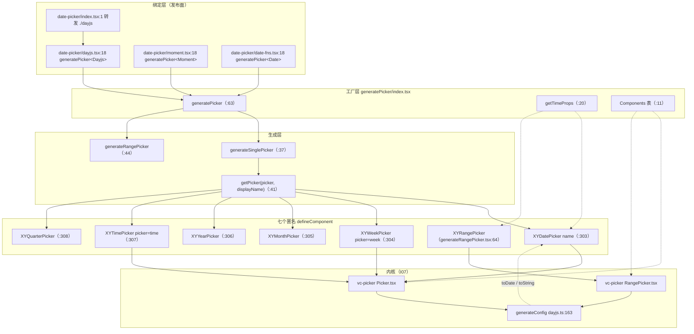
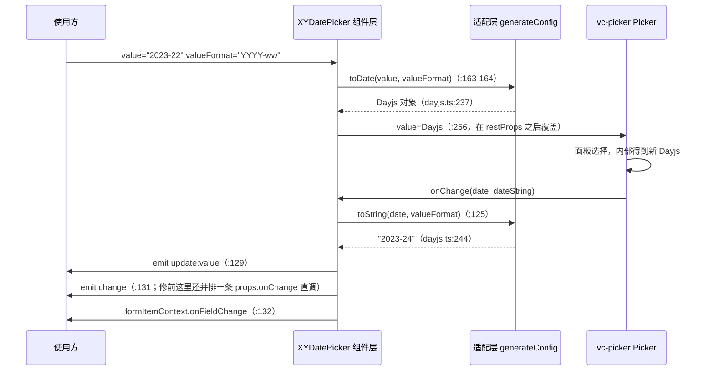
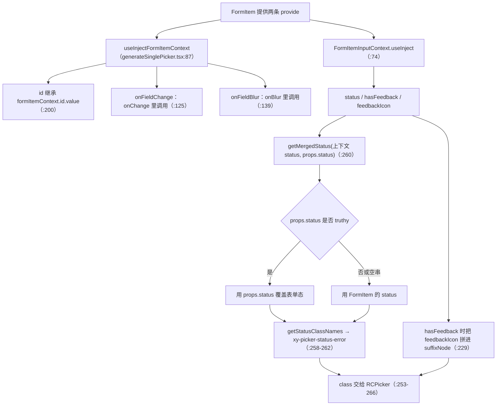

# C05-06 DatePicker 日期选择

> **本篇解决**：`<xy-date-picker>` 这个公开组件是怎么被 `generatePicker` 工厂造出来的；`valueFormat` 的字符串↔日期双向转换到底落在哪几个函数里；`presets` / `ranges` 这两类"快捷选项"如何穿过组件层；以及 Form 的校验态是通过哪两条互不相干的注入线染进类名与图标的。
> **前置**：I07《日期计算内核》（已完成）、A07《交互基础设施总览：一个浮层是怎么拼起来的》（已完成）、I04《输入基座：vc-input 与 BaseInput》（已完成）　**读者坐标**：`03-components/05-picker` 第 7/9 篇，本类第 6 个组件篇

本篇只讲 `packages/xiaoye-ui/src/date-picker/` 这一层。日期算术、dayjs 插件链、面板格子生成、范围选择的三份中间态、`viewDate` 的归属，这些机制已由 I07 论证完毕，本篇一律引用其结论并标编号，不重复展开。

## 一、职责与边界

`date-picker/` 是 **适配层 + 外观层**，它不是"实现了一个日期选择器"，而是把 I07 描述的 `vc-picker/` 内核**实例化成一组带 `xy-` 名字的公开组件**，并在中间补上四件内核没有的事：

1. **值类型协商**：内核只认 `DateType`（本库实际是 `Dayjs`）。组件层负责在入口把字符串按 `valueFormat` 解析成 `DateType`，在出口把 `DateType` 格式化回字符串。
2. **公开形态包装**：`DatePicker` / `RangePicker` / `WeekPicker` / `MonthPicker` / `YearPicker` / `QuarterPicker` / `TimePicker` 七个组件由同一份 props 表与同一份 `setup` 生成，差别只在一个闭包参数。
3. **外观注入**：尺寸、圆角、状态类名、`prefixCls`、hashId、compact 类名，全部在这一层拼成 `class` 字符串交给内核。
4. **表单接线**：`id` 从 FormItem 继承，变更与失焦时通知 FormItem 触发校验，校验态反过来决定类名与后缀图标。

**明确不负责**：弹层开合时序与定位（归 A07 / I02 的 `vc-trigger` + `vc-align`）、面板内的任何日期运算与视图态（I07）、输入框的 IME 与光标（I04）、时区与 locale 数据本体（I11）。

依赖清单（组件层实际 import 的上游，见 `generateSinglePicker.tsx:1-21`、`generateRangePicker.tsx:1-28`）：

| 依赖 | 用处 | 出处 |
| --- | --- | --- |
| `../../vc-picker` | `RCPicker` / `RangePicker` 内核容器 | `generateSinglePicker.tsx:2`、`generateRangePicker.tsx:7` |
| `../../vc-picker/generate/index` | `GenerateConfig` 类型，工厂的参数 | `generateSinglePicker.tsx:4` |
| `../locale/en_US` | 兜底语言包 | `generateSinglePicker.tsx:5` |
| `../../locale-provider/LocaleReceiver` | `useLocaleReceiver('DatePicker', enUS)` | `generateSinglePicker.tsx:159`、`generateRangePicker.tsx:157` |
| `../../config-provider/hooks/useConfigInject` | `prefixCls` / `direction` / `size` / `disabled` / `getPopupContainer` | `generateSinglePicker.tsx:115-116` |
| `../../form/FormItemContext` | 两条表单注入线 | `generateSinglePicker.tsx:16`、`generateRangePicker.tsx:20` |
| `../../_util/statusUtils` | 状态类名 | `generateSinglePicker.tsx:17` |
| `../../space/Compact` | `useCompactItemContext` | `generateSinglePicker.tsx:18`、`generateRangePicker.tsx:26` |
| `../style` | `genComponentStyleHook('DatePicker')` | `generateSinglePicker.tsx:21` |
| `@xiaoye-ui/icons` | 前后缀图标 | `generateSinglePicker.tsx:1-6`、`generateRangePicker.tsx:1-6` |

## 二、源码地图

行数为 `find packages/xiaoye-ui/src/date-picker -type f -not -path "*/locale/*" | xargs wc -l` 的实际输出（`locale/` 下 70 余个语言包文件与本篇无关，已排除）。

| 文件 | 行数 | 职责 | 关键导出 / 主入口行 |
| --- | --- | --- | --- |
| `date-picker/index.tsx` | 4 | 包内默认入口，整文件只是 `dayjs` 绑定的转发 | `import DatePicker from './dayjs'`（:1） |
| `date-picker/dayjs.tsx` | 39 | **发布面唯一入口**：绑定 `Dayjs` + 挂 `install` | `generatePicker<Dayjs>`（:18-19）、`install`（:31-38） |
| `date-picker/moment.tsx` / `date-fns.tsx` | 41 / 38 | 另两套日期库绑定 | `generatePicker<Moment>` / `<Date>` |
| `date-picker/generatePicker/index.tsx` | 85 | 工厂聚合 + `getTimeProps` + `Components` | `Components`（:11）、`getTimeProps`（:20）、`generatePicker`（:63） |
| `date-picker/generatePicker/generateSinglePicker.tsx` | 318 | **单选主实现**，七个组件里的六个出自这里 | `generateSinglePicker`（:37）、`getPicker`（:41） |
| `date-picker/generatePicker/generateRangePicker.tsx` | 290 | 范围选择组件层 | `generateRangePicker`（:44）、`RangePicker`（:48） |
| `date-picker/generatePicker/props.ts` | 301 | 三份 props 运行时表 + 对应 interface | `commonProps`（:37）、`datePickerProps`（:177）、`rangePickerProps`（:205）、`ExtraDatePickerProps`（:287） |
| `date-picker/generatePicker/interface.ts` | 70 | 把内核 props 类型剥掉内部字段、加 `size`/`bordered` | `InjectDefaultProps`（:15）、`PickerLocale`（:31） |
| `date-picker/util.ts` | 102 | 占位符解析 + `placement → dropdownAlign` 映射 | `getPlaceholder`（:6）、`getRangePlaceholder`（:33）、`transPlacement2DropdownAlign`（:57） |
| `date-picker/PickerButton.tsx` / `PickerTag.tsx` | 8 / 6 | 面板底部按钮与 preset 标签的外观件 | 经 `Components` 注入内核 |
| `date-picker/utils.js` | 60 | **测试辅助**，非发布代码 | `openPicker`（:36）、`selectCell`（:44）、`closePicker`（:40） |
| `date-picker/style/index.ts` | 1446 | CSS-in-JS 样式，本类最大单文件 | 由 `useStyle(prefixCls)` 调用 |
| `date-picker/*.test.js` ×6 | 11 / 25 / 32 / 64 / 68 / 89 | 全部测试见 §七 | — |

主实现入口：`packages/xiaoye-ui/src/date-picker/generatePicker/generateSinglePicker.tsx:55`（`getPicker`）。

测试文件与 `vitest.config.mts:33` 的 glob（`'src/**/*.test.{js,ts,jsx,tsx}'`）匹配，因此六个 `.test.js` 都会被执行——但执行不等于断言，见 §七。

## 三、架构与数据流

### 图 1：静态结构——工厂三层与七个公开组件

这张图是本篇的骨架：**组件层没有任何一个"日期选择器组件"是写在文件里的**，七个公开组件全部是 `getPicker` / `generateRangePicker` 在模块加载时的返回值。



三点解读：

- `getPicker` 被调了 6 次（`generateSinglePicker.tsx:311-316`），每次产出一个**独立的** `defineComponent`，彼此不共享实例状态；它们的差异只有闭包参数 `picker` 与 `displayName`。`picker` 的作用点在渲染期 `additionalOverrideProps.picker = picker`（`:207-209`）与 `mergedPicker = picker || p.picker || 'date'`（`:210`）——**前者优先**，所以 `<xy-week-picker picker="month">` 里用户写的 `picker` 会被静默忽略。
- `getTimeProps` 与 `Components` 是工厂层的两个"公共件"，被单选与范围两条生成链共享（`generateSinglePicker.tsx:8` 与 `generateRangePicker.tsx:12` 同一行 import）。`Components` 把本层的 `PickerButton` / `PickerTag` 反向注入内核，这是组件层唯一一次"往下给组件"而不只是"给 props"。
- `moment.tsx` / `date-fns.tsx` 与 `dayjs.tsx` 结构完全对称，但 I07 已论证只有 dayjs 进了 `package.json` 的 `exports`；本篇补一个组件层侧证：`date-picker/index.tsx` 只有 4 行，硬绑 `./dayjs`，没有任何运行时开关。

### 图 2：一次 `valueFormat` 往返（单选）



关键分支：`value` 这个 computed 的三元只在 `props.value` **truthy** 时做 `toDate`（`:162`），空串与 `null` 走 `:167` 的兜底。范围侧对应的兜底是原样返回（`generateRangePicker.tsx:165`），**没有** `'' → undefined` 这一步——这是两条链路唯一的行为差异，详见论点 2。

### 图 3：Form 校验态如何染进类名（双注入线）



`getMergedStatus` 的实现是 `customStatus || contextStatus`（`statusUtils.tsx:22-23`），用的是 `||` 而不是 `??`，所以 `status=""` 不会屏蔽表单态——这是"空串"在组件层唯一一次有语义的地方，但它和论点 2 里 `value=""` 的处理方向相反，容易记混。

## 四、核心机制精读

### 论点 1：公开组件不是"文件里的组件"，而是工厂在模块加载时的返回值；`install` 与类型生成物对不上，`xy-year-picker` 既注册不了也推导不出

**断言**：`date-picker` 目录下没有任何一个 `.tsx` 写了 `name: 'XYDatePicker'` 的完整组件；七个公开组件是 `getPicker` 闭包的产物。这条链上有三处"名单"，它们彼此不一致：**运行时可全局使用的**、**类型上可全局使用的**、**能从包根 named import 的**。

先看生成侧。`generateSinglePicker.tsx:51-61`：

```tsx
// packages/xiaoye-ui/src/date-picker/generatePicker/generateSinglePicker.tsx:37
export default function generateSinglePicker<DateType, ExtraProps = {}>(
  generateConfig: GenerateConfig<DateType>,
  extraProps: ExtraProps,
) {
  function getPicker(picker?: PickerMode, displayName?: string) {
    const comProps = {
      ...commonProps<DateType>(),
      ...datePickerProps<DateType>(),
      ...extraProps,
    };
    return defineComponent({
      compatConfig: { MODE: 3 },
      name: displayName,
      inheritAttrs: false,
      props: comProps,
```

- `props: comProps`（:37）在 **`getPicker` 内部**展开，也就是每调用一次 `getPicker` 就重新求值一次三份 props 表 —— 六个组件各持一份互不影响的 props 对象。
- `extraProps` 排在最后展开（:32），因此工厂的第二个参数**可以覆盖 `format`、`value` 等任意基础 prop 定义**。`generatePicker/index.tsx:63-66` 给了这个口子，`date-picker/` 自己的三处调用（`dayjs.tsx:19`、`moment.tsx:21`、`date-fns.tsx:18`）都没传第二个参数，唯一真正用上它的是 `time-picker/time-picker.tsx:74-77`：

```tsx
// packages/xiaoye-ui/src/time-picker/time-picker.tsx:74
  const DatePicker = generatePicker<DateType>(generateConfig, {
    ...timePickerProps(),
    order: { type: Boolean, default: true },
  });

  const { TimePicker: InternalTimePicker, RangePicker: InternalRangePicker } = DatePicker as any;
```

`grep -rn "generatePicker<" packages/xiaoye-ui/src` 的完整结果只有 4 处调用（上述 3 处 + 这一处）。**`time-picker` 这一调把七个组件全造了一遍再扔掉五个**，只为拿 `TimePicker` 与 `RangePicker` 两个内部件，于是 `XYDatePicker` 这个名字在模块图里至少对应两个不同的组件对象。它的实际后果受 `_util/registerComponent.ts:23-25` 的写法约束：

```ts
// packages/xiaoye-ui/src/_util/registerComponent.ts:22
  const tagName = toXYTagName(name);
  if (!app.component(tagName)) {
    app.component(tagName, component);
  }
```

已存在就**静默跳过**（不是报错、也不是覆盖），所以 `xy-date-picker` 最终绑到哪个实例取决于 `install` 顺序；`XYTimePicker` 同理——`generateSinglePicker.tsx:315` 造了一个、`time-picker.tsx:81` 又造了一个同名组件，谁先注册谁生效。这条约束不在任何测试里，只能靠"date-picker 的 `install` 恰好没注册 TimePicker"来维持。

- `name: displayName`（:35）取自 `:295-300` 的硬编码字符串：

```tsx
// packages/xiaoye-ui/src/date-picker/generatePicker/generateSinglePicker.tsx:303
  const DatePicker = getPicker(undefined, 'XYDatePicker');
  const WeekPicker = getPicker('week', 'XYWeekPicker');
  const MonthPicker = getPicker('month', 'XYMonthPicker');
  const YearPicker = getPicker('year', 'XYYearPicker');
  const TimePicker = getPicker('time', 'XYTimePicker');
  const QuarterPicker = getPicker('quarter', 'XYQuarterPicker');
```

注意第一行的 `undefined`：**`XYDatePicker` 是唯一一个 `picker` 参数为 `undefined` 的实例**，它的模式只能由使用方的 `picker` prop 决定（`:210` 的 `mergedPicker = picker || p.picker || 'date'`）。其余五个把 `picker` 焊死。

再看装配侧。`generatePicker/index.tsx:63-83`：

```tsx
// packages/xiaoye-ui/src/date-picker/generatePicker/index.tsx:63
function generatePicker<DateType, ExtraProps extends {} = {}>(
  generateConfig: GenerateConfig<DateType>,
  extraProps?: ExtraProps,
) {
  // =========================== Picker ===========================
  const { DatePicker, WeekPicker, MonthPicker, YearPicker, TimePicker, QuarterPicker } =
    generateSinglePicker<DateType, ExtraProps>(generateConfig, extraProps);

  // ======================== Range Picker ========================
  const RangePicker = generateRangePicker<DateType, ExtraProps>(generateConfig, extraProps);

  return {
    DatePicker,
    WeekPicker,
    MonthPicker,
    YearPicker,
    TimePicker,
    QuarterPicker,
    RangePicker,
  };
}
```

这个函数**没有缓存**：调两次 `generatePicker(dayjsGenerateConfig)` 会得到两套 `name` 相同、组件对象不同的实例，而 `registerComponent.ts:23-25` 遇到同名标签是静默跳过。"一次绑定一套组件"这件事靠调用次数维持，不靠代码约束，实际调用次数见下。

发布侧是名单不一致的现场。`date-picker/dayjs.tsx:18-39`：

```tsx
// packages/xiaoye-ui/src/date-picker/dayjs.tsx:18
const { DatePicker, WeekPicker, MonthPicker, YearPicker, TimePicker, QuarterPicker, RangePicker } =
  generatePicker<Dayjs>(dayjsGenerateConfig);

/* istanbul ignore next */
export { RangePicker, WeekPicker, MonthPicker, QuarterPicker };

export default Object.assign(DatePicker, {
  WeekPicker,
  MonthPicker,
  YearPicker,
  RangePicker,
  TimePicker,
  QuarterPicker,
  install: (app: App) => {
    registerComponent(app, DatePicker);
    registerComponent(app, RangePicker);
    registerComponent(app, MonthPicker);
    registerComponent(app, WeekPicker);
    registerComponent(app, QuarterPicker);
    return app;
  },
});
```

把三份名单摊开对比：

| 组件 | `install` 里有（:31-38） | named export 里有（:24） | `Object.assign` 属性（:25-31） | `typings/global.d.ts` 里有 |
| --- | --- | --- | --- | --- |
| `DatePicker` | 是 | 否（走 `components.ts:113` 默认导出） | — | 是（:32） |
| `RangePicker` | 是 | 是 | 是 | **否** |
| `MonthPicker` | 是 | 是 | 是 | **否** |
| `WeekPicker` | 是 | 是 | 是 | **否** |
| `QuarterPicker` | 是 | 是 | 是 | **否** |
| `YearPicker` | **否** | **否** | 是 | **否** |
| `TimePicker` | **否** | **否** | 是 | 是（:97，归 `time-picker` 篇） |

`global.d.ts` 里含 Picker 的只有三行，实测命令 `grep -n "Picker" packages/xiaoye-ui/typings/global.d.ts` 只给出 `XYColorPicker`（:25）、`XYDatePicker`（:32）、`XYTimePicker`（:97）。

**结论**：`app.use(DatePicker)` 之后，模板里写 `<xy-range-picker>` 能渲染（`registerComponent` 按 `name` 反推标签并注册了它），但 TS 在全局组件表里查不到这个名字；反过来 `YearPicker` 被 `Object.assign` 挂在 `DatePicker.YearPicker` 上（:27），既不能 named import，也不在 `install` 里，`xy-year-picker` 这个标签在任何工程里都写不出来——除非使用方自己 `app.component(...)`，而那违反 `AGENTS.md` 的注册规范。`TimePicker` 的缺席是合理的，它由 `time-picker/dayjs.tsx:25` 自己注册；`YearPicker` 的缺席没有任何对应出口，是全链路的孤儿。

### 论点 2：`valueFormat` 不是"值包装对象"，而是 8 + 6 处硬编码的 `toDate` / `toString` 调用；单选与范围在空值归一上行为不同

**断言**：整条 `valueFormat` 链路没有中间层、没有 hook、没有 `computed` 缓存失效保护，它就是**入口三个 computed 各调一次 `toDate`、出口四个回调共用一个 `maybeToString`**。实测：`grep -rn "valueFormat" packages/xiaoye-ui/src/date-picker` 共 22 行，其中 4 行在 `props.ts`（:102 props 声明、:172 interface、:288 / :295 Extra 类型）、4 行在测试（`QuarterPicker.test.js:17/23`、`RangePicker.test.js:69/76`），剩下 14 行全在两个生成文件里，`generatePicker/index.tsx` 一行都没有。

出口侧，`generateSinglePicker.tsx:124-133`。以下为修前快照（2026-09-29 已改）：

```tsx
// packages/xiaoye-ui/src/date-picker/generatePicker/generateSinglePicker.tsx:124
        const maybeToString = (date: DateType) => {
          return props.valueFormat ? generateConfig.toString(date, props.valueFormat) : date;
        };
        const onChange = (date: DateType, dateString: string) => {
          const value = maybeToString(date);
          emit('update:value', value);
          emit('change', value, dateString);
          callEvent(props.onChange, value, dateString);
          formItemContext.onFieldChange();
        };
```

修后是同一个 `124-133` 区间，差别只在 `callEvent(props.onChange, ...)` 那一句被删掉、原位换成一行注释，函数体从 4 句缩回 3 句：

```tsx
// packages/xiaoye-ui/src/date-picker/generatePicker/generateSinglePicker.tsx:124
        const maybeToString = (date: DateType) => {
          return props.valueFormat ? generateConfig.toString(date, props.valueFormat) : date;
        };
        const onChange = (date: DateType, dateString: string) => {
          const value = maybeToString(date);
          emit('update:value', value);
          // emit 已覆盖 vnode 上的 props.onChange，紧跟着再调一次就是双投
          emit('change', value, dateString);
          formItemContext.onFieldChange();
        };
```

范围侧同形，`generateRangePicker.tsx:124` 的 `onChange` 现在也只剩 `emit` 一路（`emit('change', values, dateStrings)` 在 `generateRangePicker.tsx:121`）。多删的那一行为什么会让父级 `@change` 少跑两遍、以及「只删这一行还不够」的原因，见论点 5。

`maybeToString` 被四个出口复用：`onChange`（:121）、`onPanelChange`（:142）、`onOk`（:147），范围侧对应 `generateRangePicker.tsx:114-116` 的 `maybeToStrings`，被 `onChange`（:111）、`onPanelChange`（:132）、`onOk`（:137）、`onCalendarChange`（:146）四处复用。**注意 `onCalendarChange` 也走了转换**，这是范围独有的第五个出口。

入口侧，`generateSinglePicker.tsx:161-168`：

```ts
// packages/xiaoye-ui/src/date-picker/generatePicker/generateSinglePicker.tsx:161
        const value = computed(() => {
          if (props.value) {
            return props.valueFormat
              ? generateConfig.toDate(props.value as string | DateType, props.valueFormat)
              : props.value;
          }
          return (props.value === '' ? undefined : props.value) as DateType;
        });
```

`:160` 这一行是这段里最值得记的一句：它处在 `if (props.value)` 为 **假** 的分支里，此时 `props.value` 只能是 `''` / `null` / `undefined` / `0` 之类，于是这句话的全部作用就是**把空串折成 `undefined`**，其余假值原样透传。设计意图很明确——`''` 不该被当成"受控于一个空值"，而 `undefined` 才表示"非受控"。

范围侧的同名 computed，`generateRangePicker.tsx:159-166`：

```ts
// packages/xiaoye-ui/src/date-picker/generatePicker/generateRangePicker.tsx:159
      const value = computed(() => {
        if (props.value) {
          return props.valueFormat
            ? generateConfig.toDate(props.value, props.valueFormat)
            : props.value;
        }
        return props.value;
      });
```

`:158` 直接 `return props.value`，**没有单选那句 `'' → undefined` 归一**。对范围来说 `value={[]}` 是 truthy 的，于是会走进 `:154` 的 `toDate([], valueFormat)`，`dayjs.ts:234` 的 `Array.isArray` 分支对空数组 `map` 出空数组——空数组被当成"一个长度为 0 的受控值"交给内核，而不是"未受控"。这正是 `RangePicker.test.js:21` 那条 `it.skip('should not throw error when value is reset to \`[]\`')` 想覆盖的场景，而它被 skip 了（详见 §七 坑 3）。

转换真正干活的地方在适配层，且它天然吃数组，`vc-picker/generate/dayjs.ts:233-246`：

```ts
// packages/xiaoye-ui/src/vc-picker/generate/dayjs.ts:233
  toDate: (value, valueFormat) => {
    if (Array.isArray(value)) {
      return value.map((val: any) => toDateWithValueFormat(val, valueFormat)) as Dayjs[];
    } else {
      return toDateWithValueFormat(value, valueFormat) as Dayjs;
    }
  },
  toString: (value, valueFormat) => {
    if (Array.isArray(value)) {
      return value.map((val: any) => (dayjs.isDayjs(val) ? val.format(valueFormat) : val));
    } else {
      return dayjs.isDayjs(value) ? value.format(valueFormat) : value;
    }
  },
```

两处都是 `isDayjs` 为假就**原样返回**（:242 的 `: val`、:244 的 `: value`），配合 `toDateWithValueFormat` 在 `dayjs.ts:127-129` 的 `if (dayjs.isDayjs(val)) return val`，得到一组有用的幂等性质：**设了 `valueFormat` 之后仍然传 `Dayjs` 不会报错**，进来时跳过解析、出去时才会被格式化成字符串。而 `dayjs.ts:126` 的 `if (!val) return null` 决定了另一件事：范围数组里的 `null` 元素经 `toDate` 仍是 `null`，经 `toString` 也仍是 `null`，所以 `allowEmpty`（`props.ts:207`）这类"一端留空"的语义能安全往返。

**结论**：`valueFormat` 的实现代价是 14 处散落的三元，收益是零抽象层。它没有任何一处做 `format` 与 `valueFormat` 的一致性校验，也没有 warning。I07 已指出 `Q` / `wo` 这类 token 需要 `advancedFormatRegex` 补丁才能反向解析（`dayjs.ts:130-150`），那是适配层的事；组件层的责任缺失在于——**当 `valueFormat` 写了内核解析不了的 token 时，组件层会把 `toDate` 产出的无效 Dayjs 原封不动塞进内核**，`generateSinglePicker.tsx:164` 到 `:248` 之间没有任何校验点。

### 论点 3：`presets` 与 `ranges` 全靠 `{ ...restProps }` 透传，组件层不参与它们的值加工，因此 preset 的 `value` 不受 `valueFormat` 保护

**断言**：组件层对 `presets` / `ranges` 做的唯一事情是**声明 props 让它们进 `props` 对象**，随后被渲染期的 `...restProps` 原样交给内核；`PresetPanel` 拿到 `value` 后直接喂 `triggerChange`，全程没有 `toDate`。

声明在 `props.ts`，单选与范围各一份且类型不同：

```ts
// packages/xiaoye-ui/src/date-picker/generatePicker/props.ts:182
    presets: arrayType<PresetDate<DateType>[]>(),
```

```ts
// packages/xiaoye-ui/src/date-picker/generatePicker/props.ts:212
    presets: arrayType<PresetDate<Array<DateType>>[]>(),
```

`:182` 是 `DateType`，`:212` 是 `Array<DateType>`（注意不是 `RangeValue<DateType>`，所以类型上允许长度不为 2 的数组）。而 `ranges` 只在范围侧存在，`props.ts:218-224`：

```ts
// packages/xiaoye-ui/src/date-picker/generatePicker/props.ts:218
    ranges:
      objectType<
        Record<
          string,
          Exclude<RangeValue<DateType>, null> | (() => Exclude<RangeValue<DateType>, null>)
        >
      >(),
```

类型层面它接受"值或返回值的函数"，这一点在适配处兑现：`vc-picker/hooks/usePresets.ts:11-28` 把 `presets` 与 legacy `ranges` 归一成同一个列表，`:21` 处 `typeof range === 'function' ? range() : range` 求值，并在 `:16` 打一条 `ranges` 已废弃的 warning。

**关键：这两个名字在组件层的渲染函数里从未被解构出来。** `generateSinglePicker.tsx:203-218` 从 `p` 里摘走的字段是 `bordered / placeholder / suffixIcon / showToday / transitionName / allowClear / dateRender / renderExtraFooter / monthCellRender / clearIcon / id`，`presets` 不在其中，于是落进 `...restProps`，在 `:244` 被整体展开：

```tsx
// packages/xiaoye-ui/src/date-picker/generatePicker/generateSinglePicker.tsx:250
              allowClear={allowClear}
              transitionName={transitionName || `${rootPrefixCls.value}-slide-up`}
              {...restProps}
              {...additionalOverrideProps}
              id={id}
              picker={mergedPicker}
```

范围侧同理，`generateRangePicker.tsx:247` 的 `{...restProps}` 之后才轮到显式属性。内核确实声明了这些 prop，所以透传不是"碰运气"：`vc-picker/Picker.tsx:65` 有 `presets?: PresetDate<DateType>[]`、props 列表 `:168` 含 `'presets'`、`:223-224` 建 computed 并交给 `usePresets`；`vc-picker/RangePicker.tsx:102-104` 同时声明 `presets` 与带 `@deprecated` 注释的 `ranges`，`:222` 与 `:254` 把它们列进 props 数组，`:286-288` 汇给 `usePresets(presets, ranges)`。

消费点是 `PresetPanel`，单选与范围各一处：

```tsx
// packages/xiaoye-ui/src/vc-picker/Picker.tsx:477
            <PresetPanel
              prefixCls={prefixCls}
              presets={presetList.value}
              onClick={nextValue => {
                triggerChange(nextValue);
                triggerOpen(false);
              }}
            />
```

`Picker.tsx:488` 把 preset 的 `value` **原样**交给 `triggerChange`，`RangePicker.tsx:1128` 是 `triggerChange(nextValue, null)`。这两处都不经过组件层，因此 `maybeToString` 只在**输出方向**生效：使用方写 `presets: [{ label: '今天', value: dayjs() }]` 时，点完之后 `update:value` 出来的是格式化字符串（`generateSinglePicker.tsx:135-137`），一切正常；但 `PresetPanel.tsx:23` 解构的是 `{ label, value }`，`value` 会被内核拿去做选中态比较与 `setPickerValue`，**字符串 preset 在这一侧没有任何解析**。

`grep -rn "valueFormat" packages/xiaoye-ui/src/date-picker` 的 22 行结果里，没有任何一行涉及 `presets` 或 `ranges`，这就是"组件层不参与 preset 值加工"的可复现证据。

顺带一个只有组件层才能看到的缺陷：`Components` 对象里塞了一个内核根本不读的键，`generatePicker/index.tsx:11`：

```tsx
// packages/xiaoye-ui/src/date-picker/generatePicker/index.tsx:11
export const Components = { button: PickerButton, rangeItem: PickerTag };
```

内核侧的类型只认一个键，`vc-picker/interface.ts:99-101` 是 `export type Components = { button?: any }`；而 `rangeItem` 在全库（排除 `dist` 与 `node_modules`）只出现在上面这一行，两次独立检索互为佐证：

```bash
grep -rn "rangeItem" packages/xiaoye-ui/src
grep -rni "rangeitem" packages apps --include='*.ts' --include='*.tsx' --include='*.js' \
  --include='*.vue' --include='*.less' | grep -v "/dist/" | grep -v node_modules
```

`Components` 在 `generateSinglePicker.tsx:291` 与 `generateRangePicker.tsx:277` 被注入内核，但 `getRanges.tsx:29` 只取 `components.button`（渲染面板底部的确认按钮，即本层 `PickerButton.tsx:5-7` 那个包了 `Button` 的函数式组件）。**`PickerTag.tsx`（6 行）没有任何消费方**：它给 `Tag` 焊上 `color="blue"` 作为 preset 项的外观件，而 preset 实际由 `PresetPanel.tsx:24` 的裸 `<li>` 渲染，内核里既没有读 `rangeItem` 的代码、`Components` 类型里也没有这个键。宽度倒是在样式里留了位子——`style/index.ts:1442-1443` 的 `presetsWidth: 120` / `presetsMaxWidth: 200` 被 `:1298-1299` 用作 `minWidth` / `maxWidth`。

这里要显式记下与 I07 的一处**结论分歧**（2026-09-29 复裁：I07 已按本篇更正，见 I07 §五 末段）：I07 初稿把这条注入通道描述为"页脚按钮与范围输入格都从这张表里取；要替换 preset 按钮样式，改的是这两个文件而不是 vc-picker"。按本篇两次独立检索的结果，`rangeItem` 在 `packages/xiaoye-ui/src` 全树只有 `generatePicker/index.tsx:11` 这一处出现、零处读取，且 `vc-picker/interface.ts:99-101` 的 `Components` 类型只有 `button` 一个键；`components` 的唯一读取点是 `vc-picker/utils/getRanges.tsx:29`，那里渲染的是页脚 `okNode`（`:41` 起）与「此刻」按钮（`:32-38`），而真正的预设项面板走的是另一条完全独立的通道——`vc-picker/Picker.tsx:21` 静态导入、`:491` 使用的 `PresetPanel`（其 `-presets` 容器类名在 `vc-picker/PresetPanel.tsx:21`），`components` 根本没有传进去——所以那条修法只对 `PickerButton`（页脚确认按钮）成立，对 **preset 外观不成立**；改 preset 样式要落到 `date-picker/style/index.ts:1295-1299` 的 `${componentCls}-presets` 分支（配套 token 是 `:26-27` 的 `presetsWidth`/`presetsMaxWidth`），改结构只能改 `PresetPanel`。顺带一条同向证据：全仓 `grep -rn "range-item" packages/xiaoye-ui/src` **零命中**，即厂商层连一个供 `PickerTag` 落地的类名都不存在。

**结论**：`presets` 是"内核功能 + 组件层透传"，`ranges` 是它的废弃别名并靠 `usePresets` 归一；二者都不受 `valueFormat` 保护，preset 的 value 必须是 `DateType`。组件层在这条链上唯一的实质贡献是把 `PickerButton` 交出去当确认按钮。

### 论点 4：Form 集成是两条互不相干的注入线——一条用来"喊一声"，一条用来"读一眼"，它们在组件层从不交汇

**断言**：picker 组件层同时 inject 了 FormItem 提供的两个上下文，但一个是**调用它**（`onFieldChange` / `onFieldBlur`），一个是**读取它**（`status` / `hasFeedback` / `feedbackIcon`）。两条线在源码里各走各的，没有任何一处把它们合并，也没有任何一处让 picker 自己判定校验态。

接线点紧挨着写在相邻两行，`generateSinglePicker.tsx:87-88`：

```tsx
// packages/xiaoye-ui/src/date-picker/generatePicker/generateSinglePicker.tsx:80
        const formItemContext = useInjectFormItemContext();
        const formItemInputContext = FormItemInputContext.useInject();
```

范围侧逐字相同，`generateRangePicker.tsx:89-90`。注意 import 来源也不同——`useInjectFormItemContext` 是函数导出、`FormItemInputContext` 是对象，两者同源于 `form/FormItemContext`（`generateSinglePicker.tsx:16`）。

**第一条线（通知）**有三个消费点。前两个是事件尾巴。以下为修前快照（2026-09-29 已改）：

```tsx
// packages/xiaoye-ui/src/date-picker/generatePicker/generateSinglePicker.tsx:143
        const onBlur = (e: FocusEvent) => {
          emit('blur', e);
          callEvent(props.onBlur, e);
          formItemContext.onFieldBlur();
        };
```

修后 `generateSinglePicker.tsx:151` 到 `:147` 只剩两句调用，中间那句 `callEvent(props.onBlur, e)` 已删：

```tsx
// packages/xiaoye-ui/src/date-picker/generatePicker/generateSinglePicker.tsx:143
        const onBlur = (e: FocusEvent) => {
          // emit 已覆盖 vnode 上的 props.onBlur，紧跟着再调一次就是双投
          emit('blur', e);
          formItemContext.onFieldBlur();
        };
```

`onFieldChange` 在 `onChange` 的最后一步（`generateSinglePicker.tsx:139`），`onFieldBlur` 在 `onBlur` 的最后一步（`generateSinglePicker.tsx:153`），**都是函数体的最后一句**，意味着事件投递先发、校验通知后发（修前中间还夹着 prop 回调那一句，见论点 5）。第三个消费点最隐蔽，它在渲染函数里：

```tsx
// packages/xiaoye-ui/src/date-picker/generatePicker/generateSinglePicker.tsx:207
            clearIcon = slots.clearIcon?.(),
            id = formItemContext.id.value,
            ...restProps
          } = p;
```

`id` 用的是**解构默认值**，语义是"只有当 `p.id` 为 `undefined` 时才取 FormItem 的 id"，这保证了显式 `<xy-date-picker id="x">` 不被覆盖；代价是 `p.id` 为 `null` 或 `''` 时默认值不生效，FormItem 的 label-for 关联会断。范围侧同一段在 `generateRangePicker.tsx:207`。

两个 hook 的兜底实现决定了"脱离 Form 时不炸"：`FormItemContext.ts:68-73` 的 `defaultContext` 把 `id` 做成 `computed(() => undefined)`、`onFieldBlur` / `onFieldChange` 做成空函数；`:78-90` 的 `useInjectFormItemContext` 更狠，它在 `:87-88` **主动向下 re-provide 默认值**（`:86` 的注释写明 `We should prevent the passing of context for children`），所以日期面板内部的任何组件都不会误继承外层 FormItem。

被通知的那一端在 Form 里，`FormItem.tsx:310-319`：

```tsx
// packages/xiaoye-ui/src/form/FormItem.tsx:313
    const onFieldChange = () => {
      if (validateDisabled.value) {
        validateDisabled.value = false;
        return;
      }
      validateRules({ triggerName: 'change' });
    };
```

`generateSinglePicker.tsx:139` 那句调用最终落到这里，触发的是 `triggerName: 'change'` 的规则子集；`:311` 的 blur 走 `'blur'` 子集。**`:314-317` 这道 `validateDisabled` 闸会吞掉一次变更**——这是 picker 层看不见、但在 Form 里必然发生的行为：程序化改值后的第一次 change 不校验。picker 侧完全无法感知这个吞并，因为 `onFieldChange` 返回 `void`。

**第二条线（状态）**只有两个消费点，都在渲染函数尾部。后缀图标：

```tsx
// packages/xiaoye-ui/src/date-picker/generatePicker/generateSinglePicker.tsx:234
          const suffixNode = (
            <>
              {suffixIcon || (picker === 'time' ? <ClockCircleOutlined /> : <CalendarOutlined />)}
              {formItemInputContext.hasFeedback && formItemInputContext.feedbackIcon}
            </>
          );
```

状态类名：

```tsx
// packages/xiaoye-ui/src/date-picker/generatePicker/generateSinglePicker.tsx:266
                getStatusClassNames(
                  pre,
                  getMergedStatus(formItemInputContext.status, props.status),
                  formItemInputContext.hasFeedback,
                ),
```

范围侧是同一对：`generateRangePicker.tsx:223-228` 的 suffixNode 与 `:244-248` 的类名合并。这两处都读 `formItemInputContext` 的**裸字段而非 ref**，因为上游是可变对象：`FormItem.tsx:431` 先 `FormItemInputContext.useProvide(formItemInputContext)`，随后 `:432` 的 `watchEffect` 用 `Object.assign` 往里写字段（`:447-450`），并不是重新 provide 一个新对象。`:434` 也说明了 `feedbackIcon` 只在 `hasFeedback` 为真时才构造，否则保持 `undefined`，于是 `:229` 那句 `hasFeedback && feedbackIcon` 的双重保险是冗余但无害的。

类名最终由 `_util/statusUtils.tsx:8-20` 落地，`prefixCls` 传的是 `pre`（即 `xy-picker`），产物形如 `xy-picker-status-error` / `xy-picker-has-feedback`；合并函数值得逐字看，`:22-23`：

```tsx
// packages/xiaoye-ui/src/_util/statusUtils.tsx:22
export const getMergedStatus = (contextStatus?: ValidateStatus, customStatus?: InputStatus) =>
  customStatus || contextStatus;
```

优先级是 **`props.status` 覆盖表单态**，但因为用 `||` 而非 `??`，`status=""`（`InputStatuses` 第 4 行里合法的第 3 个值）会被判 falsy 而回落到表单 status。想"用组件自身的中性态压掉表单红框"没有可用取值。

`status` 这条线到此为止：组件层**不把它传进内核**，`vc-picker` 收到的只是一个拼好的 `class` 字符串；对应的样式在 `date-picker/style/index.ts:1432` 由 `genPickerStatusStyle(pickerToken)` 单独生成，是 `genComponentStyleHook('DatePicker', ...)`（`:1422-1423`）返回的两个主样式之一。

**顺带一个可复现的重复实现**：`_util/` 下有两份等长（各 23 行）的 statusUtils——`packages/xiaoye-ui/src/_util/statusUtils.tsx` 与 `packages/xiaoye-ui/src/_util/components/statusUtils.tsx`。picker 引用的是前者（`generateSinglePicker.tsx:17` 的 `from '../../_util/statusUtils'`）。后者没有任何引用方：

```bash
grep -rn "components/statusUtils" packages/xiaoye-ui/src
```

该命令无输出。改状态类名时如果只改了副本，picker 的表现不会有任何变化。

**结论**：组件层对 Form 的贡献是"在正确的时机喊一声、在正确的地方读一眼"。它不做校验、不缓存校验态、不感知 FormItem 的吞并策略，两条线在 `:125` 与 `:258` 各自结束，彼此不知道对方存在。

### 论点 5：`{ ...props, ...attrs }` 加"显式属性写在展开之后"是组件层唯一的合并策略；`value` 能拿到转换后的值全靠 JSX 属性顺序

**断言**：组件层不维护任何内部值状态（I07 已论证 `viewDate`、`pickerValue`、范围的三份 ref 全在内核），它只做一次对象合并、一次解构补默认值、一次展开回内核。合并的唯一入口是这一行，`generateSinglePicker.tsx:201`：

```tsx
// packages/xiaoye-ui/src/date-picker/generatePicker/generateSinglePicker.tsx:191
        return () => {
          const locale = { ...contextLocale.value, ...props.locale };
          const p = { ...props, ...attrs };
```

`inheritAttrs: false`（`:36`）保证 `attrs` 只装"没被 props 表声明的东西"，所以 `p` 实际是**已声明 props 与未声明 attrs 的并集**；`attrs` 写在后面，是为了让极少数"名字撞上"的情况偏向 attrs（例如内核私有、组件层没声明的 prop）。紧接着的解构只做一件事——**补默认值**，`generateSinglePicker.tsx:203-218`：

```tsx
// packages/xiaoye-ui/src/date-picker/generatePicker/generateSinglePicker.tsx:203
          const {
            bordered = true,
            placeholder,
            suffixIcon = slots.suffixIcon?.(),
            showToday = true,
            transitionName,
            allowClear = true,
            dateRender = slots.dateRender,
            renderExtraFooter = slots.renderExtraFooter,
            monthCellRender = slots.monthCellRender ||
              (props as any).monthCellContentRender ||
              slots.monthCellContentRender,
            clearIcon = slots.clearIcon?.(),
            id = formItemContext.id.value,
            ...restProps
          } = p;
```

四个默认值 `bordered = true` / `showToday = true` / `allowClear = true` / `id = ...` 是**这一层加上的**，内核侧对这些字段没有同样的默认。`props.ts:97`（`bordered: booleanType()`）、`:93`（`showToday`）、`:49`（`allowClear`）都声明成无默认值的 `booleanType()`，也就是说"默认有边框、默认可清除、默认显示今天"这三条产品决策写在渲染函数里而不是 props 表里，改动时看 props 表是看不出来的。

然后是被解构走的字段与 `restProps` 的关系：**被解构的名字不会进 `restProps`，没被解构的名字会**。而 `value` / `defaultValue` / `defaultPickerValue` / `prefixCls` / `presets` / `onChange` / `disabled` **都不在解构清单里**，它们统统进了 `restProps`，在 `:244` 被整体展开，之后才轮到显式属性：

```tsx
// packages/xiaoye-ui/src/date-picker/generatePicker/generateSinglePicker.tsx:252
              {...restProps}
              {...additionalOverrideProps}
              id={id}
              picker={mergedPicker}
              value={value.value}
```

`value={value.value}`（`:248`）写在大展开之后，JSX 的后者覆盖前者，所以论点 2 里那个转换后的 `Dayjs` 才真的生效；`disabled={disabled.value}`（`:267`）同理覆盖了 `restProps` 里那个原始 `props.disabled`，而 `disabled.value` 来自 `useConfigInject`，其定义是 `props.disabled ?? disabledContext.value`（`useConfigInject.ts:43`）——**这一步把 `DisabledContext` 的批量禁用接上了**。`prefixCls={pre}`（`:268`）也一样：`props.prefixCls` 先经 `useConfigInject.ts:14` 的 `getPrefixCls(name, props.prefixCls)` 消化过，再由显式属性写回，所以用户自定义前缀没有丢。

这条"顺序即语义"的规则没有任何注释保护。把 `:244` 的 `{...restProps}` 挪到 `:288` 之后，`value` 就会退回原始字符串，面板立刻解析失败——这是本篇 §七 坑 1 的成因。

**范围侧多做了两件事**，`generateRangePicker.tsx:193-211`：

```tsx
// packages/xiaoye-ui/src/date-picker/generatePicker/generateRangePicker.tsx:185
        const p = { ...props, ...attrs };
        const {
          prefixCls: customizePrefixCls,
          bordered = true,
```

```tsx
// packages/xiaoye-ui/src/date-picker/generatePicker/generateRangePicker.tsx:202
        delete restProps['onUpdate:value'];
        delete restProps['onUpdate:open'];
```

第一处：`:180` 把 `prefixCls` 解构成 `customizePrefixCls`，而这个变量**在整个文件里再没出现第二次**（`grep -n "customizePrefixCls" generateRangePicker.tsx` 只有这一行）。它的唯一作用是**把 `prefixCls` 从 `restProps` 里摘掉**——单选侧没摘，靠 `:268` 的显式覆盖；范围侧摘了，靠 `:254` 的显式赋值。两种写法结果一致，但机制不同，改一边容易忘另一边。

第二处：`'onUpdate:value'` 与 `'onUpdate:open'` 是声明过的 props（`props.ts:75`、`:78`），因此它们存在于 `props` → 存在于 `p` → 单选侧会随 `restProps` 一路进内核。内核 `Picker.tsx` 的 props 清单（`:150-198`）**不包含**这两个名字（`grep -n "update:value" packages/xiaoye-ui/src/vc-picker/Picker.tsx` 无输出），于是它们落进内核的 `attrs`，而内核把 `attrs` 整体并进了 `panelProps`：

```tsx
// packages/xiaoye-ui/src/vc-picker/Picker.tsx:469
        const panelProps = {
          // Remove `picker` & `format` here since TimePicker is little different with other panel
          ...(props as Omit<MergedPickerProps<DateType>, 'picker' | 'format'>),
          ...attrs,
```

也就是说单选取掉了 `delete` 之后，这两个 v-model 处理函数会随 `attrs` 继续向下渗透到面板层。内核里没有任何代码调用 `update:value`，所以本篇**不声称这会造成可见缺陷**；但两侧的不对称是事实，且 `delete` 只写在范围侧说明作者知道这个泄漏存在。

**props 表与 emits 清单对同一件事声明了两遍**，这是这条链上最值得警惕的一处。`commonProps` 把回调当 prop 声明：

```ts
// packages/xiaoye-ui/src/date-picker/generatePicker/props.ts:74
    onChange: functionType<(value: DateType | string | null, dateString: string) => void>(),
    'onUpdate:value': functionType<(value: DateType | string | null) => void>(),
    onOk: functionType<(value: DateType | string | null) => void>(),
    onOpenChange: functionType<(open: boolean) => void>(),
    'onUpdate:open': functionType<(open: boolean) => void>(),
    onFocus: functionType<FocusEventHandler>(),
    onBlur: functionType<FocusEventHandler>(),
```

`emits` 又把同名事件声明第二遍，`generateSinglePicker.tsx:79-81`：

```tsx
// packages/xiaoye-ui/src/date-picker/generatePicker/generateSinglePicker.tsx:65
      emits: [
        'update:value',
        'change',
        'update:open',
        'openChange',
        'focus',
        'blur',
        'panelChange',
        'ok',
      ],
```

而处理函数里**修前是两条路都走**：`emit('change', value, dateString)` 紧跟着 `callEvent(props.onChange, value, dateString)`。按 Vue 3.5.40 的实现，`emit` 先从 `instance.vnode.props` 拿到 props 对象（`@vue/runtime-core` 的 `dist/runtime-core.cjs.js`，`function emit(instance, event, ...rawArgs)` 函数体第 3 行），再用 `toHandlerKey(event)` 与 `toHandlerKey(camelize(event))` 两次取值（同一函数内第 57 行处 `let handler = props[handlerName = shared.toHandlerKey(event)] || props[handlerName = shared.toHandlerKey(shared.camelize(event))]`）；`vnode.props` 是父级渲染产出的**全量**属性，包含已声明的 props——于是父组件写一个 `@change="fn"`，`fn` 同时是 `vnode.props.onChange` 与 `props.onChange`，同一个函数在一次 `onChange` 里被两条路调到。`onOk`、`onOpenChange`、`onFocus`、`onBlur`、`onPanelChange` 是同一形状。

**这一形状 2026-09-29 已经改掉**（初稿把它列为未证实推断，现已由计数回归用例证实并修复，见 §七 未证清单第 1 条）。修后的 `generateSinglePicker.tsx:131` 就是 `emit('change', value, dateString)` 一句，上方留一行注释「emit 已覆盖 vnode 上的 props.onChange，紧跟着再调一次就是双投」，setup 顶部那份 `callEvent` helper 定义也一并删了——`grep -n "callEvent" packages/xiaoye-ui/src/date-picker/generatePicker/generateSinglePicker.tsx` 现在退出码 1、无输出，范围侧与厂商层三个文件同样归零。厂商层删掉的是一条链上更多处，按 `git diff` 里被删的 `callEvent(props.onX…)` 行数计：`vc-picker/Picker.tsx` 13 处、`vc-picker/RangePicker.tsx` 14 处、`vc-picker/PresetPanel.tsx` 3 处（`PresetPanel.tsx:29` 的 `emit('click', value)` 之前也曾有 `callEvent(props.onClick, value)`），每个事件现在只留一条 `emit(...)`，涉及键为 `openChange`、`change`、`calendarChange`、`panelChange`、`ok`、`select`、`focus`、`blur`、`keydown`、`mousedown`、`mouseup`、`click`、`mouseenter`、`mouseleave`、`contextmenu`，外加 `PresetPanel` 自己的 `hover`。

**但只删本层与厂商层的直调还不够**，因为同一份 `onChange` 还有第三条通道。本层渲染时 `const p = { ...props, ...attrs }`（`generateSinglePicker.tsx:201`）之后，`onChange` 不在解构清单里、于是留在 `restProps` 中被整包摊给厂商层元素，而同一元素上又显式写了 `onChange={onChange}`（`generateSinglePicker.tsx:290`）；JSX 的展开与显式属性由 `mergeProps` 合并，`mergeProps` 对 `isOn(key)` 命中的键做的是 `existing ? [].concat(existing, incoming) : incoming`，所以厂商层拿到的 `props.onChange` 是一个**数组**；`emit` 取到数组以后由 `callWithAsyncErrorHandling` 逐项调用（`if (isArray(fn)) { for (let i = 0; i < fn.length; i++) values.push(...) }`）。同一份用户函数就这样**每穿一层摊布翻一倍**。修法是与删直调同一轮加的：模块级常量 `BRIDGED_EVENT_HANDLERS`（`generateSinglePicker.tsx:39`，列出本层已用 arrow 桥接的 9 个键名 `onChange` / `onOpenChange` / `onFocus` / `onBlur` / `onPanelChange` / `onOk` / `onCalendarChange` / `onUpdate:value` / `onUpdate:open`），配 `generateSinglePicker.tsx:202` 的 `BRIDGED_EVENT_HANDLERS.forEach(k => delete (p as any)[k])`；范围侧同形于 `generateRangePicker.tsx:46` 与 `generateRangePicker.tsx:194`。**两步必须同时成立**：只删 `callEvent` 而不剥摊布，数组仍在、一次交互照样投两遍；只剥摊布而不删 `callEvent`，`props.onChange` 那一投仍在。

实测次数（真实挂载后派发单个交互，数外部回调被调了几次）：`<xy-date-picker>` 点一次日期单元格，修前把外部 `@change` 打 **3** 次，修后 **1** 次；`Picker` 与 `RangePicker` 根节点上的 `mousedown`、`click` 修前各 **2** 次，修后各 1 次。回归用例落在 `packages/xiaoye-ui/src/_util/__tests__/event-dispatch-count.test.tsx`（23 条，判据一律 `toHaveBeenCalledTimes(1)`）。**判别只能靠数次数**——仓内原有断言全是 `toHaveBeenCalledWith`，同一个函数被调两遍参数完全一样，那条断言对双投是盲的。

对照参照：`input` 侧一直是干净的一条路——`packages/xiaoye-ui/src/input/inputProps.ts` 里没有 `onChange` 声明（`grep -n "onChange" packages/xiaoye-ui/src/input/inputProps.ts` 退出码 1、无输出），`packages/xiaoye-ui/src/input/Input.tsx:125` 只 `emit('change', e)` 一次，没有配对的 `callEvent(props.onChange)`。这条对照在本轮之后只剩历史意义：`date-picker` 侧现在与它同形。

**`onPanelChange` 是唯一的双声明漏洞**，而且方向相反。类型里有：

```ts
// packages/xiaoye-ui/src/date-picker/generatePicker/props.ts:149
  onPanelChange?: (value: DateType | string | null, mode: PanelMode | null) => void;
```

但运行时 props 表（`commonProps`，`:37-113`）**没有这一项**——`grep -n "onPanelChange" packages/xiaoye-ui/src/date-picker/generatePicker/props.ts` 只给出 `:149`（interface）、`:244`（`rangePickerProps` 的运行时声明）、`:280`（范围的 interface）三行，单选侧的运行时表里一片空白。这个错位让修前多出一坨死代码：`onPanelChange` 处理函数里的 `callEvent(props.onPanelChange, value, mode)` 读的是一个永远 `undefined` 的字段。2026-09-29 该行已删，单选侧现在只剩 `emit('panelChange', value, mode)`（`generateSinglePicker.tsx:151`，处理函数本身从 `generateSinglePicker.tsx:156` 起）。同时因为 `'panelChange'` 在 `emits` 里（`generateSinglePicker.tsx:72`），Vue 会把父级的 `onPanelChange` 从 `attrs` 中剔除，所以它也进不了 `p`——这半条与本轮无关，至今仍然是单选侧的形状。它的连带后果是 `BRIDGED_EVENT_HANDLERS` 里那个 `'onPanelChange'` 在单选侧**是空删**，只有范围侧真正生效，因为范围把它声明进了运行时表（`props.ts:244`）。净效果：单选与范围都由 `emit('panelChange')` 触发一次（修前是范围两条路、单选一条路）。TypeScript 用户按 `CommonProps` 类型写 `:on-panel-change` 是能work的，但工作方式和 `:on-change` **不完全相同**，这一点从类型上看不出来。

### 论点 6：组件层唯一"读懂 format 语义"的地方是 `getTimeProps`，它用子串匹配反推三个开关，且只在 `picker="time"` 叠加 `showTime` 时被连调两次

**断言**：`format` 在本层通常只是个透传给内核的字符串；唯一被解析一次的是工厂里的 `getTimeProps`，`generatePicker/index.tsx:20-47`：

```tsx
// packages/xiaoye-ui/src/date-picker/generatePicker/index.tsx:28
  const { format, picker, showHour, showMinute, showSecond, use12Hours } = props;

  const firstFormat = toArray(format)[0];
  const showTimeObj = { ...props };

  if (firstFormat && typeof firstFormat === 'string') {
    if (!firstFormat.includes('s') && showSecond === undefined) {
      showTimeObj.showSecond = false;
    }
    if (!firstFormat.includes('m') && showMinute === undefined) {
      showTimeObj.showMinute = false;
    }
    if (!firstFormat.includes('H') && !firstFormat.includes('h') && showHour === undefined) {
      showTimeObj.showHour = false;
    }

    if ((firstFormat.includes('a') || firstFormat.includes('A')) && use12Hours === undefined) {
      showTimeObj.use12Hours = true;
    }
  }
```

四个开关全部由 `String.prototype.includes` 反推，且每个都带 `=== undefined` 守卫（`:34`、`:37`、`:40`、`:44`），即"调用方显式说了算，没说才由 format 猜"。三处值得记的细节：

- `:30` `toArray(format)[0]`：`format` 是数组时只看**第一个**（`props.ts:57` 允许 `Array`），第二个格式串里的 `s` 不产生任何影响。
- `:40` 小时判断区分 `H` 与 `h`，但 `:44` 的 12 小时制判断只看 `a` / `A`，两者**互不校验**。`format="HH:mm:ss A"` 会同时留下 24 小时制与 `use12Hours = true`，没有任何 warning。
- `:31` `const showTimeObj = { ...props }`：这个函数把**入参对象整体**复制进返回值。当 `picker === 'time'` 时（`:49-51`）返回的就是这个包含全部 props 的大对象，而不是只含 `showTime` 的小对象。

分支收尾，`:49-60`：

```tsx
// packages/xiaoye-ui/src/date-picker/generatePicker/index.tsx:49
  if (picker === 'time') {
    return showTimeObj;
  }

  if (typeof firstFormat === 'function') {
    // format of showTime should use default when format is custom format function
    delete showTimeObj.format;
  }

  return {
    showTime: showTimeObj,
  };
```

调用点在渲染期，单选侧一共两处，`generateSinglePicker.tsx:220-232`：

```tsx
// packages/xiaoye-ui/src/date-picker/generatePicker/generateSinglePicker.tsx:220
          additionalOverrideProps = {
            ...additionalOverrideProps,
            ...(showTime
              ? getTimeProps({
                  format,
                  picker: mergedPicker,
                  ...(typeof showTime === 'object' ? showTime : {}),
                })
              : {}),
            ...(mergedPicker === 'time'
              ? getTimeProps({ format, ...restProps, picker: mergedPicker })
              : {}),
          };
```

`showTime` 先被 `:203` 折过一次：`const showTime = (p.showTime as string) === '' ? true : p.showTime`——这是给 `<xy-date-picker show-time>`（无值属性在 Vue 里是 `''`）兜的底，让空串变成 `true`。**两个分支的成立条件是「与」而不是「或」**（初稿在此把范围写宽了，2026-09-29 按 C05-07 的复算收窄：`:214` 那支的前提是 `showTime` 为真、`:221` 那支的前提是 `mergedPicker === 'time'`，裸 `<xy-time-picker>` 不传 `showTime`，所以它只走 `:221` 一支、`getTimeProps` 实为**调用一次**；`generateSinglePicker.tsx:315` 的 `const TimePicker = getPicker('time', 'XYTimePicker')` 保证 `mergedPicker` 恒为 `'time'`，而外壳 `<xy-time-picker>` 虽然把 `showTime` 声明进了 props（`generatePicker/props.ts:94`，随 `datePickerProps` 在 `time-picker/time-picker.tsx:85` 被展开进来），但**没有给它任何默认值**，外壳自己的渲染展开（`time-picker/time-picker.tsx:138` 的 `{...omit(props, ['onUpdate:value', 'onUpdate:open'])}`）也不会凭空造出 `showTime`，所以裸用值为 `undefined`、第一个分支不进）：只有 `<xy-date-picker picker="time" show-time>` 这种叠加写法才让 `mergedPicker === 'time'` 与 `showTime` 同时成立、`getTimeProps` 被连调两次，第二次的返回值整体覆盖第一次，因为 `:245` 的 `{...additionalOverrideProps}` 在最后展开；第二次传的是 `{ format, ...restProps, picker }`，`restProps` 在 `format` 之后展开，于是 `restProps.format`（同一个值）覆盖形参 `format`，`picker: mergedPicker` 又盖在最后。这两行叠在一起的效果是：**`picker` 为 time 时 `showHour/showMinute/showSecond/use12Hours` 直接摊平成顶层 props**（因为 `:49-50` 返回的是大对象），非 time 形态下它们包在 `showTime` 里（`:58-60`）。同一个函数靠 `picker` 参数切换返回结构，这是本层最难读的一段。

范围侧对应 `generateRangePicker.tsx:214-221`，形状相同但少一层保护：

```tsx
// packages/xiaoye-ui/src/date-picker/generatePicker/generateRangePicker.tsx:207
        additionalOverrideProps = {
          ...additionalOverrideProps,
          ...(showTime ? getTimeProps({ format, picker, ...showTime }) : {}),
          ...(picker === 'time'
            ? getTimeProps({ format, ...omit(restProps, ['disabledTime']), picker })
            : {}),
        };
```

`:201` 把 `showTime` **无条件当对象展开**。这带来一个可推导的差异：`showTime` 写成布尔时，展开结果是 `{}`（JS 里 `{...true}` 得到空对象），于是 `getTimeProps` 读的是**外层 `format`**；写成对象且带自己的 `format` 时，`...showTime` 在后，**覆盖了形参 `format`**，于是反推读的是 `showTime.format`。同样一个 `format="YYYY-MM-DD"`，`showTime={true}` 会推出 `showHour / showMinute / showSecond` 全 `false`（`:34-42` 三次 `includes` 都不命中，注意 `YYYY-MM-DD` 里只有大写 `M`），而 `showTime={{ format: 'HH:mm' }}` 推出的是只关秒。两者都"合法"——`props.ts:217` 的 `someType<boolean | RangeShowTimeObject<DateType>>([Boolean, Object])` 明确允许布尔。完全不传 `format` 时 `firstFormat` 为 `undefined`，整个 `if` 块（`index.tsx:33-47`）跳过，两种写法才等价。单选侧没这个坑，因为 `:218` 写的是 `typeof showTime === 'object' ? showTime : {}`。

第二处差异是 `:203` 用了 `omit(restProps, ['disabledTime'])`（`omit` 从 `generateRangePicker.tsx:21` 导入），单选侧 `:222` 则是裸 `...restProps`——即 time 形态下范围会主动剔掉 `disabledTime` 再传给 `getTimeProps`，单选不会。`getTimeProps` 的类型签名（`index.tsx:20-27`）本来就 `Omit<..., 'disabledTime'>` 并另配了一个可选的 `disabledTime`，这个 `omit` 只是在运行时对齐类型。

## 五、对外契约如何生效

**props 的路径**已经由论点 5 走完：`props + attrs → p → 解构（补默认值）→ restProps → RCPicker`，中间只有 `value / defaultValue / defaultPickerValue`（经 `toDate`）、`class`（经 `classNames` + 状态合并）、`picker`（被 `mergedPicker` 锁死）、`placeholder`（经 `getPlaceholder`）、`dropdownAlign`（经 `transPlacement2DropdownAlign`）、`suffixIcon`（拼成 fragment）、`locale`（经 `{...contextLocale, ...props.locale}` 浅合并）六个字段被加工过。

`locale` 的合并值得单看：`generateSinglePicker.tsx:200` 的 `{ ...contextLocale.value, ...props.locale }` 是**整对象覆盖**，使用方只传 `locale={{ lang: {...} }}` 会把 `timePickerLocale` 一起换掉；随后 `:252` 只把 `locale!.lang` 交给内核，`timePickerLocale` 只在 `getPlaceholder` 的 `picker === 'time'` 分支里被读一次（`util.ts:27-29`）。语言包字段的完整语义归 I11，本篇只指出这个合并粒度。

占位符的优先级在 `util.ts:6-31`：`customizePlaceholder !== undefined` 先返回（`:11-13`），之后按 `picker` 取 `yearPlaceholder` / `quarterPlaceholder` / `monthPlaceholder` / `weekPlaceholder` / `timePickerLocale.placeholder`，最后落到 `locale.lang.placeholder`（`:30`）。用 `!== undefined` 而不是 truthy 判断，意味着 `placeholder=""` 是有效值且会生效——与论点 4 里 `status=""` 被 `||` 吞掉正好相反，同层两个函数用了两套判空标准。范围侧 `getRangePlaceholder`（`:33-55`）**缺 `quarter` 分支**：`AdditionalPickerLocaleLangProps` 里明明声明了 `rangeQuarterPlaceholder`（`interface.ts:50`），但 `:42-53` 的五个 `if` 里没有 quarter，所以 `<xy-range-picker picker="quarter">` 拿不到 quarter 专用占位符，会退到 `locale.lang.rangePlaceholder`。`grep -n "quarter" packages/xiaoye-ui/src/date-picker/util.ts` 只给出 `:18-19` 两行、且都在单选那一个函数里，可复现。

`placement` 到定位的转换是纯查表，`util.ts:57-102`：四个 case 给出 `points` / `offset: [0, ±4]` / `overflow: {adjustX:1, adjustY:1}`，`default` 分支（`:94-100`）按 `direction === 'rtl'` 选 `['tr','br']` 或 `['tl','bl']`。这个对象直接作为 `dropdownAlign` prop 交给内核（`generateSinglePicker.tsx:256`），碰撞检测的算法本体归 I01。注意 `props.placement` 的类型来自 `SelectCommonPlacement`（`util.ts:2`），而 props 表里另有本层自己定义的 `DataPickerPlacements`（`props.ts:30`，四个值），两套来源在 `:240` 处汇合时只靠结构兼容，没有互相引用。

**slots 的路径**有两条不同的机制。渲染型槽位是**把函数原样交给内核**当 render prop 用：

```tsx
// packages/xiaoye-ui/src/date-picker/generatePicker/generateSinglePicker.tsx:202
            dateRender = slots.dateRender,
            renderExtraFooter = slots.renderExtraFooter,
```

`:194-195` 没有调用槽位函数，而是把它当值传下去，内核再把它当 `DateRender` / `RenderExtraFooter` 调用——这是"prop 与 slot 同形"的写法，代价是 `props.ts:98`（`dateRender`）与 `:71`（`panelRender`）这类函数型 prop 与同名 slot 走的是同一个通道，`p` 里 prop 优先（解构默认值只在 `undefined` 时生效）。图标型槽位则**立刻求值**成 VNode：`:190`（`suffixIcon = slots.suffixIcon?.()`）、`:199`（`clearIcon`）、`:271-274`（`prevIcon` / `nextIcon` / `superPrevIcon` / `superNextIcon`，各自带一个 `<span class="xy-picker-*-icon" />` 兜底）。范围侧同理，`generateRangePicker.tsx:197` 还多一个 `separator` 槽位，在 `:217-223` 与 `<SwapRightOutlined />` 兜底。

槽位声明里有一个空的：`slots` 类型包含 `default?: any`（`generateSinglePicker.tsx:77`、`generateRangePicker.tsx:79`），但两个文件里都没有 `slots.default` 的任何引用（`grep -n "slots.default" packages/xiaoye-ui/src/date-picker/generatePicker/*.tsx` 无输出），所以 `<xy-date-picker>随便写点什么</xy-date-picker>` 的默认槽位内容被静默丢弃。

**expose 只有一个窄口**：

```tsx
// packages/xiaoye-ui/src/date-picker/generatePicker/generateSinglePicker.tsx:116
        expose({
          focus: () => {
            pickerRef.value?.focus();
          },
          blur: () => {
            pickerRef.value?.blur();
          },
        });
```

`pickerRef`（`:108`）挂在 `RCPicker` 上（`:237`），所以模板 ref 拿到的实例只有 `focus` / `blur` 两个方法，`panelRender`、`open` 状态、内部 `viewDate` 一概不外露。范围侧同形，`generateRangePicker.tsx:113-121`。

**events 的路径**已在论点 5 展开：`emits` 数组（`:51-60` / `:55-65`）与 `props` 回调表（`props.ts:74-87`）重叠，`update:value` / `change` / `openChange` / `focus` / `blur` / `ok` 六个事件对外同时可用 `v-model:open`、`@open-change`、`:on-open-change` 三种写法表达。范围独有 `calendarChange`（`emits` 于 `:64`、prop 声明于 `props.ts:236-243`、转发于 `generateRangePicker.tsx:148-156`），这是使用方观察 I07 那三份中间态的唯一窗口。

**context 的方向是双向但不对称**：组件层 inject 了 `config-provider`（`:101-102`）、`SizeContext` 与 `DisabledContext`（经 `useConfigInject` 内部，`useConfigInject.ts:8-9`）、`space/Compact`（`:103`）、`locale-provider`（`:152`）、`form` 的两条（`:73-74`）；它**不 provide 任何东西**给下游——`AGENTS.md` 里"组件间通过 Context 共享状态"的做法在本组件内没有对应实现，面板与输入框之间的全部通信都靠内核 props 与 `panelProps` 展开（`Picker.tsx:469-472`）。

## 六、设计取舍

**取舍一：用工厂 + 泛型 `DateType` 换掉"绑死 dayjs"，代价是运行时不可见、调试不可达。**

本层几乎所有代码都带 `<DateType>` 形参，`generateConfig` 是唯一的日期库出口（`generateSinglePicker.tsx:278` 的 `generateConfig={generateConfig}`）。这条路买到的东西很实在：`dayjs.tsx` / `moment.tsx` / `date-fns.tsx` 三个绑定文件各自不到 41 行，`valueFormat` 的解析差异全部关在适配层——`Q` / `wo` 这类 token 三套实现各有一套补救（dayjs 用 `advancedFormatRegex` 打补丁，`vc-picker/generate/dayjs.ts:110` 与 `:130-150`；moment 直接改写格式串，`vc-picker/generate/moment.ts:102-103`；date-fns 反向替换，`vc-picker/generate/dateFns.ts:41`），而组件层一行 `if (是 dayjs)` 都没有。赔上的东西同样实在：组件是运行时构造的，IDE 对 `<xy-date-picker>` 能跳到 `getPicker` 却看不到"这是哪一个"，props 表由三处 spread 合成（`:28-32`），`pnpm typecheck` 只能检查到 `comProps` 的类型，检查不出"六个组件里某个的 `picker` 参数写错了"。论点 1 的 `xy-year-picker` 失踪正是这种不可见性的直接产物——如果 `YearPicker` 是一个真实文件里的真实组件，`install` 漏掉它会在 code review 里被抓到。

**取舍二：`presets` / `ranges` / `status` / `size` 一律走 `{...restProps}` 透传，而不是逐个显式映射。**

买到的：内核新增一个 prop 时组件层零改动，本层的渲染函数保持在一百行内；`ranges → presets` 的废弃迁移完全发生在内核（`usePresets.ts:15-27`），组件层不用跟着改。赔上的：论点 5 里那三条泄漏（`onUpdate:value`、`status`、`size`）没有任何机制能发现，`delete restProps[...]`（`generateRangePicker.tsx:210-211`）这种手工补丁就是这种风格的必然产物，而且只补了一侧。更关键的是**"顺序即语义"**：`value` / `disabled` / `prefixCls` / `onChange` 全部依赖显式属性写在展开之后（`:244` 之后），一旦有人为了"可读性"把属性重排成字母序，`valueFormat` 会静默失效而不报错。

**取舍三：`valueFormat` 用散落的三元而不是一个 `useValueFormat` hook。**

买到的：零抽象、零额外响应式对象，`props.valueFormat` 未设时完全不进转换分支（`:118`、`:156`），tree-shaking 也不会因为额外模块而受阻。赔上的：14 处结构相同的三元（见论点 2 的 grep 计数），且**已经出现了实际的实现漂移**——单选的 `'' → undefined`（`:160`）没有复制给范围（`:158`）。这类重复三元的典型结局就是各分支各自演化；本层至少还有第二处同样的漂移（论点 6 的 `showTime` 布尔展开，单选有 `typeof` 守卫、范围没有），说明这不是偶发。

**取舍四：把校验通知写成 `formItemContext.onFieldChange()` 这种"喊一声"，而不是返回 Promise 让组件等待校验结果。**

买到的：组件层与校验器彻底解耦，`FormItemContext.ts:68-73` 的空函数默认让脱离 Form 的场景零成本，picker 也无需处理异步。赔上的：使用方无法从 picker 的任何回调里拿到校验结果，`@change` 触发时校验还没跑完（`FormItem.tsx:313-319` 只是把请求交给 `validateRules`），且 `validateDisabled` 吞掉的那次变更（`:314-317`）对 picker 完全不可观测。这一条不是本组件的错，但它决定了"日期字段联动校验"为什么在本库只能靠 `Form` 篇的机制解决。

**取舍五：`getTimeProps` 用子串匹配从 `format` 反推时间列。**

买到的：`<xy-date-picker show-time format="YYYY-MM-DD HH:mm" />` 这类常见写法不需要用户再声明 `showSecond={false}`。赔上的：`includes` 是对格式串的字符扫描，不是对 token 的解析——`format="YYYY-MM-DD [秒]"` 里有 `秒` 但没有拉丁 `s`，反推得到 `showSecond = false`；而 `format="ss [dd]"` 里两处都命中，判断力依赖调用方不写含 `m` / `s` 的字面量。`props.ts:57` 还允许 `CustomFormat<DateType>` 函数型 format，此时 `:33` 的 `typeof firstFormat === 'string'` 直接跳过全部反推，`:53-56` 再显式 `delete showTimeObj.format`——函数型格式是这条路的一个"设计上放弃"分支，注释也写明了。

## 七、坑与改动指南

**坑 1：把渲染函数的 JSX 属性"整理顺序"，`valueFormat` 静默失效**

- 触发：对 `generateSinglePicker.tsx:248-304` 那段做格式化、补全、或按字母序重排属性；常见于新加一个显式属性时把它写到了 `{...restProps}` 前面。
- 症状：设了 `valueFormat` 的字段回显变成空或 `Invalid Date`，`v-model:value` 拿到的一直是字符串而不是 `Dayjs`；不报错、不告警，控制台干净。
- 原因：`value` / `defaultValue` / `defaultPickerValue` / `disabled` / `prefixCls` / `onChange` 都没被 `:187-202` 的解构摘走，它们以**原始形态**留在 `restProps` 里；组件层把它们转换后的版本靠"写在 `{...restProps}`（`:244`）之后"来生效（`:248-250`、`:267`、`:268`、`:282-287`）。JSX 后写覆盖前写，顺序就是语义。
- 定位：`packages/xiaoye-ui/src/date-picker/generatePicker/generateSinglePicker.tsx:260`（展开点）与 `:248-250`（覆盖点）；范围侧同形于 `generateRangePicker.tsx:247` 与 `:235-237`。
- 该分支**无测试保护**：`QuarterPicker.test.js:17-31` 是唯一一条真正断言 `valueFormat` 的用例，而它只读 `input` 的显示值，不检查顺序变化后的降级。

**坑 2：`presets` 的 `value` 写字符串，在设了 `valueFormat` 时看似正常实则未解析**

- 触发：`<xy-date-picker v-model:value="v" value-format="YYYY-MM-DD" :presets="[{ label: '今天', value: '2026-01-01' }]" />`。
- 症状：点preset后 `v` 得到正确的字符串（因为 `toString` 对非 Dayjs 原样返回，`vc-picker/generate/dayjs.ts:244`），但面板选中态、`disabledDate` 判断、输入框二次编辑会异常——内核拿到的是字符串而不是 `Dayjs`。
- 原因：组件层不给 preset 做任何 `toDate`；`PresetPanel` 的 `value` 被直接喂给 `triggerChange`，绕过了论点 2 的全部转换点。
- 定位：`packages/xiaoye-ui/src/vc-picker/Picker.tsx:487-489`（单选）与 `packages/xiaoye-ui/src/vc-picker/RangePicker.tsx:1128`（范围）；组件层侧证是 `grep -rn "valueFormat" packages/xiaoye-ui/src/date-picker` 的 22 行里没有一行涉及 `presets`。

**坑 3：`RangePicker.test.js` 的 `valueFormat` 用例用的是逗号表达式，断言强度只有一半**

- 触发：改动 `generateRangePicker.tsx:159-166` 或 `dayjs.ts:233-239` 后跑 `pnpm test:unit`。
- 症状：测试全绿，但范围**第一个输入框**的 `valueFormat` 回归完全检不出来。
- 原因：`packages/xiaoye-ui/src/date-picker/RangePicker.test.js:83` 与 `:87` 两句都是 `expect((inputs[0].element.value, inputs[1].element.value)).toBe((case1[0], case1[1]))`。JS 逗号运算符求值为**最后一个表达式**，所以两句实际都是 `expect(inputs[1].element.value).toBe(case1[1])`，第一个输入被静默丢弃。同一文件的 `it.skip` 在 `:21`（`value` 重置为 `[]` 的场景），意味着坑 4 也没有覆盖。
- 定位：`RangePicker.test.js:83`、`RangePicker.test.js:87`、`RangePicker.test.js:21`。复现命令：`grep -n "expect((inputs" packages/xiaoye-ui/src/date-picker/RangePicker.test.js`（不要用更宽的 `expect((`，它会命中 `:35` 那条被 skip 用例里的 `expect(() => {`）。

**坑 4：范围侧没有单选的"空串折成 `undefined`"，`value` 传空数组会当受控值**

- 触发：表单重置时写 `rangeValue.value = []`（而不是 `null` 或 `undefined`）。
- 症状：清空后面板仍认为处于受控状态，再点一次会拿旧值做范围合并；`allowEmpty` 相关行为异常。
- 原因：`generateSinglePicker.tsx:167` 有 `props.value === '' ? undefined : props.value` 的兜底，`generateRangePicker.tsx:165` 只是 `return props.value`；而 `[]` 是 truthy，会先落入 `:154` 的 `toDate([], valueFormat)`，`dayjs.ts:234-235` 对空数组 `map` 出空数组并交给内核。
- 定位：`packages/xiaoye-ui/src/date-picker/generatePicker/generateRangePicker.tsx:159-166` 对照 `generateSinglePicker.tsx:161-168`。修复前应先解除 `RangePicker.test.js:21` 的 skip，否则没有回归网。

**坑 5：`XYWeekPicker` 这类别名组件上写 `picker` 是无效的，而且不会有任何提示**

- 触发：`<xy-month-picker picker="week" />`，或从旧代码迁移 `<xy-week-picker>` 时顺手加了 `picker`。
- 症状：面板仍是周面板，`picker` 被吞；用户以为自己在用可配置组件。
- 原因：`generateSinglePicker.tsx:223-225` 只在闭包参数 `picker` 存在时写入 `additionalOverrideProps.picker`，而 `:210` 的 `mergedPicker = picker || p.picker || 'date'` 让**闭包参数优先**；`additionalOverrideProps` 在 `:245` 展开、排在 `restProps` 之后，`picker={mergedPicker}` 又在 `:247` 显式写一次，三重压制。
- 定位：`packages/xiaoye-ui/src/date-picker/generatePicker/generateSinglePicker.tsx:223-226` 与 `:245`、`:247`。
- 关联的告警缺失见坑 6。

**坑 6：legacy 别名告警的条件写成了"只有 quarter"，其余四个别名的废弃提示永不触发**

- 触发：使用 `<xy-week-picker>` / `<xy-month-picker>` / `<xy-year-picker>` / `<xy-time-picker>`（作为 date-picker 的别名）。
- 症状：控制台没有任何提示，而消息文案明写着 `is legacy usage. Please use DatePicker[picker='...'] directly.`
- 原因：`generateSinglePicker.tsx:91-95` 的守卫是 `devWarning(picker !== 'quarter', ...)`，`devWarning` 只在第一个参数为 `false` 时输出（`vc-util/devWarning.ts:5-6` → `vc-util/warning.ts:4-9` 的 `!valid`），所以这条只有 `picker === 'quarter'` 才响。`displayName || 'DatePicker'` 只参与文案，不参与条件。
- 定位：`packages/xiaoye-ui/src/date-picker/generatePicker/generateSinglePicker.tsx:91-95`；告警语义在 `packages/xiaoye-ui/src/vc-util/warning.ts:6`。

**坑 7：`YearPicker` 既不在 `install` 也不在 `global.d.ts`，`xy-year-picker` 写不出来**

- 触发：`app.use(DatePicker)` 后在模板里写 `<xy-year-picker>`，或 `import { YearPicker } from 'xiaoye-ui'`。
- 症状：前者得到 Vue 的"组件未解析"警告与空渲染；后者是 TS 报错。而 `DatePicker.YearPicker` 是可用的。
- 原因：`dayjs.tsx:31-38` 的 `install` 只注册 5 个（`YearPicker` 缺席），`:24` 的 named export 只列 4 个，`typings/global.d.ts` 里含 Picker 的只有 `:25`、`:32`、`:97` 三行。`registerComponent.ts:23-25` 是"已存在则跳过"，不会补上。
- 定位：`packages/xiaoye-ui/src/date-picker/dayjs.tsx:24`、`:31-38`；`packages/xiaoye-ui/typings/global.d.ts:31`。注意 `global.d.ts` 是生成物，**禁止手工编辑**，补齐它要走 `pnpm gen:entries`，而那需要先让 `install` / 导出面真的包含 `YearPicker`。

**坑 8：改 `PickerTag.tsx` 不会改变 preset 的外观**

- 触发：为 preset 列表调颜色、调圆角，改了 `PickerTag` 的 `color="blue"`（`PickerTag.tsx:5`）。
- 症状：页面毫无变化。
- 原因：`Components` 里的 `rangeItem` 从未被读取（`generatePicker/index.tsx:11`），内核的 `Components` 类型只有 `button`（`vc-picker/interface.ts:99-101`），preset 实际由 `vc-picker/PresetPanel.tsx:24` 的裸 `<li>` 渲染。
- 定位：`packages/xiaoye-ui/src/date-picker/PickerTag.tsx:4-5`；确认命令 `grep -rn "rangeItem" packages/xiaoye-ui/src`（只有一行输出）。要改 preset 外观应改 `date-picker/style/index.ts` 的 `-presets` 分支，其宽度来自 `:1442-1443` 的 `presetsWidth` / `presetsMaxWidth`。

**坑 9：从 `utils.js` 挑测试辅助，多数函数在本组件上根本不能用**

- 触发：新写 picker 测试时从 `date-picker/utils.js` 里挑 `hasSelected` / `openPanel` / `clearInput` / `nextYear` / `nextMonth` / `selectDateFromBody`。
- 症状：`querySelector` 返回 `null`，测试以 `Cannot read properties of null` 失败，看起来像组件坏了。
- 原因：这些函数（`packages/xiaoye-ui/src/date-picker/utils.js:4-34`）选的是 `xy-calendar-*` 类名，如 `.xy-calendar-picker-input`（`:13`）与 `xy-calendar-selected-day`（`:9`），而本组件的前缀是 `useConfigInject('picker', props)` 产出的 `xy-picker`（`generateSinglePicker.tsx:115-116`）。**这类辅助文件为什么会躺在 `src/` 里、以及它对 DOM 结构的硬编码假设，I07 坑 8 已经论证，本篇不重复**。
- 定位与本篇补充：`utils.js` 共 10 个导出函数（`:1` `$$`、`:4` `hasSelected`、`:12` `openPanel`、`:16` `clearInput`、`:20` `nextYear`、`:24` `nextMonth`、`:28` `selectDateFromBody`、`:36` `openPicker`、`:40` `closePicker`、`:44` `selectCell`），被本目录测试引用的只有 3 个——`RangePicker.test.js:5` 的 `import { openPicker, selectCell, closePicker } from './utils'`。其余 7 个没有任何外部引用方（`$$` 只被本文件内部的 `selectCell` / `nextYear` / `nextMonth` 使用；`grep -rn "from './utils'" packages/xiaoye-ui/src/date-picker` 只命中 `RangePicker.test.js:5` 那一行）。也就是说这个文件里**大半是无人调用、且带错误类名的**脚手架，新测试若复用它们会直接失败。

**测试现状（按 `vitest.config.mts:33` 的 glob 判定，六个文件都会执行）**

| 文件 | 有断言的用例 | 说明 |
| --- | --- | --- |
| `date-picker/DatePicker.test.js` | 0 | 唯一用例 `:20-63` 只挂载，`await asyncExpect(() => {})` 是空回调 |
| `date-picker/RangePicker.test.js` | 1（弱化） | `:69-88` 逗号表达式，见坑 3；`:21` 被 skip |
| `date-picker/QuarterPicker.test.js` | 1 | `:30` `expect(input.element.value).toBe(case1)`，唯一真断言 |
| `date-picker/WeekPicker.test.js` | 0 | `:14-24` 名为 `should support style prop` 但不检查 style |
| `date-picker/other.test.js` | 0 | `matchPicker`（`:23-39`）与两个 render 用例（`:51-67`）都无断言 |
| `date-picker/mount.test.js` | 由 helper 提供 | `mountTest` 只覆盖 `DatePicker` / `MonthPicker` / `WeekPicker` / `RangePicker`（`:7-10`） |

即 `YearPicker` 与工厂产出的 `TimePicker` 连挂载测试都没有，`focusTest` 同理只出现在四个文件里（`DatePicker.test.js:9`、`WeekPicker.test.js:12`、`QuarterPicker.test.js:8`、`RangePicker.test.js:11`）。I07 已给出 `vc-picker` 目录 0 测试的结论，本篇的补充是：**公开组件层的 6 个测试文件合计 289 行，只有 2 条真断言**，任何"改完测试全绿"的信号在本组件都不可信。

**安全边界与验证命令**

可以放心改的：`props.ts` 的默认值补充（前提是不与 `:187-202` 的解构默认冲突）、`util.ts` 的占位符与 placement 查表（纯函数，无响应式）、`style/index.ts` 的 token 合并。

必须成对改的：`generateSinglePicker.tsx` 与 `generateRangePicker.tsx` 的任何值转换逻辑（论点 2 的漂移就是没成对改的结果）；`commonProps` 加字段时必须同时检查 `CommonProps` interface（两者已经不同步，见论点 5 的 `onPanelChange`）。**事件投递也是成对的**：本层每用一个 arrow 桥接某个 `onXxx`，必须同时把键名加进 `BRIDGED_EVENT_HANDLERS`（`generateSinglePicker.tsx:39`、`generateRangePicker.tsx:46`），并保证厂商层对应处只剩 `emit`——两步缺一，父级 handler 就又被投一遍（论点 5）。

不能碰的：`typings/global.d.ts`、`src/components.ts`、`package.json` 的 `exports`（生成物，见 `AGENTS.md`）。改组件目录后要跑 `pnpm gen:entries`。

```bash
# 值转换是否还成立
node docs/column/tools/verify-refs.mjs --excerpt docs/column/03-components/05-picker/C05-06-date-picker-日期选择.md
pnpm --filter xiaoye-ui vitest run src/date-picker --reporter=verbose
# 一次交互是否只投递一次（23 条计数判据，日期一族占 3 条）
pnpm --filter xiaoye-ui vitest run src/_util/__tests__/event-dispatch-count.test.tsx --reporter=verbose
pnpm typecheck
```

**本篇未能运行时证实的推断（逐条列明，第 1 条已证实并已修复，其余四条不作为事实使用）**

本篇未改动任何源码。下列五条里，第 1 条已在 2026-09-29 由计数回归用例**证实并当场修复**，其余四条仍是靠源码结构与外部实现推得的、正文里就近标注过不确定性：

1. **同一次交互里父级 `@change` / `@ok` / `@focus` / `@blur` / `@open-change` 处理函数被调用两次**（论点 5）——已证实，且实际比初稿推的更糟：**修前实测 3 次**。当时的成立条件是三层叠一起：`onChange` 等被 `packages/xiaoye-ui/src/date-picker/generatePicker/props.ts:74-80` 声明成 props、`'change'` 等被 `generateSinglePicker.tsx:79-81` 声明进 `emits`、处理函数里 `emit(...)` 与 `callEvent(props.onX)` 相邻两句都执行，再叠加 Vue 的 `emit` 从 `vnode.props` 取处理函数、`mergeProps` 把同一元素上的事件键并成数组。**修后**每个事件只剩一条 `emit(...)`，并在渲染前用 `BRIDGED_EVENT_HANDLERS`（`generateSinglePicker.tsx:39`）把桥接键从 `p` 上剥掉，两步同时成立才降到 1 次（机制见论点 5）。**可复跑判据**：`pnpm --filter xiaoye-ui vitest run src/_util/__tests__/event-dispatch-count.test.tsx`，现在应观察到 **1** 次（该文件 23 条用例的断言一律是 `toHaveBeenCalledTimes(1)`）；把本轮改动的日期一族文件退回基线复跑，则应观察到 **3** 次（`@change`）与 **2** 次（`@mousedown`、`@click`），相关三条用例会红——「DatePicker 选一次日期，@change 只投递一次」「DatePicker 在框上按一次，@mousedown 与 @click 各只投递一次」「RangePicker 在框上按一次，@mousedown 只投递一次」。本条不再是未证实推断，留在清单里是为了记下「初稿只推得出两次、实测三次」这个差口，以及**判别只能靠数次数**这条方法学。
2. **坑 1 的"重排属性后 `valueFormat` 静默失效"具体降级形态**。覆盖关系是确定的（`:244` 与 `:248-250`），但"面板立刻解析失败"这句来自 `toDate` 对非字符串输入行为的推断。
3. **坑 2 里"字符串 preset 会让面板选中态与 `disabledDate` 异常"**。已证实的是"组件层对 preset 的 `value` 不做任何 `toDate`"与"`Picker.tsx:488` 原样 `triggerChange`"；未证实的是内核收到字符串后的失败形态——`vc-picker` 目录 0 测试（I07 已给结论），无法用单测复现。
4. **`status` / `size` 进入内核 `attrs` 后是否对面板产生可见副作用**。已证实到 `Picker.tsx:469-472` 的合并这一步，因此正文只写"泄漏存在"，不写"泄漏导致什么"。
5. **解除 `RangePicker.test.js:21` 的 skip 后那条用例是否真的抛错**（坑 4）。正文只给出两侧实现不一致的静态证据，未跑。

## 附：本篇可证伪的三个检查点

1. **`rangeItem` 全库只有一处声明、零处读取**（对应论点 3 与坑 8）。执行

   ```bash
   cd /Users/xiaoye/Desktop/publish/xiaoye-ui-vue
   grep -rn "rangeItem" packages/xiaoye-ui/src | grep -v "/dist/"
   ```

   预期且仅预期 1 行输出，指向 `date-picker/generatePicker/index.tsx:11`；若出现第二处读取，则"PickerTag 无消费方"结论作废。

2. **`install` 少注册 `YearPicker`，且 `global.d.ts` 里没有它**（对应论点 1 与坑 7）。执行

   ```bash
   cd /Users/xiaoye/Desktop/publish/xiaoye-ui-vue
   grep -c "registerComponent(app," packages/xiaoye-ui/src/date-picker/dayjs.tsx
   grep -c "Picker:" packages/xiaoye-ui/typings/global.d.ts
   ```

   预期分别输出 `5` 与 `3`（后者是 `XYColorPicker` / `XYDatePicker` / `XYTimePicker`）；若第一个数变成 6 或第二个数包含 `XYYearPicker`，则结论作废。

3. **`RangePicker.test.js` 的两处 `expect` 是逗号表达式**（对应坑 3）。执行

   ```bash
   cd /Users/xiaoye/Desktop/publish/xiaoye-ui-vue
   grep -n "expect((inputs" packages/xiaoye-ui/src/date-picker/RangePicker.test.js
   ```

   预期输出 `:83` 与 `:87` 两行，且两行都形如 `expect((a, b)).toBe((c, d))`——括号里是逗号运算符，实际参与比较的只有第二个输入。若有人把它们改成两个独立 `expect`，本条结论过期；若一行都搜不到，说明 §七 坑 3 是编造的。注意不要用 `grep -n "expect(("` 来复核：那条命令还会命中 `:35` 的 `expect(() => {`（被 skip 的那条用例），属于干扰项。
