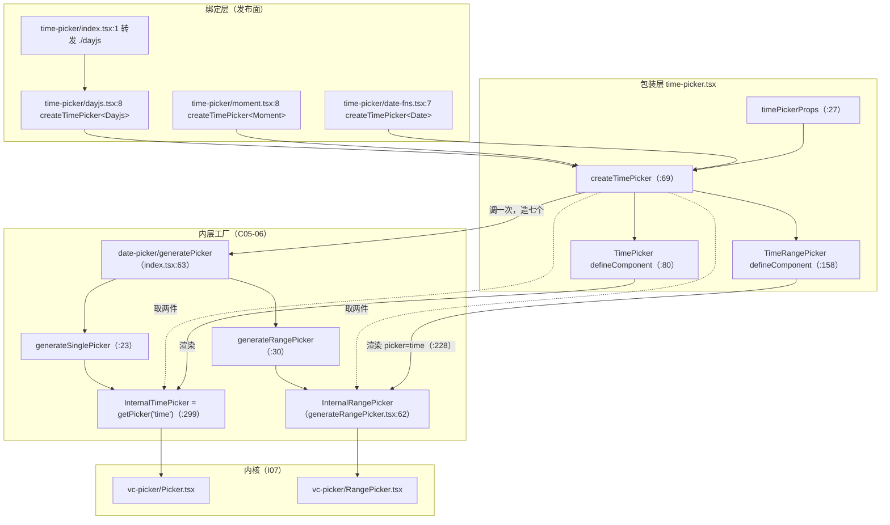
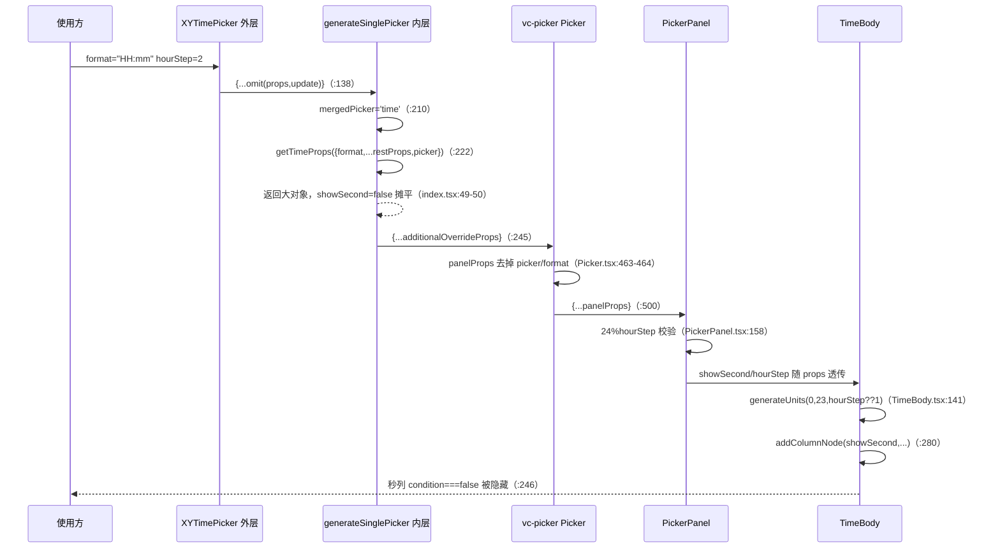
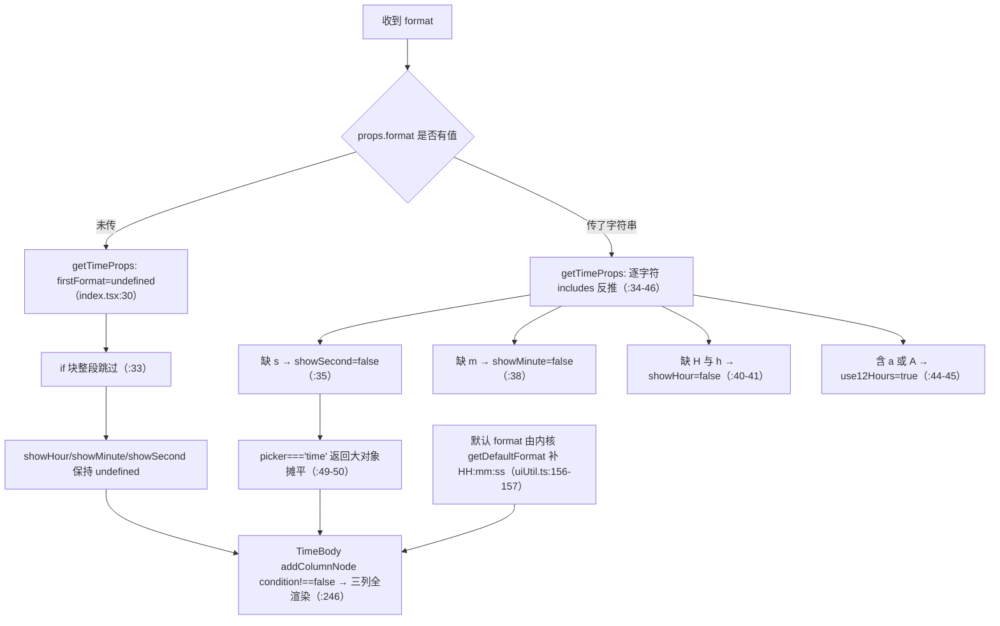

# C05-07 TimePicker 时间选择

> **本篇解决**：`<xy-time-picker>` 这一形态相对 `date-picker` 工厂独有的三件事——`format` 子串反推开关到底何时真正触发、`hourStep`/`minuteStep`/`use12Hours` 这类 step 与面板参数被哪一层读取、以及 `order` 这类「范围独活、单选全死」的开关；外层 `createTimePicker` 把工厂再包一层后，props 与事件的两层转发在哪里对不齐。
> **前置**：C05-06《DatePicker 日期选择》（已完成）、I07《日期计算内核》（已完成）　**读者坐标**：`03-components/05-picker` 第 8/9 篇

本篇只讲 `packages/xiaoye-ui/src/time-picker/` 这一层。`date-picker/` 的 `generatePicker` 工厂怎么运作、`commonProps/datePickerProps/rangePickerProps` 三张表怎么合成、`valueFormat` 的 `toDate`/`toString` 往返、Form 的双注入线、`{...props,...attrs}` 的 JSX 属性顺序语义，这些已由 C05-06 论证完毕，本篇一律引用其论点编号，不重述。日期算术、dayjs 插件链、时间列的等差生成（`generateUnits`）与步进整除对齐的算法本体，归 I07（尤其 I07 论点 6）。

本篇要抓的是 TimePicker 形态**独有**的四件事：它在工厂之上又套了一层 `createTimePicker`（论点 1）；`format` 子串反推在 TimePicker 上真正触发的条件与不触发时的默认（论点 2）；`hourStep`/`minuteStep`/`secondStep`/`use12Hours` 这些 step 与面板参数到底穿过哪几层、被谁读取（论点 3）；以及 `order` 这类「范围生效、单选死亡」的开关（论点 4）。第 5 个论点回到 TimePicker 层自己的 props/事件转发，它与内层工厂对不齐的地方。

## 一、职责与边界

`time-picker/` 不是"实现了一个时间选择器"。它是**工厂的第二重包装**：`createTimePicker` 调 `date-picker` 的 `generatePicker`（C05-06 论点 1 已论证这层工厂），拿回 `TimePicker` 与 `RangePicker` 两个内部件，再把它们各自重新 `defineComponent` 包一层，产出公开的 `XYTimePicker` 与 `XYTimeRangePicker`（`time-picker/time-picker.tsx:179`、`:158`）。这一层只补三件内层工厂没做、或做反了的事：

1. **形态固定**：把内层组件钉死成时间选择——单选靠 `getPicker('time', 'XYTimePicker')` 的闭包参数（`date-picker/generatePicker/generateSinglePicker.tsx:315`），范围靠外层显式写 `picker="time"`（`time-picker.tsx:270`）。
2. **时间专属 props 的注入**：`format`/`showHour`/`showMinute`/`showSecond`/`use12Hours`/`hourStep`/`minuteStep`/`secondStep`/`hideDisabledOptions`/`showNow`/`popupClassName`/`status` 这一组在 `timePickerProps()` 里声明（`time-picker.tsx:27-40`），其中 `hourStep` 这类是内层 `commonProps` 没有的。
3. **`addon` 兼容与 footer 兜底**：把已废弃的 `addon`（prop 与 slot）归一到 `renderExtraFooter`（`time-picker.tsx:163-165`）。

**明确不负责**：`format` 子串反推的实现本体（在 `date-picker/generatePicker/index.tsx` 的 `getTimeProps`，C05-06 论点 6 已给逐行）、弹层开合与定位（A07 / I02）、面板内时间列的生成与整除对齐算法（I07 论点 6）、值类型与 `valueFormat` 转换（C05-06 论点 2）、locale 数据本体（I11）。

依赖清单（外层实际 import 的上游）：

| 依赖 | 用处 | 出处 |
| --- | --- | --- |
| `../date-picker/generatePicker` | `generatePicker` 工厂，本层的唯一底座 | `time-picker.tsx:4` |
| `../date-picker/generatePicker/props` | 复用 `commonProps`/`datePickerProps`/`rangePickerProps` 三张表 | `time-picker.tsx:5-9` |
| `../date-picker/generatePicker`（类型） | `RangePickerTimeProps`/`PickerTimeProps`/`TimePickerProps` 类型源 | `time-picker.tsx:3`、`dayjs.tsx:5` |
| `../vc-picker/generate/dayjs`（等） | 三套日期库适配，由绑定文件注入 | `dayjs.tsx:3`、`moment.tsx:3`、`date-fns.tsx:2` |
| `../vc-picker/generate`（类型） | `GenerateConfig` 类型，`createTimePicker` 的形参 | `time-picker.tsx:11` |
| `../vc-picker/interface`（类型） | `PanelMode`/`RangeValue` | `time-picker.tsx:12` |
| `../vc-picker/RangePicker`（类型） | `RangePickerSharedProps`（供 `onCalendarChange` 取签名） | `time-picker.tsx:13` |
| `../vc-util/devWarning` | `addon` 废弃告警 | `time-picker.tsx:14`、`:99-103` |
| `../form/FormItemContext` | `useInjectFormItemContext`，id 继承与校验通知 | `time-picker.tsx:15`、`:98`/`:176` |
| `../_util/omit` | 转发前摘掉 `onUpdate:value`/`onUpdate:open` | `time-picker.tsx:16`、`:138`/`:225` |
| `../_util/type`（`booleanType`/`stringType`） | `timePickerProps` 的类型辅助 | `time-picker.tsx:19` |

## 二、源码地图

行数为 `find packages/xiaoye-ui/src/time-picker -type f -not -path "*/locale/*" | xargs wc -l` 的实际输出；`locale/` 下 78 个语言包文件（每个 7-9 行，仅转发 `timePickerLocale`）与本篇机制无关，已排除。

| 文件 | 行数 | 职责 | 关键导出 / 主入口行 |
| --- | --- | --- | --- |
| `time-picker/index.tsx` | 8 | 包内默认入口，整文件转发 `./dayjs` 并再声明一个空的 `TimePickerLocale` interface | `import TimePicker from './dayjs'`（:1）、`export default`（:8） |
| `time-picker/dayjs.tsx` | 29 | **发布面唯一入口（dayjs）**：`createTimePicker<Dayjs>` + `install` | `createTimePicker<Dayjs>`（:8）、`install`（:24-28） |
| `time-picker/moment.tsx` | 28 | moment 绑定，结构与 dayjs 对称 | `createTimePicker<Moment>`（:8）、`install`（:23-27） |
| `time-picker/date-fns.tsx` | 27 | date-fns 绑定 | `createTimePicker<Date>`（:7）、`install`（:22-26） |
| `time-picker/time-picker.tsx` | 251 | **主实现**：`timePickerProps` + `createTimePicker` 工厂套工厂 | `timePickerProps`（:27）、`createTimePicker`（:69）、`TimePicker`（:80）、`TimeRangePicker`（:158） |
| `time-picker/index.test.js` | 56 | 唯一的测试文件 | `it('renders addon correctly')`（:24）、`it('not render clean icon…')`（:49） |

主实现入口：`packages/xiaoye-ui/src/time-picker/time-picker.tsx:69`（`createTimePicker`）。

三点结构性事实：

- **本层没有 `style/` 目录**。时间面板的样式全部在 `date-picker/style/index.ts`（C05-06 §二 记的 1446 行）里，本层调 `useStyle` 也是经内层 `generateSinglePicker`/`generateRangePicker` 间接调用，`time-picker.tsx` 里没有 `genComponentStyleHook` 的任何引用。
- **本层没有 `*Types.ts`**。props 表 `timePickerProps()` 直接内联在 `time-picker.tsx:27-40`，类型 `TimePickerProps`/`TimeRangePickerProps` 也在同文件（`:42-67`），而 `dayjs.tsx:14-17` 又用 `Omit<PickerTimeProps<Dayjs>, 'picker'>` 重新导出了**同名**的两个 interface——两处 `TimePickerProps` 一个是泛型 `<DateType>`、一个是 `Dayjs` 具体化的 `export interface`，靠文件不同命名空间并存，改类型时容易只改一处。
- **测试面只有 1 个文件 56 行**，且按 `packages/xiaoye-ui/vitest.config.mts:33` 的 glob（`src/**/*.test.{js,ts,jsx,tsx}`）会被执行，但两条 `it` 只覆盖 `addon` 与 `allowClear`，见 §七 测试现状。

## 三、架构与数据流

### 图 1：静态结构——工厂套工厂与两个公开件

这张图是本篇骨架：`time-picker/` 里没有一行"时间面板"的实现，它把 `date-picker` 工厂再调一次，然后从工厂返回值里**只取两件、扔五件**，各自重新包成 `defineComponent`。



三点解读：

- `createTimePicker` 在 `time-picker.tsx:74-77` 调 `generatePicker`，并把 `timePickerProps()` 与 `order` 作为第二个实参（`extraProps`）传下去。按 C05-06 论点 5 的展开顺序，`extraProps` 排在三张基础表之后，因此这一传**给七个内部件都焊上了 `hourStep`/`order` 等时间专属 prop**——但本层随后只解构出 `TimePicker` 与 `RangePicker`（`:79`），`DatePicker`/`Week`/`Month`/`Year`/`Quarter` 五个被当场丢弃。
- 单选件 `TimePicker`（`:80`）渲染的是 `InternalTimePicker`，后者已在 `generateSinglePicker.tsx:315` 用闭包参数把 `picker` 焊成 `'time'`，所以本层**不需要**再传 `picker`（`time-picker.tsx:162-172` 的 JSX 里没有 `picker`）。范围件 `TimeRangePicker`（`:158`）渲染 `InternalRangePicker`，而工厂的 `RangePicker` 不预设 `picker`，所以本层必须在 `:228` 显式写 `picker="time"`。这一处不对称是单选与范围在本层最大的差别。
- `install` 只在 `dayjs.tsx:24-28` 注册 `TimePicker` 与 `TimeRangePicker` 两个标签；C05-06 论点 1 已说明 `date-picker/dayjs.tsx:31-38` 的 `install` 里**没有** TimePicker，两个包各注册各的，`XYTimePicker` 的最终归属由 `registerComponent.ts:23-25` 的"已存在则跳过"决定，谁先 `app.use` 谁生效。

### 图 2：一个 step/`format` 参数从使用方到时间列的完整下行链



关键：`showSecond=false` 不是内核判定的，是内层 `getTimeProps` 用 `format` 里"没有 s"反推出来的（详见论点 2）。`hourStep=2` 才是真值透传，`TimeBody.tsx:141` 的 `normalizeStep(props.hourStep, 24)` 是它的落地读数（2026-09-30 起：非法 step 会被折回 1，不再是原样读入），等差列生成本体归 I07 论点 6。

### 图 3：`format` 反推在 TimePicker 上触发与不触发的两条分支



图中三条反推都带 `=== undefined` 守卫（`:34`/`:37`/`:40`/`:44`），所以使用方显式写 `showSecond={true}` 时反推让位——这与 C05-06 论点 6 一致，本篇不重述其逐行，只补 TimePicker 形态的触发前提：**裸 `<xy-time-picker>` 不带 `format` 时，`getTimeProps` 的 `firstFormat` 是 `undefined`，整个反推块（`:33-47`）根本不进入**，三列的显示完全由 `addColumnNode` 的 `condition !== false`（`TimeBody.tsx:246`）兜住，而不是由反推决定。

## 四、核心机制精读

### 论点 1：TimePicker 是"工厂套工厂"——`createTimePicker` 再调一次 `generatePicker`，造七个扔五个，再把取回的两个件各包一层

**断言**：本层的核心动作不是渲染，而是**二次实例化内层工厂并解构丢弃**。`time-picker.tsx:69-79`：

```tsx
// packages/xiaoye-ui/src/time-picker/time-picker.tsx:69
function createTimePicker<
  DateType,
  DTimePickerProps extends TimePickerProps<DateType> = TimePickerProps<DateType>,
  DTimeRangePickerProps extends TimeRangePickerProps<DateType> = TimeRangePickerProps<DateType>,
>(generateConfig: GenerateConfig<DateType>): any {
  const DatePicker = generatePicker<DateType>(generateConfig, {
    ...timePickerProps(),
    order: { type: Boolean, default: true },
  });

  const { TimePicker: InternalTimePicker, RangePicker: InternalRangePicker } = DatePicker as any;
```

逐段解释：

- `:74` 的 `generatePicker` 是 C05-06 论点 1 详述过的那**同一个**工厂（`date-picker/generatePicker/index.tsx:63`），它会走 `generateSinglePicker` + `generateRangePicker`，产出七个匿名 `defineComponent`。也就是说，加载 `time-picker` 时，`XYDatePicker`/`XYWeekPicker`/`XYMonthPicker`/`XYYearPicker`/`XYQuarterPicker` 五个组件被完整造了出来（`:295-300` 那六次 `getPicker` 全跑了一遍），然后在 `:79` 的解构里**只拿走 `TimePicker` 与 `RangePicker`，其余五个连名字都没接**。
- 第二个实参 `{ ...timePickerProps(), order: {...} }`（`:75-76`）就是 C05-06 论点 5 里那个"排在三张表之后展开、可覆盖任意基础 prop"的 `extraProps` 口子。本层用它做两件事：把 `hourStep`/`use12Hours`/`popupClassName` 等时间专属 prop（`timePickerProps()`，`:27-40`）注入到工厂产物上，以及**给工厂产物加一个 `order` 且默认 `true`**。注意这是给**全部七个**内部件加的，而 `order` 的真实读者只在范围（论点 4）——这是本层第一个"注入了但大部分消费者不存在"的动作。
- 工厂是**无缓存**的（C05-06 论点 1 已论证），本层又是 `dayjs.tsx:8` / `moment.tsx:8` / `date-fns.tsx:7` 各调一次 `createTimePicker`。所以全库范围内 `generatePicker` 至少被调 3（date-picker 三绑定）+ 3（time-picker 三绑定）= 6 次，每次造一整套 `name` 相同的组件。`XYTimePicker` 这个名字至少对应三处产物：`generateSinglePicker.tsx:315`（date-picker 工厂顺手造的）、`time-picker.tsx:80`（本层外层包的）、以及 moment/date-fns 各一套。它们最终谁绑上 `xy-time-picker`，取决于 `app.use` 顺序与 `registerComponent.ts:23-25` 的跳过逻辑——本层 `dayjs.tsx:25` 注册的是外层件 `TimePicker`（`:80`），不是内层 `InternalTimePicker`。

外层为什么要再包一层？看 `:80-96` 的 `TimePicker` 定义：它 `props` 里重新 `...commonProps<any>(), ...datePickerProps<any>(), ...timePickerProps(), addon: {type: Function}`（`:83-88`）拼一张**自己的**表，并加了一个内层工厂完全没有的 `addon`（`:87`）。渲染时（`:132-153`）把 `addon` 归一到 `renderExtraFooter`：

```tsx
// packages/xiaoye-ui/src/time-picker/time-picker.tsx:153
            renderExtraFooter={
              props.addon || slots.addon || props.renderExtraFooter || slots.renderExtraFooter
            }
```

这条 `||` 链是本层对 `addon` 废弃的兼容：优先级 **prop.addon > slot.addon > prop.renderExtraFooter > slot.renderExtraFooter**，`addon` 排最前，意味着旧代码里同时写 `addon` 与 `renderExtraFooter` 时 `addon` 赢，而 `:99-103` 的 `devWarning(!(slots.addon || props.addon), ...)` 只在用了 `addon` 时喊一句废弃提示。这一层包装的净收益就是这个 `addon` 归一与 `popupClassName → dropdownClassName` 改名（`:140`），代价是多一层 props 转发与多一套 emits 缺口（论点 5）。

**结论**：TimePicker 层是"复用即再调工厂"的极端案例——它没有复用工厂已经造好的 `XYTimePicker`，而是把整个工厂重跑一遍丢弃五件、再手搓同名外层件。读 `time-picker/` 时找不到任何时间逻辑，是因为所有逻辑都在内层工厂与内核，本层只做"改名 + addon 归一 + 范围钉 `picker`"。

### 论点 2：`format` 子串反推对裸 TimePicker 根本不触发——它只在用户显式传 `format` 时生效，且 `picker==='time'` 把反推结果摊平成顶层 props

**断言**：C05-06 论点 6 论证了 `getTimeProps`（`date-picker/generatePicker/index.tsx:20-61`）用 `String.includes` 反推 `showHour`/`showMinute`/`showSecond`/`use12Hours`。本篇补 TimePicker 形态的两个独有前提，它们决定了这套反推在时间选择器上**默认不开工**。

调用点在渲染期，`generateSinglePicker.tsx:211-232`：

```tsx
// packages/xiaoye-ui/src/date-picker/generatePicker/generateSinglePicker.tsx:211
          const showTime = (p.showTime as string) === '' ? true : p.showTime;
          const { format } = p as any;

          let additionalOverrideProps: any = {};
          if (picker) {
            additionalOverrideProps.picker = picker;
          }
          const mergedPicker = picker || p.picker || 'date';

          additionalOverrideProps = {
            ...additionalOverrideProps,
            ...(showTime
              ? getTimeProps({
                  format,
                  picker: mergedPicker,
                  ...(typeof showTime === 'object' ? showTime : {}),
                })
              : {}),
            ...(mergedPicker === 'time'
              ? getTimeProps({ format, ...restProps, picker: mergedPicker })
              : {}),
          };
```

- **裸 `<xy-time-picker>` 走的是第二个分支，不是第一个**。`InternalTimePicker` 的闭包参数 `picker = 'time'`（`generateSinglePicker.tsx:315`，见论点 1），所以 `mergedPicker` 恒为 `'time'`（`:210`）。而第一个分支的前置是 `showTime` 为真（`:214`）——`showTime` 来自 `commonProps`（`props.ts:94`，无默认值），时间选择器场景下用户不会写 `show-time`（它已经是时间面板），于是 `p.showTime` 为 `undefined`、`showTime` 为 `undefined`、第一个 `getTimeProps` 被跳过。C05-06 论点 6 描述的"两个分支同时成立、连调两次"在 TimePicker 上**退化成一次**，即 `:222` 的 `getTimeProps({ format, ...restProps, picker })`。真正会连调两次的形态是 `DatePicker picker='time'` 或显式 `showTime` 的场景，那已由 C05-06 论点 6 覆盖，本篇不重述。
- **反推本身要不要进，取决于 `format`**。`:222` 把 `format` 传给 `getTimeProps`，而 `timePickerProps()` 里 `format: String`（`time-picker.tsx:28`）**没有默认值**。用户不写 `format` 时，`getTimeProps` 里 `firstFormat = toArray(undefined)[0]`（`index.tsx:30`）为 `undefined`，`:33` 的 `if (firstFormat && typeof firstFormat === 'string')` 判假，**`:34-46` 的四条反推整段跳过**，`showHour`/`showMinute`/`showSecond` 停在 `undefined`。于是这一形态下的三列显示，跟 `getTimeProps` 一点关系都没有。
- **不触发时，三列靠内核默认值全开**。`showX` 为 `undefined` 一路透传到 `TimeBody.tsx`，`addColumnNode(showHour, …)` 的守卫是 `if (condition !== false)`（`TimeBody.tsx:246`），`undefined !== false` 为真，时/分/秒三列**全渲染**。默认显示串 `HH:mm:ss` 也不在组件层定，而是内核 `Picker.tsx:221` 的 `getDefaultFormat(props.format, picker.value, props.showTime, props.use12Hours)` → `uiUtil.ts:156-157` 的 `case 'time': mergedFormat = use12Hours ? 'hh:mm:ss a' : 'HH:mm:ss'` 补出来的。
- **一旦用户写了 `format`，反推立即生效并被摊平成顶层 props**。`<xy-time-picker format="HH:mm" />` 时 `firstFormat='HH:mm'`，`:34` 判 `'HH:mm'.includes('s')` 为假 → `showTimeObj.showSecond = false`（`:35`）。因为 `picker==='time'`，`getTimeProps` 在 `index.tsx:49-50` 直接 `return showTimeObj`（**大对象，不是 `{showTime:…}` 小包装**），`showSecond=false` 于是作为顶层字段经 `additionalOverrideProps`（`:212`）→ `{...additionalOverrideProps}`（`:245`）→ 内核 `Picker.tsx` props 白名单（`:158`）→ `panelProps`（`Picker.tsx:469`）→ `TimeBody`，最终让 `addColumnNode(showSecond=false)` 跳过秒列（`TimeBody.tsx:280-288`）。这就是"传了 format 秒列消失"的完整链路。

一处反直觉细节：`:34` 判的是 `!firstFormat.includes('s')`，是**单字符子串匹配**不是 token 解析。`format="HH:mm A"`（12 小时制但无秒）里没有拉丁 `s`，会推出 `showSecond=false`——这是想要的；但 `format="HH:mm:ss"` 里同时含大写 `H`（24 小时），而 `use12Hours` 的反推走的是 `includes('a')` 或 `includes('A')`（`:44`），`HH:mm:ss` 里没有 `a` 也没有 `A`，故 `use12Hours` 不被反推开。这些字符级脆弱性 C05-06 论点 6 与取舍五已展开，此处只强调：**TimePicker 是这套反推最直接的受益者与受害者**，因为 `picker==='time'` 时反推结果被摊到顶层、每个 `showX` 都直接决定一列的生死。

**结论**：`format` 反推不是"TimePicker 自动隐藏不需要的列"的普适机制，而是"用户传了 `format` 才启用、不传就三列全开 + 内核补 `HH:mm:ss`"的可选机制。把它当成默认行为会误判：裸 `<xy-time-picker>` 永远显示秒列，哪怕逻辑上你只要到分钟。

### 论点 3：`hourStep`/`minuteStep`/`secondStep`/`use12Hours` 声明在 TimePicker 层，但真正读取它们的是内核的 `PickerPanel` 整除校验与 `TimeBody` 等差列；本层只是"透传两跳"

**断言**：这些 step 参数在 `time-picker/time-picker.tsx` 里**没有任何一行被 setup 读取**（`grep -rn -e hourStep -e minuteStep -e secondStep -e use12Hours packages/xiaoye-ui/src/time-picker/time-picker.tsx` 只命中 `:33-36` 的声明）。它们的旅程是"本层声明 → 外层 omit 转发到内层 → 内层摊平进 `additionalOverrideProps` → 内核读取"。声明处：

```ts
// packages/xiaoye-ui/src/time-picker/time-picker.tsx:27
export const timePickerProps = () => ({
  format: String,
  showNow: booleanType(),
  showHour: booleanType(),
  showMinute: booleanType(),
  showSecond: booleanType(),
  use12Hours: booleanType(),
  hourStep: Number,
  minuteStep: Number,
  secondStep: Number,
  hideDisabledOptions: booleanType(),
  popupClassName: String,
  status: stringType<InputStatus>(),
});
```

它们的**读取点**全在 `vc-picker`，分三处，各司其职：

1. **整除校验只在 `PickerPanel`，判定与折回已收进 `timeUtil.ts` 的标准件**。`vc-picker/PickerPanel.tsx:149-151` 给了 `hourStep/minuteStep/secondStep` 的默认 `1`，`:158-160` 建三个"是否整除"的 computed（2026-09-30 起：判定逻辑从内联取模收进 `vc-picker/utils/timeUtil.ts` 的 `isValidStep`/`normalizeStep`）：

```tsx
// packages/xiaoye-ui/src/vc-picker/PickerPanel.tsx:158
      const isHourStepValid = computed(() => isValidStep(props.hourStep, 24));
      const isMinuteStepValid = computed(() => isValidStep(props.minuteStep, 60));
      const isSecondStepValid = computed(() => isValidStep(props.secondStep, 60));
      if (process.env.NODE_ENV !== 'production') {
        watchEffect(() => {
          const { generateConfig, value, hourStep = 1, minuteStep = 1, secondStep = 1 } = props;
          // ...
          warning(isHourStepValid.value, `\`hourStep\` ${hourStep} is invalid. It should be a factor of 24.`);
```

   `isValidStep` 的口径是「整数、>0、且能整除上限」（`timeUtil.ts` 新增），`hourStep=0`/负数/小数也会被判非法。`onNow` 仍用 `isHourStepValid` 把非法 step 折回 `1`（`:360-362`）；**列生成侧也已跟进**——`TimeBody.tsx:141` 从原样读 `props.hourStep ?? 1` 改为 `normalizeStep(props.hourStep, 24)`（2026-09-30 修复，即下文坑 2），非法 step 现在在列生成与 Now 两条路径上口径一致。

2. **等差列读数在 `TimeBody`**。`vc-picker/panels/TimePanel/TimeBody.tsx:137-144` 是唯一把 `hourStep` 变成列内容的地方：

```tsx
// packages/xiaoye-ui/src/vc-picker/panels/TimePanel/TimeBody.tsx:137
    const rawHours = computed(() =>
      generateUnits(
        0,
        23,
        normalizeStep(props.hourStep, 24),
        mergedDisabledHours.value && mergedDisabledHours.value(),
      ),
    );
```

   `generateUnits` 的生成本体（从 0 按 step 递增的等差表）归 I07 论点 6，本篇不展开。这里只取两点：读数用的是 `normalizeStep(props.hourStep, 24)`（`:141`，2026-09-30 起三处读取点统一收进 `timeUtil.ts` 的 `normalizeStep`，hour/minute/second 各传 24/60 作上限）——非法 step 在这里就被折回 `1`，与 `PickerPanel` 的默认 `1` 收敛成同一份口径；`TimeBody` 在单选路径下由 `PickerPanel.tsx:513-516` 的 `case 'time': <TimePanel>` 挂载，在范围路径下由 `RangePicker.tsx` 复用同一 `TimePanel`（`panels/DatetimePanel/index.tsx:146` 也挂它），所以 step 列的读者对单选/范围是同一段代码。

3. **`use12Hours` 有两个互不相干的读者**。一是默认格式：`uiUtil.ts:156-157` 的 `case 'time': mergedFormat = use12Hours ? 'hh:mm:ss a' : 'HH:mm:ss'`——它决定输入框显示 `13:00` 还是 `01:00 PM`。二是列内容：`TimeBody.tsx:164-177` 用 `use12Hours` 把 0-23 的 `rawHours` 过滤成上午/下午两半、并对 `hourMeta.value % 12` 重贴标签；`AMPMDisabled`（`:148-161`）据此判断上/下午哪一栏可点。这两个读者一个看 `use12Hours` 的真假来选格式串、一个看它来重排小时列，**都不经过 `time-picker/`**。

`hideDisabledOptions` 的读者最窄：只在 `TimeUnitColumn.tsx:73` 的 `if (hideDisabledOptions && unit.disabled)` 里决定"被禁用的时间项是置灰还是整条移除"，其余 step 参数都不进这一层。

**结论**：`timePickerProps()` 更像一张**内核 props 白名单的本层副本**——`vc-picker/Picker.tsx:155-197` 里 `showNow/showHour/showMinute/showSecond/use12Hours/hourStep/minuteStep/secondStep/hideDisabledOptions` 这些名字逐一出现在内核的 props 数组（`:155`/`:156-158`/`:161`/`:194-197`），而本层把它们提前声明一遍好让 `defineComponent` 收下、再原样转发。真正的读取语义（整除、等差、12 小时换算、置灰）没有一行在 TimePicker 层，全部沉在内核与 I07。改 `hourStep` 的默认或校验要动 `PickerPanel.tsx`，改 TimePicker 层声明是无效的。

### 论点 4：`order` 是本层主动注入的开关，但它只在范围路径生效；单选 `XYTimePicker` 上的 `order` 一路漏到内核却无人读取

**断言**：`createTimePicker` 特意在 `extraProps` 里塞了 `order: { type: Boolean, default: true }`（`time-picker.tsx:76`），又给 `TimeRangePicker` 的 props 表重复声明了一次（`:165`）。这个 prop 全库**唯一的读取点**在 `vc-picker/RangePicker.tsx:316-323`：

```tsx
// packages/xiaoye-ui/src/vc-picker/RangePicker.tsx:316
      const [mergedValue, setInnerValue] = useMergedState<RangeValue<DateType>>(null, {
        value: toRef(props, 'value'),
        defaultValue: props.defaultValue,
        postState: values =>
          props.picker === 'time' && !props.order
            ? values
            : reorderValues(values, props.generateConfig),
      });
```

逐段解释：

- `:335` 的条件是 `props.picker === 'time' && !props.order`。含义是：**当它是时间范围选择、且 `order` 为假时，直接返回原值 `values`，不调 `reorderValues` 交换首尾**；反之（`order` 为真，即默认）会把两端排序成"早的前、晚的后"。因为 `default: true`（`time-picker.tsx:76`/`:165`），默认行为就是自动交换。想保留"用户手动指定的先后顺序"要显式写 `:order="false"`。
- 这条判断**挂在 RangePicker 上**，所以它只对 `XYTimeRangePicker` 有意义。`order` 也在 `vc-picker/RangePicker.tsx:244` 的 props 数组里登记（`'order'`），是内核正式接受的 prop。
- 单选路径上 `order` 是死的。外层 `TimePicker`（`time-picker.tsx:80`）的 props 表里**根本没声明 `order`**（只有 `commonProps`/`datePickerProps`/`timePickerProps`/`addon`，`:83-88`）；而它虽然把 `order` 通过 `extraProps` 焊进了内层 `InternalTimePicker`（`generateSinglePicker` 的产物），内层 `generateSinglePicker` 从不读 `order`（`grep -rn "\border\b" packages/xiaoye-ui/src/date-picker` 零命中，已在取证阶段验证），最终交给的 `vc-picker/Picker.tsx` props 数组（`:141-198`）里也**没有 `'order'`**。于是使用方在 `<xy-time-picker :order="false">` 上传的 `order` 会：落到外层 `attrs` → 经 `{...attrs}`（`time-picker.tsx:137`）传到内层 → 内层收下但只当普通 attr 继续透传 → 到 `vc-picker/Picker.tsx` 落进 `attrs` → 并进 `panelProps`（`Picker.tsx:465`）→ 没有任何代码读取它。**净效果：单选上 `order` 是零效果开关**，而它的默认值 `true` 又恰好等于"交换生效"的范围默认，二者不冲突，但这个 prop 在单选的声明纯属噪声。

复现命令（排除 `dist` 与 `node_modules`）：

```bash
grep -rn -e "props.order" -e "'order'" packages/xiaoye-ui/src/vc-picker
```

它只应命中 `RangePicker.tsx` 的 props 数组（`:245`）与 `postState`（`:335`）两处；`Picker.tsx` 一条都没有，即"单选不读 `order`"的直接证据。

顺带一处与本层强相关的默认值语义：`order` 的 `default: true` 是**本层**在 `:76` 与 `:165` 加的，内核 `RangePicker.tsx` 对 `order` 没有再给默认；也就是说"时间范围默认自动排序"这条产品决策是在 TimePicker 层做的，删掉 `:76` 里的 `order` 声明会让范围退回"无默认（undefined，falsy）→ `!props.order` 为真 → 不交换"，这是一个改一行就翻转默认行为的点。

**结论**：`order` 是 TimePicker 层注入、内核范围侧消费的一个开关，形态上是"范围独活、单选全死"。它是本层 `extraProps` 里唯一一个**带运行时语义**的键（其余 `timePickerProps()` 的键都在内核有读者），也因此成为论点 1 那个"给七个内部件都焊 prop"动作里最容易误读的一处。

### 论点 5：外层用 `omit(props)` + 显式覆盖把内层回调全数截走，再自己 `emit`；但外层件不声明 `emits`，且把 `mode` 硬设 `undefined`——两处与内层工厂的约定对不齐

**断言**：外层 `TimePicker` 的渲染（`time-picker.tsx:132-173`）是本层唯一真正干活的地方，它做三件与内层工厂风格不同的事。原文：

```tsx
// 以下为修前快照（2026-09-30 已改）：omit 名单只有两个 update 键
        return (
          <InternalTimePicker
            {...attrs}
            {...omit(props, ['onUpdate:value', 'onUpdate:open'])}
            id={id}
            dropdownClassName={props.popupClassName}
            mode={undefined}
            ref={pickerRef}
            renderExtraFooter={
              props.addon || slots.addon || props.renderExtraFooter || slots.renderExtraFooter
            }
            onChange={onChange}
            onOpenChange={onOpenChange}
            onFocus={onFocus}
            onBlur={onBlur}
            onOk={onOk}
            v-slots={slots}
          />
        );
```

修后（`packages/xiaoye-ui/src/time-picker/time-picker.tsx:136-173`，范围侧同形在 `:233-259`）把本层桥接过的键全部剥掉：

```tsx
// packages/xiaoye-ui/src/time-picker/time-picker.tsx:140
            {...omit(props, [
              'onUpdate:value',
              'onUpdate:open',
              'onChange',
              'onOpenChange',
              'onFocus',
              'onBlur',
              'onOk',
            ])}
```

- **JSX 顺序截胡回调**。按 C05-06 论点 5 的"写在展开之后者胜"，`:138` 的 `{...omit(props, ...)}` 先摊平用户全部已声明 props，随后 `:146-150` 的 `onChange/onOpenChange/onFocus/onBlur/onOk` **显式覆盖**掉 `omit(props)` 里那些同名的 `props.onChange` 等。于是用户写的 `:on-change="fn"`（`fn` 是 `commonProps.onChange`，`props.ts:74`）**不会**随 prop 进到内层——内层收到的是外层自己的 `onChange`（`:113`）。那 `fn` 还生效吗？生效，但走的是 emit 路径：外层 `onChange` 里 `emit('change', value, dateString)`（`:115`），Vue 从 `vnode.props` 取 `onChange` 即 `fn` 并调用。结果与内层工厂**修前**的形状不同：修前内层是 `emit('change')` 加 `callEvent(props.onChange)` **两路都调**，外层只有 `emit` 一路。**2026-09-29 内层那一半已被改掉**——`generateSinglePicker.tsx:131` 现在只剩 `emit('change', value, dateString)`，setup 顶部的 `callEvent` helper 定义一并删除，厂商层 `vc-picker/Picker.tsx`（13 处）、`vc-picker/RangePicker.tsx`（14 处）、`vc-picker/PresetPanel.tsx`（3 处）同族清完，`grep -rn "callEvent" packages/xiaoye-ui/src/time-picker packages/xiaoye-ui/src/date-picker packages/xiaoye-ui/src/vc-picker` 现在退出码 1、无输出。于是初稿那句"外层**天然规避了**内层的双调问题"**已经没有对照物可言**，不能当结论用。真正要说清的是另一件事：外层自己这一跳正是 C05-06 论点 5 的**形态③**——`:138` 的 `{...omit(props, …)}` 里带着用户的 `onChange`，同一元素上 `:146` 又显式绑着外层自己的 arrow，而 `@vue/babel-plugin-jsx` 把展开与显式属性交给 `mergeProps`，`mergeProps` 对 `on` 键做的是 `[].concat(existing, incoming)` 而不是后者覆盖前者，所以内层组件的 vnode props 收到的是一份 **数组** `[用户的 fn, 外层 arrow]`。内层这轮新加的 `BRIDGED_EVENT_HANDLERS`（`generateSinglePicker.tsx:39`、`generateRangePicker.tsx:46`）只阻止这份数组被继续摊给厂商层，**挡不住内层的 `emit('change')` 直接从这份 vnode props 取处理函数**（上面那条"显式覆盖"讲的其实是 plain-JSX 直觉，`on` 键上方向相反，另见 `C05-04` 坑 3）。**这条翻倍在 2026-09-30 已按族规则修掉**（就是上面那份 omit 名单）。计数判据在 jsdom 里跑不通——点时间格不提交、`focus` 也不展开面板，所以 TimePicker 用的是这条缺陷的**形状断言**：`mergeProps` 并数组会让 Vue 打 `Expected Function, got Array` 的 prop 校验告警，用例「TimePicker 摊给内层的事件键不应是 mergeProps 数组」（用例起于 `packages/xiaoye-ui/src/_util/__tests__/event-dispatch-count.test.tsx:371`）收集 `console.warn` 并断言为空，把 `time-picker.tsx` 退回基线复跑会得到 **4** 条告警、修后 0 条。同一次收尾里 TreeSelect 也是这一形（修前一次点树节点 `@change` 实测 **4** 次，见 `C05-04` 的事件一节）。已实测计数的仍是 date-picker 一族（点一次日期单元格修前 3 次、修后 1 次；根节点 `mousedown`/`click` 修前各 2 次、修后各 1 次）。代价照旧：外层自己也变成一层"重写事件"的适配。
- **外层不声明 `emits`**。`TimePicker`（`:80-96`）与 `TimeRangePicker`（`:158-172`）的 `defineComponent` 里都**没有** `emits` 字段（`grep -n "emits" packages/xiaoye-ui/src/time-picker/time-picker.tsx` 只命中 `:88` 的 `props:` 附近，没有独立 `emits:` 数组；对照内层 `generateSinglePicker.tsx:79-81` 明确列了八个事件名）。它们照样 `emit('update:value')`、`emit('openChange')`、`emit('ok')`……这些事件名在内层是登记过的，在外层是"裸 emit"。后果分两层：其一，`v-model:value` 依赖 `update:value` 能被父级收到——因为 `onUpdate:value` 是 `commonProps` 声明的 prop（`props.ts:75`），它落进外层 `props` 而非 `attrs`，再被 `:138` 的 `omit` 摘掉不转发内层，最后靠 `:114` 的 `emit('update:value')` 命中 `vnode.props['onUpdate:value']` 完成回写；其二，任何**不在 `props` 白名单**里的 `onXxx`（如给单选写 `@panel-change`）会进外层 `attrs`，经 `{...attrs}`（`:137`）原样流向内层，而单选内层并不 `emit('panelChange')`——于是这条事件在外层"看着能写"实则永不触发，属于 `AGENTS.md` 提醒的"emits 声明与运行时不匹配"在本层的变体。
- **`mode={undefined}` 是对受控面板模式的主动封死**。`mode` 是 `commonProps` 声明的 prop（`props.ts:100`），本可让用户控制面板处于 `time`/其他视图。外层在 `:141`（单选）与 `:229`（范围）无条件写 `mode={undefined}`，排在 `omit(props)` 之后，因此**用户传的 `mode` 被覆盖成 `undefined`**，内层 `PickerPanel.tsx:261` 的 `useMergedState({ value: toRef(props,'mode') })` 收到 `undefined` 即非受控；再叠加内核 `PickerPanel.tsx:255-256` 的 `if (props.picker === 'time') return 'time'`——时间面板本就只有 `time` 一种视图。两处合力说明：**TimePicker 的 `mode` 是设计上就不打算暴露的 prop**，外层用 `undefined` 把 `commonProps` 继承来的这条路堵死。这与 C05-06 论点 5 里 `id`/`disabled` 的"显式覆盖以生效"是同一种 JSX 顺序技巧，但方向相反——那里是"覆盖是为了让它对"，这里是"覆盖是为了让它失效"。
- **`popupClassName` → `dropdownClassName` 的改名**。`:140` 把本层的 `popupClassName`（`timePickerProps`，`:38`）映射成内层认得的 `dropdownClassName`（内核 `PickerTrigger.tsx:89` 读的是 `dropdownClassName`）。但 `omit(props)` 里 `popupClassName` 并未被摘，于是 `popupClassName` 与 `dropdownClassName` **两个键一起**发给内层；内核只读后者，前者是无害冗余。范围侧 `:227` 同形。

**结论**：外层 TimePicker 是一层"重写事件 + 改名 + 封锁 mode"的适配壳。它用 `omit` 与显式覆盖**打算**切断用户回调直达内层的通路（改由自己 emit），但这条意图只在内层往厂商层那一站成立（内层 2026-09-29 起还要靠 `BRIDGED_EVENT_HANDLERS` 剥键），在外层到内层这一站不成立——`mergeProps` 对 `on` 键并数组而不是覆盖，见论点 5。它用不声明 `emits` 省事，用 `mode={undefined}` 关掉一个对本形态无意义的受控入口。读 TimePicker 的行为要同时看外层壳与内层工厂两张表——`popupClassName`/`addon`/`order` 只在外层出现，`onChange` 的调用次数只在内层与外层的差异里才说得清（内层已收成单路；外层这一跳的数组形状已有告警断言钉住，见上一条）。

## 五、对外契约如何生效

**props 的路径是两跳**，且这两跳各自做一次 `{...props, ...attrs}` 语义的合并。第一跳在使用方 → 外层：外层 `TimePicker` 声明 `commonProps + datePickerProps + timePickerProps + addon`（`time-picker.tsx:83-88`），`inheritAttrs: false`（`:82`）。第二跳在外层 → 内层：`{...attrs}`（`:137`）把外层没声明成 prop 的东西原样递下去，`{...omit(props, ['onUpdate:value','onUpdate:open'])}`（`:138`）把外层声明的 props 递下去（除了两个 v-model 更新器），随后显式属性覆盖。内层 `generateSinglePicker` 收到这些后，再做它自己那套 `{...props, ...attrs} → 解构 → restProps → RCPicker`（C05-06 论点 5 已走完）。所以一个 `hourStep` 从使用方到 `TimeBody` 要穿过**两张 props 表 + 一次 omit + 一次 additionalOverrideProps 摊平**，中间任何一环漏声明都会让它掉进 `attrs` 而可能被内核白名单（`Picker.tsx:141-198`）拒绝——`hourStep` 在白名单里（`:195`），所以能落地；论点 4 的 `order` 在单选侧不在 `Picker.tsx` 白名单，就落不了地。

**本层不做 `useConfigInject`**。外层 `TimePicker` 的 setup（`:96-155`）里**没有** `useConfigInject`，`prefixCls`/`size`/`direction`/`disabled`/`getPopupContainer` 这些一律由内层 `generateSinglePicker.tsx:115-116` 注入。外层只 inject 了 `useInjectFormItemContext`（`:98`），用途狭窄——取 `id`（`:133`）与在 `onChange`/`onBlur` 末尾喊 `onFieldChange`/`onFieldBlur`（`:116`/`:127`）。这与 C05-06 论点 4 描述的内层双注入线不同：外层的 formItem 通知是**额外的一次**（内层 generateSinglePicker 自己也会 `onFieldChange`，`generateSinglePicker.tsx:139`），因此 TimePicker 的单次变更会触发**两次** `onFieldChange()`——外层 `:116` 一次、内层 `:125` 一次，落在 `FormItem.tsx:313` 的 `validateRules({triggerName:'change'})` 上。是否造成重复校验取决于 `validateDisabled` 闸（`FormItem.tsx:314-317`）吞并了哪一次，本篇**未跑运行时证实重复校验的实际后果**，仅登记两次调用的静态证据。

**events**：外层用 `emit` 重放 `update:value`/`change`/`update:open`/`openChange`/`focus`/`blur`/`ok`（单选 `:114-131`），范围另加 `panelChange`/`calendarChange`（`:204-219`）。因为外层不声明 `emits`（论点 5），事件名与父级 handler 的绑定完全依赖 Vue 从 `vnode.props` 取值这一步；`@change` 能工作，但写成 `:on-change` 与 `@change` 在此处路径一致（都落在 `props.onChange`，再被显式覆盖、只由 emit 命中）。范围独有 `calendarChange` 是观察 I07 三份中间态的窗口，与 C05-06 §五 对 `RangePicker` 的结论一致，本篇不重述。

**slots**：外层声明 `addon`/`renderExtraFooter`/`suffixIcon`/`clearIcon`/`default`（单选 `:89-95`，范围 `:167-172` 少 `addon`），并用 `v-slots={slots}`（`:151`/`:238`）把**全部**槽位整体转发内层。`addon` 与 `renderExtraFooter` 在 `:143-145` 归一（见论点 1）；`suffixIcon`/`clearIcon` 交给内层按图标槽位求值（C05-06 §五）。`default` 槽位声明了但内层丢弃（C05-06 §五 已证 `generateSinglePicker` 不读 `slots.default`），所以 `<xy-time-picker>随便写</xy-time-picker>` 同样静默无效。

**expose 只有一个窄口**：`focus`/`blur`（`:105-112` / `:177-184`），`pickerRef`（`:104`/`:175`）挂在内层件上，模板 ref 拿不到面板态或 `value`。与 C05-06 §五 内层的 `expose` 形状相同，只是这里多包了一层，`pickerRef.value` 指向的是 `InternalTimePicker` 实例而非内核。

**context 方向**：外层 inject `formItemContext`（`:98`/`:176`），**不 provide 任何东西**——面板与输入框的通信全在内核（C05-06 §五 的结论在此同样成立）。

## 六、设计取舍

**取舍一：外层再包一层 `defineComponent`，而不是直接 `export` 工厂造的 `XYTimePicker`。**

买到的：`addon`/`renderExtraFooter` 的废弃归一（`:143-145`）与 `popupClassName → dropdownClassName` 的改名（`:140`）这两个纯兼容动作有了落点，不必污染 `commonProps`；范围与单选的差异（范围钉 `picker="time"`、范围加 `onPanelChange`/`onCalendarChange`）被隔离在两个外层件里，内层工厂保持"picker 无关"。赔上的：一次 `generatePicker` 全量重跑（论点 1），多一套 props 表（`:83-88` 与 `:161-166`），以及一次 `onFieldChange` 重复触发（§五）。这条路的净收益很小——去掉 `addon` 兼容后，外层几乎可以合并进内层，`XYTimePicker` 本可直接用 `generateSinglePicker.tsx:315` 那个。当前形状是"为兼容而多壳"。

**取舍二：`order` 通过 `extraProps` 注入到全部七个内部件，而不是只给范围件。**

买到的：`createTimePicker` 用一次 `generatePicker` 调用同时得到单选与范围两套件（`:79`），代码路径最短。赔上的：`order`（和整张 `timePickerProps()`）被焊进了 `DatePicker`/`Week`/`Month`/`Year`/`Quarter` 五个组件的 props 表（论点 1），而它们一个都不读 `order`；更糟的是单选件也收下 `order` 却零读者（论点 4）。这是"批量注入 + 就地解构丢弃"风格的必然副产品——想精确只给范围件，就得把 `order` 从 `extraProps` 挪到 `TimeRangePicker` 的本地 props（`:165` 其实已经又声明了一次），但 `:76` 那份仍留着，成了双份。

**取舍三：`format` 反推放在组件层的 `getTimeProps`，而不是放到内核按 `showX` 缺失时补。**

买到的：`<xy-time-picker format="HH:mm" />` 这类"写了格式串就自动少一列"的直觉体验，不需要使用方再声明 `showSecond={false}`。赔上的：反推发生在**内层工厂**（`index.tsx:33-46`），而 TimePicker 的默认 `format` 却是**内核**补的（`uiUtil.ts:157`）——两处不在一层，导致"裸 TimePicker 不反推（组件层 format 为空）、默认列全开（内核补 HH:mm:ss）"这套默认逻辑分裂在两个文件（论点 2）。更本质的脆弱：`includes('s')` 是字符扫描，格式串里任何含 `s`/`m`/`H`/`a` 的字面量都会误触发反推，这条已在 C05-06 取舍五论证，TimePicker 只是它最高频的受害形态。

**取舍四：外层不声明 `emits`，靠 Vue 的 `vnode.props` 兜底。**

买到的：省一份事件清单，`emit('change')` 等照常命中父级 `@change`。赔上的：`@panel-change` 这类"不在内层 emits、也不在外层 props 白名单"的写法在单选上静默失效（论点 5），且与内层**修前**的"props 回调 + emit 双路"风格不一致（C05-06 论点 5），使得同一个 `onChange` 在 date-picker 与 time-picker 上调用次数不同。2026-09-29 内层已改成 emit 单路，这条"双路 vs 单路"的风格差异随之消失；剩下的不一致换成了另一种形状——内层靠模块级 `BRIDGED_EVENT_HANDLERS`（`generateSinglePicker.tsx:39`）显式剥键，外层靠 `omit` 加显式属性，两套写法意图相同、机制不同，而外层那一套在 `on` 键上并不真的覆盖（`mergeProps` 并数组，见论点 5），TimePicker 侧的投递次数在 jsdom 里数不到（点时间格不提交值），但数组形状已由告警断言钉住：`packages/xiaoye-ui/src/_util/__tests__/event-dispatch-count.test.tsx:371`，基线 4 条 `Expected Function, got Array`、修后 0 条。这类不一致只能靠读源码发现，`pnpm typecheck` 拦不住。

## 七、坑与改动指南

**坑 1：裸 `<xy-time-picker>` 想要"只到分钟"，秒列却还是出现**

- 触发：`<xy-time-picker v-model:value="t" />`，不写 `format`，以为时间选择器会按业务需要少显示一列。
- 症状：面板仍是 时/分/秒 三列，输入框显示 `HH:mm:ss`。
- 原因：不传 `format` 时内层 `getTimeProps` 的 `firstFormat` 为 `undefined`（`date-picker/generatePicker/index.tsx:30`），`:33` 判假、反推整段跳过，`showSecond` 停在 `undefined`；`TimeBody.tsx:246` 的 `if (condition !== false)` 把 `undefined` 当"显示"，秒列照渲。默认串 `HH:mm:ss` 由内核 `uiUtil.ts:156-157` 补。
- 定位：`packages/xiaoye-ui/src/time-picker/time-picker.tsx:28`（format 无默认）、`packages/xiaoye-ui/src/date-picker/generatePicker/index.tsx:33`（反推入口）、`packages/xiaoye-ui/src/vc-picker/panels/TimePanel/TimeBody.tsx:246`（列显示守卫）。正确写法是 `format="HH:mm"`（触发反推关秒）或显式 `:show-second="false"`。

**坑 2：`hourStep` 传非因数（如 5、7）只弹 dev warning，列会错位而不是被裁剪**

- 触发：`<xy-time-picker :hour-step="7" />` 或 `:minute-step="7"`。
- 症状：控制台出现 "`hourStep` 7 is invalid. It should be a factor of 24."，但面板仍按 7 生成小时格（0、7、14、21），滚动与选中态与"整点对齐"的直觉不符。
- 原因：`PickerPanel.tsx:158-181` 只做 `24 % hourStep === 0` 判定并 `warning`，**不修改 hourStep**；真正把非法 step 折回 `1` 的只有 `onNow`（`:360-362`），列生成读的是原始 `props.hourStep ?? 1`（`TimeBody.tsx:141`）。等差表本体见 I07 论点 6。
- 定位：`packages/xiaoye-ui/src/vc-picker/PickerPanel.tsx:158-181`（校验只 warning）、`packages/xiaoye-ui/src/vc-picker/panels/TimePanel/TimeBody.tsx:141`（原样读 step）。安全取值只能是 24 的因数（1/2/3/4/6/8/12/24）与 60 的因数。

**坑 3：在单选 `<xy-time-picker :order="false">` 上想禁用首尾交换，完全无效**

- 触发：单选 TimePicker 传 `order="false"`。
- 症状：没有任何效果，`order` 像没传一样。
- 原因：`order` 唯一读者是 `vc-picker/RangePicker.tsx:320` 的 `props.picker === 'time' && !props.order`，单选走的是 `Picker.tsx`，其 props 数组（`:141-198`）里根本没有 `'order'`，`order` 一路漏进 `attrs` 无人读取（论点 4）。
- 定位：`packages/xiaoye-ui/src/vc-picker/RangePicker.tsx:320`（范围才读）、`packages/xiaoye-ui/src/vc-picker/Picker.tsx:141-198`（单选白名单无 order）。需要"保留手动顺序"的语义只存在于范围形态。

**坑 4：`DatePicker.TimePicker` 与 `xy-time-picker` 不是同一个组件，前者缺外层壳**

- 触发：`import DatePicker from 'xiaoye-ui'` 后用 `DatePicker.TimePicker`（或 `<DatePicker.TimePicker>`），同时全局又 `app.use(TimePicker)`。
- 症状：`addon`/`renderExtraFooter` 归一、`popupClassName` 改名这类只在 TimePicker 外层壳里做的行为（论点 1、论点 5）拿不到——因为 `DatePicker.TimePicker` 是 date-picker 工厂顺手造的内层件。
- 原因：`date-picker/dayjs.tsx` 的 `Object.assign(DatePicker, { ... TimePicker ... })` 挂的是 `generateSinglePicker.tsx:315` 造的 `XYTimePicker`（内层，无壳）；而 `time-picker/dayjs.tsx:25` 注册的 `xy-time-picker` 才是 `time-picker.tsx:80` 的外层件。两个 `XYTimePicker` 同名不同体。
- 定位：`packages/xiaoye-ui/src/date-picker/generatePicker/generateSinglePicker.tsx:315`（内层件）、`packages/xiaoye-ui/src/time-picker/time-picker.tsx:80`（外层件）、`packages/xiaoye-ui/src/time-picker/dayjs.tsx:25`（注册外层）。取 TimePicker 一律走 `time-picker` 包或全局标签，不要从 `DatePicker` 对象上摘。

**坑 5：在 `timePickerProps()` 里给 step 加默认值是无效的**

- 触发：想在本层把默认 `hourStep` 改成 5，于是在 `time-picker.tsx:34` 写 `hourStep: { type: Number, default: 5 }`。
- 症状：面板行为随内核默认仍是 1，或在某些路径下你的默认根本不生效。
- 原因：step 的最终读数不在本层——`PickerPanel.tsx:149-151` 有自己的默认 `1`，`TimeBody.tsx:141/183/192` 用 `props.hourStep ?? 1` 兜底。本层 `timePickerProps` 只负责"让 prop 进 props 对象并被转发"，默认值应在内核改。
- 定位：`packages/xiaoye-ui/src/vc-picker/PickerPanel.tsx:149-151`、`packages/xiaoye-ui/src/vc-picker/panels/TimePanel/TimeBody.tsx:141`。

**坑 6：`v-model:mode` / `:mode` 在 TimePicker 上被强制失效**

- 触发：`<xy-time-picker v-model:mode="m" />` 或 `:mode="'time'"`。
- 症状：面板模式不受控，`m` 也不回写。
- 原因：外层渲染无条件写 `mode={undefined}`（单选 `time-picker.tsx:161`、范围 `:229`），排在 `omit(props)` 之后，覆盖掉用户传的 `mode`（论点 5）；内核 `PickerPanel.tsx:255-256` 又把 `picker==='time'` 的 mode 钉成 `'time'`。这是设计上的封锁，不是 bug。
- 定位：`packages/xiaoye-ui/src/time-picker/time-picker.tsx:161`、`:229`；被覆盖的 prop 声明在 `packages/xiaoye-ui/src/date-picker/generatePicker/props.ts:100`。

**测试现状（按 `packages/xiaoye-ui/vitest.config.mts:33` 的 glob，`index.test.js` 会执行）**

本层只有一个测试文件 `time-picker/index.test.js`（56 行）。它挂了 `focusTest`（`:21`）与 `mountTest`（`:22`）两个共享 helper（断言由 helper 提供，本文件本身不写挂载断言），另有两个 `it`：

| 用例 | 断言 | 说明 |
| --- | --- | --- |
| `it('renders addon correctly')`（:24-47） | 2（`:43`/`:44`） | 唯一覆盖 `addon` 归一与废弃 warning 的用例 |
| `it('not render clean icon when allowClear is false')`（:49-55） | 0 | 只 `mount`，没有任何 `expect`——名义存在、实为无断言用例 |

即 **`format` 反推（论点 2）、step 透传（论点 3）、`order`（论点 4）、`mode` 封锁（论点 5）在 TimePicker 层全部无测试保护**，且 `TimeRangePicker` 连挂载测试都没有（`index.test.js` 只 `import TimePicker from '.'`，未测范围件）。坑 1/3/5/6 的改动没有回归网。

**安全边界与验证命令**

可以放心改的：`addon` 归一链（`:143-145`，纯兼容层，有测试）、`popupClassName → dropdownClassName` 改名（`:140`/`:227`）。

必须成对改的：单选 `TimePicker`（`:80-156`）与范围 `TimeRangePicker`（`:158-243`）的事件与 props 转发——两处 `omit` 列表、`mode={undefined}`、footer 兜底形状相同但独立维护，改一边易漏另一边（本层范围件多了 `picker="time"`（`:228`）、`onPanelChange`/`onCalendarChange`（`:204-219`），少 `renderExtraFooter` 的 `addon` 归一，这些不对称是刻意的，但缺注释保护）。

不能碰的：`typings/global.d.ts`、`src/components.ts`、`package.json` 的 `exports`（生成物，见 `AGENTS.md`）；`XYTimePicker` 的注册归属由 `registerComponent.ts:23-25` 的跳过逻辑决定，改动 `install` 顺序会改变全局标签绑到哪个实例。

```bash
# 本层测试与类型
pnpm --filter xiaoye-ui vitest run src/time-picker --reporter=verbose
pnpm typecheck
# 反推/step/order 三条链是否还成立
node docs/column/tools/verify-refs.mjs --excerpt docs/column/03-components/05-picker/C05-07-time-picker-时间选择.md
```

**本篇未能运行时证实的断言（逐条列明，不作为事实使用）**

1. **§五 的"单次变更触发两次 `onFieldChange()`"**：静态证据充分（外层 `time-picker.tsx:116` 一次、内层 `generateSinglePicker.tsx:139` 一次），但两次调用是否都落到 `FormItem` 的实际校验、还是被 `validateDisabled`（`form/FormItem.tsx:314-317`）吞掉一次，本仓库未跑运行时用例。正文按源码结构陈述调用点存在，不下"重复校验必然发生"的结论。
2. **论点 5 的"`@panel-change` 在单选上永不触发"**：由"外层 emits 未声明 + 内层 `Picker.tsx` 的 `panelChange` emit 在 time 形态是否发生"共同决定，`vc-picker` 目录 0 测试（I07 结论），无法用单测复现，此处为按转发结构推得。
3. **论点 5 的"外层这一跳把 `onChange` 并成数组、一次交互投两次"**：静态证据是 `mergeProps` 对 `isOn(key)` 走 `[].concat(existing, incoming)`（`@vue/runtime-core` 的 `mergeProps`）与 `emit` 从 `instance.vnode.props` 取处理函数，两条都在实现里读得到；但 `packages/xiaoye-ui/src/_util/__tests__/event-dispatch-count.test.tsx` 的 19 条计数判据里**没有 TimePicker 用例**，`<xy-time-picker>` 一次交互实际投几次本仓未测。date-picker 一族已实测（修前 3 次 / 修后 1 次），不能把那个数字直接搬到 TimePicker 上。复现方式原本想与 date-picker 同形（挂 `vi.fn()` 到 `@change`、点一次时间列条目、断言 `toHaveBeenCalledTimes(1)`），**2026-09-30 实跑不成立**：jsdom 里点 `.xy-picker-time-panel-cell-inner` 不提交值（计数为 0），`focus` 也不展开面板，所以这条改用缺陷的**形状**做判别器——用例「TimePicker 摊给内层的事件键不应是 mergeProps 数组」（`packages/xiaoye-ui/src/_util/__tests__/event-dispatch-count.test.tsx:371`）收集 `console.warn` 并断言没有 `Expected Function, got Array`；把 `time-picker.tsx` 退回基线复跑得到 **4** 条该告警，修后 0 条。摊布已在 `packages/xiaoye-ui/src/time-picker/time-picker.tsx:140`（单选）与 `:236`（范围）剥掉本层桥接过的键，见论点 5。

## 附：本篇可证伪的三个检查点

1. **`order` 只在范围被读、单选完全不读**（对应论点 4、坑 3）。执行

   ```bash
   cd /Users/xiaoye/Desktop/publish/xiaoye-ui-vue
   grep -rn -e "props.order" -e "'order'" packages/xiaoye-ui/src/vc-picker/Picker.tsx
   grep -rn -e "props.order" -e "'order'" packages/xiaoye-ui/src/vc-picker/RangePicker.tsx
   ```

   预期第一条 **无输出（退出码 1）**，第二条给出两行：`RangePicker.tsx:244`（props 数组）与 `RangePicker.tsx:320`（`props.picker === 'time' && !props.order` 的唯一读点）。若第一条开始出现 `order`，则"单选 `order` 零效果"结论作废。

2. **`XYTimePicker` 这个名字在 `src` 下由两处独立产出**（对应论点 1、坑 4）。执行

   ```bash
   cd /Users/xiaoye/Desktop/publish/xiaoye-ui-vue
   grep -rn "'XYTimePicker'" packages/xiaoye-ui/src
   ```

   预期且仅预期两行：`time-picker/time-picker.tsx:81`（外层壳件的 `name`）与 `date-picker/generatePicker/generateSinglePicker.tsx:315`（date-picker 工厂顺手造的内层件）。两行同时存在即证明"同名不同体"，`DatePicker.TimePicker` 取到的是后者；若只剩一行，坑 4 的组件身份分裂结论作废。

3. **裸 TimePicker 不进 `format` 反推的两个前置**（对应论点 2、坑 1）。执行

   ```bash
   cd /Users/xiaoye/Desktop/publish/xiaoye-ui-vue
   grep -n "typeof firstFormat === 'string'" packages/xiaoye-ui/src/date-picker/generatePicker/index.tsx
   grep -n "format: String" packages/xiaoye-ui/src/time-picker/time-picker.tsx
   ```

   预期分别命中 `index.tsx:33`（`if (firstFormat && typeof firstFormat === 'string')`，反推入口守卫）与 `time-picker.tsx:28`（`format: String`，**无 `default`**）。二者共同决定：不传 `format` 时 `firstFormat` 为 `undefined`、反推块跳过、三列全开。若 `:28` 变成带 `default` 的写法或 `:33` 的守卫消失，坑 1 的成因结论作废。
