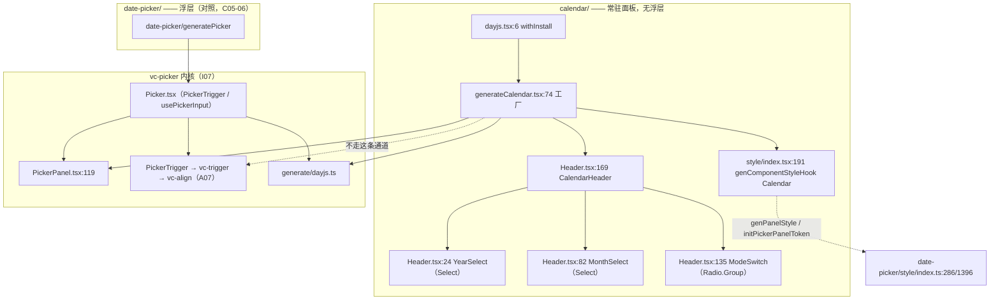
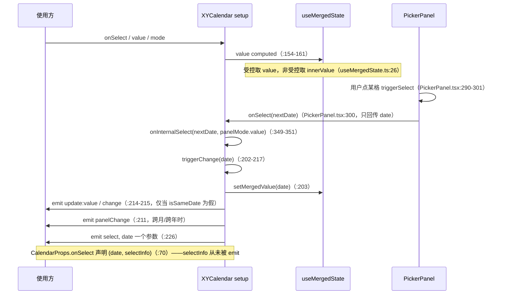
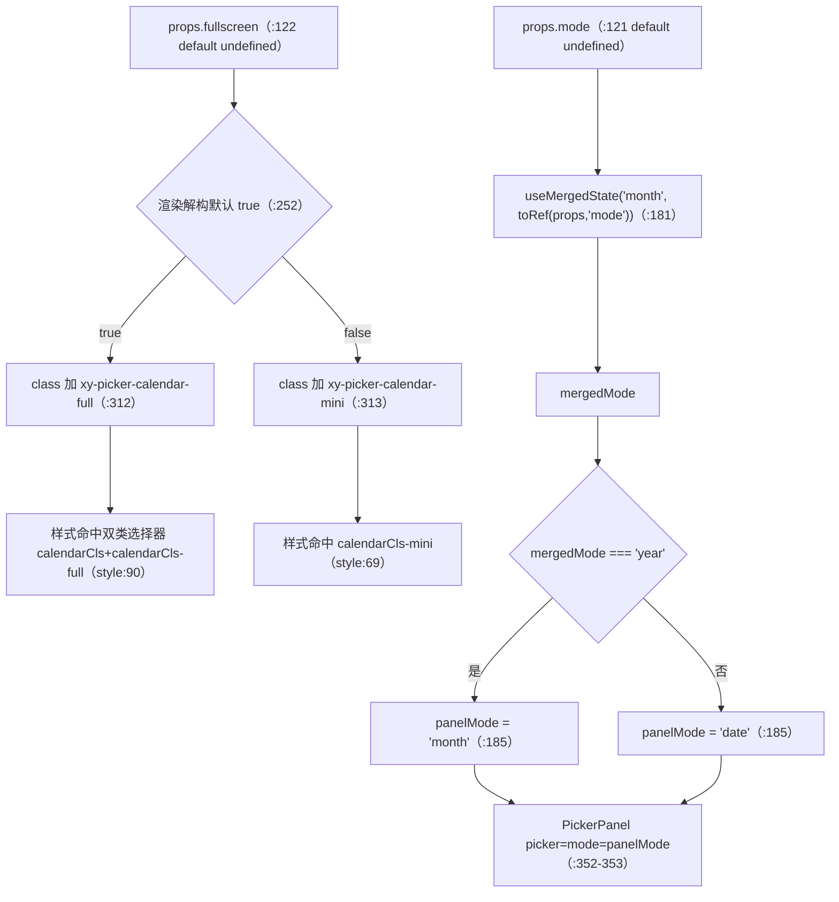

# C05-08 Calendar 日历

> **本篇解决**：Calendar 与 DatePicker 共用 `vc-picker` 内核，但它作为「常驻面板组件」到底从内核里取用了什么、又自己搭了什么——`value`/`defaultValue`/`onSelect` 的受控形状在 Calendar 里是否成立、全屏与卡片两种 mode 的样式归属边界在哪里。
> **前置**：C05-06 DatePicker 日期选择、I07 日期计算内核　**读者坐标**：`03-components/05-picker` 第 9/9 篇

## 一、职责与边界

`calendar/` 是一个**常驻面板组件**：它没有输入框、没有弹层、没有开合状态，渲染出来的就是一整张占地的日历网格（全屏档）或一张紧凑卡片（卡片档）。它与 `<xy-date-picker>` 共用 `vc-picker` 内核（I07），但对外形状完全不同——`date-picker/` 是"适配层 + 浮层外观层"（见 C05-06 §一），而 `calendar/` 只从内核里取走**一个出口 `PickerPanel`**，其余全部自己搭。

本篇只讲 `packages/xiaoye-ui/src/calendar/` 这一层。以下机制已由前置篇论证完毕，一律引用编号、不重复展开：日期算术与 dayjs 插件链、面板格子生成、`viewDate` 归属、`valueFormat` 的 `toDate`/`toString` 往返实现——见 I07；`vc-picker` 的 trigger/align 浮层通道、`PickerTrigger`、`panelProps` 合并——见 A07；`generatePicker` 工厂、七个公开组件、单选与范围在空值归一上的差异（`'' → undefined` 那一手）——见 C05-06 论点 1、论点 2。

**明确不负责**：面板内部的日期运算与视图态（I07）、输入框与 IME（I04）、`ConfigProvider` 的主题 token 派生本体（A03 / I14）、locale 数据本体（I11）。

**依赖清单**（`calendar/` 实际 import 的上游，见 `generateCalendar.tsx:1-21`、`Header.tsx:1-8`）：

| 依赖 | 用处 | 出处 |
| --- | --- | --- |
| `../vc-picker` | **只用 `PickerPanel` 一个符号**，`generateCalendar.tsx:2` | `vc-picker/index.tsx:9`（`export { PickerPanel, RangePicker }`） |
| `../vc-picker/PickerPanel` | 类型 `PickerPanel*Props`（经 `InjectDefaultProps` 剥内部字段） | `generateCalendar.tsx:6-10` |
| `../vc-picker/generate` | `GenerateConfig<DateType>` 工厂参数 | `generateCalendar.tsx:4` |
| `../select`、`../radio` | Header 的年份/月份下拉与年月切换 | `Header.tsx:1-2`（`Select` / `Group`,`Button`） |
| `../form/FormItemContext` | Header 里把 `isFormItemInput` 强制关掉 | `Header.tsx:8`、`:185-186` |
| `./date-picker/style` | **复用面板样式** `genPanelStyle` / `initPickerPanelToken` / `PickerPanelToken` | `style/index.tsx:3-4` |
| `../_util/hooks/useMergedState` | `value` 与 `mode` 两个受控形状 | `generateCalendar.tsx:1` |
| `../locale-provider/LocaleReceiver` | `useLocaleReceiver('Calendar', defaultLocale)` | `generateCalendar.tsx:11`、`:242` |
| `./locale/en_US` | 兜底语言包（整文件转发 date-picker 的语言包） | `generateCalendar.tsx:12`、`locale/en_US.ts:1` |
| `../_util/registerComponent` | `install` 里的注册 | `generateCalendar.tsx:5`、`:364` |
| `../config-provider/hooks/useConfigInject` | **注入的是 `picker` 前缀，不是 `calendar`** | `generateCalendar.tsx:17`、`:145` |

## 二、源码地图

行数取自 `find packages/xiaoye-ui/src/calendar -type f -not -path "*/locale/*" | xargs wc -l`（`locale/` 下实测 62 个 `*.ts`，每个 3 行，全是转发 date-picker 同名语言包的 shim，与本篇无关）。

| 文件 | 行数 | 职责 | 关键导出 / 主入口行 |
| --- | --- | --- | --- |
| `calendar/index.tsx` | 4 | 包内默认入口，整文件转发 `./dayjs` | `import Calendar from './dayjs'`（:1）、`export * from './dayjs'`（:2） |
| `calendar/dayjs.tsx` | 9 | **发布面唯一入口**：绑定 Dayjs + `withInstall` | `generateCalendar(generateConfig)`（:6）、`withInstall(Calendar)`（:9） |
| `calendar/moment.tsx` / `date-fns.tsx` | 10 / 9 | 另两套日期库绑定，**没有任何 export path 指向它们** | `generateCalendar<Moment>`（moment:7）/ `<Date>`（date-fns:6） |
| `calendar/generateCalendar.tsx` | 371 | **主实现 + 类型 + 工厂**三合一 | `SelectInfo`（:31）、`CalendarProps`（:53）、`generateCalendar`（:74）、`defineComponent`（:94）、`setup`（:143） |
| `calendar/Header.tsx` | 223 | 自绘头部：年/月 `Select` + 年月 `Radio.Group` | `YearSelect`（:24）、`MonthSelect`（:82）、`ModeSwitch`（:135）、`defineComponent`（:169） |
| `calendar/style/index.tsx` | 218 | CSS-in-JS，**寄生在 `xy-picker` 前缀**，面板样式来自 date-picker | `genCalendarStyles`（:26）、`genComponentStyleHook('Calendar', ...)`（:191） |
| `calendar/index.test.js` | 362 | 唯一测试文件（15 个 `it`，见 §七） | `mountTest(Calendar)`（:12） |

主实现入口：`packages/xiaoye-ui/src/calendar/generateCalendar.tsx:94`（`const Calendar = defineComponent`）。工厂 `generateCalendar<...>(generateConfig)` 在 `:74`，被 `dayjs.tsx:6` / `moment.tsx:7` / `date-fns.tsx:6` 各调一次。

组件 `name` 为 `'XYCalendar'`（`generateCalendar.tsx:95`），`registerComponent` 经 `toXYTagName`（`_util/registerComponent.ts:6-11`）反推出标签 `xy-calendar`；生成物侧 `typings/global.d.ts:16` 有 `XYCalendar`、`package.json:185-189` 有 `./calendar` 与 `./calendar/style` 双入口。与 DatePicker 的"七个匿名组件三张名单互不一致"（C05-06 论点 1）不同，Calendar 只有一个对外组件，名单对齐。

## 三、架构与数据流

### 图 1：静态结构——同一内核，两条消费路径

这张图是全篇骨架：Calendar 与 DatePicker 都落在 `vc-picker` 上，但**取用的出口几乎不重叠**。DatePicker 走 `Picker`（内含 `PickerTrigger` → vc-trigger/vc-align，见 A07），Calendar 只 `import { PickerPanel }`（`generateCalendar.tsx:2`），把内核当纯展示面板直连渲染。



三点解读：

- **Calendar 到 `vc-trigger`/`vc-align` 之间没有任何 import**。在 `calendar/` 目录里 `grep -rn "vc-trigger\|vc-align\|Trigger\|Popup"` 只命中两类噪声：`Header.tsx:76`/`:123` 的 `getPopupContainer={() => divRef!.value!}`（那是把**年份/月份 `Select` 的下拉**挂到 header 容器里，走的是 Select 自己的 trigger，不是 picker 的 `PickerTrigger`），以及 `generateCalendar.tsx:206` 的一句注释 `// Trigger when month panel switch month`。除此之外零命中——即 A07 那套为浮层搭的对齐/碰撞/开合通道，Calendar 通过 picker 这条线**一分都没用**。它唯一"弹"出去的东西是 Header 里的两个 `Select`。
- Calendar 传给 `PickerPanel` 的 props 只有一个窄子集（`generateCalendar.tsx:342-356`）：`value / prefixCls / locale / generateConfig / dateRender / monthCellRender / onSelect / mode / picker / disabledDate / hideHeader`。内核 `PickerPanelSharedProps`（`vc-picker/PickerPanel.tsx:43-87`）里的 `showTime`、`renderExtraFooter`、`onOk`、`components`、`onPanelChange`、`direction`、`tabindex` 等 Calendar 一个都没传——因为常驻面板不需要确认按钮、不需要页脚、不需要 `onPanelChange`（它自己算，见论点 5）。
- 样式是"借来的"：`style/index.tsx:3-4` 从 `../../date-picker/style` 直接 import `genPanelStyle` 与 `initPickerPanelToken`，在 `:31` 把整张面板样式 `...genPanelStyle(token)` 铺进 `[calendarCls]`。也就是说**格子、单元格、hover 选中这些面板视觉，本体归 date-picker**，Calendar 只负责外层容器与 full/mini 两档覆盖（论点 4）。

### 图 2：一次点击日期的完整回流（受控值 + select 信息丢失）



关键分支：`onInternalSelect`（`generateCalendar.tsx:224`）第二个形参名字就是 `_source`（下划线前缀 = 作者标记"我不打算用"），它接收 `panelMode.value`（`'date'` 或 `'month'`）、`'customize'`（headerRender 路径 `:325`）、或 `undefined`（默认 CalendarHeader 的 `emit('change', v)` 只带一个参数，`:202`/`:209`）——然后 `emit('select', maybeToString(date))`（`:226`）**只把第一个参数发出去**。这是本篇的头号缺陷，见论点 2。

### 图 3：fullscreen / mode 的判定与类名归属



这条链上有两处"默认值写在渲染而不是 props 表"：`fullscreen` 的 `= true` 在解构里（`:252`），props 表却是 `default: undefined`（`:122`）；`mergedMode` 的 `'month'` 初值在 `useMergedState` 第一个参数里（`:181`），props 表 `mode` 也是 `default: undefined`（`:121`）。后果见论点 3。

## 四、核心机制精读

### 论点 1：Calendar 只从 `vc-picker` 取一个出口 `PickerPanel`，A07 的 trigger/align 通道它通过 picker 这条线一分没用；"面板常显"是结构选择，不是配置项

**断言**：Calendar 不是"把 DatePicker 的浮层钉住不让收起来"，而是**根本没进浮层那条链**。它 import 的是内核的裸面板，而不是包了 trigger 的 `Picker`。整条 trigger/align/popup 通道（A07）对它完全不可达，唯一"弹"的东西是 Header 里两个 `Select`。

看它到底 import 了什么，`generateCalendar.tsx:1-2`：

```tsx
// packages/xiaoye-ui/src/calendar/generateCalendar.tsx:1
import useMergedState from '../_util/hooks/useMergedState';
import { PickerPanel } from '../vc-picker';
```

`vc-picker/index.tsx:12` 的默认导出是 `Picker`（带 trigger 的那个），Calendar 走的是具名导出 `PickerPanel`（`vc-picker/index.tsx:9`），**绕开了 `Picker`**。对照 `date-picker/generatePicker/generateSinglePicker.tsx:2` 用的是默认 `RCPicker`，后者内部 import 了 `PickerTrigger`（`vc-picker/Picker.tsx:20`）——这就是两条路径的分叉点，也是 C05-06 §一只讲 `date-picker/` 一层、本篇只讲 `calendar/` 一层的依据。

再看它给面板喂了什么，`generateCalendar.tsx:342-356`：

```tsx
// packages/xiaoye-ui/src/calendar/generateCalendar.tsx:342
            <PickerPanel
              value={mergedValue.value}
              prefixCls={prefixCls.value}
              locale={mergedLocale.value.lang}
              generateConfig={generateConfig}
              dateRender={dateRender}
              monthCellRender={obj => monthRender(obj, mergedLocale.value.lang)}
              onSelect={nextDate => {
                onInternalSelect(nextDate, panelMode.value);
              }}
              mode={panelMode.value}
              picker={panelMode.value}
              disabledDate={mergedDisabledDate.value}
              hideHeader
            />
```

三个只在"常驻面板"语境下才成立的细节：

1. **`hideHeader`（`:355`）**。这个 prop 在 `PickerPanelSharedProps` 里被标了 `@private This is internal usage. Do not use in your production env`（`vc-picker/PickerPanel.tsx:80-81`），它把内核自带的 `DateHeader`/`MonthHeader`（年月左右翻页箭头 + 顶部 label）整块关掉——`vc-picker/panels/DatePanel/DateHeader.tsx:39-41` 是 `const { hideHeader } = useInjectPanel(); if (hideHeader?.value) { return null; }`。Calendar 关掉它，是因为它要用**自己的 `Header.tsx`** 替掉内核 header（论点 5）。
2. **`mode` 与 `picker` 被喂了同一个值 `panelMode.value`（`:352-353`）**。内核 `mode` 是"当前视图层级"、`picker` 是"最终选择粒度"（I07），Calendar 把两者焊死成一样：月档 → 都是 `'date'`、年档 → 都是 `'month'`（`panelMode` 定义在 `:185`）。这是它只支持年/月两种视图的直接体现——`CalendarMode = 'year' | 'month'`（`:43`）只有两级，没有 DatePicker 的 datetime/week/quarter/time。
3. **不传 `open` / `onUpdate:open` / `onOk` / `getPopupContainer`**。浮层组件的命门是"开合状态"，Calendar 压根没有这个状态维度；`Picker.tsx:250-252` 那套 `useMergedState(..., { value: toRef(props,'open') })` 的开合受控逻辑在 Calendar 里找不到对应物。

**结论**：Calendar 对内核的依赖面 = `PickerPanel` 一个组件 + `dateRender`/`monthCellRender` 两个自定义渲染口 + `disabledDate`/`value`/`mode`/`locale`/`generateConfig` 五个数据 prop。A07 论证的 trigger/align/placement 全套，它经由 picker 这条线用到了 **0 项**；经由 `Select` 用到了浮层，但那是选择器的浮层，不是日期面板的。所以"面板常显"不是 `Picker` 上某个 `open` 常量——它体现在**换了一个 import 符号**（`PickerPanel` 而非 `Picker`），是文件级的结构决定。

### 论点 2：`value`/`defaultValue` 的受控形状是 date-picker 单选逐字的拷贝（含 `'' → undefined` 归一，本组件不命中"兜底分支恒不可达"这一族）；但 `onSelect` 承诺的第二个参数 `selectInfo` 是纯 API 面存活、实现死亡

**断言**：Calendar 的受控值链有两条独立的判断要分开看——(a) `value`/`defaultValue` 的合并是**正确**的，用的是和 C05-06 论点 2 完全同构的 `if (props.value) ... 否则 '' → undefined`，而且因为它的相关 props 默认值全是 `undefined`，兜底分支可达；(b) `onSelect` 的 `selectInfo` 第二参数**从来没被发出去过**。

先看值侧。`generateCalendar.tsx:154-169`：

```tsx
// packages/xiaoye-ui/src/calendar/generateCalendar.tsx:154
      const value = computed(() => {
        if (props.value) {
          return props.valueFormat
            ? (generateConfig.toDate(props.value, props.valueFormat) as DateType)
            : (props.value as DateType);
        }
        return (props.value === '' ? undefined : props.value) as DateType;
      });
      const defaultValue = computed(() => {
        if (props.defaultValue) {
          return props.valueFormat
            ? (generateConfig.toDate(props.defaultValue, props.valueFormat) as DateType)
            : (props.defaultValue as DateType);
        }
        return (props.defaultValue === '' ? undefined : props.defaultValue) as DateType;
      });
```

这两段与 `date-picker/generatePicker/generateSinglePicker.tsx:161-168` 的 `value` computed **逐字同构**（连行号区间都一样，`toDate` 走 I07 的适配层），`maybeToString`（`generateCalendar.tsx:151-153`）也与 `generateSinglePicker.tsx:124-126` 同形。也就是说 Calendar 把单选那套"字符串↔日期"协商原样复制了一份——这是「同一逻辑的多份拷贝」缺陷族的一个实例，但值得强调的是它复制的是**正确的那半**：C05-06 论点 2 指出范围侧 `generateRangePicker.tsx:165` 漏了 `'' → undefined` 归一，而 Calendar 的 `:160`/`:168` 都带了这一步，所以 Calendar 在这点上比范围侧还严谨。

**关于共则 §3 这一族**（`!== undefined` 三元 + prop 默认值非 undefined ⇒ 兜底分支恒不可达）：本篇专查后判定 **Calendar 不命中**。判据是它五个受控相关 prop 的默认值全是 `undefined`——`value: { default: undefined }`（`:115`）、`defaultValue: { default: undefined }`（`:119`）、`mode: { default: undefined }`（`:121`）、`fullscreen: { default: undefined }`（`:122`）、`validRange: { default: undefined }`（`:100`）。于是 `if (props.value)` 走真分支只在"使用方确实传了值"时成立，`else` 分支（`:160`/`:168`）对未传值的情况**可达**；`useMergedState` 内部 `value.value !== undefined ? value.value : innerValue.value`（`_util/hooks/useMergedState.ts:26`）的 `innerValue` 兜底同理可达。这与 `color-picker/ColorPicker.tsx:56` 那例（`defaultValue` 默认 `null`，非 undefined，回落 `modelValue` 的分支恒不进）是相反的形态。可复现命令：

```bash
grep -n "default: undefined\|!== undefined" packages/xiaoye-ui/src/calendar/generateCalendar.tsx
```

值侧唯一可挑的刺：`:155`/`:163` 用 **truthy** 判断而不是 `!== undefined`。对 Dayjs 对象与格式化字符串都成立（非空即真），但如果 `valueFormat` 未设、使用方把 `value` 直接给成 `0` 或 `false`（极端类型误用），会被判 falsy 落进 `:160`，`props.value === '' ? undefined : props.value` 于是**原样返回 `0`/`false`** 交给内核，而不是当"未受控"。这是理论边界，本组件的 `value?: DateType | string`（`:63`）类型上已排除 `number`/`boolean`，所以实际触发需要先绕过类型。

再看事件侧的硬伤。类型承诺：

```tsx
// packages/xiaoye-ui/src/calendar/generateCalendar.tsx:31
export interface SelectInfo {
  source: 'year' | 'month' | 'date' | 'customize';
}
```

```tsx
// packages/xiaoye-ui/src/calendar/generateCalendar.tsx:70
  onSelect?: (date: DateType, selectInfo: SelectInfo) => void;
```

实现只有：

```tsx
// packages/xiaoye-ui/src/calendar/generateCalendar.tsx:224
      const onInternalSelect = (date: DateType, _source: SelectInfo['source']) => {
        triggerChange(date);
        emit('select', maybeToString(date));
      };
```

`_source` 形参加了下划线前缀（`:224`），函数体里**一次都没读**；`emit('select', maybeToString(date))`（`:226`）只带一个实参。于是 `CalendarProps.onSelect`（`:70`）与 `Header.tsx:165` 的 `CalendarHeaderProps.onChange` 里那个 `selectInfo: SelectInfo` / `source: SelectInfo['source']` 的类型承诺，在运行时**永远拿不到第二个参数**。四个 source 取值（`:32`）里：`'customize'` 只在 headerRender 路径被算出（`:325`），`'date'`/`'month'` 由 `panelMode.value` 算出（`:350`），而 `'year'` 这个字面量在整条链上**没有任何一处作为 source 产生**（`panelMode` 只会是 `'date'` 或 `'month'`，见 `:185`；默认 CalendarHeader 的 `emit('change', v)` 只传一个 date，`:202`/`:209`，所以它落到 `onInternalSelect` 时 `_source` 是 `undefined`）——`'year'` 是 source 联合类型里的第三个死键。

测试侧证：`index.test.js:43-45` 是全库唯一碰 `onSelect` 参数的断言，它只读第一个参数：

```js
// packages/xiaoye-ui/src/calendar/index.test.js:43
      expect(onSelect).toHaveBeenCalledWith(expect.anything());
      const value = onSelect.mock.calls[0][0];
      expect(dayjs.isDayjs(value)).toBe(true);
```

`toHaveBeenCalledWith(expect.anything())` 只约束"被调用且有一个参数"，没有任何一条断言检查 `mock.calls[0][1]`——所以"selectInfo 缺失"这件事被测试面完全掩盖。**该分支无测试保护**。

**结论**：Calendar 的受控**值**是 date-picker 单选的正确拷贝（且比范围侧多做了空串归一），受控**回调**则是半截工程——`onSelect` 的签名对外声明了两参数语义，实现只回传 date。使用方若按 `apps/docs` 的 API 语义去 `onSelect(date, { source })` 里读 `source`，拿到的是 `undefined`。

### 论点 3：`fullscreen` 与 `mode` 两个开关的"默认值"分裂在 props 表与渲染体两处——`fullscreen` 的对外默认是渲染里 `= true`（`:252`）而非 props 表，改档名/查默认值会被误导

**断言**：Calendar 有两个布尔/枚举形态的开关（`mode`、`fullscreen`），它们的**有效默认值**都不在 `props` 声明里，而在别处：`fullscreen` 落在渲染函数的解构默认（`:252`），`mode` 落在 `useMergedState` 的第一参数（`:181`）。props 表里两者都写 `default: undefined`。这不是 bug，但它让"这个组件默认是全屏还是卡片"这个问题，只读 `props` 表答不出来。

props 表侧，`generateCalendar.tsx:121-122`：

```tsx
// packages/xiaoye-ui/src/calendar/generateCalendar.tsx:121
      mode: { type: String as PropType<Props['mode']>, default: undefined },
      fullscreen: { type: Boolean as PropType<Props['fullscreen']>, default: undefined },
```

`fullscreen` 真正被消费在渲染解构，`generateCalendar.tsx:246-254`：

```tsx
// packages/xiaoye-ui/src/calendar/generateCalendar.tsx:246
        const {
          dateFullCellRender = slots?.dateFullCellRender,
          dateCellRender = slots?.dateCellRender,
          monthFullCellRender = slots?.monthFullCellRender,
          monthCellRender = slots?.monthCellRender,
          headerRender = slots?.headerRender,
          fullscreen = true,
          validRange,
        } = props;
```

`:252` 的 `fullscreen = true` 只在 `props.fullscreen === undefined` 时生效。因为 props 表把它默认成 `undefined`（`:122`），所以 `<xy-calendar>` 不写 `fullscreen` 时，这里拿到 `true` → 走全屏档。这与 C05-06 论点 5 描述的 date-picker 同款手法一致：`bordered = true` / `showToday = true` / `allowClear = true` 也是写在解构里、不写在 props 表里（`generateSinglePicker.tsx:203-218`），"默认有边框/默认可清除"这类产品决策从 `props` 表读不出来。Calendar 的 `fullscreen` 是同一模式的延续。

`mode` 走的是另一条：`generateCalendar.tsx:181-185`：

```tsx
// packages/xiaoye-ui/src/calendar/generateCalendar.tsx:181
      const [mergedMode, setMergedMode] = useMergedState('month', {
        value: toRef(props, 'mode'),
      });

      const panelMode = computed(() => (mergedMode.value === 'year' ? 'month' : 'date'));
```

`useMergedState` 第一参数 `'month'`（`:181`）是内部初值，第二参数 `{ value: toRef(props,'mode') }` 是受控源（`_util/hooks/useMergedState.ts:26` 的 `value.value !== undefined ? value.value : innerValue.value`）。因此 `mode` 的对外默认 = 内部初值 `'month'`（月视图），props 表里的 `default: undefined` 只是"让 `!== undefined` 判定认为未受控"的哨兵。

两个开关最终决定**类名归属**，`generateCalendar.tsx:307-318`：

```tsx
// packages/xiaoye-ui/src/calendar/generateCalendar.tsx:307
          <div
            {...attrs}
            class={classNames(
              calendarPrefixCls.value,
              {
                [`${calendarPrefixCls.value}-full`]: fullscreen,
                [`${calendarPrefixCls.value}-mini`]: !fullscreen,
                [`${calendarPrefixCls.value}-rtl`]: direction.value === 'rtl',
              },
              attrs.class,
              hashId.value,
            )}
          >
```

根元素同时带 `xy-picker-calendar` 与 `-full`/`-mini` 之一（`calendarPrefixCls` = `${prefixCls.value}-calendar`，`:150`，而 `prefixCls` 来自 `useConfigInject('picker', ...)`，`:145`）。样式侧对应的两条覆盖分支见论点 4：`-full` 用**双类选择器** `.xy-picker-calendar.xy-picker-calendar-full`（`style/index.tsx:90` 是 `[`${calendarCls}${calendarCls}-full`]`），`-mini` 用单类 `.xy-picker-calendar-mini`（`style/index.tsx:69`）。`-full` 分支特异度更高（两个类），所以能安全覆盖 `genPanelStyle` 铺进来的面板默认视觉，而 `-mini` 分支只加圆角与高度约束。

`fullscreen` 还有一条**贯穿到 Header 的旁路**：它被作为 prop 透传给 `<CalendarHeader fullscreen={fullscreen}>`（`:335`），Header 内部据此决定 `YearSelect`/`MonthSelect`/`ModeSwitch` 三件的 `size`——`Header.tsx:45` 是 `size={fullscreen ? undefined : 'small'}`（`:112`、`:147` 同形），即全屏档头部控件用默认尺寸、卡片档一律降 `small`。所以"全屏/卡片"不是纯 CSS 差异，它同时改**类名**和**子控件尺寸**两条线；改 mode 视觉要同时想到 `Header.tsx` 的三处三元。

**结论**：Calendar 的两档外观由 `fullscreen` 一个布尔驱动，但它的默认值定义分散在 props 表（`undefined`）与渲染解构（`true`）两处；`mode` 同理分散在 props 表与 `useMergedState` 初值。这是"产品默认藏在渲染体"的既有风格在 Calendar 的复现，读 API 时必须连带读 `:246-254` 与 `:181`。

### 论点 4：Calendar 的样式命名空间是"分裂"的——类名前缀是 `xy-picker`（不是 `xy-calendar`），面板视觉本体归 `date-picker/style`，而 ComponentToken 键是 `Calendar`

**断言**：`calendar/style/index.tsx` 生成的 CSS 全部落在 `.xy-picker-calendar*` 与 `.xy-picker-*` 下，**没有任何一条 `.xy-calendar` 规则**。它靠两件"借"：一是 `useConfigInject('picker', ...)` 让 `componentCls` 变成 `.xy-picker`（论点 3 已铺垫），二是直接 import `date-picker/style` 的 `genPanelStyle`。于是 Calendar 的皮肤分三层归属：外层容器 = Calendar 自己的 style；面板格子/hover/选中 = date-picker 的 `genPanelStyle`；可覆盖 token = `Calendar` 键下的三个 ComponentToken。

第一层与第二层的焊接点，`style/index.tsx:1-4`：

```tsx
// packages/xiaoye-ui/src/calendar/style/index.tsx:1
import type { CSSObject } from '../../_util/cssinjs';
import { resetComponent } from '../../style';
import type { PickerPanelToken } from '../../date-picker/style';
import { genPanelStyle, initPickerPanelToken } from '../../date-picker/style';
```

`:31` 把整张面板样式铺进 Calendar 根类，`style/index.tsx:26-33`：

```tsx
// packages/xiaoye-ui/src/calendar/style/index.tsx:26
export const genCalendarStyles = (token: CalendarToken): CSSObject => {
  const { calendarCls, componentCls, calendarFullBg, calendarFullPanelBg, calendarItemActiveBg } =
    token;
  return {
    [calendarCls]: {
      ...genPanelStyle(token),
      ...resetComponent(token),
      background: calendarFullBg,
```

`genPanelStyle` 定义在 `date-picker/style/index.ts:286`、`initPickerPanelToken` 在 `date-picker/style/index.ts:1396`。也就是说 Calendar 面板里的 `-cell`、`-cell-inner`、`-selected`、`-today`、`-date-panel`、`-month-panel` 这些类，其规则本体都来自 date-picker 那份 1446 行的 `style/index.ts`（C05-06 §二），Calendar 这边只在 `:30`（`[calendarCls]`）、`:54`（`[${calendarCls} ${componentCls}-panel`]`）、`:69`（`-mini`）、`:90`（`-full`）做**覆盖与补充**。

第三层的命名分裂，`style/index.tsx:191-218`：

```tsx
// packages/xiaoye-ui/src/calendar/style/index.tsx:191
export default genComponentStyleHook(
  'Calendar',
  token => {
    const calendarCls = `${token.componentCls}-calendar`;
    const calendarToken = mergeToken<CalendarToken>(
      initInputToken<FullToken<'Calendar'>>(token),
      initPickerPanelToken(token),
      {
        calendarCls,
        pickerCellInnerCls: `${token.componentCls}-cell-inner`,
        ...
      },
    );

    return [genCalendarStyles(calendarToken)];
  },
  {
    yearControlWidth: 80,
    monthControlWidth: 70,
    miniContentHeight: 256,
  },
);
```

关键在两个名字的来源不同：
- **`component` 名是 `'Calendar'`（`:192`）**：它决定 ConfigProvider 的组件 token 覆盖读哪个键——`theme/util/genComponentStyleHook.ts:85` 的 `mergedComponentToken = { ...defaultComponentToken, ...token.value[component] }`，即用户写 `theme={{ components: { Calendar: { ... } } }}` 时命中的是 `Calendar` 键，末位的 `{ yearControlWidth: 80, ... }`（`:213-217`）正是这三个 ComponentToken 的默认值（`ComponentToken` 接口 `:10-14`）。
- **`componentCls` 却是 `.xy-picker`**：`genComponentStyleHook.ts:87` 的 `const componentCls = `.${prefixCls.value}``，而 `prefixCls.value` 来自调用方传入的 ref——Calendar 在 `generateCalendar.tsx:148` 调 `useStyle(prefixCls)`，这个 `prefixCls` 是 `useConfigInject('picker', props)` 产的（`:145`）。所以 `token.componentCls = .xy-picker`，`calendarCls = ${token.componentCls}-calendar = .xy-picker-calendar`（`:194`）。

两者叠加的直接后果：**token 命名空间（Calendar）与类名命名空间（picker）是两套**。用 `theme={{components:{Calendar:{...}}}}` 换肤只能改到 `yearControlWidth`/`monthControlWidth`/`miniContentHeight` 三个键（`style/index.tsx:11-13` 的 `ComponentToken`），改不到面板结构类名——那些在 date-picker 的 `genPanelStyle` 里。想动 `-cell`、`-date-value`、`-date-content` 的布局，要回到 `calendar/style/index.tsx:109-164`（`-full` 档对 `-cell`/`-date` 的覆盖）和 date-picker 本体两处改。

**结论**：Calendar 的样式归属是三层的——容器（自持）、面板（借 date-picker）、token（挂在 `Calendar` 键）。"全屏/卡片"两档的样式差异（`:69` 的 mini 圆角/高度、`:90` 的 full 铺满/去边框）落在自持层，但它们覆盖的是借来的面板默认值，且 `componentCls` 命名空间与 token 命名空间分裂。这是理解"为什么改 Calendar 颜色要碰 date-picker 文件、改宽度只在 Calendar 文件"的钥匙。

### 论点 5：`validRange` 被折进 `disabledDate` 喂给内核，同时 Header 又用 `YearSelect`/`MonthSelect` 独立把 `validRange` 再夹一次——同一份区间约束存在两处实现，且 Calendar 用自绘 Header 完整替换了内核 header

**断言**：Calendar 把内核的 `DateHeader` 关掉（论点 1 的 `hideHeader`），用自己的 `Header.tsx` 顶上去；而"可选区间"这件事，它在**两个互不知情**的地方各算了一遍：面板侧折进 `disabledDate`，头部侧在 `YearSelect`/`MonthSelect` 里重算起止。改 `validRange` 语义要三处同改。

第一处，面板侧把 `validRange` 转成 `disabledDate`，`generateCalendar.tsx:193-195`：

```tsx
// packages/xiaoye-ui/src/calendar/generateCalendar.tsx:187
      const mergedDisabledDate = computed(() => {
        return (date: DateType) => {
          const notInRange = props.validRange
            ? generateConfig.isAfter(props.validRange[0], date) ||
              generateConfig.isAfter(date, props.validRange[1])
            : false;
          return notInRange || !!props.disabledDate?.(date);
        };
      });
```

`:189` 的三元 `props.validRange ? ... : false` 兜底分支可达（`validRange` 默认 `undefined`，`:100`）。产出的函数在 `:354` 作为 `disabledDate` 交给 `PickerPanel`——注意 `<PickerPanel>`（`:342-356`）**根本没有 `validRange` 这个 prop**，内核 `PickerPanelSharedProps` 也不接受它（`vc-picker/PickerPanel.tsx:43-87` 里只有 `disabledDate`，`:64`）。测试 `index.test.js:154-167` 正是从 `PickerPanel` 抓出这个 `disabledDate` 并断言 `disabledDate(dayjs('2018-06-02')).toBe(true)`——它验证的是"区间被折成了 disabledDate"这一手。

第二处与第三处，Header 侧对同一 `validRange` 的独立处理。`Header.tsx:33-36`（年份列表起止）：

```tsx
// packages/xiaoye-ui/src/calendar/Header.tsx:33
  if (validRange) {
    start = generateConfig.getYear(validRange[0]);
    end = generateConfig.getYear(validRange[1]) + 1;
  }
```

`Header.tsx:54-70`（选中年份后把月夹回区间内）与 `MonthSelect` 的 `Header.tsx:90-99`（按当前年裁剪可选月）是第二、第三份区间算式：

```tsx
// packages/xiaoye-ui/src/calendar/Header.tsx:54
              if (validRange) {
                const [startDate, endDate] = validRange;
                const newYear = generateConfig.getYear(newDate);
                const newMonth = generateConfig.getMonth(newDate);
                if (
                  newYear === generateConfig.getYear(endDate) &&
                  newMonth > generateConfig.getMonth(endDate)
                ) {
                  newDate = generateConfig.setMonth(newDate, generateConfig.getMonth(endDate));
                }
                if (
                  newYear === generateConfig.getYear(startDate) &&
                  newMonth < generateConfig.getMonth(startDate)
                ) {
                  newDate = generateConfig.setMonth(newDate, generateConfig.getMonth(startDate));
                }
              }
```

这三段（`:189` 的 disabledDate、`:33-36` 的年列表、`:54-70`+`:90-99` 的夹取）读的都是同一个 `props.validRange`，但**没有任何一处复用另一处的结果**：面板的格子禁用靠 `mergedDisabledDate`，头部的下拉选项裁剪与越界回拉靠 Header 自己的 `generateConfig` 调用。这就是「同一逻辑的多份拷贝」在 Calendar 的落点。

`Header.tsx` 整体是内核 header 的一份**平行替代实现**，`hideHeader` 关掉内核 header 后（论点 1），Calendar 用 `<CalendarHeader>` 顶上，`generateCalendar.tsx:329-341`：

```tsx
// packages/xiaoye-ui/src/calendar/generateCalendar.tsx:329
              <CalendarHeader
                prefixCls={calendarPrefixCls.value}
                value={mergedValue.value}
                generateConfig={generateConfig}
                mode={mergedMode.value}
                fullscreen={fullscreen}
                locale={mergedLocale.value.lang}
                validRange={validRange}
                onChange={onInternalSelect}
                onModeChange={triggerModeChange}
              />
```

`CalendarHeader`（`Header.tsx:169`）的 `props` 是**数组式声明**且**重复列了 `'mode'`**——`Header.tsx:172-181` 是 `props: ['mode','prefixCls','value','validRange','generateConfig','locale','mode','fullscreen']`，`'mode'` 出现在 `:173` 与 `:179` 两次。这是无害冗余（Vue 会去重），但说明这份表是手维护、无类型兜底。更值得注意的是这份表**不声明 `onChange`/`onModeChange`**（`:172-181` 里没有这两个名字），而 `emits: ['change','modeChange']`（`:182`）声明了它们——父级 `generateCalendar.tsx:338-339` 传进来的 `onChange={onInternalSelect}` / `onModeChange={triggerModeChange}` 因此走的是 Vue 的 emit 通道（`emit('change', v)` 命中 `onChange`，`Header.tsx:202`/`:209`），不是 props 读取。`Header.tsx:189` 那句 `const props = { ..._props, ...attrs }` 里的 `props.onChange` 恒为 `undefined`（因为它既不在 `_props` 也不在 `attrs`——`attrs` 已被 emit 消费），Header 内部给子件挂的是**它自己新造的** `onChange={v => emit('change', v)}`（`:201-203`、`:208-210`）。

**结论**：Calendar 不用内核 header，自建 `Header.tsx`；`validRange` 的约束因此被实现三遍（面板 disabledDate + 头部起止 + 头部回拉），三者读同一 prop 却零复用。加上 `CalendarHeader` 用数组式 props（且 `'mode'` 重复声明）+ emit 而非 prop 读取回调，它是内核之外一个"自带一份区间逻辑"的孤岛——改区间语义或改年/月切换交互，改动面横跨 `generateCalendar.tsx` 与 `Header.tsx` 两个文件。

## 五、对外契约如何生效

**props 的两条加工线**。`generateCalendar.tsx:143` 的 setup 签名是 `setup(p, { emit, slots, attrs })`——`props` 先被强转成 `Props` 类型（`:144`），随后只有被 setup 显式读取的字段才产生行为。真正读进加工的是：`value`/`defaultValue`（经 `:154-169` 两个 computed 做 `toDate` 与空串归一）、`valueFormat`（`:152` 的 `maybeToString` 与 `:156`/`:164`）、`validRange`+`disabledDate`（`:187-195` 折成 `mergedDisabledDate`）、`mode`（`:182` 的 `toRef`）、`prefixCls`（`:145` 经 `useConfigInject`）、`locale`（`:230` 经 `defaultLocale`）。其余在渲染解构里被摘走或走 `attrs`。

**回调是"声明为 props、只经 emit 触发"的单通道**。`onChange`/`'onUpdate:value'`/`onPanelChange`/`onSelect` 四个既在 props 表声明为函数（`:123-126`），又对应 `emits: ['change','update:value','panelChange','select']`（`:129`）。但 setup 里**从不直接调用** `props.onChange` 之类（`grep -n "props.onChange\|props.onSelect\|props.onPanelChange" packages/xiaoye-ui/src/calendar/generateCalendar.tsx` 无输出，退出码 1），全部靠四处 `emit()`（`:199` panelChange、`:214` update:value、`:215` change、`:226` select）触发。这与 C05-06 论点 5 描述的 date-picker"emit 与 `callEvent(props.onX)` 相邻两句都执行、可能双调"是**相反的形状**——Calendar 只有一条路，父级一个 `@change` 只会被命中一次。代价是那四个 `Props['onXxx']` 声明在这里只起类型与 attrs 过滤作用，不是运行时的调用入口。

**slots 与 props 同形，二选一**。五个渲染型槽位在 `slots` 类型里声明（`:130-142`），并在渲染解构里作为 props 的**兜底默认值**：`dateFullCellRender = slots?.dateFullCellRender`（`:247`）、`dateCellRender = slots?.dateCellRender`（`:248`）、`monthFullCellRender = slots?.monthFullCellRender`（`:249`）、`monthCellRender = slots?.monthCellRender`（`:250`）、`headerRender = slots?.headerRender`（`:251`）。解构默认只在对应 prop 为 `undefined` 时生效，所以 **prop 版渲染函数优先于 slot 版**；两者都给时 slot 被忽略。`slots` 类型里那个 `default: any`（`:141`）没有任何消费点（`grep -n "slots.default" packages/xiaoye-ui/src/calendar/generateCalendar.tsx` 无输出），`<xy-calendar>随便写</xy-calendar>` 的默认槽位内容被静默丢弃——与 C05-06 §五 记录的 date-picker 空默认槽一致。

**expose 缺席**。Calendar 没有 `expose(...)` 调用，setup 也没解构 `expose`。因此模板 ref 拿到的实例是组件默认暴露面，没有像 date-picker 那样窄化成 `{ focus, blur }`（C05-06 §五 的 `generateSinglePicker.tsx:123-137`）。Calendar 常驻显示、无输入焦点语义，没有可窄化的公开方法。

**attrs 直接落根元素**。`inheritAttrs: false`（`:96`），根 `<div {...attrs} class={classNames(..., attrs.class, hashId.value)}>`（`:307-318`）手工把 `attrs` 展开并把外部 `class` 并入 `classNames`。所以使用方写的 `class`/`style`/`data-*` 会落到最外层日历容器上，而不是面板内部。

**context 只 inject 不 provide**。Calendar inject 了 `config-provider`（`:145` `useConfigInject('picker', props)`，注意 name 传的是 `'picker'` 不是 `'calendar'`）与 `locale-provider`（`:242` `useLocaleReceiver('Calendar', defaultLocale)`，注意 name 这里传 `'Calendar'`）。`useConfigInject` 只取了 `{ prefixCls, direction }` 两个（`:145`），没取 `size`/`disabled`/`getPopupContainer`——Calendar 不接 `SizeContext`/`DisabledContext`，也没有全局禁用联动。它**不向下游 provide 任何 context**；`Header.tsx` 是它的子组件但只靠 props 通信。唯一一处"向下注入"在 `Header.tsx:185-186`——它 inject `FormItemInputContext` 后立刻 `useProvide(formItemInputContext, { isFormItemInput: false })`，把 Header 内两个 `Select` 排除出 FormItem 高亮态（否则点年份下拉会误触发 Form 校验样式）。

**locale 合并粒度**：`defaultLocale` computed（`:229-240`）做 `{ ...enUS, ...locale }` 顶层浅合并 + `result.lang = { ...result.lang, ...(locale||{}).lang }` 的 lang 再合并，然后交给 `useLocaleReceiver`。传给内核与 Header 的是 `mergedLocale.value.lang`（`:336`、`:345`）——即只用 `lang` 子对象，与 C05-06 §五 记录的 date-picker `locale!.lang` 同一口径。

## 六、设计取舍

**取舍一：直接复用内核裸面板 `PickerPanel`，而不是把 `Picker` 的 `open` 焊成常开。**

买到的：Calendar 不需要 trigger/align/popup 那套（A07），不用背 `PickerTrigger`、`usePickerInput`、IME/文本回显（I04）这些它根本渲染不到的模块，import 面缩到 `import { PickerPanel }` 一行（`generateCalendar.tsx:2`），tree-shaking 也不会把浮层代码拖进日历产物。赔上的：`hideHeader`（`:355`）是个被标 `@private` 的内部 prop（`vc-picker/PickerPanel.tsx:80-81`），Calendar 依赖内核私有开关存活——内核哪天改掉 `hideHeader` 语义或把它删了，Calendar 的头部替换立刻崩，而且这个耦合没有任何类型或测试契约保护它。更直接的代价是"自己造 Header"：年份/月份切换、区间夹取全要在 `Header.tsx` 重写一遍（论点 5 的三份 `validRange` 拷贝）。若改走"复用内核 header + 关闭其翻页箭头"的另一条路，能省掉整个 `Header.tsx`，但拿不到年/月 `Select` 下拉这种 Calendar 特有的头部交互。

**取舍二：受控值的 `'' → undefined` 归一逐字拷贝 date-picker 单选，而不是抽一个 `usePickerValue` 共享。**

买到的：Calendar 与 date-picker 单选行为完全一致（含空串语义），且比范围侧更严谨（C05-06 论点 2 指出范围漏归一）。赔上的：`value`/`defaultValue`/`maybeToString` 三段逻辑（`:151-169`）在 `calendar/` 与 `date-picker/generatePicker/` 各存一份，是「同一逻辑多份拷贝」族的又一实例；一旦单选改了空值策略（比如引入 `null` 也归一到 `undefined`），Calendar 不会自动跟进，漂移只能靠人工对齐。

**取舍三：样式寄生在 `xy-picker` 前缀并 `import { genPanelStyle }` 复用 date-picker 面板样式，而不是给 Calendar 起独立前缀 `xy-calendar`。**

买到的：面板视觉零重复实现，Calendar 只写容器与 full/mini 两档覆盖（`style/index.tsx:69`、`:90`），两组件的格子永远长得一样。赔上的：命名空间分裂（论点 4）——类名走 `picker`、token 走 `Calendar`，`useConfigInject('picker')`（`:145`）与 `useLocaleReceiver('Calendar')`（`:242`）用了两个不同的 name，`genComponentStyleHook('Calendar')` 又用第三个来源算 `componentCls`。接手者极易以为改 Calendar 外观只需动 `calendar/style`，实际面板结构类名归 date-picker。且 date-picker 一旦把 `genPanelStyle` 改名或挪走（`:286`），Calendar 直接编译失败。

**取舍四：`onSelect` 类型保留两参数签名（date + selectInfo），实现却只 emit date。**

买到的（对作者而言，推测）：与 headerRender 的 `SelectInfo` 语义对齐、给未来"区分点的是年还是月"留类型位。赔上的：一个对外公开、`apps/docs` 会照抄进 Props 表的**假承诺**——`selectInfo` 永远 `undefined`（论点 2）。这不是"暂时没做"，因为 `emit('select', maybeToString(date))`（`:226`）与 `_source` 未读（`:224`）都是确定写法，补齐只需把 `_source` 拼进 emit 实参。当前状态是类型面与实现面长期不一致，属于该显式修正而非静默保留的一类。

## 七、坑与改动指南

**坑 1：读 `onSelect` 的第二参数 `selectInfo`/`source` 来区分点的是年/月/日——永远拿到 `undefined`**

- 触发：`<xy-calendar @select="(d, info) => doSomething(info.source)" />`，或按 `CalendarProps.onSelect`（`generateCalendar.tsx:70`）的类型写了第二个参数。
- 症状：`info` 恒为 `undefined`，`info.source` 抛 `Cannot read properties of undefined`；即便用可选链，也拿不到"用户点的是年份还是日期"。
- 原因：`onInternalSelect`（`:224`）收到 `_source` 后从不读，`emit('select', maybeToString(date))`（`:226`）只发一个实参；`source` 联合类型里的 `'year'` 更是整条链没有任何一处产生（`panelMode` 只会是 `'date'`/`'month'`，`:185`）。
- 定位：`packages/xiaoye-ui/src/calendar/generateCalendar.tsx:224`、`:226`（丢弃点），`:70`、`:31-33`（假承诺面）。**该行为无测试保护**——`index.test.js:43-45` 只断 `mock.calls[0][0]`，没有一条断第二参数。
- 若要修：把 `emit('select', maybeToString(date))` 补成带 `selectInfo`，并处理 Header 路径 `_source` 为 `undefined` 的情况（`emit('change', v)` 只传 date，`Header.tsx:202`）。

**坑 2：只读 props 表推断"默认档/默认值"，会判错 `fullscreen` 与 `mode`**

- 触发：查 `<xy-calendar>` 默认是全屏还是卡片、默认年视图还是月视图，仅看 props 声明（`:121-122` 两个都 `default: undefined`）。
- 症状：得出"默认未定义/两者皆可能"的错误结论；实际默认全屏（`fullscreen = true` 在渲染解构 `:252`）、默认月视图（`useMergedState('month', ...)` 初值 `:181`）。
- 原因：Calendar 的有效默认值不在 props 表而在渲染体（`fullscreen`）与 merged-state 初值（`mode`），props 表的 `undefined` 只是"未受控哨兵"。这是 C05-06 论点 5 记录的 date-picker `bordered=true`/`showToday=true` 同款的"默认藏渲染体"。
- 定位：`packages/xiaoye-ui/src/calendar/generateCalendar.tsx:122`（表）对照 `:252`（真实默认），`:121` 对照 `:181`。补默认值时若改 props 表 `default` 会破坏 `useMergedState`/解构的受控判定，只能改对应那处。

**坑 3：改 Calendar 面板的 hover/选中/格子样式，只动 `calendar/style/index.tsx` 不生效**

- 触发：给日历单元格调 padding、调 hover 底色、调选中态，只改 `calendar/style/index.tsx`。
- 症状：外层容器/`-full`/`-mini` 覆盖块改了有反应，面板内部（`-cell`、`-cell-inner`、`-date-panel`、`-month-panel`）改了没变化。
- 原因：面板视觉本体来自 `date-picker/style` 的 `genPanelStyle`（`style/index.tsx:4` import、`:31` 铺进 `[calendarCls]`，定义在 `date-picker/style/index.ts:286`）；Calendar 只在 `-full`（`:90`）/`-mini`（`:69`）两档做覆盖。类名命名空间是 `xy-picker`，不是 `xy-calendar`（论点 4）。
- 定位：`packages/xiaoye-ui/src/calendar/style/index.tsx:4`、`:31`、`:90`；面板本体在 `packages/xiaoye-ui/src/date-picker/style/index.ts:286` 起。改面板结构样式要意识到这会同时影响 date-picker（共享代码）。

**坑 4：`theme={{components:{Calendar:{...}}}}` 覆盖不到面板结构，只能改三个宽度/高度 token**

- 触发：用组件 token 想换 Calendar 的圆角、背景、单元格尺寸。
- 症状：只有 `yearControlWidth`/`monthControlWidth`/`miniContentHeight` 三个键生效，其余写了没反应。
- 原因：`genComponentStyleHook('Calendar', ..., { yearControlWidth:80, monthControlWidth:70, miniContentHeight:256 })`（`style/index.tsx:191-217`）的 ComponentToken 只有这三个（接口 `:10-14`）；面板其余视觉是 `genPanelStyle` 里用 alias/map token 直接算的，不吃 Calendar 覆盖层。
- 定位：`packages/xiaoye-ui/src/calendar/style/index.tsx:10-14`、`:213-217`。要新增可覆盖项，先在 `ComponentToken` 加键、在 `mergeToken` 给默认，再在 `genCalendarStyles` 里消费它。

**坑 5：`validRange` 的约束分散在 `disabledDate` 与 Header 两处，改一处会不一致**

- 触发：想让日历超出 `validRange` 的格子可选、或想收紧 Header 的年份下拉范围，只改一处。
- 症状：格子可点了但头部年份下拉仍按旧范围裁剪（或反过来）；跨年时 `YearSelect` 的月夹取（`Header.tsx:54-70`）与面板 `disabledDate` 判定不一致。
- 原因：面板侧 `mergedDisabledDate`（`generateCalendar.tsx:187-195`）与头部侧 `Header.tsx:33-36`/`:54-70`/`:90-99` 各算各的 `validRange`，零复用（论点 5）。
- 定位：`packages/xiaoye-ui/src/calendar/generateCalendar.tsx:187-195` + `packages/xiaoye-ui/src/calendar/Header.tsx:33-36`、`:54-70`、`:90-99`。三处必须成对改。

**坑 6：`moment.tsx` / `date-fns.tsx` 是零引用的孤儿绑定，`import { Calendar } from 'xiaoye-ui/calendar/moment'` 拿不到**

- 触发：非 dayjs 项目想按 date-picker 的 `./date-picker/moment` 习惯引 moment 版日历。
- 症状：`./calendar/moment` 这个 export path 不存在（date-picker 有对应 path，Calendar 没有）；从包根具名导入也只拿到 dayjs 版。
- 原因：`calendar/index.tsx:1-2` 硬绑 `./dayjs`；`package.json:185-189` 只声明了 `./calendar`（→ `index.tsx`）与 `./calendar/style`，没有任何 `./calendar/moment` 或 `./calendar/date-fns`。`grep -rn "calendar/moment\|calendar/date-fns" packages apps`（排除 dist/node_modules）无输出，即这两个文件全仓零引用。
- 定位：`packages/xiaoye-ui/src/calendar/index.tsx:1`、`packages/xiaoye-ui/package.json:156`。这是 date-picker 三绑定只放 dayjs（I07）现象在 Calendar 的复现，但 Calendar 连"暴露另两个绑定"的口子都没留。

**测试现状（按 `vitest.config.mts:33` 的 glob `src/**/*.test.{js,ts,jsx,tsx}` 判定，`index.test.js` 会被执行）**

`calendar/` 只有一个测试文件 `index.test.js`，15 个 `it` + `mountTest`（`:12`），31 处 `expect(`。三类假象要记下：

- **零断言用例**：`Calendar should support locale`（`:202-213`）只 `mount` + `asyncExpect(() => MockDate.reset())`，没有任何 `expect`——名义测 locale，实为空跑。
- **重复用例**：`if value.month > end.month...`（`:283-290`）与 `...end.month1`（`:291-298`）除标题尾部 `1` 外逐字相同、断言相同（都是 `toHaveBeenCalledWith(value.year('2019').month('3'))`），其中一条是纯冗余。
- **同步但带 `sync:false` 的用例**：`should trigger onPanelChange when click last month of date`（`:215-229`）是非 `async` 的 `it`，`trigger('click')` 后**同步**断言 `onPanelChange`，依赖渲染恰好已 flush；`onTypeChange should work correctly`（`:342-361`）同理且连 `sync:false` 都没传。这类时序在 `PickerPanel` 内部状态变化时不稳。

受控回调的第二参数（坑 1）、`fullscreen=false` 走 mini 分支、`mode='year'` 下 `panelMode='month'` 的映射，均**无断言覆盖**（测试里 `onSelect.mock.calls[0][1]` 一次都没查、`fullscreen` 从没被传过非默认值）。

**安全边界与验证命令**

可放心改：`Header.tsx` 的三处 `size` 三元（`:45`/`:112`/`:147`，纯映射）、`calendar/style/index.tsx:213-217` 的默认 ComponentToken。

必须成对/多处改：`value`/`defaultValue` 归一逻辑（与 date-picker 单选成对，坑 2 与论点 2）；`validRange` 约束（面板 + 头部三处，坑 5）；`CalendarProps` 接口与 `props` 运行时表（`:53-72` 与 `:97-128` 是两份，改一处必改另一处，否则出现 date-picker 那种"类型有 `onPanelChange`、运行时表没有"的漂移）。

不能碰：`typings/global.d.ts`、`src/components.ts`、`package.json` 的 `exports`（生成物，`AGENTS.md`）。动 `calendar/` 目录结构后跑 `pnpm gen:entries`。

```bash
node docs/column/tools/verify-refs.mjs --excerpt docs/column/03-components/05-picker/C05-08-calendar-日历.md
pnpm --filter xiaoye-ui vitest run src/calendar --reporter=verbose
pnpm typecheck
```

## 附：本篇可证伪的三个检查点

1. **`onSelect` 的第二参数 `selectInfo` 既不被 emit、也不被任何测试读取**（对应论点 2 与坑 1）。执行

   ```bash
   cd /Users/xiaoye/Desktop/publish/xiaoye-ui-vue
   grep -n "emit('select'" packages/xiaoye-ui/src/calendar/generateCalendar.tsx
   grep -n "onSelect.mock.calls\[0\]\[1\]" packages/xiaoye-ui/src/calendar/index.test.js
   ```

   预期第一条输出恰好 1 行 `emit('select', maybeToString(date));`（单实参），第二条**无输出**（测试从不查第二参数）。若第一条变成带第二个实参、或第二条出现断言行，则"selectInfo 实现死亡"结论作废。

2. **Calendar 走 `PickerPanel`、不碰 picker 的 trigger/align 通道**（对应论点 1）。执行

   ```bash
   cd /Users/xiaoye/Desktop/publish/xiaoye-ui-vue
   grep -nE "PickerTrigger|vc-trigger|vc-align" packages/xiaoye-ui/src/calendar/generateCalendar.tsx
   grep -n "import { PickerPanel }" packages/xiaoye-ui/src/calendar/generateCalendar.tsx
   ```

   预期第一条**无输出**（退出码非 0），第二条输出 1 行 `import { PickerPanel } from '../vc-picker';`。若在 `generateCalendar.tsx` 里搜到 `PickerTrigger`/`vc-trigger`/`vc-align`，则"面板常显 = 结构上绕开浮层"结论作废。

3. **Calendar 的类名前缀是 `picker` 不是 `calendar`，且 `moment`/`date-fns` 绑定无 export 出口**（对应论点 4 与坑 6）。执行

   ```bash
   cd /Users/xiaoye/Desktop/publish/xiaoye-ui-vue
   grep -n "useConfigInject('picker'" packages/xiaoye-ui/src/calendar/generateCalendar.tsx
   grep -rn "xy-calendar" packages/xiaoye-ui/src/calendar/
   grep -c "calendar/moment" packages/xiaoye-ui/package.json
   ```

   预期第一条输出 1 行（`useConfigInject('picker', props)`），第二条**无输出**（全目录不含字面量 `xy-calendar`），第三条输出 `0`。若第二条命中、或第三条变成 `1`（即新增了 `./calendar/moment` 出口），则"类名寄生 picker"与"moment 绑定孤儿"两条结论分别作废。
