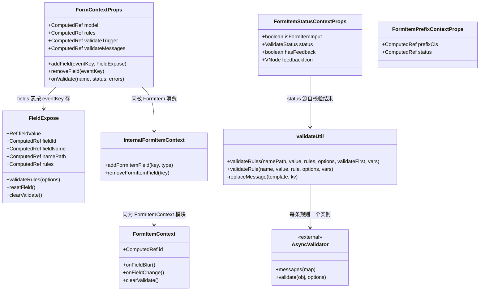
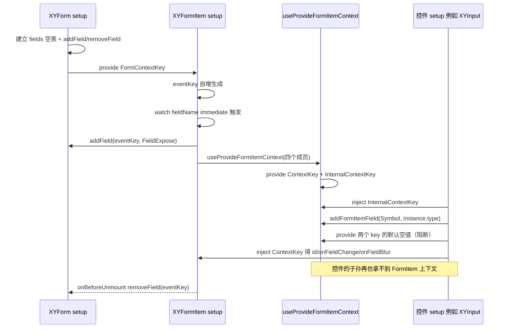
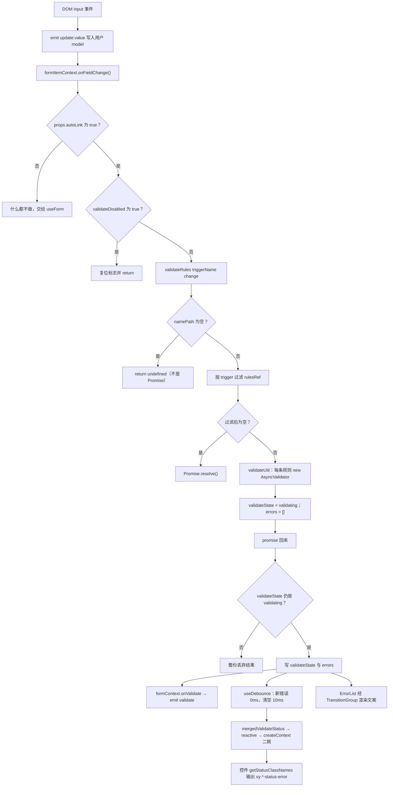

# C06-00 类横写：Form 的字段注册、校验与上下文下发

> **本篇解决**：Form 类组件的「字段身份与注册」「值 / 校验规则 / 错误回显如何经 provide-inject 串起来」「async-validator 接缝」「控件被 FormItem 收集与触发的时机」这四件事的共性机制。
> **前置**：I13《响应式内核 hooks》、I12《校验适配层 resolvers》、C04-01《Input》、C06-07《KeyFilter》　**读者坐标**：`03-components/06-form-editor` 类横写篇（本类第 1 篇横写，`C06-01`～`C06-08` 各组件篇的下位参照）

## 一、职责与边界

本篇是 `03-components/06-form-editor` 的类横写篇，只管四件事：**字段身份与注册**（一个控件凭什么被认作一个字段、登记表长什么样、什么时候写进去）、**值 / 规则 / 错误回显如何经 provide-inject 串起来**（五条上下文通道各自携带什么、谁能切断它）、**async-validator 接缝**（本库在哪一层调用它、剥掉了什么、自己补了什么）、**控件被 FormItem 收集与触发的时机**（谁负责写值、谁负责通知变了、通知的顺序由谁保证）。

明确不负责：`xy-form` 组件自身的 Props 语义、布局与 `labelCol` 栅格细节、`xy-form-list` 的数组增删与 `name` 前缀拼接、每个控件的受控/非受控实现（归 I13《响应式内核 hooks》与各类控件自己的组件篇，C04-01《Input》已把 `input/Input.tsx` 到 `form/FormItemContext.ts:116` 的接线取证过一次）、`xy-upload` 的上传流水线（见 C06-03《Upload 上传》）、校验 schema 到 `Rule` 的归一化（归 I12《校验适配层 resolvers》）。同类组件篇 C06-01《Form 表单》、C06-02《FormList 列表表单》可能并行撰写，本篇只写机制层，不代替它们描述单个组件的对外 API。

依赖清单（本篇正文实际取证过的）：`form/Form.tsx`、`form/FormItem.tsx`、`form/FormItemInput.tsx`、`form/FormItemLabel.tsx`、`form/FormItemContext.ts`、`form/context.ts`、`form/useForm.ts`、`form/ErrorList.tsx`、`form/interface.ts`、`form/utils/{validateUtil,valueUtil,typeUtil,asyncUtil,messages,useDebounce}.ts`、`form/index.tsx`，以及消费侧的 `_util/createContext.ts`、`_util/statusUtils.tsx`、`input/Input.tsx`。

## 二、源码地图

| 文件 | 行数 | 职责 | 关键导出 / 主入口 |
| --- | --- | --- | --- |
| `form/Form.tsx` | 413 | 字段表 `fields`、批量校验、上下文根 | `formProps`、主 `setup` 于 `Form.tsx:118` |
| `form/FormItem.tsx` | 546 | 单字段身份、规则合并、状态机、回显 | `formItemProps` 于 `FormItem.tsx:109`、`FieldExpose` 于 `FormItem.tsx:60` |
| `form/FormItemContext.ts` | 121 | 控件收集 Map、上下文阻断、`XYFormItemRest`、`NoFormStatus` | `useProvideFormItemContext` 于 `FormItemContext.ts:32` |
| `form/context.ts` | 77 | Form 级与 prefix 级两条上下文 | `useInjectForm` 于 `context.ts:38` |
| `form/useForm.ts` | 392 | 独立 store 型校验路线（不经 FormItem） | `useForm` 于 `useForm.ts:93` |
| `form/utils/validateUtil.ts` | 242 | async-validator 接缝与聚合 | `validateRules` 于 `validateUtil.ts:99` |
| `form/utils/valueUtil.ts` | 88 | namePath 读写、深合并、路径匹配 | `getNamePath` 于 `valueUtil.ts:13` |
| `form/utils/asyncUtil.ts` | 34 | 批量 promise 聚合保序 | `allPromiseFinish` 于 `asyncUtil.ts:3` |
| `form/utils/useDebounce.ts` | 18 | 错误文案非对称延迟 | 默认导出于 `useDebounce.ts:4` |
| `form/utils/messages.ts` | 49 | 内置文案模板（`${name}` 系列） | `defaultValidateMessages` 于 `messages.ts:3` |
| `form/FormItemInput.tsx` | 114 | 栅格外壳 + 上下文裁剪再下发 + `ErrorList` 挂载 | `setup` 于 `FormItemInput.tsx:48` |
| `form/FormItemLabel.tsx` | 116 | label / 必填星号 / tooltip | 由 `FormItem.tsx:505` 调用 |
| `form/ErrorList.tsx` | 67 | 错误列表的 transition 与状态记忆 | `setup` 于 `ErrorList.tsx:21` |
| `form/interface.ts` | 223 | `Rule`、`NamePath`、`ValidateErrorEntity` 等契约类型 | `Rule` 于 `interface.ts` |
| `form/index.tsx` | 30 | 入口与静态挂载、`install` | `Form.install` 于 `index.tsx:15` |
| `form/style/index.ts` | 488 | `genComponentStyleHook('Form', ...)` 样式与 Token | 见本篇第五节末尾的类名清单 |

主实现入口：`FormItem.tsx:150` 的 `defineComponent`（`name: 'XYFormItem'`，内部标识 `__XY_NEW_FORM_ITEM: true`，`FormItem.tsx:154`）。测试：`form/__tests__/form.test.tsx`（184 行）、`form/__tests__/form-item-context.test.tsx`（191 行）、`form/__tests__/useForm.test.ts`（195 行），三者均落在 `packages/xiaoye-ui/vitest.config.mts:33` 的 `src/**/*.test.{js,ts,jsx,tsx}` glob 内，属于会被执行的用例。

## 三、架构与数据流

### 3.1 静态结构：五条通道与一个自研接缝

整个 Form 体系的耦合面只有五条 provide-inject 通道加一个第三方库，画出来是这张图（`classDiagram` 用于表达「谁持有哪个 key、哪个 key 上挂什么类型」的稳定结构）：



五个 key 的定义位置分别是：`FormContextKey`（`context.ts:32`）、`ContextKey` 与 `InternalContextKey`（`FormItemContext.ts:28`、`FormItemContext.ts:30`）、`FormItemInputContext` 内部的匿名 `contextKey`（`_util/createContext.ts:4`，被 `FormItemContext.ts:111` 实例化）、`FormItemPrefixContextKey`（`context.ts:65`）。**五套 Symbol，其中三套的声明或实例化落在同一个 `FormItemContext.ts`**，这是读这块代码时最容易跟丢的地方，也是「控件收编」与「状态回显」能被分别切断的物理原因。

### 3.2 注册时序：一个控件被认作字段的全过程



两条注册发生在不同时刻：`addField` 在 FormItem 自己的 `watch(fieldName, ..., { immediate: true })` 里（`FormItem.tsx:383-406`），`addFormItemField` 在**控件的 setup** 里（`FormItemContext.ts:82`）。控件晚于 FormItem 建立，所以 FormItem 的 `provide` 一定先完成；反之若把 `useInjectFormItemContext()` 提到 FormItem 之前（自定义控件把 FormItem 包住）就只会拿到 `defaultContext`。

### 3.3 一次输入的全链路



这张图的三个「出口」（Z、Y、W）就是横写层面的三个坑位：`autoLink=false` 让 FormItem 整条链路哑火（论点 3）、空 `namePath` 返回 `undefined` 而非 Promise（论点 1）、`'validating'` 自锁丢弃过期结果（论点 6）。

### 3.4 值的流向：读单向、写旁路

`model` 的写入完全绕过 Form 体系：用户 `v-model:value` → 控件 `emit('update:value')` → 用户自己的响应式对象 → FormItem 的 `fieldValue` computed 被动重算（论点 3）。Form 体系里唯一反向写 model 的是 `resetField`（`FormItem.tsx:330-337`）与 `useForm.resetFields` 的 `Object.assign`（`useForm.ts:127-130`），后者写的是 `unref(modelRef)` 整体，前者写的是单键。`getFieldsValue` 则不读 fields 表里的值，而是把每个字段的 `namePath` 收集起来再 `cloneByNamePathList(props.model, allNameList)`（`Form.tsx:233-243`、`valueUtil.ts:70-78`）——**注册表只提供路径，不提供值**，这与 store 型表单的直觉相反。

## 四、核心机制精读

### 论点 1：字段登记走两条互不相交的通道，主表的 key 是自增串而非 `namePath`

断言：`XYForm` 侧的字段表 `fields` 用模块级自增计数器生成的 `form-item-<n>` 作 key，`namePath` 只活在 value 内部；`XYFormItem` 侧另有一套以 `Symbol` 为 key 的控件收集表。两套 key 都不参与业务寻址，所有「按 name 找字段」的操作都是对 `Object.values(fields)` 的线性扫描。

```tsx
// packages/xiaoye-ui/src/form/FormItem.tsx:145
let indexGuid = 0;

// default form item id prefix.
const defaultItemNamePrefixCls = 'form_item';
```

```tsx
// packages/xiaoye-ui/src/form/FormItem.tsx:163
  setup(props, { slots, attrs, expose }) {
    warning(props.prop === undefined, `\`prop\` is deprecated. Please use \`name\` instead.`);
    const eventKey = `form-item-${++indexGuid}`;
```

```ts
// packages/xiaoye-ui/src/form/Form.tsx:168
    const lastValidatePromise = ref();
    const fields: Record<string, FieldExpose> = {};
    const addField = (eventKey: string, field: FieldExpose) => {
      fields[eventKey] = field;
    };
    const removeField = (eventKey: string) => {
      delete fields[eventKey];
    };
```

`eventKey` 在 `setup` 的第一帧就确定（`FormItem.tsx:165`），与 `props.name` 完全无关。这个设计换来的是**同名字段可共存**：`FormList` 里两个 `name={['users', 0, 'nick']}` 的项不会互相覆盖注册表；代价是**注册表无法按 name 直接寻址**，于是 `getFieldsByNameList` 必须逐个比对（`Form.tsx:177-188`）：

```ts
// packages/xiaoye-ui/src/form/Form.tsx:177
    const getFieldsByNameList = (nameList: NamePath | NamePath[]) => {
      const provideNameList = !!nameList;
      const namePathList = provideNameList ? toArray(nameList).map(getNamePath) : [];
      if (!provideNameList) {
        return Object.values(fields);
      } else {
        return Object.values(fields).filter(
          field =>
            namePathList.findIndex(namePath => isEqualName(namePath, field.fieldName.value)) > -1,
        );
      }
    };
```

比对用的是 `isEqual(toArray(name1), toArray(name2))`（`Form.tsx:102-104`），这意味着 `name="a"` 与 `name={['a']}` 在寻址上等价；但 `scrollToFirstError` 只取 `errorFields[0]`（`Form.tsx:211`），而 `errorFields` 的顺序来自 `promiseList` 的 push 顺序，push 顺序又来自 `Object.values(fields)` 的插入顺序（`Form.tsx:265`）——也就是 **DOM 里 FormItem 的 setup 顺序**，不是 rules 里的书写顺序。

注册与注销的时机绑在 `fieldName` 的 watch 上，且带 `immediate: true`：

```tsx
// packages/xiaoye-ui/src/form/FormItem.tsx:382
    let registered = false;
    watch(
      fieldName,
      val => {
        if (val) {
          if (!registered) {
            registered = true;
            formContext.addField(eventKey, {
              fieldValue,
              fieldId,
              fieldName,
              resetField,
              clearValidate,
              namePath,
              validateRules,
              rules: rulesRef,
            });
          }
        } else {
```

三个细节值得钉住：

1. **无 `name` 的 FormItem 根本不进注册表**。`fieldName` 为 `props.name || props.prop`（`FormItem.tsx:170`），空值走 `else` 分支去调 `removeField`，因此纯布局用的 FormItem 对 `validateFields()` 完全不可见。同理 `validateRules` 在 `namePath.value.length === 0` 时直接 `return undefined`（`FormItem.tsx:256-258`）——注意它返回的是 `undefined`，而 `Form.tsx:280-283` 拿到后立刻 `.then()`，这是一条真实的类型不一致路径，见第七节坑 2。
2. **`registered` 是普通布尔闭包变量**，不是 ref。它只在 watch 回调里读写，所以「name 从 a 改成 b」不会重复登记，也不会丢登记（`val` 仍真值 → `registered` 已 true → 跳过），但 `fields[eventKey]` 里的 `fieldName` 是响应式 computed，扫描时读到的是新值。
3. **卸载即摘除**：`onBeforeUnmount(() => formContext.removeField(eventKey))`（`FormItem.tsx:407-409`）。配合自增 key，条件渲染切换字段不会留下僵尸记录——但 `indexGuid` 本身永不回收，长会话下 key 空间单调增长（无功能影响，仅内存与可读性）。

另一条通道在 `FormItemContext.ts`。`useProvideFormItemContext` 维护的是 `Map<Symbol, ConcreteComponent>`（`FormItemContext.ts:36-44`），key 是 `Symbol('FormItemFieldKey')`（`FormItemContext.ts:80`），value 是控件的组件实例 `instance.type`。这张表**没有任何读取路径用于校验或取值**——全仓唯一消费它的地方是开发期告警：

```ts
// packages/xiaoye-ui/src/form/FormItemContext.ts:45
  watch([useValidation, formItemFields], () => {
    if (process.env.NODE_ENV !== 'production') {
      if (useValidation.value && formItemFields.value.size > 1) {
        devWarning(
          false,
          'Form.Item',
          `FormItem can only collect one field item, you haved set ${[
            ...formItemFields.value.values(),
          ]
            .map(v => `\`${v.name}\``)
            .join(', ')} ${formItemFields.value.size} field items.
        You can set not need to be collected fields into \`xy-form-item-rest\``,
```

所以「一个 FormItem 只能收一个控件」不是一条被机制保证的约束，而是一条**只打印警告的约定**。size > 1 时行为上不报错、值也不冲突，因为真正干活的是 `ContextKey` 上的那一份 `props`（`FormItemContext.ts:61`），Map 只是观察者。这也解释了为什么 `addFormItemField`/`removeFormItemField` 每次都要 `new Map(...)` 重建（`FormItemContext.ts:39`、`FormItemContext.ts:43`）——为了让 `watch` 的第二个源真的变化，否则 Map 是同一引用，`size > 1` 的告警永远不会触发。

### 论点 2：控件即边界——`useInjectFormItemContext` 用「先 provide 再 inject」阻断上下文穿透

断言：任何一个调用 `useInjectFormItemContext()` 的控件，都会**在自己的 subTree 上重新 provide 一份空上下文**，从而把 FormItem 的上下文压回自己这一层；嵌套控件（如 `xy-radio` 在 `xy-radio-group` 内）只有外层会被 FormItem 收集。

```ts
// packages/xiaoye-ui/src/form/FormItemContext.ts:78
export const useInjectFormItemContext = () => {
  const internalContext = inject(InternalContextKey, defaultInternalContext);
  const formItemFieldKey = Symbol('FormItemFieldKey');
  const instance = getCurrentInstance();
  internalContext.addFormItemField(formItemFieldKey, instance.type);
  onBeforeUnmount(() => {
    internalContext.removeFormItemField(formItemFieldKey);
  });
  // We should prevent the passing of context for children
  provide(InternalContextKey, defaultInternalContext);
  provide(ContextKey, defaultContext);
  return inject(ContextKey, defaultContext);
};
```

四行顺序是有讲究的：`inject` 发生在 provide **之前**（第 79 行读旧值，第 87-88 行写新值），Vue 的 `provide` 写当前组件实例、`inject` 沿 parent 链读，所以本组件拿到的是上层的真上下文，子孙拿到的是 `defaultContext`（`FormItemContext.ts:68-73`，四个成员全为空实现）。返回的 `id` 是 `computed(() => undefined)`（`FormItemContext.ts:69`），所以控件侧必须写成 `formItemContext.id?.value` 这种防御形式（`input/Input.tsx:139`）。

这条阻断带来两个可验证的后果：

- **收集只发生一层**。全仓 19 个源文件调用 `useInjectFormItemContext()`（`grep -rn "useInjectFormItemContext()" packages/xiaoye-ui/src --include='*.tsx' --include='*.ts' | grep -v __tests__`），其中 `radio/Radio.tsx:53` 与 `radio/Group.tsx:50`、`checkbox/Checkbox.tsx:34` 与 `checkbox/Group.tsx:18` 是父子成对调用。因为 `Group` 的 setup 早于 `Radio`，`Group` 在第 87 行已经把 `InternalContextKey` 换成 `defaultInternalContext`，`Radio` 第 82 行调到的 `addFormItemField` 是空函数（`FormItemContext.ts:75`）——于是 FormItem 的 Map 里只留 `XYRadioGroup` 一条，不会误报「collect more than one field」。
- **脱离 FormItem 使用控件不会炸**。`defaultContext` 的三个回调是 no-op，`useInjectFormItemContext` 的兜底值与 `useInjectForm` 的兜底值（`context.ts:39-56`，`addField`/`removeField` 均为空函数）都是**可用的空实现**，这是 `form/__tests__/form-item-context.test.tsx:92` 专门覆盖的一条路径。

同一手法被显式产品化成两个组件：`XYFormItemRest`（`FormItemContext.ts:92-102`）把两条 key 一起清空，供「FormItem 里放了非字段控件」的场景使用；`NoFormStatus`（`FormItemContext.ts:113-121`）只切断状态回显通道。后者在 C04-01《Input》里已作为 `form/FormItemContext.ts:116` 的接缝取证过，本篇不重复论证，只登记它在横写维度上的位置：**它是「控件被 FormItem 收编」与「控件不被收编」的唯一显式开关**。

`XYFormItemRest` 在入口的挂载方式值得一记——它既是一个静态属性，又被单独注册成标签：

```tsx
// packages/xiaoye-ui/src/form/index.tsx:12
Form.useInjectFormItemContext = useInjectFormItemContext;
Form.ItemRest = FormItemRest;
/* istanbul ignore next */
Form.install = function (app: App) {
  registerComponent(app, Form);
  registerComponent(app, Form.Item);
  registerComponent(app, FormItemRest);
  return app;
};
```

`Form.Item` 不在这里赋值，它来自 `defineComponent` 选项对象里的 `Item: FormItem`（`form/Form.tsx:115`），并在类型上被重新声明（`form/Form.tsx:415-418`）；`FormItemRest` 的名字是 `XYFormItemRest`（`form/FormItemContext.ts:94`），经 `registerComponent` 映射为 `xy-form-item-rest` 标签（`form/index.tsx:18`），正好对上第一论点里那句开发期告警给出的建议标签名。

`useInjectFormItemContext` 被挂到 `Form` 对象上（`form/index.tsx:12`）而不是只从 `FormItemContext` 模块导出，本库测试正是用 `Form.useInjectFormItemContext()` 这种写法（`form/__tests__/form-item-context.test.tsx:17`）。这意味着**用户可以在任意自定义控件里复刻本库的接入协议**：`id` + `onFieldBlur` + `onFieldChange` + `clearValidate` 四个成员就是字段控件的全部契约，第五节展开。

### 论点 3：FormItem 从不写值——它只按 `namePath` 读 model，写入由控件自己完成

断言：本库的 Form **不是 store 型表单**。`XYFormItem` 手里没有任何写 `props.model` 的路径（除 `resetField` 外），它把 `model` 当只读源，靠 `getPropByPath` 按 namePath 取当前值；值的写入始终由控件通过 `update:value` 直接落到用户自己的响应式对象上。`onFieldChange()` 因此只是一个「值可能变了」的**通知**，不携带新值。

```tsx
// packages/xiaoye-ui/src/form/FormItem.tsx:188
    const getNewFieldValue = () => {
      const model = formContext.model.value;
      if (!model || !fieldName.value) {
        return;
      } else {
        return getPropByPath(model, namePath.value, true).v;
      }
    };
    const fieldValue = computed(() => getNewFieldValue());

    const initialValue = shallowRef(cloneDeep(fieldValue.value));
```

`formContext.model` 就是 `computed(() => props.model)`（`form/Form.tsx:382`），所以 `fieldValue` 是一条 `props.model → computed → getPropByPath` 的只读派生链。全仓里 FormItem 唯一写 model 的地方是 `resetField`（`form/FormItem.tsx:330-337`），它直接 `prop.o[prop.k] = initialValue.value`——绕过控件、绕过 emit。

写入侧的协议在控件里，且**顺序被硬编码**：

```tsx
// packages/xiaoye-ui/src/input/Input.tsx:123
const triggerChange = (e: Event) => {
  emit('update:value', (e.target as HTMLInputElement).value);
  emit('change', e);
  emit('input', e);
  formItemContext.onFieldChange();
};
```

`emit('update:value')` 是同步调用父组件的 `onUpdate:value`，用户写 `v-model:value="state.name"` 时这一步已经把新值塞进 `props.model`；等到第 127 行 `onFieldChange()` 触发 `validateRules({ triggerName: 'change' })`，`FormItem.tsx:278` 读到的 `fieldValue.value` 才是新值。**两行代码的顺序颠倒就会让所有 change 校验慢一拍**，而这条顺序没有任何机制保证，只靠 19 个控件各自复刻（`switch/index.tsx:136`、`radio/Group.tsx:74`、`TextArea.tsx:162` 同款）。

FormItem 侧对这次通知的处理有一道闸门：

```tsx
// packages/xiaoye-ui/src/form/FormItem.tsx:313
    const onFieldChange = () => {
      if (validateDisabled.value) {
        validateDisabled.value = false;
        return;
      }
      validateRules({ triggerName: 'change' });
    };
```

`validateDisabled` 由 `resetField` 置 true，并在 `nextTick` 里复位（`form/FormItem.tsx:328-341`）。它存在的全部理由就是第 336 行那句绕过 emit 的赋值：直接改 `prop.o[prop.k]` 会让控件的 `watch(value)` 补发一次 change 事件，若不拦截，`resetFields()` 会立刻把刚清空的错误又校验出来。这是「非 store 型」路线必然要付的补丁。

同时，本库还有**第二条完全独立、且真的是 store 型**的校验路线：`useForm`。它不经过 FormItem 的注册表，而是自己 `watch(modelRef, modelFn, { deep: true })`（`form/useForm.ts:371-377`），对 `rulesRef` 的每个 key 做前后值比较后触发（`form/useForm.ts:320-334`）：

```ts
// packages/xiaoye-ui/src/form/useForm.ts:320
  const modelFn = (model: { [x: string]: any }) => {
    const names = [];
    rulesKeys.value.forEach(key => {
      const prop = getPropByPath(model, key, false);
      const oldProp = getPropByPath(oldModel, key, false);
      const isFirstValidation = isFirstTime && options?.immediate && prop.isValid;

      if (isFirstValidation || !isEqual(prop.v, oldProp.v)) {
        names.push(key);
      }
    });
    validate(names, { trigger: 'change' });
    isFirstTime = false;
    oldModel = cloneDeep(toRaw(model));
  };
```

两条路线同时跑会双份校验、双份 error 数组。把它们分开的是 `autoLink` 这一个 prop：`useForm` 产出的每个 `validateInfos[key]` 都被硬写 `autoLink: false`（`form/useForm.ts:357`），而 FormItem 把 `onFieldBlur`/`onFieldChange` 包在 `if (props.autoLink)` 里再 provide 出去（`form/FormItem.tsx:366-375`），并且把同一个条件作为「是否检查多字段」的开关传给 `useProvideFormItemContext`（`form/FormItem.tsx:378-380`）。

```tsx
// packages/xiaoye-ui/src/form/FormItem.tsx:363
    useProvideFormItemContext(
      {
        id: fieldId,
        onFieldBlur: () => {
          if (props.autoLink) {
            onFieldBlur();
          }
        },
        onFieldChange: () => {
          if (props.autoLink) {
            onFieldChange();
          }
        },
        clearValidate,
      },
      computed(() => {
        return !!(props.autoLink && formContext.model.value && fieldName.value);
      }),
    );
```

`props.autoLink` 默认 `true`（`form/FormItem.tsx:123`）。所以「`useForm` + `xy-form-item` 且不 spread `validateInfos`」是最危险组合：FormItem 仍在自动校验并回显，`useForm` 也在校验，错误文案会出现两份，而 `useForm` 的 `validateInfos[name].help` 因为 `mergeValidateInfo`（`form/useForm.ts:303-317`）要求显式合并才会生效，不会自动出现。两条路线的取值实现也是**两份不同的代码**：`useForm.ts:66-91` 的 `getPropByPath` 接受字符串路径并支持 `a.b[0].c` 下标语法、返回 `isValid`；`FormItem.tsx:78-108` 的那份只接受数组、不返回 `isValid`、`catch` 里直接 `console.error`。同名不同实现，这是第七节坑 1 的根。

### 论点 4：async-validator 的接缝是「一条规则一个 validator 实例」，trigger 过滤发生在它之前

断言：本库没有把整个 rules 对象交给一个 `AsyncValidator`，而是**每条规则单独 new 一个实例、单独 validate 一个值**，再自己实现串行/并行/首错即停三种聚合。这样做的代价是每次校验都要重建 validator，收益是完全掌握聚合语义与错误对象结构。

```ts
// packages/xiaoye-ui/src/form/utils/validateUtil.ts:95
/**
 * We use `async-validator` to validate the value.
 * But only check one value in a time to avoid namePath validate issue.
 */
export function validateRules(
  namePath: InternalNamePath,
  value: any,
  rules: RuleObject[],
  options: ValidateOptions,
  validateFirst: boolean | 'parallel',
  messageVariables?: Record<string, string>,
) {
  const name = namePath.join('.');
```

`name` 是 `namePath.join('.')`（`validateUtil.ts:107`），它同时是 async-validator 的字段名、错误文案里 `${name}` 的值，以及 `scrollToField`/`errorFields[].name` 的载体。`useForm` 传的是 `[name]` 单元素数组（`useForm.ts:238`），`FormItem` 传的是完整 `namePath`（`FormItem.tsx:277`），所以两条路线的 `errorFields[].name` 类型不同（字符串 vs 数组），消费方要分别处理。

单条规则的执行体：

```ts
// packages/xiaoye-ui/src/form/utils/validateUtil.ts:31
  const cloneRule = { ...rule };

  // Bug of `async-validator`
  delete (cloneRule as any).ruleIndex;
  delete (cloneRule as any).trigger;

  // We should special handle array validate
  let subRuleField: RuleObject = null;
  if (cloneRule && cloneRule.type === 'array' && cloneRule.defaultField) {
    subRuleField = cloneRule.defaultField;
    delete cloneRule.defaultField;
  }

  const validator = new AsyncValidator({
    [name]: [cloneRule],
  });

  const messages = setValues({}, defaultValidateMessages, options.validateMessages);
  validator.messages(messages);
```

四个动作各有出处：

1. `delete ruleIndex / trigger`（`validateUtil.ts:34-35`）：这两个是本库自己塞进 rule 的元信息（`ruleIndex` 于 `validateUtil.ts:113-116` 写入），async-validator 不认识 `trigger` 会当规则字段处理，因此必须在实例化前剥掉。**副作用**：`rule.trigger` 被剥离意味着 trigger 语义只能靠外层过滤实现（见下）。
2. `type: 'array' + defaultField` 被拆出来手工递归（`validateUtil.ts:38-42`、`validateUtil.ts:67-75`），子项字段名是 `${name}.${i}`，所以数组第 3 项的错误文案里的 `${name}` 会长成 `users.2`——这是有意的，但 `Form` 的 `isEqualName`（`Form.tsx:102-104`）与 `matchNamePath`（`utils/valueUtil.ts:80-88`）都不认这个带点号的字符串，错误回传给 `field` 时只能靠 `namePath` 原值。
3. 消息表每次校验都重复合并：`setValues({}, defaultValidateMessages, options.validateMessages)`（`validateUtil.ts:48`）。`setValues` 是深合并（`utils/valueUtil.ts:44-61`），而 `options.validateMessages` 在 FormItem 路线里已经是 `defaultValidateMessages ← 全局 ← props` 三层合并的结果（`Form.tsx:145-151`，全局来自 `useInjectGlobalForm()`，`Form.tsx:144`）。**`useForm` 路线不合并任何全局消息**，它硬传 `defaultValidateMessages`（`useForm.ts:242`），因此 `ConfigProvider` 的 `form.validateMessages` 对 `useForm` 无效——两条路线在 i18n 上的能力不等价。
4. 错误项可以是 VNode：`isValidElement(message) ? cloneVNode(message, { key: 'error_${index}' }) : message`（`validateUtil.ts:57-60`，源码注释写作 `Wrap VueNode with 'key'`，`validateUtil.ts:58`），这允许用户把 Vue 节点当校验消息，也决定了 `errors` 数组在下游只能是 `any[][]`（`FormItem.tsx:171` 的 `shallowRef([])`）。

自定义 `validator` 的 promise/callback 双轨适配是这层最硬的一块：

```ts
// packages/xiaoye-ui/src/form/utils/validateUtil.ts:119
      if (originValidatorFunc) {
        cloneRule.validator = (rule: RuleObject, val: any, callback: (error?: string) => void) => {
          let hasPromise = false;

          // Wrap callback only accept when promise not provided
          const wrappedCallback = (...args: string[]) => {
            // Wait a tick to make sure return type is a promise
            Promise.resolve().then(() => {
              warning(
                !hasPromise,
                'Your validator function has already return a promise. `callback` will be ignored.',
              );

              if (!hasPromise) {
                callback(...args);
              }
            });
          };

          // Get promise
          const promise = originValidatorFunc(rule, val, wrappedCallback);
          hasPromise =
            promise && typeof promise.then === 'function' && typeof promise.catch === 'function';
```

判定「用户走 promise 还是 callback」靠微任务延后一拍再读 `hasPromise`（`validateUtil.ts:124-136`），因此**同一个 validator 里同时用 callback 又 return promise 时，callback 被静默丢弃并 warn**，而 `hasPromise` 的判定要求对象同时有 `then` 和 `catch`（`validateUtil.ts:141`）——一个只有 `then` 的 thenable（例如某些请求库的自定义 Promise）会被判成「非 promise」，走到 callback 分支，若用户又没调 callback，这条规则就永久挂起。

聚合策略与 `warningOnly` 的排序绑在一起：

```ts
// packages/xiaoye-ui/src/form/utils/validateUtil.ts:163
    .sort(({ warningOnly: w1, ruleIndex: i1 }, { warningOnly: w2, ruleIndex: i2 }) => {
      if (!!w1 === !!w2) {
        // Let keep origin order
        return i1 - i2;
      }

      if (w1) {
        return 1;
      }

      return -1;
    });
```

```ts
// packages/xiaoye-ui/src/form/utils/validateUtil.ts:179
  if (validateFirst === true) {
    // >>>>> Validate by serialization
    summaryPromise = new Promise(async (resolve, reject) => {
      /* eslint-disable no-await-in-loop */
      for (let i = 0; i < filledRules.length; i += 1) {
        const rule = filledRules[i];
        const errors = await validateRule(name, value, rule, options, messageVariables);
        if (errors.length) {
          reject([{ errors, rule }]);
          return;
        }
      }
      /* eslint-enable */

      resolve([]);
    });
  } else {
    // >>>>> Validate by parallel
    const rulePromises: Promise<RuleError>[] = filledRules.map(rule =>
      validateRule(name, value, rule, options, messageVariables).then(errors => ({ errors, rule })),
    );

    summaryPromise = (
      validateFirst ? finishOnFirstFailed(rulePromises) : finishOnAllFailed(rulePromises)
    ).then((errors: RuleError[]): RuleError[] | Promise<RuleError[]> => {
      // Always change to rejection for Field to catch
      return Promise.reject<RuleError[]>(errors);
    });
  }
```

三个 `validateFirst` 取值对应三条实现分支：`true` 串行短路（`validateUtil.ts:181-191`）、`'parallel'` 并发但首错返回（`finishOnFirstFailed`，`validateUtil.ts:225-242`）、假值并发等全部（`finishOnAllFailed`，`validateUtil.ts:215-223`）。`warningOnly` 被排到最后，是为了在串行模式下让真错误先命中；而 `finishOnFirstFailed` 的并发分支**并不因为先出现错误就中止其它规则**，它只是先 `resolve`，其余 promise 继续跑完——异步 validator 的副作用（如请求）无法被取消。

`trigger` 过滤完全不在这层，它在 FormItem：

```tsx
// packages/xiaoye-ui/src/form/FormItem.tsx:263
      const { triggerName } = options || {};

      let filteredRules = rulesRef.value;
      if (triggerName) {
        filteredRules = filteredRules.filter(rule => {
          const { trigger } = rule;
          if (!trigger && !mergedValidateTrigger.value.length) {
            return true;
          }
          const triggerList = toArray(trigger || mergedValidateTrigger.value);
          return triggerList.includes(triggerName);
        });
      }
      if (!filteredRules.length) {
        return Promise.resolve();
      }
```

`mergedValidateTrigger` 的三级兜底是 `props.validateTrigger → formContext.validateTrigger → 'change'`（`FormItem.tsx:199-206`）。注意 `Form` 的全量校验 `validateFields()` 调用 `field.validateRules({ validateMessages })` 时**不传 `triggerName`**（`Form.tsx:280-283`），所以提交校验会跑所有规则、包括只标了 `trigger: 'blur'` 的；而 `rules` 里若一条都没写 `trigger`，`mergedValidateTrigger.value` 又非空时，`toArray(trigger || mergedValidateTrigger.value)` 会让这条规则**只在 change 时跑**（`FormItem.tsx:269-270`），`onFieldBlur` 的 `triggerName: 'blur'`（`FormItem.tsx:311`）命中不了它。`useForm` 用的是另一套：`filterRules(..., toArray(option && option.trigger))` 且默认 `'change'`（`useForm.ts:140-149`），当 `option.trigger` 为空数组时直接返回全部 rules——两条路线的 trigger 缺省语义不同。

### 论点 5：状态回显走「reactive 源 + `createContext` 二次 reactive 合并」的双跳，错误文案再经一层非对称 debounce

断言：控件看到的校验状态不是 FormItem 的计算属性，而是 `mergedValidateStatus` → `formItemInputContext`（reactive）→ `createContext` 内部 `mergedProps`（另一个 reactive）两跳之后的副本；错误文案又单独走一层 `useDebounce`，且「出现」与「消失」的延迟不对称。

先看状态优先级：

```tsx
// packages/xiaoye-ui/src/form/FormItem.tsx:410
    const debounceErrors = useDebounce(errors);
    const mergedValidateStatus = computed(() => {
      if (props.validateStatus !== undefined) {
        return props.validateStatus;
      } else if (debounceErrors.value.length) {
        return 'error';
      }
      return validateState.value;
    });
```

优先级是 `props.validateStatus`（受控）> `debounceErrors` 非空则 `error` > `validateState`（内部自算）。`validateState` 由 `watchEffect` 每次同步回 `props.validateStatus`（`form/FormItem.tsx:238-241`），于是「受控切回非受控」时内部态会被外部值覆盖一次。

下发这一步是三段式：

```tsx
// packages/xiaoye-ui/src/form/FormItem.tsx:430
    const formItemInputContext = reactive<FormItemStatusContextProps>({});
    FormItemInputContext.useProvide(formItemInputContext);
    watchEffect(() => {
      let feedbackIcon: any;
      if (props.hasFeedback) {
        const IconNode = mergedValidateStatus.value && iconMap[mergedValidateStatus.value];
        feedbackIcon = IconNode ? (
          <span
            class={classNames(
              `${prefixCls.value}-item-feedback-icon`,
              `${prefixCls.value}-item-feedback-icon-${mergedValidateStatus.value}`,
            )}
          >
            <IconNode />
          </span>
        ) : null;
      }
      Object.assign(formItemInputContext, {
        status: mergedValidateStatus.value,
        hasFeedback: props.hasFeedback,
        feedbackIcon,
        isFormItemInput: true,
      });
    });
```

关键在 `feedbackIcon` 是 **VNode 存进 reactive 对象**（`form/FormItem.tsx:450`），下游控件直接把它渲染进 suffix（`input/Input.tsx:115-116` 的 `{hasFeedback && feedbackIcon}`，渲染处 `input/Input.tsx:131` 解构）。这意味着反馈图标的 DOM 由 FormItem 的 render effect 创建、却挂在子控件的 subTree 上，`iconMap` 的四个图标来自 `@xiaoye-ui/icons`（`form/FormItem.tsx:21-26`、`form/FormItem.tsx:71-76`）。

而 `FormItemInputContext.useProvide` 内部并不是直接 provide `formItemInputContext`：

```ts
// packages/xiaoye-ui/src/_util/createContext.ts:5
  const useProvide = (props: T, newProps?: T) => {
    const mergedProps = reactive<T>({} as T);
    provide(contextKey, mergedProps);
    watchEffect(() => {
      Object.assign(mergedProps, props, newProps || {});
    });
    return mergedProps;
  };
  const useInject = () => {
    return inject(contextKey, defaultValue as T) || ({} as T);
  };
```

（`createContext` 的定义在 `_util/createContext.ts:3-20`，`FormItemInputContext = createContext<FormItemStatusContextProps>({})` 在 `form/FormItemContext.ts:111`。）两跳的后果是：**控件 inject 到的对象不是 `formItemInputContext` 本体**，往它身上写任何字段都不会回传到 FormItem；且每次状态变更要走两个 `watchEffect` 才抵达消费方。第二跳的存在也让 `useProvide` 的第二个参数变成一个「不可覆盖的旁路」——`calendar/Header.tsx:186` 正是用它把 `isFormItemInput` 强制写成 `false`，以便在日历头部的选择器上关掉 `*-in-form-item` 样式（消费点见 `tree-select/index.tsx:296`、`radio/Radio.tsx:131`），这是全仓唯一使用第二参数的地方。

15 个文件调用 `FormItemInputContext.useInject()`，它们统一用同一个函数收敛状态优先级：

```tsx
// packages/xiaoye-ui/src/_util/statusUtils.tsx:22
export const getMergedStatus = (contextStatus?: ValidateStatus, customStatus?: InputStatus) =>
  customStatus || contextStatus;
```

`customStatus || contextStatus`：控件自身的 `status` 覆盖 FormItem，且因为 `''` 是 falsy，`status=""` 会**退回**到上下文状态而非清空它（`Input.tsx:34` 的 `mergedStatus` 就是这个表达式）。同时 `getStatusClassNames` 会输出 `xy-input-status-success` 之类的状态类（`_util/statusUtils.tsx:8-20`），这是控件侧样式与 Form 侧状态的唯一耦合点。

文案侧的 debounce 只有 18 行，但延迟是反直觉的：

```ts
// packages/xiaoye-ui/src/form/utils/useDebounce.ts:4
export default function useDebounce<T>(value: Ref<T[]>): Ref<T[]> {
  const cacheValue = shallowRef(value.value.slice());
  let timeout: any = null;
  watchEffect(() => {
    clearTimeout(timeout);
    timeout = setTimeout(
      () => {
        cacheValue.value = value.value;
      },
      value.value.length ? 0 : 10,
    );
  });

  return cacheValue;
}
```

延迟取自**新值**：新值非空 0ms（错误立刻出现），新值为空 10ms（错误延后消失）。配合 `validateRules` 在开跑时立刻 `errors.value = []`（`form/FormItem.tsx:288`），效果是「重新校验期间旧错误仍挂 10 毫秒」，避免文案闪断；但 `mergedValidateStatus` 里的 `debounceErrors.value.length`（`form/FormItem.tsx:414`）用的也是这层缓存，所以状态色与文案的时机被绑成同一个 10ms。

`ErrorList` 里还有第三层「状态记忆」，它和 debounce 无关但常被误认为同源：

```tsx
// packages/xiaoye-ui/src/form/ErrorList.tsx:24
    const visible = computed(() => !!(props.errors && props.errors.length));
    const innerStatus = ref(status.value);
    const [, hashId] = useStyle(prefixCls);
    // Memo status in same visible
    watch([visible, status], () => {
      if (visible.value) {
        innerStatus.value = status.value;
      }
    });
```

`innerStatus` 只在 `visible` 为真时跟随 `status`（`form/ErrorList.tsx:28-32`），退出动画期间颜色不跳变；`status` 本身来自 `useInjectFormItemPrefix()`（`form/ErrorList.tsx:22`），即 `FormItemInput` 下发的 `FormItemPrefixContextKey`（`form/context.ts:60-77`、`form/FormItemInput.tsx:57-60`）。这里还留了一个**死接口**：`ErrorList` 的 props 声明了 `help`、`helpStatus`、`warnings` 三项（`form/ErrorList.tsx:20`），但 setup 与 render 里只读 `props.errors` 和 `props.onErrorVisibleChanged`（`form/ErrorList.tsx:24`、`form/ErrorList.tsx:50-53`），`FormItemInput` 传下来的 `help`（`form/FormItemInput.tsx:97`）不会被渲染——`help` 的真实生效路径是 FormItem 直接把它当 errors 用（`form/FormItem.tsx:518-520`）。

### 论点 6：批量校验靠 `allPromiseFinish` 保序 + `lastValidatePromise` 判过期，字段级靠 `'validating'` 自锁

断言：`Form` 从不 `await Promise.all`，而是用自制聚合器把每个字段的 promise 结果按**下标**写回同一数组以保持错误顺序；并发提交的「谁最新」由一个 ref 身份比较决定，字段级则由 `validateState === 'validating'` 决定是否落地结果。

```ts
// packages/xiaoye-ui/src/form/utils/asyncUtil.ts:3
export function allPromiseFinish(promiseList: Promise<FieldError>[]): Promise<FieldError[]> {
  let hasError = false;
  let count = promiseList.length;
  const results: FieldError[] = [];

  if (!promiseList.length) {
    return Promise.resolve([]);
  }

  return new Promise((resolve, reject) => {
    promiseList.forEach((promise, index) => {
      promise
        .catch(e => {
          hasError = true;
          return e;
        })
        .then(result => {
          count -= 1;
          results[index] = result;

          if (count > 0) {
            return;
          }

          if (hasError) {
            reject(results);
          }
          resolve(results);
        });
    });
  });
}
```

三点读法：`results[index]` 按下标写入，所以 `errorFields` 顺序等于 `promiseList` 顺序（即注册顺序，回扣论点 1）；单字段失败被 `catch` 转成 fulfilled 值，保证「全部跑完再结算」；`reject(results)` 之后**没有 `return`**，下一行 `resolve(results)` 照常执行，只是 Promise 一旦 settle 就忽略后续，属于无害冗余（`utils/asyncUtil.ts:27-30`）。

外层如何用这个结果：

```tsx
// packages/xiaoye-ui/src/form/Form.tsx:319
      const summaryPromise = allPromiseFinish(promiseList);
      lastValidatePromise.value = summaryPromise;

      const returnPromise = summaryPromise
        .then(() => {
          if (lastValidatePromise.value === summaryPromise) {
            return Promise.resolve(getFieldsValue(namePathList));
          }
          return Promise.reject([]);
        })
        .catch(results => {
          const errorList = results.filter(result => result && result.errors.length);
          return Promise.reject({
            values: getFieldsValue(namePathList),
            errorFields: errorList,
            outOfDate: lastValidatePromise.value !== summaryPromise,
          });
        });

      // Do not throw in console
      returnPromise.catch(e => e);

      return returnPromise;
```

`lastValidatePromise` 是 `ref()`（`form/Form.tsx:168`），存的是 promise **引用身份**而非结果；第二次 `validateFields()` 会覆盖它，第一次的 `.then` 再执行时身份不符即返回 `Promise.reject([])`（`form/Form.tsx:327`）。`useForm` 里有一份语义相同但用普通变量实现的副本（`form/useForm.ts:151`、`form/useForm.ts:204-224`），差别在于 `useForm` 的 `.catch` 在 `errorList` 为空时 `Promise.resolve(values)`（`form/useForm.ts:217-223`），而 `Form` 无条件 reject（`form/Form.tsx:331-335`）——因为 `allPromiseFinish` 只在有错时才 reject，`Form` 的写法把这条路径当成不可达。

字段级不看身份，只看自己的状态机：

```tsx
// packages/xiaoye-ui/src/form/FormItem.tsx:287
      validateState.value = 'validating';
      errors.value = [];

      promise
        .catch(e => e)
        .then((results: RuleError[] = []) => {
          if (validateState.value === 'validating') {
            const res = results.filter(result => result && result.errors.length);
            validateState.value = res.length ? 'error' : 'success';

            errors.value = res.map(r => r.errors);

            formContext.onValidate(
              fieldName.value,
              !errors.value.length,
              errors.value.length ? toRaw(errors.value[0]) : null,
            );
          }
        });

      return promise;
```

`validateState = 'validating'` 是**每次校验的入场券**：只有它还是 `'validating'` 时才写回结果，因此同一字段连打两次，慢的那次结果被丢弃（不用身份比较，用状态位）。代价在 `clearValidate()`：它把 `validateState.value = props.validateStatus`（`form/FormItem.tsx:321`）。若此刻正在校验，`validateState` 立刻离开 `'validating'`，慢回来的那次回调条件不成立、结果被整份丢弃——这正是「点清空校验后错误又冒出来」被防住的原因；但 `props.validateStatus` 为 `undefined` 时 `validateState` 也变成 `undefined`，`mergedValidateStatus` 会一路回落到空值（`form/FormItem.tsx:411-417`），受控与非受控混用时这里的终值不确定，见第七节坑 4。

最后，`Form` 侧对每条字段 promise 都做了 `warningOnly` 分流（`form/Form.tsx:293-299`），把 `warningOnly` 规则的 errors 降级进 `warnings`，只有 `mergedErrors.length` 才 reject（`form/Form.tsx:301-307`）——这与 `validateUtil` 里的排序（论点 4）是同一件事的两个端点：底层排序保证串行时 warning 最后跑，上层分流保证 warning 不阻断提交。

### 论点 7：规则合并是「就近优先的二选一」，不是叠加；`required` prop 只在缺位时补一条

断言：`rulesRef` 从 Form 级 `rules` 里按 `namePath` 取出的规则与 FormItem 自身的 `rules` **互斥**（`selfRules || formRules`），写了两处只会生效一处；`props.required` 是唯一会被追加的输入，且仅在合并结果里已经存在 `required` 规则时被忽略。

```tsx
// packages/xiaoye-ui/src/form/FormItem.tsx:207
    const rulesRef = computed<Rule[]>(() => {
      let formRules = formContext.rules.value;
      const selfRules = props.rules;
      const requiredRule =
        props.required !== undefined
          ? { required: !!props.required, trigger: mergedValidateTrigger.value }
          : [];
      const prop = getPropByPath(formRules, namePath.value);
      formRules = formRules ? prop.o[prop.k] || prop.v : [];
      const rules = [].concat(selfRules || formRules || []);
      if (find(rules, rule => rule.required)) {
        return rules;
      } else {
        return rules.concat(requiredRule);
      }
    });
```

逐行：`formContext.rules` 是 `computed(() => props.rules)`（`form/Form.tsx:392`），形态是 `{ [namePathKey]: Rule[] | Rule }`；`getPropByPath(formRules, namePath.value)`（不传 strict）允许中间层缺失并只返回 `{ o: 最后可达对象, k: 下一个 key }`（`form/FormItem.tsx:90-94` 的 `break` 分支），随后 `prop.o[prop.k] || prop.v` 兜住「父层就是规则数组」的写法。`formRules ? ... : []` 让没有 Form 或 Form 未传 rules 时直接空数组，因此**独立使用的 FormItem 只剩自身 rules**。

`find(rules, rule => rule.required)`（`form/FormItem.tsx:217`，来自 `lodash-es/find`，`form/FormItem.tsx:36`）决定要不要追加 `requiredRule`。注意追加的那条把 `trigger` 设为 `mergedValidateTrigger.value`（`form/FormItem.tsx:212`），而手写规则通常不写 trigger——于是 `props.required` 生成的规则**总能在 change 时被命中**（默认 `mergedValidateTrigger` 是 `['change']`，`form/FormItem.tsx:204`），但 `validateTrigger="blur"` 时它命中 blur。同一份必填判定还被复制给 label 的星号：

```tsx
// packages/xiaoye-ui/src/form/FormItem.tsx:223
    const isRequired = computed(() => {
      const rules = rulesRef.value;
      let isRequired = false;
      if (rules && rules.length) {
        rules.every(rule => {
          if (rule.required) {
            isRequired = true;
            return false;
          }
          return true;
        });
      }
      return isRequired || props.required;
    });
```

`isRequired` 与 `rulesRef` 里的 `find` 是同一判断的两份实现（`form/FormItem.tsx:227-231` 与 `form/FormItem.tsx:217`），`useForm.ts:22-34` 还有第三份（同名 `isRequired` 函数）。三份代码的差别在于 `rulesRef` 判断的是**追加后**的数组、`isRequired` 末尾又 `|| props.required`，因此 `required: false` 时星号不会出现，但 `rulesRef` 会追加 `{ required: false, trigger: [...] }` 这条无效规则进 async-validator——多一次无用的 validator 实例化，属可观察的性能冗余。

`messageVariables` 是给错误文案模板喂 `${label}` 的唯一入口：

```tsx
// packages/xiaoye-ui/src/form/FormItem.tsx:242
    const messageVariables = computed(() => {
      let variables: Record<string, string> = {};
      if (typeof props.label === 'string') {
        variables.label = props.label;
      } else if (props.name) {
        variables.label = String(props.name);
      }
      if (props.messageVariables) {
        variables = { ...variables, ...props.messageVariables };
      }
      return variables;
    });
```

它作为最后一个参数进 `validateRulesUtil`（`form/FormItem.tsx:276`），在 `validateRule` 里被摊进 `kv` 并**排在最后**（`validateUtil.ts:78-83`），因此 `messageVariables` 可以覆盖 `${name}`、`${enum}` 甚至 `${pattern}` 之外的任何模板位。`replaceMessage` 只匹配 `${\w+}`（`validateUtil.ts:18`），未提供的变量会被替换成 `undefined` 字符串而不是保留原样——`kv[key]` 取值后直接返回（`validateUtil.ts:20-21`），这是自定义消息里最常见的排版事故源。

### 论点 8：`FormItemInput` 对 Form 上下文做「裁剪式再下发」，嵌套 FormItem 因此共享同一张字段表

断言：`FormItem` 的默认插槽外面还包了一层 `FormItemInput`，它把从 Form inject 来的上下文**浅拷贝后删掉 `labelCol`/`wrapperCol` 再 provide 一次**；`addField`/`removeField` 因为共享引用而没被裁掉，所以嵌套 FormItem 依然注册到同一个 Form 的 `fields` 表上。

```tsx
// packages/xiaoye-ui/src/form/FormItemInput.tsx:48
  setup(props, { slots }) {
    const formContext = useInjectForm();
    const { wrapperCol: contextWrapperCol } = formContext;

    // Pass to sub FormItem should not with col info
    const subFormContext = { ...formContext };
    delete subFormContext.labelCol;
    delete subFormContext.wrapperCol;
    useProvideForm(subFormContext);
    useProvideFormItemPrefix({
      prefixCls: computed(() => props.prefixCls),
      status: computed(() => props.status),
    });
```

`{ ...formContext }` 复制的是**属性引用**：`model`、`rules`、`validateTrigger`、`requiredMark`、`validateMessages` 仍是 Form 里那批 `computed`（`form/Form.tsx:382-398`），`addField`/`removeField` 仍是同一对闭包函数（`form/Form.tsx:170-175`）。被删的两个是布局列配置，目的是让 `<xy-form-item><xy-form-item /></xy-form-item>` 这类嵌套里，内层不再继承外层的栅格宽度（注释原文 `Pass to sub FormItem should not with col info`，`form/FormItemInput.tsx:52`）。

这里的裁剪**只影响后代，不影响自己**：第 50 行 `const { wrapperCol: contextWrapperCol } = formContext;` 是在 `delete` 之前从原始注入对象上解构的（`form/FormItemInput.tsx:50`），所以本层 `<Col>` 仍然用上 Form 的 `wrapperCol`（`form/FormItemInput.tsx:76-77`）；被删掉的两个 key 只让**下一层** `useInjectForm()` 拿到无栅格的上下文。同时因为 `addField` 引用被原样带下去，嵌套 FormItem 注册的仍是同一个 `fields` 表——`FormList` 的「数组项各自是独立字段、但共享一次提交校验」就是靠这两条性质同时成立的。

同一段还开出第三条上下文通道：`FormItemPrefixContextKey`（`form/context.ts:65-71`），只带 `prefixCls` 与 `status` 两个成员，注释写明 `Used for ErrorList only`（`form/context.ts:59`）。它的存在让 `ErrorList` 不必 inject 整个 Form——`useInjectFormItemPrefix()` 的兜底值是 `{ prefixCls: computed(() => '') }`（`form/context.ts:74-76`），脱离 FormItem 直接渲染 `ErrorList` 会产出 `-item-explain` 这样的残缺类名而不报错。

`status` 在 `FormItemInput` 里是普通 `computed(() => props.status)`，值来自 FormItem 渲染时传的 `status={mergedValidateStatus.value}`（`form/FormItem.tsx:523`）；而 `FormItemInputContext.useProvide` 走的是 `Object.assign` 到 reactive（论点 5）。也就是说**同一个状态值有两条下发路径**：给 `ErrorList` 的是 props→computed，给控件的是 reactive→reactive。两者都在 FormItem 的 render 里赋值（`form/FormItem.tsx:432` 的 `watchEffect` 与 `form/FormItem.tsx:523` 的渲染参数），但前者不触发控件重渲染，后者触发 `FormItemInput` 重渲染——控件的状态类名和错误文案颜色可能差一帧，这是第七节坑 5 的机制根因。

## 五、对外契约如何生效

契约一共三层，从上到下依次变窄。

**第一层：实例方法。** `FormExpose` 声明了 6 个方法（`form/Form.tsx:79-98`），`expose` 实际挂上同名 6 个（`form/Form.tsx:372-379`）。其中 `validate` 与 `validateFields` 是**同一实现的两个名字**：`validate = (...args) => validateField(...args)`（`form/Form.tsx:214-216`），`validateField = (...args) => validateFields(...args)`（`form/Form.tsx:343-345`）——三层包装没有增加任何行为，只增加了 `any` 逃逸。`scrollToField` 不走注册表的方法调用，而是把 `fieldId` 当 DOM id 去 `document.getElementById` 再 `scrollIntoView`（`form/Form.tsx:224-231`），所以它对不可见元素无效（第七节坑 6）。`resetFields`/`clearValidate` 是纯转发：`getFieldsByNameList(name).forEach(field => field.resetField())`（`form/Form.tsx:189-202`），落到 FormItem 的 `expose` 四方法（`form/FormItem.tsx:356-361`，类型 `FormItemExpose` 于 `form/FormItem.tsx:136-141`）。

**第二层：上下文成员。** Form 级上下文一次 provide 了 15 个成员（`form/Form.tsx:381-399`，类型 `FormContextProps` 于 `form/context.ts:9-30`），其中 `onValidate` 是唯一的回流通道：字段校验完成后 `formContext.onValidate(fieldName, !errors.length, toRaw(errors[0]))`（`form/FormItem.tsx:299-303`），Form 侧把它原样 `emit('validate', ...)`（`form/Form.tsx:390-392`）。`emits` 选项被注释掉了（`form/Form.tsx:117`），因此 Vue 靠「`onValidate` 已声明为 prop」（`form/Form.tsx:74`）来命中处理器——这条链能跑，但如果把 `onValidate` 从 props 里删掉，`emit` 会静默失效。

**同一个 props 面上有两个死成员**：`onValuesChange` 与 `onFieldsChange` 在 `form/Form.tsx:70-71` 声明、在 `form/interface.ts:162-163` 定形，但全仓（排除 `dist`）没有任何调用点，也没有对应的 emit 名：

```bash
grep -rn "valuesChange\|fieldsChange" --include='*.ts' --include='*.tsx' --include='*.vue' packages apps | grep -v '/dist/'
```

该命令返回空。也就是说「值变化回调」这个能力在 Form 侧**只存在类型与 prop 声明，不存在实现**；想要值变化通知，只能靠 `onValidate` 或用户自己 watch model（`useForm` 路线就是这么做的，`form/useForm.ts:371-377`）。文档 `apps/docs/components/form.md` 也未列出这两个回调，属一致的缺失而非文档过期。

**第三层：控件接入协议。** 一个第三方控件要被 FormItem 认作字段，只需要满足 `FormItemContext` 的四个成员（`form/FormItemContext.ts:16-21`）：

- 读 `id` 并把它放进真正可聚焦元素的 `id` 属性——本库的用法是 `id = formItemContext.id?.value`（`input/Input.tsx:139`）或 `props.id ?? formItemContext.id.value`（`switch/index.tsx:199`）。id 的生成规则是 `(formName || 'form_item') + '_' + namePath.join('_')`（`form/FormItem.tsx:179-187`），label 的 `htmlFor` 默认取同一个值（`form/FormItem.tsx:343-345`），点击 label 时在 `inputRef.$el` 内 `querySelector('[id="…"]')` 后 `.focus()`（`form/FormItem.tsx:346-355`）。注意 `id` 的下发**不受 `autoLink` 影响**：`useProvideFormItemContext` 的第一个参数里 `id: fieldId` 是无条件传入的，被 `autoLink` 包住的只有两个回调（`form/FormItem.tsx:363-381`）。所以关掉自动联动不会打断 label 聚焦与 `scrollToField`。
- 在值已落到 model 之后调用 `onFieldChange()`（顺序见论点 3）。
- 在真正失焦时调用 `onFieldBlur()`（`input/Input.tsx:112-116`）。
- 可选地 `clearValidate()`，它被 provide 但本库控件没有一个调用它（`grep -rn "formItemContext.clearValidate" packages/xiaoye-ui/src` 为空），实际调用方只有 Form 的批量 `clearValidate`（`form/Form.tsx:198-202`）。

样式契约与类名面由 `genComponentStyleHook('Form', …)` 产出（`form/style/index.ts:472-488`，`mergeToken<FormToken>` 于 `form/style/index.ts:473`，`formItemCls` 于 `form/style/index.ts:475`）。状态类名不是 FormItem 自己写的：FormItem 只写容器类 `xy-form-item-has-error` / `-is-validating` / `-hidden` 等（`form/FormItem.tsx:419-429`），控件内部的 `xy-*-status-error` 由 `getStatusClassNames` 生成（`_util/statusUtils.tsx:8-20`），错误文案的动画类 `xy-form-show-help` / `xy-form-show-help-item` 由 `form/style/explain.ts:7-8` 定义、`form/ErrorList.tsx:35-49` 通过 `getTransitionGroupProps` 注入（`_util/transition`）。**校验状态因此在样式层是三处分离的**：容器、控件、文案各一套类名，改任一 token 都要三处对照，`hashId` 只挂在容器上（`form/FormItem.tsx:421`）。

## 六、设计取舍

**取舍一：model 由用户持有，而不是 Form 内部 store。** 这是全篇最贵的一次决定。收益是三件事同时成立——用户可以用任意 `reactive`/`ref` 对象当 model（`getPropByPath` 只做路径遍历，`form/FormItem.tsx:78-108`）、`getFieldsValue` 可以直接返回 model 的切片而不必维护第二份状态（`form/Form.tsx:233-243`）、以及表单值与外部状态天然同步（不需要 `onValuesChange` 这种回传，也解释了为什么第五节那两个 prop 可以「声明了却没人实现」而整套东西照跑）。赔上的代价：FormItem 无法拦截写入，于是 `onFieldChange()` 的**调用顺序**必须由每个控件自己保证（论点 3），`resetField` 只能绕过 emit 直接改对象并补一个 `validateDisabled` 闸门（`form/FormItem.tsx:326-342`），`initialValue` 只能在 setup 抓一次快照（`form/FormItem.tsx:198`）而无法响应「异步灌入初值」。替代方案是 `useForm` 那条 store 路线，它确实存在于同一个目录里——但它没有取代前者，而是变成了第二条需要靠 `autoLink` 互相避让的通道。

**取舍二：`fields` 表的 key 用自增串而不是 `namePath`。** 用 `namePath` 做 key 能让按名寻址变成 O(1)、并天然去重，但会让「同名字段共存」不可能（`FormList` 复制行、`v-for` 渲染重复列、条件渲染期间新旧并存都会互相覆盖），也会让 `useForm` 那种字符串路径写法与数组写法在 key 层面分裂。现在的答案是把复杂度移到查找侧：`Object.values + isEqualName`（`form/Form.tsx:183-187`），并且用 `isEqual(toArray(x))` 抹平 `'a'` 与 `['a']`。代价是每次 `resetFields/clearValidate/validateFields` 都是 O(字段数 × nameList 长度)，且错误顺序变成注册顺序而非声明顺序（`form/Form.tsx:265-317`）。

**取舍三：每条规则单独 `new AsyncValidator`。** 源码注释给出的理由是 `only check one value in a time to avoid namePath validate issue`（`form/utils/validateUtil.ts:95-98`）——把整个 `{ a: { b: [...] } }` 交给一个 validator 实例时，async-validator 会按对象结构展开校验，`namePath` 的错误聚合与 `warningOnly` 分级都不好控制。逐条实例化后，本库拿到了 `ruleIndex` 保序、`warningOnly` 后置排序（`validateUtil.ts:163-174`）、`${label}` 变量注入（`validateUtil.ts:78-90`）与 promise/callback 双轨适配（`validateUtil.ts:119-158`）四个控制权。赔上的是每次校验 N 次构造与 N 次 `messages()` 深合并（`validateUtil.ts:48`），以及 `trigger` 必须自己在上一层剥离并重新过滤（`validateUtil.ts:34-35`、`form/FormItem.tsx:263-272`）。

**取舍四：`createContext` 再包一层 reactive。** 如果直接 `provide(computed(...))` 或每次校验都 `provide(新对象)`，Vue 的响应式 provide 会让所有 inject 方在下发新引用时重建 effect 依赖；`_util/createContext.ts:5-12` 选择让 provide 的引用**永远不变**、内容靠 `watchEffect + Object.assign` 增量刷进同一个 reactive。换来的是消费方引用稳定、`feedbackIcon` 这种 VNode 字段可以原地替换；赔上的是论点 5 说的双跳与「写回无效」。这个取舍在专栏里不是孤例——同一份 `createContext` 的用法在 C04-01《Input》已作为 `form/FormItemContext.ts:111` 的接缝取证过，本篇只补「双跳」这一层。

**取舍五：把状态做成 VNode 下发，而不是把 status 下发给控件自渲染。** `feedbackIcon` 是 FormItem 生成、控件插入的（`form/FormItem.tsx:436-445` → `input/Input.tsx:115-116`）。收益是 15 个消费 `FormItemInputContext` 的控件不必各自维护一套四状态图标映射；代价是 FormItem 直接依赖 `@xiaoye-ui/icons` 的四个图标（`form/FormItem.tsx:21-26`），任何只用 `xy-form` 布局而不用校验反馈的场景也要背上这份依赖，对 tree-shaking 不利；同时图标 class 由 FormItem 拼（`form/FormItem.tsx:438-441`），控件侧无法按自己的 `prefixCls` 调整尺寸。

**未能证实的取舍**：`ErrorList` 的 `help`、`helpStatus`、`warnings` 三个 props（`form/ErrorList.tsx:20`）在当前实现里没有任何读取点，`FormItemInput` 只传 `errors`、`help`、`class`、`onErrorVisibleChanged`（`form/FormItemInput.tsx:95-100`）。源码里没有注释或测试解释这三个名字的来历，**无法从仓库判断这是预留还是残留**，此处不做定性。

## 七、坑与改动指南

**坑 1：FormItem 的 `name` 路径写错时不报路径错误，而是静默按 `undefined` 校验。**
触发：`<xy-form-item :name="['user','nmae']">`（末级键拼错）或 `:name="['usr','name']"`（中间层缺失）。症状：分两种——只有末级键错时**完全没有提示**，`fieldValue` 恒为 `undefined`，required 规则报「'user.nmae' is required」，而 type/len 这类非 `required` 规则会被 async-validator 在空值上直接放行（`node_modules/async-validator/dist-node/index.js:653-654` 的 `if (isEmptyValue(value) && !rule.required) { return callback(); }`，本库未改写该分支，只在 `form/utils/validateUtil.ts:31-46` 剥字段与实例化）；中间层缺失时控制台多一行固定文案 `please transfer a valid name path to form item!`，但没有堆栈、也不指出哪个字段。原因：`getPropByPath` 的 `strict` 分支抛出的 `Error` 被同一个函数自己的 `try/catch` 吞掉，只打印那句固定字符串（`form/FormItem.tsx:99-101`），随后照常返回 `{ o: 中断处的对象, k: keyArr[i], v: undefined }`（`form/FormItem.tsx:103-107`，`i` 是抛出时停下的下标），`fieldValue` 于是取 `.v` 得到 `undefined`（`form/FormItem.tsx:188-196`）。定位：`form/FormItem.tsx:78-108`；同目录另一份 `getPropByPath` 返回 `isValid` 并靠它 `continue` 跳过字段（`form/useForm.ts:85-90`、`form/useForm.ts:161-163`），**两条路线对错位的容错完全不同**。附带风险：`resetField` 用的也是同一份返回值，中间层缺失时 `prop.o` 会退回 model、`prop.k` 是错写的首段，`prop.o[prop.k] = initialValue.value` 会在 model 上**新建一个拼错的键**（`form/FormItem.tsx:332-336`）。该分支无测试保护（`grep -rn "valid name path" packages/xiaoye-ui/src/form/__tests__` 为空）。

**坑 2：只写 `rules` 不写 `name` 的 FormItem 永远不会校验，且早退分支返回的是 `undefined` 而不是 Promise。**
触发：`<xy-form-item :rules="[{ required: true }]">` 不传 `name`（或传了又置空）。症状：输入、失焦、提交三条路径都不出错误文案，也没有任何警告；用户以为 rules 失效，实际是字段根本没被登记。原因有两条链：`fieldName` 为空时 `watch` 走 `else` 分支只调 `removeField`，字段不进 `fields` 表（`form/FormItem.tsx:383-406`），因此 `validateFields()`/`resetFields()`/`clearValidate()`/`scrollToField()` 全部看不见它（`form/Form.tsx:177-202`、`form/Form.tsx:244-317`）；而控件照常触发的 `onFieldChange()` → `validateRules({ triggerName: 'change' })` 在 `namePath.value.length === 0` 时执行的是裸 `return`（`form/FormItem.tsx:254-258`），返回 `undefined`。**注意这个 `undefined` 目前不会炸**：`Form` 侧唯一 `.then()` 它的地方在 `form/Form.tsx:280-283`，而那里遍历的 `Object.values(fields)` 里不可能存在空 `namePath` 的字段（`fieldName` 为真才登记，`toArray` 对真值必返回长度 ≥1 的数组，`form/utils/valueUtil.ts:13-15`）。所以它是一个**尚未被触发的类型洞**——`FieldExpose.validateRules` 是导出契约的一部分（`form/FormItem.tsx:60-69`），任何新增调用方（例如未来的「只校验有 rule 的字段」过滤）都会踩到。定位：`form/FormItem.tsx:254-258`、`form/FormItem.tsx:383-406`。该组合无测试保护：`form/__tests__` 里全部 6 处 `Form.Item` 调用点都传了 `name`（`form.test.tsx:33`、`form.test.tsx:164`、`form-item-context.test.tsx:28`、`form-item-context.test.tsx:118`、`form-item-context.test.tsx:160`、`form-item-context.test.tsx:182`），核对方式：`grep -rn -A4 "Form.Item,$\|Form.Item, {" packages/xiaoye-ui/src/form/__tests__`，看每个调用点及其后 4 行参数。

**坑 3：`resetFields()` 把字段重置成「挂载那一刻」的值，不是「异步灌入后」的值。**
触发：组件挂载时 model 字段为空，数据请求回来后 `Object.assign(model, data)`，用户点重置。症状：字段被清成 `undefined`（数组清成 `[]`），而不是回到接口数据。原因：`initialValue` 只在 setup 里 `cloneDeep(fieldValue.value)` 抓一次（`form/FormItem.tsx:198`），此后不再更新；`resetField` 直接 `prop.o[prop.k] = initialValue.value`（`form/FormItem.tsx:330-337`）。对照：`useForm` 的初值是挂载时 `cloneDeep(unref(modelRef))`（`form/useForm.ts:121`），同样是一次性快照，两条路线一致地「不认异步初值」。定位：`form/FormItem.tsx:198`。有测试但只覆盖同步初值（`form/__tests__/form.test.tsx:120`）。

**坑 4：受控 `validateStatus` 与非受控混用时，`clearValidate()` 会把状态清成 `undefined`。**
触发：不传 `validateStatus`（或传了又改成不传），校验进行中调用 `clearValidate()`。症状：`xy-form-item-is-validating` 消失后状态类名整体消失，动画中的字段看起来「既没在校验也没通过」。原因：`clearValidate` 把内部态直接赋成 `props.validateStatus`（`form/FormItem.tsx:320-324`），而 `mergedValidateStatus` 在无错误时返回 `validateState.value`（`form/FormItem.tsx:411-417`），未传时即 `undefined`；同时 `watchEffect` 每轮都会把 `validateState` 拉回 `props.validateStatus`（`form/FormItem.tsx:238-241`），使外部无法用「先不传再传」来桥控。定位：`form/FormItem.tsx:238-241`、`form/FormItem.tsx:411-417`。

**坑 5：状态到控件有两类下发路径，容器类名与错误文案颜色可能不同帧。**
触发：`hasFeedback` 打开、规则含异步 `validator`，观察图标与 `*-explain` 文案的配色切换。症状：反馈图标已变红而错误文案仍是上一次的颜色（或反之）。原因：控件侧状态走 `mergedValidateStatus` → `formItemInputContext`（reactive）→ `createContext` 的 `mergedProps`（第二个 reactive）双 `watchEffect` 跳（`form/FormItem.tsx:430-453`、`_util/createContext.ts:5-12`），`ErrorList` 侧走 `props.status` → `useProvideFormItemPrefix` 的 `computed`（`form/FormItem.tsx:523`、`form/FormItemInput.tsx:57-60`），且 `ErrorList` 自己还要把 status 记忆到 `innerStatus` 且仅在 `visible` 时更新（`form/ErrorList.tsx:24-32`）。三条链路只有一个源头。定位：`form/FormItem.tsx:430-453` 与 `form/FormItemInput.tsx:57-60`。改动前先看 `form/__tests__/form-item-context.test.tsx:110-175`，那里覆盖了错误列表的渲染与 `help` 覆盖，但**没有覆盖时序一致性**。

**坑 6：`hidden` 字段仍在注册表里，`scrollToFirstError` 会滚向一个不可见元素。**
触发：`<xy-form-item hidden>` 带失败规则，提交时开了 `scrollToFirstError`。症状：页面无滚动、错误看不见，`finishFailed` 的 `errorFields[0]` 指向这个隐藏字段。原因：`hidden` 只加一个类名（`form/FormItem.tsx:428`），既不参与 `getFieldsByNameList` 过滤也不在 `validateFields` 里被跳过，而 `scrollToField` 只做 `document.getElementById` + `scrollIntoView`（`form/Form.tsx:224-231`）。这是**有测试保护的既定语义**（`form/__tests__/form-item-context.test.tsx:176` 「hidden 的字段仍注册但从视觉上隐藏」），不是 bug，但任何「隐藏即跳过校验」的直觉都不成立。定位：`form/FormItem.tsx:428`、`form/Form.tsx:217-231`。`scrollToFirstError` 自身在全仓无任何测试（`grep -rn "scrollToFirstError" --include='*.test.tsx' packages` 为空）。

**坑 7：`useForm` 路线不吃 ConfigProvider 的 `validateMessages`，且 `outOfDate`/`warningOnly` 无人验证。**
触发：外层 `ConfigProvider` 配了中文 `form.validateMessages`，一部分表单走 `xy-form` 全量校验、另一部分走 `useForm().validate()`。症状：同一批规则在两条路线上输出不同语言。原因：`Form` 做了 `defaultValidateMessages ← 全局 ← props` 三层合并（`form/Form.tsx:144-151`），`useForm` 的 `validateField` 硬传 `defaultValidateMessages`（`form/useForm.ts:237-246`）。定位：`form/useForm.ts:242`。顺带登记两条无保护分支：`outOfDate` 只出现在 `form/Form.tsx:334`、`form/useForm.ts:221`、`form/interface.ts:101`，没有任何测试断言它；`warningOnly` 的分流在 `form/Form.tsx:293-299` 与排序在 `form/utils/validateUtil.ts:163-174`，全仓测试里 0 命中（复现命令见附 3）。

**改动这块代码的安全边界**：
1. 动 `FieldExpose`（`form/FormItem.tsx:60-69`）就是动 `Form` 的批量操作面，`form/Form.tsx:189-202`、`form/Form.tsx:265-317` 两个消费点必须同时改。
2. 动 `FormItemContext` 的四成员（`form/FormItemContext.ts:16-21`）等于改所有 19 个控件的接入协议，跨包影响面看 `grep -rln "useInjectFormItemContext()" packages/xiaoye-ui/src | grep -v __tests__ | wc -l`。
3. 动 `validateUtil` 的聚合语义（`form/utils/validateUtil.ts:176-213`）会同时改变两条路线，因为它们是同一份代码（`form/useForm.ts:8` 与 `form/FormItem.tsx:32` 引同一模块）。
4. 验证顺序：`pnpm --filter xiaoye-ui test:unit -- form` → `pnpm typecheck`；只有 `form` 目录三个测试文件会跑到，其它控件的 Form 联动只能靠快照，改状态类名时注意 `hashId` 只挂容器（`form/FormItem.tsx:421`）。

## 附：本篇可证伪的三个检查点

1. **`fields` 表的 key 与 `name` 无关**：执行
   `grep -n "eventKey = " packages/xiaoye-ui/src/form/FormItem.tsx`
   应只看到一行 `const eventKey = \`form-item-${++indexGuid}\`;`。若有人把它改成 `namePath.join('.')`，`form/FormItem.tsx:383-406` 的 `registered` 逻辑与 `form/Form.tsx:183-187` 的线性过滤都会失去意义，同名字段会互相覆盖。

2. **`onValuesChange` / `onFieldsChange` 在实现里是死成员**：执行
   `grep -rn "valuesChange\|fieldsChange" --include='*.ts' --include='*.tsx' --include='*.vue' packages apps | grep -v '/dist/'`
   应返回空。它们只以 `onValuesChange` / `onFieldsChange` 的形态存在于 `form/Form.tsx:70-71` 与 `form/interface.ts:162-163` 的 prop/类型声明中（可用 `grep -n "onValuesChange" packages/xiaoye-ui/src/form/Form.tsx` 得到 1 行）。任何一天该命令出现非空结果，说明第五节这一段的结论需要重写。

3. **`warningOnly` 与 `outOfDate` 无测试保护**：执行
   `grep -rn "warningOnly\|outOfDate" --include='*.test.ts' --include='*.test.tsx' packages/xiaoye-ui/src`
   应返回空，而
   `grep -rn "warningOnly" packages/xiaoye-ui/src --include='*.ts' --include='*.tsx' | grep -v '/dist/'`
   应返回 `form/useForm.ts:177`、`form/useForm.ts:178`、`form/utils/validateUtil.ts:163`、`form/interface.ts:53`、`form/interface.ts:60`、`form/Form.tsx:293`、`form/Form.tsx:294` 共 7 行（实现与类型，零测试）。
