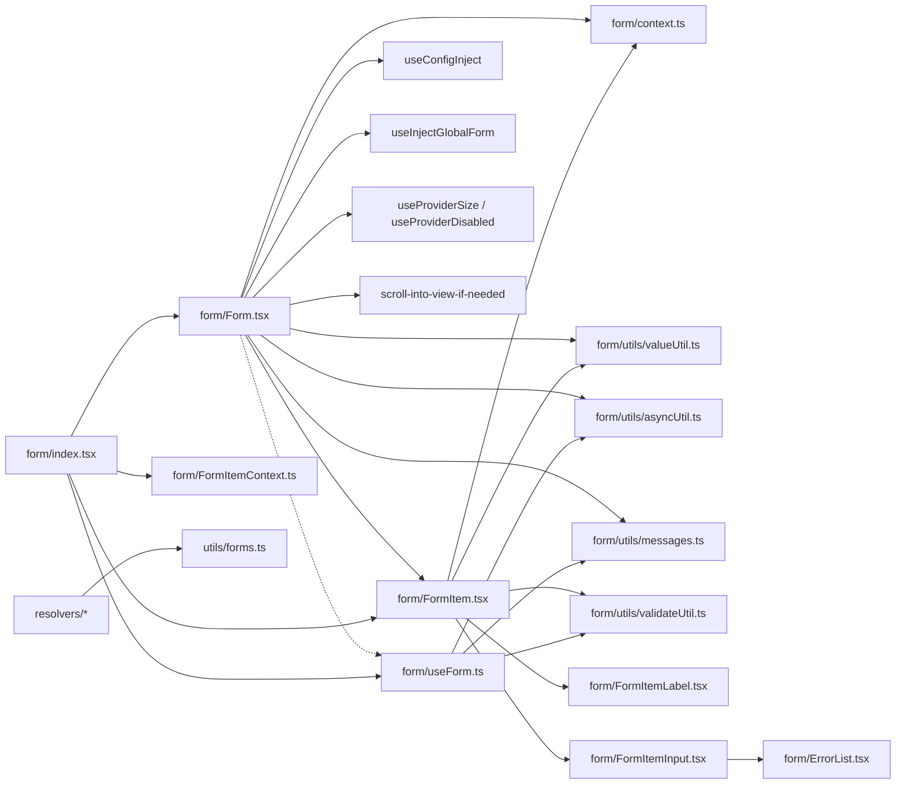
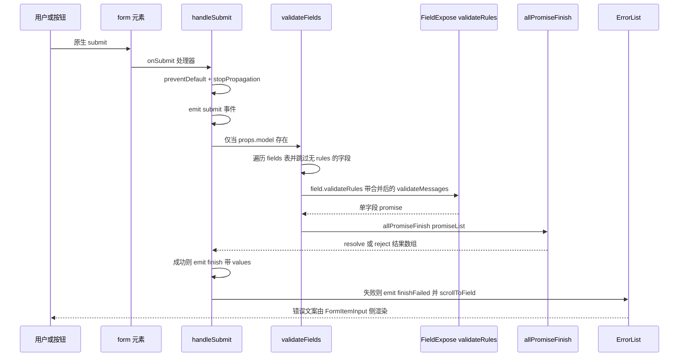
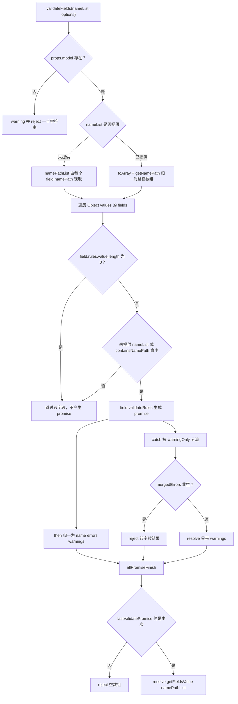

# C06-01 Form 表单

> **本篇解决**：`<xy-form>` 的模型（model/`useForm`）如何收集字段、规则如何解析与执行、提交与错误回显沿着哪条链路流动。
> **前置**：C06-00《类横写：Form 的字段注册、校验与上下文下发》　**读者坐标**：`03-components/06-form-editor` 第 2/9 篇（类横写之外的组件篇正文）

## 一、职责与边界

`XYForm` 是**编排层**，不是执行层。它做四件事：持有并下发 `model` 引用（`packages/xiaoye-ui/src/form/Form.tsx:382`）、维护一张字段注册表（`packages/xiaoye-ui/src/form/Form.tsx:169-175`）、把 `<form>` 的原生 submit 翻译成「全表校验 → `finish` / `finishFailed`」（`packages/xiaoye-ui/src/form/Form.tsx:347-371`）、以及对外给出 6 个实例方法（`packages/xiaoye-ui/src/form/Form.tsx:372-379`）。规则怎么执行、值从哪读、状态怎么流进控件，C06-00《类横写：Form 的字段注册、校验与上下文下发》已论证过（其论点 3、论点 5、论点 6 分别处理读值、回显双跳与 promise 聚合），本篇不再展开。

明确**不负责**：

- 单个字段的身份、规则合并与状态机 —— 归 `XYFormItem`（C06-00 论点 7 已定「就近优先二选一」的合并语义，`packages/xiaoye-ui/src/form/FormItem.tsx:207-222`）。
- 值的写入。Form 不写 `model`，FormItem 一侧的唯一例外是 `resetField` 的直改（C06-00 论点 3）。
- schema 到 `Rule` 的归一化，即 `src/resolvers/` 五个适配层 —— 归 I12《校验适配层 resolvers》，其论点 6 已给出「resolver 产出的规则不被 Form 执行，Form 的执行体是 `async-validator`」。本篇只登记它与 Form 的唯一交点（`packages/xiaoye-ui/src/utils/forms.ts:1-3` 的 `toValues` 只被 `resolvers/*` 引用）。
- 布局的 CSS 细节与栅格断点，本库由 `genComponentStyleHook('Form', …)` 产出（`packages/xiaoye-ui/src/form/style/index.ts:323-441` 是三种 layout 的规则体）；本篇只讲「layout 状态被表达了几次」。

依赖清单（出向）：`config-provider/hooks/useConfigInject`（`Form.tsx:125`）、`config-provider/context` 的 `useInjectGlobalForm`（`Form.tsx:144`）、`config-provider/SizeContext` 与 `DisabledContext`（`Form.tsx:44-142`）、`scroll-into-view-if-needed`（`Form.tsx:13-14`）、`lodash-es` 的 `isEqual`/`cloneDeep`/`debounce`/`intersection`/`find`/`omit`（`Form.tsx:12`、`useForm.ts:3-7`、`FormItem.tsx:27,36`）。被依赖（入向）：`cascader`（`packages/xiaoye-ui/src/cascader/index.tsx:22`）与 `upload`（`packages/xiaoye-ui/src/upload/Upload.tsx:17`）只引 `useInjectFormItemContext`，即它们依赖的是 FormItem 的接入协议而不是 `XYForm`；`form-list` 走深路径引 Form 的上下文与 namePath 工具（`packages/xiaoye-ui/src/form-list/FormList.tsx:5-6`），但**不碰注册表**——它只读 `formContext.model`（`packages/xiaoye-ui/src/form-list/FormList.tsx:53`）并直接往 model 上写数组（`packages/xiaoye-ui/src/form-list/FormList.tsx:57`、`packages/xiaoye-ui/src/form-list/FormList.tsx:64`），这是 `FormItem.resetField` 之外全仓第二处写 `model` 的地方。

## 二、源码地图

行数取自 `find packages/xiaoye-ui/src/form -type f | xargs wc -l`，`utils/forms.ts` 单列为 `wc -l packages/xiaoye-ui/src/utils/forms.ts`（下表为 `.ts`/`.tsx` 部分，`style/index.ts` 与测试都算入）。

| 文件 | 行数 | 本篇关心的职责 | 关键符号与主入口 |
| --- | --- | --- | --- |
| `form/Form.tsx` | 413 | 字段注册表、批量校验编排、上下文根、submit 翻译 | `formProps` 于 `Form.tsx:48`、`setup` 于 `Form.tsx:118`、`FormExpose` 于 `Form.tsx:79` |
| `form/useForm.ts` | 392 | 与 `Form` 并列的**第二条**入口模型（无组件、无注册表） | `useForm` 于 `useForm.ts:93`、`validateFields` 于 `useForm.ts:152` |
| `form/context.ts` | 77 | Form 级上下文的类型与默认值兜底 | `FormContextProps` 于 `context.ts:9`、`useProvideForm` 于 `context.ts:34` |
| `form/interface.ts` | 223 | `Rule`/`NamePath`/`ValidateErrorEntity`/`Callbacks` 契约 | `Callbacks` 于 `interface.ts:161` |
| `form/ErrorList.tsx` | 67 | 错误文案的进出场动画与 `role` | `setup` 于 `ErrorList.tsx:21` |
| `form/FormItemInput.tsx` | 114 | 控件容器 + `ErrorList` 挂载点 + 上下文裁剪 | `setup` 于 `FormItemInput.tsx:48` |
| `form/FormItemLabel.tsx` | 116 | 三源 `colon` / `requiredMark='optional'` 文案 | 函数体于 `FormItemLabel.tsx:27` |
| `form/utils/valueUtil.ts` | 88 | `getNamePath` 归一与 `cloneByNamePathList` 切片 | `getNamePath` 于 `valueUtil.ts:13` |
| `form/utils/typeUtil.ts` | 7 | `toArray`，namePath 归一的唯一实现 | `toArray` 于 `typeUtil.ts:1` |
| `form/utils/messages.ts` | 49 | 内置 `${name}` 文案模板 | `defaultValidateMessages` 于 `messages.ts:3` |
| `form/style/index.ts` | 488 | 三种 layout 的样式分支 | `genHorizontalStyle` 于 `style/index.ts:323` |
| `form/index.tsx` | 30 | 入口、静态挂载、`install` | `Form.install` 于 `index.tsx:15` |
| `form/__tests__/form.test.tsx` | 184 | 10 条 Form 级用例（唯一直接测 `XYForm` 的文件） | `makeForm` 于 `form.test.tsx:10` |
| `form/__tests__/useForm.test.ts` | 195 | 13 条 `useForm` 用例 | `describe` 于 `useForm.test.ts:11` |
| `utils/forms.ts` | 3 | `toValues`，只服务 `resolvers/*` | `packages/xiaoye-ui/src/utils/forms.ts:1` |

主实现入口是 `Form.tsx:106` 的 `defineComponent`（`name: 'XYForm'`，`Form.tsx:108`）。`FormItem.tsx` 的 546 行与 `FormItemContext.ts` 的 121 行属于 C06-00 的地盘，本篇只在必要处引用其行号。

两个入口模型共用一个目录但互不调用：`index.tsx:12-13` 把 `useInjectFormItemContext` 与 `FormItemRest` 挂成 `Form` 的静态属性，`Form.tsx:116` 把 `useForm` 挂成静态属性——`Form` 的 `setup` 内部**没有**任何一处调用 `useForm`（核对：`grep -n "useForm" packages/xiaoye-ui/src/form/Form.tsx` 只得三行：`:40` 的 import、`:116` 的静态挂载、`:412` 的导出类型声明）。这条事实是第四节论点 1 的落点。

## 三、架构与数据流

### 3.1 静态结构：Form 层只有两个入口，且它们互不相通

`graph` 表达的是文件级依赖，节点全是真实文件与真实函数名。实线是 import，虚线是「同目录但无引用关系」：



读图三件事：

1. `Form.tsx` 与 `useForm.ts` 之间只有虚线。`Form.tsx:40` import 了 `useForm`，但只用于 `Form.tsx:116` 的静态挂载，`setup` 不调用它，因此两条线各自实现了一遍「收集 promise → 聚合 → 判过期 → 造错误实体」（`Form.tsx:244-342` 与 `useForm.ts:152-230`）。
2. `resolvers/*` 与 `utils/forms.ts` 对 Form 而言是**孤岛**：`src/` 内没有任何文件 import 这个目录（复现：`grep -rn "resolvers" packages/xiaoye-ui/src --include='*.ts' --include='*.tsx' --include='*.js' | grep -v '/dist/'` 只命中 `src/resolvers/` 自身的 6 行 `@module resolvers` 注释；`packages/vite-plugin/src/index.ts:32` 与 `packages/nuxt-module/src/module.ts:80` 出现的 `resolvers` 是自动导入插件的同名选项，与该目录无关）。这与 I12《校验适配层 resolvers》论点 6、论点 7 的结论一致，本篇不复述。
3. `ErrorList.tsx` 只被 `FormItemInput.tsx` 引（`FormItemInput.tsx:4`），Form 本身不渲染错误文案——Form 层的「错误回显」只有 `scrollToFirstError`（`Form.tsx:203-213`）与实例方法两条出口。

### 3.2 一次提交的全闭环



`emit('submit')` 在校验**之前**（`Form.tsx:350`），所以父级拿到的 `submit` 事件不代表校验结果；`finish` 与 `finishFailed` 才是结果事件，且二者互斥（`Form.tsx:353-369`）。`stopPropagation()`（`Form.tsx:349`）意味着外层 `<form>` 包裹或事件委托收不到这次 submit。`scrollToField` 走的是 `document.getElementById`（`Form.tsx:221`），不是注册表里的方法调用，因此它和 DOM 的 id 契约绑定（见论点 4）。

### 3.3 `validateFields` 的编排分支



四个分支的存在理由：`B` 是这套 API 的硬前提（没有 model 就没有取值源，`Form.tsx:250-253`）；`H` 让「只排版不校验」的字段零开销，代价是这类字段的 `validate()` 也拿不到 `success` 状态；`N` 是 `warningOnly` 的唯一去处——纯 warning 规则不会让提交失败，只会带着 `warnings` 通过（`Form.tsx:301-313`）；`R` 是并发防陈旧：后发起的校验会把 `lastValidatePromise` 抢走，先前那次即使算完也判为过期（`Form.tsx:320-327`）。这条 `lastValidatePromise` 机制与 C06-00 论点 6 描述的是同一套，但那是**字段级**的 `'validating'` 自锁，这里是**表单级**的引用比对，两者互不干涉。

## 四、核心机制精读

### 论点 1：Form 目录里有两套**同名不同实现**的校验编排，`Form` 从不消费 `useForm`，两者的失败形状也不一致

断言：`Form.tsx` 与 `useForm.ts` 各自独立实现了「收集 promise → `allPromiseFinish` 聚合 → `lastValidatePromise` 判过期 → 造 `ValidateErrorEntity`」这一整套编排，两份代码结构几乎逐行对应，但**收尾的 `catch` 分支语义不同**：`Form` 无条件 reject，`useForm` 还要先看有没有真错误才决定 reject 还是 resolve。

`Form.tsx` 的那一份：

```tsx
// packages/xiaoye-ui/src/form/Form.tsx:319
      const summaryPromise = allPromiseFinish(promiseList);
      lastValidatePromise.value = summaryPromise;

      const returnPromise = summaryPromise
        .then(() => {
          if (lastValidatePromise.value === summaryPromise) {
            return Promise.resolve(getFieldsValue(namePathList));
          }
          return Promise.reject([]);
        })
        .catch(results => {
          const errorList = results.filter(result => result && result.errors.length);
          return Promise.reject({
            values: getFieldsValue(namePathList),
            errorFields: errorList,
            outOfDate: lastValidatePromise.value !== summaryPromise,
          });
        });
```

`useForm.ts` 的那一份：

```ts
// packages/xiaoye-ui/src/form/useForm.ts:203
    const summaryPromise = allPromiseFinish(promiseList);
    lastValidatePromise = summaryPromise;

    const returnPromise = summaryPromise
      .then(() => {
        if (lastValidatePromise === summaryPromise) {
          return Promise.resolve(values);
        }
        return Promise.reject([]);
      })
      .catch((results: any[]) => {
        const errorList = results.filter(
          (result: { errors: string | any[] }) => result && result.errors.length,
        );
        return errorList.length
          ? Promise.reject({
              values,
              errorFields: errorList,
              outOfDate: lastValidatePromise !== summaryPromise,
            })
          : Promise.resolve(values);
      });
```

逐段解释：

- `lastValidatePromise` 一个是 `ref`（`Form.tsx:168`），一个是普通 `let`（`useForm.ts:151`）。`Form` 里它其实**不需要响应式**——全文件只有 `Form.tsx:320`、`Form.tsx:324`、`Form.tsx:334` 三处读写，都在同一个同步流程里，没人 `watch` 它。这是从响应式路线（`useForm` 需要把状态摊给 `validateInfos`）抄过来时留下的形态差异。
- 两份的 `.then()` 都靠 `=== summaryPromise` 的引用相等判过期，过期时 reject 的是**空数组** `[]`（`Form.tsx:327`、`useForm.ts:211`），而不是 `ValidateErrorEntity`。
- `Form` 的 `catch` 里 `errorList` 只用来填 `errorFields`，不影响 reject/resolve（`Form.tsx:329-336`）；`useForm` 的 `catch` 里 `errorList.length` 是**分支条件**（`useForm.ts:217-223`）。也就是说：`useForm` 认定「聚合结果里没有真错误」等价于「校验通过」，而 `Form` 认定「promise 链进了 catch」就等于失败。
- 这个差异在当前调用下不会炸：两边的 promise 只有在 `mergedErrors.length` 非空时才 reject（`Form.tsx:301-307`、`useForm.ts:185-191`），纯 `warningOnly` 失败走的是 resolve 分支（`Form.tsx:309-313`、`useForm.ts:193-197`），所以 `allPromiseFinish` 根本不会进 `hasError`（`asyncUtil.ts:14-29`）。但它是一个**已存在的语义分岔**：任何一方将来把 promise 的 reject 形状放宽（例如让 `validateRules` 在异常时也 reject 一个 `{errors: []}`），`Form` 会把「无错误」当成失败并 emit `finishFailed`（`Form.tsx:357-369`），`useForm` 会当成通过并 resolve。

结论回扣：`Form` 挂 `useForm` 当静态属性（`Form.tsx:116`）只是**导出面的便利**，不构成运行关系。`grep -n "useForm(" packages/xiaoye-ui/src/form/Form.tsx` 返回空，可以直接证伪「Form 内部用 useForm 做校验」这种猜测。改 `Form` 的聚合语义时，`useForm` 不会跟着变；反过来也一样。两条线真正共享的只有聚合与文案这两件：`asyncUtil` 与 `messages` 各自被两边各引一次（`Form.tsx:9-10`、`useForm.ts:9-10`）。执行内核 `validateUtil` 则是**间接共享**——`Form` 从不 import 它，它只被 `useForm.ts:8` 与 `FormItem.tsx:32` 引入，而 `Form` 通过字段表上的 `field.validateRules` 间接受它约束（`Form.tsx:280-283`）。

### 论点 2：规则寻址有两套互不兼容的**方言**——Form 路线按 namePath 数组下钻，`useForm` 路线按字符串路径切点

断言：同一个 `rules` 对象放到两条不同入口上，对 `model` 的**形状要求是互斥的**。根因是 `getNamePath` 只做「包一层数组」，从不切点，而 `useForm` 自带一份会切点的字符串路径解析器。

namePath 归一的唯一实现：

```ts
// packages/xiaoye-ui/src/form/utils/typeUtil.ts:1
export function toArray<T>(value?: T | T[] | null): T[] {
  if (value === undefined || value === null) {
    return [];
  }

  return Array.isArray(value) ? value : [value];
}
```

```ts
// packages/xiaoye-ui/src/form/utils/valueUtil.ts:13
export function getNamePath(path: NamePath | null): InternalNamePath {
  return toArray(path);
}
```

而 `useForm` 的解析器会把点与下标展开：

```ts
// packages/xiaoye-ui/src/form/useForm.ts:66
function getPropByPath(obj: Props, path: string, strict: boolean) {
  let tempObj = obj;
  path = path.replace(/\[(\w+)\]/g, '.$1');
  path = path.replace(/^\./, '');

  const keyArr = path.split('.');
  let i = 0;
  for (let len = keyArr.length; i < len - 1; ++i) {
    if (!tempObj && !strict) break;
    const key = keyArr[i];
    if (key in tempObj) {
      tempObj = tempObj[key];
    } else {
      if (strict) {
        throw new Error('please transfer a valid name path to validate!');
      }
      break;
    }
  }
```

Form 路线的取值与规则查找都不切点：`FormItem` 用数组版 `getPropByPath`（`FormItem.tsx:78-108`，它**不 split**，直接 `keyArr[i]` 逐步下钻，见 `FormItem.tsx:81` 的 `const keyArr = namePathList;`），而 Form 侧的批量入口全部先过 `getNamePath`（`Form.tsx:179`、`Form.tsx:256`）。

逐段解释：

- `model` 侧：`<xy-form-item name="user.name">` 得到 `namePath = ['user.name']`（`FormItem.tsx:174-177`），`getPropByPath(model, ['user.name'], true)` 的循环条件是 `i < len - 1`，`len === 1` 时循环体一次都不执行，直接返回 `{ o: model, k: 'user.name', v: model['user.name'] }`（`FormItem.tsx:82-84`、`FormItem.tsx:103-107`）。所以 Form 路线里的 `name="user.name"` 指向的是**带点的平铺键**，不是嵌套对象。
- 测试把这条语义钉死的是 `useForm`，不是 `Form`：`useForm.test.ts:167-175` 用 `ref({ user: { name: '' } })` 配 `rulesRef = reactive({ 'user.name': [...] })` 断言 `validateInfos['user.name']` 报错——`useForm` 的键表 lookup 是平铺的（`useForm.ts:164` `unref(rulesRef)[name]`），取值 lookup 是切点的（上面的 `path.split('.')`）。**同一份 rules 对象，`useForm` 读得出、`<xy-form :rules>` 读不出**，因为后者会去 `formRules['user.name']` 这个平铺键上找（`FormItem.tsx:214-215` 的 `prop.o[prop.k] || prop.v`）。
- `validateInfos` 的键空间也是字符串域：`useForm.ts:342` 用 `Object.keys(unref(rulesRef))` 生成 `rulesKeys`，`useForm.ts:250-257` 全部以 `validateInfos[name]` 索引，因此 `name` 里能不能有点，决定的是「键名」而不是「层级」——`help`、`validateStatus` 都挂在带点的整串键上。
- 规则变更侦测同样是两套：`Form` 只 `watch(() => props.rules, …)`，没有 `deep`（`Form.tsx:401-408`）：

```tsx
// packages/xiaoye-ui/src/form/Form.tsx:396
    watch(
      () => props.rules,
      () => {
        if (props.validateOnRuleChange) {
          validateFields();
        }
      },
    );
```

`useForm` 则是 `{ deep: true, immediate: true }` 并用 `first` 标志跳过首帧（`useForm.ts:339-349`），拿到新键表后才判 `validateOnRuleChange`（`useForm.ts:343`）。原地往规则数组里 push 一条规则，只有 `useForm` 路线会重新校验；`Form` 路线必须整体替换 `rules` 对象引用才会进这个 watch。
- 顺带一个文档-源码分歧：手册 `apps/docs/components/form.md:240` 写 `validateOnRuleChange` 的默认值是 `true`，但源码里它既没有出现在 `initDefaultProps` 的默认表（`Form.tsx:110-114` 只有 `layout`、`hideRequiredMark`、`colon`），`booleanType()` 生成的对象默认值也是 `undefined`（`packages/xiaoye-ui/src/_util/type.ts:58-60`）。无论 Vue 对缺省 Boolean 做不做 `false` 转换，`Form.tsx:399` 的 `if (props.validateOnRuleChange)` 在用户不显式传时都取假值——**默认不重校验**，与手册相反。`useForm` 侧同构：选项未传即假值（`useForm.ts:343`），其测试文件也没有覆盖 `validateOnRuleChange`（`grep -n "validateOnRuleChange" packages/xiaoye-ui/src/form/__tests__/useForm.test.ts` 返回空）。

结论回扣：Form 的「规则」不是一个统一概念，而是「一条 namePath 数组下钻 + 一张字符串键表」两套并存的查表协议，切换入口时要同时换 `model` 的形状写法。C06-00 论点 3 已经指出这两份 `getPropByPath` 的容错完全不同（一个返回 `isValid`、一个吞异常），本篇补的是它们在**键空间**上的后果。

### 论点 3：字段表是**普通对象而不是响应式**，且按名寻址在「重置侧」与「校验侧」用了两套等值判断

C06-00 论点 1 已论证「表的 key 是自增串 `eventKey` 而非 `namePath`」及其线性查找代价，本篇不重复；这里补的是表的**存储形态**与两个批量入口的匹配语义差异。

表的声明与两处消费：

```tsx
// packages/xiaoye-ui/src/form/Form.tsx:169
    const fields: Record<string, FieldExpose> = {};
    const addField = (eventKey: string, field: FieldExpose) => {
      fields[eventKey] = field;
    };
    const removeField = (eventKey: string) => {
      delete fields[eventKey];
    };

    const getFieldsByNameList = (nameList: NamePath | NamePath[]) => {
      const provideNameList = !!nameList;
      const namePathList = provideNameList ? toArray(nameList).map(getNamePath) : [];
      if (!provideNameList) {
        return Object.values(fields);
      } else {
        return Object.values(fields).filter(
          field =>
            namePathList.findIndex(namePath => isEqualName(namePath, field.fieldName.value)) > -1,
        );
      }
    };
```

重置/清理侧用的等值判断在 `Form.tsx` 自己手里：

```tsx
// packages/xiaoye-ui/src/form/Form.tsx:102
function isEqualName(name1: NamePath, name2: NamePath) {
  return isEqual(toArray(name1), toArray(name2));
}
```

校验侧完全绕开了它，改用 `valueUtil` 的路径匹配：

```tsx
// packages/xiaoye-ui/src/form/Form.tsx:265
      Object.values(fields).forEach(field => {
        // Add field if not provide `nameList`
        if (!provideNameList) {
          namePathList.push(field.namePath.value);
        }

        // Skip if without rule
        if (!field.rules?.value.length) {
          return;
        }

        const fieldNamePath = field.namePath.value;

        // Add field validate rule in to promise list
        if (!provideNameList || containsNamePath(namePathList, fieldNamePath)) {
```

```ts
// packages/xiaoye-ui/src/form/utils/valueUtil.ts:32
export function containsNamePath(namePathList: InternalNamePath[], namePath: InternalNamePath) {
  return namePathList && namePathList.some(path => matchNamePath(path, namePath));
}
```

逐段解释：

- `fields` 是 `const` 声明的裸对象（`Form.tsx:169`），既不是 `reactive` 也不是 `ref`，`addField`/`removeField` 直接改它（`Form.tsx:170-175`）。后果：**字段增减不产生任何响应式信号**，Form 的渲染（`Form.tsx:410-416`）不依赖字段数量，所有批量方法都是调用时刻 `Object.values(fields)` 现取（`Form.tsx:180`、`Form.tsx:183`、`Form.tsx:265`）。这让 `xy-form-list` 的动态增删立刻对下一次 `validate()` 可见，代价是谁也没法「响应字段数量」——想做「有错误字段时才显示提交按钮」只能靠 `@validate` 事件自己攒状态（回流通道只有 `Form.tsx:390-392`）。
- 两侧比较的**操作数不同**：重置侧比的是 `field.fieldName.value`，也就是用户写的那个 `name`/`prop` 原值（`Form.tsx:185`，`fieldName` 定义于 `FormItem.tsx:170`）；校验侧比的是 `field.namePath.value`，即归一后的数组（`Form.tsx:268`、`Form.tsx:276`）。因为 `isEqualName` 内部对两边都过 `toArray`（`Form.tsx:103`），`'a'` 与 `['a']` 在重置侧等价；`containsNamePath` → `matchNamePath` 要求**长度相同且逐项 `===`**（`valueUtil.ts:80-88`），而 `namePathList` 里的元素已经在 `Form.tsx:256` 过了一遍 `getNamePath`，所以校验侧同样等价。两套判断在此刻行为一致，但它们是**两个独立实现**——`matchNamePath` 用 `every` 逐项比，`isEqual` 用 lodash 深比，将来若允许相对路径或通配（`FormList` 的常见需求），只改一处就会出现「`resetFields(['a'])` 命中而 `validateFields(['a'])` 不命中」这类不对称。
- `Form.tsx:267-268` 的 push 发生在 `Form.tsx:272` 的跳过**之前**：未提供 `nameList` 时，`namePathList` 收录**全部**注册字段的路径，包括没有任何规则的字段。因此 `finish` 回调的 `values` 与 `finishFailed` 的 `values` 都按「全字段」切片（`Form.tsx:325`、`Form.tsx:332`），而不是按「被校验过的字段」。这是刻意设计——无规则字段也是表单值——但提供 `nameList` 时切片口径立刻换成「点名的那些路径」，而点名用的是 `toArray(nameList).map(getNamePath)`（`Form.tsx:255-257`）：传 `['user','name']` 会被读成**两个平铺字段** `['user']` 与 `['name']`，而不是字段声明时那个嵌套路径 `['user','name']`（对照 `FormItem.tsx:174-176`，那里 `toArray` 对已经是数组的值原样返回）。同一串字面量在两侧的层级含义相反，这是第七节坑 1 的主题。
- 名字写错时校验侧不会报错：`containsNamePath` 找不到就整个跳过（`Form.tsx:279` 的条件为假），`namePathList` 里那个不存在的路径仍会喂给 `getFieldsValue` → `cloneByNamePathList`（`valueUtil.ts:70-78`），后者对 model 上不存在的分支会**凭空造出嵌套键**：`getValue` 返回 `undefined`（`valueUtil.ts:17-20` → `vc-util/get.ts:4-12` 遇到 `undefined` 直接返回），`setValue` 再按路径逐层 `{...entity}` 克隆建层（`vc-util/set.ts:15-29`）。于是 `finishFailed` 的 `values` 里可能出现 model 上没有的键，而 `errorFields` 为空数组。
- 一个易误读的遮蔽：`scrollToField` 内部 `const fields = getFieldsByNameList(...)`（`Form.tsx:218`）声明了同名**局部数组**，遮蔽了 `Form.tsx:169` 的表；它随后只取 `fields[0]`（`Form.tsx:219`）。同名不同物，改这个函数时不要以为在操作注册表。

结论回扣：Form 层的「字段收集」只做两件事——存引用（`Form.tsx:170-172`）与按名过滤（`Form.tsx:177-188`、`Form.tsx:254-279`），它不做去重、不做排序、不做响应式聚合。错误顺序因此等于**注册顺序**（`Object.values` 的键插入序，`Form.tsx:265`），而注册顺序由 `eventKey` 自增决定（C06-00 论点 1，`FormItem.tsx:165`），与 DOM 声明顺序一致、与 `nameList` 给定的顺序无关。

### 论点 4：提交翻译层有**三种不同的 reject 形状**，其中 `[]` 那一种会把「校验通过」变成崩溃点；`scrollToFirstError` 依赖的是全局 DOM id 而非注册表

断言：`validateFields()` 对外可能抛出三种 payload——字符串、空数组、`ValidateErrorEntity`——而 `handleSubmit` 唯一注册的 `.catch` 只按第三种形状取属性。同时「滚到第一个错误字段」不查表，靠 `document.getElementById` 命中 `fieldId`，而 `fieldId` 在多表单场景可以完全相同。

提交翻译：

```tsx
// packages/xiaoye-ui/src/form/Form.tsx:347
    const handleSubmit = (e: Event) => {
      e.preventDefault();
      e.stopPropagation();
      emit('submit', e);
      if (props.model) {
        const res = validateFields();
        res
          .then(values => {
            emit('finish', values);
          })
          .catch(errors => {
            handleFinishFailed(errors);
          });
      }
    };
```

失败处理与滚动：

```tsx
// packages/xiaoye-ui/src/form/Form.tsx:203
    const handleFinishFailed = (errorInfo: ValidateErrorEntity) => {
      const { scrollToFirstError } = props;
      emit('finishFailed', errorInfo);
      if (scrollToFirstError && errorInfo.errorFields.length) {
        let scrollToFieldOptions: Options = {};
        if (typeof scrollToFirstError === 'object') {
          scrollToFieldOptions = scrollToFirstError;
        }
        scrollToField(errorInfo.errorFields[0].name, scrollToFieldOptions);
      }
    };
    const validate = (...args: any[]) => {
      return validateField(...args);
    };
    const scrollToField = (name?: NamePath, options = {}) => {
      const fields = getFieldsByNameList(name ? [name] : undefined);
      if (fields.length) {
        const fieldId = fields[0].fieldId.value;
        const node = fieldId ? document.getElementById(fieldId) : null;

        if (node) {
          scrollIntoView(node, {
            scrollMode: 'if-needed',
            block: 'nearest',
            ...options,
          });
        }
      }
    };
```

id 的来源在 FormItem 侧：

```tsx
// packages/xiaoye-ui/src/form/FormItem.tsx:179
    const fieldId = computed(() => {
      if (!namePath.value.length) {
        return undefined;
      } else {
        const formName = formContext.name.value;
        const mergedId = namePath.value.join('_');
        return formName ? `${formName}_${mergedId}` : `${defaultItemNamePrefixCls}_${mergedId}`;
      }
    });
```

逐段解释：

- `handleSubmit` 先 `preventDefault()` 再 `stopPropagation()`（`Form.tsx:348-349`），然后无条件 `emit('submit', e)`（`Form.tsx:350`）。`onSubmit` 是声明过的 prop（`Form.tsx:65`），`emits` 选项整段被注释（`Form.tsx:117`），所以 `emit('submit')` 命中的是 prop 处理器而不是原生监听器；`inheritAttrs: false`（`Form.tsx:109`）加 `{...attrs}`（`Form.tsx:412`）意味着**没被声明成 prop 的监听器**（`onReset`、`onClick`）仍以原生形式挂在 `<form>` 上，而 submit 这条通道是独占的。原生的表单提交、`action`、`<button type="submit">` 的默认行为一律被掐掉（测试正是靠 `wrapper.find('form').trigger('submit')` 驱动，`form.test.tsx:45-47`）。
- `if (props.model)`（`Form.tsx:351`）是唯一的守门：没传 `model` 时点提交**什么都不发生**——没有 `finish`、没有 `finishFailed`、也没有警告。那句「`model` is required」的 `warning` 与 `Promise.reject(字符串)` 都在 `validateFields` 内部（`Form.tsx:250-253`），而 `handleSubmit` 这条路上根本没走到它。
- 三种 reject 形状：无 `model` 时是字符串（`Form.tsx:252`），过期时先抛空数组（`Form.tsx:327`），正常失败是 `{ values, errorFields, outOfDate }`（`Form.tsx:331-335`）。**这一段初稿把第二条直接当成了到达用户回调的形状，并据此写下「`[].errorFields` 是 undefined → `Form.tsx:206` 抛 `TypeError` → 一条未处理的 promise rejection」——2026-09-30 用挂载探针实跑不成立**：`:327` 那个 `Promise.reject([])` 写在 `.then` 里，会被紧随其后的同一个 `.catch`（`:329-335`）接住并归一成 `{ values, errorFields: [], outOfDate: true }`，所以到达 `handleFinishFailed` 的对象里 `errorFields` 是 `[]`（`.length` 读到 0），`process.on('unhandledRejection')` 实收 0 条。真正的缺陷只剩语义那条，而且它是真的：第一次点击的聚合结果被第二次的 `lastValidatePromise` 顶掉（`:320` 赋值、`:324` 的引用比较失败），于是「校验通过」的那一次进了 `finishFailed`（`:205` 带着 `errorFields: []` 发给用户），实测 `@finish` 1 次 + `@finishFailed` 1 次——与 `scrollToFirstError` 无关，开与关都一样。2026-09-30 已在投递口吞掉被取代的那一轮（`handleSubmit` 的 `.catch` 里 `if (errors?.outOfDate) return`，`:360-362`），回归见 `packages/xiaoye-ui/src/form/__tests__/form.test.tsx:187`。剩下的是一处**潜在**而不是一处现役：`:206` 是全文件对 `errorInfo.errorFields` 的唯一一处无守卫读取，今天所有能到达它的 reject 都恰好带这个键（字符串那条被 `:351` 的 `if (props.model)` 挡在门外），但只要将来多一种 reject 形状就会真的抛。
- `scrollToField` 的取节点方式（`Form.tsx:217-231`）让它与 DOM 强耦合：`document.getElementById` 依赖 `fieldId` 全局唯一。`fieldId` 的构成是 `(formContext.name || 'form_item') + '_' + namePath.join('_')`（`FormItem.tsx:179-187`，前缀常量在 `FormItem.tsx:148`），Form 级 `name` 只是把它包一层（`Form.tsx:383` 下发 `computed(() => props.name)`）。两个都没有写 `name` 的 `<xy-form>` 渲染同名 `namePath` 时，id 完全相同，`getElementById` 按文档序返回**第一个**，于是第二个表单的错误永远滚不到；同一个 id 也被 label 的 `for` 使用（`FormItemLabel.tsx:102`，`htmlFor` 取自 `FormItem.tsx:343-345`），因此重复 id 直接违反「label 关联唯一控件」的无障碍前提。`scrollToField` 也没有 `shadowRoot` 分支（全文件仅此一次 `document` 调用，`grep -n "document" packages/xiaoye-ui/src/form/Form.tsx` 只得一行）。
- `scrollToFirstError` 的布尔/对象双形态在 `Form.tsx:208-210` 手工分流（对象时当作 `scroll-into-view-if-needed` 的 `Options`），类型面用的是 `anyType<boolean | Options>`（`Form.tsx:64`）——`anyType` 的实现是 `{ validator: () => true, default: ... }`（`packages/xiaoye-ui/src/_util/type.ts:66-67`），因此这个 prop **没有任何运行时类型约束**。

结论回扣：Form 的「提交」不是 DOM submit 的包装，而是一个**串行降级**：DOM submit → 事件 → 全表校验 → 三选一形状 → 用户回调或滚动副作用。这一层里唯一带外部依赖的就是 `document.getElementById`，其余全在注册表内。

### 论点 5：Form 是全站唯一的「三源合流点」，但五条配置链的**合并深度和优先级顺序各不相同**

断言：`requiredMark`、`colon`、`validateMessages`、`size`、`disabled` 这五组值都在 Form 的 `setup` 里合成，但它们既不是同一套优先级，也不是同一种合并算法——`validateMessages` 在 Form 侧是**浅展开**，真正的深合并发生在下一层的 `validateUtil`，于是「局部覆盖会吃掉全局的嵌套模板」。

```tsx
// packages/xiaoye-ui/src/form/Form.tsx:126
    const requiredMark = computed(() => props.requiredMark === '' || props.requiredMark);
    const mergedRequiredMark = computed(() => {
      if (requiredMark.value !== undefined) {
        return requiredMark.value;
      }

      if (contextForm && contextForm.value?.requiredMark !== undefined) {
        return contextForm.value.requiredMark;
      }

      if (props.hideRequiredMark) {
        return false;
      }
      return true;
    });
    useProviderSize(size);
    useProviderDisabled(disabled);
    const mergedColon = computed(() => props.colon ?? contextForm.value?.colon);
    const { validateMessages: globalValidateMessages } = useInjectGlobalForm();
    const validateMessages = computed(() => {
      return {
        ...defaultValidateMessages,
        ...globalValidateMessages.value,
        ...props.validateMessages,
      };
    });
```

`contextForm` 来自 `useConfigInject('form', props)` 的解构（`Form.tsx:119-125`，其中 `form` 字段在 `packages/xiaoye-ui/src/config-provider/hooks/useConfigInject.ts:22` 取自 `configProvider.form`）；`useInjectGlobalForm` 的兜底是 `{ validateMessages: computed(() => undefined) }`（`packages/xiaoye-ui/src/config-provider/context.ts:29-30`）。

逐段解释：

- **`requiredMark` 有四级**（`Form.tsx:127-140`）：自身 → ConfigProvider → `hideRequiredMark` 取反 → 常量 `true`。`Form.tsx:126` 那行 `=== ''` 说明空串是一个**会被到达的入参**（模板里只写属性名不写值时传的就是 `''`），代码必须在这里显式把它当「开启」处理，否则 `mergedRequiredMark` 的第一道判断 `!== undefined` 会带着 `''` 往下走。`hideRequiredMark` 排在第三级，意味着只要 ConfigProvider 设过 `requiredMark`，这个「已标 deprecated 但默认值被写死为 `false`」的 prop（`Form.tsx:57-58`、`Form.tsx:112`）就永远读不到——它只在两边都没配时生效。
- **`colon` 只有两级且不落回内置默认**（`Form.tsx:143`）。`??` 使 `props.colon === false` 能压过 ConfigProvider（`Form.tsx:143`），但两级都是 `undefined` 时 `mergedColon` 就是 `undefined`，兜底推迟到 label 侧的 `colon === true || (contextColon?.value !== false && colon !== false)`（`packages/xiaoye-ui/src/form/FormItemLabel.tsx:58`）——「默认有冒号」这件事是**在 FormItemLabel 里靠 `!== false` 表达**的，而不是 Form 给的默认值。改 Form 的 `colon` 逻辑时必须同时看这一行。
- **`validateMessages` 是浅展开**（`Form.tsx:145-151`），随后逐字段透传给 `field.validateRules({ validateMessages: validateMessages.value, ...options })`（`Form.tsx:280-283`），最终在 `validateRule` 里被再合一次：`setValues({}, defaultValidateMessages, options.validateMessages)`（`packages/xiaoye-ui/src/form/utils/validateUtil.ts:48`）。`setValues` 对纯对象键递归（`packages/xiaoye-ui/src/form/utils/valueUtil.ts:44-61`，`isObject` 判定在 `valueUtil.ts:36-38`）。两次合并叠加后的净效果是：内置模板的嵌套键（如 `string.len`）总能被补回来，但 **ConfigProvider 的嵌套模板会被组件级同名嵌套对象整块顶掉**——`validateMessages` 上展开的是顶层键，`string: { min }` 一出现就替换掉整个 `string`，`globalValidateMessages.string.max` 在第一步已经丢了，第二步只能从 `defaultValidateMessages` 恢复。所以「全局配一套中文文案、某个表单再补一条」这种写法在嵌套层上不成立，必须自己把对象合全。
- **`size` 与 `disabled` 是二次 provide，且合并运算符不同**：`useProviderSize(size)`（`Form.tsx:141`）与 `useProviderDisabled(disabled)`（`Form.tsx:142`）分别落到 `packages/xiaoye-ui/src/config-provider/SizeContext.ts:9-16` 与 `packages/xiaoye-ui/src/config-provider/DisabledContext.ts:10-17`，前者用 `size.value || parentSize.value`（`SizeContext.ts:13`），后者用 `disabled.value ?? parentDisabled.value`（`DisabledContext.ts:14`）。而传进去的 `size`/`disabled` 本身已经是 `useConfigInject` 合过一遍的结果（`useConfigInject.ts:39` 的 `props.size || sizeContext.value`、`useConfigInject.ts:43` 的 `props.disabled ?? disabledContext.value`）。也就是说 Form 把同一对运算符执行了两次。对 `size` 而言这两个运算符**等价**，因为 `SizeType` 的三个合法值 `'small'|'middle'|'large'` 都是真值、唯一的假值就是 `undefined`（`SizeContext.ts:3`）；对 `disabled` 而言它们**不等价**，因为 `DisabledType` 允许 `false` 这个真值（`DisabledContext.ts:4`），`??` 让表单上显式写的 `:disabled="false"` 能覆盖父级的 `true`，一旦把 `DisabledContext.ts:14` 改成 `||` 就会被顶掉——**这是一条语义靠一个运算符撑着、却没有测试保护的链**（`form/__tests__` 里没有任何 `size`/`disabled` 相关用例，复现：`grep -rn "size\|disabled" packages/xiaoye-ui/src/form/__tests__` 返回空）。
- 这两个 provider 的作用域**不限于 FormItem**：provide 覆盖 Form 默认插槽里的整棵子树（`Form.tsx:410-416` 渲染 `slots.default?.()`），所以表单末尾的 `<xy-button type="primary">` 也会吃到 Form 的 `size`/`disabled`。这是 Form 作为「布局容器」之外的第二重身份，也是「禁用整个表单」唯一可用的开关（Form 自身没有 `readOnly` 之类的 prop，`formProps` 全集见 `Form.tsx:48-75`；属性清单以手册为准，见 `apps/docs/components/form.md`）。

结论回扣：`mergedRequiredMark`、`mergedColon`、`validateMessages`、`fields`、`useProviderSize/Disabled` 一起构成 Form 的「配置出口面」，它们经 `useProvideForm` 一次性下发 15 个成员（`Form.tsx:381-399`，类型 `FormContextProps` 见 `context.ts:9-30`，C06-00 第五节已数过成员）。本篇关心的是**这些合成规则彼此不成体系**：加第六个可配置项时，没有一处集中的「优先级定义」可参照，只能逐条抄最相近的那条链。

### 论点 6：错误回显的**布局补偿是运行时量测 + 负 margin**，不是 CSS 高度过渡；`ErrorList` 在进出场期间必须保持挂载

C06-00 论点 5 已论证状态如何经 `createContext` 双跳与 `useDebounce` 的非对称延迟到达文案（`useDebounce.ts:9-14`），本篇不重复；这里讲文案到达后**版面为什么不跳**。

量测与两个补偿层：

```tsx
// packages/xiaoye-ui/src/form/FormItem.tsx:455
    const marginBottom = shallowRef<number>(null);
    const showMarginOffset = shallowRef(false);
    const updateMarginBottom = () => {
      if (itemRef.value) {
        const itemStyle = getComputedStyle(itemRef.value);
        marginBottom.value = parseInt(itemStyle.marginBottom, 10);
      }
    };
    onMounted(() => {
      watch(
        showMarginOffset,
        () => {
          if (showMarginOffset.value) {
            updateMarginBottom();
          }
        },
        { flush: 'post', immediate: true },
      );
    });

    const onErrorVisibleChanged = (nextVisible: boolean) => {
      if (!nextVisible) {
        marginBottom.value = null;
      }
    };
```

```tsx
// packages/xiaoye-ui/src/form/FormItem.tsx:534
          {!!marginBottom.value && (
            <div
              class={`${prefixCls.value}-margin-offset`}
              style={{
                marginBottom: `-${marginBottom.value}px`,
              }}
            />
          )}
```

```tsx
// packages/xiaoye-ui/src/form/FormItemInput.tsx:93
                {marginBottom !== null || errors.length ? (
                  <div style={{ display: 'flex', flexWrap: 'nowrap' }}>
                    <ErrorList
                      errors={errors}
                      help={help}
                      class={`${baseClassName}-explain-connected`}
                      onErrorVisibleChanged={onErrorVisibleChanged}
                    />
                    {!!marginBottom && <div style={{ width: 0, height: `${marginBottom}px` }} />}
                  </div>
                ) : null}
```

逐段解释：

- 三个状态各有分工：`marginBottom`（`FormItem.tsx:455`）是**量出来的像素值**，`showMarginOffset`（`FormItem.tsx:456`）是「当前有没有 help」的镜像布尔，`errors`（`FormItem.tsx:171`）是文案本体。`showMarginOffset.value = withHelp` 直接写在渲染函数里（`FormItem.tsx:487`，`withHelp` 判定于 `FormItem.tsx:483-486`），也就是**每次渲染都写一次响应式 ref**，真正的读取被推给 `flush: 'post'` 的 watcher（`FormItem.tsx:464-472`）在 DOM 更新后跑。
- 为什么必须量：`getComputedStyle` 读的是最终生效的 `margin-bottom`（`FormItem.tsx:460`），而这个值由 token 决定且在三种 layout 下不同——基础值是 `token.marginLG`（`packages/xiaoye-ui/src/form/style/index.ts:122`），`inline` 下先清零再在有 help 时补回（`style/index.ts:356-360`），`vertical` 下另有 `flexWrap: 'wrap'` 分支（`style/index.ts:402-414`）。补偿层要抵消的正是「这一格里到底还剩多少下间距」，写死数值在三种 layout 下只能对一种。
- 补偿层有两个，方向相反：`FormItemInput.tsx:101` 那个 `width: 0; height: marginBottom` 的占位 div 挂在 `ErrorList` **同级**，作用是错误文案进场动画期间（外层只做 opacity 过渡、内层做 height 过渡，见 `packages/xiaoye-ui/src/form/style/explain.ts:11-13` 与 `explain.ts:32-36`）撑住原本会被压缩的行高；`FormItem.tsx:534-541` 的 `-margin-offset` 挂在 `Row` **之后**，用负 `margin-bottom` 把这一格的下间距整体收回。两者共用同一个 `marginBottom` 数字，因此必须同生同灭（都由 `!!marginBottom` 控制）。
- `FormItemInput.tsx:93` 的条件 `marginBottom !== null || errors.length` 是**保挂载**用的：文案清空后 `errors` 立即为空，但离场动画还没跑完，此时若只看 `errors.length` 就会把 `ErrorList` 整个卸掉、动画中断；靠 `marginBottom` 仍为数值（要等 `onAfterLeave` 才置 `null`，`packages/xiaoye-ui/src/form/ErrorList.tsx:51` → `FormItem.tsx:475-479`）把节点留住。
- `ErrorList` 自己还做了两件与版面无关但属于「回显」的事：给 `TransitionGroup` 补 `role="alert"`（`ErrorList.tsx:40`），以及把 `status` 记忆在 `innerStatus` 里且**仅在可见时更新**（`ErrorList.tsx:24-32`）——后者保证文案淡出期间颜色不突变，前者让读屏软件播报错误。这两处是 Form 层唯一直接命中的无障碍实现。
- 一个静默失效分支：`parseInt(itemStyle.marginBottom, 10)` 对 `auto` 或 `calc()` 形式的下边距返回 `NaN`（`FormItem.tsx:460`），`!!NaN` 为假 → 两个补偿层都不渲染（`FormItem.tsx:534`、`FormItemInput.tsx:101`），但 `NaN !== null` 为真 → `ErrorList` 仍被挂载（`FormItemInput.tsx:93`）。版面表现为「错误文案出现时下方多出一格空白」，且没有任何警告。该分支无测试保护（`grep -rn "marginBottom\|margin-offset" packages/xiaoye-ui/src/form/__tests__` 返回空）。

结论回扣：Form 的错误回显是**三段式**——FormItem 产 `errors`（`FormItem.tsx:297`）、FormItemInput 决定挂不挂载（`FormItemInput.tsx:93-103`）、ErrorList 决定怎么进出场（`ErrorList.tsx:34-64`）。Form 本身不参与，它只在失败时决定「滚不滚」（`Form.tsx:206-211`）。

## 五、对外契约如何生效

C06-00 第五节已经把「实例方法 / 上下文成员 / 控件接入协议」三层数过一遍，本节不重数，改写**每条 prop 离开 `props` 之后物理上走到哪**，因为 Form 的坑几乎都出在这四条通道的分工上。

**通道一：class 合成，Form 的 JS 不管布局。** `props.layout` 在渲染侧只有一个消费者——`formClassName` 里的 `${prefixCls}-${props.layout}`（`Form.tsx:160`），同一函数还把 `mergedRequiredMark === false`、`direction === 'rtl'`、`size` 三项拼成类（`Form.tsx:161-163`），并把 `hashId` 放在末位（`Form.tsx:165`）。也就是说 `horizontal` / `inline` / `vertical` 的差别**完全由样式表兑现**（`style/index.ts:323`、`style/index.ts:344`、`style/index.ts:418` 三个生成函数分别对应三种 layout），JS 里没有任何 `if (layout === 'inline')` 分支。唯一的例外是 `vertical: computed(() => props.layout === 'vertical')`（`Form.tsx:388`），它下发给 label 只为了一件事：vertical 下不画冒号（`FormItemLabel.tsx:59` 的 `haveColon = computedColon && !vertical.value`）。**layout 因此被表达了两次**——一次是类名，一次是布尔上下文；两处若不同步（例如将来加第四种 layout），样式会跟着类名走，冒号行为会跟着 `false` 走。

**通道二：`attrs` 的分配决定了原生事件能不能拿到。** `inheritAttrs: false`（`Form.tsx:109`）配合 `<form {...attrs} onSubmit={handleSubmit} class={[formClassName.value, attrs.class]}>`（`Form.tsx:412`）：`class` 手工并进数组（因为后者覆盖前者），未声明成 prop 的监听器（`onReset`、`onClick`、`onFocusin`）原样落到 DOM；而 `onSubmit` 已在 `formProps` 里声明（`Form.tsx:65`），于是它**不会**出现在 `attrs` 中，用户写 `@submit` 拿到的是 `emit('submit', e)` 的通知（`Form.tsx:350`），不是原生事件对象的第一现场——虽然这里传的确实是那个 `e`，但它已经被 `preventDefault()` 与 `stopPropagation()` 处理过（`Form.tsx:348-349`）。同理 `onFinish`/`onFinishFailed`/`onValidate` 三个 prop（`Form.tsx:72-74`）是 `emit` 的落点，`emits` 选项被注释掉（`Form.tsx:117`）后 Vue 走「props 上有同名处理器就调用」这条路径，功能成立但**放弃了声明式校验**：`emit('finish', values)` 的 payload 类型不受 `emits` 约束，`Form.tsx:331-335` 那个 reject 形状也没人检查。

**通道三：`useProvideForm` 下发的是计算引用，不是快照。** 15 个成员里 12 个是 `computed`（`Form.tsx:382-392`、`Form.tsx:398`），FormItem 每次读都跟随 `props` 的最新值（例如 `formContext.model.value` 出现在取值函数首行，`FormItem.tsx:189`）；剩下的是 `addField`/`removeField`/`onValidate` 三个函数（`Form.tsx:393-397`，类型声明于 `context.ts:20-21`、`context.ts:24-28`）。`addField` 闭包捕获的 `fields` 是裸对象（`Form.tsx:169`），**子组件的登记动作与 Form 的批量读取共享同一块内存**，没有中间层，这是「新挂载的字段立刻进入下一次 `validate()`」的机制原因，也是「字段表无法被响应式观察」的机制原因（论点 3）。脱离 `<xy-form>` 单独用 `xy-form-item` 时，`useInjectForm` 返回一套 `computed` 兜底空值（`context.ts:38-57`），其中 `addField` 是空函数（`context.ts:44`），因此独立 FormItem 只会自检、不会被批量操作命中。

**通道四：`expose` 的 6 个方法是 Form 的全部命令面。** 声明（`Form.tsx:79-98`）与挂载（`Form.tsx:372-379`）逐一同名。`getFieldsValue` 是其中唯一**不做路径归一**的（`Form.tsx:233-243`，对比 `Form.tsx:179`、`Form.tsx:255-257` 都先 `toArray(...).map(getNamePath)`），它的公开类型也据此写成 `InternalNamePath[] | true`（`Form.tsx:88-90`）——即「每个元素本身就是一条路径」。测试对这块的覆盖是：`validate`/`resetFields`/`clearValidate` 一条（`form.test.tsx:120-146`）、`getFieldsValue()` 无参一条（`form.test.tsx:148-153`）、`validateFields` 仅通过 submit 间接覆盖（`form.test.tsx:72-94`）；`scrollToField` 与 `getFieldsValue(带参)` 都没有用例（复现：`grep -rn "scrollToField" packages/xiaoye-ui/src/form/__tests__` 返回空）。

**静态挂载与全局注册面。** `Form` 的组件选项上直接挂了 `Item`（`Form.tsx:115`）与 `useForm`（`Form.tsx:116`），`index.tsx:12-13` 再补 `useInjectFormItemContext` 与 `ItemRest`；`install` 注册三个标签（`index.tsx:15-20`），标签名由 `registerComponent` 从组件 `name` 推导（`packages/xiaoye-ui/src/_util/registerComponent.ts:16-27`，推导函数 `toXYTagName` 于 `:6-11`），于是 `XYForm`→`xy-form`（`Form.tsx:108`）、`XYFormItem`→`xy-form-item`（`FormItem.tsx:152`）、`XYFormItemRest`→`xy-form-item-rest`（`FormItemContext.ts:94`），`:23-25` 的 `if (!app.component(tagName))` 保证重复 `install` 不覆盖。`NoFormStatus`（`FormItemContext.ts:113-121`）**不在** `index.tsx:22` 的导出列表里，它的两个真实消费者是直接深路径引 `../form/FormItemContext` 的 `input`（`packages/xiaoye-ui/src/input/Input.tsx:3-7`）与 `input-number`（`packages/xiaoye-ui/src/input-number/index.tsx:10`）——也就是说「豁免表单状态」这个能力对业务方**没有公开出口**，只有库内控件能用。

## 六、设计取舍

**取舍一：保留两条入口，而不是把 `useForm` 收编成 `Form` 的引擎。** `useForm` 的真实价值是**脱离组件树**：它返回的 `validateInfos` 是普通 reactive 对象（`useForm.ts:122`、`useForm.ts:103-107` 的返回签名），可以被 spread 到任意控件上，不需要 `XYForm` 也不需要 `XYFormItem`——这正是 C06-00 论点 3 里「`autoLink` 关掉后交给 `useForm`」那条支路（`FormItem.tsx:123` 的默认值与 `FormItem.tsx:366-375` 的守卫）。被放弃的方案是「让 `Form` 内部跑 `useForm`，`Form` 只负责渲染」：那样编排只剩一份，但 `useForm` 的键空间是**字符串**（`useForm.ts:342` 的 `Object.keys`、`useForm.ts:250-257` 的 `validateInfos[name]`），而 `Form` 的字段表是**数组路径**（`FormItem.tsx:174-177`），合并等于重写取值层。赔上的是本篇论点 1、论点 2 列出的全部分岔：两套 `catch` 语义、两份 `getPropByPath`、两种 rules 寻址、两份 trigger 过滤（`useForm.ts:140-149` 的 `filterRules` 与 `FormItem.tsx:263-272` 的内联过滤，前者缺省按 `'change'`、后者缺省继承 `mergedValidateTrigger`）。

**取舍二：Form 层刻意零状态，代价是留下一堆「store 型表单」的化石类型。** Form 的全部状态只有 `fields` 裸对象与 `lastValidatePromise`（`Form.tsx:168-169`），值的权威源始终在用户 `model` 里。这条决定的证据不只是正面——`interface.ts` 里完整保留了一整套做 store 才需要的通知协议：`Meta`（`interface.ts:13-18`，含 `touched`/`validating`）、`InternalFieldData`（`interface.ts:20-22`）、`FieldData`（`interface.ts:27-29`）、`NotifyInfo` 及其 `setField`/`dependenciesUpdate` 分支（`interface.ts:135-155`，注释还留着 `a <- b <- c` 的依赖传播说明，`interface.ts:146-151`）、`ValuedNotifyInfo`（`interface.ts:157-159`）。**这些名字没有任何运行时消费者**：`grep -rn "NotifyInfo\|InternalFieldData\|ValuedNotifyInfo" packages/xiaoye-ui/src --include='*.ts' --include='*.tsx' | grep -v '/dist/'` 只命中 `interface.ts` 自己的 4 行声明。同理，`valueUtil` 里 store 风格的读写对（`getValue`/`setValue`，`valueUtil.ts:17-30`）在 Form 侧完全没被使用，`Form.tsx:8` 只引了 `getNamePath`、`containsNamePath`、`cloneByNamePathList` 三个（那两个函数仅被 `cloneByNamePathList` 内部调用，`valueUtil.ts:73-74`）。换来的是「用户 model 就是唯一真相」，赔上的是：**字段级 `touched`、跨字段 `dependencies` 这类能力在类型面上存在、在实现面上不存在**，读代码的人会先以为有。`onValuesChange`/`onFieldsChange` 两个死 prop 属于同一批残留（C06-00 第五节已给复现命令，本篇不重复论证）。

**取舍三：`scrollToFirstError` 走 DOM id，而不是扩展 `FieldExpose` 交出节点引用。** 注册表里的 `FieldExpose` 一个 DOM 引用都没有（`FormItem.tsx:60-69` 的 8 个成员全是值/路径/方法），要在 Form 侧拿到可滚动的节点就得给契约加成员并让 FormItem 把 `itemRef` 暴露出来（`FormItem.tsx:168` 已有这个 ref，只是没往外给）。现在的答案是复用**已经必须存在**的 `fieldId`（`Form.tsx:220-221` → `FormItem.tsx:179-187`），因为 label 的 `for` 本来就要它。换来的是零契约改动，赔上的是三个失效场景：多表单同名路径（id 撞车，坑 3）、`shadowRoot` 或自定义渲染根（`document.getElementById` 找不到，`Form.tsx:221` 是全文件唯一一次 `document` 访问）、以及 SSR——`scrollIntoView` 只在客户端被调用，这一点倒是安全（只在 `handleFinishFailed` 里触发，`Form.tsx:211`）。

**取舍四：规则变更侦测用浅 watch。** `Form.tsx:401-408` 不写 `deep`，很可能是为了避开「每次渲染都深遍历整张 rules 表」的开销——rules 里允许放 `validator` 函数与 `enum` 数组，深 watch 的代价不可忽略。被放弃的方案就是同仓库 `useForm` 的做法（`useForm.ts:339-349` 的 `{ deep: true, immediate: true }`）。赔上的是：默认行为与手册相反（坑 6），且同一个功能在同一目录里有两种响应式深度，**看不出这是有意的分层**，只能算两条路线各自长出来的。

**取舍五：`getFieldsValue` 的参数保持「内部形状」，不给外部做归一。** 事实证据是它带参的那条分支**在全仓没有任何调用者**：`grep -rn "getFieldsValue(" packages apps --include='*.vue' --include='*.tsx' --include='*.ts' | grep -v '/dist/'` 只有 4 行——两处内部调用（`Form.tsx:325`、`Form.tsx:332`）传的都是已经归一过的 `namePathList`，一处测试用无参形式（`form.test.tsx:151`），剩下就是定义本身（`Form.tsx:233`）。也就是说这个参数是为内部切片服务的，`Form.tsx:88-90` 把它原样暴露成了公开 API。换来的是零转换成本，赔上的是对外参数形状与其它 5 个方法相反（坑 1 的后半段）。

## 七、坑与改动指南

**坑 1：`validateFields(['user','name'])` 与 `resetFields(['user','name'])` 里的两个字符串被当成两个字段名，不是一条嵌套路径。**
触发：字段声明写 `<xy-form-item :name="['user','name']">`，批量调用写 `form.validateFields(['user','name'])`。症状：该字段**根本没被校验**（`errorFields` 为空、`finish` 照常触发），但返回的 `values` 里多出 `{ user: {…}, name: undefined }` 这样的键；`resetFields(['user','name'])` 同样一个字段都不重置。原因：批量侧先 `toArray(nameList).map(getNamePath)`（`Form.tsx:255-257`、`Form.tsx:179`），`toArray` 对已是数组的入参原样返回（`utils/typeUtil.ts:1-7`），于是 `['user','name']` 被拆成 `['user']` 与 `['name']` 两条长度 1 的路径；而声明侧 `name={['user','name']}` 的 `toArray` 同样原样返回，得到的是**一条长度 2 的路径**（`FormItem.tsx:174-177`）。`matchNamePath` 要求长度相等（`utils/valueUtil.ts:80-88`），所以两侧永远错身。多出的键来自 `cloneByNamePathList` 的建层行为（`utils/valueUtil.ts:70-78` → `packages/xiaoye-ui/src/vc-util/set.ts:15-29`）。定位：`Form.tsx:255-257`、`Form.tsx:179`；正确写法是 `validateFields([['user','name']])`。该组合无测试保护：`form/__tests__` 里 `resetFields`/`clearValidate` 全部是无参调用（`form.test.tsx:134`、`form.test.tsx:141`），`validateFields(` 带参调用零命中（复现：`grep -rn "validateFields(" packages/xiaoye-ui/src/form/__tests__` 返回空）。

**坑 2：双击提交会让一次「校验通过」变成 `finishFailed`（2026-09-30 已修；同条目原本写的 `TypeError` 是误报，见末段）
触发：字段全部合法，用户快速点两次提交按钮（或提交后立即再次提交）。症状（探针实测复现）：`@finish` 只触发一次，`@finishFailed` 却被调用一次，payload 是 `{ values: {…}, errorFields: [], outOfDate: true }`。触发条件与 `scrollToFirstError` **无关**——它开着关着都同样错。
原因在 `validateFields` 的链式结构里：`Form.tsx:327` 的 `return Promise.reject([])` 是「本轮已被后一次取代」的标记，但它写在 `.then` 里，于是**被紧随其后的同一个 `.catch` 捕获**（`:329-335`），空数组被 `results.filter(...)` 归一成一个 `errorFields: []` 的普通失败对象，`outOfDate: true` 就此带进用户回调（`:334` 算出这个标记，而全文件此前没有任何一处读它）。修法是在投递口吞掉：`handleSubmit` 的 `.catch` 加 `if (errors?.outOfDate) return`（`Form.tsx:365-367`），语义变成「被取代的那一轮对外什么都不发」。
回归：`packages/xiaoye-ui/src/form/__tests__/form.test.tsx:187`「连点两次提交，只有成功的那轮对外发事件」，断言 `onFinish` 1 次、`onFinishFailed` **0** 次；把 `Form.tsx` 退回基线复跑得 `onFinishFailed` 1 次、用例红。
**要撤回的那半条**：本坑初稿还写着「开了 `scrollToFirstError` 会抛 `TypeError`、控制台出现未处理的 promise rejection（`Cannot read properties of undefined (reading 'length')`）」。2026-09-30 用「字段全合法 + 连点两次 + `scrollToFirstError: true`」的挂载探针实跑，`process.on('unhandledRejection')` 收 0 条、无抛错——因为真正到达 `handleFinishFailed` 的对象里 `errorFields` 是 `[]`（定义良好），`:206` 的 `.length` 读到 0 而不是 undefined。那个 `TypeError` 只能来自**别的** reject 形状（无 `model` 时 `:252` 抛的是字符串，`'字符串'.errorFields` 才是 undefined），而这条路走不进 `handleSubmit`（`:351` 的 `if (props.model)` 已挡下）。也就是说：初稿把「三种 reject 形状」的推演当成了「这条触发链的实测」。裸读 `errorFields` 的风险仍在（`:206` 是全文件对它的唯一一处无守卫访问），但那是坑 4 的载荷形状问题，不该记在本坑的账上。

**坑 3：两个不写 `name` 的表单会出现完全相同的字段 id，`scrollToField` 只命中文档序第一个。**
触发：同一页面渲染两个 `<xy-form>`（都没有 `name`），各自有 `name="username"` 的字段。症状：第二个表单提交失败时页面滚到**第一个表单**那个输入框；读屏软件把 label 关联到错误的控件；`scrollToField('username')` 在第一个表单上调用时也可能滚到第二个（取决于文档序）。原因：`fieldId = (formContext.name || 'form_item') + '_' + namePath.join('_')`（`FormItem.tsx:179-187`，前缀常量 `FormItem.tsx:148`），Form 级 `name` 是唯一命名空间（`Form.tsx:383`）；`scrollToField` 只用 `document.getElementById`（`Form.tsx:221`）而不比较节点是否属于本表单；label 的 `for` 用同一个值（`FormItemLabel.tsx:102`、`FormItem.tsx:343-345`）。定位：`Form.tsx:217-231`。已有的正向覆盖是 `form.test.tsx:56` 断言 `for` 等于 `test_username`（因为测试给了 `name: 'test'`，`form.test.tsx:26`），**跨表单撞车场景没有任何用例**。

**坑 4：不传 `model` 时提交静默无反应；手动 `validateFields()` 的 reject 又不是对象。**
触发：`<xy-form>` 漏传 `model`，用户点提交；或业务代码直接 `await formRef.validateFields()` 并 `catch ({ errorFields })`。症状：前者按了没反应——无 `finish`、无 `finishFailed`、无警告；后者解构出一串 `undefined`，或 `catch(err => err.message)` 拿到空。原因：`handleSubmit` 的 `if (props.model)` 守卫（`Form.tsx:351`）让整条链不启动；缺 `model` 的警告与 reject 都写在 `validateFields` 内部（`Form.tsx:250-253`，reject 的是字符串字面量），而公开类型 `FormExpose.validateFields` 声明的返回是 `Promise<{ [key: string]: any }>`（`Form.tsx:82-87`），**没有把三种 reject 形状写进类型**。定位：`Form.tsx:250-253`、`Form.tsx:351`。测试覆盖了有 `model` 的正常路径（`form.test.tsx:72-94`），无 `model` 路径零覆盖。

**坑 5：`validateMessages` 的嵌套层不能「全局一套 + 局部补一条」。**
触发：`ConfigProvider` 配了 `form.validateMessages = { string: { min: '至少 ${min} 个字' } }`，某个表单又传 `:validate-messages="{ string: { max: '不能超过 ${max} 个字' } }"`。症状：全局那句 `string.min` 失效，回落到英文内置文案。原因：`Form.tsx:145-151` 的三层是**对象展开**（浅），组件级的 `string` 整块覆盖全局的 `string`；下一层 `setValues({}, defaultValidateMessages, options.validateMessages)` 虽然是深合并（`utils/valueUtil.ts:44-61`，`isObject` 判定 `valueUtil.ts:36-38`），但它合并的是「内置默认」与「已展开过的结果」，全局那份嵌套在第一步就被丢掉了，只能从内置恢复。定位：`Form.tsx:146-150` 与 `utils/validateUtil.ts:48`。无测试保护：`grep -rn "validateMessages" packages/xiaoye-ui/src/form/__tests__` 返回空。

**坑 6：`validateOnRuleChange` 默认不生效，且原地改规则不触发。**
触发：把规则数组做成 `reactive` 配置，运行期 `rules.value.username.push({ pattern })`，指望 `validateOnRuleChange` 自动重校验；或按手册（`apps/docs/components/form.md:240` 把默认值标为 `true`）以为什么都不用传。症状：规则改了但界面仍是旧错误/旧通过态。原因：`watch(() => props.rules, ...)` 没有 `deep`（`Form.tsx:401-408`），只认引用替换；且 `validateOnRuleChange` 没有默认值（`Form.tsx:62` 的 `booleanType()` → `packages/xiaoye-ui/src/_util/type.ts:58-60` 生成 `default: undefined`，`Form.tsx:110-114` 的默认表里也没有它）。对照实现：`useForm` 是 `{ deep: true, immediate: true }`（`useForm.ts:339-349`），同一目录两种深度。定位：`Form.tsx:401-408`。安全改法：整体替换 `rules` 对象并显式传 `:validate-on-rule-change="true"`。该 prop 在全仓测试里 0 命中（复现：`grep -rn "validateOnRuleChange" packages/xiaoye-ui/src/form/__tests__` 返回空）。

**坑 7：下边距不是纯像素时，错误文案的版面补偿静默失效。**
触发：主题层把 `xy-form-item` 的 `margin-bottom` 改成 `auto`、百分比或 `calc()`，或自定义样式覆盖成非长度值，然后出现校验错误。症状：错误文案展开时下方凭空多出一格间距，收起时又跳一下；没有警告，类名 `xy-form-item-with-help` 仍正常挂上。原因：`parseInt(itemStyle.marginBottom, 10)` 返回 `NaN`（`FormItem.tsx:460`），`!!marginBottom.value` 为假 → 两个补偿层都不渲染（`FormItem.tsx:534`、`FormItemInput.tsx:101`），但 `marginBottom !== null` 为真 → `ErrorList` 容器仍挂载（`FormItemInput.tsx:93`）。定位：`FormItem.tsx:455-462`。该分支无测试保护（`grep -rn "marginBottom\|margin-offset" packages/xiaoye-ui/src/form/__tests__` 返回空）。

**测试现状**：Form 层只有 `form/__tests__/form.test.tsx`（10 条用例，覆盖 layout 类名、`for` 关联、requiredMark 类、submit 双分支、change/blur 两类 trigger、四个实例方法、嵌套 namePath）；`useForm.test.ts` 13 条覆盖的是无组件路线；`form-item-context.test.tsx` 9 条覆盖 ItemRest 与错误列表渲染。三个文件都落在 `packages/xiaoye-ui/vitest.config.mts:33` 的 glob 内，会被执行。**未覆盖**的是：`scrollToFirstError`、`outOfDate`、`validateOnRuleChange`、`validateMessages`、`size`/`disabled` provider、`getFieldsValue` 带参分支、无 `model` 提交、margin 补偿（各条复现命令见对应坑）。

**改动这块代码的安全边界**：

1. 动 `validateFields` 的聚合形状（`Form.tsx:319-341`）要同步检查 `useForm.ts:203-229`，因为两份代码同名不同实现（论点 1）；只改一份会让两条入口的失败形状进一步分岔。
2. 动 `FormContextProps`（`context.ts:9-30`）的任何一个 `computed` 成员，要同时看 `useInjectForm` 的兜底默认值（`context.ts:39-56`）——两边成员数量必须一致，否则脱离 `<xy-form>` 的 FormItem 会读到 `undefined.value`。
3. 动 `getFieldsByNameList`（`Form.tsx:177-188`）与 `validateFields` 的匹配逻辑（`Form.tsx:254-279`）时记得它们是**两套等值判断**（`isEqualName` 于 `Form.tsx:102-104`、`matchNamePath` 于 `valueUtil.ts:80-88`），任何一侧改成支持前缀匹配都必须同步，否则 `resetFields` 与 `validateFields` 的命中集合会不同。
4. 动 layout（加第四种取值）要改三处：类名合成（`Form.tsx:160`）、`vertical` 布尔（`Form.tsx:388`）、样式生成函数（`style/index.ts:323`/`:344`/`:418`），漏第三处会得到「有类名没样式」。
5. 验证顺序：`pnpm --filter xiaoye-ui test:unit -- form` 只跑到 `form` 目录三个文件；`scrollToField`/`scrollToFirstError` 相关改动**无法靠单测验证**，需要手工起 `pnpm dev` 在多表单页面测；`pnpm typecheck` 会抓到 `FormExpose`（`Form.tsx:79-98`）与 `expose` 实参（`Form.tsx:372-379`）不同名的情况（两者靠 `as FormExpose` 断言，`Form.tsx:379`，改签名时注意这个断言会吃掉一部分类型检查）。

## 附：本篇可证伪的三个检查点

1. **`getFieldsValue` 是唯一不做路径归一的实例方法**（论点 3、坑 1 的根）：执行
   `grep -n "getNamePath" packages/xiaoye-ui/src/form/Form.tsx`
   应只得 3 行——`:8` 的 import、`:179`（`getFieldsByNameList`）、`:256`（`validateFields`）——**没有一行落在 `233-243` 的 `getFieldsValue` 体内**。哪天出现第 4 行且位于该区间，坑 1 的「必须写 `validateFields([['user','name']])`」就要改成扁平写法也支持。

2. **Form 层没有 store，`interface.ts` 的 store 型协议是化石**（取舍二）：执行
   `grep -rn "NotifyInfo\|InternalFieldData\|ValuedNotifyInfo" packages/xiaoye-ui/src --include='*.ts' --include='*.tsx' | grep -v '/dist/'`
   应只得 4 行，且全部位于 `form/interface.ts`（`:20`、`:27`、`:154`、`:157`）。只要有任何一行出现在 `Form.tsx`、`useForm.ts` 或 `FormItem.tsx`，就说明 `touched`/`dependencies` 那条路线被接通，本篇「Form 层零状态」的论证需要重写。

3. **`outOfDate`、`scrollToFirstError`、`validateOnRuleChange`、`validateMessages` 四个 Form 级特性零测试**（坑 2、坑 5、坑 6）：执行
   `grep -rn "outOfDate\|scrollToFirstError\|validateOnRuleChange\|validateMessages" packages/xiaoye-ui/src/form/__tests__`
   应返回空（退出码 1）；而
   `grep -c "  it(" packages/xiaoye-ui/src/form/__tests__/form.test.tsx packages/xiaoye-ui/src/form/__tests__/useForm.test.ts packages/xiaoye-ui/src/form/__tests__/form-item-context.test.tsx`
   应给出 10、13、9 三个数——这三份文件是 Form 层全部的可执行用例（glob 见 `packages/xiaoye-ui/vitest.config.mts:33`），任何一天第一条命令出现非空结果，对应坑的「无测试保护」定性就要撤销。
