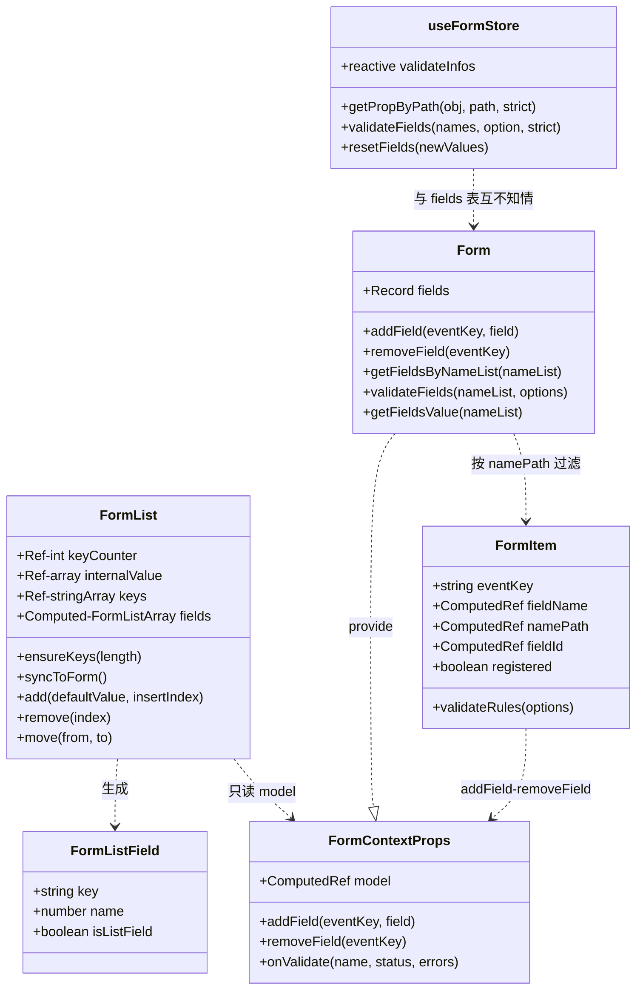
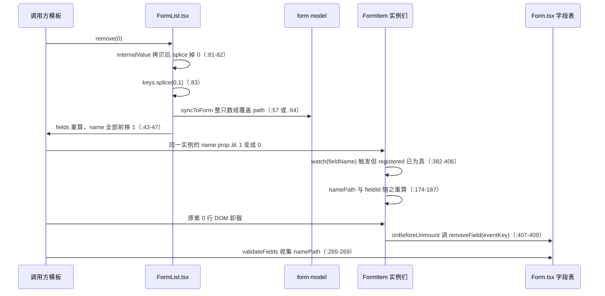
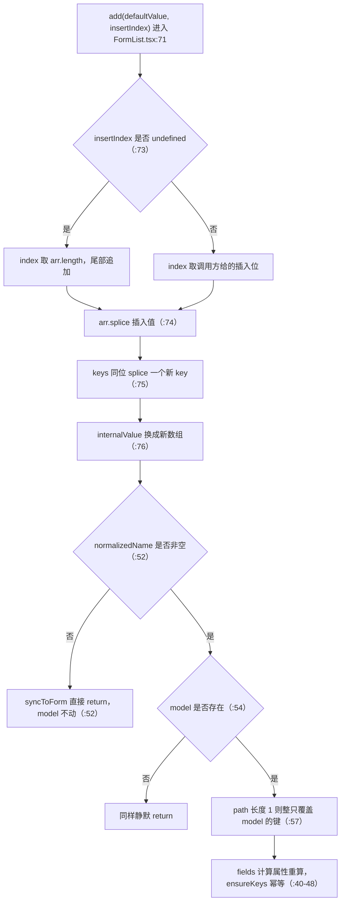

# C06-02 FormList 列表表单

> **本篇解决**：`xy-form-list` 增删行之后，行的 `key`、行的 `name`（下标）、已注册字段的 `namePath`、字段自带的校验错误、以及最终收集到的错误集合，这五套索引为什么可能互相对不上；以及要改它，哪几行是承重点。
> **前置**：C06-01《Form 表单》（已完成，本篇只引用其编号不重述其机制）、C06-00《类横写：Form 的字段注册、校验与上下文下发》　**读者坐标**：`03-components/06-form-editor` 第 3/9 篇

## 一、职责与边界

`FormList` 的全部职责是：**维护一份「数组长度 + 每行一个稳定 key」的本地状态，把长度变化翻译成插槽参数 `fields`，并把当前数组写回表单 model**。它的渲染面只有一行——`packages/xiaoye-ui/src/form-list/FormList.tsx:99`，返回 `slots.default?.({ fields, add, remove, move })`，没有任何根元素、没有容器 div、没有类名。

明确**不负责**的事情（这四条决定了本篇后半部分的几乎所有坑）：

1. 不负责拼名字路径。它只交出下标 `name: i`（`FormList.tsx:45`），从不像上游实现那样 provide 一个 list 上下文让子项自动继承前缀；完整路径由调用方在模板里手写数组。
2. 不负责字段注册。它不向表单上下文登记任何东西，`FormList.tsx` 里连 `provide` 都没有导入（对比 `packages/xiaoye-ui/src/form/context.ts:34-36` 的 `useProvideForm`）。
3. 不负责校验。它不读 `rules`、不触发 `validate`、不产生错误集合，校验全部由行内的 `xy-form-item` 完成。
4. 不负责读回。它只往 model 里写（`FormList.tsx:50-66`），没有任何 `watch` 监听 model 变化，所以外部对数组的赋值、`resetFields`、异步回填都进不来。

依赖清单（全部是单向读取）：`../_util/props-util` 的 `initDefaultProps`（`FormList.tsx:3`）、`../config-provider/hooks/useConfigInject`（`:4`）、`../form/context` 的 `useInjectForm`（`:5`）、`../form/utils/valueUtil` 的 `getNamePath`（`:6`）、`./style`（`:9`）。被依赖方只有文档示例与自身测试；组件库里没有任何其他模块导入 `form-list`（可对 `packages/xiaoye-ui/src` 与 `apps` 全量 grep `FormList` 复核，命中面只有 `components.ts`、`typings/global.d.ts` 两个生成物与 `theme/interface/components.ts:165`）。

## 二、源码地图

本篇组件是全专栏目前遇到的**最小主体 + 最大外围**组合：主体 101 行，但它做出的两个选择（自持数组、不拼路径）把重量全部推给了 `form/` 侧，所以地图必须把 `form/` 里被牵动的四处一起列出来。

| 文件 | 行数 | 职责 | 关键导出 |
| --- | --- | --- | --- |
| `packages/xiaoye-ui/src/form-list/FormList.tsx` | 101 | 主实现，唯一渲染面在 `:99` | default 组件 `XYFormList` |
| `packages/xiaoye-ui/src/form-list/formListTypes.ts` | 24 | props 与插槽参数类型，`FormListField` 在 `:4-8` | `formListProps` / `FormListProps` |
| `packages/xiaoye-ui/src/form-list/index.ts` | 14 | 导出入口与 `install`，注册走 `registerComponent`（`:10`） | default / `formListProps` |
| `packages/xiaoye-ui/src/form-list/style/index.ts` | 14 | 一条 `display: block` 规则（`:11`） | `genComponentStyleHook('FormList', …)` |
| `packages/xiaoye-ui/src/form-list/index.test.js` | 234 | 13 个 `it`（外加 `mountTest` 的 1 个），全部只测长度与顺序，无一测 model | — |
| `packages/xiaoye-ui/src/form/context.ts` | 77 | 表单上下文契约，`FormContextProps` 在 `:9-30` | `useInjectForm` |
| `packages/xiaoye-ui/src/form/FormItem.tsx` | 546 | 字段注册与卸载摘除，`eventKey` 在 `:165`，注册在 `:383-406`，摘除在 `:407-409` | default 组件 `XYFormItem` |
| `packages/xiaoye-ui/src/form/Form.tsx` | 413 | 字段表与错误收集，`fields` 在 `:169`，收集在 `:265-317` | default 组件 `XYForm` |
| `packages/xiaoye-ui/src/form/useForm.ts` | 392 | 第二条校验线，`validateInfos` 以字符串为键（`:62-64`） | default `useForm` |
| `packages/xiaoye-ui/src/form/ErrorList.tsx` | 67 | 错误渲染面，props 白名单在 `:20` | default `ErrorList` |

主实现入口锚点：`packages/xiaoye-ui/src/form-list/FormList.tsx:16`（`setup` 起始）。样式入口锚点：`packages/xiaoye-ui/src/form-list/style/index.ts:7`。

## 三、架构与数据流

### 3.1 静态结构：三套索引的持有者

下图是静态归属图（谁持有什么），不是时序图。它要说明一件事：**行的身份（key）在 FormList，行的位置（name）在 FormList，字段的注册身份（eventKey）在 FormItem，字段的查找键（namePath）在 FormItem，错误集合的键（string path）在 useForm——五个索引由四个不同的文件各自维护，没有任何一处做映射**。



`FormList ..> FormContextProps : 只读 model` 这条边是全篇的枢纽：`FormList.tsx:21` 拿到上下文，但只用它取 `model`（`:53`），既不调 `addField` 也不调 `onValidate`——所以 FormList 对表单而言是**透明的**，`Form.tsx:169` 那张字段表里永远没有「列表」这个概念。

### 3.2 时序：一次 remove(0) 里五套索引各自发生了什么



图中第 5 到第 8 步是**风险集中区**：`name` 前移是位置索引的漂移，`eventKey` 不变是实例身份的守恒，`errors` 留在实例上所以跟着行走，而 model 里的数据跟着 `keys` 走。四者只在「调用方用 `field.key` 当 `v-for` 的 key 且用 `index` 拼 name」这一种写法下才恰好一致——这正是官方示例 `apps/docs/examples/form-list/basic.vue:7` 与 `:9` 的组合，也说明这个一致性是**约定巧合而非机制保证**。

### 3.3 分支：一次 add 的键对齐决策



`H`/`J` 两个静默出口值得单独指出来：**FormList 在拿不到 model 或没写 `name` 时不报任何警告**（`FormList.tsx:52`、`:54`），此时组件退化成一个纯粹的「本地数组渲染循环」，行内字段照样能校验，但校验对象与列表状态已经彻底脱钩。

## 四、核心机制精读

### 论点 1：FormList 的真值来源是它自己的本地数组，`setup` 期间的一次无条件写回会用空数组抹掉 model 里已有的列表数据

断言：**`internalValue` 不从 model 读，只从 `props.initialValue` 读；而 `syncToForm()` 在 `setup` 里被同步调用一次，它把 `internalValue` 整只覆盖到 `model[name]` 上。因此「model 里已经装着列表数据、`FormList` 不带 `initial-value`」这个最常见写法，会在组件挂载的那一瞬间把数据清空成 0 行。**

```tsx
// packages/xiaoye-ui/src/form-list/FormList.tsx:26
    const internalValue = ref<any[]>([...(props.initialValue || [])]);
    const keys = ref<string[]>([]);

    const ensureKeys = (length: number) => {
      while (keys.value.length < length) {
        keys.value.push(`list_${keyCounter.value++}`);
      }
      if (keys.value.length > length) {
        keys.value.splice(length);
      }
    };

    ensureKeys(internalValue.value.length);
```

```tsx
// packages/xiaoye-ui/src/form-list/FormList.tsx:50
    const syncToForm = () => {
      const path = normalizedName.value;
      if (!path || !path.length) return;
      const model = formContext.model?.value;
      if (!model) return;

      if (path.length === 1) {
        model[path[0]] = internalValue.value;
      } else {
        let obj = model;
        for (let i = 0; i < path.length - 1; i++) {
          if (!obj[path[i]]) obj[path[i]] = {};
          obj = obj[path[i]];
        }
        obj[path[path.length - 1]] = internalValue.value;
      }
    };

    // 初始化时同步初始值到 form model（替代源项目的 registerList）
    syncToForm();
```

逐段解释：

- `:26` 的 `[...(props.initialValue || [])]` 是**唯一的取数入口**：`initialValue` 没传就是空数组。注意这里没有任何分支去 `formContext.model.value[name]` 读现值，而 `model` 明明就在同一个作用域可达（`:53` 用的正是它）。
- `:69` 的 `syncToForm()` 是**同步执行、无前置条件**的（唯一的条件是 `name` 非空且 model 存在），并且 `:68` 的原注释直说了它的身份——它是「替代源项目的 registerList」而存在的。上游实现的 `registerList` 是向表单**登记**一个列表节点，登记不改变数据；这里换成了「把本地值写进 model」，语义从「登记」变成了「覆盖」，这是整条链的转折点。
- `:56-57` 与 `:64` 两个分支都是**整只赋值**（`model[path] = internalValue.value`），不是合并、不是「仅当 model 缺失该键时填充」。所以 `path.length === 1` 时 `model.users = []`，`path.length > 1` 时 `model.a.b.users = []`。`:61` 的 `if (!obj[path[i]]) obj[path[i]] = {}` 只负责补齐中间层对象，不会保护末端数组。
- `:29-36` 的 `ensureKeys` 与 `:38` 的首次调用，把 `keys` 对齐到 `internalValue` 的长度（0），于是 `:40-48` 的 `fields` 计算属性长度也是 0，插槽拿到空数组。

这条断言不是理论推演——官方示例本身就在演示它。`apps/docs/examples/form-list/validation.vue:55-59` 把 `formState.emails` 种成 2 行，`apps/docs/examples/form-list/validation.vue:3` 的 `<xy-form-list name="emails">` 不带 `initial-value`：按 `:26` + `:69` 的链条，挂载后 `fields.length === 0`，示例里 `:6` 的 `v-for` 一行都不渲染，种子数据被静默丢弃。同理 `apps/docs/examples/form-list/basic.vue:37-41` 种了 1 行带 `'张三'` 的 `users`，而 `basic.vue:3` 也没给 `initial-value`，`'张三'` 在 `model` 里已不存在。**口径说明**：上述「首屏渲染 0 行」是沿 `:26 → :57` 的代码路径推出的结论，本篇没有跑挂载实验去实测行数；但「`:26` 不读 model」与「`:69` 无条件覆盖」这两环是逐行可读的事实，无需推断。

结论回扣：**FormList 与 model 之间是「本地副本单向覆盖」，不是「以 model 为真值」。** 行的数据从哪来的正确答案是「从 `initial-value` 来」，而 model 只是它的落点。这解释了为什么 `apps/docs/examples/form-list/initial-value.vue:5` 那句「FormList 通过 `initialValue` 初始化字段列表，重置 key 即可重建」会成为官方口径——因为改 `initial-value` 也无效（`:26` 只在 setup 读一次），唯一出路是换 `:key` 销毁重建实例，见 `apps/docs/examples/form-list/initial-value.vue:8` 的 `:key="reloadKey"`。

### 论点 2：行的 `key` 由实例级自增计数器生成、行的 `name` 由数组下标生成，两者只在增删时被手工同位 splice 对齐

断言：**`keys` 与 `internalValue` 是两个平行数组，它们的一致性靠 `add`/`remove`/`move` 三处各写一遍 splice 来维持；`keyCounter` 是 `ref(0)` 而非模块级或全局唯一源，所以 `list_N` 只在单个 FormList 内唯一，不在跨列表层面唯一。**

```tsx
// packages/xiaoye-ui/src/form-list/FormList.tsx:23
    const normalizedName = computed(() => getNamePath(props.name ?? null));

    const keyCounter = ref(0);
    // ... internalValue 与 keys（:26-27）、ensureKeys（:29-38）见论点 1
    const fields = computed<FormListField[]>(() => {
      const len = internalValue.value.length;
      ensureKeys(len);
      return Array.from({ length: len }, (_, i) => ({
        key: keys.value[i],
        name: i,
        isListField: true,
      }));
    });
```

```tsx
// packages/xiaoye-ui/src/form-list/FormList.tsx:71
    const add: FormListOperation['add'] = (defaultValue, insertIndex) => {
      const arr = [...internalValue.value];
      const index = insertIndex !== undefined ? insertIndex : arr.length;
      arr.splice(index, 0, defaultValue);
      keys.value.splice(index, 0, `list_${keyCounter.value++}`);
      internalValue.value = arr;
      syncToForm();
    };

    const remove: FormListOperation['remove'] = (index: number) => {
      const arr = [...internalValue.value];
      arr.splice(index, 1);
      keys.value.splice(index, 1);
      internalValue.value = arr;
      syncToForm();
    };

    const move: FormListOperation['move'] = (from, to) => {
      const arr = [...internalValue.value];
      if (from < 0 || from >= arr.length || to < 0 || to >= arr.length) return;
      const [item] = arr.splice(from, 1);
      arr.splice(to, 0, item);
      const [key] = keys.value.splice(from, 1);
      keys.value.splice(to, 0, key);
      internalValue.value = arr;
      syncToForm();
    };
```

逐段解释：

- `:25` 的 `keyCounter` 是 `ref(0)`，作用域是**每次组件实例化**。同一个页面两个 `xy-form-list` 各自从 `list_0` 开始编号。`packages/xiaoye-ui/src/form-list/index.test.js:211` 的用例标题写的是「每个字段的 key 以 list_ 前缀生成且**全局唯一**」，但 `index.test.js:213-232` 只挂载了一个 FormList，`new Set(keys).size` 的检查（`index.test.js:231`）在同列表内恒真——标题里的「全局」二字没有对应的断言。
- `:27` 声明了 `keys`，`:29-36` 的 `ensureKeys` 只做**尾部**补齐与**尾部**截断（`keys.value.splice(length)` 从末尾砍）。这意味着「长度变化」这个入口只认尾部；任何中间位置的插入/删除都必须走 `add`/`remove`/`move`，否则 `keys` 与 `internalValue` 的对应关系会**整体错位**而不是报错。
- `:45` 的 `name: i` 是**纯位置**：它不是数据自带的 id，也不是 key 的一部分。所以「行的身份」（`key`，随行走）与「行的位置」（`name`，随槽位走）是两个坐标系，`fields` 把它们并排交给调用方（`:44-46`），由调用方自己决定哪个当 Vue 的 key、哪个拼进 `namePath`。
- `add`（`:75`）、`remove`（`:83`）、`move`（`:93-94`）三个函数各自重复一遍「对 keys 做和 arr 一样位置的 splice」。**三处独立维护同一不变式**，这是本篇认定的第一大结构性风险：任何新增的改长度操作若忘带 keys 的对应 splice，`keys` 立刻与数据错位，而 `ensureKeys`（`:29`）只在长度不等时修尾部，检测不到中间错位。
- `:90` 的越界保护是 `return`（静默），既不 `warning` 也不抛错，与 `FormList.tsx:52`/`:54` 的静默 return 是同一种风格——本组件所有失败路径都不出声。

`isListField: true`（`:46`，类型在 `packages/xiaoye-ui/src/form-list/formListTypes.ts:7` 被收窄成字面量类型 `true`）是上游实现里给子字段做「我是列表项」判据的标志位。要核实它在本库是否还有消费方：

```bash
grep -rn "isListField" packages/xiaoye-ui/src --include="*.ts" --include="*.tsx" | grep -v dist
```

`FormList.tsx:46` 写、`formListTypes.ts:7` 声明类型，除这两处外 `form/` 侧无人读取——即 `isListField` 是一个**只写不读的字段**，它给了调用方一个「框架会识别列表项」的错觉，而实际机制里没有任何一处按它分支。

### 论点 3：`namePath` 的前缀拼接完全外置给调用方——FormList 不 provide 任何 list 上下文，`name` 与行内字段的路径是两套互不相干的系统

断言：**`FormList` 的 `props.name` 只喂给 `syncToForm`，从不参与子字段路径的构造；子字段的 `namePath` 就是调用方手写在 `xy-form-item` 上的那个值，中间没有任何一层把它和列表名合并。所以「`FormList` 的 name 写错、行内字段全对」或反之，都是可能同时成立的两种独立错误。**

证据一，`FormList.tsx` 全文件没有 `provide` 调用，`name` 的唯一消费者是 `syncToForm`：

```tsx
// packages/xiaoye-ui/src/form-list/FormList.tsx:21
    const formContext = useInjectForm();

    const normalizedName = computed(() => getNamePath(props.name ?? null));
```

`normalizedName` 在 `FormList.tsx` 内只出现两次（`:23` 定义、`:51` 被 `syncToForm` 读取），没有任何地方把它和 `:45` 的 `name: i` 合并成 `[...normalizedName, i]`。

证据二，表单上下文的契约里根本没有 list 相关字段：

```ts
// packages/xiaoye-ui/src/form/context.ts:9
export interface FormContextProps {
  model?: ComputedRef<any>;
  vertical: ComputedRef<boolean>;
  name?: ComputedRef<string>;
  // ... colon / labelAlign / labelWrap / labelCol / wrapperCol / requiredMark
  addField: (eventKey: string, field: FieldExpose) => void;
  removeField: (eventKey: string) => void;
  validateTrigger?: ComputedRef<string | string[]>;
  rules?: ComputedRef<{ [k: string]: Rule[] | Rule }>;
  onValidate: (
    name: string | number | Array<string | number>,
    status: boolean,
    errors: string[] | null,
  ) => void;
  validateMessages: ComputedRef<ValidateMessages>;
}
```

`FormContextProps`（`context.ts:9-30`）里与「字段在哪」有关的只有 `model` 与 `rules`，**没有任何 `fieldPath`、`prefixName`、`ListContext` 之类的槽位**；`context.ts` 全文只导出两个 key：`FormContextKey`（`:32`）与只服务于 ErrorList 的 `FormItemPrefixContextKey`（`:65`）。上游实现用 `FieldContext` 把列表路径逐级传给子字段，本库没有这一层，所以路径拼接必然外置。

证据三，`FormItem` 侧对 `name` 的处理是「原样收下」：

```tsx
// packages/xiaoye-ui/src/form/FormItem.tsx:170
    const fieldName = computed(() => props.name || props.prop);
    const errors = shallowRef([]);
    const validateDisabled = shallowRef(false);
    const inputRef = shallowRef();
    const namePath = computed(() => {
      const val = fieldName.value;
      return getNamePath(val);
    });

    const fieldId = computed(() => {
      if (!namePath.value.length) {
        return undefined;
      } else {
        const formName = formContext.name.value;
        const mergedId = namePath.value.join('_');
        return formName ? `${formName}_${mergedId}` : `${defaultItemNamePrefixCls}_${mergedId}`;
      }
    });
```

`namePath`（`:174-177`）= `getNamePath(props.name)`，其中 `getNamePath` 只是 `toArray`（`packages/xiaoye-ui/src/form/utils/valueUtil.ts:13-15`，实现见 `packages/xiaoye-ui/src/form/utils/typeUtil.ts:1-7`）。它不看任何上下文里的列表前缀。`:184` 的 `namePath.value.join('_')` 生成 DOM id，所以行内字段的 `id` 形如 `emails_0_value`，一旦下标前移，id 也跟着前移。

官方文档把这条外置契约写成了明话：`apps/docs/components/form-list.md:37` 要求「name 需使用 `[listName, index, field]` 的数组形式定位字段」，示例 `apps/docs/examples/form-list/validation.vue:9` 正是 `:name="['emails', index, 'value']"`——注意它用的是 **`v-for` 的 `index`**（`validation.vue:6`）而不是 `field.name`；两者数值恒等，但这说明文档示例本身也没把 `field.name` 当作路径来源，`fields` 里那个 `name` 字段实际处于「给了但示例不用」的状态。

结论回扣：**「`namePath` 从哪来」的答案是「从模板字符串来」。** FormList 只保证下标连续，不保证路径正确。这带来一个具体的后果：把行内 `name` 写成 `['emails', field.name, 'value']` 与 `['users', index, 'value']`（列表名拼错）时，FormList 一侧的 `syncToForm` 照常工作、校验一侧对着另一个路径工作，两边都不会报错。

### 论点 4：字段注册用实例身份（`eventKey`）索引、错误收集用当前位置（`namePath`）索引——删一行时前者守恒、后者整体前移，卸载确实会摘但只摘前者

断言：**`Form` 的字段表键是 `form-item-N`（自增，与位置无关），而校验与取值时用 `namePath` 匹配（与位置强相关）。删一行会让所有后续行的 `namePath` 前移，但它们的 `eventKey` 不变，所以注册表不会残留；真正的残留风险在另一侧——`FormList` 自己不注册，于是 `resetFields` 与 `getFieldsValue` 都看不见「列表」这个整体。**

先看注册与摘除的完整代码：

```tsx
// packages/xiaoye-ui/src/form/FormItem.tsx:382
    let registered = false;
    watch(
      fieldName,
      val => {
        if (val) {
          if (!registered) {
            registered = true;
            formContext.addField(eventKey, {
              fieldValue,
              fieldId,
              fieldName,
              resetField,
              clearValidate,
              namePath,
              validateRules,
              rules: rulesRef,
            });
          }
        } else {
          registered = false;
          formContext.removeField(eventKey);
        }
      },
      { immediate: true },
    );
    onBeforeUnmount(() => {
      formContext.removeField(eventKey);
    });
```

- `:165` 的 `const eventKey = \`form-item-${++indexGuid}\`` 用的是 `:145` 的**模块级** `let indexGuid = 0`。它是全仓共享的单调计数器，跨 Form 实例累加。这不影响正确性（`eventKey` 只做 map 键、不进 DOM），但它使 `Form.tsx:169` 那张表的键完全不可预测，调试时不能靠序号推断「第几个表单项」。
- `:382-406` 的 `registered` 布尔位意味着**注册是一次性的**：`fieldName` 后续变化不会重新 `addField`。这在列表场景下恰好是对的——因为注册进去的是 `namePath` 这个 **computed 本身**（`:395` 传引用不传值），下标前移时 map 里那条记录的 `namePath.value` 自动跟着变。这是全篇最容易改错的一处：如果有人「优化」成 `addField(eventKey, { namePath: namePath.value … })` 传快照，删行后字段表就永久指向旧下标。
- 卸载摘除确实存在且可用：`:407-409` 的 `onBeforeUnmount` 无条件调 `removeField(eventKey)`，`Form.tsx:173-175` 的 `delete fields[eventKey]` 从表里真删。**这条链没有被 FormList 破坏。**

再看收集侧：

```ts
// packages/xiaoye-ui/src/form/Form.tsx:169
    const fields: Record<string, FieldExpose> = {};
    const addField = (eventKey: string, field: FieldExpose) => {
      fields[eventKey] = field;
    };
    const removeField = (eventKey: string) => {
      delete fields[eventKey];
    };

    const getFieldsByNameList = (nameList: NamePath | NamePath[]) => {
      const provideNameList = !!nameList;
      const namePathList = provideNameList ? toArray(nameList).map(getNamePath) : [];
      if (!provideNameList) {
        return Object.values(fields);
      } else {
        return Object.values(fields).filter(
          field =>
            namePathList.findIndex(namePath => isEqualName(namePath, field.fieldName.value)) > -1,
        );
      }
    };
```

```ts
// packages/xiaoye-ui/src/form/Form.tsx:265
      Object.values(fields).forEach(field => {
        // Add field if not provide `nameList`
        if (!provideNameList) {
          namePathList.push(field.namePath.value);
        }

        // Skip if without rule
        if (!field.rules?.value.length) {
          return;
        }

        const fieldNamePath = field.namePath.value;

        // Add field validate rule in to promise list
        if (!provideNameList || containsNamePath(namePathList, fieldNamePath)) {
          const promise = field.validateRules({
```

两个关键细节（表的存储形态与按名寻址的代价已由 C06-01 论点 3 论证，此处只取它们在列表场景下的后果，不重复推导）：

1. `:169` 的 `fields` 是**普通对象，不是 `reactive`**（形态与后果见 C06-01 论点 3）。对 FormList 的直接意义是：行数变化不会让这张表有任何可观测反应，FormList 与字段表之间**没有任何事件通道**，二者的耦合全部通过 `model` 这个共享对象完成。
2. `:268` 把 `field.namePath.value` **push 进 namePathList**，随后 `:279` 用 `containsNamePath` 反查自身。`containsNamePath`（`valueUtil.ts:32-34`）走 `matchNamePath`（`:80-88`），逐元素严格相等比较。删行后前移的下标在这里是自洽的——因为 push 与查读的是同一时刻的 `.value`，而注册进表的又是 computed 引用（`:395`）。**这一条是「删一行让后面所有行路径整体前移」之所以没有演变成校验错乱的根本原因**，也是本篇认为最容易被后续改动破坏的隐式契约（见论点 5 与第七节坑 4）。

真正的裂缝不在校验侧，而在取值侧：

```ts
// packages/xiaoye-ui/src/form/Form.tsx:233
    const getFieldsValue = (nameList: InternalNamePath[] | true = true) => {
      if (nameList === true) {
        const allNameList = [];
        Object.values(fields).forEach(({ namePath }) => {
          allNameList.push(namePath.value);
        });
        return cloneByNamePathList(props.model, allNameList);
      } else {
        return cloneByNamePathList(props.model, nameList);
      }
    };
```

`cloneByNamePathList`（`packages/xiaoye-ui/src/form/utils/valueUtil.ts:70-78`）从空对象 `{}` 起，按 namePath 逐条 `setValue`。因此：**一个 0 行的列表在 `getFieldsValue()` 里不是 `users: []`，而是根本没有 `users` 这个键**（没有任何注册字段携带该前缀）。`validateFields` 成功时返回的 `values` 正是 `getFieldsValue(namePathList)`（`Form.tsx:325`），失败时同样（`:332`），所以提交回调拿到的对象里，空列表与「用户没填这个字段」不可区分。这是 FormList 不注册自己带来的第一个可观测后果。

第二个后果是 `resetFields`（`Form.tsx:189-197`）只遍历注册过的字段，`FormList` 不在其中，因此 **`resetFields` 不会把行数恢复成初始行数**：删到 1 行后重置，仍是 1 行，只是各行内容回到各自 `FormItem` 的 `initialValue` 快照。而那个快照在 `FormItem.tsx:198` 用 `shallowRef(cloneDeep(fieldValue.value))` 只在 setup 取一次——行卸载即消失，行前移则快照跟着行走。文档给出的官方对策是重建实例（`apps/docs/examples/form-list/initial-value.vue:8`），不是调 `resetFields`。

### 论点 5：错误集合有三层索引（实例内数组下标 / 注册先后序 / DOM id），**没有一层以行号为键**——于是 `move` 会让 `errorFields` 的顺序与视觉行序分叉，`scrollToFirstError` 滚向「最早挂载」的那行

先定位三层索引各自在哪：

```tsx
// packages/xiaoye-ui/src/form/FormItem.tsx:170
    const fieldName = computed(() => props.name || props.prop);
    const errors = shallowRef([]);
    const validateDisabled = shallowRef(false);
```

```tsx
// packages/xiaoye-ui/src/form/FormItem.tsx:292
        .then((results: RuleError[] = []) => {
          if (validateState.value === 'validating') {
            const res = results.filter(result => result && result.errors.length);
            validateState.value = res.length ? 'error' : 'success';

            errors.value = res.map(r => r.errors);

            formContext.onValidate(
              fieldName.value,
              !errors.value.length,
              errors.value.length ? toRaw(errors.value[0]) : null,
            );
          }
        });
```

- **第一层：`errors` 挂在 FormItem 实例上**（`:171`）。它按「规则命中的先后」组织（`:294` 的 `results.filter` 保持 `validateRulesUtil` 返回序），并且注意 `:297` 是 `res.map(r => r.errors)` ——每个元素本身还是 `string[]`，所以 `errors` 的静态形状是 `string[][]`，一条规则产生的多条文案会被塞进同一个 `<div>`（渲染侧见 `ErrorList.tsx:54-60`）。这与行号无关，因此 **`remove` 之后不会出现「错误文案串到别的行」**：文案跟着 Vue 实例走，实例跟着 `field.key` 走（示例 `apps/docs/examples/form-list/basic.vue:7` 的 `:key="field.key"` 正是这条链的保障）。
- **第二层：表单级 `errorFields` 按注册序**。`Form.tsx:265` 用 `Object.values(fields).forEach` 生成 `promiseList`，`packages/xiaoye-ui/src/form/utils/asyncUtil.ts:13-21` 里 `results[index] = result` 严格用**入组下标**回填（不是完成顺序），所以 `allPromiseFinish` 的输出序恒等于 `Object.values(fields)` 序，也就是 `eventKey` 的插入序 = 字段挂载序。`Form.tsx:330` 的 `results.filter(...)` 只是过滤，不重排。
- **第三层：`fieldId` 按当前 namePath**。`FormItem.tsx:184` 的 `namePath.value.join('_')` 使 id 随行号漂移，`Form.tsx:217-231` 的 `scrollToField` 靠 `document.getElementById` 找节点（`Form.tsx:221`）。

把三层合起来看 `move`：

```tsx
// packages/xiaoye-ui/src/form-list/FormList.tsx:88
    const move: FormListOperation['move'] = (from, to) => {
      const arr = [...internalValue.value];
      if (from < 0 || from >= arr.length || to < 0 || to >= arr.length) return;
      const [item] = arr.splice(from, 1);
      arr.splice(to, 0, item);
      const [key] = keys.value.splice(from, 1);
      keys.value.splice(to, 0, key);
      internalValue.value = arr;
      syncToForm();
    };
```

`move(0, 2)` 交换的是 `keys` 与数据（`:91-94`），Vue 按 key 复用实例，于是**每行的 `namePath` 换了、但没有任何字段卸载或重新注册**——`eventKey` 全不变（`FormItem.tsx:165` 只在 setup 生成一次）。后果链条：视觉上第 1 行是原来第 3 行 → 但 `errorFields[0]` 仍是**挂载最早**的那个字段的错误 → `Form.tsx:211` 的 `scrollToField(errorInfo.errorFields[0].name)` 滚到的不是最靠上的错误行，而是最初那行现在的位置。这不是 FormItem 的 bug，而是「FormList 提供重排能力、`Form` 的错误序却按挂载序固化」这一组合产生的新行为；`apps/docs/components/form-list.md:21` 明确把 `move` 作为公开能力对外提供，却没有同步说明它对 `scrollToFirstError` 的影响。

`onValidate` 这条回调通道带的是 `fieldName.value`（`:300`），也就是当前完整 namePath，父级若用它维护「哪几行有错」的集合，同样要在 remove 后自行前移——本库不会替它前移。至于错误文案的进出场与版面补偿，属 C06-01 论点 6 的主题，本篇不重复。

另外登记一处既有死面（`docs/column/OUTLINE.md` 的「已知待办」已收录，此处只引用不重开）：`packages/xiaoye-ui/src/form/ErrorList.tsx:20` 的 props 白名单声明了 5 个名字，而 `setup` 只读 `props.errors`（`:24`、`:53`）与 `props.onErrorVisibleChanged`（`:50`、`:51`），`help`、`helpStatus`、`warnings` **三个没有任何读取点**——其中 `help` 还是调用方真在传的（`packages/xiaoye-ui/src/form/FormItemInput.tsx:97` 的 `help={help}`），属于「API 面存活、实现死亡」。对 FormList 的意义是：行内想靠 `help` 定制每行的辅助文案是无效的，只有 `errors` 一条路。

### 论点 6：`useStyle` 的返回值被丢弃、类名无人渲染、`inheritAttrs: false` 又没有兜底绑定——三件事叠成一条完全空转的样式链

```tsx
// packages/xiaoye-ui/src/form-list/FormList.tsx:16
  setup(props, { slots }) {
    const { prefixCls } = useConfigInject('formlist', props);
    // 调用 useStyle 以维持组件样式 hook 链路一致；FormList 无根元素，不直接使用返回值
    useStyle(prefixCls);

    const formContext = useInjectForm();
```

```tsx
// packages/xiaoye-ui/src/form-list/FormList.tsx:99
    return () => slots.default?.({ fields: fields.value, add, remove, move });
```

逐段解释：

- `:17` 造出 `prefixCls`（前缀 `formlist`，即 `xy-formlist`），但整个 `setup` 里 `prefixCls` 只被 `:19` 消费一次，而 `:19` 的调用**没有接收返回值**。`genComponentStyleHook` 返回的是 `[wrapSSR, hashId]` 二元组（`packages/xiaoye-ui/src/theme/util/genComponentStyleHook.ts:77-111`，`hashId` 在 `:110`）；对比同目录的正常写法 `Form.tsx:154` 的 `const [wrapSSR, hashId] = useStyle(prefixCls)`，可以看出这里是被有意丢弃的，`:18` 的注释也承认了这一点。
- 丢弃 `hashId` 的直接后果：`:99` 的渲染面里没有任何 `class`，`xy-formlist` 这个类名**不会出现在 DOM 上**。而 `packages/xiaoye-ui/src/form-list/style/index.ts:8-12` 确实生成了一条以 `componentCls`（即 `.xy-formlist`，占位符构造见 `genComponentStyleHook.ts:87`）为选择器的 `display: block` 规则。规则被注册、选择器无人匹配——这就是共则里说的「有规则但查不到的键」。复现方式：`grep -rn "xy-formlist" packages apps` 在全仓（含 `apps/docs` 的 5 个示例）零命中。
- `:13` 的 `inheritAttrs: false` 关掉了自动透传，而 `:99` 又没有 `{...attrs}`，所以调用方写在标签上的 `class` / `style` / 任何属性**静默丢失**。即使有人想用「手动加 `class="xy-formlist"`」来激活那条样式，也做不到——除非把 class 加在列表外面的容器上。三者叠加是这条链的空转闭环：`prefixCls` 有值、样式有规则、DOM 无载体、attr 无入口。
- 组件令牌位同样只是占位：`packages/xiaoye-ui/src/theme/interface/components.ts:165` 的 `FormList?: {};` 是空对象类型，`packages/xiaoye-ui/src/form-list/style/index.ts:4` 的 `export interface ComponentToken {}` 也是空壳。也就是说 FormList 在主题系统里**占了一个可被 `ConfigProvider.theme.components.FormList` 点名的槽位，但填任何值都不会产生效果**（没有 token 被读，`style/index.ts:7` 的回调只用了 `componentCls`）。

结论回扣：FormList 的样式面是一条**为对齐导出链路而保留的死链**（`style/index.ts:6` 的注释自己写明了动机）。它不影响功能，但它让「给 FormList 加个类名调间距」这类需求必然失败，而失败表现为「什么都没发生」，没有任何警告。若要把这条链接活，最小改动是 `:99` 外面套一个真实容器元素并把 `hashId` 与 `attrs` 一起挂上——但那会改变插槽的 DOM 层级，属于破坏性变更（见第六节）。

## 五、对外契约如何生效

这一节沿四条线走：props 怎么落地、插槽参数怎么生成与流动、expose/emit 为什么是空的、以及样式与类型的对外面。

**props 线（三个名字，三种截然不同的结局）**

- `prefixCls`（`packages/xiaoye-ui/src/form-list/formListTypes.ts:17`，裸 `String`，无默认）→ `useConfigInject('formlist', props)`（`FormList.tsx:17`）→ 只喂给 `:19` 那个丢弃返回值的 `useStyle` → **止于内存，落地长度为零**（论点 6）。
- `name`（`formListTypes.ts:18`，`[String, Number, Array]` 且 `default: undefined`）→ `getNamePath(props.name ?? null)`（`FormList.tsx:23`）→ 只被 `syncToForm` 读（`:51`）→ **只决定「写回 model 的哪个键」**，不参与子字段路径（论点 3）。注意 `props.name` 若给成空字符串 `''`，`toArray('')` 返回 `['']`（`packages/xiaoye-ui/src/form/utils/typeUtil.ts:2-6` 只挡 `undefined` 与 `null`），于是 `:57` 会往 `model['']` 上写一整只数组——键名是空串，不报错也不可见。
- `initialValue`（`formListTypes.ts:19`，`Array` 且 `default: undefined`）→ `:26` 的浅拷贝 → `:57`/`:64` 的写回源 → **只在 setup 读一次，之后不再响应 props 变化**（无 `watch`，全文件只有 `:23` 与 `:40` 两个 computed）。

三个 props 都经过 `initDefaultProps(formListProps(), {})`（`FormList.tsx:15`）——传入的空默认值对象意味着**这一步对 FormList 是空操作**，它只是符合本库「props 必须过 `initDefaultProps`」的写法约定（见根目录 `AGENTS.md` 的 Props 与类型小节），真正生效的默认值仍写在 `formListTypes.ts:18`/`:19` 的 `default` 字段里。

**插槽线（唯一的行为出口）**

`:99` 一次性把四样东西交给 `slots.default`：`fields.value`（响应式的行描述数组）、`add`/`remove`/`move`（三个普通闭包）。三个函数的**身份在整个实例生命周期内不变**（`:71`、`:80`、`:88` 各定义一次，不随重渲染重建），这使调用方可以把它们直接放进 `@click` 而不会引起子组件无谓更新；而 `fields` 每次取值都是新数组（`:43` 的 `Array.from`），所以任何 `watch(() => fields.value)` 都会因引用变化而触发。

行对象的 `key` 用于 Vue 的复用判定（`:44`），`name` 用于路径拼接（`:45`），这两者的正确用法**完全依赖调用方遵守文档约定**（`apps/docs/components/form-list.md:13` 说「每项包含 `key`（唯一标识）和 `name`（索引）」，`:37` 说路径要写成 `[listName, index, field]`）。类型系统帮不上忙：`FormListField.key` 是 `string`、`name` 是 `number`（`formListTypes.ts:5-6`），但 `xy-form-item` 的 `name` 收任意 `NamePath`，写 `['users', field.key, 'name']`（把 key 当路径）在类型与运行时都通得过，只是永远校验不到值。

**expose / emits：两个都是空的，而且插槽类型也没声明**

`FormList` 的 `setup` 只解构了 `{ slots }`（`FormList.tsx:16`），没有拿 `expose`、没有拿 `emit`，`formListProps()` 里也没有任何事件型 prop（`formListTypes.ts:16-20` 只有三个值型 prop）。因此：

- `<xy-form-list ref="x">` 拿不到任何受控 API——既不能 `x.value.add()` 也不能读 `x.value.fields`，与 `Form` 暴露 6 个方法的风格（`packages/xiaoye-ui/src/form/Form.tsx:372-379`）形成对比；
- 外面**没有任何事件通道**能得知行数变化，唯一可观察途径是 watch model——而 `syncToForm` 每次操作都会把 `internalValue.value` 整只重新赋值到 model 上（`:76`/`:84`/`:95` 后紧跟 `:77`/`:85`/`:96`），所以 watch 会看到「数组换了引用但内容可能几乎相同」的更新。

还有一处容易被忽略的偏差：`FormList` **没有声明 `slots` 选项**。对比 `FormItem.tsx:156-162` 用 `CustomSlotsType` 显式列出了 `help/label/extra/default/tooltip`，`FormList.tsx:11-15` 的选项里只有 `name/inheritAttrs/__XY_FORM_LIST/props`。运行时 `slots.default?.()` 照常工作，但代价是模板侧对插槽作用域**拿不到类型提示**：`FormListField` 与 `FormListOperation` 虽然被导出了（`packages/xiaoye-ui/src/form-list/index.ts:6`），却没有被接到组件的 slot 类型上。用户在 `<template #default="{ fields, add }">` 里得到的 `fields` 类型来自 Vue 的宽松推断，写 `f.nmae` 这类拼错不会有 IDE 报错。

**样式与类型的对外面**

`packages/xiaoye-ui/src/components.ts:158` 有一条 `import './form-list/style'`，因此**整包引入时 `.xy-formlist` 这条规则确实会被注册进样式表**（只是无人匹配，见论点 6）；按需引入走 `xiaoye-ui/form-list/style` 双入口。`packages/xiaoye-ui/src/components.ts:156-157` 同时 `export * from './form-list'` 与显式 `export { default as FormList }`，所以包根既能 `import { FormList }` 也能拿到 `formListProps` 与三个类型。标签名 `xy-form-list` 由 `registerComponent` 从 `XYFormList`（`FormList.tsx:12`）推导，注册入口在 `packages/xiaoye-ui/src/form-list/index.ts:10`。内部标识 `__XY_FORM_LIST`（`FormList.tsx:14`）**没有任何生产读取点**——全仓 grep 只有两处命中，一处是它自己（`FormList.tsx:14`），一处是断言它的测试（`packages/xiaoye-ui/src/form-list/index.test.js:10`）；对比 `__XY_*` 在别处确实被跨组件读取的用法（如 OUTLINE 已知待办登记的 `tooltip/Tooltip.tsx:173` 读 `__XY_RADIO`），这个标志位在本组件属于「声明并测试、无人消费」。

## 六、设计取舍

**取舍一：本地副本 + 覆盖写回，而不是「以 model 为真值」。**
`FormContextProps.model` 是 `ComputedRef<any>`（`packages/xiaoye-ui/src/form/context.ts:10`），对 FormList 而言只是一个**读取口**：要改长度就得对嵌套路径做 splice，而本库给列表的 `setValue` 工具（`packages/xiaoye-ui/src/form/utils/valueUtil.ts:22-30`）返回的是新对象而非原地修改，接到 `props.model` 上无法回写（`props` 不应被改）。作者选择的替代方案是「自己拿一份数组，每次操作后整只覆盖 model 的对应键」（`FormList.tsx:26` + `:50-66`）。
换来的是：实现只有 101 行，且不依赖 `Form` 提供任何 list 级的受控 API。
赔上的是：① 挂载即覆盖，`model` 里的既有列表被清空（论点 1）；② 外部对数组的赋值、异步回填、`resetFields` 都进不来，因为没有任何 `watch`（`FormList.tsx` 全文只 import 了 `computed/ref`，`:2`）；③ model 里的数组每次操作都换引用，调用方持有的 `const users = formState.users` 会在一次 `add` 之后变成过期引用。
**这里最实质的代价是单向性**：`internalValue` 与 `model` 之间存在一个「谁赢」的问题，而答案是「FormList 永远赢」。

**取舍二：不做 list 上下文，把路径拼接交给调用方。**
如果照上游实现那样 provide 一层 `FieldContext`，`FormItem` 的 `namePath` 就必须从「`getNamePath(props.name)`」（`packages/xiaoye-ui/src/form/FormItem.tsx:174-177`）改成「上下文前缀 + 本地 name」。那会同时牵动 C06-00 论点 3 的读值链与 C06-01 论点 2 的两套寻址方言（`useForm` 一侧的键是字符串点路径，见 `packages/xiaoye-ui/src/form/useForm.ts:66-71`），属于跨篇的结构性改动。本组件的当前选择把复杂度**外化为一条文档约定**（`apps/docs/components/form-list.md:37`）。
换来的是：`FormItem` 与列表彻底解耦，列表可以嵌在任意层级而不用改字段实现。
赔上的是：路径由用户手写，写错不会报错（论点 3 末段），而且行内 `name` 用了 `index` 而非 `field.name`（`apps/docs/examples/form-list/validation.vue:9`），说明连官方示例都没有把 `name` 当作可信来源。

**取舍三：不渲染根元素，而不是包一层 div。**
`Form` 的排版依赖 `Row`/`Col` 栅格（`packages/xiaoye-ui/src/form/FormItem.tsx` 一路到 `grid`），列表如果插入一层 `<div>`，就会打断 `xy-form` 下 `-item` 的兄弟选择器与紧凑布局；作者因此选择零 DOM（`FormList.tsx:99`），并接受 `inheritAttrs: false`（`:13`）与样式链空转（论点 6）作为代价。
换来的是：插槽内容的 DOM 层级与调用方手写结构完全一致。
赔上的是：组件在样式系统、`class` 透传、`ConfigProvider.theme.components.FormList` 三个方向**同时不可用**（`packages/xiaoye-ui/src/theme/interface/components.ts:165` 的空 token 占位因此是纯名义的）。若要接活，把容器做成可选渲染（例如传 `wrapper` 时才包 div）比无条件包一层更安全，因为无条件包会立刻破坏既有页面的选择器。

**取舍四：`keyCounter` 用实例级 `ref(0)`，而不是模块级计数器或 uuid。**
好处是服务端渲染与客户端首次渲染产生的 key 完全一致（`FormList.tsx:25`、`:31`、`:75` 的 `list_${n}` 序列只由操作历史决定，不含时间戳与随机数），不会出现 hydration 期间的 key 抖动；代价是跨列表不唯一（论点 2），而测试标题「全局唯一」（`packages/xiaoye-ui/src/form-list/index.test.js:211`）恰好把这个代价写成了它并不具备的好处。

## 七、坑与改动指南

### 坑 1：model 里已备好列表数据，但 FormList 不带 `initial-value`——挂载瞬间数据被清空

- **触发**：`<xy-form :model="formState">` 的 `formState.users` 已装着从接口取回的 3 行，里面写 `<xy-form-list name="users">` 而不给 `initial-value`。
- **症状**：列表渲染 0 行；`formState.users` 变成空数组；接口数据在内存里也没了。
- **原因**：取数只认 `props.initialValue`（`packages/xiaoye-ui/src/form-list/FormList.tsx:26`），`setup` 尾部的 `syncToForm()` 无条件把这份本地副本整只覆盖到 model 的键上（`packages/xiaoye-ui/src/form-list/FormList.tsx:69` 定义体在 `packages/xiaoye-ui/src/form-list/FormList.tsx:57`）。
- **定位**：`packages/xiaoye-ui/src/form-list/FormList.tsx:26`、`packages/xiaoye-ui/src/form-list/FormList.tsx:50-69`。现成反例见 `apps/docs/examples/form-list/validation.vue:55-59` 与 `apps/docs/examples/form-list/basic.vue:37-41`（两处都在 model 里种了行却没给 `initial-value`）。安全改法是把种子数据放进 `initial-value`，或把 `:26` 改成「优先读 model 现值、缺失时才用 `initialValue`」——后者是行为变更，需要与坑 2 一起改。

### 坑 2：想通过改 `:initial-value` 来重置列表——什么都不发生

- **触发**：`initial-value` 绑的是响应式变量，异步加载完成后它从 `[]` 变成 3 行。
- **症状**：行数组不更新，UI 仍是旧长度；改的是数组内部元素也同样无反应。
- **原因**：`props.initialValue` 只在 `setup` 里被读一次（`packages/xiaoye-ui/src/form-list/FormList.tsx:26`），文件里没有 `watch`（`packages/xiaoye-ui/src/form-list/FormList.tsx:2` 只 import 了 `computed`、`defineComponent`、`ref`）。
- **定位**：`packages/xiaoye-ui/src/form-list/FormList.tsx:26`。官方口径的绕法在示例里：给组件换 `:key` 强制重建实例，见 `apps/docs/examples/form-list/initial-value.vue:8` 的 `:key="reloadKey"`；`apps/docs/examples/form-list/initial-value.vue:5` 把这句话写成了提示文案。若要正式支持受控重置，应新增一个 `watch` 并在其中同步 `keys`（不能只换 `internalValue`，否则撞坑 4）。

### 坑 3：`v-for` 用 `:key="index"` 或漏写 `key`——删中间行后输入框内容与错误文案留在原槽位

- **触发**：照抄结构但把 key 写成 `v-for="(f, i) in fields" :key="i"`。
- **症状**：删第 1 行后，原第 2 行的**校验红字与输入框里的文本**留在了新第 1 行上；`getPropByPath` 一类的值读取反而正常，于是表现为「数据对、显示错」。
- **原因**：FormList 交出两套索引，`key`（行走）与 `name`（槽位走）（`packages/xiaoye-ui/src/form-list/FormList.tsx:44-46`），而 `FormItem` 的 `errors` 与 `initialValue` 都挂在**组件实例**上（`packages/xiaoye-ui/src/form/FormItem.tsx:171` 与 `packages/xiaoye-ui/src/form/FormItem.tsx:198`）。key 用 index 就等于告诉 Vue「槽位才是身份」，实例不随之移动。
- **定位**：`packages/xiaoye-ui/src/form-list/FormList.tsx:44`、`packages/xiaoye-ui/src/form/FormItem.tsx:171`、`packages/xiaoye-ui/src/form/FormItem.tsx:198`。正确写法见 `apps/docs/examples/form-list/basic.vue:7` 的 `:key="field.key"`。该分支**无任何测试保护**：`packages/xiaoye-ui/src/form-list/index.test.js` 的全部 13 个用例都在数 `div` 的个数与文本（如 `packages/xiaoye-ui/src/form-list/index.test.js:204-207`），从不挂载 `xy-form-item`。

### 坑 4：新增一个会改行数的操作却忘了同位 `splice` keys——错位不报错

- **触发**：给 FormList 加 `duplicate(index)` / `insertMany` / 或把 `add` 改造成批量插入。
- **症状**：`keys` 与数据整体错位一格，表现为「删除 A 行后 B 行的输入框变空」，且每次操作后错位固定，很难联想到是 keys 问题。
- **原因**：这个不变式目前在 `packages/xiaoye-ui/src/form-list/FormList.tsx:75`、`packages/xiaoye-ui/src/form-list/FormList.tsx:83`、`packages/xiaoye-ui/src/form-list/FormList.tsx:93-94` **三处各写一遍**，而唯一的自愈逻辑 `ensureKeys`（`packages/xiaoye-ui/src/form-list/FormList.tsx:29-36`）只按长度补尾、砍尾（`:34` 的 `splice(length)`），**检测不到中间错位**。
- **定位**：`packages/xiaoye-ui/src/form-list/FormList.tsx:29-36`。改动建议：把长度与 key 合进单一状态（例如 `ref([{ key, value }])`），让 `fields` 只读这一个源，三处 splice 收敛成一处；这同时能消掉坑 3 的「两套索引」根因。

### 坑 5：`add()` 不传默认值——数组里出现 `undefined`，模板取值直接抛错

- **触发**：插槽里写 `@click="add()"`（`FormListOperation['add']` 的 `defaultValue` 是可选的，见 `packages/xiaoye-ui/src/form-list/formListTypes.ts:11`）。
- **症状**：在模板按下标取属性的写法下（本库 5 个示例皆如此），新行渲染即 `Cannot read properties of undefined`，控制台报错、组件树崩在该行；若模板不取属性（只做占位排版），则表现为多出一个空行。
- **原因**：`packages/xiaoye-ui/src/form-list/FormList.tsx:74` 把形参原样 `splice` 进数组，没有任何「缺省补 `{}`」的处理；而示例的统一写法是按下标取属性（`apps/docs/examples/form-list/basic.vue:13` 的 `formState.users[index].name`）。
- **定位**：`packages/xiaoye-ui/src/form-list/FormList.tsx:71-77`。`packages/xiaoye-ui/src/form-list/index.test.js:29-44` 的每个 `add` 都带了对象参数，所以**空参分支无测试**。

### 坑 6：给 `xy-form-list` 写 `class` / `style` 不生效，改 `theme.components.FormList` 也不生效

- **触发**：想统一调列表行距，写 `<xy-form-list class="my-list">`，或在 `ConfigProvider` 的 `theme.token.components.FormList` 里填值。
- **症状**：什么都没有发生，无警告、无 fallback。
- **原因**：`packages/xiaoye-ui/src/form-list/FormList.tsx:13` 关掉属性透传，而唯一渲染面 `packages/xiaoye-ui/src/form-list/FormList.tsx:99` 没有绑定 `attrs`；`useStyle` 的 `hashId` 在 `packages/xiaoye-ui/src/form-list/FormList.tsx:19` 被丢弃，导致 `packages/xiaoye-ui/src/form-list/style/index.ts:8-12` 生成的 `.xy-formlist` 规则无 DOM 可匹配；组件令牌位是空对象（`packages/xiaoye-ui/src/theme/interface/components.ts:165`）。
- **定位**：`packages/xiaoye-ui/src/form-list/FormList.tsx:13`、`packages/xiaoye-ui/src/form-list/FormList.tsx:19`、`packages/xiaoye-ui/src/form-list/FormList.tsx:99`。当前可行的替代：把 class 加在列表外面自己写的容器上——示例正是这个做法，`apps/docs/examples/form-list/initial-value.vue:2` 用 `xy-space` 包住整块、`apps/docs/examples/form-list/initial-value.vue:3` 再放一个 `div.demo-row`，样式全挂在这些自造节点上。

### 坑 7：`resetFields()` 不恢复行数；0 行列表在提交值里是「缺键」而不是空数组

- **触发**：用户删到只剩 1 行后点重置；或提交一个 0 行的列表。
- **症状**：行数仍是 1（内容回到各自快照）；`finish` 回调拿到的 `values` 里没有 `users` 这个键。
- **原因**：FormList 从不 `addField`（`packages/xiaoye-ui/src/form-list/FormList.tsx:21` 只取 `model`），所以 `resetFields` 遍历不到它（`packages/xiaoye-ui/src/form/Form.tsx:189-197`）；`getFieldsValue` 用注册字段的 namePath 列表去切片（`packages/xiaoye-ui/src/form/Form.tsx:233-243`），而 `cloneByNamePathList` 从空对象起累加（`packages/xiaoye-ui/src/form/utils/valueUtil.ts:70-78`），没有任何路径携带 `users` 时该键就不存在。
- **定位**：`packages/xiaoye-ui/src/form/Form.tsx:189`、`packages/xiaoye-ui/src/form/Form.tsx:233`、`packages/xiaoye-ui/src/form/utils/valueUtil.ts:70`。业务侧兜底：提交前自行 `values.users ??= []`；库侧修法是给 FormList 注册一个「列表级字段」或在 `getFieldsValue` 里补 model 顶层键。

### 坑 8：用过 `move` 之后，`scrollToFirstError` 滚到的不是最上面那个错误行

- **触发**：`<xy-form :scroll-to-first-error="true">`，列表调用 `move(0, 2)` 后再提交校验，且第 1、3 行都有错。
- **症状**：滚动定位到视觉上的第 3 行（即最初挂载的那行）而不是第 1 行。
- **原因**：`move` 只换数据与 key（`packages/xiaoye-ui/src/form-list/FormList.tsx:91-94`），实例不卸载也不重注册，所以 `eventKey` 保持旧值（`packages/xiaoye-ui/src/form/FormItem.tsx:165`）；而错误集合的顺序由 `Object.values(fields)` 的插入序决定（`packages/xiaoye-ui/src/form/Form.tsx:265-269`），`packages/xiaoye-ui/src/form/utils/asyncUtil.ts:21` 又按入组下标回填，`packages/xiaoye-ui/src/form/Form.tsx:330` 只过滤不重排；最后 `packages/xiaoye-ui/src/form/Form.tsx:211` 拿 `errorFields[0]` 去 `getElementById`。
- **定位**：`packages/xiaoye-ui/src/form-list/FormList.tsx:88-97`、`packages/xiaoye-ui/src/form/utils/asyncUtil.ts:13-21`、`packages/xiaoye-ui/src/form/Form.tsx:211`。这不是 FormItem 的排序 bug，而是「列表可重排 × 表单按挂载序出错误序」的组合产物；链条上的每一环（key 不变、`Object.values` 插入序、按入组下标回填、无重排）都可逐行核对，但「滚到视觉上第 3 行」这一具体表现需要真实挂载加 move 才复现，本篇未跑该实验。要修得在 FormList 的 `move` 里让行卸载重注册（代价是丢输入焦点与动画），或在 Form 侧按 namePath 的行号排序 `errorFields`。

### 坑 9：两个 FormList 的行被合并到同一个 `v-for`——`list_0` 撞车

- **触发**：页面上有两个 `xy-form-list`（如「当前地址」与「历史地址」），开发者把两个 `fields` 拼接成一个数组统一渲染。
- **症状**：Vue 报重复 key 警告，或删除一行后另一个列表的行被错误复用。
- **原因**：`keyCounter` 是实例级 `ref(0)`（`packages/xiaoye-ui/src/form-list/FormList.tsx:25`），key 格式 `list_${n}`（`packages/xiaoye-ui/src/form-list/FormList.tsx:31`），两个列表都从 `list_0` 开始。
- **定位**：`packages/xiaoye-ui/src/form-list/FormList.tsx:25`。注意 `packages/xiaoye-ui/src/form-list/index.test.js:211` 的用例标题声称「全局唯一」，但 `packages/xiaoye-ui/src/form-list/index.test.js:213-232` 只挂了一个列表，标题与断言范围不符——不要把它当作已受保护的行为。规避做法是给 key 加列表名前缀（`${name}_${field.key}`）。

### 测试现状与安全边界

`packages/xiaoye-ui/src/form-list/index.test.js` 有 13 个 `it`，加上 `packages/xiaoye-ui/tests/shared/mountTest.js:2-22` 由 `packages/xiaoye-ui/src/form-list/index.test.js:6` 引入的 1 个，实跑 14 个。覆盖面是「长度、顺序、key 前缀、key 唯一」四件事，**没有任何一条断言涉及 model、校验或字段注册**——用 `grep -c "model" packages/xiaoye-ui/src/form-list/index.test.js` 复核得 0。其中两个用例的断言没有鉴别力：`packages/xiaoye-ui/src/form-list/index.test.js:140` 的 `expect(typeof wrapper.vm).toBe('object')` 恒真，`packages/xiaoye-ui/src/form-list/index.test.js:103-115` 的「无 name 时不同步」只数了 `div` 的个数，并没有验证 model 未被写入。也就是说**论点 1 这条最危险的链条完全没有测试保护**。

改动 FormList 的安全边界建议：

- 只动 `packages/xiaoye-ui/src/form-list/FormList.tsx:29-36` 的 `ensureKeys` 与 `packages/xiaoye-ui/src/form-list/FormList.tsx:40-48` 的 `fields` 属于内部重构，插槽契约不变，风险最低。
- 动 `:50-69` 的写回语义（例如改成读 model 优先）会同时改变 `apps/docs/examples/form-list/basic.vue`、`apps/docs/examples/form-list/validation.vue`、`apps/docs/examples/form-list/nested.vue` 三个示例的首屏行数，属于可观察行为变更。
- 动 `:99` 增加根元素是破坏性变更：会改所有既有页面的 DOM 层级与 CSS 选择器（坑 6）。
- 验证命令：`pnpm --filter xiaoye-ui test:unit` 只覆盖上面那点面，改完必须补两类测试——「model 已有数据时的首屏行数」与「remove 之后行内 `xy-form-item` 的错误文案跟随正确的行」。

## 附：本篇可证伪的三个检查点

**检查点 1：FormList 不向子字段提供任何路径上下文，所以「行内 `name` 自动带列表前缀」这个假设必然落空（对应论点 3）。**

```bash
grep -n -e useProvide -e "provide(" packages/xiaoye-ui/src/form-list/FormList.tsx | wc -l
```

预期输出 `0`。若某次改动后不再是 0，说明本库补上了 list 上下文，此时本篇论点 3 与第七节坑 3 的前提失效，`apps/docs/components/form-list.md:37` 那条「`name` 要写成 `[listName, index, field]`」的文档约定也应同步作废。注意不能直接用 `grep -c provide`，它会命中 `packages/xiaoye-ui/src/form-list/FormList.tsx:4` 的 `config-provider` 路径字符串而返回 1。

**检查点 2：`.xy-formlist` 这条样式规则被注册但全仓没有任何 DOM 承载它（对应论点 6 与坑 6）。**

```bash
grep -rn "xy-formlist" packages apps 2>/dev/null | grep -v "/dist/" | wc -l
```

预期输出 `0`，与 `packages/xiaoye-ui/src/form-list/style/index.ts:11` 确实写入了 `display: block`、`packages/xiaoye-ui/src/components.ts:158` 确实 `import './form-list/style'` 并存。一旦这个数变成正数，说明有人把 `hashId` 与 `attrs` 接回了渲染面，坑 6 需要改写。

**检查点 3：`model` 同步这条链条完全没有测试保护（对应论点 1 与第七节「测试现状」）。**

```bash
grep -c "model" packages/xiaoye-ui/src/form-list/index.test.js
grep -c "syncToForm" packages/xiaoye-ui/src/form-list/FormList.tsx
```

第一条预期 `0`（13 个用例里没有任何一处提及 model），第二条预期 `5`（`packages/xiaoye-ui/src/form-list/FormList.tsx:50` 的定义 + `:69`、`:77`、`:85`、`:96` 四处调用，其中 `:69` 是挂载期那次无条件覆盖写回）。若第一条不再是 0，说明补了相关测试，此时应回头核对本篇论点 1 的结论是否已被新用例改变——断言是否覆盖了「model 已有数据且未传 `initial-value`」这一具体组合，而不是只测了「传了 `initial-value` 之后 model 被写对」。
