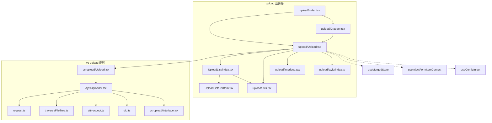
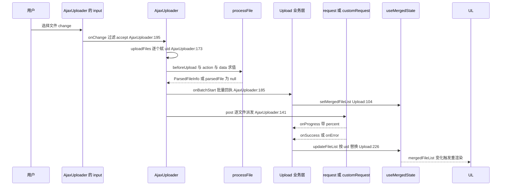
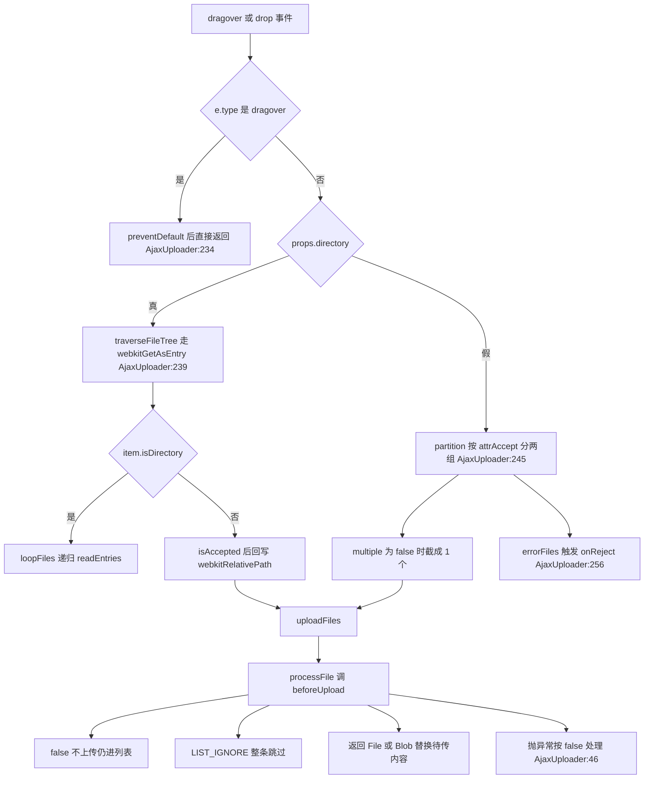
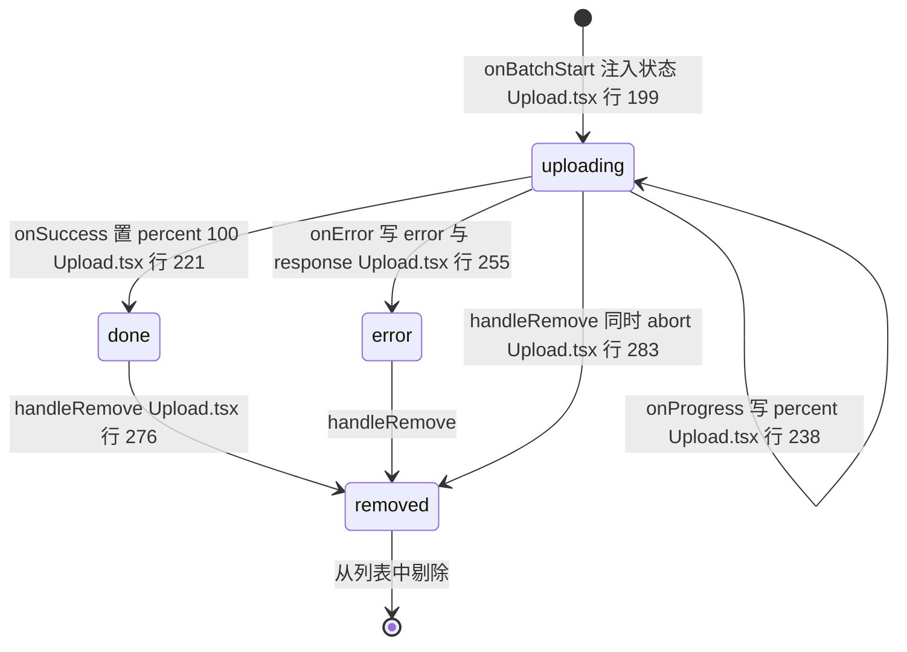

# C06-03 Upload 上传

> **本篇解决**：Upload 的一次「选择文件 → 发出请求 → 回流到列表」到底在 `upload/` 与 `vc-upload/` 两层之间怎样流动，哪些状态归调用方管、哪些归组件管。
> **前置**：A07 交互基础设施总览：一个浮层是怎么拼起来的　**读者坐标**：`03-components/06-form-editor` 第 4/9 篇

## 一、职责与边界

Upload 在一次交互里只做三件事：把用户的选择或拖入动作变成一组 `File` 对象（`packages/xiaoye-ui/src/vc-upload/AjaxUploader.tsx:173`）、把每个文件变成一个可中断的 HTTP 请求（`packages/xiaoye-ui/src/vc-upload/request.ts:25`）、把每个请求的回执折回一份可渲染的文件列表（`packages/xiaoye-ui/src/upload/Upload.tsx:192`）。这三件事被硬切在两个目录里。

`vc-upload/`（vendor = 底层实现层）只认「单个文件」这一粒度。它的 props 表 `packages/xiaoye-ui/src/vc-upload/interface.tsx:7-50` 里没有 `fileList` 这个 prop——该目录中出现的所有 `fileList` 字样都是局部变量或形参名（`AjaxUploader.tsx:39`、`AjaxUploader.tsx:182`、`traverseFileTree.ts:15`），与「组件受控数据」无关。它对外只暴露四个回执通道 `onStart` / `onProgress` / `onSuccess` / `onError`（`vc-upload/interface.tsx:27-34`）加一个批次钩子 `onBatchStart`（`vc-upload/interface.tsx:23-25`）和一个拒绝钩子 `onReject`（`vc-upload/interface.tsx:26`）。

`upload/`（业务层）则完全不出现 `XMLHttpRequest` 或 `fetch`——`grep -rn "XMLHttpRequest\|fetch(" packages/xiaoye-ui/src/upload | grep -v test` 命中 0 条。它把上面四个回执接成一台文件状态机，再负责列表渲染、多语言、主题注入和与 Form 的联动。

明确**不负责**的部分同样重要，因为这些是读者最容易误以为「组件应该做」的：

- 不解析文件内容。唯一的「解析」是把图片缩放成 200px 的 dataURL 缩略图（`packages/xiaoye-ui/src/upload/utils.tsx:76-124`），其余类型一律不读。
- 不解释服务端响应。`onSuccess` 只对字符串做一次 `JSON.parse` 尝试，失败即原样保留（`packages/xiaoye-ui/src/upload/Upload.tsx:192-199`），没有 `code` / `data` 之类的约定。
- 不做并发调度。一批文件进来就 `Promise.all` 后逐个 `post`（`AjaxUploader.tsx:182-192`），没有并发上限、没有队列、没有重试、没有断点续传与分片。
- 不做删除后的服务端同步。`handleRemove` 只改本地列表并 `abort`（`upload/Upload.tsx:248-275`）。

本篇不展开的共性机制：受控/非受控的统一实现见 I13 响应式内核 hooks；样式注水与 `hashId` 见 A04 cssinjs 样式引擎与 SSR 注水；Token 派生见 A03 Design Token 四层体系；`ConfigProvider` 纵向注入路径见 A05 ConfigProvider 注入链与 Size/Disabled Context；浮层与焦点基础设施见 A07 交互基础设施总览：一个浮层是怎么拼起来的（Upload 只在错误态用了一次 `Tooltip`，见 `upload/UploadList/ListItem.tsx:279`）。本类横写篇 C06-00 类横写：Form 的字段注册、校验与上下文下发 与 C06-01《Form 表单》均已落盘（2026-09-29 更正），本篇只写 Upload 侧实际发生的耦合点，不代为论证 Form 的字段注册。

## 二、源码地图

`upload/` 与 `vc-upload/` 合计 33 个文件、约 3400 行。行数取自 `find packages/xiaoye-ui/src/upload packages/xiaoye-ui/src/vc-upload -type f | xargs wc -l | sort -n`。

| 文件 | 行 | 职责 | 关键导出 |
| --- | --- | --- | --- |
| `vc-upload/index.ts` | 7 | 底层入口，首行标注版本血统 | `default Upload` |
| `vc-upload/Upload.tsx` | 42 | 默认值层，转发到 AjaxUploader 并 expose `abort` | `default` |
| `vc-upload/AjaxUploader.tsx` | 319 | 主实现入口：选择、拖拽、批处理、请求派发、`input` 渲染 | `default` |
| `vc-upload/request.ts` | 107 | 默认 XHR 实现 | `default upload` |
| `vc-upload/interface.tsx` | 83 | props 定义与请求契约类型 | `uploadProps`、`RcFile` |
| `vc-upload/traverseFileTree.ts` | 74 | 目录树递归（`webkitGetAsEntry`） | `default` |
| `vc-upload/attr-accept.ts` | 53 | `accept` 字符串匹配 | `default` |
| `vc-upload/uid.ts` | 7 | 进程内自增 id | `default uid` |
| `upload/index.tsx` | 19 | 聚合入口与 `install` | `Upload`、`UploadDragger`、`LIST_IGNORE` |
| `upload/Upload.tsx` | 465 | 业务主实现：状态机、`rcUploadProps` 装配、三种布局渲染 | `default`、`LIST_IGNORE` |
| `upload/Dragger.tsx` | 23 | 只做 `type: 'drag'` 的转写封装 | `default` |
| `upload/interface.tsx` | 193 | 业务 props 与 `UploadFile` 类型 | `uploadProps`、`uploadListProps` |
| `upload/utils.tsx` | 124 | `file2Obj` / `updateFileList` / `removeFileItem` / 缩略图 | 四个具名函数 |
| `upload/UploadList/index.tsx` | 279 | 列表容器、缩略图异步注入、动画配置 | `default` |
| `upload/UploadList/ListItem.tsx` | 304 | 单条目渲染与三种 `listType` 分支 | `default`、`listItemProps` |
| `upload/style/index.ts` | 66 | Component Token 装配与七个样式生成器汇总 | `default` |
| `upload/upload.test.js` | 310 | 主组件用例，含 5 个 `it.skip` | — |
| `upload/uploadlist.test.js` | 417 | 列表用例 | — |

主实现入口是 `packages/xiaoye-ui/src/upload/Upload.tsx:25`（`defineComponent`）与 `packages/xiaoye-ui/src/vc-upload/AjaxUploader.tsx:23`。底层目录的入口注释 `vc-upload/index.ts:1` 写明了这一层的血统标记，属于上游实现版本号，不代表本库现状。业务层的样式装配在 `upload/style/index.ts:46`，用 `genComponentStyleHook('Upload', ...)` 合并出三个组件专属 Token：`uploadThumbnailSize`、`uploadProgressOffset`、`uploadPicCardSize`（`upload/style/index.ts:50-54`）。

## 三、架构与数据流

### 3.1 静态结构：两层的连线



连线里唯一值得解释的是 `UP --> VU` 这一条：业务层传给底层的不是散落的 prop，而是**一个就地组装的对象字面量** `rcUploadProps`（`upload/Upload.tsx:345-357`），里面把四个回执、`beforeUpload` 的包装版、`prefixCls`、`disabled` 全部塞进去，然后靠 `...props`（`upload/Upload.tsx:351`）把业务层声明的同名 props 整体下发。这决定了「业务层加一个 prop 就自动透到底层」这条隐式契约，也决定了 `onChange` 必须在组装时显式置空（`upload/Upload.tsx:362`）——否则业务层的 `onChange` 会被当成底层回调。

### 3.2 一次上传的完整闭环



注意这里有两个**独立的入口事件都汇聚到 `uploadFiles`**：`input` 的 `change`（`AjaxUploader.tsx:195`）与拖放（`AjaxUploader.tsx:229`）。二者的过滤逻辑不同，这是本篇论点 5 的内容。另外 `onBatchStart` 先于任何请求发出（`AjaxUploader.tsx:185` 在 `post` 之前），所以列表里一定先出现 `uploading` 项，再由 `onProgress` 推进——这个顺序是列表不会「凭空出现」的保证。

### 3.3 拖放的分支与 beforeUpload 的四种返回



这张图里最值得停留的是「directory 为真」那条支线：它**没有 `onReject` 分支**，也不看 `multiple`。递归遍历时只有 `isAccepted(file)` 为真才 `callback([file])`（`traverseFileTree.ts:43-59`），被拒的文件静默消失。这是设计上的不对称，见论点 5 与坑 4。

### 3.4 单个文件的状态机



（图内行号为规避 mermaid 的冒号解析陷阱写作「文件名 行 N」，逐条精确 `file:line` 见论点 3 与 §七 坑 8。）

`removed` 是唯一**不会离开组件的中间态**：`onInternalChange` 用它调 emit（`upload/Upload.tsx:262-271`），而 `removeFileItem` 已经把该 uid 从 `removedFileList` 里过滤掉了（`upload/utils.tsx:34-41`），所以调用方在 `change` 的 `file` 上看到 `removed`、在 `fileList` 上却找不到它。这个分裂是 `UploadChangeParam` 的结构本身（`upload/interface.tsx:58-62`：`file` 与 `fileList` 是两个字段）。

## 四、核心机制精读

### 论点 1：一个文件的「传什么、传到哪、附带什么」全部在 `processFile` 里串行 `await` 定死，请求发出后没有任何二次求值机会

**断言**：`action` 与 `data` 支持函数形态不是「两个独立的小特性」，而是同一个异步流水线上的两个 `await` 点；这条流水线一旦返回，`ParsedFileInfo` 就是一个不可变快照，`post` 只消费它、不再回读 props。

`packages/xiaoye-ui/src/vc-upload/AjaxUploader.tsx:39`：

```tsx
// packages/xiaoye-ui/src/vc-upload/AjaxUploader.tsx:39
    const processFile = async (file: RcFile, fileList: RcFile[]): Promise<ParsedFileInfo> => {
      const { beforeUpload } = props;

      let transformedFile: BeforeUploadFileType | void = file;
      if (beforeUpload) {
        try {
          transformedFile = await beforeUpload(file, fileList);
        } catch (e) {
          // Rejection will also trade as false
          transformedFile = false;
        }
        if (transformedFile === false) {
          return {
            origin: file,
            parsedFile: null,
            action: null,
            data: null,
          };
        }
      }

      // Get latest action
      const { action } = props;
      let mergedAction: string;
      if (typeof action === 'function') {
        mergedAction = await action(file);
      } else {
        mergedAction = action;
      }

      // Get latest data
      const { data } = props;
      let mergedData: Record<string, unknown>;
      if (typeof data === 'function') {
        mergedData = await data(file);
      } else {
        mergedData = data;
      }
```

逐段看：

第一道闸门是 `beforeUpload`，它的 `catch` 把 **Promise reject 也折叠成 `false`**（`AjaxUploader.tsx:46-49`），注释直写「Rejection will also trade as false」。这意味着业务层 `mergedBeforeUpload` 抛出的异常（`upload/Upload.tsx:110` 的 `await beforeUpload(...)` 不包 try）在这里被兜住，调用方拿不到 rejection 原因——想用 `beforeUpload` 抛错来区分「校验失败」和「用户取消」是做不到的，两种都落进同一个 `false` 分支。

第二道是 `false` 的返回形状：`parsedFile: null`（`AjaxUploader.tsx:53`）。这个 `null` 是跨层暗号，业务层靠它区分「这个文件没被送出去」，见 `upload/Upload.tsx:163` 的 `if (!filteredFileInfoList[index].parsedFile)`。

第三、四道是 `action` 与 `data` 的求值，两者结构完全对称：`typeof === 'function'` 就 `await`。注意 `await` 的**顺序性**——三个 `await` 串在一条流水线上，所以 `beforeUpload` 慢会连带推迟 `action` 函数的调用时刻。这不是缺陷，它恰好保证了「`action` 函数看到的是 `beforeUpload` 之后的世界」；但也意味着 `action(file)` 里的 `file` 是**原始 `RcFile`**而不是转换后的 `parsedFile`（`AjaxUploader.tsx:53` 传的是 `file`，而 `parsedFile` 直到 `AjaxUploader.tsx:86-94` 才产出）。想按转换后内容决定上传地址，在这个签名下拿不到。

第五道是内容归一化，`AjaxUploader.tsx:78-94`：

```tsx
// packages/xiaoye-ui/src/vc-upload/AjaxUploader.tsx:78
      const parsedData =
        // string type is from legacy `transformFile`.
        // Not sure if this will work since no related test case works with it
        (typeof transformedFile === 'object' || typeof transformedFile === 'string') &&
        transformedFile
          ? transformedFile
          : file;

      let parsedFile: File;
      if (parsedData instanceof File) {
        parsedFile = parsedData;
      } else {
        parsedFile = new File([parsedData], file.name, { type: file.type });
      }

      const mergedParsedFile: RcFile = parsedFile as RcFile;
      mergedParsedFile.uid = file.uid;
```

这里源码自带的注释已经把风险写在明面上：`string` 分支来自 legacy 的 `transformFile`，而「不确定是否还能用，因为没有相关测试用例跑通过它」（`AjaxUploader.tsx:79-81`）。这不是我的推断，是原注释。配合 `upload/upload.test.js` 里 5 个 `it.skip`（第 32、65、104、135、177 行，全部围绕 `beforeUpload`）看，这一段的字符串与 Blob 分支确实处于**无测试状态**。`uid` 的回写（`AjaxUploader.tsx:93`）是关键一步：转换会产生新 `File` 对象，若不把旧 `uid` 搬过来，业务层的 `updateFileList` 就认不出这是同一个文件。

结论回扣：因为求值全部前置，`post` 的实现就极薄——它只做「组装选项 + 派发 + 记账」，`AjaxUploader.tsx:104-142` 里没有任何 `await`、没有任何对 `props.action` 的直接读取。要改「上传到哪里」的决策时机，只能改 `processFile`。

### 论点 2：传输实现的可替换点只有 `customRequest || defaultRequest` 这一行，代价是 abort 语义变成调用方的口头承诺

**断言**：默认 XHR 与自定义请求在组件内是**同一个函数签名**的两个实例，组件对它们的唯一结构性要求是「返回一个带 `abort` 的对象」；这个要求没有类型强制，违反它不会报错，只会让「删除上传中的文件」静默地不生效。

`packages/xiaoye-ui/src/vc-upload/AjaxUploader.tsx:104`：

```tsx
// packages/xiaoye-ui/src/vc-upload/AjaxUploader.tsx:104
    const post = ({ data, origin, action, parsedFile }: ParsedFileInfo) => {
      if (!isMounted) {
        return;
      }

      const { onStart, customRequest, name, headers, withCredentials, method } = props;

      const { uid } = origin;
      const request = customRequest || defaultRequest;

      const requestOption = {
        action,
        filename: name,
        data,
        file: parsedFile,
        headers,
        withCredentials,
        method: method || 'post',
        onProgress: (e: UploadProgressEvent) => {
          const { onProgress } = props;
          onProgress?.(e, parsedFile);
        },
        onSuccess: (ret: any, xhr: XMLHttpRequest) => {
          const { onSuccess } = props;
          onSuccess?.(ret, parsedFile, xhr);

          delete reqs[uid];
        },
        onError: (err: UploadRequestError, ret: any) => {
          const { onError } = props;
          onError?.(err, ret, parsedFile);

          delete reqs[uid];
        },
      };

      onStart(origin);
      reqs[uid] = request(requestOption);
    };
```

三个细节必须点出来。

第一，`if (!isMounted) return`（`AjaxUploader.tsx:105-107`）配合 `onMounted` 里置真（`AjaxUploader.tsx:165-167`）。因为 `processFile` 是异步的，`beforeUpload` 返回慢于挂载完成时，`post` 会被这道闸门**静默丢弃**——文件进了 `onBatchStart` 的批次计算，却永远不会发出请求，也不会有 `onError`。这是异步流水线与组件生命周期之间的一次裸露竞争。

第二，`reqs` 是**普通对象而非 ref**（`AjaxUploader.tsx:30`：`const reqs: any = {};`），键是 `origin.uid`。它不参与响应式，纯粹是一张「在飞请求」的登记表，`onSuccess` 与 `onError` 各自 `delete reqs[uid]`（`AjaxUploader.tsx:130`、`:136`）。而 `abort` 的读法在 `AjaxUploader.tsx:148-163`：

```tsx
// packages/xiaoye-ui/src/vc-upload/AjaxUploader.tsx:148
    const abort = (file?: any) => {
      if (file) {
        const uid = file.uid ? file.uid : file;
        if (reqs[uid] && reqs[uid].abort) {
          reqs[uid].abort();
        }
        delete reqs[uid];
      } else {
        Object.keys(reqs).forEach(uid => {
          if (reqs[uid] && reqs[uid].abort) {
            reqs[uid].abort();
          }
          delete reqs[uid];
        });
      }
    };
```

`reqs[uid] && reqs[uid].abort` 这个双重守卫就是全部的类型安全保障：没有 `abort` 就不调用，然后照样 `delete`。也就是说自定义请求若不实现 `abort`，「取消」在 UI 上看起来是成功的（列表项被移除、`reqs` 被清理），而请求还在跑，之后它的 `onSuccess` 会打到 `upload/Upload.tsx:202` 的 `getFileItem` 守卫上——文件已不在列表，回调直接 `return`，于是表现为「上传完成后列表里也没有它」。`UploadRequestOption` 类型（`vc-upload/interface.tsx:68-79`）对返回值**一个字节都没声明**，`customRequest: Function as PropType<(option: UploadRequestOption) => void>`（`vc-upload/interface.tsx:41`）的返回是 `void`，所以写 `return { abort }` 与什么都不返回，在类型上等价。

这一点在本仓库里就有活证据：测试桩 `upload/requests.js:1-11` 的 `successRequest` 与 `errorRequest` 都只 `setTimeout` 后回调，**没有返回值**。它们能跑通是因为只测成功/失败路径，不测中断路径。

第三，默认实现的契约细节集中在 `request.ts`。上传进度挂的是 `xhr.upload.onprogress` 并把比例换算成 `percent`（`vc-upload/request.ts:29-36`）：

```ts
// packages/xiaoye-ui/src/vc-upload/request.ts:29
  if (option.onProgress && xhr.upload) {
    xhr.upload.onprogress = function progress(e: UploadProgressEvent) {
      if (e.total > 0) {
        e.percent = (e.loaded / e.total) * 100;
      }
      option.onProgress(e);
    };
  }
```

`e.percent` 是**在原生 `ProgressEvent` 对象上追加字段**（类型侧的对应声明是 `UploadProgressEvent extends Partial<ProgressEvent>` 加一个 `percent?`，`vc-upload/interface.tsx:54-56`），所以业务层 `onProgress(e, file)` 拿到的 `e` 同时是原生事件和百分比载体，`upload/Upload.tsx:232-236` 把它原样塞进 `changeInfo.event`。

成功判定是**纯状态码区间**，不看响应体（`vc-upload/request.ts:69-77`）：

```ts
// packages/xiaoye-ui/src/vc-upload/request.ts:69
  xhr.onload = function onload() {
    // allow success when 2xx status
    // see https://github.com/react-component/upload/issues/34
    if (xhr.status < 200 || xhr.status >= 300) {
      return option.onError(getError(option, xhr), getBody(xhr));
    }

    return option.onSuccess(getBody(xhr), xhr);
  };
```

`getBody`（`vc-upload/request.ts:12-23`）先试 `JSON.parse`、失败就返回原始文本。注意 `xhr.status` 为 0 时（网络层直接失败、或 `file://`）也落进 `onError` 分支并带上 `getBody` 的空值；而 `xhr.onerror` 是另一条独立通道（`vc-upload/request.ts:65-67`），它调用 `option.onError(e)` **不带第二个参数**，所以业务层 `onError(error, response, file)` 的 `response` 在真实网络错误下是 `undefined`（`upload/Upload.tsx:232-240` 会把它写成 `targetItem.response`）。

`multipart` 这个 prop 在 `vc-upload/Upload.tsx:19` 有默认值 `false`，但 `request.ts` 全文没有读它——`grep -n "multipart" packages/xiaoye-ui/src/vc-upload/request.ts` 命中 0 条；实际发送一律走 `FormData`（`vc-upload/request.ts:39`、`:59-63`）。也就是说 `multipart: false` 并不能把请求切成 `urlencoded`，这是一个**声明存在、实现缺席**的 prop。`data` 的数组值会被摊成 `key[]` 多个字段（`vc-upload/request.ts:45-52`），这一条是有注释说明的既有行为。

### 论点 3：状态机的全部演化被收敛成一个算子 `updateFileList`，它按 `uid` 做「存在即替换、否则追加」，而 `uid` 的唯一来源是 `uploadFiles` 里的一次赋值

**断言**：`onBatchStart` / `onSuccess` / `onProgress` / `onError` 四个回执没有各自的列表拼接逻辑，它们一律先 `file2Obj` 再 `updateFileList`（`upload/utils.tsx:18-27`）。这让「同一文件的多轮回执」天然幂等替换，但也让 **`uid` 成为单点**——一旦两个来源给出的 `uid` 不同，同一个文件就会在列表里出现两份。

`packages/xiaoye-ui/src/upload/utils.tsx:3`：

```tsx
// packages/xiaoye-ui/src/upload/utils.tsx:3
export function file2Obj(file: FileType): InternalUploadFile {
  return {
    ...file,
    lastModified: file.lastModified,
    lastModifiedDate: file.lastModifiedDate,
    name: file.name,
    size: file.size,
    type: file.type,
    uid: file.uid,
    percent: 0,
    originFileObj: file,
  };
}

/** Upload fileList. Replace file if exist or just push into it. */
export function updateFileList(file: UploadFile<any>, fileList: UploadFile<any>[]) {
  const nextFileList = [...fileList];
  const fileIndex = nextFileList.findIndex(({ uid }: UploadFile) => uid === file.uid);
  if (fileIndex === -1) {
    nextFileList.push(file);
  } else {
    nextFileList[fileIndex] = file;
  }
  return nextFileList;
}
```

`file2Obj` 的 `...file` 展开（`utils.tsx:5`）值得注意：它把 `File` 实例的自有属性摊平成普通对象字段，随后又逐个显式重写（`utils:6-13`）。显式重写是必要的，因为 `name`/`size`/`type` 在 `File` 上是**原型上的 getter**，展开拿不到；而 `originFileObj: file`（`utils.tsx:13`）保留了对原始 `File` 的引用，缩略图生成只能靠它（`UploadList/index.tsx:99` 判断的正是 `file.originFileObj instanceof File`）。`percent: 0` 是无条件写入的（`utils.tsx:12`），这带来一个后果：`onSuccess` 与 `onError` 里 `file2Obj(file)` 出来的新对象先把 `percent` 归零，再各自覆写（`upload/Upload.tsx:208` 写 100；`onError` 分支 `upload/Upload.tsx:232-246` 全程没写 `percent`）——**失败项的 `percent` 恒为 0**，而不是「失败时停在的百分比」。这与 `ListItem` 的进度条显示条件（`ListItem.tsx:251-266`，`v-show` 只看 `mergedStatus === 'uploading'`）恰好互补，所以 UI 上不显形，但调用方读 `file.percent` 会读到误导值。

回执三兄弟的写法几乎是复制粘贴，只差状态字段：

```tsx
// packages/xiaoye-ui/src/upload/Upload.tsx:192
    const onSuccess = (response: any, file: FileType, xhr: any) => {
      try {
        if (typeof response === 'string') {
          response = JSON.parse(response);
        }
      } catch (e) {
        /* do nothing */
      }

      // removed
      if (!getFileItem(file, mergedFileList.value)) {
        return;
      }

      const targetItem = file2Obj(file);
      targetItem.status = 'done';
      targetItem.percent = 100;
      targetItem.response = response;
      targetItem.xhr = xhr;

      const nextFileList = updateFileList(targetItem, mergedFileList.value);

      onInternalChange(targetItem, nextFileList);
    };
```

每个回执开头的 `if (!getFileItem(file, mergedFileList.value)) return`（`upload/Upload.tsx:202`、`:233`、`:248`）是**乱序回执的护栏**：`getFileItem` 用 `matchKey` 匹配（`upload/utils.tsx:29-32`），`uid !== undefined` 时按 `uid`，否则退化成按 `name`。退化到 `name` 是有代价的——同名多文件会互相命中，这条护栏就形同虚设。而这里传入的 `file` 是底层回调携带的 `parsedFile`（`AjaxUploader.tsx:124`、`:128`、`:134` 三处一致），不是原始 `origin`；由于 `processFile` 把 `origin.uid` 搬到了 `parsedFile` 上（`AjaxUploader.tsx:93`），匹配才能成立。**这行 uid 搬运一旦丢失，整台状态机就退化成「每次回执都 push 一条新记录」**，这是两层之间最脆弱的一处耦合。

`onBatchStart` 是唯一**不经过 `updateFileList` 追加语义**的回执，因为它要处理「一批」：

```tsx
// packages/xiaoye-ui/src/upload/Upload.tsx:149
      const objectFileList = filteredFileInfoList.map(info => file2Obj(info.file as FileType));

      // Concat new files with prev files
      let newFileList = [...mergedFileList.value];

      objectFileList.forEach(fileObj => {
        // Replace file if exist
        newFileList = updateFileList(fileObj, newFileList);
      });

      objectFileList.forEach((fileObj, index) => {
        // Repeat trigger `onChange` event for compatible
        let triggerFileObj: UploadFile = fileObj;

        if (!filteredFileInfoList[index].parsedFile) {
          // `beforeUpload` return false
          const { originFileObj } = fileObj;
          let clone;

          try {
            clone = new File([originFileObj], originFileObj.name, {
              type: originFileObj.type,
            }) as any as UploadFile;
          } catch (e) {
            clone = new Blob([originFileObj], {
              type: originFileObj.type,
            }) as any as UploadFile;
            clone.name = originFileObj.name;
            clone.lastModifiedDate = new Date();
            clone.lastModified = new Date().getTime();
          }

          clone.uid = fileObj.uid;
          triggerFileObj = clone;
        } else {
          // Inject `uploading` status
          fileObj.status = 'uploading';
        }

        onInternalChange(triggerFileObj, newFileList);
      });
```

这里有一个容易读漏的**两段循环结构**（`upload/Upload.tsx:161-164` 与 `:173-203`）：第一个 `forEach` 先把整批文件全部 `updateFileList` 进同一份 `newFileList`，第二个 `forEach` 才逐个 `onInternalChange`。也就是说**第一个 `change` 事件携带的 `fileList` 已经包含整批文件**，而 `change.file` 只是其中一个。多次选文件的 `change` 次数等于文件数，但每次的列表都是完整的批次结果——注释「Repeat trigger `onChange` event for compatible」（`upload/Upload.tsx:167`）说明了这是兼容性行为而非设计意图。

第二个分支解释了「`beforeUpload` 返回 `false` 的文件为什么仍出现在列表里但状态不是 `uploading`」：`triggerFileObj` 被换成一个临时 clone（`upload/Upload.tsx:176-188`），而 `fileObj` 本身留在 `newFileList` 里且 `status` 未被赋值。clone 存在的目的是让 `change.file` 与列表项**不是同一个对象引用**，避免调用方修改 `change.file` 时串改列表。`catch` 分支退化到 `Blob`（`upload/Upload.tsx:173-178`）是因为 jsdom 等环境不实现 `File` 构造器——这不是猜测，`upload/upload.test.js` 正是在 jsdom 下跑（`packages/xiaoye-ui/vitest.config.mts:31` 的 `environment: 'jsdom'`）。

### 论点 4：`fileList` 的受控是「双向写」：组件既 `emit('update:fileList')` 又直接改传入对象的 `uid`，`postState` 的副作用让受控与非受控行为不完全一致

**断言**：受控路径上组件仍然会**原地写入调用方传进来的 file 对象**补 `uid`，靠 `Object.isFrozen` 做最后一道保护；因此「传入 `Object.freeze` 的文件对象」会让自动 `uid` 静默失败，而组件不会报错。

`packages/xiaoye-ui/src/upload/Upload.tsx:42`：

```tsx
// packages/xiaoye-ui/src/upload/Upload.tsx:42
    const [mergedFileList, setMergedFileList] = useMergedState(props.defaultFileList || [], {
      value: toRef(props, 'fileList'),
      postState: list => {
        const timestamp = Date.now();
        return (list ?? []).map((file, index) => {
          if (!file.uid && !Object.isFrozen(file)) {
            file.uid = `__AUTO__${timestamp}_${index}__`;
          }
          return file;
        });
      },
    });
```

`useMergedState` 侧为什么用 `watchEffect` 而不是 `computed`，I13 响应式内核 hooks 在「设计取舍」里已经给过结论（`§六`），本篇不重复论证；这里只说 Upload 从这条副作用里**实际承担了什么**。

`postState` 在 `packages/xiaoye-ui/src/_util/hooks/useMergedState.ts:27-29` 被无条件调用，且 `watchEffect`（`useMergedState.ts:25`）在依赖变化时恰好执行一次。于是 `upload/Upload.tsx:46-51` 的 `map` 是一次**对调用方数组元素的原地赋值**：`file.uid = ...` 写在传入对象上，`map` 只返回了新数组、没有返回新元素。这带来两个后果：

第一，受控与非受控不等价。非受控时列表由 `file2Obj` 产出，`uid` 来自 `vc-upload/uid.ts:4-7` 的 `vc-upload-${now}-${++index}`；受控时调用方手写的 `fileList` 常常没有 `uid`，组件补的是 `__AUTO__${timestamp}_${index}__`（`upload/Upload.tsx:55`）。**`index` 参与命名**意味着：删掉第 0 项后，原本第 1 项若仍无 `uid`，会拿到和前面不同的自动名——但因为它已经在第一次 `postState` 时被写入过 `uid`，`!file.uid` 判空为假、不会重名。真正的风险是**同一次 `map` 里 `timestamp` 共享**，只有 `index` 区分，所以「同一批里两个都缺 `uid` 的对象」靠 `index` 保证唯一，而「两次不同的 `setMergedFileList`，两次的第一项都缺 `uid`」会因为 `timestamp` 不同而不同名——这套命名只在**单次调用内**稳定。

第二，`Object.isFrozen(file)` 是唯一的守门（`upload/Upload.tsx:47`）。冻结对象跳过赋值，于是该项 `uid` 保持 `undefined`。而 `getFileItem` 与 `removeFileItem` 在 `uid === undefined` 时**退化为按 `name` 匹配**（`upload/utils.tsx:30`、`:35`），`ListItem` 的 `key` 也取自 `file.uid`（`UploadList/index.tsx:239-241`）——`key` 为 `undefined` 会让 Vue 的列表 diff 失去稳定标识。也就是说「传入冻结对象」不会崩，但会静默降级成按文件名匹配 + 无 key 渲染。

再看受控闭环：`onInternalChange` 一次写两路。

```tsx
// packages/xiaoye-ui/src/upload/Upload.tsx:76
    const onInternalChange = (
      file: UploadFile,
      changedFileList: UploadFile[],
      event?: { percent: number },
    ) => {
      let cloneList = [...changedFileList];

      // Cut to match count
      if (props.maxCount === 1) {
        cloneList = cloneList.slice(-1);
      } else if (props.maxCount) {
        cloneList = cloneList.slice(0, props.maxCount);
      }

      setMergedFileList(cloneList);

      const changeInfo: UploadChangeParam<UploadFile> = {
        file: file as UploadFile,
        fileList: cloneList,
      };

      if (event) {
        changeInfo.event = event;
      }
      emit('update:fileList', changeInfo.fileList);
      emit('change', changeInfo);
      formItemContext.onFieldChange();
    };
```

`maxCount` 的截断在这里做（`upload/Upload.tsx:83-88`），**而不是在底层拦截**——底层 `uploadFiles` 不看 `maxCount`（`AjaxUploader.tsx:173-193` 无该判断），所以超过上限的文件**照样发出了请求**，只是结果被裁掉。`maxCount === 1` 用 `slice(-1)`（保留最后一个，实现「替换」语义），其余用 `slice(0, maxCount)`（保留前 N 个）。这两个分支方向相反，是刻意的。

`setMergedFileList(cloneList)`（`upload/Upload.tsx:90`）在非受控时写 `innerValue`，在受控时**并不直接改 `props.fileList`**：`useMergedState.ts:33-39` 的 `triggerChange` 只写 `innerValue` 和调 `onChange`，而 Upload 没传 `onChange` 选项（`upload/Upload.tsx:42-53` 的 option 只有 `value` 与 `postState`）。所以受控时组件侧的「写入」完全靠 `emit('update:fileList')`（`upload/Upload.tsx:100`）回到调用方，再由 `v-model` 写回 `fileList` prop，`useMergedState.ts:42-44` 的 `watch(value, ...)` 把它同步进 `innerValue`。**如果调用方只绑 `:fileList` 而不接 `@update:fileList`/`@change`，列表会停在旧值**——这是受控语义最常见的误用点，`emits` 声明里两个事件都在（`upload/Upload.tsx:39`）。

最后一行 `formItemContext.onFieldChange()`（`upload/Upload.tsx:102`）是 Upload 与 Form 的全部耦合面：它不校验、不取值，只上报「字段动过」。上下文由 `useInjectFormItemContext`（`upload/Upload.tsx:41`）注入，另有一处 `id` 回退 `props.id ?? formItemContext.id.value`（`upload/Upload.tsx:352`）。Form 侧的注册与校验不在本篇边界内，见 C06-01 Form 表单。

### 论点 5：拖拽由两层各自独立的 handler 分担，业务层只管视觉态、底层只管受理，`dragleave` 只有业务层听得到

**断言**：`onFileDrop` 在两个目录里**同名且互不调用**。底层版（`vc-upload/AjaxUploader.tsx:229`）负责受理文件，业务层版（`upload/Upload.tsx:284`）负责 `drag-hover` 类名与 `drop` 事件派发；两者挂在**不同的 DOM 节点**上，靠事件冒泡串起来。

底层挂在包裹 `<input>` 的那个 `Tag` 上（`packages/xiaoye-ui/src/vc-upload/AjaxUploader.tsx:286`）：

```tsx
// packages/xiaoye-ui/src/vc-upload/AjaxUploader.tsx:286
      const events = disabled
        ? {}
        : {
            onClick: openFileDialogOnClick ? onClick : () => {},
            onKeydown: openFileDialogOnClick ? onKeyDown : () => {},
            onMouseenter,
            onMouseleave,
            onDrop: onFileDrop,
            onDragover: onFileDrop,
            tabindex: '0',
          };
```

业务层挂在外面那一圈 `<div>` 上（`packages/xiaoye-ui/src/upload/Upload.tsx:397`）：

```tsx
// packages/xiaoye-ui/src/upload/Upload.tsx:397
            <div
              class={dragCls}
              onDrop={onFileDrop}
              onDragover={onFileDrop}
              onDragleave={onFileDrop}
              style={attrs.style as CSSProperties}
            >
```

四个后果依次是：

第一，**`disabled` 直接摘掉底层的整个事件包**（`AjaxUploader.tsx:286-288` 的三元），此时连 `dragover` 都不再 `preventDefault`。浏览器的默认行为是「不允许 drop」，所以拖拽物落上去会走浏览器的原生打开逻辑而不是被组件吞掉。而业务层的外圈 `<div>` **不看 `disabled`**，`upload/Upload.tsx:399-401` 的三个 handler 是无条件挂上的。于是禁用态下拖文件进 Dragger，`dragState` 仍会变成 `dragover`/`drop`，`-drag-hover` 类名照样高亮，只是文件不会被受理。

第二，`dragleave` 只有业务层监听。底层没有 `onDragleave`（`AjaxUploader.tsx:293-294` 只有 `onDrop` 与 `onDragover`）。业务层的 `onFileDrop` 只写 `dragState.value = e.type`（`upload/Upload.tsx:278`），`drop` 时才 emit（`upload/Upload.tsx:281`）：

```tsx
// 以下为修前快照（2026-09-29 已改）：同一个 drop 被投了两次
    const onFileDrop = (e: DragEvent) => {
      dragState.value = e.type;
      if (e.type === 'drop') {
        emit('drop', e);
        callEvent(props.onDrop, e);   // ← 修前多这一行
      }
    };
```

修后只留一个出口（`packages/xiaoye-ui/src/upload/Upload.tsx:284`-`:289`，`:287` 是留下的说明注释）：

```tsx
// packages/xiaoye-ui/src/upload/Upload.tsx:281
        emit('drop', e);
```

`-drag-hover` 的条件是 `dragState.value === 'dragover'`（`upload/Upload.tsx:377`），所以高亮消失**依赖 `dragleave` 到达外圈 div**。由于内层 `Tag` 与 `input` 都在这个 div 内部，指针在内层元素间移动时浏览器会连续派发 `dragleave`/`dragover`，视觉上会出现闪烁——这是「两层分别监听不同拖拽事件」这一分层的直接代价。

第三，底层的 `dragover` 与 `drop` 共用一个函数，靠前 6 行早退：`e.preventDefault()` 无条件执行（`AjaxUploader.tsx:232`），随后 `if (e.type === 'dragover') return`（`AjaxUploader.tsx:234-236`）。`preventDefault` 是 drop 能被接收的**前提**，因此必须先做再判断，这个顺序不能换。

第四，`drop` 事件**曾经有两条并行通道**（`emits` 里声明了 `drop`，`upload/Upload.tsx:39`，而 `onDrop` 同时是 prop，`upload/interface.tsx:126`），2026-09-29 已合并成 `emit` 一条。要点是「`emit('drop')` 与 `callEvent(props.onDrop)` 指向同一个函数」：Vue 的 `emit` 本来就从 `instance.vnode.props` 取 `onDrop`，所以修前一次拖放把外部 `@drop` 打 **2** 次（实测，见 `packages/xiaoye-ui/src/_util/__tests__/event-dispatch-count.test.tsx` 的「Upload 拖放一次，@drop 只投递一次」，判据 `toHaveBeenCalledTimes(1)`，退回基线即红），修后 1 次。被删掉的那份 `callEvent` 原本的用途是让 prop 可以传数组（多个监听者）——这个能力没有丢，Vue 自己在 `emit` 时就把数组形状逐个调用。**还有一处容易误判成同族、其实不是**：`upload/UploadList/index.tsx:127`、`:132`、`:140` 三处 `callEvent(props.onPreview/onDownload/onRemove)` 必须保留——`UploadList` 没有 `emits` 声明，props 是这些回调的唯一出口，实测点一次文件名 `@preview` 只 1 次；而公开层 `Upload` 的 `emits` 里虽然写了 `preview`/`download`（`upload/Upload.tsx:39`），全文件却从不 `emit` 它们，属于「声明面与生效面两张表」那一条。

### 论点 6：目录遍历走 `webkitGetAsEntry` 的异步递归，它会**强行改写** `File.webkitRelativePath`，且这条支线既不走 `onReject` 也不看 `multiple`

**断言**：`directory` 为真时，拖入的文件夹被展开成文件列表的过程完全绕开了非目录支线的两套过滤——没有 `partition`，因此没有 rejected 集合，`onReject` 永不触发；也没有 `multiple === false` 的截断。同时为了让「拖入」与「`<input webkitdirectory>` 选择」两条路产出形状一致的对象，实现**先解锁再改写再锁回** `webkitRelativePath`。

`packages/xiaoye-ui/src/vc-upload/AjaxUploader.tsx:238`：

```tsx
// packages/xiaoye-ui/src/vc-upload/AjaxUploader.tsx:238
      if (props.directory) {
        traverseFileTree(
          Array.prototype.slice.call(e.dataTransfer.items),
          uploadFiles,
          (_file: RcFile) => attrAccept(_file, props.accept),
        );
      } else {
        const files: [RcFile[], RcFile[]] = partition(
          Array.prototype.slice.call(e.dataTransfer.files),
          (file: RcFile) => attrAccept(file, props.accept),
        );
        let successFiles = files[0];
        const errorFiles = files[1];
        if (multiple === false) {
          successFiles = successFiles.slice(0, 1);
        }

        uploadFiles(successFiles);
        if (errorFiles.length && props.onReject) props.onReject(errorFiles);
      }
```

`partition` 来自 `lodash-es/partition`（`AjaxUploader.tsx:15`），返回值 `[truthy[], falsy[]]`（`AjaxUploader.tsx:249-250`）。这一段的形状很干净，但它只在非目录分支存在。

递归部分 `packages/xiaoye-ui/src/vc-upload/traverseFileTree.ts:36`：

```ts
// packages/xiaoye-ui/src/vc-upload/traverseFileTree.ts:36
const traverseFileTree = (files: InternalDataTransferItem[], callback, isAccepted) => {
  const _traverseFileTree = (item: InternalDataTransferItem, path?: string) => {
    item.path = path || '';
    if (item.isFile) {
      item.file(file => {
        if (isAccepted(file)) {
          if (item.fullPath && !file.webkitRelativePath) {
            Object.defineProperties(file, {
              webkitRelativePath: {
                writable: true,
              },
            });
            (file as any).webkitRelativePath = item.fullPath.replace(/^\//, '');
            Object.defineProperties(file, {
              webkitRelativePath: {
                writable: false,
              },
            });
          }
          callback([file]);
        }
      });
    } else if (item.isDirectory) {
      loopFiles(item, (entries: InternalDataTransferItem[]) => {
        entries.forEach(entryItem => {
          _traverseFileTree(entryItem, `${path}${item.name}/`);
        });
      });
    }
  };
  files.forEach(file => {
    _traverseFileTree(file.webkitGetAsEntry() as any);
  });
};
```

三处机制值得单独说。

**`callback` 是逐文件调用的**（`traverseFileTree.ts:58`、`:62-66`）。非目录分支 `uploadFiles(successFiles)` 一次拿到整个数组（`AjaxUploader.tsx:255`），目录分支则是「每发现一个文件就 `uploadFiles([file])` 一次」。于是 `beforeUpload(file, fileList)` 的第二个参数在目录拖入时**恒为长度 1 的数组**，任何「拿整批做批量校验」的写法在这一分支下失效。同理 `onBatchStart` 会被逐文件触发多次。

**`readEntries` 必须迭代到空**（`traverseFileTree.ts:13-34`）：

```ts
// packages/xiaoye-ui/src/vc-upload/traverseFileTree.ts:17
  function sequence() {
    dirReader.readEntries((entries: InternalDataTransferItem[]) => {
      const entryList = Array.prototype.slice.apply(entries);
      fileList = fileList.concat(entryList);

      // Check if all the file has been viewed
      const isFinished = !entryList.length;

      if (isFinished) {
        callback(fileList);
      } else {
        sequence();
      }
    });
  }
```

这是 `FileSystemDirectoryReader` 的规约（单次调用不保证返回全部条目），实现用「返回空数组即结束」来判定完成（`traverseFileTree.ts:23`）。这段递归没有任何深度或数量上限，也没有取消机制——`abort`（`AjaxUploader.tsx:148`）只能中断**已发出的请求**，中断不了正在遍历的目录树。

**`webkitRelativePath` 的解锁-改写-锁回**（`traverseFileTree.ts:44-57`）是为兼容性付出的手写代价：拖入路径下该属性为空，而 `<input webkitdirectory>` 路径下由浏览器填好；为了让两条路的 `File` 形状一致，实现把只读属性临时改成 `writable: true`、赋值、再改回 `writable: false`，中间用 `Object.defineProperties` 而不是直接赋值（因为直接赋值在严格模式下对只读访问器属性会抛错）。注意条件是 `item.fullPath && !file.webkitRelativePath`（`traverseFileTree.ts:44`），所以只在原值为空时才动，不会覆盖浏览器已填的值。

`accept` 过滤在 `isAccepted` 里（`AjaxUploader.tsx:242`），实现是 `attrAccept`（`vc-upload/attr-accept.ts:4-53`）。它的匹配次序是：`*` 或 `*/*` 直接放行（`attr-accept.ts:16-18`）→ 以 `.` 开头按扩展名小写后缀比（`attr-accept.ts:21-31`，且 `.jpg`/`.jpeg` 被绑成一组）→ `image/*` 这类按主类型比（`attr-accept.ts:34-36`）→ 全等 MIME（`attr-accept.ts:39-41`）→ **纯字母 token 视为非法并放行**（`attr-accept.ts:44-47`）。最后一条是易踩的：写 `accept="png"` 不会报错也不会过滤，只会在开发期由 `warning`（`vc-upload/attr-accept.ts:45`，走 `vc-util/warning`，见 `attr-accept.ts:1`）提示一次，然后**所有文件都通过**。而 `file` 与 `acceptedFiles` 任一为空时函数直接返回 `true`（`attr-accept.ts:52`），即「不填 accept 就是全收」。

另外，通过 `<input>` 选择这条路的过滤条件和拖拽不同：`onChange` 里是 `!directory || attrAccept(file, accept)`（`AjaxUploader.tsx:198-200`）——**`directory` 为真时选择路径不做 accept 过滤**，只有非目录选择才过滤。这与拖拽路径上「directory 分支用 `isAccepted`」正好相反，两条入口的过滤矩阵是错位的。

### 论点 7：`UploadList` 不把 `props.items` 直接渲染，而是维护一份副本 `mergedItems`，并用外部 `Set` 记账「哪些文件已生成过缩略图」

**断言**：缩略图是异步写入的，如果直接写 `props.items` 就会**污染调用方数据并反过来触发自己的 deep watcher**；本仓库的实现选择「拷贝元素 + 外部集合记账」来断开这个环，而不是加防抖或标记位到 file 对象上。

副本容器与记账集合在 `packages/xiaoye-ui/src/upload/UploadList/index.tsx:59` 一起声明，摘录从 `:62` 起：

```tsx
// packages/xiaoye-ui/src/upload/UploadList/index.tsx:62
    const previewedUids = new Set<string>();
    const previewedFiles = new WeakSet<object>();

    const isPreviewed = (file: InternalUploadFile) =>
      file.uid != null ? previewedUids.has(String(file.uid)) : previewedFiles.has(file);

    const markPreviewed = (file: InternalUploadFile) => {
      if (file.uid != null) {
        previewedUids.add(String(file.uid));
      } else {
        previewedFiles.add(file);
      }
    };

    watch(
      () => props.items,
      (val = []) => {
        mergedItems.value = val.map(file => ({ ...file }));
      },
      {
        immediate: true,
        deep: true,
      },
    );
```

（原文件在 `UploadList/index.tsx:61` 与 `:79-80` 各有一行中文注释解释这两处的动机，摘录时为控制长度省略。）

`mergedItems` 声明为 `shallowRef<any[]>([])`（`UploadList/index.tsx:59`），拷贝用 `val.map(file => ({ ...file }))` 逐项展开（`UploadList/index.tsx:81`）。配合 `watchEffect` 里的写入（`packages/xiaoye-ui/src/upload/UploadList/index.tsx:89`）：

```tsx
// packages/xiaoye-ui/src/upload/UploadList/index.tsx:89
    watchEffect(() => {
      if (props.listType !== 'picture' && props.listType !== 'picture-card') {
        return;
      }
      (props.items || []).forEach((file: InternalUploadFile) => {
        if (
          typeof document === 'undefined' ||
          typeof window === 'undefined' ||
          !(window as any).FileReader ||
          !(window as any).File ||
          !(file.originFileObj instanceof File || (file.originFileObj as Blob) instanceof Blob) ||
          file.thumbUrl !== undefined ||
          !props.previewFile ||
          isPreviewed(file)
        ) {
          return;
        }

        markPreviewed(file);

        props.previewFile(file.originFileObj as File).then((previewDataUrl: string) => {
          const thumbUrl = previewDataUrl || '';
          // 异步回调期间 mergedItems 可能已重建，按 uid 精确定位而非依赖索引
          const target = mergedItems.value.find(item => item.uid === file.uid);
          if (target && target.thumbUrl !== thumbUrl) {
            target.thumbUrl = thumbUrl;
            triggerRef(mergedItems);
          }
        });
      });
    });
```

八个短路条件（`UploadList/index.tsx:94-104`）里前四个是环境探测：`document`/`window` 不存在直接跳过，这让 `picture` 模式在服务端渲染时不会调用 `document.createElement('canvas')`（真正的 canvas 操作在 `upload/utils.tsx:84-89`）。`file.thumbUrl !== undefined`（`:100`）让「调用方自带的 `thumbUrl`」优先于自动生成——这与 `uploadlist.test.js` 的第一个用例标题「should use file.thumbUrl for `` in priority」（`upload/uploadlist.test.js:41`）对应。

`previewedUids` 与 `previewedFiles` 的双结构（`:62-63`）是为无 `uid` 的对象准备的兜底：`file.uid != null` 才用 Set，否则用 WeakSet 按引用记账（`:65-74`）。`WeakSet` 不阻止回收，因此不会因删除文件而泄漏。注意这两个集合**在整个组件实例生命周期内只增不减**（没有清理逻辑），反复挂载同一批对象不会重复生成缩略图，但一次长会话里拖入大量图片会让 `previewedUids` 一直增长。

异步回调里按 `uid` 重新 `find`（`UploadList/index.tsx:112`）而不是记住索引，正是因为上面的 `watch` 会在每次 `props.items` 变化时整体重建副本；记住索引会写错对象。写完必须 `triggerRef(mergedItems)`（`:115`），因为 `mergedItems` 是 `shallowRef`，改副本内部字段不会自动触发更新。渲染侧消费的就是副本（`UploadList/index.tsx:235` 的 `const items = mergedItems.value`，条目 `key` 取 `file.uid` 于 `:239`）。

`listType` 的三种形态只在渲染分叉，不改状态：`picture-card` 时列表容器把「上传按钮」当作最后一个子节点塞进 `TransitionGroup`（`UploadList/index.tsx:275-274` 的 `HackSlot` 与 `appendAction`，由 `upload/Upload.tsx:436` 传入 `renderUploadButton`），并用 `v-show` 而不是条件渲染来控制它，以便按钮跟着列表一起参与动画；`transitionGroupProps` 在 `picture-card` 下**刻意不合并 collapse 动画**（`UploadList/index.tsx:211-216` 的三元），因为网格布局的 `height` 过渡与卡片动画冲突。

## 五、对外契约如何生效

契约的落地点不在 props 声明处，而在渲染函数里的一次对象组装。`packages/xiaoye-ui/src/upload/Upload.tsx:342`：

```tsx
// packages/xiaoye-ui/src/upload/Upload.tsx:342
    return () => {
      const { listType, type } = props;
      const { class: className, style: styleName, ...transAttrs } = attrs;
      const rcUploadProps = {
        onBatchStart,
        onError,
        onProgress,
        onSuccess,
        ...transAttrs,
        ...(props as RcUploadProps),
        id: props.id ?? formItemContext.id.value,
        prefixCls: prefixCls.value,
        beforeUpload: mergedBeforeUpload,
        onChange: undefined,
        disabled: mergedDisabled.value,
      };
      delete (rcUploadProps as any).remove;

      // Remove id to avoid open by label when trigger is hidden
      if (!slots.default || mergedDisabled.value) {
        delete rcUploadProps.id;
      }
```

顺序就是优先级。`...transAttrs` 在 `...props` 之前展开（`upload/Upload.tsx:350-351`），所以**同名时 prop 覆盖 attr**；随后六个显式键（`:366-371`）又覆盖两者，因此 `prefixCls`、`beforeUpload`、`disabled` 是调用方**改不掉**的——写 `:before-upload` 会先进 `...props`，再被 `mergedBeforeUpload` 顶掉，业务层的 `upload/Upload.tsx:105` 正是那个包装版。这解释了为什么 `beforeUpload` 的返回值语义（`false` / `LIST_IGNORE` / 新内容）在业务层和底层是两套：调用方接触的是包装版，底层见到的是包装后的产物。

两处清理动作值得单独点名。`onChange: undefined`（`upload/Upload.tsx:362`）是必需的，因为 `upload/interface.tsx:123` 声明了 `onChange` prop，`...props` 会把它带下去，而底层 `AjaxUploader` 的 props 里没有 `onChange`（`vc-upload/interface.tsx:7-50`）——不置空它会以 attr 形式落到 `<input>` 上变成真实 DOM 事件监听器，与状态机的 `change` 语义撞车。`delete rcUploadProps.remove`（`upload/Upload.tsx:358`）同理处理 deprecated 的 `remove`（`upload/interface.tsx:133`）。`id` 的两段处理（`:366` 与 `:374-377`）是**可访问性契约**：`id` 让 `<label>` 能打开文件选择框，所以「没有默认插槽」或「禁用」时必须删掉它，否则点标签会触发一个不可见的选择器；注释原文就是这句（`:374`）。

attrs 的第二道闸门在底层。`AjaxUploader.tsx:300` 只把 `aria-*` 与 `data-*` 透到 `<input>`：

```tsx
// packages/xiaoye-ui/src/vc-upload/AjaxUploader.tsx:299
          <input
            {...pickAttrs(otherProps, { aria: true, data: true })}
            id={id}
            type="file"
            ref={fileInput}
            onClick={e => e.stopPropagation()}
            onCancel={e => e.stopPropagation()}
            key={uid.value}
            style={{ display: 'none' }}
            accept={accept}
            {...dirProps}
            multiple={multiple}
            onChange={onChange}
            {...(capture != null ? { capture } : {})}
          />
```

`pickAttrs` 来自 `vc-upload/AjaxUploader.tsx:14` 的导入。这意味着**任何非 `aria`/`data` 的未知属性都到不了 `input`**，包括调用方以为能透传的 `autocomplete` 之类。另外两个细节：`key={uid.value}`（`AjaxUploader.tsx:306`）配合 `reset()`（`AjaxUploader.tsx:144-146`）在每次 `onChange` 后换 key，用「重建 input」来实现「清空已选文件」，所以连续两次选同一个文件仍会触发 `change`；`onClick` 与 `onCancel` 的 `stopPropagation`（`:304-305`）是为了不让 `input` 自身的点击冒泡到外层 `Tag` 的 `onClick`（`AjaxUploader.tsx:205-221`）造成二次打开。`dirProps`（`AjaxUploader.tsx:283-285`）用字符串 `'directory'`/`'webkitdirectory'` 写入，注释解释是因为类型定义里没有这两个属性。

插槽路径是「一处声明、两处消费」。业务层把 `v-slots={slots}` 同时交给 `VcUpload`（`upload/Upload.tsx:401` 与 `:434`）和 `UploadList`（`upload/Upload.tsx:336`）。默认插槽最终在底层被渲染成 `slots.default?.()`（`vc-upload/AjaxUploader.tsx:314`），业务层在选择模式下先 `flattenChildren` 判断有没有内容（`upload/Upload.tsx:424`、`:459`），无内容时给按钮容器加 `display: none`。列表侧的具名插槽在 `UploadList` 与 `ListItem` 里被当作「props 缺省时的备胎」：`iconRender` 优先取 prop 再取 slot（`UploadList/index.tsx:144`），`ListItem` 的 `previewIcon`/`removeIcon`/`downloadIcon` 同样先 prop 后 slot（`upload/UploadList/ListItem.tsx:105-107`），而 `itemRender` 是**整体替换**入口——它拿到 `originNode` 与三个动作的绑定函数（`ListItem.tsx:288-299`），可以选择不用 `originNode`。

事件面有一个必须点出的裂缝。`emits` 声明了六个（`upload/Upload.tsx:39`），实际 `emit` 只出现四处：`update:fileList`（`:114`）、`change`（`:115`）、`remove`（`:265`）、`drop`（`:294`）。**`preview` 与 `download` 从未被 emit**——`grep -n "emit(" packages/xiaoye-ui/src/upload/Upload.tsx` 可复核。预览与下载走的是纯 prop 通道：业务层把 `onPreview`/`onDownload` 原样交给 `UploadList`（`upload/Upload.tsx:319-321`），`UploadList` 再判空（`UploadList/index.tsx:122-137`）。所以 `@preview="..."` 这种写法不会生效，必须用 `:on-preview`。`onInternalDownload` 在没有 `onDownload` 时回退到 `openSafeWindow(file.url)`（`UploadList/index.tsx:135`），这条回退带协议白名单与 `noopener`；`ListItem` 里的 `<a href>` 也过 `safeUrl`（`upload/UploadList/ListItem.tsx:26` 导入）。消毒工具本身的机制不在本篇边界内。

暴露面：`upload/Upload.tsx:284-291` 的 `expose` 交出 `onBatchStart`/`onSuccess`/`onProgress`/`onError`/`fileList`/`upload`，其中 `upload` 是底层组件的 ref（`upload/Upload.tsx:56`），`abort` 通过它间接可达（`vc-upload/Upload.tsx:32-37` 的转发 + `AjaxUploader.tsx:259-261` 的 `expose`）。对照 `upload/upload.test.js:147` 里被 skip 的用例调用的 `uploadInstance.autoUpdateProgress(0, file)`——`grep -rn "autoUpdateProgress" packages/xiaoye-ui/src` 只命中这个测试文件，说明该方法**既没实现也不在 expose 里**，这是那条用例被 skip 的直接原因。

`Dragger` 的契约薄到只有一件事：把 `height` 从 props 里摘出来换算成 px 并强制 `type: 'drag'`（`packages/xiaoye-ui/src/upload/Dragger.tsx:12-19`），然后原样渲染 `Upload`。因此 `height` 这个 prop（`upload/interface.tsx:152`）**只在 `xy-upload-dragger` 上有意义**，直接给 `xy-upload` 传 `height` 不会有任何效果——`grep -n "height" packages/xiaoye-ui/src/upload/Upload.tsx` 无输出，业务主实现从未读它，读它的只有 `Dragger.tsx:12`。注册侧走统一入口：`upload/index.tsx:14-18` 的 `install` 用 `registerComponent` 注册 `XYUpload` 与 `XYUploadDragger` 两个组件，`index.tsx:11-13` 又把 `Dragger` 与 `LIST_IGNORE` 挂在默认导出上，`upload-png-only.vue:53` 的示例用的就是 `Upload.LIST_IGNORE` 这种取法。

## 六、设计取舍

**取舍一：传输层用 XHR 而不是 fetch。** 组件对传输实现只提两个结构性要求：能在请求进行中推进度、能返回一个可中断对象。这两件事在源码里就是按 XHR 的形状写的——`vc-upload/request.ts:29-36` 直接把进度挂在 `xhr.upload.onprogress` 上，`vc-upload/request.ts:102-106` 返回 `{ abort() { xhr.abort(); } }`，而 `AjaxUploader.tsx:141` 把返回值原样存进 `reqs`。换成 fetch 需要引入 `AbortController` 并把「进度」降级为不可观测，或在 `UploadRequestOption` 上另立一套形状，两处都会击穿 `customRequest` 的现有签名（`vc-upload/interface.tsx:41`）。赔上的是：`onSuccess` 的第三个参数类型被硬绑成 `XMLHttpRequest`（`vc-upload/interface.tsx:31-33`），自定义请求即使实现了成功回调也填不出这个参数——`upload/requests.js:1-5` 的测试桩就是直接 `onSuccess(null, file)` 少传一个。

**取舍二：把「单文件传输」与「文件列表」拆成两层。** 换来的是 `vc-upload/` 可被独立替换、业务层完全不接触 XHR（本篇 §一 的 grep 结果），也让 `onBatchStart` 成为唯一的一次性批量入口。赔上的是**跨层暗号**：`parsedFile: null` 表示「没送出去」（`AjaxUploader.tsx:53` ↔ `upload/Upload.tsx:163`）、`uid` 必须手工搬运（`AjaxUploader.tsx:93` ↔ `upload/utils.tsx:20`）、`LIST_IGNORE` 靠给原始 `File` 对象挂动态属性来通信（`upload/Upload.tsx:116-123`，源码注释自认是 `Hack`）。这三处都不在类型系统保护范围内。

**取舍三：`postState` 选择原地写 `uid` 而不是产出新对象。** 见论点 4。这条的权衡主体（`watchEffect` 与 `computed` 的求值次数差异）归 I13 响应式内核 hooks 的「设计取舍」，本处只交代 Upload 承担的那一半：换来的是「调用方传无 `uid` 的 `fileList` 也能渲染、能删除」，赔上的是**受控数据被组件写回**，且只靠 `Object.isFrozen` 兜住（`upload/Upload.tsx:47`）。

**取舍四：目录遍历停留在 `webkitGetAsEntry`。** 代码里能看到的是它同时服务两条入口并需要抹平差异（`traverseFileTree.ts:44-57` 改写 `webkitRelativePath`）。走较新的目录句柄方案就不需要这次抹平，但 `traverseFileTree.ts:3` 的接口声明里全是 `isFile`/`isDirectory`/`createReader`/`fullPath` 这一套 legacy entry 字段，说明实现是围绕 entry 语义写的。赔上的代价在论点 6 里已经量化：逐文件回调破坏批量语义、递归不可取消、`onReject` 在这一分支缺席。

**取舍五：保留三个已声明废弃的入口而不是删。** `transformFile`（`upload/interface.tsx:143-144` 带 `@deprecated` JSDoc，运行期由 `upload/Upload.tsx:64-68` 告警）、`remove` prop（`upload/interface.tsx:132-133`，告警在 `upload/Upload.tsx:69-73`）、`multipart`（在 `vc-upload/Upload.tsx:19` 给了默认值却无人读取）。前两处换来的都是「老代码不改也能跑」，代价是 `mergedBeforeUpload`（`upload/Upload.tsx:105-136`）必须串两级转换，而底层还要为 legacy 字符串形态保留一条**源码注释自承「不确定是否还能用」**的分支（`AjaxUploader.tsx:79-81`）。`multipart` 属于第三种情况：既没有兼容价值也没有实现，是纯粹的声明噪声，符合 OUTLINE 里登记的「API 面存活、实现死亡」那一类。

**取舍六：`UploadList` 用副本渲染。** 见论点 7。被源码注释明确否掉的那条路是「在 `props.items` 上写标记」（`upload/UploadList/index.tsx:61`，理由原文为「会改动父组件数据」）——`thumbUrl` 若直接写回 `props.items` 的元素，就会同时触发同一组件里 `props.items` 的 deep watcher（`UploadList/index.tsx:76-87`），形成「监听源被自身修改」。副本方案换来的是不污染受控数据，赔上的是 `mergedItems` 与 `props.items` 是两份对象——调用方通过 `change.file` 拿到的对象与列表渲染用的对象**不是同一个引用**，外部改 `thumbUrl` 不会立刻反映到视图，得等下一轮 `watch`（`UploadList/index.tsx:76-87`）重建副本。

## 七、坑与改动指南

**坑 1：`beforeUpload` 与文件转换链完全无测试保护。**
触发：改 `upload/Upload.tsx:105-136` 的 `mergedBeforeUpload`，或改 `vc-upload/AjaxUploader.tsx:78-94` 的 `parsedData` 分支。
症状：`beforeUpload` 返回 `Blob`/字符串时上传内容变化不报错，返回值 `false` 的文件是否进列表也可能变。
原因：`upload/upload.test.js` 的 5 条 `it.skip`（第 32、65、104、135、177 行）覆盖了全部 `beforeUpload` 相关用例，其中 `:135` 那条还调用根本不存在的 `autoUpdateProgress`。`vitest.config.mts:33` 的 include glob 会收这两个测试文件，但 skip 的不会跑。
定位：`packages/xiaoye-ui/src/upload/upload.test.js:32` 与 `packages/xiaoye-ui/src/vc-upload/AjaxUploader.tsx:78`。
复核命令：`grep -c "it.skip(" packages/xiaoye-ui/src/upload/upload.test.js` 应为 5。

**坑 2：`LIST_IGNORE` 的字符串含 `Date.now()`，两份实现共存时静默失效。**
触发：项目里同时打进两个版本的 `upload`，或 SSR 与客户端各自求值一次模块常量。
症状：`beforeUpload` 返回 `Upload.LIST_IGNORE` 后，文件照样进列表并发起上传。
原因：比较用的是字符串恒等（`upload/Upload.tsx:125`），动态属性名也是这个串（`:133-136`、`:155`）；两份常量的时间戳不同就永远不相等，于是走 `parsedFile` 分支而非跳过分支。
定位：`packages/xiaoye-ui/src/upload/Upload.tsx:23`。

**坑 3：`maxCount` 只裁列表不裁请求。**
触发：`maxCount` 设 1 或 3，一次选入更多文件。
症状：服务端收到全部文件，UI 只显示被裁后的那几条；被裁掉的项仍可能触发 `change`。
原因：截断发生在 `onInternalChange`（`upload/Upload.tsx:76-88`），而底层 `uploadFiles` 到 `post` 全程没有 `maxCount` 判断（`AjaxUploader.tsx:173-193`）。
定位：`packages/xiaoye-ui/src/upload/Upload.tsx:83`。
补充：`maxCount === 1` 用 `slice(-1)` 保留末位、其余用 `slice(0, n)` 保留首位（`upload/Upload.tsx:84-88`），两个分支方向相反，改动时不要合并。

**坑 4：`directory` 的两条入口过滤矩阵不一致，且拖入路径没有拒绝回调。**
触发：`directory` 与 `accept` 同时设置。
症状：A) 通过文件选择器选目录时 `accept` 完全不生效；B) 拖入文件夹时被排除的文件静默消失，`onReject` 不触发；C) 拖入文件夹时 `multiple=false` 也不截断。
原因：选择路径的过滤式是 `!directory || attrAccept(...)`（`AjaxUploader.tsx:198-200`），目录直接短路；拖拽路径的目录分支（`AjaxUploader.tsx:238-243`）只把 `attrAccept` 作为 `isAccepted` 传进递归（`traverseFileTree.ts:43`），没有 rejected 集合，也没有 `multiple` 判断（对比 `AjaxUploader.tsx:251-256`）。
定位：`packages/xiaoye-ui/src/vc-upload/AjaxUploader.tsx:198` 与 `packages/xiaoye-ui/src/vc-upload/AjaxUploader.tsx:238`。

**坑 5：`accept` 写裸扩展名等于不过滤。**
触发：`accept="png"`、`accept="jpg,png"` 这类漏了点的写法。
症状：所有类型都通过校验；开发控制台只出现一条 warning，生产无提示。
原因：`attr-accept.ts:44-47` 把「纯字母 token」判为非法类型后 `return true` 放行，而不是拒绝；且 `attr-accept.ts:52` 在 `accept` 为空串时一律放行（注意业务层给 `accept` 的默认值正是空串，`upload/Upload.tsx:34`）。
定位：`packages/xiaoye-ui/src/vc-upload/attr-accept.ts:44`。

**坑 6：`customRequest` 不返回 `abort` 时，「删除上传中的文件」只是假装成功。**
触发：`customRequest` 里用 axios 且没有把取消句柄返回出来。
症状：条目从列表消失、`reqs` 被清理，但网络请求照常完成；完成后该项也不会回流到列表。
原因：`AjaxUploader.tsx:151-154` 的 `if (reqs[uid] && reqs[uid].abort)` 双守卫对缺失的 `abort` 静默跳过，随后照样 `delete`；回流时被 `upload/Upload.tsx:202` 的 `getFileItem` 守卫吞掉。`UploadRequestOption` 类型（`vc-upload/interface.tsx:68-79`）与 `customRequest` 的返回类型（`vc-upload/interface.tsx:41`）都不要求返回 `abort`，所以**类型检查不会提示你漏了**。
定位：`packages/xiaoye-ui/src/vc-upload/AjaxUploader.tsx:148`。
该分支无测试保护：`upload/requests.js:1-11` 的两个桩都没有返回值。

**坑 7：`error` 状态项的 `percent` 恒为 0，不是失败时的进度。**
触发：读 `info.file.percent` 来展示「传到多少失败了」。
症状：失败项的 `percent` 显示 0。
原因：`file2Obj` 无条件写 `percent: 0`（`upload/utils.tsx:12`），`onError` 分支（`upload/Upload.tsx:232-246`）不回填百分比，而 `onSuccess` 显式写 100（`:222`）。UI 上看不出来是因为进度条 `v-show` 只认 `uploading`（`upload/UploadList/ListItem.tsx:254`）。
定位：`packages/xiaoye-ui/src/upload/utils.tsx:12`。

**坑 8：`removed` 状态被写进原对象，但 `ListItem` 故意不跟随。**
触发：给 `onRemove` 挂异步逻辑，观察条目的 class。
症状：看不到 `xy-upload-list-item-removed`，条目靠 `TransitionGroup` 的离场动画消失；而 `change` 事件里 `file.status` 确实是 `removed`。
原因：`upload/Upload.tsx:263-268` 原地把匹配项的 `status` 写成 `removed`，`ListItem.tsx:80-87` 的 watch 里 `if (status !== 'removed')` 显式拒绝更新 `mergedStatus`。两处共同构成的语义是「`removed` 只对外、不对内」。
定位：`packages/xiaoye-ui/src/upload/UploadList/ListItem.tsx:83` 与 `packages/xiaoye-ui/src/upload/Upload.tsx:266`。

**坑 9：Dragger 内的提示文案必须用 `<p>` 承载，换标签就丢样式。**
触发：把拖拽区内容从 `<p class="xy-upload-text">` 改成 `<div>`。
症状：图标尺寸、文案字号与提示行距全部回落默认值。
原因：样式选择器带标签前缀——`p${componentCls}-drag-icon`（`upload/style/dragger.ts:40`）、`p${componentCls}-text`（`:49`）、`p${componentCls}-hint`（`:55`），而 `:45` 的 `fontSize: token.uploadThumbnailSize` 就在 `p` 选择器块内。文档示例正是靠 `<p>` 才拿到样式（`apps/docs/examples/upload/drag.vue:10-17`）。
定位：`packages/xiaoye-ui/src/upload/style/dragger.ts:40`。

**坑 10：禁用态的 Dragger 仍会出现 hover 高亮并吞掉 `drop` 的视觉反馈。**
触发：`type="drag"` 或 `xy-upload-dragger` 加 `disabled`，把文件拖进去。
症状：边框高亮、`@drop` 照常触发，但文件不会上传，也没有任何拒绝提示。
原因：外圈 `<div>` 的三个拖拽 handler 不看 `disabled`（`upload/Upload.tsx:385-401`），`dragState` 无条件写入（`:292`），`-drag-hover` 只看 `dragState`（`:391`）；真正拦下文件的是底层，`disabled` 时整个事件包被替换成空对象（`AjaxUploader.tsx:286-288`）。
定位：`packages/xiaoye-ui/src/upload/Upload.tsx:399`。

改动安全边界：`vc-upload/` 侧的四个回调签名（`vc-upload/interface.tsx:27-34`）与 `ParsedFileInfo` 形状（`AjaxUploader.tsx:17-22`）是跨层契约，改任何一处必须同时核对 `upload/Upload.tsx:138`、`:206`、`:231`、`:246` 四个接收端；`upload/utils.tsx` 的四个函数是纯函数、可独立跑测试（`upload.test.js:212-256` 的 `describe('util')` 覆盖了 `getFileItem` 与 `removeFileItem`）。另需知道：**拖拽与目录这一整条支线没有任何测试触碰**——`grep -rn "drop\|directory" packages/xiaoye-ui/src/upload/*.test.js` 命中 0 条，所以坑 4 描述的过滤矩阵错位不会有任何用例报错。`vc-util` 在本篇范围内只有两个接入点：`upload/Upload.tsx:13` 的 `devWarning` 与 `vc-upload/attr-accept.ts:1` 的 `warning`，本篇不重复 I03 vc-util 工具层的内容。相对安全的是 `upload/style/` 六个生成器与 `upload/interface.tsx` 的 props 追加——后者只要不改名就不会破坏 `...props` 透传（`upload/Upload.tsx:351`）。改完的验证顺序：

```bash
pnpm --filter xiaoye-ui test:unit -- upload
pnpm typecheck
pnpm check:entries
```

`pnpm check:entries` 只在增删目录时需要；本篇范围内（只改实现文件）不需要，因为 `src/components.ts` 等生成物只认目录与导出名（见 A02 组件目录契约与 `gen:entries` 生成物链路）。

## 附：本篇可证伪的三个检查点

1. **业务层不接触传输 API。** 跑 `grep -n "XMLHttpRequest" packages/xiaoye-ui/src/upload/Upload.tsx`，预期无输出；再跑 `grep -rn "XMLHttpRequest" packages/xiaoye-ui/src/upload | grep -v test`，预期也无输出。对照 `grep -rn "XMLHttpRequest" packages/xiaoye-ui/src/vc-upload | grep -v test`，预期 7 条命中，分布在 `request.ts:3`、`:12`、`:27`、`:91` 与 `interface.tsx:32`、`:71` 及 `AjaxUploader.tsx:126`——即类型名与实例化都封在底层，业务层只传递 `xhr` 这个值（`upload/Upload.tsx:210`）。若前两条出现输出，本篇 §一 的分层断言不成立。
2. **`multipart` 是声明存活、实现缺席。** 跑 `grep -rn "multipart" packages/xiaoye-ui/src/vc-upload/`，预期恰好两条命中：`interface.tsx:10`（props 声明）与 `Upload.tsx:19`（默认值 `false`），且 `packages/xiaoye-ui/src/vc-upload/request.ts` 内无命中。若 `request.ts` 出现读取语句，论点 2 末段需改写。
3. **`beforeUpload` 链无测试执行。** 跑 `grep -c "it.skip(" packages/xiaoye-ui/src/upload/upload.test.js`，预期输出 `5`；再跑 `grep -rn "autoUpdateProgress" packages/xiaoye-ui/src | grep -v test`，预期无输出（说明 `upload.test.js:147` 调用的方法在实现里不存在，坑 1 的前提成立）。
