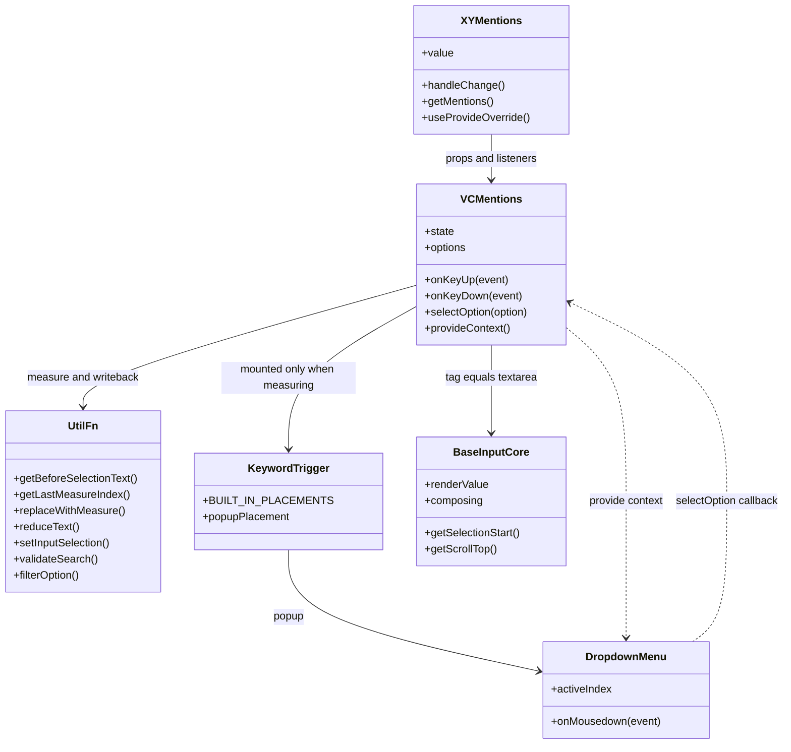
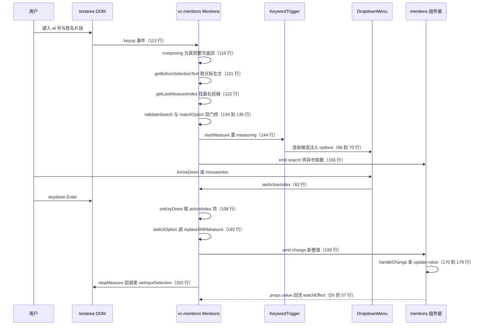
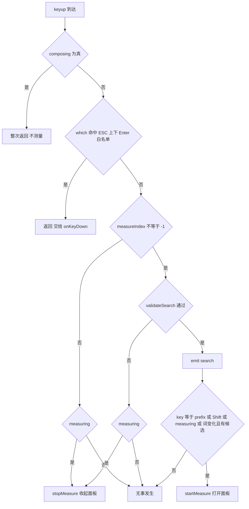

# C06-04 Mentions 提及

> **本篇解决**：`<xy-mentions>` 如何从「光标位置」反推出当前正在被提及的那段关键字（而不是从整值里正则匹配）、候选面板为什么必须挂在一段自建的镜像文本里才能贴着光标出现、上下键与回车如何在菜单和输入框之间分工、以及选中一项之后 value 与光标位置是怎么同时归位的。
> **前置**：C04-01《Input 输入框》、I04《输入基础设施》（`_util/BaseInput` 记账层与 IME 标志位）、C06-07《KeyFilter 关键词过滤》、A07《交互基础设施总览》（`vc-trigger` 的调用序列，本篇不重复展开）　**读者坐标**：`03-components/06-form-editor` 第 4 篇

## 一、职责与边界

`mentions` 是**「在文本里插入结构化提及」这一种交互的完整闭环**：它自己拥有一个 `<textarea>`，在每次 `keyup` 时根据光标左侧的文本来判定「用户是不是正在打一个提及」，判定成立时把一个只含触发符的零尺寸镜像节点塞进 DOM，让 `vc-trigger` 贴着它弹出候选菜单，选中后把提及词写回整值并把光标放到末尾。

分层与本库其它组件一样是两棵树：

- `packages/xiaoye-ui/src/mentions/`（3 个文件、648 行）是公开面 `XYMentions`：`prefixCls`/状态/表单联动/样式/`loading` 语义/废弃告警。
- `packages/xiaoye-ui/src/vc-mentions/`（8 个文件、717 行）是全部机制所在：测量、弹层、键盘、回写。

**依赖清单**（值 import，逐条给出处）：`../vc-mentions`（`mentions/index.tsx:5`）→ `_util/BaseInput`（`vc-mentions/src/Mentions.tsx:29`）、`vc-trigger`（`vc-mentions/src/KeywordTrigger.tsx:1`）、`menu`（`vc-mentions/src/DropdownMenu.tsx:1`）、`spin`（`DropdownMenu.tsx:6`、`mentions/index.tsx:18`）、`form/FormItemContext`（`index.tsx:9`）、`menu/src/OverrideContext`（`index.tsx:16`）、`_util/statusUtils`（`index.tsx:14`）、`config-provider/hooks/useConfigInject`（`index.tsx:7`）。

**明确不负责的事**，四条都有源码依据：

1. **不负责自动高度。** `grep -rnE "ResizableTextArea|autoSize|autosize" packages/xiaoye-ui/src/mentions packages/xiaoye-ui/src/vc-mentions` 为空。它要的是 `_util/BaseInput` 的 `tag="textarea"` 形态（`Mentions.tsx:281`），高度只由 `rows` 决定（`mentionsProps.ts:34` 与 `defaultProps` 的 `rows: 1`，`mentionsProps.ts:46`）。I04 里那条 textarea 自动高度链路（`input/ResizableTextArea.tsx`）**没有被 Mentions 复用**，这是本篇与输入基座最重要的分工点。
2. **不负责值的受控存储。** 组件层持 `value` 的 shallowRef（`index.tsx:127`），非受控时自己改、受控时只 emit（`index.tsx:168-175`）；`vc-mentions` 侧的 `state.value` 由 `watchEffect` 从 `props.value` 单向灌入（`Mentions.tsx:55-57`），它自己从不「拥有」值。
3. **不负责候选数据从哪来。** 同步 `options` 数组（`mentionsProps.ts:32`）或异步 `search` 事件（`Mentions.tsx:155-157` → `index.tsx:257`）都由调用方提供；`loading` 只做「把候选换成一个转圈项 + 让过滤恒真」（`index.tsx:240-248`、`:207-209`）。
4. **不负责浮层的开合状态机。** 面板显示与否由 `measuring` 决定并直接以 `v-if` 挂载整棵镜像子树（`Mentions.tsx:282`），传给 `Trigger` 的 `popupVisible` 恒为真（`:291`）；`vc-trigger` 在这里只借用它的定位与 portal 能力，弹层时序归 A07/I02。

**被谁依赖**：`grep -rn "vc-mentions" packages/xiaoye-ui/src --include='*.ts' --include='*.tsx'` 命中除自身目录外只剩 `mentions/index.tsx` 的 3 行——`:5`（组件本体）、`:6`（props 表）、`:11`（`optionProps` 与 `optionOptions`），三行同属一个消费者，即 `vc-mentions` 在库内**只有一个消费者**。公开面 `Mentions` 则通过生成物 `src/components.ts` 出现在包根导出（本篇不重复 A02 的生成物论证）。

## 二、源码地图

```
packages/xiaoye-ui/src/mentions/
├── index.tsx            309   公开组件 XYMentions + getMentions + Option 别名 + install
├── index.test.js        103   唯一会被 vitest 执行的用例文件
└── style/index.ts       232   CSS-in-JS：输入框外观 + 镜像层 + dropdown 层

packages/xiaoye-ui/src/vc-mentions/
├── index.ts               6   转发（首行注释标注 base rc-mentions .6.2，属上游实现溯源）
└── src/
    ├── Mentions.tsx       305  主实现：state 机、keyup 测量、键盘仲裁、回写
    ├── util.ts            124  六个导出：取光标左文、找前缀、拼回、放光标、默认校验、默认过滤
    ├── KeywordTrigger.tsx 101  Trigger 包装 + 四个 builtinPlacements + placement 仲裁
    ├── DropdownMenu.tsx    85  Menu 渲染 + inject 上下文 + mousedown 抢焦点
    ├── mentionsProps.ts    51  props 面与 defaultProps
    ├── Option.tsx          30  废弃的 Option 壳（只 render 默认插槽）
    └── MentionsContext.ts  15  InjectionKey 与上下文类型
```

主实现入口：`packages/xiaoye-ui/src/vc-mentions/src/Mentions.tsx:35`（`defineComponent`）与 `:41`（`setup`）。公开面入口：`packages/xiaoye-ui/src/mentions/index.tsx:103`。

三个容易被误判的「文件身份」：

| 文件 | 名字与实际 | 证据 |
| --- | --- | --- |
| `vc-mentions/src/Mentions.tsx` | `name: 'Mentions'`，**不是** 公开组件；公开组件名是 `XYMentions`（`index.tsx:105`） | `Mentions.tsx:37` |
| `mentions/index.tsx:294` | `MentionsOption`（`XYMentionsOption`）只是 `vc-mentions/src/Option.tsx:22-27` 的 `optionOptions` 换名复用，render 里没有输入值语义 | `Option.tsx:22-27` |
| `vc-mentions/src/KeywordTrigger.tsx` | 名字叫 Trigger，实际是「一次 `Trigger` 调用的参数装配器」，自身无状态 | `:84-99` |

`Mentions.tsx:234-241` 的 `provide(MentionsContextKey, …)` 与 `DropdownMenu.tsx:20-29` 的 `inject` 之间是本篇唯一一条跨层直连的状态通道：候选面板不通过 props 拿 `activeIndex`，而是**反向**从输入框那里借上下文，因为面板已经被 portal 到组件 DOM 子树之外。

## 三、架构与数据流

静态结构上只有六个真实角色，其余都是转发。注意两个反直觉的边：候选面板不是输入框的子节点而是被 portal 出去的兄弟（因此 `activeIndex` 只能靠 `provide/inject` 反向流动，`Mentions.tsx:234-241` ↔ `DropdownMenu.tsx:20-29`）；面板的定位目标不是 textarea 而是那个 `z-index: -1` 的镜像层里的 `<span>`（`Mentions.tsx:296` + `style/index.ts:118-131`）。



逐边说明：`XYMentions --> VCMentions` 传的是「除 `defaultValue`/`onUpdate:value`/`prefixCls` 之外的全部 props」再叠上四个事件回调（`index.tsx:220`、`:252-257`）；`VCMentions --> UtilFn` 是本篇绝大多数机制的落点，但导入是**分两处**的：`Mentions.tsx:16-21` 只取走测量与回写的 4 个函数（`getBeforeSelectionText`、`getLastMeasureIndex`、`replaceWithMeasure`、`setInputSelection`），`util.ts` 另外两个导出 `validateSearch` 与 `filterOption` 是在 `mentionsProps.ts:4-7` 被取去做默认值的——也就是说「默认判定」根本不在主实现文件里，改签名要同时看两个文件；`DropdownMenu ..> VCMentions` 这条虚线回调是唯一的「子层反向驱动父层状态写入」，它绕过了 props（`DropdownMenu.tsx:48-51`）。

数据流的主环是**单向异步**的：`keyup` 只读 DOM，写回只 emit，真正的 DOM 值要等 Vue 渲染队列。



读这条闭环要注意两个时序裂缝，它们在 §四 论点 4 展开：`setInputSelection` 发生在 `props.value` 回流**之前**（`:199`→`:202` 是同一批同步代码，DOM 值要等 `BaseInput.tsx:155` 的渲染才写），而 `watchEffect`（`:55-57`）是 `props.value → state.value` 的单向灌入，Mentions 从不反向写 `props.value`。

开合状态只有一个布尔位，但它由三条边进入、四条边离开：



白名单分支（`:128`）的存在理由是：方向键与 Enter 已经被 `onKeyDown` 占用（`:92-110`），若 `onKeyUp` 再跑一遍测量，光标位置会因为 `preventDefault` 的选择变化而被重新解释；ESC 之后也必须让 `measuring` 保持 `false` 而不是被同一次按键的 keyup 重新打开。`stopMeasure` 的两条入口（`:146-148` 词非法、`:158-160` 前缀消失）加上 `onBlur` 的 100ms 延时（`:182-188`）构成全部收起路径。


## 四、核心机制精读

### 论点 1：当前提及关键字是从光标位置反推出来的，不是从整值匹配出来的

`onKeyUp` 的第一件事是拿到**光标左侧那一段**，然后在那一段里找前缀，剩下的部分才是 query：

```tsx
// packages/xiaoye-ui/src/vc-mentions/src/Mentions.tsx:121
      const selectionStartText = getBeforeSelectionText(target);
      const { location: measureIndex, prefix: measurePrefix } = getLastMeasureIndex(
        selectionStartText,
        prefix,
      );

      // Skip if match the white key list
      if ([KeyCode.ESC, KeyCode.UP, KeyCode.DOWN, KeyCode.ENTER].indexOf(which) !== -1) {
        return;
      }

      if (measureIndex !== -1) {
        const measureText = selectionStartText.slice(measureIndex + measurePrefix.length);
        const validateMeasure = validateSearch(measureText, props);
        const matchOption = !!getOptions(measureText).length;
```

两个被调用的函数都很短，且都只认「最后一个前缀」：

```ts
// packages/xiaoye-ui/src/vc-mentions/src/util.ts:7
export function getBeforeSelectionText(input: HTMLTextAreaElement) {
  const { selectionStart } = input;
  return input.value.slice(0, selectionStart);
}
```

```ts
// packages/xiaoye-ui/src/vc-mentions/src/util.ts:19
export function getLastMeasureIndex(text: string, prefix: string | string[] = ''): MeasureIndex {
  const prefixList: string[] = Array.isArray(prefix) ? prefix : [prefix];
  return prefixList.reduce(
    (lastMatch: MeasureIndex, prefixStr): MeasureIndex => {
      const lastIndex = text.lastIndexOf(prefixStr);
      if (lastIndex > lastMatch.location) {
        return {
          location: lastIndex,
          prefix: prefixStr,
        };
      }
      return lastMatch;
    },
    { location: -1, prefix: '' },
  );
}
```

逐段解释，四条结论都从这两段里读出来：

1. **query 是光标的函数，不是文本的函数。** `getBeforeSelectionText` 只读 `selectionStart`（`util.ts:8`），连 `selectionEnd` 都不看。因此同一段文本，光标停在 `@xia` 中间和停在末尾，得到两个不同的 `measureText`（`:133` 的 `slice(measureIndex + measurePrefix.length)`）。用户把光标移回上一行的 `@` 之后继续打字，会**再次**触发测量并弹出面板——这个行为不需要任何额外代码，它就是「只取光标左文」的直接后果。
2. **多前缀取最右，不取最长。** `reduce` 的初值是 `{ location: -1, prefix: '' }`（`util.ts:32`），比较条件是 `lastIndex > lastMatch.location`（`:24`），所以 `prefix: ['@','#']` 时返回的是两个 `lastIndexOf` 里**下标更大**的那个。`'@a#b'` 里光标在末尾时命中 `#`（下标 2）而不是 `@`。
3. **前缀左侧完全不参与判定，这是邮箱误触的根因。** `getLastMeasureIndex` 不检查 `text[location - 1]` 是否是 `split` 或串首（`util.ts:19-34` 全文无此判断）。输入 `mailto:xiaoye@q` 时光标左侧串里存在 `@`，`measureText` 得到 `'q'`，`validateSearch('q', props)` 通过（`util.ts:116-119` 只查 `split` 是否出现在 measureText 里），只要 `q` 命中某个候选的 `value` 前缀（默认过滤是 `indexOf` 包含式，`util.ts:121-124`），面板就会弹出。分隔符只在**回写**阶段才被处理（`util.ts:79-85`），这与「识别」阶段形成口径不对称。
4. **打开面板要同时过两道门，且四选一。** `validateMeasure` 是第一道门（`:137`）；第二道是 `:138-143` 的四元条件：

```tsx
// packages/xiaoye-ui/src/vc-mentions/src/Mentions.tsx:138
          if (
            key === measurePrefix ||
            key === 'Shift' ||
            measuring ||
            (measureText !== prevMeasureText && matchOption)
          ) {
            startMeasure(measureText, measurePrefix, measureIndex);
          }
```

`key === measurePrefix` 覆盖「刚敲下前缀这一个字符」；`key === 'Shift'` 是为 `@` 这类需要 Shift 的组合键准备的旁路——某些浏览器在 `keyup` 时把 `key` 报成 `'Shift'` 而非 `'@'`，此时若不放开这条，`startMeasure` 就只能等下一个字符；`measuring` 让已在测量的会话持续刷新而不要求「有候选」；`measureText !== prevMeasureText && matchOption` 是唯一要求候选非空的入口（`prevMeasureText` 取自 `state.measureText`，`:115`）。**副作用是候选从有到无时面板不关**：因为 `measuring` 为真就够条件，于是空候选也保持打开，由 `DropdownMenu` 渲染禁用态的 notFoundContent 项（`packages/xiaoye-ui/src/vc-mentions/src/DropdownMenu.tsx:71-75`）。

还有一条经常被忽略的时钟差异：`onKeyUp` 全程以 **DOM 的 `target.value`** 为准（`:117`、`util.ts:9`），而 `selectOption` 拼接底本用的是 **Vue 侧的 `state.value`**（`Mentions.tsx:192`）。两个来源在正常输入时同步（`BaseInput.tsx:155` 的渲染把 `props.value` 写回 DOM），但在受控父组件不改值、或 `watchEffect`（`Mentions.tsx:55-57`）尚未跑到的那一帧，两者可以不一致——论点 4 的回写缺陷就长在这条缝上。

### 论点 2：候选面板贴着光标，靠的是一层与 textarea 字体度量强制一致的镜像文本

面板的定位目标不是输入框，而是一个用户看不见的镜像 `<div>` 里的 `<span>`：

```tsx
// packages/xiaoye-ui/src/vc-mentions/src/Mentions.tsx:282
          {measuring && (
            <div ref={measure} class={`${prefixCls}-measure`}>
              {state.value.slice(0, measureLocation)}
              <KeywordTrigger
                prefixCls={prefixCls}
                transitionName={transitionName}
                dropdownClassName={props.dropdownClassName}
                placement={placement}
                options={measuring ? options.value : []}
                visible
                direction={direction}
                getPopupContainer={getPopupContainer}
                v-slots={{ notFoundContent: slots.notFoundContent, option: slots.option }}
              >
                <span>{measurePrefix}</span>
              </KeywordTrigger>
              {state.value.slice(measureLocation + measurePrefix.length)}
            </div>
          )}
```

镜像层的样式由两条规则撑起。第一条把 textarea 和镜像层的字体度量强行对齐（这是整块面板定位精度的**唯一**保证）：

```ts
// packages/xiaoye-ui/src/mentions/style/index.ts:82
      [`> textarea, ${componentCls}-measure`]: {
        color: colorText,
        boxSizing: 'border-box',
        minHeight: controlHeight - 2,
        margin: 0,
        padding: `${inputPaddingVertical}px ${inputPaddingHorizontal}px`,
        overflow: 'inherit',
        overflowX: 'hidden',
        overflowY: 'auto',
        fontWeight: 'inherit',
        fontSize: 'inherit',
        fontFamily: 'inherit',
        // ...
        lineHeight: 'inherit',
        direction: 'inherit',
        letterSpacing: 'inherit',
        whiteSpace: 'inherit',
        textAlign: 'inherit',
        verticalAlign: 'top',
        wordWrap: 'break-word',
        wordBreak: 'inherit',
        tabSize: 'inherit',
      },
```

第二条把它压到不可见但仍参与布局：

```ts
// packages/xiaoye-ui/src/mentions/style/index.ts:118
      [`${componentCls}-measure`]: {
        position: 'absolute',
        top: 0,
        insetInlineEnd: 0,
        bottom: 0,
        insetInlineStart: 0,
        zIndex: -1,
        color: 'transparent',
        pointerEvents: 'none',

        '> span': {
          display: 'inline-block',
          minHeight: '1em',
        },
      },
```

解释，四步闭环：

- **几何怎么成立**：镜像 div 铺满 `xy-mentions` 的 content box（`:119-123` 的四边归零 + `:82-107` 的同一份 padding），里面的文本流与 textarea 逐字同宽（font/lineHeight/whiteSpace/wordBreak 全 `inherit`，父级 `xy-mentions` 本身带 `lineHeight` 与 `whiteSpace: 'pre-wrap'`，`style/index.ts:50-56`）。于是 `{state.value.slice(0, measureLocation)}` 这段文本渲染完之后，光标恰好落在「前缀应当出现」的位置，紧跟其后的 `<span>{measurePrefix}</span>` 就站在那个坐标上；`Trigger` 拿它当 target（`KeywordTrigger.tsx:96` 把默认插槽原样塞进 `Trigger`），align 算出的 popup 坐标因此贴着光标而不是贴着输入框左下角。`> span { display: inline-block }`（`:128-131`）是必要的：inline 元素的盒子在换行处会被拆开，`inline-block` 才给 align 一个稳定矩形。
- **开合不用弹层状态机**：`visible` 是硬编码的 `true`（`:291`），`{measuring && …}`（`:282`）才是唯一真值。这意味着 `vc-trigger` 的 pending/受控开合逻辑在这里被绕过（弹层时序归 A07/I02，本篇不重复），代价是每次 `measuring` 由假变真都要重新挂载整棵 Trigger 子树，`transitionName` 未传时（`mentionsProps.ts:21`，无默认值）面板是硬出现的。
- **滚动必须手抄一遍**：镜像层自己是 `overflowY: 'auto'`（`:90`）的独立滚动容器，textarea 滚了它不会跟着滚，所以有这段：

```tsx
// packages/xiaoye-ui/src/vc-mentions/src/Mentions.tsx:242
    onUpdated(() => {
      nextTick(() => {
        if (state.measuring) {
          measure.value.scrollTop = textarea.value.getScrollTop();
        }
      });
    });
```

`getScrollTop` 不在 DOM 上直接取，而是走 `_util/BaseInput` 的 expose 链：记账层 `packages/xiaoye-ui/src/_util/BaseInput.tsx:130` 转发到元素层 `packages/xiaoye-ui/src/_util/BaseInputInner.tsx:87` 的 `inputRef.value?.scrollTop`。守卫 `if (state.measuring)`（`:244`）是必需的——`measure` 这个模板 ref 只在镜像层挂载时才有值（`:283`）。这条同步只挂在 `onUpdated` 上，没有 value 级 watcher：如果一次外部赋值让 textarea 滚了但 vc 组件本身没有 re-render（父层直接改 DOM 或 `props.value` 未变），镜像层的 `scrollTop` 就停在旧值，面板会错位到上一屏。
- **只做上下翻转**：`BUILT_IN_PLACEMENTS` 四个键的 `overflow` 全是 `adjustX: 0, adjustY: 1`（`KeywordTrigger.tsx:7-40`，例如 `bottomRight` 的 `points: ['tl','br']` + `offset: [0, 4]`），配合 `popupPlacement` 的四选一仲裁：

```ts
// packages/xiaoye-ui/src/vc-mentions/src/KeywordTrigger.tsx:74
    const popupPlacement = computed(() => {
      const { placement, direction } = props;
      let popupPlacement = 'topRight';
      if (direction === 'rtl') {
        popupPlacement = placement === 'top' ? 'topLeft' : 'bottomLeft';
      } else {
        popupPlacement = placement === 'top' ? 'topRight' : 'bottomRight';
      }
      return popupPlacement;
    });
```

`adjustX: 0` 的理由可以从 span 的宽度反推：目标只有 1 个字符宽，水平翻转只会让面板与光标错开；垂直方向才需要避让视口。缺省方向也要读准：`placement` 没有默认值（`mentionsProps.ts:22` 只有 `PropTypes.oneOf(PlaceMent)`，`defaultProps` 里不含它，`:43-49`），所以 `undefined` 走 `:80` 的 else 分支拿到 `'bottomRight'`，即**默认向下弹**；`:76` 的初值 `'topRight'` 是永远读不到的死值，`if/else` 两个分支都会覆写它——把它当成默认方向是这类代码最常见的误读。

### 论点 3：键盘权由 `measuring` 一票独占，`onKeyDown` 在测量前把整条链路让给原生

```tsx
// packages/xiaoye-ui/src/vc-mentions/src/Mentions.tsx:85
    const onKeyDown = (event: KeyboardEvent) => {
      const { which } = event;
      // Skip if not measuring
      if (!state.measuring) {
        return;
      }

      if (which === KeyCode.UP || which === KeyCode.DOWN) {
        // Control arrow function
        const optionLen = options.value.length;
        const offset = which === KeyCode.UP ? -1 : 1;
        const newActiveIndex = (state.activeIndex + offset + optionLen) % optionLen;
        state.activeIndex = newActiveIndex;
        event.preventDefault();
      } else if (which === KeyCode.ESC) {
        stopMeasure();
      } else if (which === KeyCode.ENTER) {
        // Measure hit
        event.preventDefault();
        if (!options.value.length) {
          stopMeasure();
          return;
        }
        const option = options.value[state.activeIndex];
        selectOption(option);
      }
    };
```

四个设计事实能直接从这 27 行读出来：

- **拦截值是 `event.which`**（`:86`），不是 `event.code`/`key`。`KeyCode.UP: 38`、`DOWN: 40`、`ENTER: 13`、`ESC: 27` 来自 `packages/xiaoye-ui/src/_util/KeyCode.ts:79`、`:87`、`:27`、`:51`。`which` 是已被规范标记废弃的旧属性，浏览器目前仍提供，但这决定了「给测试造按键」的正确姿势：必须让事件对象带 `which`（详见 §七 坑 5，现有用例没做对）。
- **`measuring` 为假时函数立刻 `return`**（`:88-90`），既不 `preventDefault` 也不改状态。这就是「方向键在没弹面板时照常移动光标」的实现方式——不需要显式放行，靠的是提前退出。
- **`ENTER` 分支的 `preventDefault()` 在候选数检查之前**（`:103` 早于 `:104`），所以面板打开期间换行键被无条件吞掉，即使候选是空的。对 `rows > 1` 的多行输入，这是「打提及的那几行里换不了行」的直接原因。
- **取模用了 `optionLen` 作除数却没有为零做守卫**：`(state.activeIndex + offset + optionLen) % optionLen`（`:96`）。`optionLen === 0` 时 JS 语义是 `x % 0 → NaN`，于是 `state.activeIndex = NaN`（`:97`）且 `preventDefault()`（`:98`）已经执行——方向键在「空候选面板」上被吞掉且高亮位被污染成 `NaN`。`ENTER` 有 `!options.value.length` 守卫（`:104-107`），箭头键没有，两者保护级别不一致。`NaN` 一旦写入就不会自愈，直到下一次 `startMeasure` 把 `activeIndex: 0` 重置（`:68-74`）。

鼠标侧与键盘侧共用同一个高亮位，这靠 `provide/inject` 而不是 props：

```tsx
// packages/xiaoye-ui/src/vc-mentions/src/DropdownMenu.tsx:31
    let timeoutId: any;
    const onMousedown = (e: MouseEvent) => {
      clearTimeout(timeoutId);
      timeoutId = setTimeout(() => {
        onFocus(e);
      });
    };
    onBeforeUnmount(() => {
      clearTimeout(timeoutId);
    });
```

```tsx
// packages/xiaoye-ui/src/vc-mentions/src/DropdownMenu.tsx:48
          onSelect={({ key }) => {
            const option = options.find(({ value }) => value === key);
            selectOption(option);
          }}
          onMousedown={onMousedown}
```

`onMousedown` 这段延时不是可有可无的装饰：`mousedown` 在候选项上按下时，浏览器随后会让 textarea 失焦，失焦触发 `onBlur`，而 `onBlur` 把收起动作挂在一个 100ms 定时器上：

```tsx
// packages/xiaoye-ui/src/vc-mentions/src/Mentions.tsx:182
    const onBlur = (event: Event) => {
      focusId.value = setTimeout(() => {
        state.isFocus = false;
        stopMeasure();
        emit('blur', event);
      }, 100);
    };
    const onFocus = (event: Event) => {
      clearTimeout(focusId.value);
```

`onFocus` 的第一行 `clearTimeout(focusId.value)`（`:175`）就是这个定时器的取消点。`setTimeout(0)`（`DropdownMenu.tsx:33`）保证 `onFocus` 在 textarea 的 `blur` 之后、100ms 之前跑到，于是面板不会在 `click` 事件抵达 `onSelect`（`DropdownMenu.tsx:48-51`）之前被收掉。换句话说，**「鼠标点选候选项」这条路径依赖两个魔术数字（0 与 100）的大小关系**，把它们调平或改成同步都会让点击选中失效。

高亮位的写入是双向的：键盘写 `state.activeIndex`（`Mentions.tsx:97`），鼠标 hover 也写（`DropdownMenu.tsx:61-63` 的 `setActiveIndex(index)`），面板侧把它当只读消费（`:42` `options[activeIndex.value] || {}` → `:47` `activeKey`）。注意 `inject` 的兜底值只给了 `activeIndex` 与 `loading`（`:26-29`），`setActiveIndex`/`selectOption` 不在兜底对象里，只有 `onFocus` 有 noop 默认（`:24`）——因此 `DropdownMenu` 一旦被脱离 `Mentions` 单独渲染，点击项会走到 `selectOption(option)`（`:50`）抛 `TypeError`，它的可复用性是假的。

### 论点 4：回写是「字符串拼接 + 手工放光标」，两侧各自读不同的时钟

选中一项的全部逻辑只有 18 行，但它同时读了 DOM 与 Vue 状态两个来源：

```tsx
// packages/xiaoye-ui/src/vc-mentions/src/Mentions.tsx:189
    const selectOption = (option: OptionProps) => {
      const { split } = props;
      const { value: mentionValue = '' } = option;
      const { text, selectionLocation } = replaceWithMeasure(state.value, {
        measureLocation: state.measureLocation,
        targetText: mentionValue,
        prefix: state.measurePrefix,
        selectionStart: textarea.value.getSelectionStart(),
        split,
      });
      triggerChange(text);
      stopMeasure(() => {
        // We need restore the selection position
        setInputSelection(textarea.value.input as HTMLTextAreaElement, selectionLocation);
      });

      emit('select', option, state.measurePrefix);
    };
```

拼接算法在 `util.ts`，它负责把「分隔符」这件事做圆：

```ts
// packages/xiaoye-ui/src/vc-mentions/src/util.ts:75
export function replaceWithMeasure(text: string, measureConfig: MeasureConfig) {
  const { measureLocation, prefix, targetText, selectionStart, split } = measureConfig;

  // Before text will append one space if have other text
  let beforeMeasureText = text.slice(0, measureLocation);
  if (beforeMeasureText[beforeMeasureText.length - split.length] === split) {
    beforeMeasureText = beforeMeasureText.slice(0, beforeMeasureText.length - split.length);
  }
  if (beforeMeasureText) {
    beforeMeasureText = `${beforeMeasureText}${split}`;
  }

  // Cut duplicate string with current targetText
  let restText = reduceText(
    text.slice(selectionStart),
    targetText.slice(selectionStart - measureLocation - prefix.length),
    split,
  );
  if (restText.slice(0, split.length) === split) {
    restText = restText.slice(split.length);
  }

  const connectedStartText = `${beforeMeasureText}${prefix}${targetText}${split}`;

  return {
    text: `${connectedStartText}${restText}`,
    selectionLocation: connectedStartText.length,
  };
}
```

四条机制：

- **前缀左侧被强制改写成「恰好一个 split」**：先剥掉紧邻的 split（`:80-82`），非空再补一个（`:83-85`）。所以 `@a@b` 这种连续提及会被规整成 `@a @b`（选中第二个后）。
- **`selectionLocation` 落在尾随 split 之后**：`connectedStartText` 以 `split` 结尾（`:97`），`selectionLocation = connectedStartText.length`（`:101`）。这带来一个隐性收益——插入后光标已经在分隔符右侧，下一次 `keyup` 算出的 `measureText` 必然含 split，`validateSearch` 返回 `false`（`util.ts:116-119`），面板不会因为「刚插入的内容」而重新弹出。
- **`reduceText` 处理「用户已经打了一部分」**：

```ts
// packages/xiaoye-ui/src/vc-mentions/src/util.ts:48
function reduceText(text: string, targetText: string, split: string) {
  const firstChar = text[0];
  if (!firstChar || firstChar === split) {
    return text;
  }

  // Reuse rest text as it can
  let restText = text;
  const targetTextLen = targetText.length;
  for (let i = 0; i < targetTextLen; i += 1) {
    if (lower(restText[i]) !== lower(targetText[i])) {
      restText = restText.slice(i);
      break;
    } else if (i === targetTextLen - 1) {
      restText = restText.slice(targetTextLen);
    }
  }

  return restText;
}
```

它逐字符比较光标右侧残余（`text.slice(selectionStart)`）与 `targetText` 的对应段（`:88-92` 的 `targetText.slice(selectionStart - measureLocation - prefix.length)`，即「query 已输入部分」），找到第一个不同就把那之后的内容留下（`:58-60`），完全相同则整段丢掉（`:61-62`）。文件注释给了具体口径：`little@litest` 选 `light` 得到 `little @light test`（`util.ts:69-74`）。注意 `firstChar === split` 时直接返回原文（`:50-52`），即**光标右侧紧跟分隔符时不做去重**——这条早退让 `@li| test` 选中 `light` 会变成 `@light test`（`:` 表示光标，右侧 ` test` 的首字符是空格）。

- **value 与光标走的是两条时间线。** `triggerChange(text)`（`:199`）只是 `emit('change', val)`（`:59-61`），值要经过公开层 `index.tsx:168-175` 更新 `value.value`，再由 `watchEffect`（`Mentions.tsx:55-57`）灌回 `state.value`，最后由 `BaseInput.tsx:155` 的 `value={renderValue.value}` 经 `BaseInputInner.tsx:91` 写到 DOM `<textarea>`。而 `setInputSelection` 在同一个同步块里就被调用（`:200-203`，`stopMeasure` 的 callback 是同步执行的，见 `:76-83`），此刻 DOM 上的还是**旧字符串**：

```ts
// packages/xiaoye-ui/src/vc-mentions/src/util.ts:105
export function setInputSelection(input: HTMLTextAreaElement, location: number) {
  input.setSelectionRange(location, location);

  /**
   * Reset caret into view.
   * Since this function always called by user control, it's safe to focus element.
   */
  input.blur();
  input.focus();
}
```

`setSelectionRange(location, location)`（`:106`）作用在旧值上；新值随后由渲染队列写入，浏览器在程序化赋值 `value` 时会重设光标位置——所以「插入后光标到底落在哪」并不是 `selectionLocation` 说了算，而是「旧值上的 setSelectionRange」+「新值写入时的光标重定位」两步的结果。多数场景两步恰好一致（新串是旧串的前缀扩展且 `location ≤ 旧长度`时能保住），但这条链路没有任何测试保护（`packages/xiaoye-ui/src/mentions/index.test.js` 全文没有断言 `selectionStart`，见 §七）。

紧随其后的 `input.blur(); input.focus()`（`:112-113`）也不是多余的：注释写的是「Reset caret into view」，让浏览器把光标滚入可见区。它的副作用是每次插入都产生一对 blur/focus 事件，而 `onBlur` 的 100ms 延时 + `onFocus` 的 `clearTimeout`（`Mentions.tsx:175-188`、`:174-175`）恰好把这对事件吸收掉——因为 blur 与 focus 在同一个同步块里连续发生，定时器还没到点就被取消，于是**不会向外 emit `blur`**，公开层的 `handleBlur`（`index.tsx:157-162`）与 `formItemContext.onFieldBlur()` 也不会跑。这与论点 3 的鼠标路径共用同一个机制，是这个 100ms 存在的两个理由。

### 论点 5：`loading` 的占位候选不是为了显示，而是为了通过 `matchOption` 这道门

公开层在 `loading` 为真时做了两件事——换掉过滤函数、把候选数组替换成一项假数据：

```tsx
// packages/xiaoye-ui/src/mentions/index.tsx:42
function loadingFilterOption() {
  return true;
}
```

```tsx
// packages/xiaoye-ui/src/mentions/index.tsx:203
    const mentionsfilterOption = computed(() =>
      props.loading ? loadingFilterOption : props.filterOption,
    );
```

```tsx
// packages/xiaoye-ui/src/mentions/index.tsx:240
        options: props.loading
          ? [
              {
                value: 'XYUI_SEARCHING',
                disabled: true,
                label: <Spin size="small" />,
              },
            ]
          : props.options || getOptions(),
```

`:244` 与 `:211` 两处替换是配套的：只替换 options 而不放宽过滤，`XYUI_SEARCHING` 会被默认过滤函数（`util.ts:121-124` 的 `indexOf` 包含式）按当前 query 裁掉，占位项可能一个都不剩。

真正读这两处替换的是 vc 层的一个布尔门：

```tsx
// packages/xiaoye-ui/src/vc-mentions/src/Mentions.tsx:211
    const getOptions = (measureText?: string) => {
      const targetMeasureText = measureText || state.measureText || '';
      const { filterOption } = props;
      const list = props.options.filter((option: OptionProps) => {
        /** Return all result if `filterOption` is false. */
        if (!!filterOption === false) {
          return true;
        }
        return (filterOption as Function)(targetMeasureText, option);
      });
      return list;
    };
```

`getOptions(measureText).length` 就是论点 1 里 `matchOption` 的来源（`Mentions.tsx:135`）。把它和四元条件连起来读，`loading` 的真实语义就出来了：**在异步取数还没回来时，本地候选通常是空数组；若不加占位项，`matchOption` 恒假，用户每敲一个字符都要重新满足 `key === measurePrefix` 才能开面板**（`Mentions.tsx:139-143`），也就是「打第一个 `@` 弹出、打第二个字符就收掉」。有了 `XYUI_SEARCHING`，`getOptions` 长度恒为 1（配合恒真的 `loadingFilterOption`），`matchOption` 恒真，面板得以持续存在。

而它本身**不会出现在 DOM 里**：

```tsx
// packages/xiaoye-ui/src/vc-mentions/src/DropdownMenu.tsx:54
          {!loading.value &&
            options.map((option, index) => {
              const { value, disabled, label = option.value, class: className, style } = option;
              return (
                <MenuItem
                  key={value}
                  disabled={disabled}
                  onMouseenter={() => {
                    setActiveIndex(index);
                  }}
                  class={className}
                  style={style}
                >
                  {slots.option?.(option) ?? (typeof label === 'function' ? label(option) : label)}
                </MenuItem>
              );
            })}
          {!loading.value && options.length === 0 ? (
            <MenuItem key="notFoundContent" disabled>
              {slots.notFoundContent?.()}
            </MenuItem>
          ) : null}
          {loading.value && (
            <MenuItem key="loading" disabled>
              <Spin size="small" />
            </MenuItem>
          )}
```

`loading` 从上下文来（`Mentions.tsx:240` 的 `loading: toRef(props, 'loading')` → `DropdownMenu.tsx:25`），一旦为真，`:54` 与 `:71` 两个分支都被短路，只剩 `:76-80` 那条 `key="loading"` 的 `<Spin>` 项。所以「转圈」由 `DropdownMenu` 自己渲染，`:249` 那个 `label: <Spin size="small" />` 是走不到的第二份实现。

这里要如实记录测试的分辨力：`packages/xiaoye-ui/src/mentions/index.test.js:64-78` 的 `loading` 用例断言 `.xy-mentions-dropdown-menu-item` 数量非零且存在 `.xy-spin`。这两条断言在上述两条渲染路径下**都成立**（占位项也是 `MenuItem`、label 也是 `Spin`），因此它并不能证明走的是 `:76-80` 分支；本结论来自代码分支判定（`:54`、`:71`、`:76` 的三个条件互斥），不是来自测试。

`filterOption` 的三态也在这条链上，但只有两态有保护：

- 传 `false` → `!!filterOption === false` 为真 → 返回全部（`:216-218`）。这是异步搜索的正解：远端已经筛过，本地不要再裁。
- 传函数 → 调用（`:219`）。默认值 `() => defaultFilterOption`（`mentionsProps.ts:48`，带 `as any`）能否被解成 `defaultFilterOption` 本身，取决于 Vue 的「函数型默认值按工厂调用」规则：条件是 `opt.type !== Function` 且 default 是函数，本例 `opt.type` 是 `[Boolean, Function]` 数组故成立。该规则实现在安装的 `@vue/runtime-core`（本机版本 3.5.40）的 `resolvePropValue` 里，不在本仓源码索引范围内，本篇不把它记作仓库内 `file:line` 断言；读者可用 `grep -n "applying defaults" -A 6` 在 `node_modules/.pnpm/@vue+runtime-core@*/node_modules/@vue/runtime-core/dist/runtime-core.cjs.js` 内定位。若这条规则不成立，`props.filterOption` 就是那个箭头函数本身，`getOptions` 每次调用都返回真值，效果等同于「任何候选都通过」。
- 传 `true` → **没有任何分支处理**：`!!true === false` 为假，直接进 `:219` 的 `(filterOption as Function)(...)`，抛 `TypeError: filterOption is not a function`。而 prop 声明 `type: [Boolean, Function]`（`mentionsProps.ts:25-27`）恰好允许 Boolean，Vue 的 prop 校验不会告警。这是 §七 坑 4。

### 论点 6：面板跨过了 DOM 子树，于是样式与行为都得各另送一条通道

弹层不在 `.xy-mentions` 的子树里（portal 到 `getPopupContainer` 或 body），本库有两处机制因此必须「绕行」：

**其一，hash 类靠 `dropdownClassName` 捎带。**

```tsx
// packages/xiaoye-ui/src/mentions/index.tsx:258
      const mentions = (
        <VcMentions
          {...mentionsProps}
          dropdownClassName={hashId.value}
          v-slots={{ notFoundContent: getNotFoundContent, option: slots.option }}
        ></VcMentions>
      );
```

三跳落地：`Mentions.tsx:288` 把它转给 `KeywordTrigger`，后者作为 `popupClassName` 交给 `Trigger`（`KeywordTrigger.tsx:91`）。为什么必须有这一跳：样式引擎把 `hashId` 作为选择器的一部分注入到规则自身（`packages/xiaoye-ui/src/_util/cssinjs/hooks/useStyleRegister/index.tsx:79-99`，`:85` 决定是 `.hash` 还是 `:where(.hash)`），所以 `.xy-mentions-dropdown` 那一整块规则（`mentions/style/index.ts:135-156`）只有在**弹层元素自身带上 hash 类**时才命中。组件根节点上的 hash 来自另一路（`index.tsx:230` 把它并进 `mergedClassName`）。注水细节归 A04，本篇只登记这条绕行通道：`dropdownClassName` 这个看起来是「给用户加类名」的 prop，在本库内部被占用作 hash 载体（`mentionsProps.ts:40` 的 `dropdownClassName: String` 由公开层写死，用户传不进 vc 层）。

**其二，`Menu` 的行为靠 override 上下文锁死，而不是靠 props。**

```tsx
// packages/xiaoye-ui/src/mentions/index.tsx:131
    useProvideOverride({
      prefixCls: computed(() => `${prefixCls.value}-menu`),
      mode: computed(() => 'vertical'),
      selectable: computed(() => false),
      onClick: () => {},
      validator: ({ mode }) => {
        // Warning if use other mode
        warning(
          !mode || mode === 'vertical',
          'Mentions',
          `mode="${mode}" is not supported for Mentions's Menu.`,
        );
      },
    });
```

`DropdownMenu` 用的是**公开**的 `menu` 组件（`DropdownMenu.tsx:1`），不是内部精简菜单；因此它默认带着 Menu 的全部配置面（`selectable`、`mode`、`onClick`）。Mentions 用 `useProvideOverride`（`index.tsx:16` 导入自 `../menu/src/OverrideContext`）把这三项在上下文层钉成「vertical、不可选中、点击不做事」，并用 `validator` 给误配补一条 `warning`（`:138-142`）。选中动作不经过 `onClick`，而是走 Menu 的 `onSelect`（`DropdownMenu.tsx:48-51`）——注意 `:135` 的 `selectable: false` 与 `onSelect` 并存，说明这里用的是 Menu 的「非受控高亮」能力而非选择能力，高亮由 `activeKey` 提供（`DropdownMenu.tsx:47`）。

顺带一条容易写错的契约：`dropdownClassName` 在公开层**不是 prop**。基础 props 表 `vc-mentions/src/mentionsProps.ts:14-36` 没有它（只在 `vcMentionsProps` 的 `:38-41` 追加，而公开层只展开 `mentionsProps`，见 `index.tsx:6` 与 `:75`），于是用户写的 `dropdown-class-name` 进入 `attrs`（`index.tsx:219` 解构出 `class` 后其余全在 `otherAttrs`），再被 `:250` 的 `...otherAttrs` 交给 VcMentions，最后落进 `textareaProps`（`Mentions.tsx:266-269`）变成 `<textarea>` 上的一个属性。弹层拿到的只有 `hashId`（`index.tsx:265` 在展开之后覆写）。

**其三，`getPopupContainer` 有一条可证的断链。** 公开层只取了三个注入值：

```tsx
// packages/xiaoye-ui/src/mentions/index.tsx:123
    const { prefixCls, renderEmpty, direction } = useConfigInject('mentions', props);
```

而 `useConfigInject` 是提供 `getPopupContainer` 的，其取值顺序为 `props.getContainer ?? props.getPopupContainer ?? configProvider.getPopupContainer?.value`（`packages/xiaoye-ui/src/config-provider/hooks/useConfigInject.ts:26-27`，并在 `:56` 导出）。Mentions 反而从 props 里单独解构再透传：`const { disabled, getPopupContainer, rows = 1, ... } = props`（`index.tsx:211-217`）与 `:239` 的 `getPopupContainer,`。同库对照：`select/index.tsx:159-162`、`slider/index.tsx:114-115`、`date-picker/generatePicker/generateSinglePicker.tsx:115-116` 都从 `useConfigInject` 的返回值里取了 `getPopupContainer`。结论是 **`<xy-config-provider>` 上的全局 `getPopupContainer` 对 Mentions 候选面板无效**，只有写在组件自己身上的那一份生效。交叉验证（第二种方法）：`grep -n "getPopupContainer" packages/xiaoye-ui/src/mentions/index.tsx` 只有 `:213` 与 `:239` 两处，均指向 `props`，没有第三处来自注入。

## 五、对外契约如何生效

**值有两条轨道，且受控判定写在 handler 里而不是包在 hook 里。** 公开层用 `const value = shallowRef(props.value ?? props.defaultValue ?? '')`（`index.tsx:127`）初始化一次内部影子值，配一个无条件覆写的 watcher：

```tsx
// packages/xiaoye-ui/src/mentions/index.tsx:145
    watch(
      () => props.value,
      val => {
        value.value = val;
      },
    );
```

而受控/非受控的分叉发生在写路径上：`handleChange` 只在 `props.value === undefined` 时才落内部值（`:168-175`）。`grep -rn "useMergedState" packages/xiaoye-ui/src/mentions packages/xiaoye-ui/src/vc-mentions` 为空——本组件没有走 I13 记录的统一实现，两件事因此和走 `useMergedState` 的组件不一样：其一，`props.value` 从有到无（受控切非受控）时 watcher 会把 `value.value` 置为 `undefined`，`.value` 清空一次才恢复输入；其二，`defaultValue` 只在 `:127` 被读一次，后续任何 `props.defaultValue` 变化都不生效（watcher 只盯 `props.value`）。

往下传的仍然不是 `props.value` 而是 `value.value`：`:235` 展开 `otherProps`（其中含 `value: props.value`）之后，`:259` 用 `value: value.value` 覆写，键序决定了谁生效——把 `value` 挪到 `:235` 之前就会变成外部值优先，非受控模式当场失效。这是一处「靠对象字面量顺序维持语义」的脆弱写法。

**事件只剩一条投递通道（修前是两条，同一个回调函数被打两次）。** 修前形状：五个处理器一律写成「先 `emit`，再直调 `props.onXxx`」——focus 是 `emit('focus', e)` 紧跟 `props.onFocus?.(e)`（修前 `:153-154`），其余四处同形（修前 `:159-160` blur、`:165-166` select、`:174-176` change、`:181-182` pressenter）。而 `onFocus`/`onBlur`/`onSelect`/`onChange`/`onPressenter` 同时被声明为 props（`:77-91`），`emits` 里也有对应事件名（`:108`）——但「声明为 prop」并不会把键从 `vnode.props` 里移走，Vue 的 `emit` 恰恰是从 `instance.vnode.props` 按 `toHandlerKey(event)` 取处理器，所以两条通道指向的是**同一个用户函数**。这就是「事件双投递」族的**形态二**（`emit` 紧跟 `props.onX?.(...)` 直调），本组件是该族在 `mentions`、`switch`、`radio`、`dark-mode-toggle`、`vc-select` 一批命中里的一个。判据只靠数调用次数：`toHaveBeenCalledWith` 照不出这一族。**实测**：修前一次聚焦把外部 `@focus` 打 **2** 次，修后 **1** 次；回归是 `packages/xiaoye-ui/src/_util/__tests__/event-dispatch-count.test.tsx` 的「Mentions 聚焦再失焦，`@focus` 与 `@blur` 各只投递一次」，判据 `toHaveBeenCalledTimes(1)`。修后形状：五个 handler 只留 `emit`，focus 那一处留了一行注释说明为什么不能再补直调（`packages/xiaoye-ui/src/mentions/index.tsx:151-155`），`grep -n "props\.on" packages/xiaoye-ui/src/mentions/index.tsx` 现在只剩 1 行命中、且那行就是注释自身（`:153`）。`update:value` 从来不在双投之列——它只 `emit`（`:172`）没有第二跳；`search` 也是在装配对象里现造的单 arrow（`:257`）。

还有一条**测试层面**的事实要登记，否则计数用例会反过来骗人：vc-mentions 的 `blur` 被延后 100ms 才发——`packages/xiaoye-ui/src/vc-mentions/src/Mentions.tsx:182-188` 的 `onBlur` 写的是 `focusId.value = setTimeout(..., 100)`，`emit('blur', event)` 在 `:186`，延后是为了区分「焦点移到候选面板里」的情形。所以断言 `@blur` 次数之前必须先等约 160ms，否则计数停在 **0**，会被误读成「没有投递」而不是「没有双投」。

**原生属性靠两跳 attrs 落到 textarea。** 公开层 `inheritAttrs: false`（`:106`），`attrs` 解构出 `class` 后其余进 `otherAttrs`（`:219`）并被 `...otherAttrs` 交给 VcMentions（`:250`）；vc 层再解构一次 `const { class: className, style, ...otherAttrs } = attrs`（`Mentions.tsx:254`）并把 `otherAttrs` 铺进 `textareaProps`（`:266-268`），最后 `<BaseInput {...textareaProps} tag="textarea">`（`:281`）由记账层把非声明键继续下推到真实 `<textarea>`（`_util/BaseInput.tsx:148` 的 `{...attrs}`）。所以 `placeholder`、`maxlength`、`aria-*` 这些没有对应 prop 的属性全部走这条路生效；而 `class` 走的是另一条——它被并进 `mergedClassName`（`index.tsx:222-231`）后作为 `class` 传给 VcMentions，最终落在**外层 div**（`Mentions.tsx:280`）而不是 textarea。用户在 `<xy-mentions class="x">` 上写的类名因此挂在容器上。

**三个插槽各有各的落点。** `default` 只服务于废弃的 Option 写法：`getOptions()` 把子节点用 `flattenChildren` 摊平后取 `getOptionProps(item)` 与 `item.children.default()` 当 label（`index.tsx:192-196`），并在 setup 早期就发出废弃告警（`:116-122`，条件是非空 default 插槽）。`notFoundContent` 与 `option` 则各自原样透传两层（`:266` → `Mentions.tsx:294` → `KeywordTrigger.tsx:69` → `DropdownMenu.tsx:73`、`:67`），`option` 插槽的调用签名是 `slots.option?.(option)`（`DropdownMenu.tsx:67`），它优先于 `label`，`label` 为函数时才被当渲染函数调用（同一行三元）。

**expose 是三级接力，且第一级就把类型写错了。** 公开层 `expose({ focus, blur })`（`index.tsx:206`），实现是把 `vcMentions` 断言成 `HTMLTextAreaElement` 再调 `.focus()`（`:198-204`）——实际拿到的是 VcMentions 的 expose 代理（`Mentions.tsx:233` 的 `expose({ blur, focus })`），它再转调 `textarea.value.focus()`，即记账层的 `focus()`（`_util/BaseInput.tsx:95-99`）。三者恰好同名所以能跑通，`as HTMLTextAreaElement` 是纯粹的欺骗性断言：如果哪天 BaseInput 的 expose 少了 `focus`，这里不会有编译错误。这与 I04 记录的 `setScrollTop` 空头支票是同一类问题（该篇 §七 坑 3）。

**表单契约靠两条 context 边。** `id` 缺省取 `formItemContext.id.value`（`:215`）；值变化调 `formItemContext.onFieldChange()`（`:174`）、失焦调 `onFieldBlur()`（`:160`）；状态色由 `getMergedStatus(formItemInputContext.status, props.status)`（`:130`）仲裁后交给 `getStatusClassNames`（`:228`）。带 `hasFeedback` 时外层再套一个 `${prefixCls}-affix-wrapper`（`:269-287`），此时用户的 `class` 被挂到 wrapper 上（`:279`）而**不再**挂到内层（对比 `:229` 的 `!hasFeedback && className`）——这是「同一个 prop 在两种布局下落点不同」的一处，与 I04 记录的 `vc-input` 落点漂移同形。

**样式契约的入口是三个 Component Token。** `genComponentStyleHook('Mentions', …)` 用 `initInputToken(token)` 复用输入框的 token 面（`style/index.ts:221-224`），另外补三个：`dropdownHeight: 250`、`controlItemWidth: 100`、`zIndexPopup: token.zIndexPopupBase + 50`（`:227-230`）。前两个分别落到 `:156` 的 `maxHeight` 与 `:167` 的 `minWidth`；第三个是弹层层级，编排规则归 I10，本篇只登记数值。`xy-mentions` 根节点的定位上下文由 `style/index.ts:49` 的 `position: 'relative'` 提供，镜像层的四边归零（`:118-123`）依赖它——把根节点改成 `position: static` 会让镜像层相对最近的定位祖先铺开，面板随之飞离光标。

## 六、设计取舍

**取舍一：测量挂在 `keyup`，而不是 `input`。** `startMeasure` 在整个 `vc-mentions` 里只有一个调用点（`Mentions.tsx:144`），它位于 `onKeyUp` 内部；`onInput`/`onChange` 那条路径只做值转发（`:63-65`）。选择 `keyup` 买到的东西很具体：事件对象里有 `key`，于是能区分「刚敲下前缀」和「在前缀之后继续打字」（`:139-142`），也能在合成期用 `composing` 位整次旁路（`:118-120`，该 expando 由基座写入，见 I04 对 `_util/BaseInput.tsx:68` 的记录）。赔上的东西同样具体：**任何不产生 keyup 的写入都不会触发面板**——粘贴（BaseInput 声明了 `paste` 事件于 `packages/xiaoye-ui/src/_util/BaseInput.tsx:48`，而 Mentions 的 `textareaProps` 没有绑 `onPaste`，见 `Mentions.tsx:266-278`）、拖拽入框、脚本赋值，全都静默（§七 坑 2）。另一条路是 `input` + `selectionchange`，那需要额外订阅文档级事件并自己维护「按键身份」缺失下的会话状态，实现量明显更大；现方案把这个缺口留在了产品行为上。

**取舍二：不接 `ResizableTextArea`，直接用 `_util/BaseInput` 的 textarea 形态。** I04 已经证明自动高度是一条带 ResizeObserver 回环闸门的状态机（`input/ResizableTextArea.tsx:21-23`、`:82-102`），并有 `setScrollTop` 的类型空头支票。Mentions 一个都不想要：它只要 `rows`（`mentionsProps.ts:34`、`defaultProps.rows: 1`）。换来的是零测量依赖，代价是**没有 autoSize**——长文本只能靠 textarea 自身滚动，而一旦滚动，镜像层必须跟着滚，于是多了 `Mentions.tsx:242-248` 那段 `onUpdated` + `nextTick` 的手工同步。如果改成复用 `ResizableTextArea`，`getScrollTop` 的语义会变成「测量后的稳定值」并连带继承 I04 坑 3，同时 expose 层级再加一层（该组件的 `textArea` 暴露名与本篇用的 `input`/`getSelectionStart` 不同名），改动成本集中在这里，现在的取舍是可以理解的。

**取舍三：面板开合用条件挂载，不用 `vc-trigger` 的受控开合。** `popupVisible` 恒传 `true`（`Mentions.tsx:291`），真值是 `{measuring && …}`（`:282`）。收益是状态源唯一（`state.measuring` 一处写、`:76-83` 一处清），不存在「trigger 说开着而测量说关了」的双主问题。代价有三个：每次开合都重建整棵 popup 子树（align 重算、Menu 重新挂载）；`transitionName` 没有默认值（`mentionsProps.ts:21`），因此默认是硬闪；以及**测量态与焦点态解耦**——失焦后靠 100ms 定时器收起（`:182-188`），而不是靠弹层自己的 outside-click 机制：`KeywordTrigger.tsx:87-96` 传给 `Trigger` 的九个参数里没有 `action`，而 `popupVisible` 恒真意味着**即使 action 判定为「该关」也关不掉**（面板存在与否由 `Mentions.tsx:282` 的 `measuring` 独家决定），A07/I02 描述的那套开合语义在本组件被架空了一半。

**取舍四：「识别触发」与「抽取提及」用了两套算法。** 触发侧是「光标左文 + 最右前缀 + measureText 不含 split」（`util.ts:7-34`、`:116-119`）；抽取侧 `getMentions` 是「按 split 切词 + 每词首字符比对前缀列表」（`index.tsx:49-71`）。两条实现对同一段文本给出的结论可以不同：`hi\n@bob`（换行分隔）在触发侧会弹面板并能正常插入，在抽取侧因为整串没有空格而切不出以 `@` 开头的词，返回空数组；`zhang@q` 反过来在触发侧弹面板、在抽取侧不认。顺带一条由 `util.ts:83-85` 推出的写入结果：`hi\n@bob` 选中候选后会被写成 `hi\n @bob `——换行后面多出一个空格，因为「前缀左侧非空就补 `split`」这一步只看 `beforeMeasureText` 是否为空串，不区分它是否已经以换行结尾。**为什么不用同一套**：抽取侧需要「无状态地扫全文」，光标信息不可用；触发侧需要「跟随光标」，切词信息不够精确。现方案没有为两者建立一致性契约，也没有文档化这一分歧，结果就是 `Mentions.getMentions` 不能作为「组件里到底有哪些提及」的可靠答案（§七 坑 7、坑 8）。

**取舍五：保留废弃的 Option 通路。** `MentionsOption` 只是把 `optionOptions` 换个名字再导出（`index.tsx:294-299`，展开自 `Option.tsx:22-27`），它的 render 只有 `slots.default?.()`，本身不参与任何数据流；组件挂载时若有 default 插槽就 `devWarning`（`index.tsx:116-122`）。保留它换来旧写法不破（`index.test.js:80-102` 仍在用它），赔上的是 `getOptions()` 必须从 VNode 反推数据——`getOptionProps(item)` 取 `value`/`disabled`，`label` 靠 `item.children.default()` 掏插槽（`:192-196`）。这条路径上 `label` 的类型声明是 `anyType<VueNode | ((o) => VueNode)>([])`（`Option.tsx:14`），默认值 `[]` 与「字符串或渲染函数」的语义并不吻合，是从 React 式 API 迁移时的残留形状。

**取舍六：事件原先同时走 `emit` 与 `props.onXxx`，2026-09-29 收敛成单通道。** 修前五个处理器都是双跳（§五），换来的是「函数式 prop 与 `v-on` 两种风格都能用」（`onSelect` prop 与 `@select` 都成立），代价是同一回调被调用两次，任何有副作用的 handler（打点、请求）都会重复。这笔交换现在看不成立：`emit` 取的就是 vnode 上那一份 `onSelect`，两种写法本来就撞在同一个键上，「都能用」是伪收益。修后只留 `emit`，判据也从「读代码里有没有成对的两行」换成「数一次交互调用几次」——`grep -n "props\.on" packages/xiaoye-ui/src/mentions/index.tsx` 只剩 `:153` 一条，且那是修复时留下的注释而非调用。仓库原先没有任何注释记录为什么写双跳，本篇也无法补证；新注释只说明「不能再补一次」。

## 七、坑与改动指南

**坑 1：邮箱、URL 里的 `@` 会弹候选面板。**
触发：默认 `prefix: '@'`（`packages/xiaoye-ui/src/vc-mentions/src/mentionsProps.ts:44`），输入 `zhang@q`，且 `options` 里存在 `value` 含 `q` 的项。
症状：打字途中面板突然出现在 `@` 处；选中候选后，`zhang` 与提及之间被强行插入一个分隔空格（`util.ts:83-85` 的「非空就补 split」分支），邮箱串被拆成 `zhang @<候选值> `。
原因：`getLastMeasureIndex` 只找最右前缀、**不校验前缀左侧**是否为串首或 `split`（`packages/xiaoye-ui/src/vc-mentions/src/util.ts:19-34`）；`validateSearch` 只检查 `measureText` 内有没有 split（`:116-119`），前缀左边有什么不参与判定。
定位：`util.ts:19-34`、`util.ts:116-119`、`Mentions.tsx:121-135`。
绕法：把 `prefix` 设为不会出现在正文里的串（如 `'@'` 改 `'提及:'`），或自己传 `validateSearch`——但它的入参只有 `measureText` 与 `props`（`Mentions.tsx:134`），拿不到前缀左侧的文本，因此无法在回调里补上「左邻必须是分隔符」这一条；真正的修法是在 `util.ts` 里给 `getLastMeasureIndex` 增加左邻字符判断。

**坑 2：粘贴 `@张三` 不弹面板。**
触发：选中候选前用 Ctrl+V 或右键粘贴包含前缀的文本。
症状：值进入输入框，面板不出现；必须再敲一个字符才弹。
原因：`startMeasure` 的唯一调用点在 `onKeyUp` 里（`Mentions.tsx:144`），而 `textareaProps` 没有绑任何 `onPaste`/`onCompositionend`（`:266-278` 的参数清单是穷举可核对的：`onChange`、`onSelect`、`value`、`onInput`、`onBlur`、`onKeydown`、`onKeyup`、`onFocus`、`onPressenter`）。基座是具备 `paste` 事件通道的（`_util/BaseInput.tsx:48` 声明、`:135-137` 转发），只是本组件没接。
定位：`Mentions.tsx:113-161`、`Mentions.tsx:266-278`、`_util/BaseInput.tsx:48`、`:135-137`。

**坑 3：空候选面板上按方向键会把高亮位写成 `NaN`，随后回车抛错。**
触发：`options` 为空或全部被过滤掉，敲前缀使面板打开（走的是 `key === measurePrefix` 这条路，不要求有候选，`Mentions.tsx:139`）→ 按 ArrowDown/ArrowUp → 异步搜索结果返回 → 按 Enter。
症状：方向键毫无反应且没有报错；候选到达后按回车，控制台出现 `TypeError: Cannot destructure property 'value' of 'option' as it is undefined`，插入动作不发生。
原因：`(state.activeIndex + offset + optionLen) % optionLen`（`:96`）在 `optionLen === 0` 时得 `NaN` 并写回状态（`:97`），`NaN` 只能被下一次 `startMeasure` 重置（`:73`）；Enter 分支只对「候选数为 0」做了守卫（`:104-107`），对「下标非法」没有守卫，于是 `options.value[NaN]` 取到 `undefined` 传进 `selectOption`，在解构处崩（`:191`）。
定位：`Mentions.tsx:92-98`、`:104-109`、`:189-191`。
说明：该分支无测试保护（`packages/xiaoye-ui/src/mentions/index.test.js` 全文没有出现 `KeyCode.UP`/`DOWN`）。

**坑 4：`filterOption` 传 `true` 会让组件在按键时抛异常。**
触发：`<xy-mentions :filter-option="true">`（模板里很容易把「开启过滤」写成布尔真）。
症状：敲字符时控制台报 `filterOption is not a function`，面板打不开；由于 `getOptions` 也在 `options` 这个 computed 里被调用（`Mentions.tsx:223-225`），渲染期同样会抛。
原因：只处理了 `false` 与函数两态——`if (!!filterOption === false) return true;`（`:216-218`）之后直接 `(filterOption as Function)(...)`（`:219`）；而 prop 声明是 `type: [Boolean, Function]`（`mentionsProps.ts:25-27`），传 Boolean 不会触发 Vue 的 prop 类型告警，默认值 `() => defaultFilterOption`（`:48`）也只在缺省时才被当工厂调用。
定位：`Mentions.tsx:214-220`、`mentionsProps.ts:25-27`、`:48`。

**坑 5：`@pressenter` 永远不触发。**
触发：`<xy-mentions @pressenter="fn">`，无论面板开合状态如何按 Enter。
症状：`fn` 一次都不调用；面板开着时 Enter 还被吞掉（坑 10）。
原因：`onPressEnter` 的唯一绑定方式是把它塞进 `textareaProps.onPressenter`（`Mentions.tsx:277`）。这个名字不在记账层的 emits 清单里（`_util/BaseInput.tsx:39-50`），也不在元素层的 props 清单里（`_util/BaseInputInner.tsx:23-42`），于是它作为 attr 一路继承到真实 `<textarea>`，变成一个监听器名为 `pressenter` 的**非标准 DOM 事件**；而全仓没有任何地方派发这个名字的事件——基座唯一的合成派发是 `document.createEvent('HTMLEvents')` + `initEvent('input', ...)`（`_util/BaseInput.tsx:75-77`）。对照实现可见正确做法：`input/TextArea.tsx:148` 是在 keydown 里显式 `emit('pressEnter', e)`，`vc-input/Input.tsx:104` 同理。
定位：`Mentions.tsx:162-166`、`:277`、`index.tsx:108`、`:177-179`、`_util/BaseInput.tsx:39-50`、`:75-77`。
交叉验证（第二种方法，命令可复跑）：`grep -rn "pressenter\|pressEnter\|PressEnter" packages/xiaoye-ui/src --include='*.ts' --include='*.tsx' | grep -v "/dist/"` 的命中里，`mentions` 与 `vc-mentions` 两处只出现在 emits 声明、handler 定义与属性装配三处，没有任何 `dispatchEvent`/`new Event`/`initEvent` 以该名字派发。

**坑 6：`<xy-config-provider>` 的全局 `getPopupContainer` 对本组件无效。**
触发：在 ConfigProvider 上配 `:get-popup-container="fn"`，期望候选面板渲染进某个滚动容器内。
症状：面板仍然挂到默认容器上；在滚动容器里出现面板与输入框脱开、或期望的裁剪/跟随行为没有发生。
原因：公开层只解构了三个注入值（`index.tsx:123`），`getPopupContainer` 走的是 props 通道（`:213` 解构、`:239` 透传），而注入函数本身是提供这个键的（`config-provider/hooks/useConfigInject.ts:26-27`，导出见 `:56`）。同库的 `select/index.tsx:159-162`、`slider/index.tsx:114-115` 都取了注入值，本组件是少数没取的。
定位：`index.tsx:123`、`:213`、`:239`、`useConfigInject.ts:26-27`。

**坑 7：`Mentions.getMentions` 不认实例上配置的 `prefix`/`split`。**
触发：`<xy-mentions prefix="#" @change="v => Mentions.getMentions(v)">`。
症状：返回空数组，看起来「抽取提及的功能坏了」。
原因：`getMentions` 是模块级纯函数，默认参数写死 `{ prefix: '@', split: ' ' }`（`index.tsx:46`），它挂在导出对象上（`:301-303`）但从不读任何实例 props；调用方必须自己把配置再传一遍。
定位：`index.tsx:45-72`、`:301-303`。

**坑 8：换行分隔的提及，`getMentions` 抽不出来，但组件认为它是提及。**
触发：多行输入里写 `你好\n@张三`（行间没有空格）。
症状：面板能弹、能选、能插入，事后用 `Mentions.getMentions(value)` 却得到空数组，或漏掉这一条。
原因：抽取侧按 `split`（默认单空格）`String.split` 后逐词比对前缀（`index.tsx:50-51`），`'你好\n@张三'` 整体是一个词且首字符不是 `@`；触发侧完全不看词边界（`util.ts:19-34`）。同一份文本、两套判定，组件内没有共享的解析器。
定位：`index.tsx:49-71`、`util.ts:19-34`、`Mentions.tsx:121-135`。

**坑 9：受控切回非受控时会清空一次输入。**
触发：`:value="v"` 的绑定被移除或改为 `undefined`（常见于 `v-model` 写成 `:value` 后条件失效）。
症状：输入框内容瞬间变空，之后重新输入正常。
原因：`watch(() => props.value, val => { value.value = val })`（`index.tsx:145-150`）不区分「外部主动改」与「外部不再提供」，`undefined` 会被原样写进内部值；同时 `handleChange` 的受控判定是 `props.value === undefined`（`:169`），两个条件读的是同一个易变来源。本组件没有用 I13 记录的 `useMergedState`（两目录内 `grep -rn "useMergedState"` 为空），因此也就没有它带来的默认处理。
定位：`index.tsx:145-150`、`:168-175`。

**坑 10：面板打开期间 Enter 无法换行。**
触发：`rows` 大于 1 的多行输入，正在打提及时按 Enter。
症状：不会插入换行；`onKeyDown` 已经 `preventDefault()`。
原因：`ENTER` 分支的 `event.preventDefault()` 排在候选数检查之前（`Mentions.tsx:103` 早于 `:104`），即使最终只是 `stopMeasure()` 也已经吞掉了按键。
定位：`Mentions.tsx:101-110`。

**坑 11：`dropdown-class-name` 到不了弹层，反而落到 textarea 上。**
触发：`<xy-mentions dropdown-class-name="my-panel">` 想用类名定制面板样式。
症状：样式不生效；DevTools 里在 `<textarea>` 上看到一个 `dropdownclassname` 属性。
原因：公开层的 props 来自 `vc-mentions/src/mentionsProps`（`index.tsx:6` 与 `:75`），该表没有 `dropdownClassName`（它在 `vcMentionsProps` 才被追加，`mentionsProps.ts:38-41`），于是这个键进 `attrs` 被当成原生属性下推（`index.tsx:219`、`:250` → `Mentions.tsx:254`、`:266-268`）；而真正的弹层类名位被内部占用为 hash 载体（`index.tsx:265`）。
定位：`index.tsx:6`、`:219`、`:250`、`:265`、`mentionsProps.ts:38-41`、`Mentions.tsx:266-269`。

**坑 12：中文输入法合成期间面板不刷新，合成结束后也不刷新。**
触发：`prefix="@"` 后切换到中文输入法打候选。
症状：候选串进入输入框的过程中面板不更新；确认候选后面板仍停在旧 query 上，要再敲一个键才刷新。
原因：`onKeyUp` 首行按 `target.composing` 整次旁路（`Mentions.tsx:118-120`），该标志位由记账层写入与清除（`_util/BaseInput.tsx:68`、`:73`）；而基座在 `compositionend` 里只补发 `input` 事件并直连 `handleChange`（`_util/BaseInput.tsx:75-78`），Mentions 把 `onInput` 绑成纯值转发（`Mentions.tsx:272`），不触发测量，也没有任何 `onCompositionend` 绑定（`:266-278`）。IME 标志位在本仓是多套并存的一处，这一事实由 I04《输入基础设施》与 C06-07《KeyFilter 关键词过滤》论点 6 给出，本篇不重复论证，只登记 Mentions 侧的读取点与缺口。
定位：`Mentions.tsx:118-120`、`:266-278`、`_util/BaseInput.tsx:66-79`。
说明：「候选期间浏览器是否会派发 keyup」属平台行为差异，本篇未做浏览器实测；源码侧可证的只有「测量只挂在 keyup 上、且 keyup 会被 composing 挡下」。

**测试现状。** 按 `packages/xiaoye-ui/vitest.config.mts:33` 的 include glob（`src/**/*.test.{js,ts,jsx,tsx}`），本篇范围内会被执行的只有 `packages/xiaoye-ui/src/mentions/index.test.js`（103 行，4 个自有用例 + `focusTest(Mentions)` 共享套，`:26`）。`vc-mentions/` 目录下没有任何测试文件（`find packages/xiaoye-ui/src/vc-mentions -name '*.test.*'` 为空），也就是说论点 1 到论点 4 的全部机制——测量、镜像定位、键盘仲裁、回写与光标——都没有直接单测。现存 4 个用例的覆盖质量：

- `getMentions` 用例（`:27-39`）是纯函数断言，覆盖多前缀切词，但它正是坑 7、坑 8 的口径，不会因这两条而变红。
- `focus` 用例（`:41-62`）依赖 `sleep(500)` 等 `onBlur` 的 100ms 定时器到期，断言 `-focused` 类的增删，能挡住焦点态回归，但挡不住 `stopMeasure` 的行为变化。
- `loading` 用例（`:64-78`）的两条断言在两条渲染路径下都成立（论点 5 已述），分辨力不足。
- `notExist` 用例（`:80-102`）**没有进入它想测的分支**：`triggerInput` 以最后一个字符 `'t'` 作为 `keyup` 的 `key`（`:13-20`），此时 `matchOption` 为假、`measuring` 为假，`startMeasure` 不会被调用；随后的 `keydown` 因此命中 `Mentions.tsx:88-90` 提前返回。而它给按键造的条件是 `element.keyCode = KeyCode.ENTER`（`:97`）——把 `keyCode` 写在 DOM **元素**上，处理器读的却是 `event.which`（`Mentions.tsx:86`）。最后一行断言 `value` 仍是 `'@notExist'`（`:101`）因此恒真，无论 Enter 逻辑对错都会通过。
- `triggerInput` 这个助手值得学：它同时设 `value` 与 `selectionStart`（`:15-16`）再派发 `keyup`，这正是论点 1「一切从光标反推」的镜像写法；直接 `setValue` 而不设 `selectionStart` 的测试永远不会弹面板。

**改动安全边界。** 三条。

其一，`_util/BaseInput.tsx` 属公共记账层，Mentions 对它的依赖面可以逐项列出，动基座时按这张表回归：`getSelectionStart` 用于回写取光标（`Mentions.tsx:196`）、`getScrollTop` 用于镜像层跟随（`:245`）、`input` 用于放置光标（`:202`）、`focus`/`blur` 用于对外方法（`:227-231`）、`composing` expando 用于合成旁路（`:118`）。五项分别对应五种症状：回写偏移、面板错位到上一屏、光标归位失效、`focus()` 抛错、合成期误弹面板。

其二，`util.ts` 的 6 个导出几乎全是纯函数（`replaceWithMeasure` 与 `reduceText` 只吃字符串和配置，不碰 DOM），最适合补单测却没有一个测试；对它们做任何改动（例如给坑 1 补左邻字符判断）都要先落一批用例再动刀，因为现有 4 个用例一次都不会碰到它们。

其三，样式层 `style/index.ts:82-107` 与 `:118-132` 是一个整体：前者负责让镜像层与 textarea 的字体度量一致，后者负责让镜像层隐形但仍参与布局。把任何一条 `inherit` 改成显式值（尤其是 `lineHeight`、`whiteSpace`、`wordBreak`、`padding`），或用 `opacity`/`visibility` 替换 `color: transparent` + `pointer-events: none`，都会直接改变面板落点；这类改动只能靠浏览器肉眼验收，本篇未找到任何自动化保护。

验证命令（本篇未执行，按仓库现状列出）：

```bash
pnpm --filter xiaoye-ui exec vitest run src/mentions
pnpm typecheck
```

## 附：本篇可证伪的三个检查点

**检查点 1：开面板的入口只有一个（`onKeyUp`），收面板的入口有六个。**

```bash
grep -n "startMeasure\|stopMeasure" packages/xiaoye-ui/src/vc-mentions/src/Mentions.tsx
```

预期恰好 9 行：两个定义（`:67`、`:76`）、**一个** `startMeasure` 调用（`:144`，位于 `onKeyUp` 内）、六个 `stopMeasure` 调用（`:100` ESC、`:105` 空候选回车、`:148` 与 `:159` 的 onKeyUp 分支、`:185` 失焦定时器、`:200` 选中回调）。若出现第二个 `startMeasure` 调用点（例如给 `onPaste` 或 `onCompositionend` 接线），取舍一与坑 2、坑 12 立即失效，本篇需重写；若 `:185` 那一条的延时值不再是 100，论点 3 结尾与论点 4 结尾关于「0 与 100 的大小关系」的论证需要重算。

**检查点 2：本组件不接自动高度，也不接粘贴与合成事件。**

```bash
grep -rnE "ResizableTextArea|autoSize|autosize|onPaste|onCompositionend" packages/xiaoye-ui/src/mentions packages/xiaoye-ui/src/vc-mentions
```

预期零命中（退出码 1）。这是 §一「不负责自动高度」与取舍二的直接依据，也是坑 2、坑 12 的成因侧写：Mentions 只要 `_util/BaseInput` 的 `tag="textarea"`（`Mentions.tsx:281`）。若 `autoSize` 一词开始出现在这两个目录里，说明它开始复用 `input/ResizableTextArea.tsx`，则 I04 记录的 `setScrollTop` 缺陷（该篇 §七 坑 3）会一并进入本组件，改动安全边界其一的依赖表要再加一行。

**检查点 3：五个事件只剩 `emit` 一条投递口，`props.onXxx` 直调应为零。**

```bash
grep -n "props\.on" packages/xiaoye-ui/src/mentions/index.tsx
grep -n "emit('" packages/xiaoye-ui/src/mentions/index.tsx
```

前者现在预期恰好 **1** 行（`:153`），并且那一行必须是修复时写下的注释而不是调用——2026-09-29 之前这里预期 5 行（修前 `:154`、`:160`、`:166`、`:176`、`:182`，每行都是一个 `props.onXxx?.(...)`），与后者的 5 处一一相邻成对，那正是双调用的充分条件。后者预期 7 行（`:154`、`:159`、`:164`、`:172`、`:173`、`:178`、`:257`），其中 `update:value`（`:172`）与 `search`（`:257`）本来就没有第二跳。机制侧的解释照旧不写成本仓 `file:line` 断言：`emit` 从 `instance.vnode.props` 取处理器的实现在安装的 `@vue/runtime-core`（本机 3.5.40）内部，不属本仓源码索引范围。判定「有没有回退」不要靠读形状，`toHaveBeenCalledWith` 照不出这一族，只能数次数——运行时用例已经现成，不必再自己搭 `props: { onChange: Function }` + `emits: ['change']` 的最小组件：`packages/xiaoye-ui/src/_util/__tests__/event-dispatch-count.test.tsx` 直接挂真实 Mentions，断言 `toHaveBeenCalledTimes(1)`（修前实测 **2**，用例里 blur 前先等约 160ms，原因见 §五）。谁把直调加回来，`props\.on` 的命中就从 1 行变 6 行，本条即失效，§五 与取舍六要按事件逐条改回双通道口径。
