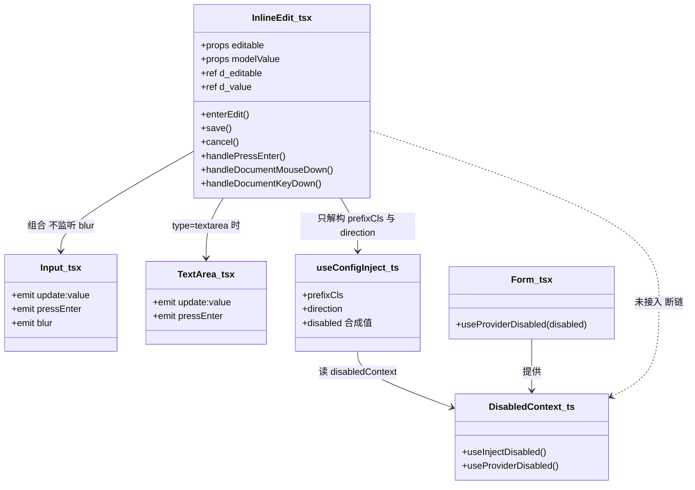
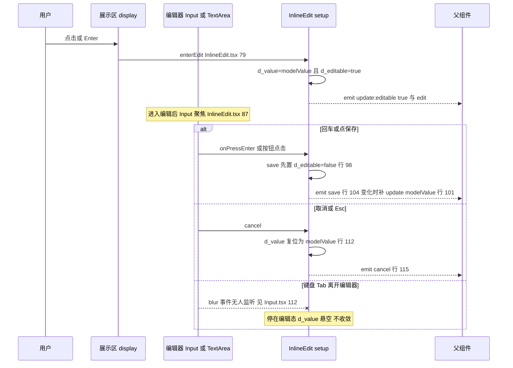
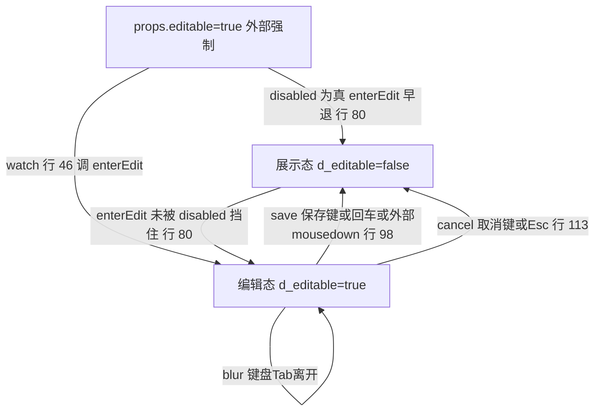

# C06-05 InlineEdit 行内编辑

> **本篇解决**：`InlineEdit` 的编辑态与展示态在哪几份状态之间来回、进入/保存/取消/失焦四条路径各自把值收敛到哪里，以及它和 `Form` 到底有没有接通——给出逐条行号。
> **前置**：C04-01 Input 输入框　**读者坐标**：`03-components/06-form-editor` 第 6/9 篇

## 一、职责与边界

`InlineEdit`（`XYInlineEdit`，标签 `xy-inline-edit`）是一个「展示区 + 就地编辑器」两态切换的受控/半受控组件：非编辑态渲染一段可点击文本，编辑态把同一块区域换成 `Input` 或 `TextArea`，并附保存/取消两个操作按钮。它负责的事只有一件——**决定编辑态什么时候进、什么时候出，以及退出时把哪一个值当作最终值发出去**。它不负责数据校验、不负责字段收集、也不负责异步保存的成败回执。

它依赖的下游是 `input`（`packages/xiaoye-ui/src/inline-edit/InlineEdit.tsx:7` 导入 `Input`、`:8` 导入 `TextArea`）与三个图标（`:6` 导入 `CheckOutlined`、`CloseOutlined`、`EditOutlined`），配置注入走 `useConfigInject`（`:5`、`:32`），样式走 CSS-in-JS 的 `genComponentStyleHook`（`:11`、`style/index.ts:210`）。它**不被任何组件依赖**——`index.ts:9`-`:12` 只把自己注册成全局组件，仓库内没有别的组件 import 它。

明确不做的事，需要在动笔前就钉死，因为它决定本篇的取证方向：

- 它不向 `Form` 注册字段。全目录 grep 不到 `FormItemContext`/`useInjectFormItemContext`/`onFieldChange`/`onFieldBlur` 任何一个符号（`InlineEdit.tsx` 全文），也就是说它「长得像表单控件，但不接 Form」，与 `C04-00` 论点 5 登记的那批「能填不能验」控件是同一族。
- 它不把 `Form` 的整体禁用接进来。`useConfigInject` 已经替它算好了合成 `disabled`（`packages/xiaoye-ui/src/config-provider/hooks/useConfigInject.ts:43`），但 `InlineEdit.tsx:32` 的解构里没有 `disabled`。这条在第七节作为坑 2 展开。

## 二、源码地图

| 文件 | 行数 | 职责 | 关键导出/入口 |
| --- | --- | --- | --- |
| `packages/xiaoye-ui/src/inline-edit/index.ts` | 14 | 导出入口与安装 | `InlineEdit` 默认导出（`index.ts:14`）、`inlineEditProps`（`:5`） |
| `inlineEditTypes.ts` | 32 | Props 工厂与类型 | `inlineEditProps`（`:8`）、`InlineEditType`（`:6`） |
| `InlineEdit.tsx` | 277 | 主实现，两态渲染与状态机 | `defineComponent` 默认导出（`InlineEdit.tsx:16`） |
| `style/index.ts` | 227 | CSS-in-JS Token 与规则 | `genComponentStyleHook('InlineEdit', …)`（`style/index.ts:210`） |
| `__tests__/inline-edit.test.tsx` | 302 | 单元测试 | 24 个 `it`、60 次 `expect(`（见第七节测试现状） |

主实现入口在 `InlineEdit.tsx:31` 的 `setup`。安装走 `registerComponent`（`index.ts:3`、`:10`），因此 `XYInlineEdit` 会被自动登记成 `xy-inline-edit` 标签，同时带内部标识 `__XY_INLINE_EDIT`（`InlineEdit.tsx:19`）。组件进入聚合入口：`packages/xiaoye-ui/src/components.ts:175`-`:185` 有 `export * from './inline-edit'`、`export { default as InlineEdit }` 与样式副作用 `import './inline-edit/style'`。

## 三、架构与数据流

组件的状态面由四份东西组成：外部 prop `editable`、内部 ref `d_editable`、外部 prop `modelValue`、内部 ref `d_value`。前两对控制「态」，后两对控制「值」。它们之间的驱动方向是不对称的——进入编辑由 `modelValue`/`editable` 单向灌入内部，退出编辑只发事件不保证回写 prop。

静态结构如下（`classDiagram` 为主实现的文件级依赖图）：



数据流闭环（`sequenceDiagram`）：展示态被点击或键盘 Enter/Space 触发 `enterEdit`，值从 `props.modelValue` 拷进 `d_value`、`d_editable` 置真、`update:editable` 发出；编辑态里三条退出路径分别走向不同的值收敛终点——保存把 `normalizeValue(d_value)` 发回外部，取消把 `d_value` 复位成 `props.modelValue`，而失焦这条在源码里根本没有边。



关键分支（`flowchart TD`）是四进四出的状态机。之所以单独画它，是因为「失焦」在图上是一条**不存在的边**——这正是本篇的核心缺陷：



图中 `B -->|blur| B` 这条自环不是画错，是源码现状的如实表达：`InlineEdit.tsx:198`-`:206` 构造编辑器 `sharedProps` 时只挂了 `onUpdate:value` 与 `onPressEnter`，没有 `onBlur`，也没有在文档上注册 `blur`。`handleDocumentMouseDown`（`:144`）用 `mousedown` 覆盖了「鼠标点外部」这一种离开方式，但键盘 `Tab` 离开不会触发任何保存或取消，于是停在编辑态。`props.editable` 强制进入这条边在 `disabled` 为真时会掉头回到展示态（`enterEdit` 在 `:80` 早退），但组件不会补发一次 `update:editable false` 去纠正外部——这条断裂是坑 5 的位置。

## 四、核心机制精读

### 论点 1：编辑态是「prop + 内部 ref」双写，而 `disabled` 早退不回写，外部强制 `editable` 会永久错帧

`d_editable` 是一个独立的内部 `ref`，它和外部 prop `editable`（声明在 `packages/xiaoye-ui/src/inline-edit/inlineEditTypes.ts:19`，默认 `false`）之间只有一条 watch 相连，且这条 watch 对进入方向调 `enterEdit`、对退出方向手工复位——两个方向的处理不对称：

```ts
// packages/xiaoye-ui/src/inline-edit/InlineEdit.tsx:36
    const d_editable = ref(props.editable);
    // 临时编辑值：进入编辑模式时从 modelValue 拷贝，保存/取消时同步或丢弃
    const d_value = ref(props.modelValue);
    const rootRef = ref<HTMLElement | null>(null);
    const inputRef = ref<any>(null);

    // 外部 editable 变化时同步内部状态
    watch(
      () => props.editable,
      val => {
        if (val && !d_editable.value) {
          enterEdit();
        } else if (!val && d_editable.value) {
          // 外部主动关闭：按取消处理，还原临时值
          d_value.value = props.modelValue;
          d_editable.value = false;
        }
      },
    );
```

进入这条分支把控制权整个交给了 `enterEdit`：

```ts
// packages/xiaoye-ui/src/inline-edit/InlineEdit.tsx:79
    function enterEdit(event?: Event) {
      if (props.disabled || d_editable.value) return;
      d_value.value = props.modelValue;
      d_editable.value = true;
      emit('update:editable', true);
      emit('edit', event);
      if (isClient) {
        nextTick(() => {
          inputRef.value?.focus?.();
        });
      }
    }
```

`enterEdit` 的第一行 `:80` 是 `if (props.disabled || d_editable.value) return;`。关键在于：当外部把 `editable` 置真、但组件恰好 `disabled` 为真时，`enterEdit` 在这行**直接 return**，既没有把 `d_editable` 置真（那当然），也**没有 emit 一次 `update:editable false` 去把外部 prop 拉回来**。于是出现一个稳定错帧：`v-model:editable` 停在 `true`，界面却渲染在展示态。`:43` 的 watch 只在 `props.editable` **变化**时触发，事后把 `disabled` 改回 `false` 也不会重跑这条 watch，父级必须再切换一次 `editable` 才能补上。这段守卫与 `emit` 的顺序（`:80` 早退、`:83` 才 emit）就是错帧的根因，第七节坑 5 落到这两行。

### 论点 2：「失焦」根本不是一条退出路径——子 `Input` 会发 `blur`，但 `InlineEdit` 不接

行内编辑最被默认的收敛语义是「点别处/离开输入框就保存」。`InlineEdit` 只实现了「鼠标 `mousedown` 到 root 之外」这一半：

```ts
// packages/xiaoye-ui/src/inline-edit/InlineEdit.tsx:144
    function handleDocumentMouseDown(event: MouseEvent) {
      if (!d_editable.value) return;
      const target = event.target as Node | null;
      if (rootRef.value && target && !rootRef.value.contains(target)) {
        save(event);
      }
    }
```

而编辑器的 props 组装里，只挂了值通道和回车通道，没有任何 `onBlur`：

```tsx
// packages/xiaoye-ui/src/inline-edit/InlineEdit.tsx:197
      const { type, placeholder, disabled } = props;
      const sharedProps = {
        ref: inputRef,
        value: d_value.value,
        placeholder,
        disabled,
        class: `${prefixCls.value}-editor`,
        'onUpdate:value': handleChange,
        onPressEnter: handlePressEnter,
      };
```

这不是「失焦保存走了别的路」，而是**失焦在组件里根本没有对应代码**。用第二种方式交叉验证：全文对 `blur`/`focus` 的引用只有 `:87` 的 `inputRef.value?.focus?.()`（进入编辑时的主动聚焦），没有任何 `onBlur`/`handleBlur`/`addEventListener('blur', …)`。与此同时，被组合的 `Input` 是**确实会发 `blur` 事件**的——它在 `packages/xiaoye-ui/src/input/Input.tsx:112`-`:114` 定义了 `handleBlur` 并 `emit('blur', e)`，在 `:29` 的 `emits` 里也登记了 `'blur'`。信号源是有的，接收端被漏接了。

后果是键盘用户的离开方式（`Tab` 键移出编辑器）既不会保存也不会取消：`handleDocumentMouseDown`（`:144`）只监听 `mousedown`、`handleDocumentKeyDown`（`:153`）只处理 `Escape`，`Tab` 不在任何一条上。此时 `d_editable` 保持 `true`、编辑器继续渲染（`:222` 的三元取假分支进不去），界面卡在一个已经失去焦点、`d_value` 悬空的半编辑态。回车、保存键、取消键、Esc 四条路径都有明确的值收敛终点，唯独「离开输入框」没有。顺带核实一条容易被误判为 bug 的行为：`type: 'textarea'` 时普通回车不保存是**有意为之**——被组合的 `packages/xiaoye-ui/src/input/TextArea.tsx:146`-`:148` 对任何 `keyCode === 13` 都会 `emit('pressEnter', e)`，进到 `InlineEdit.tsx:132` 后由 `:134` 的 `ctrlKey/metaKey/shiftKey` 判定把普通回车放行给换行、只在组合键时才 `save`（`:136`），所以 textarea 的回车语义是对的，缺陷只在「失焦」这一条。第七节坑 1 对应此处，且该分支无任何测试保护。

### 论点 3：进入编辑的初值恒取 `props.modelValue`，但外部 `modelValue` 的同步 watch 没有编辑态守卫，编辑中途会被父级推送冲掉

进入编辑时，`d_value` 的来源是干净且确定的——`enterEdit` 的 `:81` 写死 `d_value.value = props.modelValue`（见论点 1 摘录），不是从某个可能过期的内部状态里捞。这一条是对的。问题出在另一条 watch 上：

```ts
// packages/xiaoye-ui/src/inline-edit/InlineEdit.tsx:56
    // 外部 modelValue 变化时同步临时值（非编辑态或 autoSave 持续同步场景）
    watch(
      () => props.modelValue,
      val => {
        d_value.value = val;
      },
    );
```

`:56` 的注释声称这条 watch 服务的是「非编辑态或 autoSave 持续同步场景」，但 `:60` 的代码是无条件 `d_value.value = val;`，**没有 `if (d_editable.value) return;` 这样的守卫**。于是当用户正处在编辑态、`handleChange` 刚把打字结果写进 `d_value`（`:120`）时，只要父组件因任何其他原因（列表刷新、异步回填、重置）改了 `modelValue`，这条 watch 立刻用外部值覆盖掉用户尚未保存的 `d_value`。

这条病是「补了同步边、却没加编辑态护栏」：watch 让内部值跟着外部值走，护栏却没有限定「什么时候不许跟」。展示文本读的是 `props.modelValue`（`displayText` 的 `:189`），退出编辑后显示的是最新外部值；但在编辑态里被冲掉的输入是静默丢失的——不报错、不提示，用户只会看到自己打了一半的字突然变回原值。第七节坑 3 落 `:57`-`:62`。

### 论点 4：`save()` 先把编辑态关掉再通知外部，`onSave` 没有回执通道——「保存失败卡在编辑态」在这里不可能发生

派工单问的是「保存失败后是否卡在编辑态」。读下来的结论是**方向相反**：组件不但不会卡住，反而根本不给「保存失败」留任何余地。看 `save` 的行序：

```ts
// packages/xiaoye-ui/src/inline-edit/InlineEdit.tsx:93
    function save(_event?: Event) {
      if (!d_editable.value) return;
      const oldValue = props.modelValue;
      const newValue = normalizeValue(d_value.value);
      const changed = newValue !== oldValue;
      d_editable.value = false;
      emit('update:editable', false);
      if (changed) {
        emit('update:modelValue', newValue);
        emit('change', newValue);
      }
      emit('save', newValue);
      // 临时值与最新值保持一致
      d_value.value = newValue;
    }
```

`d_editable.value = false`（`:98`）与 `emit('update:editable', false)`（`:99`）都排在 `emit('save', newValue)`（`:104`）**之前**。`emit` 在 Vue 里是发完即走的单向通知，`onSave` 回调的返回值（哪怕是 `Promise`、哪怕是 `false`）不会被组件读取——`emits` 声明（`:26`）里 `save` 事件也没有任何「可返回布尔以否决」的约定。因此一旦触发保存：编辑态已经关掉、`d_value` 已经定格成 `newValue`（`:106`）、展示区（`:222` 的真分支）随即用 `props.modelValue` 渲染新值（`displayText` 的 `:189`）。若 `onSave` 里发的是异步请求且请求失败，界面早已显示成新值，调用方无法让组件「退回编辑态」，只能自己把 `editable` 再置真——而这条置真又会撞上论点 1 的 `disabled`/错帧逻辑。取消路径则相反地保持了一致：`cancel` 里 `d_value.value = props.modelValue`（`:112`）先把临时值倒回原值再退出，不发 `update:modelValue`。两相对照，`save` 缺的正是「失败可回退」这一维。第七节坑 4 落 `:98` 早于 `:104` 这个顺序。

### 论点 5：与 `Form` 的契约是三重断裂

这条是派工单点名要单独核实的。逐层拆：

其一，**不注册字段、不参与校验**。组件里没有 `useInjectFormItemContext`、没有 `formItemContext.onFieldChange/onFieldBlur` 的任何调用（全文 grep 无命中），也没有向 `Form` 暴露字段名。对照被它组合的 `TextArea`——`packages/xiaoye-ui/src/input/TextArea.tsx:156` 在 `onBlur` 里调 `formItemContext.onFieldBlur()`，`Input` 也注入了 `useInjectFormItemContext`（`packages/xiaoye-ui/src/input/Input.tsx:32`）。`InlineEdit` 把这层能力截断在了自己身上：内层 `Input` 即便触发了 `FormItemContext`（若存在），外层 `InlineEdit` 也不会把编辑结果作为表单字段值上报，因为值走的是 `update:modelValue`，而 `InlineEdit` 本身没在 `Form` 里登记。机制细节归 C06-01《Form》。

其二，**不接 `Form` 的整体禁用**。`useConfigInject` 在 `packages/xiaoye-ui/src/config-provider/hooks/useConfigInject.ts:43` 已经算好 `disabled = computed(() => props.disabled ?? disabledContext.value)`，并把 `disabled` 放进返回值（`:69`）。但 `InlineEdit.tsx:32` 的解构是 `const { prefixCls, direction } = useConfigInject('inline-edit', props);`，**没取 `disabled`**。组件此后所有禁用判定都读裸 `props.disabled`——进入编辑的守卫 `:80`、根类名 `:177`、展示类名 `:183`、编辑器传参 `:197`/`:202`、`tabindex` 的 `:225`、`aria-disabled` 的 `:227`、编辑图标的显隐 `:241`，八处全是 `props.disabled`。这正是共则 §3 判据 ① 的同一形判法（`useConfigInject.ts:43` 合成、组件不解构、`<xy-form disabled>` 失效）。

其三，**额外把 `props.disabled`（默认 `false`）硬灌进子 `Input`，短路掉 `Input` 自己的 context 兜底**。这是比前两层更重的一层：`Input` 本身是接了 `DisabledContext` 的——`packages/xiaoye-ui/src/input/Input.tsx:45` 用 `useInjectDisabled()` 取 `disabled`，`:166` 写 `disabled={props.disabled ?? disabled.value}`。`useInjectDisabled` 的默认值与来源在 `packages/xiaoye-ui/src/config-provider/DisabledContext.ts:7`-`:8`，提供方是 `useProviderDisabled`（`:10`-`:15`），`Form` 正是用它来下发整体禁用的（`packages/xiaoye-ui/src/form/Form.tsx:44` 导入、`:142` 调用 `useProviderDisabled(disabled)`）。但 `InlineEdit` 在 `sharedProps` 里把 `disabled`（来自 `:197` 解构 `props.disabled`，默认 `false`）显式传给 `Input`（`:202`）。于是 `Input.tsx:166` 的 `props.disabled ?? disabled.value` 变成 `false ?? 上下文值`——`??` 只在 `null`/`undefined` 才右落，`false` 是实值，兜底被短路。结果：在 `<xy-form disabled>` 下，`InlineEdit` 既挡不住进入编辑，连编辑框本身也不会变灰。三重断裂叠加，`InlineEdit` 与 `Form` 之间事实上没有任何契约生效。

### 论点 6：`number` 归一化用「空串保留 + 严格不等」两把尺，能把数字字段提交成空串，也能把没变报成变了

`normalizeValue` 与 `save` 的改动判定合在一起，构成一个类型契约上的洞：

```ts
// packages/xiaoye-ui/src/inline-edit/InlineEdit.tsx:69
    function normalizeValue(val: any) {
      if (props.type === 'number') {
        if (val === '' || val === null || val === undefined) return val;
        const num = Number(val);
        return Number.isNaN(num) ? val : num;
      }
      return val;
    }
```

`:71` 明确保留空串：`type` 为 `number` 时，用户把输入框清空后保存，`newValue` 是 `''`（不是 `null`、不是 `0`）。回到 `save` 的 `:97` `const changed = newValue !== oldValue;`，`'' !== 0` 为真，于是 `:101` 会把 `update:modelValue` 发成 `''`——一个声明了 `type: 'number'` 的字段，最终对外交付的值是空串，与 `InlineEditType` 里 `'number'`（`inlineEditTypes.ts:6`）的语义自相矛盾。另一半在反向：若初始 `modelValue` 是字符串 `'5'`（上游数据没归一），用户原样确认后 `Number('5')` 得数字 `5`，`5 !== '5'` 为真，`save` 会把它判成「已改动」并发出 `update:modelValue`（`:100`-`:103`），即一次什么都没改的保存也触发了类型翻转与 change 事件。`number` 分支无对应单测覆盖这条边界（测试里 `type: 'number'` 只见 `:179`、`:186` 的正常路径）。

### 论点 7：样式层没有死 CSS，但禁用语义被写了两遍、编辑图标只在 hover 时现身

把 `style/index.ts` 生成的类名逐条对齐 `InlineEdit.tsx` 渲染出的类名，结论是这个组件**没有「生成但不渲染」或「有规则但查不到键」的类名**——这是好的一面，值得如实记录，因为本仓不少组件栽在这一项上。渲染端出现的 `-display`（`InlineEdit.tsx:182`）、`-display-text`（`:239`）、`-display-icon`（`:242`）、`-content`（`:248`）、`-content-inner`（`:249`）、`-editor`（`:203`）、`-actions`（`:253`）、`-btn`/`-btn-save`/`-btn-cancel`（`:256`、`:264`）、`-rtl`（`:176`）在样式侧都有对应规则：分别是 `style/index.ts:58`、`:100`、`:110`、`:123`、`:133`、`:140`、`:146`、`:153`/`:183`/`:192`、`:53`。

但有两处值得指出的重复与一处无障碍缺口。其一，禁用样式写了两份：根级 `&-disabled` 在 `style/index.ts:200`-`:204` 把内部的 `-display` 光标设成 `not-allowed`，而展示区自己的 `&-disabled`（`style/index.ts:89`-`:93`）已经把 `cursor: not-allowed`、`color`、`opacity` 一并设好了。TSX 在 `props.disabled` 为真时同时给根挂 `-disabled`（`InlineEdit.tsx:177`）、给展示区挂 `-display-disabled`（`:183`），于是同一个「禁用光标」被两条规则各命中一次——不是 bug，但是「同一逻辑多份拷贝」在样式层的再现，删任一条都不影响观感，容易被误认为冗余而一并删掉后者导致展示区禁用态掉色。其二，编辑图标的可见性只绑在 hover 上：

```ts
// packages/xiaoye-ui/src/inline-edit/style/index.ts:73
        '&:not(&-disabled):hover': {
          color: colorText,
          background: inlineEditDisplayHoverBg,
          borderColor: colorBorder,

          [`${componentCls}-display-icon`]: {
            opacity: 1,
          },
        },

        '&:focus-visible': {
          boxShadow: 'none',
          outline: `${lineWidth * 2}px solid ${colorPrimary}`,
          outlineOffset: '2px',
        },
```

图标默认 `opacity: 0.6`（`style/index.ts:115`），只有 `:hover` 分支（`:78`-`:80`）把它提到 `opacity: 1`；而 `:focus-visible`（`:83`-`:87`）只加轮廓、不碰图标透明度。展示区是可聚焦的（`tabindex` 见 `InlineEdit.tsx:225`），但键盘聚焦时编辑图标仍是半透明——鼠标用户看得到「hover 才亮起的铅笔」，键盘用户 Tab 过来时它不会亮。这与论点 2 的「键盘路径残缺」是同一族问题在样式侧的投影，第七节坑 7 落到 `style/index.ts:83`-`:87`。

## 五、对外契约如何生效

这一节把「声明」和「实际流动」并排看，因为本篇的关键结论都藏在两者的错位里。

**前缀与方向。** `useConfigInject('inline-edit', props)`（`InlineEdit.tsx:32`）返回的 `prefixCls` 由 `packages/xiaoye-ui/src/config-provider/hooks/useConfigInject.ts:14` 的 `configProvider.getPrefixCls(name, props.prefixCls)` 生成，缺省前缀会拼成 `xy-inline-edit`（这与测试断言的 `.xy-inline-edit`、`.xy-inline-edit-display` 一致，`__tests__/inline-edit.test.tsx:36`-`:37`）。`direction` 取 `:15` 的合成值，只在 `rootClasses` 的 `:176` 用来加 `-rtl` 类。这一路是通的。

**值的流动。** `props.modelValue` 灌进 `d_value` 有两个入口：`enterEdit` 的 `:81`（进编辑时拷一次）和 `modelValue` watch 的 `:60`（外部变化时同步）。编辑器读 `d_value.value` 作为受控 `value`（`:200`），用户在 `Input` 里打字触发 `update:value` → `handleChange`（`:119`）把它写回 `d_value`。注意这条通道用的是 `value`/`update:value`，不是 `modelValue`——因为被组合的 `Input` 的 v-model 契约就是 `value`：`Input.tsx:124` `emit('update:value', …)`，`TextArea.tsx:159` 同款。`InlineEdit` 对外的值契约则是 `modelValue`/`update:modelValue`（`inlineEditTypes.ts:11`、`InlineEdit.tsx:101`），它在内部做了一次 `value↔modelValue` 的转译。这层转译在 autoSave 下会有回声：`handleChange` 每次输入都 `emit('update:modelValue')`（`:124`），父组件回灌 `modelValue` 又触发 `:60` 的 watch 把 `d_value` 覆盖一遍——因为 `d_value` 和 `val` 此时相等，不报错，但多绕了一圈。

**事件的声明冗余。** `inlineEditTypes.ts:23`-`:29` 把 `onChange`、`onSave`、`onCancel`、`onEdit` 四个回调声明成 props，`InlineEdit.tsx:26` 又把 `change`、`save`、`cancel`、`edit`（以及 `update:modelValue`、`update:editable`）声明进 `emits`。实际派发**只走 `emit`**：`emit('edit', event)`（`:84`）、`emit('save', newValue)`（`:104`）、`emit('cancel', props.modelValue)`（`:115`）、`emit('change', newValue)`（`:102`）。那四个 `onXxx` prop 声明后从未被 `setup` 读取——`grep props.onChange` 与 `props.onSave` 在 `InlineEdit.tsx` 全文零命中。它们之所以「看起来还活着」，靠的是 Vue 把 `emit('change')` 自动桥接到名为 `onChange` 的 prop 这一内建机制。结论：事件语义由 `emits` 数组定义，props 里的四个 `onXxx` 是被 Vue 消费的旁路，删掉不影响功能，但会破坏类型面（`InlineEditProps` 的类型来自 `inlineEditTypes.ts:32`）。这属于「API 面存活、实现死亡」族的轻量变体，不是运行时缺陷。

**插槽契约。** `slots` 声明在 `InlineEdit.tsx:27`-`:30`：`default` 作用域是 `{ value, editable }`，`edit` 作用域是 `{ value, save, cancel }`。渲染端一致：展示区 `:237` 传 `{ value: props.modelValue, editable: false }`，编辑区 `:250` 传 `{ value: d_value.value, save, cancel }`。用自定义 `edit` 插槽时默认操作按钮组不渲染（`:252` 的 `!slots.edit` 守卫），测试 `:299` 断言了这一点。`save`/`cancel` 作为函数原样透传给插槽，所以坑 4（保存无回执）对插槽用户同样成立——插槽里调 `save()` 一样拿不到成功/失败。

**expose。** `:172` 暴露 `{ save, cancel, edit: enterEdit }`，方法名 `edit` 对应内部 `enterEdit`（测试 `:96` 用 `.edit()`）。这三者是组件对「程序化退出/进入编辑」的唯一后门，也意味着外部想「失败后停在编辑态」只能自己不去调 `save`，一旦调了就必然退出。

## 六、设计取舍

**为什么用 `mousedown` 而不是 `blur` 来做「点外部就保存」。** `handleDocumentMouseDown`（`:144`）监听文档级 `mousedown` 并判断 `!rootRef.value.contains(target)`（`:147`），而不是监听编辑器的 `blur`。选 `mousedown` 的动机是它比 `blur` 早触发、且能捕获「点到了页面上另一个可聚焦元素」这种会顺带抢走焦点的场景，避免 `blur` 与 `mousedown` 双触发导致的重复保存。代价是：这条设计只覆盖了「鼠标离开」，把「键盘 `Tab` 离开」整条丢掉（论点 2、坑 1）。一个更完整的取舍应当是 `mousedown` 管外部点击、`blur` 管所有失焦，两者共用同一个 `save`，而当前实现只有前者。

**为什么不统一用 `useMergedState`/`v-model` 标准件，而手写 `d_editable` + 两条 watch。** 组件把「态」也做成了可双向的（`update:editable`，`:83`/`:99`/`:114`），但用的是手写双写：内部 ref 起于 `:36`，外部 prop 经 `:43` 的 watch 灌入。标准件（`useMergedState`）会把「受控/非受控」的判定收敛成一处，且带 value 复位边；这里拆成 `editable` 与 `modelValue` 两条独立 watch（`:43`、`:57`），换来的好处是能分别处理「态变化」与「值变化」，赔上的正是论点 1 的错帧（`editable` 强制进入遇 `disabled` 不回写）与论点 3 的冲值（`modelValue` watch 无编辑态守卫）。两害相权，手写双写在这里没有比标准件更省，反而多了两处守卫缺口。

**为什么 `save` 不等 `onSave` 回执就退出。** `:98` 先关态、`:104` 后发事件（论点 4）。这让组件保持了「同步、无副作用」的简单模型：不依赖调用方返回值、不存在 pending 状态、SSR 友好。代价是完全放弃异步保存语义——凡是「保存要打服务器、失败要留在编辑态」的场景都不适用，调用方只能在外层重新挂载状态机来补救。

**每个实例都挂 document 级监听。** `onMounted`（`:160`）给每个实例注册 `mousedown` 与 `keydown` 两个文档监听（`:162`-`:163`），`onBeforeUnmount`（`:166`）成对移除（`:168`-`:169`，测试 `:266`-`:273` 验证了移除）。单实例没问题，但行内编辑的典型场景是一张表里很多单元格，N 个实例就是 2N 个文档监听，每次全局 `mousedown`/`keydown` 都要遍历一遍（每个回调先判 `!d_editable.value` 早退，`:145`/`:154`）。取舍是「实现简单、无需共享调度器」，赔上是「大量实例下的监听器线性开销」，且当多个单元格同时处于编辑态（例如都用 autoSave）时，一次 `Escape`（`:154`）会把它们全部取消。

## 七、坑与改动指南

**坑 1：键盘 `Tab` 离开编辑器后卡在半编辑态，既不保存也不还原**
- 触发：进入编辑后按 `Tab` 移出输入框（不用鼠标点别处、不按回车、不按 Esc）。
- 症状：编辑器仍显示、`d_editable` 仍为 `true`、`d_value` 停在最后一次 `handleChange` 的中间值，父组件收不到任何 `save`/`cancel`/`update:modelValue`。
- 原因：组件没有失焦收敛路径，`sharedProps` 不挂 `onBlur`（`InlineEdit.tsx:198`-`:206`），文档监听只处理 `mousedown`（`:144`）与 `Escape`（`:153`）。
- 定位：`packages/xiaoye-ui/src/inline-edit/InlineEdit.tsx:198`-`:206` 与 `:144`-`:158`；子信号本可用于 `packages/xiaoye-ui/src/input/Input.tsx:112`-`:114`。该分支**无测试保护**。

**坑 2：`<xy-form disabled>` 对 inline-edit 无效**
- 触发：把 `<xy-inline-edit>` 放进 `<xy-form disabled>` 包裹范围内，或放进任何 `useProviderDisabled` 提供的子树。
- 症状：展示区仍可点击、编辑图标仍显示（`:241`）、`enterEdit` 不被拦（`:80`），连进入后的编辑框也不会变灰。
- 原因：三重断裂（论点 5）——`InlineEdit.tsx:32` 未从 `useConfigInject` 取 `disabled`；八处禁用判定只读 `props.disabled`；`:202` 又把 `disabled`（默认 `false`）硬传给 `Input`，短路了 `Input.tsx:166` 的 `props.disabled ?? disabled.value`。`useConfigInject.ts:43` 合成的 `disabled` 被整条丢弃。
- 定位：`packages/xiaoye-ui/src/inline-edit/InlineEdit.tsx:32`、`:80`、`:177`、`:202`、`:241`；合成端 `packages/xiaoye-ui/src/config-provider/hooks/useConfigInject.ts:43`；下发端 `packages/xiaoye-ui/src/form/Form.tsx:142`。形判法同共则 §3 判据 ①。现有测试只用 `props.disabled: true`（`__tests__/inline-edit.test.tsx:82`、`:94`），未测 context 通道。

**坑 3：编辑过程中父级更新 `modelValue` 会吞掉用户未保存的输入**
- 触发：进入编辑、打了几个字（`d_value` 已被 `handleChange` 改写），此时父组件从别处改了 `modelValue`。
- 症状：编辑器内容突然回退成外部新值，未保存的字符丢失，无提示。
- 原因：`:57`-`:62` 的 `modelValue` watch 无条件 `d_value.value = val`，缺 `if (d_editable.value) return` 守卫（`:56` 的注释描述了应有语义但代码没实现）。
- 定位：`packages/xiaoye-ui/src/inline-edit/InlineEdit.tsx:57`-`:62`。

**坑 4：想「保存失败就留在编辑态」做不到**
- 触发：`onSave` 里做异步校验/请求并期望失败时不退出编辑。
- 症状：界面已退回展示态并显示新值，`editable` 已变 `false`，失败时无法回退。
- 原因：`save` 在 `emit('save')` 之前就把 `d_editable` 置 `false`（`:98` 早于 `:104`），且不读 `onSave` 返回值。
- 定位：`packages/xiaoye-ui/src/inline-edit/InlineEdit.tsx:93`-`:107`。exposed 的 `save`（`:172`）同样是同步、无回执。

**坑 5：`editable` 与 `disabled` 同时为真时，`v-model:editable` 与内部态永久错帧**
- 触发：`<xy-inline-edit v-model:editable="x" :disabled="true">` 且把 `x` 置真。
- 症状：界面停在展示态，但绑定变量 `x` 仍是 `true`；事后把 `disabled` 改回 `false` 也不会自动进入编辑。
- 原因：`enterEdit` 在 `:80` 因 `disabled` 早退，`:43` 的 watch 又只在 `editable` 变化时跑、`editable` 没再变就不会重试，且早退路径不 emit 纠正值。
- 定位：`packages/xiaoye-ui/src/inline-edit/InlineEdit.tsx:43`-`:54` 与 `:79`-`:90`。

**坑 6：`type: 'number'` 可被保存成空串，且字符串数字会被误报为改动**
- 触发：数字型清空后保存；或初始 `modelValue` 为字符串 `'5'`、原样确认。
- 症状：前者对外发 `update:modelValue: ''`（类型与 `number` 契约冲突），后者一次无改动保存却触发 `change`。
- 原因：`normalizeValue` 的 `:71` 保留空串，`save` 的 `:97` 用 `!==` 严格比较跨类型值。
- 定位：`packages/xiaoye-ui/src/inline-edit/InlineEdit.tsx:69`-`:76` 与 `:96`-`:104`。`number` 边界**无测试保护**（`__tests__/inline-edit.test.tsx:177`-`:189` 只测正常转换）。

**坑 7：键盘聚焦时编辑图标不亮，与 hover 呈现不一致**
- 触发：不用鼠标，直接 `Tab` 聚焦到展示区（`tabindex` 为 `0`，`InlineEdit.tsx:225`）。
- 症状：展示区拿到焦点轮廓，但右侧铅笔图标仍是半透明，视觉上像「不可编辑」。
- 原因：图标透明度提到 `1` 只写在 `:hover` 分支（`style/index.ts:78`-`:80`），`:focus-visible` 分支（`:83`-`:87`）只设 `outline` 不设图标透明度，图标默认 `opacity: 0.6`（`:115`）。
- 定位：`packages/xiaoye-ui/src/inline-edit/style/index.ts:73`-`:87` 与 `:110`-`:120`；渲染端 `packages/xiaoye-ui/src/inline-edit/InlineEdit.tsx:242`。样式层缺陷**无测试**（测试只断言类名存在，`__tests__/inline-edit.test.tsx:37`，不测计算样式）。

**测试现状与安全边界。** 测试文件执行性由 `packages/xiaoye-ui/vitest.config.mts:33` 的 glob（`src/**/*.test.{js,ts,jsx,tsx}`，含 `.tsx`）保证。24 个用例覆盖的是渲染两态、点击/键盘进入编辑、保存/取消/Esc/外部点击的值收敛、autoSave、number 正常转换、插槽与监听移除——恰好把上面七个坑的触发面全部绕开：没有一条测试模拟 `blur`/`Tab`（坑 1）、没有 `<xy-form disabled>` 场景（坑 2）、没有编辑中回灌 `modelValue`（坑 3）、没有异步保存（坑 4）、没有 `editable+disabled` 并发（坑 5）、没有 `number` 空串（坑 6）、也没有断言聚焦态的计算样式（坑 7）。改动安全边界集中在四处状态写入点——`:81`、`:98`/`:106`、`:112`/`:113`、`:120`，动任何一处都应先补对应缺失用例。验证最小集：`pnpm --filter xiaoye-ui exec vitest run src/inline-edit` 与 `pnpm typecheck`。

## 附：本篇可证伪的三个检查点

1. **失焦不是收敛路径。** 执行 `grep -n -e blur -e Blur -e onBlur packages/xiaoye-ui/src/inline-edit/InlineEdit.tsx` 预期零命中（全文只有 `:87` 的 `focus` 与聚焦调用），而 `grep -n "emit('blur'" packages/xiaoye-ui/src/input/Input.tsx` 命中 `:114`——证明子组件会发 `blur`、父组件不接。
2. **`useConfigInject` 合成 `disabled` 但组件不解构。** 执行 `grep -n "const { prefixCls, direction } = useConfigInject" packages/xiaoye-ui/src/inline-edit/InlineEdit.tsx` 命中 `:32`（无 `disabled`），对照 `grep -n "disabled" packages/xiaoye-ui/src/config-provider/hooks/useConfigInject.ts` 命中 `:43` 与 `:69`；再 `grep -rn -e FormItemContext -e useInjectDisabled packages/xiaoye-ui/src/inline-edit/` 应零命中，即不接表单禁用、不注册字段。
3. **`save` 先关态后发事件。** 执行 `sed -n '93,107p' packages/xiaoye-ui/src/inline-edit/InlineEdit.tsx`，可见在 `save` 函数体内 `d_editable.value = false` 落在 `:98`、`emit('save', newValue)` 落在 `:104`，关态早于发事件（坑 4）；`grep -n "d_editable.value = false" packages/xiaoye-ui/src/inline-edit/InlineEdit.tsx` 另有 `:51` 与 `:113` 两处分别在 watch 与 `cancel` 内，不要与 `save` 的 `:98` 混淆。辅助计数：`grep -c "  it(" packages/xiaoye-ui/src/inline-edit/__tests__/inline-edit.test.tsx` 得 24，用于核对第七节测试面计数。
