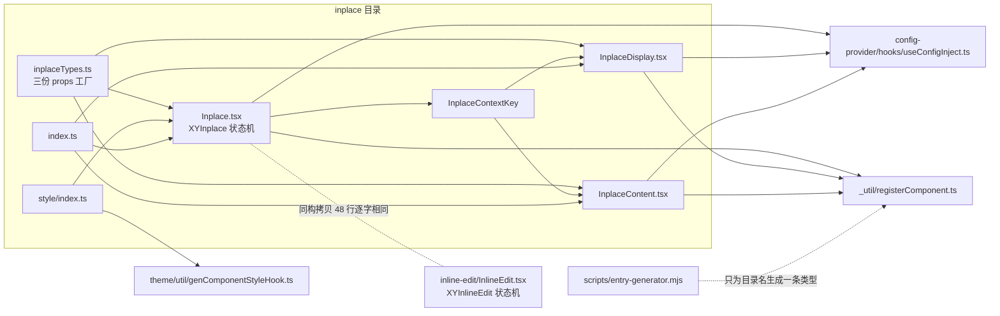
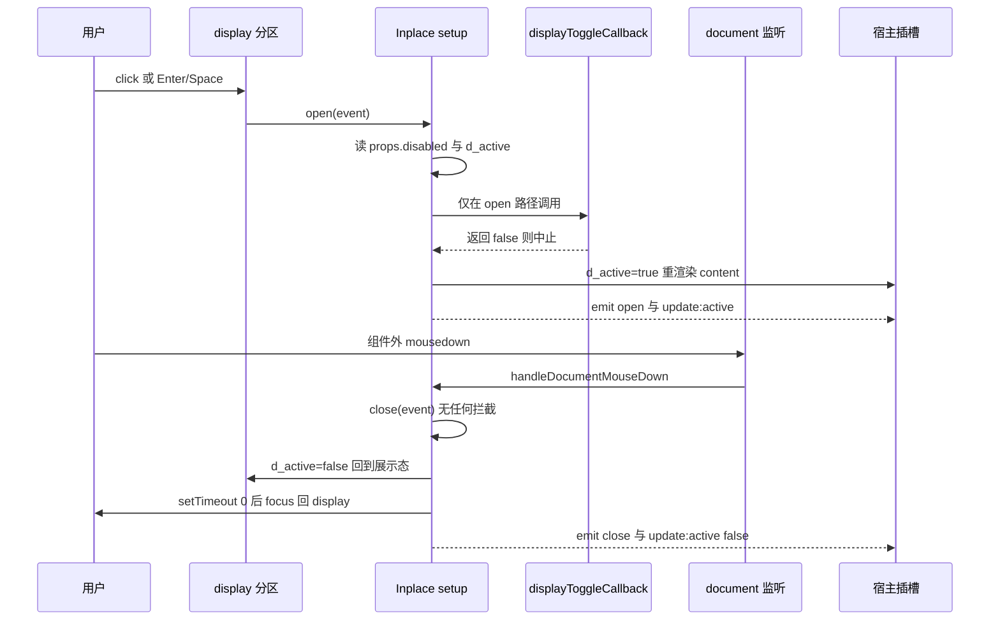
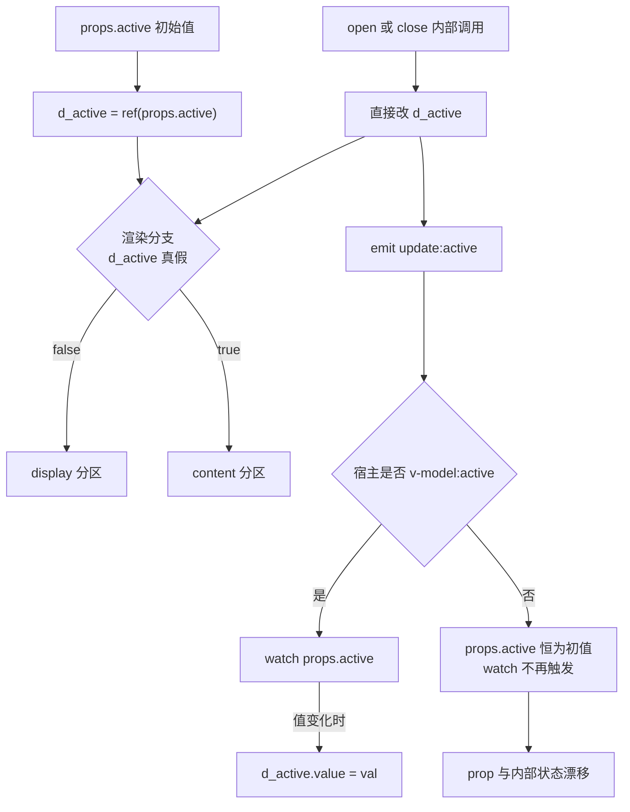

# C06-06 Inplace 原地编辑

> **本篇解决**：`XYInplace` 与 `XYInlineEdit` 是同一台「展示态/编辑态」状态机的两份拷贝，本篇用逐字行比对量化它们的重复度、列出三条已经漂移的分歧点，并逐条核对 `C06-05` 在 InlineEdit 上证过的三条结论（失焦不是退出路径、先落状态后 emit 所以宿主无法回退、`disabled` 断链）在 Inplace 上是复发还是能力差异。
> **前置**：C06-05 InlineEdit 行内编辑　**读者坐标**：`03-components/06-form-editor` 第 7/9 篇（含类横写 C06-00）

## 一、职责与边界

`XYInplace` 负责的是**一块区域在「展示态」与「编辑态」之间的切换控制器**：它持有 `active` 状态、决定谁能进入编辑（`packages/xiaoye-ui/src/inplace/Inplace.tsx:68`）、决定何时退出（`packages/xiaoye-ui/src/inplace/Inplace.tsx:78`）、并把退出动作以 `closeCallback` 交给宿主的插槽内容（`packages/xiaoye-ui/src/inplace/Inplace.tsx:174`）。

它**明确不负责**三件事，而这三件事正是判断它与 `XYInlineEdit` 是否重复的关键：

1. 不持有编辑中的值。`Inplace.tsx` 的整个文件没有 `modelValue` prop（`packages/xiaoye-ui/src/inplace/inplaceTypes.ts:9-19` 只声明 `prefixCls`/`active`/`disabled`/`closable`/`displayToggleCallback` 五项），也没有临时值副本；而 `InlineEdit` 有 `d_value` 草稿与 `normalizeValue` 归一化（`packages/xiaoye-ui/src/inline-edit/InlineEdit.tsx:38`、`:69-76`）。
2. 不渲染任何输入控件。`Inplace.tsx:13-20` 的导入面里没有 `Input`/`TextArea`，编辑区完全由 `#content` 插槽决定；`InlineEdit` 自己渲染 `<Input>`/`<TextArea>`（`packages/xiaoye-ui/src/inline-edit/InlineEdit.tsx:196-211`）。
3. 不产生「保存/取消」语义。它的 `emits` 只有 `open`/`close`/`update:active`（`packages/xiaoye-ui/src/inplace/Inplace.tsx:46`），没有 `save`/`cancel`/`change`（对照 `packages/xiaoye-ui/src/inline-edit/InlineEdit.tsx:26`）。

被谁依赖：仓库内**没有任何组件导入 `inplace`**（除自身目录与生成物；判形命令 `grep -rn "from '[^']*inplace" --include='*.ts' --include='*.tsx' --include='*.vue' packages apps` 在 `src/inplace/` 之外只有三条命中：聚合入口两行 `packages/xiaoye-ui/src/components.ts:179-180` 与主题登记一行 `packages/xiaoye-ui/src/theme/interface/components.ts:30`），挂在它名字上的只有六处：聚合入口 `packages/xiaoye-ui/src/components.ts:179-181`、包导出面 `packages/xiaoye-ui/package.json:320-324`、全局类型 `packages/xiaoye-ui/typings/global.d.ts:48`、主题 Token 注册 `packages/xiaoye-ui/src/theme/interface/components.ts:30` 与 `:110`、文档侧栏 `apps/docs/.vitepress/config/index.ts:120`、文档页 `apps/docs/components/inplace.md`。依赖谁：`useConfigInject`（`packages/xiaoye-ui/src/inplace/Inplace.tsx:52`）、`genComponentStyleHook` 样式链路（`packages/xiaoye-ui/src/inplace/style/index.ts:130`）、`classNames`、`@xiaoye-ui/icons` 的 `CloseOutlined`（`packages/xiaoye-ui/src/inplace/Inplace.tsx:16`）、`registerComponent`（`packages/xiaoye-ui/src/inplace/index.ts:21`）。

本篇不重复 `C06-00` 类横写篇已讲的表单字段注册与上下文下发共性，也不重复 `C06-05 InlineEdit 行内编辑` 已论证的三条结论本身；本篇要做的是**逐条核对它们在 Inplace 上是否复发**，并回答一个队列里悬着的问题：同一逻辑的两份拷贝，是否有一份已被另一份取代。

## 二、源码地图

| 文件 | 行数 | 职责 | 关键导出 |
| --- | --- | --- | --- |
| `packages/xiaoye-ui/src/inplace/index.ts` | 32 | 导出面与 `install`，把两个子组件静态挂到主组件 | `Inplace`（default，`:28`）、`InplaceDisplay`/`InplaceContent`（`:27`） |
| `packages/xiaoye-ui/src/inplace/Inplace.tsx` | 196 | 主实现：状态机、document 监听、插槽渲染、provide 上下文 | `XYInplace`（`:37`）、`InplaceContextKey`（`:35`）、`useInplaceContext`（`:194`） |
| `packages/xiaoye-ui/src/inplace/inplaceTypes.ts` | 35 | 三份 props 工厂与类型 | `inplaceProps`（`:9`）、`inplaceDisplayProps`（`:23`）、`inplaceContentProps`（`:29`） |
| `packages/xiaoye-ui/src/inplace/InplaceDisplay.tsx` | 55 | 展示子组件，与主组件内联 DOM 第二份拷贝 | `XYInplaceDisplay`（`:10`） |
| `packages/xiaoye-ui/src/inplace/InplaceContent.tsx` | 47 | 编辑子组件，关闭按钮第二份拷贝 | `XYInplaceContent`（`:11`） |
| `packages/xiaoye-ui/src/inplace/style/index.ts` | 145 | Design Token → CSS-in-JS | `genComponentStyleHook('Inplace', …)`（`:130`） |
| `packages/xiaoye-ui/src/inplace/__tests__/inplace.test.tsx` | 350 | 27 个显式 `it`（主组件 18、两子组件 9），`mountTest` 再各补 1 条；全文 46 次 `expect` | — |

主实现入口 `packages/xiaoye-ui/src/inplace/Inplace.tsx:37`（`defineComponent`），`setup` 在 `:51`，渲染函数从 `:145` 开始。对照实现入口 `packages/xiaoye-ui/src/inline-edit/InlineEdit.tsx:16`、`setup` 在 `:31`、渲染函数从 `:213` 开始——**行号差约 21 行，因为 Inplace 只是在头部多了 14 行的上下文类型声明**（`packages/xiaoye-ui/src/inplace/Inplace.tsx:25-35`）。

## 三、架构与数据流

### 3.1 静态结构：一份状态机，两处渲染



图中有三条线值得单独指出。第一条是 `MAIN -.同构拷贝.- IE`：两个组件不是继承关系，而是两份平行实现（论点 1 给量化证据）。第二条是 `MAIN --> CTX --> DISP/CONT`：主组件 `provide` 了一个上下文（`packages/xiaoye-ui/src/inplace/Inplace.tsx:130`），但**主组件自己的渲染函数从不消费它**——`Inplace.tsx:145-189` 全部直接读 `props` 与 `d_active`（`packages/xiaoye-ui/src/inplace/Inplace.tsx:124`、`:141`、`:158`、`:160`），因此这条 provide 链只有在宿主把子组件塞进插槽时才接通（论点 3）。第三条是 `GEN -.-> REG`：`registerComponent` 在运行时注册了三个标签，而生成器只为目录生成一条全局类型（`packages/xiaoye-ui/scripts/entry-generator.mjs:453-456`），于是两个子组件「运行时可用、类型面不存在」。

### 3.2 一次点击进入编辑、一次外部点击退出



这张图里最要紧的信息是**两条进入路径不对称**：进入编辑有三道判定（禁用、已激活、回调可否决，`packages/xiaoye-ui/src/inplace/Inplace.tsx:69-71`），退出编辑只有一道判定（`!d_active.value` 时不动作，`packages/xiaoye-ui/src/inplace/Inplace.tsx:79`），而且 `displayToggleCallback` 根本不在 `close` 的调用链上（论点 5）。

### 3.3 状态同步：prop 与内部 ref 的单向拉齐



`packages/xiaoye-ui/src/inplace/Inplace.tsx:56` 用 `ref(props.active)` 起内部态，`:60-65` 用一个非 `immediate` 的 `watch` 做 prop → 内部单向同步，`:72`/`:80` 直接写内部态，`:74`/`:82` 再 emit。这个手写的「受控/非受控二合一」在仓库里已有现成抽象 `packages/xiaoye-ui/src/_util/hooks/useMergedState.ts:24-46`（全仓 17 个文件在用它），`Inplace` 与 `InlineEdit` 都没有用（论点 6）。

## 四、核心机制精读

### 论点 1：Inplace 是 InlineEdit 状态机的逐行派生副本，48 行源码与它逐字相同，唯一被有意改掉的是「谁持有值」

两文件都从同一份骨架抄起。把 `Inplace.tsx` 的渲染入口与 `InlineEdit.tsx` 的渲染入口并排打开，除了内部态变量名（`d_active` 对 `d_editable`）、方法名（`open` 对 `enterEdit`）和一处 `ref={displayRef}`（`packages/xiaoye-ui/src/inplace/Inplace.tsx:156`，为了关闭后回填焦点而加），其余完全一致：

```tsx
// packages/xiaoye-ui/src/inplace/Inplace.tsx:145
    return () =>
      wrapSSR(
        <div
          ref={rootRef}
          class={rootClasses.value}
          {...attrs}
          aria-live="polite"
          aria-atomic="true"
        >
          {!d_active.value ? (
            <div
              ref={displayRef}
              class={displayClasses.value}
              tabindex={props.disabled ? -1 : 0}
              role="button"
              aria-disabled={props.disabled}
              onClick={open}
              onKeydown={(e: KeyboardEvent) => {
                if (e.key === 'Enter' || e.key === ' ') {
                  e.preventDefault();
                  open(e);
                }
              }}
            >
```

```tsx
// packages/xiaoye-ui/src/inline-edit/InlineEdit.tsx:213
    return () =>
      wrapSSR(
        <div
          ref={rootRef}
          class={rootClasses.value}
          {...attrs}
          aria-live="polite"
          aria-atomic="true"
        >
          {!d_editable.value ? (
            <div
              class={displayClasses.value}
              tabindex={props.disabled ? -1 : 0}
              role="button"
              aria-disabled={props.disabled}
              onClick={enterEdit}
              onKeydown={(e: KeyboardEvent) => {
                if (e.key === 'Enter' || e.key === ' ') {
                  e.preventDefault();
                  enterEdit(e);
                }
              }}
            >
```

这不是「思路相似」，而是字面复制。把两个文件按行去空白后取交集，`Inplace.tsx` 的 117 个有效行里有 48 行与 `InlineEdit.tsx` 逐字相同（约 41%），其中包含整段生命周期与监听器管理：

```tsx
// packages/xiaoye-ui/src/inplace/Inplace.tsx:107
    onMounted(() => {
      if (!isClient) return;
      document.addEventListener('mousedown', handleDocumentMouseDown);
      document.addEventListener('keydown', handleDocumentKeyDown);
    });

    onBeforeUnmount(() => {
      if (!isClient) return;
      document.removeEventListener('mousedown', handleDocumentMouseDown);
      document.removeEventListener('keydown', handleDocumentKeyDown);
    });
```

`InlineEdit.tsx:160-170` 是同一段的同一版本，连注释位置都不同但代码逐字相同。连带的模块级派生判断也是同一行代码：`packages/xiaoye-ui/src/inplace/Inplace.tsx:23` 与 `packages/xiaoye-ui/src/inline-edit/InlineEdit.tsx:14` 都是 `const isClient = typeof window !== 'undefined' && !!window.document;`。

对齐后看差异，差异恰好只集中在「值」这一维：

| 机制 | Inplace | InlineEdit | 是否同源 |
| --- | --- | --- | --- |
| 展示态/编辑态二选一渲染 | `Inplace.tsx:154` | `InlineEdit.tsx:222` | 逐字 |
| 进入判定 `disabled` 或已激活即返回 | `Inplace.tsx:69` | `InlineEdit.tsx:80` | 逐字 |
| 外部 mousedown 退出 | `Inplace.tsx:92-98` 调 `close` | `InlineEdit.tsx:144-150` 调 `save` | 结构同、语义反 |
| Esc 退出 | `Inplace.tsx:101-105` 不 `preventDefault` | `InlineEdit.tsx:153-158` 先 `preventDefault` | 结构同、差一行 |
| 关闭后焦点 | `Inplace.tsx:84-88` `setTimeout` 聚焦 display | `InlineEdit.tsx:85-89` `nextTick` 聚焦 input | 方向相反 |
| 草稿值与归一化 | 无 | `InlineEdit.tsx:38`、`:69-76` | 独有 |
| 值提交事件 | 无 | `InlineEdit.tsx:100-104` | 独有 |

结论回扣本篇之问：**没有一份被取代**。两者是同一台状态机在「值归属」两侧的两个实例——`InlineEdit` 是自带输入框与草稿值的封闭编辑器，`Inplace` 是把编辑区整个交给宿主的开放容器。真正的债务不是「多了一份实现」，而是**状态机本身（含 document 监听的注册与注销、展示区的键盘与可访问性契约、`disabled` 读取方式、`aria-live` 挂载位置）被复制了两遍且已经开始漂移**：漂移的三处（`preventDefault`、焦点回填方向、退出时提交还是丢弃）没有任何一处有跨文件的注释指向对方，改一处必然漏另一处。

### 论点 2：C06-05 的三条结论在 Inplace 上「两条复发、一条不复发」，其中 `disabled` 断链复发成了更重的双层形态

`C06-05` 在 `InlineEdit` 上证了三条。逐条核对如下。

**第一条「失焦不是退出路径」——复发。** 全目录搜索退出触发点，只有 document 级 `mousedown` 与 `keydown` 两个来源，两文件都不存在任何 `blur`/`focusout` 监听：

```bash
grep -rn -e blur -e focusout packages/xiaoye-ui/src/inplace packages/xiaoye-ui/src/inline-edit
```

该命令零命中（本篇实测退出码 1、无输出行）。症状与 `InlineEdit` 完全一致：用户 Tab 到编辑区里的下一个字段，编辑器不退出；只有**鼠标**点出去才退出。`Inplace.tsx:92-98` 的判定用的是 `rootRef.value.contains(target)`，键盘换焦点根本不产生 `mousedown`，于是 `d_active` 恒为 `true`，展示区永远回不来——除非用户碰巧再点一下别处或按 Esc。

**第二条「先落状态再 emit，因此宿主无法失败回退」——以更彻底的形式复发。** `InlineEdit.save()` 是在 `packages/xiaoye-ui/src/inline-edit/InlineEdit.tsx:98` 把 `d_editable` 置 `false`、`emit('update:editable', false)` 在 `:99`、真正的 `emit('save', newValue)` 才在 `:104`，所以宿主在 `save` 里 `return false` 也拦不住已经关闭的编辑态。Inplace 的 `close()` 是同一个顺序，而且**连一个可供否决的事件语义都没有**：

```tsx
// packages/xiaoye-ui/src/inplace/Inplace.tsx:77
    // 退出编辑模式
    function close(event?: Event) {
      if (!d_active.value) return;
      d_active.value = false;
      emit('close', event);
      emit('update:active', false);
      // 关闭后将焦点还原到展示区，便于键盘连续操作
      if (isClient) {
        setTimeout(() => {
          displayRef.value?.focus();
        }, 0);
      }
    }
```

`:79` 的 `if (!d_active.value) return;` 是这条路径上唯一的判定，`d_active.value = false` 在 `emit('close', …)` **之前**执行（`:80` 对 `:81`）。宿主能拿到的只有 `close` 这个既成事实，`emits` 声明里也不存在 `cancel`/`save`（`packages/xiaoye-ui/src/inplace/Inplace.tsx:46`）。唯一的事前拦截 `displayToggleCallback` 只在 `open()` 里被调用一次（`packages/xiaoye-ui/src/inplace/Inplace.tsx:70-71`），不在 `close()` 的调用链上——名字也印证了这一点：`toggleCallback` 只管「进」，不管「出」。

**第三条「`disabled` 硬传给子控件、短路掉子控件的 `??` 兜底」——不复发，但复发了另一条更基础的。** `Inplace` 不渲染任何输入控件（`packages/xiaoye-ui/src/inplace/Inplace.tsx:13-20` 的导入面没有 `Input`），所以「硬传 `disabled` 给子 Input」这个动作在 Inplace 里不存在，这是真实的能力面差异。取而代之的是共则 §3 判据 ① 的形态，并且叠加了默认值中毒，形成双层：

```ts
// packages/xiaoye-ui/src/config-provider/hooks/useConfigInject.ts:43
  const disabled = computed<boolean>(() => props.disabled ?? disabledContext.value);
```

第一层：`Inplace.tsx:52` 只解构了 `prefixCls` 与 `direction`——

```tsx
// packages/xiaoye-ui/src/inplace/Inplace.tsx:51
  setup(props, { slots, emit, expose, attrs }) {
    const { prefixCls, direction } = useConfigInject('inplace', props);
```

合成好的 `disabled` 被丢弃，后续 6 个读取点全部直取 `props.disabled`（`packages/xiaoye-ui/src/inplace/Inplace.tsx:69`、`:125`、`:135`、`:141`、`:158`、`:160`）。

第二层更隐蔽：**即使改成解构 `disabled` 也修不好**，因为 `props.disabled` 永远不会是 `undefined`。它在类型层就带了默认值：

```ts
// packages/xiaoye-ui/src/inplace/inplaceTypes.ts:13
  /** 是否禁用，禁用后无法进入编辑模式 */
  disabled: booleanType(false),
```

而 `booleanType` 的实现是把入参直接写进 `default`（`packages/xiaoye-ui/src/_util/type.ts:58-60`），于是 `useConfigInject.ts:43` 的 `??` 右侧恒不可达。组件定义处还又设了一遍：`packages/xiaoye-ui/src/inplace/Inplace.tsx:43` 的 `initDefaultProps` 第二参数 `{ active: false, disabled: false, closable: true }` 走的是 `prop.default = defaultProps[k]`（`packages/xiaoye-ui/src/_util/props-util/initDefaultProps.ts:20-21`）。净效果：**`<xy-config-provider :disabled="true">` 或表单级禁用上下文对 `XYInplace` 零效果**，`-disabled` 类与 `tabindex="-1"` 都不会加上（`packages/xiaoye-ui/src/inplace/Inplace.tsx:135`、`:158`）。`InlineEdit` 是「断链 + 硬传」，`Inplace` 是「断链 + 默认值中毒」，两条都需要一次改掉两层才修得干净。

附带一条与 `disabled` 同族、但 Inplace 处理正确的对照：`direction`。`inplaceProps` 根本没声明 `direction`（`packages/xiaoye-ui/src/inplace/inplaceTypes.ts:9-19`），所以 `useConfigInject.ts:15` 的 `props.direction ?? configProvider.direction?.value` 兜底可达，`Inplace.tsx:134` 的 `-rtl` 类能随全局配置生效。代价是宿主无法对单个实例覆写方向——`direction="rtl"` 会因为未声明而落进 `attrs`，被 `{...attrs}` 原样铺到根 DOM 节点上（`packages/xiaoye-ui/src/inplace/Inplace.tsx:150`），成为一个无效的 HTML 属性。这正是 `AGENTS.md` 里 `stringType<'ltr' | 'rtl'>()` 不带默认值那种写法的适用位置，本篇未把它列为缺陷，只登记为「一处修好、一处未覆盖」。

### 论点 3：两个子组件的公开面比它们能走到的渲染路径大一层——主组件从不渲染默认插槽，于是 provide 出去的上下文有 3/6 字段无人读

`XYInplace` 的插槽签名里**没有 default**：

```tsx
// packages/xiaoye-ui/src/inplace/Inplace.tsx:47
  slots: Object as CustomSlotsType<{
    display?: any;
    content?: (scope: { closeCallback: (event?: Event) => void }) => any;
  }>,
```

渲染函数里对插槽的读取只有两处，同样不含 default：

```tsx
// packages/xiaoye-ui/src/inplace/Inplace.tsx:168
            >
              {slots.display?.()}
            </div>
          ) : (
            <div class={`${prefixCls.value}-content`}>
              <div class={`${prefixCls.value}-content-inner`}>
                {slots.content?.({ closeCallback: close })}
              </div>
```

即 `grep -n "slots\." packages/xiaoye-ui/src/inplace/Inplace.tsx` 只有 `:169` 与 `:174` 两行命中。同时 `:154-187` 已经把展示区与编辑区的 DOM 自己画了一遍。两者相加的结果是：**子组件不可能作为 `XYInplace` 的 children 被渲染**，它们要么独立使用（此时 `useInplaceContext()` 返回 `null`，走 `emit` 分支，见 `packages/xiaoye-ui/src/inplace/InplaceDisplay.tsx:25-29` 与 `packages/xiaoye-ui/src/inplace/InplaceContent.tsx:23-29`），要么被宿主手写进 `#display`/`#content` 插槽里——后者产出的是一层套一层的重复控件：外层是主组件的 `<div class="xy-inplace-display" role="button" tabindex="0">`（`packages/xiaoye-ui/src/inplace/Inplace.tsx:155-161`），内层是子组件几乎同样的 `<div class="xy-inplace-display" role="button" tabindex="0">`（`packages/xiaoye-ui/src/inplace/InplaceDisplay.tsx:40-46`）。这不是假想用法，测试里就是这么写的：`packages/xiaoye-ui/src/inplace/__tests__/inplace.test.tsx:272-283` 把 `<InplaceDisplay>` 放进 `display` 插槽再点它。一个逻辑控件因此占用两个 tab 停靠点、并给出 `role="button"` 套 `role="button"` 的非法可访问性树。

上下文接口的六个字段里，实际被读到的只有三个：

| `InplaceContextValue` 字段 | 声明 | 被读 |
| --- | --- | --- |
| `prefixCls` | `Inplace.tsx:27` | 否 |
| `active` | `Inplace.tsx:28` | 否 |
| `disabled` | `Inplace.tsx:29` | 是，`InplaceDisplay.tsx:22` |
| `closable` | `Inplace.tsx:30` | 否，`InplaceContent.tsx:34` 读的是自己的 `props.closable` |
| `open` | `Inplace.tsx:31` | 是，`InplaceDisplay.tsx:26` |
| `close` | `Inplace.tsx:32` | 是，`InplaceContent.tsx:25` |

`grep -rn "ctx\." packages/xiaoye-ui/src/inplace/*.tsx` 只有两条命中（`InplaceContent.tsx:25`、`InplaceDisplay.tsx:26`），加上可选链形式的 `ctx?.disabled.value`（`packages/xiaoye-ui/src/inplace/InplaceDisplay.tsx:22`）共三处读取。`closable` 的丢失是行为性的：主组件 `closable={false}` 时，插槽里手写的 `<xy-inplace-content>` 仍会照自己的默认值渲染出关闭按钮（`packages/xiaoye-ui/src/inplace/inplaceTypes.ts:32` 的 `booleanType(true)` 加 `packages/xiaoye-ui/src/inplace/InplaceContent.tsx:15` 的再设一遍），也就是说**同一份 DOM 里会出现「关掉关闭按钮」关不掉的第二个关闭按钮**。

导出面还在继续放大这个缺口。`install` 一次注册三个标签：

```ts
// packages/xiaoye-ui/src/inplace/index.ts:19
/* istanbul ignore next */
Inplace.install = function (app: App) {
  registerComponent(app, Inplace);
  registerComponent(app, InplaceDisplay);
  registerComponent(app, InplaceContent);
  return app;
};
```

`registerComponent` 会把 `XYInplaceDisplay` 译成标签 `xy-inplace-display`（`packages/xiaoye-ui/src/_util/registerComponent.ts:6-11`、`:22-25`），所以运行时三个标签都真能解析。但生成全局类型的那段只按「目录 = 一个模块 = 一个 PascalCase 名」发射一条：

```js
// packages/xiaoye-ui/scripts/entry-generator.mjs:453
for (const mod of modules) {
  if (!mod.hasDefault || nonComponentDirs.includes(mod.name)) continue;
  lines.push(`    XY${mod.pascalName}: (typeof import('xiaoye-ui'))['${mod.pascalName}'];`);
}
```

于是 `packages/xiaoye-ui/typings/global.d.ts:48` 只有 `XYInplace` 一行，`XYInplaceDisplay`/`XYInplaceContent` 在 `GlobalComponents` 里根本不存在——模板里写这两个标签，运行时能渲染、类型检查会报未知组件。同一个不对称还出现在元数据面：`packages/metadata/src/components/index.ts:86` 登记了 `'InlineEdit'`，而全文件搜不到 `'Inplace'`（`grep -rn "'Inplace'" packages/metadata/src` 零命中），也就是说 Inplace 从未进入那份 130 条的组件清单。文档面则相反：`apps/docs/components/inplace.md:84-111` 为两个子组件各写了一节 API 表格，`:115` 明确把 `xy-inplace-display`、`xy-inplace-content` 列为合规标签，而五个示例文件（`apps/docs/examples/inplace/` 下 `basic`/`with-input`/`with-form`/`custom-trigger`/`disabled`）**没有一处用到它们**——`grep -rn "xy-inplace-display" apps/docs/examples` 零命中。

一句话收口：Inplace 有三个组件的公开面、两个组件的 DOM 产出路径、一个组件的实际文档用法。

### 论点 4：三个 ComponentToken 全部被 `styleFn` 内部的 `mergeToken` 覆盖，主题覆写对 Inplace 零效果

样式文件声明了三个组件级 Token，并在 `genComponentStyleHook` 的第三参数给了兜底默认值：

```ts
// packages/xiaoye-ui/src/inplace/style/index.ts:130
export default genComponentStyleHook(
  'Inplace',
  token => {
    const inplaceToken = mergeToken<InplaceToken>(token, {
      inplaceDisplayHoverBg: token.colorBgLayout,
      inplaceDisplayPadding: token.paddingXS,
      inplaceCloseSize: token.controlHeightSM,
    });
    return [genInplaceStyle(inplaceToken)];
  },
  {
    inplaceDisplayHoverBg: 'transparent',
    inplaceDisplayPadding: 8,
    inplaceCloseSize: 24,
  },
);
```

链路是三段。第一段：宿主通过 `ConfigProvider` 的 `theme.components.Inplace` 注入的值确实会到达——`packages/xiaoye-ui/src/theme/util/genComponentStyleHook.ts:85` 做的是 `{ ...defaultComponentToken, ...token.value[component] }`，用户值盖掉第三参数那三个默认值；`packages/xiaoye-ui/src/theme/interface/components.ts:106` 的 `Inplace?: InplaceComponentToken`（由 `:30` 从 `inplace/style` 导入）保证这条路径在类型上也开着。第二段：`genComponentStyleHook.ts:88-99` 用 `mergeToken(proxyToken, { componentCls, … }, mergedComponentToken)` 把它并进 token，顺序正确、用户值仍在。第三段翻车：`styleFn` 自己又调了一次 `mergeToken(token, { inplaceDisplayHoverBg: token.colorBgLayout, … })`（`packages/xiaoye-ui/src/inplace/style/index.ts:133-137`），而 `mergeToken` 就是 `Object.assign({}, ...objs)`（`packages/xiaoye-ui/src/theme/util/statistic.ts:11-14`），后面对象覆盖前面对象——三个键在同一层被别名 Token 无条件重写。

净结果有两个，都是硬的：**(a)** `theme.components.Inplace` 里三个键全部无效，配了也白配；**(b)** 第三参数那份 `getDefaultToken`（`packages/xiaoye-ui/src/inplace/style/index.ts:140-144`）永远读不到，因为无论它填什么，都会在 `:133-137` 被同名键盖掉——`inplaceDisplayHoverBg: 'transparent'` 与 `inplaceDisplayPadding: 8` 这两份「默认值」和实际生效值（`colorBgLayout`、`paddingXS`）不一致，会误导后来人按它排查。

这不是 Inplace 的孤例，而是可以用命令圈出来的通病，但 Inplace 是命中最重的一个。把「第三参数声明的键」与「`styleFn` 内 `mergeToken` 重设的键」求交集，全仓只有两个组件命中，Inplace 是 3/3 全中：

```bash
# 输出：inplace -> 3 个键全被覆盖；menu -> menuSubMenuBg 1 个键
```

具体脚本与判形见「附：本篇可证伪的三个检查点」第 3 条。

顺带一条同文件内的死面：主组件在根节点上发出的 `-disabled` 类没有任何样式规则承接。它只在 `packages/xiaoye-ui/src/inplace/Inplace.tsx:135` 被发出，而 `style/index.ts` 里与 disabled 相关的只有两条，都挂在展示区下面（`:60` 的 `'&:not(&-disabled):hover'` 与 `:71` 的 `'&-disabled'`，编译后是 `.xy-inplace .xy-inplace-display…`），没有 `.xy-inplace-disabled` 这条选择器。也就是说禁用在根层只剩「让子节点样式连带生效」这一条路，任何想给禁用态整块加透明度或禁用指针的意图都落不了地。这是本仓缺陷族里「生成但从不消费的类名」的镜像形态：类名发了，规则表里查不到。

### 论点 5：退出路径不归 Inplace 管，但它抢占了全局事件——同一页两份实现会互相触发，插槽里的弹层会被自己关掉

document 级监听只有两个来源，都在 `onMounted` 里无条件注册：

```tsx
// packages/xiaoye-ui/src/inplace/Inplace.tsx:91
    // 外部点击关闭：点击发生在组件根节点之外时退出编辑模式
    function handleDocumentMouseDown(event: MouseEvent) {
      if (!d_active.value) return;
      const target = event.target as Node | null;
      if (rootRef.value && target && !rootRef.value.contains(target)) {
        close(event);
      }
    }

    // Esc 键关闭
    function handleDocumentKeyDown(event: KeyboardEvent) {
      if (event.key === 'Escape' && d_active.value) {
        close(event);
      }
    }
```

四个可分离的后果。

**其一，Esc 在这里是「关闭」而不是「取消」，且不改回任何东西。** `Inplace` 不持有草稿值（论点 1 的能力差异），编辑区里的 `<xy-input v-model:value="...">` 直接把改动写进宿主状态，例如 `apps/docs/examples/inplace/with-input.vue:9` 就绑在宿主的 `value` 上。于是按 Esc：`close(event)`（`:103`）把面板换回展示区，展示区渲染的是已经改过的值（`:169`）。想区分「Esc 关闭」与「点按钮关闭」，宿主只能去读 `close` 事件载荷里的原始 DOM 事件（`:81` 透传 `event`），而 `emit('close', event)` 的载荷在文档里只写成 `function(event)`（`apps/docs/components/inplace.md:64-68`），没说这个 event 可能来自 `keydown`、也可能来自 `mousedown`、也可能是 `undefined`（宿主自己调 `closeCallback()` 时，见 `apps/docs/examples/inplace/with-form.vue:39`）。Inplace 没有撤销语义可用，这是契约缺口而不是实现 bug，但它是**文档承诺的「Esc 退出」在真实表单场景下会被读成「Esc 撤销」**（`apps/docs/components/inplace.md:9`）。

**其二，`keydown` 监听不判 target 归属。** `:102` 的条件只有 `event.key === 'Escape' && d_active.value`，没有任何 `contains` 判定（与 `:95` 的 mousedown 路径不同）。页面里同时激活的多个实例会被同一次按键一起关掉。更值得注意的是跨实现串扰：`InlineEdit` 用的是同一套写法（`packages/xiaoye-ui/src/inline-edit/InlineEdit.tsx:153-158`），而它调了 `event.preventDefault()`（`:155`）、Inplace 没调，两者都注册在 `document` 上且都不 `stopPropagation`，所以「一个活跃的 InlineEdit + 一个活跃的 Inplace」一次 Esc 全部退出。按 `grep -rn "addEventListener('keydown'" --include='*.ts' --include='*.tsx' packages/xiaoye-ui/src` 统计，向 `document` 挂键盘监听的实现共两处（`packages/xiaoye-ui/src/inplace/Inplace.tsx:110` 与 `packages/xiaoye-ui/src/inline-edit/InlineEdit.tsx:163`，恰好就是本条对照的两份实现）；换成更宽的第二种判形 `grep -rn "addEventListener(['\"]key"` 只多出一条 `packages/xiaoye-ui/src/key-filter/useKeyFilter.ts:163` 的 `keypress`，且那一条挂在目标元素上、不在 `document` 上。Esc 的所有权在本仓是这两份行内/原地编辑实现的公共地带。

**其三，mousedown 与 click 的先后顺序决定了「一次点击驱动两台状态机」。** 同一个物理点击先派发 `mousedown` 再派发 `click`。若 `InlineEdit` 正在编辑、用户去点 Inplace 的展示区：`InlineEdit.tsx:144-149` 在 mousedown 阶段执行 **save**（`:148`），紧接着 click 阶段 `Inplace.tsx:161` 执行 **open**。同一次点击在两份实现上分别是「提交」与「进入」，谁也拦不住谁。

**其四，`#content` 里放任何浮层组件都会「点一下就丢编辑态」。** 判定用的是 `!rootRef.value.contains(target)`（`:95`），而浮层默认挂到 `document.body`，不在 `rootRef` 子树内：`packages/xiaoye-ui/src/_util/Portal.tsx:69` 用 `<Teleport to={container}>` 渲染，容器在 `packages/xiaoye-ui/src/vc-trigger/Trigger.tsx:455-456` 缺省即 `getDocument(...).body`。于是在编辑区里放一个 `<xy-select>` 或 `<xy-date-picker>`，展开选项面板后点选项：mousedown 落在 body 下的弹层里 → `contains` 为假 → `close()` 立刻把整个编辑区卸载，选中值能不能落进宿主状态取决于该组件在关闭前是否已经提交。这一条是本篇认为最容易被真实业务撞上的坑，而它由论点 1 的复制粘贴继承而来（`InlineEdit` 同位置同写法，只是它在那里执行的是 save）。

### 论点 6：`active` 的受控与非受控各写了一半，缺少仓库里现成的 `useMergedState`

```tsx
// packages/xiaoye-ui/src/inplace/Inplace.tsx:55
    // 内部激活状态：与 props.active 双向同步
    const d_active = ref(props.active);
    const rootRef = ref<HTMLElement | null>(null);
    const displayRef = ref<HTMLElement | null>(null);

    watch(
      () => props.active,
      val => {
        d_active.value = val;
      },
    );
```

`:55` 的注释写的是「双向同步」，实际代码是**单向拉齐 + 内部直写**：prop 变化时覆盖内部态（`:62-64`），内部动作时改内部态并 emit（`:72/:80` 写、`:74/:82` 播）。这带来两个可判定的后果。

第一，一旦宿主只提供初值不接 `v-model`（例如只写 `:active="true"`），`close()` 之后 `props.active` 仍是 `true`，而 `d_active` 已经 `false`——`watch` 只在值变化时触发，值没变就不再拉齐，于是**「把 `active` 设回 true」这件事无法再次打开编辑器**（宿主只能先设 false 再设 true 制造一次变化）。测试恰好把这条路径停在了中间：`packages/xiaoye-ui/src/inplace/__tests__/inplace.test.tsx:193-206` 传 `props: { active: true }` 后派发 Escape，只断言 `emitted('close')`，不回头核对 prop 与 DOM 是否仍一致；而 `:237-248` 的「keeps active state synced with prop」只覆盖了 prop → 内部的正向同步（`setProps({ active: true })`），没有任何一条用例从内部关闭后再改 prop。

第二，`ref(props.active)` 只取**挂载时**的 prop 值，`watch` 又没带 `immediate`，所以异步决定的初值（父组件在下一拍才把 `active` 设为 true 且值恰好从 `undefined` 变成 `true` 的情况）仍要靠 `booleanType(false)` 的默认值先把 `props.active` 钉成 `false`（`packages/xiaoye-ui/src/inplace/inplaceTypes.ts:12`）才能自洽——这条链路是通的，但它通在默认值上，而不是通在同步逻辑上。

仓库里对这件事有标准解法：`packages/xiaoye-ui/src/_util/hooks/useMergedState.ts:24-46` 同时处理「外部受控值优先」（`mergedValue` 在被受控时不改内部态）与「非受控回落内部初值」，并在 `:36` 只在值真的变了时才回调 `onChange`。`grep -rl "useMergedState" packages/xiaoye-ui/src` 命中 17 个文件（含其自身定义，即 16 处使用方），`inplace/` 与 `inline-edit/` 都在名单外（`grep -rn "useMergedState" packages/xiaoye-ui/src/inplace packages/xiaoye-ui/src/inline-edit` 零命中）。同一族「两份拷贝各写一半受控逻辑」的问题，在这里第三次出现。

最后一条属于收尾质量：`close()` 里那个 `setTimeout(…, 0)`（`packages/xiaoye-ui/src/inplace/Inplace.tsx:85-88`）没有在 `onBeforeUnmount` 里取消。组件在同一个宏任务里被卸载时，回调仍会跑一次，`displayRef.value?.focus()`（`:86`）因可选链而落到已脱离文档的元素上——不会抛错，但也不再是「回填焦点」，而是一次无效动作。与之相对，`:113-117` 的两个 document 监听是成对注销的，`packages/xiaoye-ui/src/inplace/__tests__/inplace.test.tsx:337-349` 专门断言了这一点（注意该用例被写在 `describe('InplaceContent')` 块里，测的却是 `Inplace`，文件名与用例归属不一致）。

## 五、对外契约如何生效

**props：五个声明，五个真被读。** 这一层 Inplace 比本仓平均水准干净——不存在「API 面存活、实现死亡」的 prop。逐个跟到底：`prefixCls`（`packages/xiaoye-ui/src/inplace/inplaceTypes.ts:10`）不进 `setup`，而是被 `useConfigInject` 第二参数接走，走 `configProvider.getPrefixCls(name, props.prefixCls)`（`packages/xiaoye-ui/src/config-provider/hooks/useConfigInject.ts:14`）；`active`（`inplaceTypes.ts:12`）在 `Inplace.tsx:56` 作初值、`:61` 作 watch 源；`disabled` 有 6 个读取点（`:69`、`:125`、`:135`、`:141`、`:158`、`:160`）；`closable` 只在 `:176` 决定关闭按钮是否渲染；`displayToggleCallback` 只在 `:70` 取出、`:71` 判定。

但**读取路径本身有断链**：`disabled` 全部读 `props.disabled`，绕开了 `useConfigInject.ts:43` 合成好的那个（论点 2 的双层形态）。所以在 Inplace 上，「`disabled` 契约」等价于「只认实例自己传的值」，全局与表单级禁用不参与。类型面的三处默认值也都在这里：`inplaceTypes.ts:12`、`:14`、`:16` 各带一个 `booleanType(...)`，`Inplace.tsx:41-45` 的 `initDefaultProps` 又设一遍同样的三个键——**同一批默认值写了两次**，这本身无害，但它让「把 `props.disabled` 换成注入值」这一步无法单独完成。

**slots：两个具名，无 default，一个带作用域。** `#display` 被 `:169` 直接调用、不带任何作用域参数（`Inplace.tsx:48` 的 `display?: any`），因此展示区拿不到组件内部状态；`#content` 是唯一的作用域插槽，`Inplace.tsx:174` 把 `{ closeCallback: close }` 递出去，递给它的正是 `:78` 那个无条件关闭函数。`slots` 的类型声明面（`Inplace.tsx:47-50`）与读取面一致，没有第三个插槽被读取（论点 3）。

**expose：两个方法，绕过了全部拦截。** `Inplace.tsx:119` 的 `expose({ open, close })` 把内部函数原样交出去。`open` 仍受 `:69` 的 `disabled` 判定与 `:71` 的回调判定保护（测试 `packages/xiaoye-ui/src/inplace/__tests__/inplace.test.tsx:127-137` 就断言了「disabled 时调 expose 的 open 不生效」），`close` 只受 `:79` 的 `!d_active` 保护。所以宿主用 ref 主动关闭时，连 `displayToggleCallback` 都不经过——这个方向上「拦截」这件事根本不存在。

**emits：三个都真发。** `open` 在 `:73`、`close` 在 `:81`、`update:active` 在 `:74` 与 `:82` 各一次，参数分别是原始 DOM 事件（可能为 `undefined`）与布尔值。子组件的 `click`/`close` 事件（`InplaceDisplay.tsx:16`、`:28` 与 `InplaceContent.tsx:17`、`:27`）声明在 `emits` 里、也确会触发，**但只在脱离 `XYInplace` 独立使用时**——一旦在 `XYInplace` 树内（能注入到上下文），就改走 `ctx.open`/`ctx.close`，事件不 emit。这是文档 `apps/docs/components/inplace.md:96`、`:111` 里那句「在 `XYInplace` 内部使用时不会触发，由父组件接管」的来源，属实。

**attrs：三条摆放顺序不一致的透传路径。** `Inplace.tsx:39` 与 `InplaceDisplay.tsx:12`、`InplaceContent.tsx:13` 都设了 `inheritAttrs: false`，然后各自主动手工合并 `attrs.class`：`Inplace.tsx:133`、`InplaceDisplay.tsx:41`、`InplaceContent.tsx:32`。而展开又各自不同位置：根节点在 `class` 之后立刻 `{...attrs}`（`Inplace.tsx:149-150`），`InplaceDisplay` 把 `{...attrs}` 夹在 `aria-disabled` 与自己绑的 `onClick`/`onKeydown` 之间（`packages/xiaoye-ui/src/inplace/InplaceDisplay.tsx:46-49`），`InplaceContent` 则是同一行里 `class` 紧跟 `{...attrs}`（`packages/xiaoye-ui/src/inplace/InplaceContent.tsx:32`）。本篇**不断言** JSX 插件对同一键重复出现的最终合并语义（那是构建链行为，不在本仓引用范围内）；需要记下的事实是：同一个 `attrs` 在三处被合并两遍，且只有 `InplaceDisplay` 把自己绑的 `onClick` 写在 attrs 展开之后——也就是「宿主传的 `onClick` 与组件自己的 `onClick` 谁生效」这个问题，在三个节点上的代码写法给的是三种答案。改动前先跑一个真实用例确认，别照抄另一个节点的经验。

**样式契约：入口挂 hashId，Token 契约半失效。** `useStyle(prefixCls)` 在 `Inplace.tsx:53` 取回 `[wrapSSR, hashId]`，`hashId` 进 `rootClasses`（`:133`）、`wrapSSR` 包住整棵树（`:146`），这条是通的。断的是组件级 Token 覆写：`ComponentToken` 三个键（`packages/xiaoye-ui/src/inplace/style/index.ts:8-12`）经 `theme/interface/components.ts:106` 暴露给主题配置，却同一层被 `mergeToken` 重写（论点 4）。

## 六、设计取舍

**取舍一：值所有权交给宿主，代价是放弃一切「提交语义」。** 这是 Inplace 与 InlineEdit 唯一的分野，也是本篇判断「没有一份被取代」的依据。把 `#content` 整个留给宿主（`Inplace.tsx:174`），换来的是编辑区可以放任何控件——`apps/docs/examples/inplace/with-form.vue:8-20` 放的是完整的 `xy-form` + 两个 `xy-form-item`，这类东西 InlineEdit 那种「我替你渲染 Input」的设计永远装不下。赔上的是：一旦值不在组件手里，它就无法提供草稿、无法回滚、无法在关闭前问一句「存好了吗」。所以它的 `emits` 只有三个（`:46`），`displayToggleCallback` 只守进（`:70-71`），`close` 先落状态后 emit（`:80-81`）。这不是偷懒，是**该设计必然的推论**：想同时要「开放插槽」和「可否决的提交」，就得把草稿值的所有权也一并交给宿主（即 `close` 收一个 `done(err?)` 回调），而现在的 `closeCallback: (event?: Event) => void` 签名（`:49`）连异步回执都没留。

**取舍二：自己挂 document 监听，而不用本仓已有的浮层基础设施。** 仓库里 `vc-trigger` 已经把「外部点击」这件事做成了带 Portal、带 `getPopupContainer` 协议的一层（`packages/xiaoye-ui/src/vc-trigger/Trigger.tsx:448-465`、`packages/xiaoye-ui/src/_util/Portal.tsx:69`），Inplace 与 InlineEdit 都没用，各自在 `onMounted`/`onBeforeUnmount` 里手写两份 `document` 监听（`Inplace.tsx:107-117`、`InlineEdit.tsx:160-170`）。换来的是依赖面极小、SSR 安全（`isClient` 判断 + 只在挂载后注册，`Inplace.tsx:23`、`:108`）、tree-shaking 时不会被 `vc-trigger` 拖累。赔上的是：它把「外部」定义成 `!rootRef.value.contains(target)`（`:95`），而浮层节点天然在 body 下，于是任何带浮层的编辑控件都被这条判定判成了「点击外部」（论点 5 其四）；同时 Esc 成了公共地带（同页多实例、跨两份实现互相触发）；再加一份按实例数线性增长的全局监听开销——每个 Inplace 实例两个监听，卸载才注销。

**取舍三：子组件既保留又内联，两条路都留着。** `#display`/`#content` 插槽是主干，`XYInplaceDisplay`/`XYInplaceContent` + `provide/inject` 是第二条路，主组件自己的 DOM 是第三条路（`:154-187`）。看起来是「兼容两种写法」，实际收益只有「子组件可独立使用」这一条（`InplaceDisplay.tsx:24-30` 的 `else` 分支就是为它写的）。赔上的是：三条路径的 class 名互相碰撞（两处都发 `.xy-inplace-display`，测试只能靠文档顺序命中主组件那个），上下文 6 个字段有 3 个没人读，`closable` 在两处独立决定（`:176` 与 `InplaceContent.tsx:34`），以及类型面/元数据面只登记了三个组件中的一个（`packages/xiaoye-ui/scripts/entry-generator.mjs:453-456`、`packages/xiaoye-ui/typings/global.d.ts:48`）。**如果只能改一处**，本篇认为不是把子组件删掉，而是让主组件改为渲染 `slots.default` 并把上下文接通——那才能让「文档写了的三个标签」和「实现能走通的路径」对上。

**取舍四（未做的设计）：为什么没抽 `useInplaceState`。** 论点 1 的 48 行相同源码是可以抽成一个 hook 的：内部态、`open`/`close`、两个 document 监听、`rootClasses`/`displayClasses` 计算，全都不依赖具体控件。没抽的原因是两份实现的分歧点恰好落在它们最在意的地方（关闭时是提交还是丢弃、聚焦给谁、要不要 `preventDefault`），抽出来就得让这些以参数形式传进去，而调用方只有两处。这个理由在代码里没有任何注释支撑，属于本篇的重构；即便如此，两处漂移（`InlineEdit.tsx:155` 与 `Inplace.tsx:101-105` 差一行 `preventDefault`）已经是**不一致的实际产物**，而不是设计的结果。

## 七、坑与改动指南

以下每条按「触发 → 症状 → 原因 → 定位」写，定位均可直接跳转。

**坑 1：编辑区里放任何带浮层的控件，一点选项编辑态就没了。**
触发：`#content` 里放 `<xy-select>`/`<xy-date-picker>`/`<xy-tooltip>` 之类，展开面板后点击面板内选项。
症状：编辑区整个卸载、回到展示态，选中结果按不落地取决于该控件在卸载前是否已提交；用户表现为「一点下拉就退出编辑」。
原因：外部点击判定 `!rootRef.value.contains(target)` 为真——浮层默认挂到 `document.body`。
定位：`packages/xiaoye-ui/src/inplace/Inplace.tsx:95`（判定）与 `packages/xiaoye-ui/src/inplace/Inplace.tsx:109`（注册）；容器缺省值 `packages/xiaoye-ui/src/vc-trigger/Trigger.tsx:455-456`、`packages/xiaoye-ui/src/_util/Portal.tsx:69`。同源副本在 `packages/xiaoye-ui/src/inline-edit/InlineEdit.tsx:147`，只是那里执行的是 `save`。改法：给 `contains` 之外再加一层「目标是否落在本组件派生的浮层容器内」判定，或让宿主可通过 `getPopupContainer` 把浮层挂回根节点（`packages/xiaoye-ui/src/inplace/inplaceTypes.ts:9-19` 目前**没有**任何容器类 prop）。该分支无测试保护。

**坑 2：一次 Esc 关掉页面上所有活跃的编辑器。**
触发：同页放两个 `xy-inplace`（或 `xy-inplace` 与 `xy-inline-edit` 各一），使它们先后进入编辑态，然后按一次 Esc。
症状：两个（跨实现也一样）都退出编辑态；而且两者退出的语义相反——`InlineEdit` 的 Esc 走 `cancel`，丢弃草稿并 emit `cancel`（`packages/xiaoye-ui/src/inline-edit/InlineEdit.tsx:156` 调 `:110-116`），Inplace 的 Esc 走 `close`，不回滚宿主已通过 `v-model` 收到的改动。一次按键、两种后果。
原因：两处都往 `document` 挂 `keydown`，判定只看 `event.key === 'Escape'` 与自身 `d_active`/`d_editable`，无 target 归属判定、无 `stopPropagation`；且 Inplace 连 `preventDefault` 都没调。
定位：`packages/xiaoye-ui/src/inplace/Inplace.tsx:101-105` 对照 `packages/xiaoye-ui/src/inline-edit/InlineEdit.tsx:153-158`。测试只覆盖了单实例路径（`packages/xiaoye-ui/src/inplace/__tests__/inplace.test.tsx:193-206`）。

**坑 3：全局/表单级 `disabled` 对 Inplace 零效果。**
触发：`<xy-config-provider :disabled="true">` 或表单级禁用上下文里放 `<xy-inplace>`。
症状：展示区照样可点、可 Tab、可 Enter 进入编辑，根节点与展示区都没有 `-disabled` 类，`tabindex` 仍是 `0`。
原因：两层叠加——① `setup` 只解构 `prefixCls`/`direction`，丢掉了 `useConfigInject` 已合成的 `disabled`；② `props.disabled` 带 `false` 默认值，使 `useConfigInject.ts:43` 的 `??` 右侧永不可达，所以只补 ① 也修不好。
定位：`packages/xiaoye-ui/src/inplace/Inplace.tsx:52`、`packages/xiaoye-ui/src/config-provider/hooks/useConfigInject.ts:43`、`packages/xiaoye-ui/src/inplace/inplaceTypes.ts:14`、`packages/xiaoye-ui/src/inplace/Inplace.tsx:43`。这条与共则 §3 判据 ①、`C06-05` 已证的「硬传短路」是同族的第三种形态（断链 + 默认值中毒）。

**坑 4：主题里配 `components.Inplace` 三个键，改不动任何样式。**
触发：`theme: { components: { Inplace: { inplaceCloseSize: 40 } } }`。
症状：关闭按钮仍是 `controlHeightSM`，数值毫无变化；不报错、无警告。
原因：用户值确实到了 `genComponentStyleHook`（`{ ...defaultComponentToken, ...token.value[component] }`），但在 `styleFn` 内部又被同名的 `mergeToken(token, { ... })` 无条件覆盖，`mergeToken` 即 `Object.assign`。
定位：`packages/xiaoye-ui/src/inplace/style/index.ts:133-137`（覆盖点）、`:140-144`（被架空的 `getDefaultToken`，其 `'transparent'`/`8`/`24` 三值和实际生效值不一致，会误导排查）、`packages/xiaoye-ui/src/theme/util/genComponentStyleHook.ts:85`、`packages/xiaoye-ui/src/theme/util/statistic.ts:11-14`。同类命中另有 `menu` 的 `menuSubMenuBg`，全仓就这两个组件。

**坑 5：`displayToggleCallback` 写成 async 就完全失效。**
触发：`:display-toggle-callback="async () => { await check(); return false; }"`。
症状：照样进入编辑态。
原因：类型允许返回 `Promise<boolean | void>`（`packages/xiaoye-ui/src/inplace/inplaceTypes.ts:7`），但实现是同步比较 `cb(event) === false`（`packages/xiaoye-ui/src/inplace/Inplace.tsx:71`）——Promise 对象永远不等于 `false`，兜底分支不可达。文档反而没承诺异步（`apps/docs/components/inplace.md:60` 只写 `function(event) => boolean | void`），所以「类型说可以、代码说不可以」以类型为准错。
定位：`packages/xiaoye-ui/src/inplace/Inplace.tsx:70-71`。改法二选一：要么 `await` 后再决定（需把 `open` 改 async 并处理竞态），要么把类型收窄成同步并删掉 `Promise` 分支。该分支无测试保护（`packages/xiaoye-ui/src/inplace/__tests__/inplace.test.tsx:139-168` 只测了同步 `false`/`true`）。

**坑 6：只绑 `:active="true"`（不接 `v-model`）时，关掉的编辑器再也打不开。**
触发：`<xy-inplace :active="flag">`，`flag` 一直为 `true`；进入编辑后点外部或按 Esc 退出，再把 `flag` 重新赋 `true`。
症状：编辑器不再打开（因为值没变，`watch` 不触发），必须赋一次 `false` 再 `true`。
原因：`ref(props.active)` + 无 `immediate` 的单向 `watch` + 内部直写（`packages/xiaoye-ui/src/inplace/Inplace.tsx:56`、`:60-65`、`:80`），prop 与内部态可漂移且无人纠偏；仓库现成抽象 `packages/xiaoye-ui/src/_util/hooks/useMergedState.ts:24-46` 未被采用。
定位：`packages/xiaoye-ui/src/inplace/Inplace.tsx:55-65`；`packages/xiaoye-ui/src/inplace/__tests__/inplace.test.tsx:237-248` 只测了 prop → 内部的正向同步，反向漂移无保护。

**坑 7：文档承诺的 `xy-inplace-display`/`xy-inplace-content` 是三个陷阱的交集。**
触发：照 `apps/docs/components/inplace.md:115` 写 `<xy-inplace><xy-inplace-display>…</xy-inplace-display></xy-inplace>`。
症状：一是 DOM 里出现两层同 class、都是 `role="button"`、都是 `tabindex="0"` 的嵌套控件（Tab 两次、读屏重复播报）；二是主组件 `closable={false}` 关不掉子组件那份关闭按钮（它读自己的 `props.closable`）；三是这两个标签在 `GlobalComponents` 里不存在，模板类型检查会报未知组件，而 `packages/metadata/src/components/index.ts` 连 `Inplace` 本身都没登记。
原因：主组件不读 `slots.default`（`packages/xiaoye-ui/src/inplace/Inplace.tsx:169`、`:174` 是仅有的两处插槽读取），子组件与主组件各画一份 DOM；类型由「一个目录一条声明」的生成器产出。
定位：`packages/xiaoye-ui/src/inplace/Inplace.tsx:155-161` 对 `packages/xiaoye-ui/src/inplace/InplaceDisplay.tsx:40-46`；`packages/xiaoye-ui/src/inplace/InplaceContent.tsx:34` 对 `packages/xiaoye-ui/src/inplace/Inplace.tsx:176`；`packages/xiaoye-ui/scripts/entry-generator.mjs:453-456` 与 `packages/xiaoye-ui/typings/global.d.ts:48`。测试反而把这种嵌套写法当成了受支持路径（`packages/xiaoye-ui/src/inplace/__tests__/inplace.test.tsx:272-283`）。

**坑 8：想「失焦就退出」做不到，也没有任何撤销入口。**
触发：键盘 Tab 离开编辑区；或希望按 Esc 丢弃本次编辑。
症状：Tab 出去后编辑态不退出（退出只有鼠标与 Esc 两条路）；Esc 退出了但改动仍留在宿主状态里（因为值一直由宿主的 `v-model` 直接持有）。
原因：本组件族没有任何 `blur`/`focusout` 监听；`close` 不回滚值、也没有 `cancel` 事件。
定位：`grep -rn -e blur -e focusout packages/xiaoye-ui/src/inplace packages/xiaoye-ui/src/inline-edit` 零命中；`packages/xiaoye-ui/src/inplace/Inplace.tsx:46`（emits 面）、`:78-89`（`close` 无回滚）。

**坑 9：一条测试名字与断言内容不符，别把它当回归保护。**
触发：改动 `closeCallback` 的作用域传递（`packages/xiaoye-ui/src/inplace/Inplace.tsx:174`）。
症状：用例 `content slot receives closeCallback scope` 仍绿。
原因：它把插槽函数返回值拼成 HTML 字符串（`onclick="${() => scope.closeCallback()}"`，函数源码被字面插进属性，浏览器里根本无法执行），然后只断言 `.xy-inplace-content-inner` 存在——该节点由 `Inplace.tsx:173` 无条件渲染，与 `closeCallback` 是否传对毫无关系。
定位：`packages/xiaoye-ui/src/inplace/__tests__/inplace.test.tsx:225-235`。另一处归属错位：`packages/xiaoye-ui/src/inplace/__tests__/inplace.test.tsx:337-349` 断言的是 `Inplace` 的 document 监听注销，却写在 `describe('InplaceContent')` 块内。

**改动安全边界与验证命令。** 这个组件最危险的不是崩溃，而是**静默不生效**：`disabled`（坑 3）、`closable`（坑 7）、主题 Token（坑 4）、异步回调（坑 5）四条路径都是「配了没反应、也不报错」，现有测试一条都拦不住——因为它们中的多数压根没有被有效断言。因此：

1. 改 `Inplace.tsx` 的 `open`/`close`/两个 document 监听时，**必须同步改 `InlineEdit.tsx` 的对应位置**（`packages/xiaoye-ui/src/inline-edit/InlineEdit.tsx:80`、`:93-116`、`:144-170`），并顺手对齐本篇列出的三处漂移；只改一份会让两份继续分叉。
2. 改 `disabled` 读取路径时，两件事一起做：`Inplace.tsx:52` 补解构 + `inplaceTypes.ts:14` 与 `Inplace.tsx:43` 去默认值，改完必须补一条「ConfigProvider 层禁用能传到实例」的用例，否则等于没修。
3. 验证：`npx vitest run src/inplace/__tests__/inplace.test.tsx`（在 `packages/xiaoye-ui` 下执行，本篇实测 30 条用例全绿），以及 `pnpm --filter xiaoye-ui test:unit`；动了目录结构或导出名则 `pnpm gen:entries` 后跑 `pnpm check:entries`（新增子组件不会自动进 `GlobalComponents`，见论点 3）。
4. 任何「浮层 + 原地编辑」的组合改动，加一条真实挂载用例（`attachTo: 'body'`）覆盖 `contains` 判定，因为 `packages/xiaoye-ui/src/inplace/__tests__/inplace.test.tsx:208-223` 只测了「body 下一个孤立 div」这种理想外部节点。

## 附：本篇可证伪的三个检查点

1. **命题：Inplace 的主实现有约四成代码与 InlineEdit 逐字相同，它不是独立设计。** 命令（在本仓根执行，输出为「共有相同行 48 / 有效行 117 / 41.0%」及逐行清单）：

   ```bash
   node -e 'const fs=require("fs");
   const norm=f=>fs.readFileSync(f,"utf8").split("\n").map(s=>s.trim()).filter(s=>s.length>12);
   const a=norm("packages/xiaoye-ui/src/inplace/Inplace.tsx");
   const b=new Set(norm("packages/xiaoye-ui/src/inline-edit/InlineEdit.tsx"));
   const sh=a.filter(l=>b.has(l));
   console.log("Inplace 有效行",a.length,"共有相同行",sh.length,(sh.length/a.length*100).toFixed(1)+"%");'
   ```

   若共享行数明显下降（例如有人把状态机抽成了 hook），本篇论点 1 即被证伪。

2. **命题：「失焦退出」与「异步拦截进入」两条能力在本组件族都不存在。** 命令（第一条应零命中、退出码 1；第二条应得 6 行，且 `Inplace.tsx` 内**只有一行**——`:70` 是该回调唯一的运行时读取点，判定就写在下一行 `:71`）：

   ```bash
   grep -rn -e blur -e focusout packages/xiaoye-ui/src/inplace packages/xiaoye-ui/src/inline-edit
   grep -rn "displayToggleCallback" packages/xiaoye-ui/src/inplace
   ```

   第二条的 6 行实测为：`inplaceTypes.ts:18`（prop 声明）、`Inplace.tsx:70`（唯一读取点）、以及 `__tests__/inplace.test.tsx` 的 `:139`、`:142`、`:155`、`:158` 四行——四行全是同步 `false`/`true` 用例，没有一条 Promise 用例。若哪天 `Inplace.tsx` 里出现 `await cb(event)`，则坑 5 已修、本条命题作废。

3. **命题：Inplace 是「`styleFn` 内 `mergeToken` 覆盖自家 ComponentToken」这一缺陷在全仓最严重的实例（3/3 全中）。** 命令（输出两行：`inplace` 三个键、`menu` 一个键）：

   ```bash
   node -e 'const fs=require("fs"),path=require("path"),root="packages/xiaoye-ui/src";
   for(const d of fs.readdirSync(root)){
     const f=path.join(root,d,"style","index.ts"); if(!fs.existsSync(f))continue;
     const t=fs.readFileSync(f,"utf8");
     const g=t.match(/genComponentStyleHook\([\s\S]*?\n\s*\{\n([\s\S]*?)\n\s*\},?\n?\s*\)/); if(!g)continue;
     const dk=[...g[1].matchAll(/^\s*([A-Za-z0-9_]+)\s*:/gm)].map(x=>x[1]);
     const m=t.match(/mergeToken<[\s\S]*?>\(\s*token\s*,\s*\{([\s\S]*?)\}\s*\)/);
     const ik=m?[...m[1].matchAll(/^\s*([A-Za-z0-9_]+)\s*:/gm)].map(x=>x[1]):[];
     const c=dk.filter(k=>ik.includes(k)); if(c.length)console.log(d,"->",c.join(" "));
   }'
   ```

   若 `inplace` 从输出里消失（例如把 `:133-137` 的三个键改为读 `token inplaceDisplayHoverBg ?? token.colorBgLayout` 形式），则论点 4 的该项结论作废。
