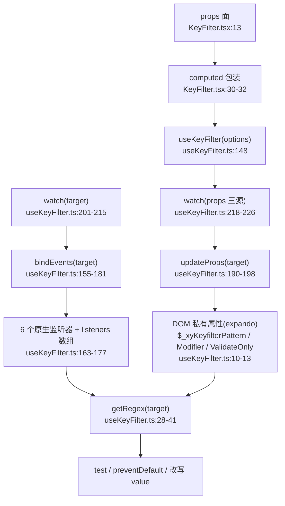
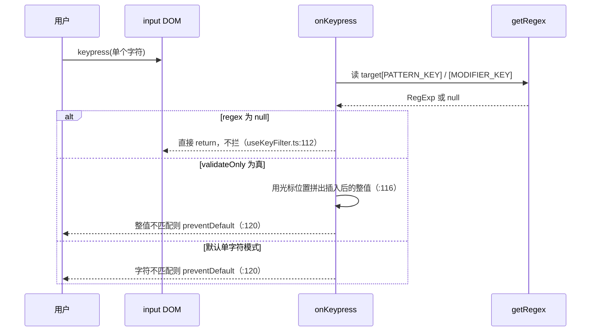

# C06-07 KeyFilter 关键词过滤

> **本篇解决**：`key-filter` 这一对外只有 350 行源码的模块，为什么同时存在「组件壳 `<xy-key-filter>`」和「组合式函数 `useKeyFilter`」两个出口；它的按键过滤到底拦在哪一层事件上、`preset` 与 `pattern` 谁优先、`validateOnly` 改了整条判定链的哪一步；以及为什么把它套在 `<xy-input>` 外面会造成同一 DOM 节点被绑定两次。
> **前置**：C04-01《Input 输入框》（`useKeyFilter` 在库内唯一的真实消费者）、I04《输入基础设施》（IME 合成标志位与 `vc-input` 的 attrs 接力）。

## 一、职责与边界

`key-filter` 是本库唯一**不做受控值改写**的输入约束手段。它的全部工作发生在原生 DOM 事件层：把一组监听器挂到真实 `<input>`/`<textarea>` 节点上，在字符进入值之前拦掉（`keypress`、`paste`），或在字符已经进入之后把它删掉（`input`、`change`、`compositionend`）。源码里没有 `modelValue`、没有 `useMergedState`、也没有任何 `computed` 包裹的「合法值」派生——`useKeyFilter.ts` 全文 234 行，操作的对象始终是 `target.value` 这个 DOM 属性本身（`useKeyFilter.ts:61`、`:78`、`:84`、`:102`）。

这条边界决定了它能与不能做什么，也决定了读它时必须带着的两个问题：

1. **它拦的是「按键」还是「值」？** 默认路径拦按键：`onKeypress` 对单字符做 `regex.test` 后 `preventDefault()`（`useKeyFilter.ts:118-121`）。`validateOnly` 为真时改成拦「插入后的整值」：把待插入字符拼进光标位置再测（`:115-117`）。两种模式共用同一个监听器，差别只在 `testKey` 怎么构造。
2. **它改的值 Vue 知不知道？** 默认不知道。`onChange`/`onInput` 直接写 `target.value`，然后**手工补发一个 `InputEvent`**（`:85-92`、`:69`）让框架的 `v-model`/`onUpdate` 链路看见。这一步是整个模块最脆弱的接缝：补发的事件类型是硬编码的 `inputType: 'insertText'`（`:89`）与 `'insertCompositionText'`（`:65`），并不反映真实操作来源。

与相邻模块的分工要在开头钉住，否则后文容易重复论证：

- **`vc-input` / `BaseInput` 的 attrs 接力、IME 合成状态机**归 I04《输入基础设施》。本篇只在需要解释 `key-filter` 为什么必须自己再维护一套 `$_xyKeyfilterComposing` 标志位时引用它的结论（见论点 6）。
- **`<xy-input>` 如何在自己的 setup 里调 `useKeyFilter`、以及 `keyFilterPreset`/`keyFilterPattern` 这两个 prop 怎么下沉**归 C04-01《Input 输入框》。该篇 §5.3 明确写了「`useKeyFilter` 在 `target` 为空时的内部行为未逐行核对」——那段留白正是本篇的主线。
- **表单校验**（`async-validator`、`FormItem` 的错误回显）与本模块无任何代码接触：`grep -rn "FormItemContext\|asyncValidator" packages/xiaoye-ui/src/key-filter` 为空。它是**输入期的字符约束**，不是**提交期的值校验**，两者在文档里容易被当成同一件事。

组件公开名 `XYKeyFilter`、标签 `xy-key-filter`、内部标志 `__XY_KEY_FILTER`（`KeyFilter.tsx:10-12`），注册走 `registerComponent`（`index.ts:17-19`），符合库的命名硬约束。

## 二、源码地图

七个文件、合计 350 行实现 + 136 行测试：

```
packages/xiaoye-ui/src/key-filter/
├── index.ts              22   公开面：组件 + props + 9 预设 + hook
├── KeyFilter.tsx         41   组件壳：找目标元素、桥接 props 到 hook
├── useKeyFilter.ts      234   全部机制所在
├── keyFilterTypes.ts     24   props 定义（4 个）
├── presets.ts            29   9 条单字符正则 + 查表函数
├── style/index.ts       （见下）一个 display: contents 的规则
└── __tests__/key-filter.test.js  136   6 个用例
```

`index.ts` 的导出面刻意做成「三通道」：默认导出组件（`index.ts:22`）、具名导出 `useKeyFilter`（`:14`）、具名导出 `DEFAULT_PATTERNS` 与 `getPresetRegex`（`:12`）。这意味着消费者可以只用 hook 不用组件——库内的实际情况正是如此，`useKeyFilter` 的唯一真实消费者是 `input/Input.tsx:17`（导入）与 `:53`（调用），而组件形态在库内**没有任何消费者**，只有文档站用它：`apps/docs/components/key-filter.md:82`。

可复现的引用清点（注意 `import Portal from '../portal'` 这类写法会漏，所以三种拼法都要统计）：

```bash
cd packages/xiaoye-ui/src
grep -rn "useKeyFilter\|key-filter" --include='*.ts' --include='*.tsx' --include='*.vue' . \
  | grep -v "^./key-filter/" | grep -v "/dist/"
```

实测命中 6 行：`components.ts:199-201`（聚合入口与样式副作用）、`input/Input.tsx:17`（值 import，真正的消费者）、`input/Input.tsx:18` 与 `input/inputProps.ts:7`（两条纯类型 import，只借 `KeyFilterPattern`/`KeyFilterPreset` 两个类型名）。也就是说除生成物之外，**只有一个**库内消费者，而且它用的是 hook 不是组件。

预设表在 `presets.ts:3-22`，九条全是**单字符字符类**（`pint: /[\d]/`、`money: /[\d.\s,]/`、`hex: /[0-9a-f]/i` 等），注释明确写着「与源项目 `DEFAULT_PATTERNS` 保持一致，匹配单字符」。这个「单字符」约束是后文多个坑的总根源：既然正则只匹配一个字符，任何「整体值」判断都必须由调用侧自己逐字符循环完成（`useKeyFilter.ts:55-59`、`:78-82`），而 `validateOnly` 的整值拼接（`:116`、`:134`）与这套单字符语义是**互相冲突**的两套判定口径。

样式层几乎是空的：`style/index.ts:11-18` 只发一条 `[componentCls] { display: 'contents' }`，外加一条 `[data-xy-keyfilter]: {}` 空规则（注释自陈「源项目保留……仅作标识」）。`display: contents` 的存在理由写在同一行注释里——wrapper 组件不引入额外布局层。这条决定与论点 5 的 DOM 结构直接相关。


## 三、架构与数据流

这个模块的形状可以用一句话概括：**响应式侧只负责往 DOM 节点上贴三个私有属性，事件回调只读这三个私有属性，两边永不直接对话。**



静态结构上只有两个「写者」和一个「读者」：`updateProps` 写 expando（`:195-197`），六个事件函数通过 `getRegex` 读 expando（`:29`、`:36`）。响应式系统不知道过滤规则的存在，DOM 节点成了唯一的通信媒介。

数据流因此有一条硬时序约束：**先有 target 后有规则**。`watch(target)` 的回调里 `bindEvents` 与 `updateProps` 是顺序调用（`:210-211`），而 `watch(props)` 的回调只在 `boundTarget` 非空时才写 expando（`:221-223`）。若 `target` 首帧为 `null`（组件壳的场景很常见：默认插槽里的 `<input>` 还没挂载），第二个 watch 的 `immediate` 首跑会**整次丢弃**，直到 `target` 变为非空才被 `watch(target)` 补写。



## 四、核心机制精读

### 论点 1：过滤规则不住在响应式里，住在 DOM 节点的私有属性上

`useKeyFilter` 收到的是四个 `Ref`/`ComputedRef`（`UseKeyFilterOptions`，`useKeyFilter.ts:17-24`），但它一次都没有在事件回调里读这些 ref。回调读的是挂在目标元素上的字符串键：

```ts
// useKeyFilter.ts:10-13
const PATTERN_KEY = '$_xyKeyfilterPattern';
const MODIFIER_KEY = '$_xyKeyfilterModifier';
const VALIDATE_ONLY_KEY = '$_xyKeyfilterValidateOnly';
const COMPOSING_KEY = '$_xyKeyfilterComposing';

// useKeyFilter.ts:190-198
const updateProps = (target: KeyFilterTarget) => {
  const preset = unref(options.preset);
  const pattern = unref(options.pattern);
  const validateOnly = unref(options.validateOnly);

  target[MODIFIER_KEY] = preset;
  target[PATTERN_KEY] = pattern;
  target[VALIDATE_ONLY_KEY] = !!validateOnly;
};
```

`KeyFilterTarget` 的类型是 `HTMLElement & Record<string, any>`（`:15`）——`Record<string, any>` 这半截正是为了允许往 DOM 对象上挂任意键。这么做的直接收益是**事件处理器不需要闭包捕获 props**：同一份模块级函数（`onKeypress`、`onPaste`、`onChange` 都定义在 `useKeyFilter` 之外，`:74`、`:97`、`:106`、`:124`）可以被任意多个目标节点复用，状态从节点上取。代价是三个可观察后果：

1. **规则更新与监听器绑定是两条独立时间线。** `preset` 改了不会重新 `addEventListener`，只会重写 expando（`:218-226`）。这在功能上正确，但意味着「绑定时刻」和「规则生效时刻」在调试时看到的不同步。
2. **规则的生命周期跟着 DOM 节点走，不跟着组件走。** 组件卸载时 `unbindEvents` 只移除监听器（`:183-188`），**不清除 expando**。同一 DOM 节点被复用（例如 `v-for` 重排或 `keep-alive` 复活）时，上一轮写入的 `$_xyKeyfilterPattern` 仍在节点上；此时若新绑定在 `updateProps` 之前先收到一个 `keypress`，读到的就是旧规则。
3. **`Record<string, any>` 让这条通道对类型检查完全隐形。** 把 `PATTERN_KEY` 改成别的字面量不会有任何编译错误，只会静默失效——四个常量必须逐字一致（`:10-13` 与 `:29`、`:36`、`:98`、`:115`、`:133`）。

这条通道不是本模块的独创：I04《输入基础设施》已经记录了 `vc-input` 一侧同样用 DOM 侧信道传递合成状态，`key-filter` 是同一手法的第二处实例。


### 论点 2：`getRegex` 是唯一的规则仲裁点，它的优先级与三处「上游 bug 修复」注释

```ts
// useKeyFilter.ts:28-41
function getRegex(target: KeyFilterTarget): RegExp | null {
  const pattern = target[PATTERN_KEY];
  if (pattern) {
    if (typeof pattern === 'string') {
      return getPresetRegex(pattern);
    }
    return pattern as RegExp;
  }
  const modifier = target[MODIFIER_KEY];
  if (modifier) {
    return getPresetRegex(modifier);
  }
  return null;
}
```

三条判定规则从中读出来：

- **`pattern` 完全压过 `preset`。** 两者同时给出时 `preset` 不参与任何计算（`:30` 命中即 return）。而 `updateProps` 会同时写两者（`:195-196`），所以「传了 `preset` 也传了 `pattern`」这种配置的最终行为只由 `pattern` 决定。
- **`pattern` 允许是字符串预设名。** `:31-33` 走 `getPresetRegex` 查表，查不到返回 `null`（`presets.ts:27-29`），于是整个过滤器静默变成「什么都不拦」。这条路径的类型面很拧：`keyFilterTypes.ts:19` 把组件的 `pattern` prop 声明成 `Object as PropType<RegExp>`，而 hook 的入参类型是 `KeyFilterPattern | string`（`useKeyFilter.ts:21-22`）——**字符串路径只有从 hook 进来才类型合法**，从组件 prop 进来要自己承担 `Invalid prop` 告警。真正在用它的是 `input/inputProps.ts:25-26`，那里显式声明 `[String, Object]`，并在 `Input.tsx:56` 把 `KeyFilterPattern | string` 一路传进 hook。
- **`null` 是合法返回值且表示「不拦」。** 四个消费点各自 `if (!regex) return`（`:112`）或 `if (regex)`（`:53`、`:76`、`:100`）。

`:8-9`、`:26-27`、`:111`、`:126`、`:129` 五处注释是移植现场的自白，逐条记录了上游实现的缺陷：前缀不统一（`$_pkeyfilterPattern` 与 `$_keyfilterKeydownEvent` 两套混用）、`pattern` 为字符串时直接返回字符串导致后续 `regex.test` 抛错、以及 `if (regex === '') return;` 永假（`regex` 只可能是 `RegExp` 或 `null`，与空字符串恒不等）。最后这条尤其值得留意：它在上游意味着**非法 pattern 时完全不设防**，而本库把它改成 `!regex`（`:112`、`:127`）之后，语义从「永不成立」变成了「无规则时放行」——行为修对了，但注释留在原地，读代码的人需要知道自己是站在修复后的哪一侧。

### 论点 3：`validateOnly` 把判定对象从「字符」换成「插入后的整值」

```ts
// useKeyFilter.ts:114-121
let testKey = `${event.key}`;
if (target[VALIDATE_ONLY_KEY]) {
  testKey = `${target.value.substring(0, target.selectionStart)}${event.key}${target.value.substring(target.selectionEnd)}`;
}
if (!regex.test(testKey)) {
  event.preventDefault();
}
```

默认分支测的是 `event.key` 这一个字符，因此九条单字符预设正好对齐。`validateOnly` 分支测的是**拼接后的完整字符串**——这就把语义要求换成了「整值正则」：用户必须传 `/^\d+$/` 这类锚定式（`__tests__/key-filter.test.js:109` 用的正是 `pattern: /^\d+$/`），如果传的是预设 `pint`（`/[\d]/`），任何含数字的整值都会匹配成功，过滤等于失效。源码没有对这个组合做任何校验或告警：`preset` 走 `getPresetRegex` 拿到的仍是单字符正则（`presets.ts:5`），与 `validateOnly` 的整值口径天然不匹配。

同一段还引入一个 DOM 依赖：`target.selectionStart`。`substring(undefined)` 在 JS 里按 `NaN → 0` 处理，因此当目标节点是 `<input type="number">`（规范上这类 input 的 `selectionStart` 会抛 `InvalidStateError`）或不支持选择位置的元素时，判定结果取决于异常是否真的抛出。这一点本篇只作机制推演，未做浏览器实测（见 §七 坑 5）。

`onPaste` 里同一个开关分出了两条完全不同的实现（`:133-145`）：`validateOnly` 时拼接整值测一次；否则**逐字符循环**，任一字符不匹配就整体 `preventDefault()` 并 `return`（`:139-144`）。后者是「全有或全无」——粘贴 `12a34` 会得到「什么都不粘贴」，而不是「粘贴 1234」。这与 `onChange` 的逐字符**重建并保留合法字符**（`:77-82`）方向相反，两条路径对同一份剪贴板内容给出不同结果。

### 论点 4：三个「改写值」的入口，三种不同的删除算法

模块里会真的改动 `target.value` 的地方有三处，算法彼此不一致：

| 入口 | 触发事件 | 删除方式 | 隐含假设 |
| --- | --- | --- | --- |
| `onInput`（`:97-104`） | `input` | `value.slice(0, -1)` 砍掉最后一个字符 | 非法字符是最后进入的那一个 |
| `onChange`（`:74-95`） | `change` | 逐字符 `filter` 重建整串 | 可以对整值做单字符正则遍历 |
| `onCompositionEnd`（`:47-72`） | `compositionend` | `value.slice(0, -compositionText.length) + filtered` | 合成文本落在值的末尾 |

`onInput` 的写法最脆弱：它先看整值是否匹配（`:100`，注意用的仍是**单字符正则**，任何合法字符都会让条件为假从而不进分支），一旦进入就无条件删掉末尾一个字符。这意味着「值里有一个非法字符，且光标不在末尾」时，删掉的是末尾那个**合法**字符。判定用整值、执行用尾删，两边口径不同。

`onChange` 与 `onCompositionEnd` 是逐字符重建，语义正确但同样依赖尾位置假设（`:68`）。此外两者都会手工补发 `InputEvent`（`:69`、`:85-92`）——`change` 路径补发的是 `inputType: 'insertText'`，这与真实操作（一次删除）不符，任何按 `inputType` 分流的下游监听都会读到错误来源。

### 论点 5：组件壳只做一件事——把插槽里的第一个输入元素找出来

```tsx
// KeyFilter.tsx:21-26
const targetRef = computed<HTMLElement | null>(() => {
  const el = containerRef.value;
  if (!el) return null;
  if (el.tagName === 'INPUT' || el.tagName === 'TEXTAREA') return el as HTMLElement;
  return (el.querySelector('input, textarea') as HTMLElement | null) || null;
});
```

组件形态的全部智能就在这 6 行：渲染一个 `<div>` 容器（`:36`），先检查容器自己是不是输入元素（业务方把 `ref` 直接指到 `<input>` 时的快路径），否则在子树里 `querySelector` **第一个** `input` 或 `textarea`。三处后果：

1. **多个输入元素只有第一个被过滤。** `querySelector` 只回一个节点，第二个 `<input>` 静默不受约束。插槽里放「密码 + 确认密码」这类结构时，看起来配了过滤、实际只覆盖一半。
2. **`tagName` 判断对大小写敏感且只认两种。** `<input>` 的 `tagName` 是 `'INPUT'`（HTML  DOM 规范保证），但 `contenteditable` 元素、自定义组件渲染出的 `div[role=textbox]` 都不在查询串里（`:24-25`），这类目标一律返回 `null`。返回 `null` 时 `watch(target)` 的回调不进绑定分支（`:208`），**不报错也不告警**。
3. **wrapper 的 `<div>` 用 `display: contents` 抹掉了自己的盒子**（`style/index.ts:12-14`），所以 `class` 与 `style` 落到一个不生成布局盒的元素上：`KeyFilter.tsx:36` 把 `prefixCls`、`hashId`、`attrs.class` 三路合并写进 `class`，但除了作为选择器锚点，这个 div 在视觉上不存在。这也是它与本库其它 wrapper 的显著差异。

组件形态与 hook 形态的「双出口」不是本模块的偶然设计，而是这一类应用级/行为级组件的统一形状；`focus-trap`、`ripple`、`dark-mode-toggle` 同构，见 C12-00 论点 2。

还有一条时序事实值得单独钉住：`containerRef` 在 `KeyFilter.tsx:18` 声明、`:36` 绑到渲染出的 `<div>` 上，而 `targetRef` 在 `:21` 读的正是 `containerRef.value`。ref 要到首次 DOM patch 之后才有值，所以 setup 阶段（`useKeyFilter` 的两个 watcher 以 `immediate` 首跑时，`useKeyFilter.ts:214`、`:225`）`targetRef` 必然为 `null`——组件壳这条路径**永远**走「先丢弃规则、绑定时刻再补写」的顺序，`updateProps` 的唯一入口因此是 `:211` 那一行而不是 props watcher。hook 路径（`Input.tsx:53`）同样依赖 `inputRef` 何时被填（`Input.tsx:49-51`），但它的 `target` 是嵌套组件 expose 出来的内层节点，可用性取决于 `vc-input` 的绑定完成时刻，这正是 C04-01 §5.3 留下、本篇补全的那一段。

### 论点 6：IME 走的是自己那套标志位，且只在 `input` 事件上设防

`useKeyFilter` 自己维护第四个合成状态位：`COMPOSING_KEY` 在 `onCompositionStart` 置真（`:43-45`）、在 `onCompositionEnd` 置假（`:47-48`），唯一的读取点是 `onInput` 的第一行守卫（`:98`）：

```ts
// useKeyFilter.ts:97-104
function onInput(target: KeyFilterTarget) {
  if (target[COMPOSING_KEY]) return;
  const regex = getRegex(target);
  if (regex && !regex.test(target.value)) {
    target.value = target.value.slice(0, -1);
  }
}
```

设计意图明确：合成期间不要用尾删破坏输入法的候选串，改由 `compositionend` 统一处理（`:52-71`）。但**守卫只此一处**——`onKeypress`（`:106`）与 `onPaste`（`:124`）都不看 `COMPOSING_KEY`。中文输入法在候选串确认前是否会触发 `keypress` 因浏览器而异，如果触发，`event.key` 通常是 `'Process'`，而九条预设没有一条能匹配 `'Process'`，于是走 `:120` 被 `preventDefault()`。这是「按默认路径放行合成期按键」的一处缺口，本篇未做浏览器实测（§七 坑 3 记录了判据与未验证部分）。

与 I04 的关系要点明：I04 已把本仓的 IME 合成标志位清点成多套并存的格局（`vc-input` 一侧有自己的实现），`$_xyKeyfilterComposing` 是独立于 `vc-input` 的那一套。两者不共享状态、不互相通知，因此同一个 `<input>` 上如果两套都在（正是 `<xy-key-filter><xy-input/></xy-key-filter>` 这种嵌套，或 `Input.tsx:53` 自身已接线又被外层壳重复接线），合成状态就会出现「一处为真一处为假」的分叉。

## 五、对外契约如何生效

四个 prop，落到契约的方式各不相同：

| prop | 声明位置 | 生效路径 | 类型面 |
| --- | --- | --- | --- |
| `prefixCls` | `keyFilterTypes.ts:15` | 经 `useConfigInject('key-filter', props)`（`KeyFilter.tsx:15`）派生 | 裸 `String`，无默认值 |
| `preset` | `:17` | `computed` → hook → expando `MODIFIER_KEY` | `stringType<KeyFilterPreset>()`（`_util/type.ts:87`），运行时只校验 String，不校验九个名字之一 |
| `pattern` | `:19` | 同上 → `PATTERN_KEY` | `Object as PropType<RegExp>`，**不含 String**，与 hook 入参不一致 |
| `validateOnly` | `:21` | 同上 → `VALIDATE_ONLY_KEY` | `booleanType()`（`_util/type.ts:58`），无默认值即 `undefined` |

`initDefaultProps(keyFilterProps(), {})`（`KeyFilter.tsx:13`）传入空默认表，因此四个 prop 全部可缺省——这与「无规则时放行」的 `getRegex` 兜底（`:40`）共同构成安全默认：`<xy-key-filter>` 不带任何配置时不会拦截任何按键。

hook 侧的契约是另一个形状：`UseKeyFilterOptions` 要求 `target` 必传且是 ref（`:18`），其余三个可选（`:19-23`）。`useKeyFilter` 无返回值（`:148` 的签名没有 return type，函数体只在 `!isClient` 时提前 `return`，`:149`），组件也没有 `expose`——外部拿不到任何状态，只能靠 DOM 上的两个属性观测：`data-xy-keyfilter="true"` 与被强制写入的 `autocomplete="off"`（`:179-180`）。

SSR 契约由一个模块级常量决定：`isClient = typeof window !== 'undefined' && !!window.document`（`:6`）。服务端渲染时 `useKeyFilter` 在注册任何 watcher 之前就返回，因此**服务端不产生任何副作用，也不会有水合后的自动补齐**——过滤能力只在客户端存在。

测试面（`__tests__/key-filter.test.js`，按 `packages/xiaoye-ui/vitest.config.mts:33` 的 `src/**/*.test.js` glob 确实会被执行）共 6 个用例：名字与内部标志（`:6-9`）、`install` 存在（`:11-13`）、挂载后打上两个 DOM 属性（`:15-27`）、`pint` 拦字母（`:29-55`）、自定义正则拦小写（`:57-83`）、粘贴被拦（`:85-105`）、`validateOnly` 整值判定（`:107-135`）。**未被任何用例覆盖的路径**：`input` 事件（`:97-104`）、`change` 事件（`:74-95`）、`compositionstart`/`compositionend`（`:43-72`）、`target` 变更时的重绑与解绑（`:201-215`）、`unmount` 清理（`:228-233`）。也就是说论点 4 里三个删值算法中最危险的 `onInput` 尾删，正好处在测试空白区。


## 六、设计取舍

**取舍一：DOM 侧信道 vs 闭包捕获。** 把规则写成节点私有属性（`:195-197`）换来的是「事件函数可以提到模块级、被多个目标复用」，代价是类型检查失效（`:15` 的 `Record<string, any>`）与生命周期错位（卸载不清 expando，论点 1）。另一条路是把六个 handler 写成 `bindEvents` 内部的闭包、直接 `unref(options.*)`——那样 `watch(props)` 就必须触发重绑，`listeners` 数组的存在理由（`:153`）也随之消失。现实现选择「不重绑、只重写属性」，把重绑代价换成了状态隐形。仓库没有注释记录这个决定，上述判据来自代码形状本身。

**取舍二：拦按键 vs 拦值。** `keypress` + `preventDefault` 的性价比极高（一行判定、无需回滚 DOM），但它天然拦不住「不产生 `keypress` 的写入」：粘贴（所以另有 `onPaste`，`:124`）、输入法合成（所以另有 `compositionend`，`:47`）、拖拽进输入框（**没有任何 handler**，`bindEvents` 的六个事件名里没有 `drop`/`dragstart`，`:163-168`）、以及脚本直接赋值（无法拦，也不打算拦）。`validateOnly` 是对「拦按键语义不够」的折中回应：仍用 `keypress`，但把判定对象换成插入后的整值（`:116`）。真正守值的路径（`change`/`input` 改写）作为兜底存在，而它的删除算法精度不足（论点 4）。这三条路叠在一起而非任选其一，是本模块复杂度的主要来源。

**取舍三：预设正则只匹配单字符。** `presets.ts:3-22` 保持与上游一致的九条单字符类，好处是 `keypress` 分支可以零成本地 `regex.test(event.key)`；坏处是 `validateOnly` 的整值语义与它不可组合（论点 3），而库内没有任何机制阻止用户把两者拼在一起用。改成整值正则（`/^\d*$/`）会破坏 `keypress` 分支，因此这是一次「保上游兼容、把误用风险外移」的选择。

**取舍四：wrapper 组件用 `display: contents`。** `style/index.ts:12-14` 让包裹层不产生布局盒，这是对「过滤是行为而非视觉」的正确表达——嵌套 `<xy-input>` 时不会因为多了一层 div 而破坏 flex/grid 布局。代价是这一层的 `class`/`style` 失去视觉意义（论点 5 第 3 条），以及 `display: contents` 在无障碍树里的历史兼容问题（本库未做相关处理，`grep -rn "display: contents" packages/xiaoye-ui/src/style` 无全局封装）。

**取舍五：hook 不返回值、组件不 `expose`。** 两者都拒绝暴露内部状态（`:148`、`KeyFilter.tsx` 全文无 `expose`），使本模块对外只有「配置进、DOM 属性出」一个方向。这让它在 `Form` 里完全隐形——校验链路看不到过滤的存在，值的合法性最终仍要靠 `FormItem` 的规则自证（这一分工归 C06-00《Form 的字段注册、校验与上下文下发》，该篇已落盘；本篇仍只作编号引用、不重述其内部结论）。

## 七、坑与改动指南

**坑 1：`<xy-key-filter>` 包住已接线的 `<xy-input key-filter-preset>`，同一节点被绑定两次。**
触发：外层用组件壳传 `preset`，内层 `<xy-input>` 又传自己的 `keyFilterPreset`；`KeyFilter.tsx:25` 的 `querySelector('input, textarea')` 会穿过 `vc-input` 的包装命中真正的 `<input>`，而 `Input.tsx:49-51` 的 `keyFilterTarget` 命中同一节点。
症状：`onInput` 的尾删执行两次（每输入一个非法字符少两个字符），`onChange` 重建两遍，`onCompositionEnd` 的 `slice(0, -compositionText.length)` 在第二遍时按已缩短的值再截一次，出现「吞字」。
原因：`bindEvents` 每次都新建六个 handler 闭包（`:156-161`），两个 hook 实例的函数引用不同，`addEventListener` 不去重。
定位：`KeyFilter.tsx:25`、`input/Input.tsx:49-58`、`useKeyFilter.ts:155-168`。
改法建议：两个出口只保留一个（推荐 hook 侧），或在 `bindEvents` 入口检查 `target[PATTERN_KEY] !== undefined` 即视为已绑定并直接 `updateProps`。

**坑 2：`listeners` 是实例级单槽，重绑会丢掉前一份句柄，导致永久无法解绑。**
触发：`target` 从节点 A 变成 `null` 再变回 A（`v-if` 折叠、或 `computed` 因依赖重算返回同一节点）。
症状：组件卸载后监听器仍在，继续改写用户输入；`onBeforeUnmount` 的清理看起来「没起作用」。
原因：解绑只发生在 `prevTarget && prevTarget !== target` 这一支（`:204-207`）；`prevTarget` 为 `null` 时不解锁任何旧绑定，而随后的 `bindEvents` 会用新数组覆盖 `listeners`（`:170-177`），前一批 handler 引用就此丢失。
定位：`useKeyFilter.ts:153`、`:170-177`、`:204-211`、`:228-233`。

**坑 3：合成期按键仍会被拦。**
触发：`preset="pint"` 的输入框用中文输入法打候选。
症状：候选阶段就打不进字母，或候选确认后才正常。
原因：`COMPOSING_KEY` 只在 `onInput` 被读（`:98`），`onKeypress`（`:106-122`）无条件按单字符正则判定，而 `event.key === 'Process'` 不匹配九条预设中任何一条，落到 `:120` 被阻止。
定位：`useKeyFilter.ts:98`、`:106-122`、`presets.ts:3-22`。
说明：这条的「浏览器是否会为候选串触发 `keypress`」属平台行为差异，本篇只证源码侧无守卫，未做浏览器实测。

**坑 4：`autocomplete="off"` 被写进用户 DOM 且永不还原。**
触发：任何一次成功绑定。
症状：浏览器对该输入框的自动填充/密码管理建议消失，组件卸载后该属性仍在（若宿主元素被复用给别的非过滤输入框，`off` 会跟着过去）。
原因：`bindEvents` 直接 `setAttribute`（`:180`），`unbindEvents` 只移除监听器（`:183-188`），没有任何属性回滚。同类问题也适用于 `data-xy-keyfilter`（`:179`）。
定位：`useKeyFilter.ts:179-180`、`:183-188`。

**坑 5：`validateOnly` 配 `preset` 静默失效。**
触发：`<xy-key-filter preset="pint" validate-only>`。
症状：任何字符都拦不住。
原因：`validateOnly` 分支测整值（`:116`），而 `preset` 经 `getPresetRegex` 得到的是单字符类（`presets.ts:5`），`/[\d]/.test('12a')` 为真即放行。
定位：`useKeyFilter.ts:115-121`、`presets.ts:3-22`。

**坑 6：目标节点没有 `selectionStart` 时整值拼接可能抛异常。**
触发：目标是不支持选择位置的输入元素（例如 `type="number"`、`type="file"`）且开了 `validateOnly`。
症状：控制台在按键时抛 `InvalidStateError`，`keypress` 处理器中断，过滤行为退化为「不拦」。
原因：`:116` 无条件读 `target.selectionStart` / `target.selectionEnd`，没有能力检测。
定位：`useKeyFilter.ts:116`、`:134`。
说明：不同浏览器对该场景是抛错还是返回 `null` 存在实现差异，本篇未做浏览器实测，源码侧可证的只有「无守卫」。

**坑 7：`pattern` 的字符串写法只有 hook 侧类型合法。**
触发：模板里写 `<xy-key-filter pattern="pint">`。
症状：控制台出现 `Invalid prop: type check failed for prop "pattern". Expected Object, got String`，功能却正常。
原因：prop 声明是 `Object as PropType<RegExp>`（`keyFilterTypes.ts:19`），而运行时 `getRegex` 专门支持字符串（`:31-33`）。`Input` 一侧没有这个问题，因为 `inputProps.ts:25-26` 声明了 `[String, Object]`。
定位：`keyFilterTypes.ts:19`、`useKeyFilter.ts:31-33`、`input/inputProps.ts:25-26`。

**改动安全边界**：`useKeyFilter.ts` 的任何改动必须同时验证两个消费者（组件壳 `KeyFilter.tsx:28-33` 与 `Input.tsx:53-58`），且默认只跑 `key-filter` 目录测试；`input` 与 `change` 两个事件路径在现有测试里零覆盖（见 §五），因此改 `onInput`/`onChange` 时**不会有任何测试变红**——需要自己补事件用例再动刀。

## 附：本篇可证伪的三个检查点

**检查点 1：组件形态在本库内确实零消费者。**

```bash
cd packages/xiaoye-ui/src && grep -rn "key-filter" . --include='*.ts' --include='*.tsx' --include='*.vue' \
  | grep -v "^./key-filter/" | grep -v "/dist/"
```

预期恰好 6 行：`components.ts` 的 `:199`/`:200`/`:201`（聚合导出、默认导出别名、样式副作用）、`input/Input.tsx:17` 与 `:18`（hook 与类型各一条）、`input/inputProps.ts:7`（类型）。若新增行指向其它组件目录，说明组件形态开始被库内复用，论点 5 与 §二 的「只有文档站用」需重写。注意 `Input.tsx:18` 是**纯类型** import，把它算进「消费者」会夸大耦合面——清点时必须区分值 import 与 type import。

**检查点 2：IME 标志位只有一个读取点。**

```bash
grep -n "COMPOSING_KEY" packages/xiaoye-ui/src/key-filter/useKeyFilter.ts
```

预期恰好 4 行：定义（`:13`）、两处写入（`:44`、`:48`）、一处读取（`:98`）。若 `onKeypress`/`onPaste` 里出现第 5 处读取，坑 3 已被修掉，论点 6 的「守卫只此一处」需相应更新。

**检查点 3：`data-xy-keyfilter` 标记没有任何样式或逻辑消费者。**

```bash
grep -rn "data-xy-keyfilter" packages apps --include='*.ts' --include='*.tsx' --include='*.less' --include='*.css' --include='*.js' \
  | grep -v "/dist/"
```

预期四处命中且全部为「生产端、空规则或测试断言」：`key-filter/useKeyFilter.ts:179`（写入）、`key-filter/style/index.ts:16`（注释）与 `:17`（空规则本体）、`key-filter/__tests__/key-filter.test.js:24`（断言属性被写上）。若出现第五处命中某条真实 CSS 规则或 `querySelector('[data-xy-keyfilter]')`，说明该标记开始承载样式或逻辑，`style/index.ts:17` 的「仅作标识」注释即失效。

