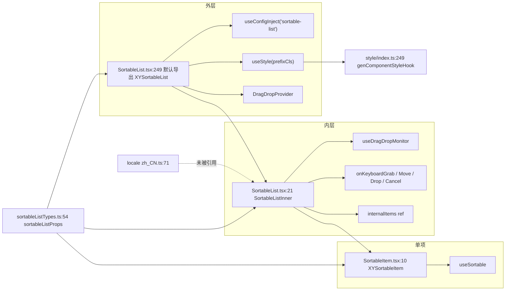
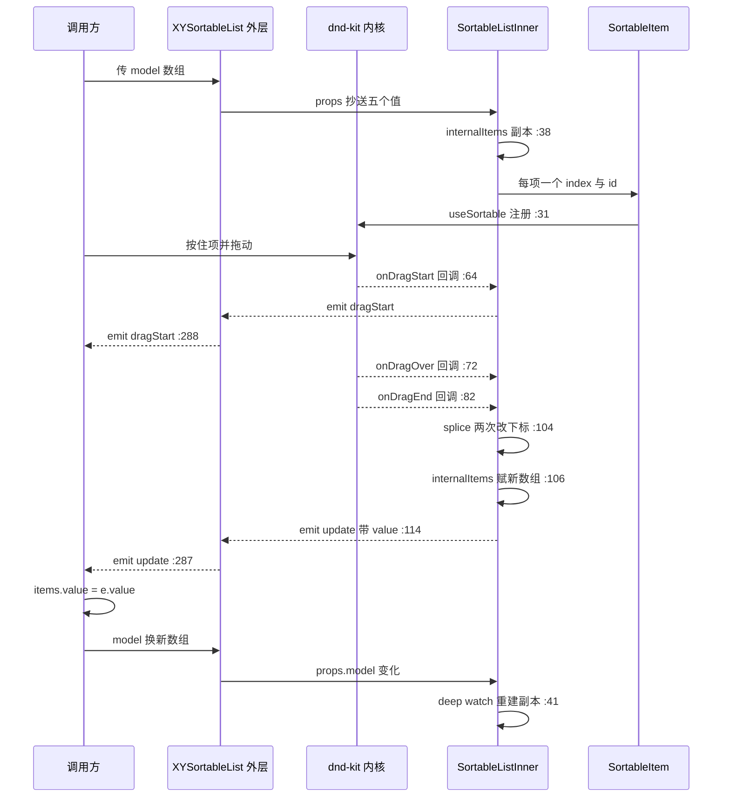
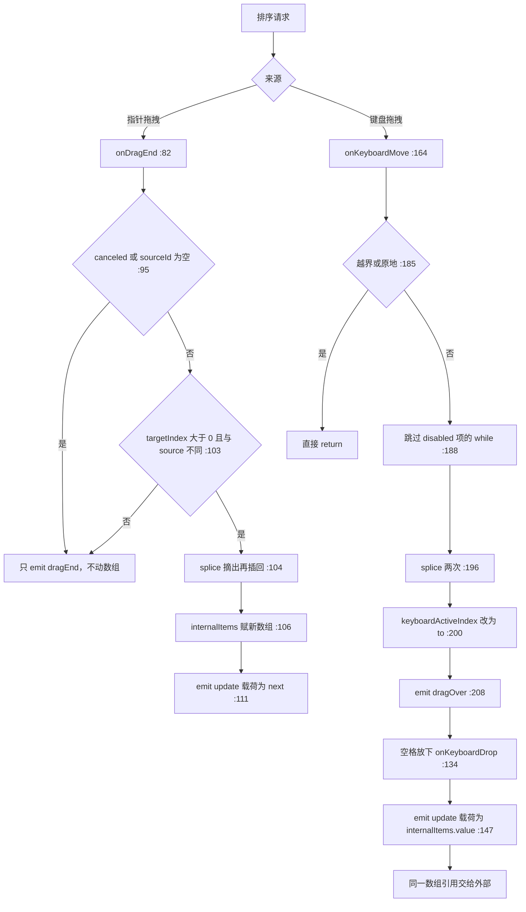

# C06-08 SortableList 可排序列表

> **本篇解决**：拖拽排序的结果落在哪里、谁负责回写、`axis`/`disabled`/`handle` 三个开关各自的生效路径走到哪一步就断了。
> **前置**：C08-06 VirtualList 虚拟列表（已完成）　**读者坐标**：`03-components/06-form-editor` 第 8 篇

## 一、职责与边界

`sortable-list` 负责三件事：把 `model` 数组渲染成可拖拽的 `listitem` 序列（`packages/xiaoye-ui/src/sortable-list/SortableList.tsx:218`）、维护一份可与外部异步的内部顺序副本（`packages/xiaoye-ui/src/sortable-list/SortableList.tsx:38`）、以及在鼠标拖拽与键盘拖拽两条路径结束时把新数组交还调用方（`packages/xiaoye-ui/src/sortable-list/SortableList.tsx:114` 与 `packages/xiaoye-ui/src/sortable-list/SortableList.tsx:149`）。

它明确**不负责**的事，每一件都是后文某个坑的根源：

- 不回写数据源。组件没有 `modelValue`，也没有 `update:modelValue`——在整个目录里 `grep -rn "update:model\|modelValue" packages/xiaoye-ui/src/sortable-list` 返回空。顺序的新真相必须由调用方在 `@update` 里自己赋值（`apps/docs/examples/sortable-list/basic.vue:21`）。
- 不写 `order` 字段。排序结果是数组下标的变化（`packages/xiaoye-ui/src/sortable-list/SortableList.tsx:104`、`packages/xiaoye-ui/src/sortable-list/SortableList.tsx:196`），对象本身不被改动，因此后端持久化「第几位」这件事完全在组件之外。
- 不接管指针事件。全部 `pointer`/`document` 级监听交给第三方内核 `@dnd-kit/vue`（`packages/xiaoye-ui/src/sortable-list/SortableList.tsx:3`、`packages/xiaoye-ui/src/sortable-list/SortableItem.tsx:3`，依赖声明在 `packages/xiaoye-ui/package.json:49`），组件自身不注册任何全局监听（论点 3）。
- 不做虚拟滚动、不做测量、不做碰撞算法。列表长度即 DOM 长度（`packages/xiaoye-ui/src/sortable-list/SortableList.tsx:218` 的 `map`），长列表与虚拟化的关系归 C08-06《VirtualList 虚拟列表》。

依赖清单（组件向外伸手的全部对象）：`@dnd-kit/vue` 的两个入口 `DragDropProvider` 与 `useDragDropMonitor`、`@dnd-kit/vue/sortable` 的 `useSortable`、`@xiaoye-ui/icons` 的 `GripVerticalIcon`（`packages/xiaoye-ui/src/sortable-list/SortableItem.tsx:4`）、`useConfigInject`（`packages/xiaoye-ui/src/sortable-list/SortableList.tsx:266`）、`initDefaultProps`（`packages/xiaoye-ui/src/sortable-list/SortableList.tsx:253`）、`genComponentStyleHook` 家族（`packages/xiaoye-ui/src/sortable-list/style/index.ts:249`）。组件之间零耦合：`grep -rn --include='*.tsx' --include='*.ts' "from 'xiaoye-ui/sortable-list'" packages/xiaoye-ui/src` 除自身目录外无命中，也就是说它不是任何组件的底座。

## 二、源码地图

| 文件 | 行数 | 职责 | 关键导出 / 主入口 |
| --- | --- | --- | --- |
| `packages/xiaoye-ui/src/sortable-list/index.ts` | 25 | 导出面与 `install`，同时注册两个组件 | `SortableList`（默认，`index.ts:24`）、`SortableItem`（`index.ts:25`） |
| `packages/xiaoye-ui/src/sortable-list/SortableList.tsx` | 322 | 外层容器 + 内层逻辑，两个 `defineComponent` 同居一文件 | 默认导出是外层（`SortableList.tsx:249`），内层 `SortableListInner` 不导出（`SortableList.tsx:21`） |
| `packages/xiaoye-ui/src/sortable-list/SortableItem.tsx` | 203 | 单项：注册 `useSortable`、渲染手柄、承接键盘事件 | 默认导出（`SortableItem.tsx:10`） |
| `packages/xiaoye-ui/src/sortable-list/sortableListTypes.ts` | 101 | 两组 props 与四个事件载荷接口 | `sortableListProps`（`:54`）、`sortableItemProps`（`:81`） |
| `packages/xiaoye-ui/src/sortable-list/style/index.ts` | 267 | Design Token → 组件样式，两个生成函数 | `genComponentStyleHook('SortableList', …)`（`:249`） |
| `packages/xiaoye-ui/src/sortable-list/__tests__/sortable-list.test.tsx` | 354 | 22 个 `it`（`grep -n "^  it(" ` 计数），全是类名 / 属性 / 键盘行为断言；另有 `mountTest` 补的生命周期用例（`packages/xiaoye-ui/tests/shared/mountTest.js:4`） | —— |

主实现入口是 `packages/xiaoye-ui/src/sortable-list/SortableList.tsx:249`，而不是文件顶部——`SortableList.tsx:21` 的 `SortableListInner` 是它的私有子组件，两者共享 `sortableListProps()` 这一套 props 定义（`packages/xiaoye-ui/src/sortable-list/sortableListTypes.ts:54` 被 `SortableList.tsx:24` 与 `SortableList.tsx:253` 各调用一次 `initDefaultProps`）。这一点决定了本篇的读法：**任何「props 有没有被读」的判定都要跨两个组件走一遍**，因为外层读一遍、内层再读一遍，两层的默认值还各设了一次。

聚合入口与生成物侧的登记状态：`packages/xiaoye-ui/src/components.ts:306` 是 `export * from './sortable-list'`，`:339` 是具名默认导出，`:340` 是样式副作用导入；`packages/xiaoye-ui/typings/global.d.ts:78` 只登记了 `XYSortableList`。


## 三、架构与数据流

### 3.1 静态结构：谁持有谁



这张图要说清三件事。第一，**组件树有两层，props 定义只有一份**：`sortableListTypes.ts:54` 的 `sortableListProps()` 同时喂给外层（`SortableList.tsx:253`）与内层（`SortableList.tsx:24`），外层再把 `model`/`itemKey`/`disabled`/`axis`/`handle` 五个值原样抄送进内层（`SortableList.tsx:306` 至 `SortableList.tsx:310`）。于是「某个 prop 到底被哪一层读」不能靠看声明判断，只能看这两处抄送清单——不在清单里的 prop 到内层就是 `undefined`，在内层里被读的 `props.prefixCls` 正是靠 `SortableList.tsx:305` 这一行才拿到值。第二，`useStyle` 只在外层调用（`SortableList.tsx:267`），内层与单项都不调用——这是 `packages/xiaoye-ui/src/_util/static-style-extract/index.tsx:15` 把 `SortableItem` 列入黑名单时给出的理由（「其样式由 SortableList 的 `useStyle` 统一注册」），也意味着**单项的样式命中完全依赖它挂在外层 `hashId` 节点之下**（论点 4 的判定要用到这一点）。第三，那条虚线：`locale/zh_CN.ts:71` 里就有「暂无数据」这个字符串，但组件的空状态（`SortableList.tsx:214`）是把它当字面量写死的，`grep -rn "useLocaleReceiver\|locale" packages/xiaoye-ui/src/sortable-list` 返回空。

### 3.2 指针拖拽：一次完整闭环



图里最后两圈是这篇的关键：**闭环只有在外层 `@update` 里重新赋值时才闭合**。如果调用方不接 `update`，`internalItems` 已经换了顺序而 `props.model` 还是旧的（`SortableList.tsx:106` 与 `SortableList.tsx:42` 分别动了两个不同的真相源），界面会显示新顺序，看起来「能用」，但下一次外部改动 `model` 时深 watch 会把界面拽回父级数组的顺序。指针事件的采集、碰撞、位移全在内核里（`SortableItem.tsx:31` 注册、`SortableList.tsx:63` 监听），组件侧只写了三个回调。

### 3.3 排序落点：两条路径的两个分支



两条路径都改数组下标，但**产出物的形态不同**：指针路径交出一个全新的数组 `next`（`SortableList.tsx:102` 展开复制后再 splice），键盘路径直接把内部 `ref` 的值原样递出去（`SortableList.tsx:147`）——外部若就地 `sort`/`splice` 这个 `value`，就会同时改到组件内部状态和父级数组里的同一份对象。`targetId` 的语义也分叉：指针路径只在真的有目标时才发 `update`（`SortableList.tsx:103`），键盘路径把 `targetId` 填成 `sourceId` 自己（`SortableList.tsx:146`），而类型上 `targetId` 是必填的 `string | number`（`sortableListTypes.ts:22`）。详见论点 1 与坑 1。


## 四、核心机制精读

### 论点 1：排序结果只落在数组下标上，回写责任由 `update` 事件单方交给调用方，而两条发出路径给出的载荷并不同构

这条论点回答派工单问的第一件事：拖完之后改的是什么，谁负责发更新。

指针拖拽那条路径的收尾（`SortableList.tsx:94` 起，函数头是 `useDragDropMonitor` 的 `onDragEnd`，`SortableList.tsx:82`）：

```tsx
// packages/xiaoye-ui/src/sortable-list/SortableList.tsx:94
        // 拖拽被取消则不更新顺序
        if (canceled || sourceId == null) return;

        const sourceIndex = findIndexById(sourceId);
        const targetIndex = targetId != null ? findIndexById(targetId) : -1;
        if (sourceIndex < 0) return;

        // 重新排序
        const next = [...internalItems.value];
        if (targetIndex >= 0 && sourceIndex !== targetIndex) {
          const [moved] = next.splice(sourceIndex, 1);
          next.splice(targetIndex, 0, moved);
          internalItems.value = next;

          const updateEvent: SortableListUpdateEvent = {
            sourceId,
            targetId,
            value: next,
            originalEvent: event?.nativeEvent,
          };
          emit('update', updateEvent);
        }
```

`findIndexById`（`SortableList.tsx:58`）用 `itemKey` 字段在内部分配的副本里查下标（`SortableList.tsx:59`），随后两次 `splice`（`SortableList.tsx:104`、`SortableList.tsx:105`）就是「排序」的全部内容：**没有任何 `order`、`sort`、`index` 字段被写进对象**，`moved` 对象是原引用搬了个位置。这决定了持久化口径——调用方拿到 `value` 之后自己决定是存数组顺序还是回填序号字段，组件不参与。

键盘拖拽那条路径的收尾（`SortableList.tsx:134`）形态不同：

```tsx
// packages/xiaoye-ui/src/sortable-list/SortableList.tsx:134
    function onKeyboardDrop(payload: { sourceId: any; sourceIndex: number }) {
      keyboardActiveIndex.value = null;
      keyboardSnapshot = null;
      const itemLabel =
        internalItems.value[payload.sourceIndex]?.label ?? `第 ${payload.sourceIndex + 1} 项`;
      liveMessage.value = `已放下：${itemLabel}。当前位置第 ${payload.sourceIndex + 1} 项。`;

      // 触发 update 与 dragEnd 事件，让外部使用者获取最新顺序
      const dragEvent: SortableListDragEvent = { sourceId: payload.sourceId };
      emit('dragEnd', dragEvent);
      const updateEvent: SortableListUpdateEvent = {
        sourceId: payload.sourceId,
        targetId: payload.sourceId,
        value: internalItems.value,
      };
      emit('update', updateEvent);
    }
```

三处不同值得逐条记住。第一，`value: internalItems.value`（`SortableList.tsx:147`）交出去的是内部 `ref` 当前持有的**同一个数组对象**，而指针路径交出去的是 `next` 这个刚复制出来的新数组（`SortableList.tsx:102`、`SortableList.tsx:111`）；调用方一旦对 `e.value` 做原地操作（`sort`、`splice`、`reverse`），键盘路径会同时改到组件内部状态，并经由深 watch（`SortableList.tsx:41`）再把内部状态重写一遍。第二，`targetId: payload.sourceId`（`SortableList.tsx:146`）是自指填充——`SortableListUpdateEvent.targetId` 在类型上是必填（`sortableListTypes.ts:22`），键盘语义里根本没有「目标项」，于是用源项冒充，任何按「source 与 target 不同」来判断真实位移的调用方在键盘路径上都会被判成「原地不动」。第三，`originalEvent` 在键盘路径整个缺席（对比 `SortableList.tsx:112`），载荷里连原始 `KeyboardEvent` 都没带出去，尽管发起处明明握着它（`SortableItem.tsx:88`、`SortableItem.tsx:133` 都塞进了 `payload.originalEvent`，而 `SortableList.tsx:144` 构造载荷时只取 `sourceId` 和 `sourceIndex`）。

还有一点关于「谁发 `update:modelValue`」：**没有这个角色**。props 里数据源叫 `model`（`sortableListTypes.ts:57`），事件叫 `update`（`sortableListTypes.ts:69` 的 `onUpdate`、`SortableList.tsx:287` 的 `emits`），全目录 `grep -rn "update:model\|modelValue" packages/xiaoye-ui/src/sortable-list` 返回空。所以 `v-model:model="list"` 这种写法只会建立单向绑定——prop 名对得上，事件名 `update:model` 永不发出，用户拖完看到的是组件内部副本的新顺序（假象），外部数组始终不动。五个文档示例全部手工接事件（`apps/docs/examples/sortable-list/basic.vue:4` 的 `@update="onUpdate"` 与 `basic.vue:21` 的 `items.value = e.value`），这是本组件唯一的闭环方式。

### 论点 2：`internalItems` 与 `props.model` 是两个真相源，深 watch 让「不接 update」从静默失效变成静默回滚

```tsx
// packages/xiaoye-ui/src/sortable-list/SortableList.tsx:36
  setup(props, { slots, emit }) {
    // 内部维护的列表顺序，便于拖拽时即时反馈
    const internalItems = ref<SortableListItem[]>([...(props.model || [])]);

    // 同步外部 model 变化（受控）
    watch(
      () => props.model,
      next => {
        internalItems.value = [...(next || [])];
      },
      { deep: true },
    );
```

副本本身是合理设计——拖拽过程中要即时反馈，不能等父级回写（`SortableList.tsx:37` 的注释直说了这个意图）。问题在 `{ deep: true }`（`SortableList.tsx:46`）与回调的无条件整体覆盖（`SortableList.tsx:44`）组合出来的语义：这条 watch 并不区分「父级换了顺序」与「父级只是加了个字段/加了项」。只要 `props.model` 里**任何一个对象的任何属性**变了，内部副本就被父级数组的当前顺序整份替换。

后果是一条具体时间线：拖完不接 `@update` → 内部新顺序、外部旧顺序，界面显示新顺序（因为渲染读的是 `internalItems.value`，`SortableList.tsx:218`）→ 之后任何一次对数组元素的写入（改 `label`、切 `disabled`、`push` 新项）→ watch 触发 → 界面在用户没有做任何拖拽的情况下回滚成父级数组的旧顺序。这条回滚没有任何事件与警告：`SortableList.tsx:43` 的回调不发 `update`，也不发 `console.warn`（全目录 `grep -rn "warning\|devWarning" packages/xiaoye-ui/src/sortable-list` 返回空）。

反过来，如果调用方规矩地接了 `@update` 并赋新数组，深 watch 还会多跑一次：`SortableList.tsx:44` 把外部新数组又复制一份内部副本，于是同一次排序产生两个内容相同、引用不同的数组。这不是 bug，但它让「内部副本 === 外部数组」这种优化假设永远不成立，也让 `key` 只能靠 `itemKey` 而不能靠引用比较（`SortableList.tsx:220` 用的正是 `item?.[props.itemKey] ?? index`）。

对照本仓更常见的做法：`useMergedState` 把「受控值优先、非受控回落内部值」写成一个 hook（`packages/xiaoye-ui/src/_util/hooks/useMergedState.ts`），Tabs 等组件用它得到单一真相（`packages/xiaoye-ui/src/tabs/src/Tabs.tsx:204`）。sortable-list 没有引它——`grep -rn "useMergedState" packages/xiaoye-ui/src/sortable-list` 返回空——自己手写了一套「副本 + 深 watch」，正是这两个真相源分叉的代价所在。

### 论点 3：本组件没有任何自管的 document 级监听，因此也没有成对解绑的义务；拖拽期间的监听面 100% 在第三方内核里

派工单要求逐行取证、不许先假设坏。结论是正面的，取证过程如下。

命令与结果：`grep -rn "addEventListener\|removeEventListener\|onBeforeUnmount\|onMounted\|onScopeDispose" packages/xiaoye-ui/src/sortable-list` 返回空（0 行）。也就是说整个目录里既没有裸绑定，也没有卸载钩子——不存在「绑了没解」的形状。第二种方法交叉验证：把整个组件目录读一遍能看到的监听只有一个，即写在 JSX 属性上的按键监听：

```tsx
// packages/xiaoye-ui/src/sortable-list/SortableItem.tsx:178
      const interactiveTabindex = props.handle ? undefined : isDisabled.value ? -1 : 0;
      const interactiveAriaRoleDesc = props.handle ? undefined : '可拖拽项';
      const interactiveOnKeydown = props.handle ? undefined : handleKeyDown;

      return (
        <div
          ref={elementRef}
          class={classes.value}
          {...attrs}
          role="listitem"
          aria-grabbed={isGrabbed.value ? 'true' : 'false'}
          aria-disabled={isDisabled.value ? 'true' : undefined}
          aria-roledescription={interactiveAriaRoleDesc}
          data-id={itemId.value}
          data-disabled={isDisabled.value}
          data-keyboard-grabbed={props.keyboardActive}
          tabindex={interactiveTabindex}
          onKeydown={interactiveOnKeydown}
        >
```

`onKeydown` 挂在元素属性上（`SortableItem.tsx:195`，手柄那条是 `SortableItem.tsx:154` 与 `SortableItem.tsx:167`），Vue 在 vnode 卸载时自行移除 DOM 属性监听，不存在跨实例残留。键盘拖拽的可变状态同样是**实例作用域**：`let keyboardSnapshot`（`SortableList.tsx:52`）声明在 `setup` 体内，不是模块顶层；`keyboardActiveIndex` 是 `ref`（`SortableList.tsx:50`）。所以本仓缺陷族里的「模块级可变全局量破坏 SSR 与多实例」在 sortable-list 上不成立，`keyboardSnapshot = null` 在放下（`SortableList.tsx:136`）与取消（`SortableList.tsx:157`）两条路径都被清掉，没有悬挂。

指针侧就完全换了一种责任分配：`SortableList.tsx:3` 引 `DragDropProvider` 与 `useDragDropMonitor`，`SortableItem.tsx:3` 引 `useSortable`，`@dnd-kit/vue` 是 `packages/xiaoye-ui/package.json:49` 声明的运行时 `dependencies`。pointermove / pointerup / document 级事件由内核注册还是元素级注册、卸载时是否解绑，本篇**未在本仓源码中找到对应实现**（内核在 `node_modules`，按共则 §2 不挂行号），因此只能写成条件句：如果内核在其实例作用域内成对绑定与解绑，那么本组件的监听面就是干净的；如果内核把监听挂在 `document` 上且依赖 `DragDropProvider` 的卸载来清理，那么清理时机就由 `SortableList.tsx:295` 这个 Provider 的挂载点决定——好消息是 Provider 与列表根节点在同一个 `wrapSSR` 返回值里（`SortableList.tsx:294`、`SortableList.tsx:319`），不存在「Provider 先于子项卸载而子项仍持有监听」的错位窗口。

与 `C04-07`《Slider》的对照值得写清：Slider 是**自己实现**拖拽，所以有 document 级绑定与 `onBeforeUnmount` 的成对代码可查；sortable-list 把这一层整个外包，于是「成对性」这个检查项在这里退化为「本仓无自管监听，需转向内核与 `useDragDropMonitor` 的注册时机」。改动的安全边界随之下移：任何要在拖拽期间加 `document` 监听的改动（例如滚动跟随），都必须自带 `onBeforeUnmount`，因为本组件目前没有任何一个卸载钩子可以挂靠。


### 论点 4：`axis` 从未抵达拖拽内核，它只影响键盘按键过滤与三条永不命中的 CSS 类名

先看内核注册点里有什么（`SortableItem.tsx:31`，整段在论点 7 展开）——`useSortable` 收到 `id`、`index`、`element`、`handle`、`disabled` 五个键，**没有 `axis`、没有 `restrictToAxis`、没有任何方向约束**。判形命令能把这条钉死：

```bash
grep -rn "axis" packages/xiaoye-ui/src/sortable-list
```

命中的 `axis` 只有 props 声明（`sortableListTypes.ts:63`、`sortableListTypes.ts:94`）、两处默认值（`SortableList.tsx:28`、`SortableList.tsx:257`）、两处向下抄送（`SortableList.tsx:227`、`SortableList.tsx:309`）、一处类名（`SortableList.tsx:275`）、一处 `data-axis`（`SortableList.tsx:301`）和键盘过滤（`SortableItem.tsx:119`、`SortableItem.tsx:120`）。也就是说 `axis` 只有两条生效通道，第一条是键盘：

```tsx
// packages/xiaoye-ui/src/sortable-list/SortableItem.tsx:118
      // 仅响应当前列表方向上的键，避免水平列表里 ArrowUp/Down 干扰
      const isVertical = props.axis === 'y';
      const isHorizontal = props.axis === 'x';
      const isRelevant =
        (isVertical && (direction === 'up' || direction === 'down')) ||
        (isHorizontal && (direction === 'left' || direction === 'right')) ||
        direction === 'home' ||
        direction === 'end';
      if (!isRelevant) return;

      event.preventDefault();
      emit('keyboardMove', {
        sourceId: itemId.value,
        sourceIndex: props.index,
        direction,
        originalEvent: event,
      });
    }
```

这条是真的：水平列表里按 ArrowUp 会被 `!isRelevant` 挡掉（`SortableItem.tsx:126`）。第二条通道——布局——是死的。`-y` / `-x` 这两个类名写在**根元素自己**身上（`SortableList.tsx:274` 与 `SortableList.tsx:275` 是同一个数组元素，`SortableList.tsx:298` 一次性绑到根 div），样式表里对应这三条：

```tsx
// packages/xiaoye-ui/src/sortable-list/style/index.ts:50
      [`${componentCls}-container`]: {
        display: 'flex',
        gap: itemGap,
        background: colorBgContainer,
        borderRadius: borderRadiusLG,
        padding: itemPaddingVertical,
      },

      // 垂直方向（默认）
      [`${componentCls}-y ${componentCls}-container`]: {
        flexDirection: 'column',
      },

      // 水平方向
      [`${componentCls}-x ${componentCls}-container`]: {
        flexDirection: 'row',
        overflowX: 'auto',
      },
```

样式对象的键在进入引擎时是**字面拼接**的：`parseStyle` 把嵌套键 `trim` 后（`packages/xiaoye-ui/src/_util/cssinjs/hooks/useStyleRegister/index.tsx:198`）直接以 `styleStr += \`${mergedKey}${parsedStr}\`` 累加在父选择器之后（`packages/xiaoye-ui/src/_util/cssinjs/hooks/useStyleRegister/index.tsx:232`），再整串交给 stylis 编译（`packages/xiaoye-ui/src/_util/cssinjs/hooks/useStyleRegister/index.tsx:70`）。仓内能证到的是「键被原样拼接、不在本仓做任何同元素判断」这一步；「以 `&` 开头即同元素展开、不带 `&` 即后代组合器」是 stylis 的语义（内核在 `node_modules`，按共则 §2 不挂行号），仓内最好的旁证是这个写法的全仓使用量——`grep -rl '`&${componentCls}' packages/xiaoye-ui/src/*/style/*.ts` 命中 53 个组件样式文件、共 202 行（`grep -rn '`&${componentCls}' packages/xiaoye-ui/src --include='*.ts' --include='*.tsx' | wc -l`），其中包括本文件自己：

```tsx
// packages/xiaoye-ui/src/sortable-list/style/index.ts:195
      // 使用拖拽手柄时，列表项本身的 cursor 改为 default
      [`&${componentCls}-with-handle ${componentCls}-item`]: {
        cursor: 'default',

        '&:active': {
          cursor: 'default',
        },
      },
```

`:196` 的 `-with-handle` 与 `:59` 的 `-y` 是**完全同一种情形**（类名都挂在根元素自己身上，对照 `SortableList.tsx:279`），作者在那里写了 `&`，所以它能命中；在 `-y`/`-x` 三处（`style/index.ts:59`、`style/index.ts:64`、`style/index.ts:213`）漏了 `&`，编译出来就是 `.xy-sortable-list .xy-sortable-list-y .xy-sortable-list-container` 这类要求「根的后代里还有一个带 `-y` 的节点」的选择器。DOM 里不存在这样的节点（`SortableList.tsx:296` 至 `SortableList.tsx:303` 就是根 div 加一个 `-container` 子 div），三条规则因此全部失配。同类形状在 `style/index.ts:112` 还有一条：`-item-dragging` 被写在 `[${componentCls}-item`]` 块的**内部**（`style/index.ts:81` 起）却没有 `&`，而类名与 `-item` 在同一个节点上（`SortableItem.tsx:45` 至 `SortableItem.tsx:53` 的 `classes` 数组把两者一起吐出），于是那条 `opacity: 0.5` 加阴影的规则（`style/index.ts:113` 至 `style/index.ts:115`）也是死规则；紧挨着的 `-item-drag-source`（`style/index.ts:119`）、`-item-drop-target`（`style/index.ts:124`）、`-item-keyboard-grabbed`（`style/index.ts:131`）、`-item-disabled`（`style/index.ts:138`）四组都带了 `&`，形成同一文件内的四种写法对照。

把两条通道合起来读，`axis` 的真实效果是：`axis="x"` 只让键盘改用左右键，指针拖拽本来就不受方向约束，而布局上 `flex-direction` 从来没被声明过——`-container` 只有 `display: flex`（`style/index.ts:51`），初始值即 `row`。所以「纵向列表」与「横向列表」的容器排布方向相同，`axis="x"` 唯一多出来的可见差异（`overflowX: auto` 于 `style/index.ts:66`、项的 `flex: 0 0 auto` 与 `minWidth: 120` 于 `style/index.ts:214`）也同属失配集。文档承诺的「列表项横向排列」（`apps/docs/components/sortable-list.md:29`）与源码状态不符。修法是最小改动补 `&`，并注意 `style/index.ts:50` 那条 `-container` 后代写法本身是对的，别连带改。

### 论点 5：`disabled` 在这里是双重断链——外层不取 `useConfigInject` 合成的 `disabled`，而 props 默认值 `false` 又先把 `??` 短路

本仓缺陷族里 `disabled` 断链有两条判据（共则 §3：① 合成不取、② 硬传短路），sortable-list **两条同时命中**：

```tsx
// packages/xiaoye-ui/src/sortable-list/SortableList.tsx:265
  setup(props, { slots, attrs, emit }) {
    const { prefixCls, direction } = useConfigInject('sortable-list', props);
    const [wrapSSR, hashId] = useStyle(prefixCls);

    // aria-label：默认"可排序列表"
    const ariaLabel = computed(() => props.ariaLabel || '可排序列表');

    // 容器类名
    const classes = computed(() => [
      prefixCls.value,
      `${prefixCls.value}-${props.axis}`,
      {
        [`${prefixCls.value}-disabled`]: props.disabled,
        [`${prefixCls.value}-rtl`]: direction.value === 'rtl',
        [`${prefixCls.value}-with-handle`]: props.handle,
      },
      hashId.value,
      attrs.class,
    ]);
```

判据一：`SortableList.tsx:266` 的解构只有 `prefixCls` 与 `direction`，`useConfigInject` 已经合成好的 `disabled`（`packages/xiaoye-ui/src/config-provider/hooks/useConfigInject.ts:43`，实现为 `props.disabled ?? disabledContext.value`，context 来自同文件 `:9` 的 `useInjectDisabled()`）没有被取用。正确写法见 `packages/xiaoye-ui/src/switch/index.tsx:82` 与 `packages/xiaoye-ui/src/switch/index.tsx:83`——Switch 甚至绕开 `useConfigInject` 自己接 context，而 sortable-list 连送上门的都没接。

判据二更硬：`disabled` 的 props 定义是 `booleanType(false)`（`sortableListTypes.ts:61`），`initDefaultProps` 又对 `model`/`itemKey`/`disabled`/`axis`/`handle` 五个键各设默认值，外层一份（`SortableList.tsx:253` 至 `SortableList.tsx:259`）、内层一份（`SortableList.tsx:24` 至 `SortableList.tsx:30`）。`initDefaultProps` 的赋值通道是 `prop.default = defaultProps[k]`（`packages/xiaoye-ui/src/_util/props-util/initDefaultProps.ts:21`），于是 `props.disabled` 恒为 `false` 而非 `undefined`，`useConfigInject.ts:43` 的 `??` 右侧永不可达——这是共则 §3 那个「三元兜底 + 非 `undefined` 默认值」形状在 `disabled` 上的实例。

断链继续往下传：外层把 `props.disabled` 原样抄给内层（`SortableList.tsx:308`），内层再抄给每一项（`SortableList.tsx:225`），项里的 `isDisabled` 只认这两处加一项自身的标记（`SortableItem.tsx:28`：`props.disabled === true || props.item?.disabled === true`）。净效果是「容器下发禁用」这条路（`<xy-form disabled>`、DisabledContext）对 sortable-list 零效果，而单个项的 `item.disabled` 照常生效（`SortableItem.tsx:36` 把它交给内核），文档也只承诺了后者（`apps/docs/components/sortable-list.md:45`）。类名 `-disabled`（`SortableList.tsx:277`）与样式规则（`style/index.ts:70`）都在，只是永不由 context 触发。

顺带把 `direction` 那条对照清楚：`SortableList.tsx:266` 确实取了 `direction`，而 `direction` 这个 prop 在 `sortableListProps()` 里根本没有声明（`sortableListTypes.ts:54` 至 `:76` 通读无 `direction` 键），所以 `useConfigInject.ts:15` 的 `props.direction ?? …` 左侧恒为 `undefined`，全局 RTL 能正常落到本组件（`SortableList.tsx:278` 产出 `-rtl` 类，样式在 `style/index.ts:238`）。这与 `rate/index.tsx` 那种「声明了 `direction` 又给 `'ltr'` 默认值」的活例恰好相反，属于**正确写法**，改的时候别顺手给 `sortableListProps` 加一个 `direction: stringType('ltr')`。

### 论点 6：内层发出的 `keyboardActiveChange` 是死事件——外层既不在 `emits` 里登记它，也没有转发它的那行代码

```tsx
// packages/xiaoye-ui/src/sortable-list/SortableList.tsx:126
      liveMessage.value = `已拾起：${itemLabel}。使用方向键移动，空格键放下，Esc 取消。`;
      emit('keyboardActiveChange', payload.sourceIndex);

      const dragEvent: SortableListDragEvent = { sourceId: payload.sourceId };
      emit('dragStart', dragEvent);
    }
```

内层的 `emits` 有五个名字（`SortableList.tsx:35`），外层只有四个（`SortableList.tsx:264`）；外层转发靠的是一个手工字典：

```tsx
// packages/xiaoye-ui/src/sortable-list/SortableList.tsx:285
    // 透传事件到内部子组件
    const innerListeners = {
      onUpdate: (e: SortableListUpdateEvent) => emit('update', e),
      onDragStart: (e: SortableListDragEvent) => emit('dragStart', e),
      onDragEnd: (e: SortableListDragEvent) => emit('dragEnd', e),
      onDragOver: (e: SortableListDragEvent) => emit('dragOver', e),
    };
```

`innerListeners` 被展开进内层（`SortableList.tsx:311`），四个键对应四个 `onXxx`，**第五个事件没有任何接收者**。判形命令：

```bash
grep -rn "keyboardActiveChange" packages apps docs
```

全仓只命中 `SortableList.tsx:35` 与 `SortableList.tsx:128` 两行，一行声明一行发出。类型面同样没有登记：`sortableListTypes.ts:69` 至 `sortableListTypes.ts:75` 只有 `onUpdate`/`onDragStart`/`onDragEnd`/`onDragOver` 四个回调 prop，没有 `onKeyboardActiveChange`；文档事件表也只有四个事件（`apps/docs/components/sortable-list.md:67` 至 `:70`）。所以这条 `emit` 是纯粹空转——它是「API 面存活、实现死亡」的反向形态：实现活着（真的会发），API 面不存在，外部无论写 `@keyboardActiveChange` 还是 `:on-keyboard-active-change` 都收不到。

同一文件里另一处「只写不读」的内部标识是 `__XY_SORTABLE_LIST`（`SortableList.tsx:252`）与 `__XY_SORTABLE_ITEM`（`SortableItem.tsx:13`）：全仓唯一读取点是它们自己的测试（`packages/xiaoye-ui/src/sortable-list/__tests__/sortable-list.test.tsx:104`、`:108`），没有任何组件像读别的 `__XY_*` 标记那样消费它们。`OUTLINE.md` 已知待办里登记过同族残留，本篇这两个是「连误读方都没有」的那一档。

### 论点 7：`useSortable` 的五个选项里两个是响应式、两个是 setup 期快照，而内核的三个状态位只喂类名不喂顺序

```tsx
// packages/xiaoye-ui/src/sortable-list/SortableItem.tsx:20
    setup(props, { slots, attrs, emit }) {
      const elementRef = ref<HTMLElement | null>(null);
      const handleRef = ref<HTMLElement | null>(null);

      // 列表项的唯一标识
      const itemId = computed(() => props.item?.[props.itemKey]);

      // 是否禁用该项的拖拽
      const isDisabled = computed(() => props.disabled === true || props.item?.disabled === true);

      // 注册为可排序项
      const { isDragging, isDragSource, isDropTarget } = useSortable({
        id: itemId,
        index: props.index,
        element: elementRef,
        handle: props.handle ? handleRef : undefined,
        disabled: isDisabled,
      });
```

一次调用里出现两种响应式等级：`id` 传 `itemId` 这个 computed（`SortableItem.tsx:32`）、`disabled` 传 `isDisabled`（`SortableItem.tsx:36`），而 `index` 传 `props.index` 的**当前数值**（`SortableItem.tsx:33`），`handle` 传一个三元表达式的**求值结果**（`SortableItem.tsx:35`）。后两者在 `setup` 里只执行一次。

`index` 这一条尤其值得盯：项组件实例是按 `itemKey` 复用的（`SortableList.tsx:220` 的 `key={item?.[props.itemKey] ?? index}`），排序时 `props.index` 会变（`SortableList.tsx:223` 直接取 `map` 的下标），但因为实例不重建，`SortableItem.tsx:33` 那行不会重新执行。内核此后认哪个 index——读快照还是每次回调时重取——本仓源码无法证明（`@dnd-kit/vue` 的选项读取策略在 `node_modules`，按共则 §2 不挂行号），所以写成条件句：**若内核把 `index` 当一次性值持有，那么排序后各项在碰撞与位移计算里仍带着首次挂载时的下标**，而组件自己那条 `onDragEnd` 是按 `itemKey` 现查下标的（`SortableList.tsx:58` 的 `findIndexById`），两者口径不同、互不校验。要判这条，最省事的做法是把它写成 `() => props.index` 或 `computed(() => props.index)`——改动面只有这一行，且与同函数里已有的两个 computed 写法一致。

`handle` 的快照更直接：`useSortable` 在 `handle: undefined` 下注册后，若运行期把外层 `handle` 从 `false` 切到 `true`，手柄节点会渲染出来（`SortableItem.tsx:144` 走 `props.handle` 的分支），但那一次 `useSortable` 调用早已把 `undefined` 交出去，实例不会重跑 `setup`。同样地，`elementRef` 与 `handleRef` 传的是 `ref` 对象（`SortableItem.tsx:34`、`:35`），这两个在实例生命周期内稳定，不构成问题。

另一个结构性事实：**指针拖拽的顺序完全不由组件计算**。内核的三个状态位 `isDragging`、`isDragSource`、`isDropTarget` 只被拿去拼类名与 `isGrabbed`（`SortableItem.tsx:41`、`SortableItem.tsx:48` 至 `SortableItem.tsx:52`），没有任何一处读它们来决定新下标；新下标来自 `useDragDropMonitor` 的 `onDragEnd` 里 `event.operation.target.id`（`SortableList.tsx:84`）。所以本组件对内核有两个互不相干的接口面：单项用 `useSortable` 拿状态，容器用 `useDragDropMonitor` 拿结果。与之相对，键盘拖拽那条路径**绕开内核全部机制**：拾起、移动、放下、取消四个回调（`SortableList.tsx:120`、`SortableList.tsx:164`、`SortableList.tsx:134`、`SortableList.tsx:152`）自己维护 `keyboardActiveIndex` 与 `keyboardSnapshot`，数组自己 splice（`SortableList.tsx:196`、`SortableList.tsx:197`）。这意味着同一份 UI 上并存两套位置状态（内核的位置与 `internalItems` 的位置），而键盘路径只改后者——用键盘移动后再直接用鼠标拖，两者的下标口径是否一致，取决于内核如何消化外部数组的变化，本篇不能证实，只能标为改动前必须实测的交界点。

### 论点 8：`SortableItem` 是包根公开导出，却只能在 `SortableList` 内部存活；它的 `prefixCls` 没有任何兜底

`SortableItem.tsx:14` 的 props 初始化传的是**空对象**：

```tsx
// packages/xiaoye-ui/src/sortable-list/SortableItem.tsx:10
export default defineComponent({
  name: 'XYSortableItem',
  inheritAttrs: false,
  __XY_SORTABLE_ITEM: true,
  props: initDefaultProps(sortableItemProps(), {}),
  slots: Object as CustomSlotsType<{
    default?: { item: any; index: number };
    handle?: { item: any; index: number };
  }>,
  emits: ['keyboardGrab', 'keyboardDrop', 'keyboardCancel', 'keyboardMove'],
```

而 `sortableItemProps()` 的第一个键是裸 `prefixCls: String`（`sortableListTypes.ts:82`），既没有默认值，`initDefaultProps` 也没有被要求补一个（`SortableItem.tsx:14` 第二个参数是 `{}`）。类名全部由它拼出（`SortableItem.tsx:46` 至 `SortableItem.tsx:53` 的 `${props.prefixCls}-item*`），所以脱离父级单独使用时，DOM 上的类名是字面量 `undefined-item`——只有父级在 `SortableList.tsx:305` 显式把已解析的 `prefixCls.value` 传下来时它才拿到真值。这是「props 声明与运行时读取不匹配」的另一种形态：**声明为可选，运行时按必填使用**。

公开面与可用性之间的四处不一致，逐条都有行号：

- 包根导出：`packages/xiaoye-ui/src/sortable-list/index.ts:25` 的 `export { SortableItem }`，经 `packages/xiaoye-ui/src/components.ts:306` 的 `export * from './sortable-list'` 进入包根。
- 全局注册：`index.ts:19` 至 `index.ts:20` 连续注册两个组件，标签名由 `packages/xiaoye-ui/src/_util/registerComponent.ts:22` 走 `toXYTagName`（`:6` 至 `:11` 的两步替换）得出 `xy-sortable-item`——也就是模板里真的能写这个标签，Vue 不会报未知组件。
- 类型面缺登记：`packages/xiaoye-ui/typings/global.d.ts:78` 只有 `XYSortableList`；`grep -c "XYSortableItem" packages/xiaoye-ui/typings/global.d.ts` 返回 `0`。于是模板里写 `xy-sortable-item` 能通过运行时却在 `vue-tsc` 的 `GlobalComponents` 校验里是未知标签。
- 文档面零提及：`apps/docs/components/sortable-list.md` 全文 95 行，`grep -c "SortableItem"` 返回 `0`，API 段只有 `SortableList` 一组（`apps/docs/components/sortable-list.md:53`）。

测试与工具链其实都已经承认这个限制，只是没在导出面上收口：测试文件顶部注释写着「SortableItem 必须在 DragDropProvider 内使用，不单独进行 mountTest」（`packages/xiaoye-ui/src/sortable-list/__tests__/sortable-list.test.tsx:10`），静态样式提取把它列入黑名单并给出同一理由（`packages/xiaoye-ui/src/_util/static-style-extract/index.tsx:15` 至 `:17`）。**脱离 Provider 会怎样**取决于 `useSortable` 的 inject 失败行为（内核在 `node_modules`），本篇不判定，只登记本仓两处注释都按「不可独立渲染」处理。

改这条的成本要算清：从 `index.ts` 摘掉 `SortableItem` 会改动包根导出名，`packages/xiaoye-ui/tests/__snapshots__/index.test.js.snap:160` 正是登记这个名字的快照，需随 `pnpm gen:entries` 一并更新（见根目录 `AGENTS.md` 的生成物规则）；反过来，要让它真正可用，最小改动是给 `sortableItemProps` 的 `prefixCls` 一个兜底（例如 `initDefaultProps(sortableItemProps(), { prefixCls: 'xy-sortable-list' })`）并补 `GlobalComponents`，但那会让「脱离 Provider 的渲染」变成一种看起来合法、实际仍依赖 inject 的用法。

## 五、对外契约如何生效

这一段只谈三件事：声明面与读取面的差集、事件通道的真实条数、样式前缀的产权归属。

**props 声明面 11 键，运行时读取面 7 键。** `sortableListProps()` 一次声明 11 个键（`packages/xiaoye-ui/src/sortable-list/sortableListTypes.ts:54` 至 `:76`）。外层 `setup` 真正读取的只有 `model`（`packages/xiaoye-ui/src/sortable-list/SortableList.tsx:306`）、`itemKey`（`SortableList.tsx:307`）、`disabled`（`SortableList.tsx:308`）、`axis`（`SortableList.tsx:309`）、`handle`（`SortableList.tsx:310`）、`ariaLabel`（`SortableList.tsx:270`），加上经 `useConfigInject` 间接读取的 `prefixCls`（`SortableList.tsx:266`）。剩下的 `onUpdate`、`onDragStart`、`onDragEnd`、`onDragOver`（`sortableListTypes.ts:75`、`sortableListTypes.ts:71`、`sortableListTypes.ts:73`、`sortableListTypes.ts:75`）在 `setup` 体内零读取，判据是 `grep -rn "props.onUpdate" packages/xiaoye-ui/src/sortable-list` 与 `grep -rn "props.onDrag" packages/xiaoye-ui/src/sortable-list` 双双返回空。它们不是死代码，但也不构成第二条通道：`emit('update')`（`SortableList.tsx:114` 与 `SortableList.tsx:149`）按事件名去 vnode 的原始 props 里取 `onUpdate` 这一格，所以声明式 `:on-update="fn"` 与模板糖 `@update="fn"` 写的是**同一个格子的两种拼法，互斥而非叠加**，同一标签上两种写法只有一份能留下。机制侧的同类判定见 C06-05 §五。真正承担「把 `on*` 从 `attrs` 里剔走」这件事的是 `emits` 数组（`SortableList.tsx:264`），不是那四行 props 声明——若后人以「反正没人读 `props.onXxx`」为由删掉 `emits` 里的四项，用户写的 `@update` 会掉进 `attrs`、再被 `{...attrs}`（`SortableList.tsx:297`）当普通属性撒到根 div 上，事件面当场消失。声明与读取不一致的族里还有一条纯类型面的：`SortableListKeyboardEvent`（`sortableListTypes.ts:43` 至 `:52`）描述了四个键盘事件的载荷形状，而 `grep -rn "SortableListKeyboardEvent" packages apps` 在整个 `src` 里只命中它自己那一行，四个回调的实际形状全是内联字面量（`SortableList.tsx:120`、`SortableList.tsx:134`、`SortableList.tsx:152`、`SortableList.tsx:164`），且 `packages/xiaoye-ui/src/sortable-list/index.ts:8` 至 `:15` 的类型导出清单里没有它——外部想给自己的键盘处理函数标这个类型都拿不到。

**同一份 props 声明被实例化两次，而抄送清单只有六项。** 内层用同一个 `sortableListProps()` 建 props（`SortableList.tsx:24`），于是它也「声明」11 键，但外层只喂六个：

```tsx
// packages/xiaoye-ui/src/sortable-list/SortableList.tsx:304
              <SortableListInner
                prefixCls={prefixCls.value}
                model={props.model}
                itemKey={props.itemKey}
                disabled={props.disabled}
                axis={props.axis}
                handle={props.handle}
                {...innerListeners}
```

后果有三条。第一，内层的 `ariaLabel` 与四条 `on*` 恒为 `undefined`（内层拿监听靠 `emit`，外层用 `innerListeners` 的四个闭包接走，`SortableList.tsx:287` 至 `:290`），第五个事件名 `keyboardActiveChange` 没有任何出口，见论点 6。第二，内层 `initDefaultProps` 那五项默认值（`SortableList.tsx:25` 至 `:29`）在「外层驱动」这条唯一路径上永不生效，因为六个键每次都被显式赋值——这是「兜底恒不可达」族在本篇的另一种形态（不是三元判错，而是抄送清单把兜底位占满）。第三，两份默认值表逐字相同（`SortableList.tsx:25`-`:29` 与 `SortableList.tsx:254`-`:258`）却没有单一真源，属机械副本，见坑 7。顺带一条：内层写了 `inheritAttrs: false`（`SortableList.tsx:23`）却连 `attrs` 都没解构（`SortableList.tsx:36`），所以任何被塞进内层的属性都会被静默丢弃；目前无损失，因为外层只写显式属性。

**事件通道一共一条半。** 外部到组件：一格 `onXxx`（见上）。组件内部到外部：内层 `emit` → `innerListeners` 闭包 → 外层 `emit` → 用户监听（`SortableList.tsx:286` 至 `:291` 展开在 `SortableList.tsx:311`），是**链式转发**而不是叠加，所以一次排序用户只会收到一条 `update`。`{...innerListeners}` 写在六个显式属性之后（`SortableList.tsx:305`-`:310` 在前），两组键不重叠，因此当前无覆盖发生；但要留意「将来再补一个 `onUpdate`」的情形——那不会覆盖前者，见下一段的实测。

**JSX 字面顺序决定外部能不能改某条属性，且 `on*` 的净效果是数组而不是覆盖。** 本组件目录里只有两处 `{...attrs}` 展开：根 div（`SortableList.tsx:297`，其后是 `class`/`role`/`aria-label`/`data-axis`，`:298`-`:301`）与项根 div（`packages/xiaoye-ui/src/sortable-list/SortableItem.tsx:186`，其后是 `role`、三个 `aria-*`、三个 `data-*`、`tabindex`、`onKeydown`，`:187`-`:195`）。用本仓实际装的 `@vue/babel-plugin-jsx` 现场编译这两个形状（`node --input-type=module -e` 里跑 `babel.transformSync`，插件 `@vue/babel-plugin-jsx`），`{...attrs}` 写在前面就生成 `_mergeProps(attrs, {...})`，写在中间就生成 `_mergeProps({class: cls}, attrs, {...})`——即**展开点之前的属性先入参、之后的显式属性最后入参**。再用实际装的 Vue 跑 `mergeProps` 验净效果，得到三类不同行为：普通属性后写者胜（用户传 `role="table"` 被 `SortableList.tsx:299` 的 `role="list"` 吃掉，用户传 `data-axis` 被 `SortableList.tsx:301` 吃掉）；`class` 是**合并**且不做 token 去重（实测 `{class:'user-a'}` 与 `{class:['a','b']}` 合并成 `"user-a a b"`）；`on*` 键**收成数组**（实测 `onKeydown` 得到长度为 2 的数组，两个处理函数都保留）。三条各自都有本篇对应的落点：项级 `SortableItem.tsx:186` 先展开、`SortableItem.tsx:195` 后写 `onKeydown`，所以 `xy-sortable-item` 上挂 `@keydown` 的净效果是「用户的与组件的 `handleKeyDown` 都进数组、都会执行」，不能按「谁覆盖谁」写结论（共则 §3 特别提醒的一条，C05-04 实测到同族的类型告警）；根级那条 `class` 的合并则暴露一处重复——`attrs.class` 被显式塞进了 `classes` 数组末位（`SortableList.tsx:282`），同一个值又随 `{...attrs}` 进入第一个参数（`SortableList.tsx:297`），于是用户自定义类名在 DOM 上出现两次。这不破坏样式（同名 token 重复无害），但会让 `wrapper.classes()` 与快照里出现重复项，也是「同一份语义两份拷贝」的一个微例。

**插槽的键在两层之间被改名，外层没有 `default`。** 外层声明 `item`/`handle` 两个键（`SortableList.tsx:260` 至 `:263`），读取点只有 `slots.item` 与 `slots.handle`（`SortableList.tsx:313`、`SortableList.tsx:314`）——`grep -n "slots\.default" packages/xiaoye-ui/src/sortable-list/SortableList.tsx` 零命中，所以在外层写 `#default` 会被整份丢弃且不报错。内层再声明一次同名两键（`SortableList.tsx:31` 至 `:34`），并在 `SortableList.tsx:229` 至 `:232` 把 `item` 塞进项的 `default`、把 `handle` 塞进项的 `handle`；源插槽缺失时显式给 `undefined`（`SortableList.tsx:230`、`SortableList.tsx:231` 的三元），好让项回落到 `props.item?.label`（`SortableItem.tsx:139` 至 `:141`）。所以「不写 `#item` 就显示 `label`」这条行为的落点在项的 `:141`，不在外层；插槽载荷 `{ item, index }` 三层声明一致（`sortableListTypes.ts` 无插槽类型，靠 `CustomSlotsType` 各写一份：`SortableList.tsx:260`、`SortableList.tsx:31`、`SortableItem.tsx:15`）。

**expose 面是空的。** `grep -rn "expose" packages/xiaoye-ui/src/sortable-list` 返回空——三个组件（`SortableList.tsx:21`、`SortableList.tsx:249`、`SortableItem.tsx:10`）的 `setup` 解构里都没有 `expose`（对照 `SortableList.tsx:265` 的 `{ slots, attrs, emit }`）。于是 `ref` 拿到的是未经收敛的 public instance，组件对外**没有任何程序化入口**：想「按 key 把某项挪到第 N 位」只能改 `model` 数组，而这会经深 watch 把内部副本整体替换（`SortableList.tsx:44`），拖拽进行中做这件事会丢掉未收尾的反馈状态。与 C06-05 §五 那类「expose 出 `save`/`cancel` 后门」的写法相比，本篇组件连后门都没有，所有外部控制都只能走 `model` 与事件这两条正规路径。

**样式 hook 的前缀产权在调用方，主题覆盖键是另一串名字。** 链路是：`useConfigInject('sortable-list', props)`（`SortableList.tsx:266`）→ `configProvider.getPrefixCls(name, props.prefixCls)`（`packages/xiaoye-ui/src/config-provider/hooks/useConfigInject.ts:14`）→ 缺省拼成 `xy-sortable-list`（`packages/xiaoye-ui/src/config-provider/context.ts:168` 的模板串）→ `useStyle(prefixCls)`（`SortableList.tsx:267`）→ `genComponentStyleHook('SortableList', …)`（`packages/xiaoye-ui/src/sortable-list/style/index.ts:249`）。前缀是**调用方的**而不是组件的：`prefixCls` 在 `sortableListTypes.ts:55` 是裸 `String`、两份 `initDefaultProps` 都没给它填默认值（`SortableList.tsx:24`-`:30`、`SortableList.tsx:253`-`:259`），所以 `ConfigProvider` 的全局前缀与单实例 `prefixCls` 都能改它；改动的下游是缓存路径 `[component, prefixCls.value, iconPrefixCls.value]`（`packages/xiaoye-ui/src/theme/util/genComponentStyleHook.ts:74`）与 `componentCls = '.' + prefixCls.value`（同文件 `:87`）——传什么前缀就另生成一张表。这是共则 §3「两张表」族的**正向案例**：本篇唯一的 `useStyle` 调用在外层（`SortableList.tsx:267`），内层与项都不调用（内层 `setup` 体内无 `useStyle`，项文件 `SortableItem.tsx:1` 至 `:8` 的 import 里也没有），所以不存在把子件前缀喂进 hook 的形状；代价是 `hashId` 只挂在根节点类名里（`SortableList.tsx:281`），项与容器全靠后代关系命中样式（`packages/xiaoye-ui/src/_util/static-style-extract/index.tsx:15` 正因如此把项列入黑名单）。主题侧的覆盖键是 PascalCase 的 `SortableList`（`packages/xiaoye-ui/src/theme/interface/components.ts:122` 登记 `SortableList?: SortableListComponentToken`，其类型由同文件 `:53` 从组件目录引入；运行时读取点是 `genComponentStyleHook.ts:85` 的 `token.value[component]`），与类名侧的 kebab `sortable-list` 是**两串标识**，只改一处会让组件级 Token 定制静默失效。按需面：包根双入口 `./sortable-list` 与 `./sortable-list/style`（`packages/xiaoye-ui/package.json:479` 与 `:552`），聚合入口把样式当副作用导入（`packages/xiaoye-ui/src/components.ts:308`）；自动导入解析器读的是 metadata 名单（`packages/auto-import-resolver/src/index.ts:32` 的 `components.find(...)`），`SortableList` 在其中（`packages/metadata/src/components/index.ts:29`），`SortableItem` 不在——与 `packages/xiaoye-ui/typings/global.d.ts:78` 只登记 `XYSortableList` 同口径，构成论点 8 那处「运行时能写、类型面与自动导入面都不认」的错位。

## 六、设计取舍

**取舍一（结案）：拖拽内核是第三方 npm 包 `@dnd-kit/vue`，不是自研、也不是浏览器原生 drag 事件。** 这条给 `OUTLINE.md` 里挂着的那处「`drag` 机制待核实」定案，证据三组。

第一组，依赖声明面。`grep -n "drag" packages/xiaoye-ui/package.json`、`grep -n "dnd" packages/xiaoye-ui/package.json`、`grep -n "sortable" packages/xiaoye-ui/package.json` 三条合起来，`dependencies` 段（起于 `packages/xiaoye-ui/package.json:46`）里命中一条拖拽库：`packages/xiaoye-ui/package.json:49` 的 `"@dnd-kit/vue": "^0.5.0"`。`devDependencies` 段（起于 `packages/xiaoye-ui/package.json:546`）**零命中**——也就是说它不是「只在测试里用的替身」，而是随包发布的运行时依赖。`sortable` 这个词在 `package.json` 里的命中全是子路径导出登记（`:479`、`:483`），不是依赖名。锁文件侧：`pnpm-lock.yaml:308`-`:309` 记录 `packages/xiaoye-ui` 的 specifier `^0.5.0` 解析为 `0.5.0`，`pnpm-lock.yaml:8472` 记录它自己再拉入 `@dnd-kit/abstract`、`@dnd-kit/dom`、`@dnd-kit/state` 三个传递依赖——本仓只声明一个包名，其余是它的内层。

第二组，导入面。`grep -rn "@dnd-kit" packages/xiaoye-ui/src` 在全库只命中两行：`packages/xiaoye-ui/src/sortable-list/SortableList.tsx:3` 引 `DragDropProvider` 与 `useDragDropMonitor`，`packages/xiaoye-ui/src/sortable-list/SortableItem.tsx:3` 从子路径 `@dnd-kit/vue/sortable` 引 `useSortable`。即：本篇组件是内核在整库里的唯一消费者，消费面收窄到三个符号；而组件向外伸手的对象一共也只有这三个加 icons、`useConfigInject`、`initDefaultProps`、样式 hook（见 §一 的依赖清单）。

第三组，反证面。「原生 HTML5 drag 手搓」与「pointer 事件手搓」两条都被排除：`grep -rn "draggable" packages/xiaoye-ui/src/sortable-list` 只命中测试标题里那个英文单词（`packages/xiaoye-ui/src/sortable-list/__tests__/sortable-list.test.tsx:165`），零 `draggable="true"`、零 `onDragstart`、零 `onDrop`；`grep -rn "pointerdown" packages/xiaoye-ui/src/sortable-list`、`grep -rn "pointermove" packages/xiaoye-ui/src/sortable-list`、`grep -rn "setPointerCapture" packages/xiaoye-ui/src/sortable-list` 与 `grep -rn "addEventListener" packages/xiaoye-ui/src/sortable-list` 四组全零命中（最后一条与论点 3 用的是同一个判据）。所以「入口函数与事件绑定在哪几行」这个问题在本仓没有答案可给——采集、碰撞、位移、过渡、自动滚动全在内核里，本仓的装配面就是上面那两行 import 加 `packages/xiaoye-ui/src/sortable-list/SortableItem.tsx:31` 的五个注册键与 `packages/xiaoye-ui/src/sortable-list/SortableList.tsx:63` 的三个回调。对照 C04-07《Slider》：那是**自研**拖拽，所以那里能写出「document 级绑定在第几行、解绑在第几行」。

换来的是什么：组件不持有任何跨实例的监听状态，因此论点 3 里「成对解绑」这一整类风险被消掉，SSR 面也不依赖 `window`（本目录零 `addEventListener`）；指针拖拽的可用性与无障碍键盘方案的解耦成为可能（下面取舍五）。赔上的是四件，每件都有行号或命令：

其一，**可取证性归零**。内核在 `node_modules`，按共则 §2 不许挂行号，于是本篇有四个问题只能写成条件句而不是结论：内核的监听粒度（论点 3）、`index` 选项的读取时机（论点 7）、脱离 Provider 的 `useSortable` 行为（论点 8）、键盘传感器与本组件自建键盘路径是否并活（下面坑 8）。工具链同样只能靠注释交代（`packages/xiaoye-ui/src/_util/static-style-extract/index.tsx:15`）。

其二，**版本弹性被 0.x 与 peer 两头夹**。`^0.5.0` 在 0.x 上等价于只允许 patch 位移动（`pnpm-lock.yaml:862` 解析到 `@dnd-kit/vue@0.5.0`），想拿内核新功能必须跳 minor。更要紧的是内核自己的 peer 要求：`pnpm-lock.yaml:865` 记的是 `vue: ^3.5.0`，而主库对外的下限是 `packages/xiaoye-ui/package.json:44` 的 `"vue": ">=3.4.0"`（依赖段根 `package.json:83` 同样是 `^3.4.0`，实际解析到 3.5.x）。净效果：**一个只满足主库 peer 的 Vue 3.4.x 应用能装上网，却在 sortable-list 这一处踩到内核的下限**——本组件的真实可用下限被内核抬到了 3.5，而包级声明没跟着抬。这条需要跨篇统一口径（根目录 `AGENTS.md` 的技术栈表与 `docs/column/PROMPT.md` §2 都写「Vue 3.4+」），本篇只登记事实、不改他人文件。

其三，**内核能力面一个旋钮都没接**。`grep -rni "modifier" packages/xiaoye-ui/src/sortable-list`、`grep -rn "sensors" packages/xiaoye-ui/src/sortable-list`、`grep -rn "collisionDetection" packages/xiaoye-ui/src/sortable-list` 三组零命中，`DragDropProvider` 在 `SortableList.tsx:295` 是**零属性**用法。现场取证内核默认装配（命令：`grep -n "defaultPreset" -A4 node_modules/.pnpm/@dnd-kit+dom@0.5.0/node_modules/@dnd-kit/dom/index.js`）给出 `modifiers: []`、`sensors: [PointerSensor, KeyboardSensor]`——所以「默认即产品行为」：文档 `apps/docs/components/sortable-list.md:91` 写「默认使用 `PointerSensor`」是对内核默认值的转述，不是本仓的显式配置，内核哪天改默认值，本仓一行代码都不用动、行为却会变。这也顺带解释了论点 4 为什么必然如此：轴约束在内核里是 modifier 级能力（`grep -n "AxisModifier" -A6 node_modules/.pnpm/@dnd-kit+abstract@0.5.0/node_modules/@dnd-kit/abstract/modifiers.d.ts` 可见其选项形如 `{ axis: 'x' | 'y' }`），装配点在 Provider 或项上，两处都被留空。

其四，`axis` 的「只映射键盘」是一条真实的取舍而不是疏忽（论点 4 已给出生效面）。接 modifier 要在 Provider 上传参并处理约束与碰撞的相互作用；作者选择只映射按键，零配置的代价是文档 `apps/docs/components/sortable-list.md:29` 与 `:9` 承诺的水平场景没有指针侧落点，加上三条失配的布局规则（`packages/xiaoye-ui/src/sortable-list/style/index.ts:59`、`:64`、`:213`）。

**取舍二：为什么拆成两层组件、共享一份 props 定义。** 动机不是复用，是 `inject` 的解析方向：`useDragDropMonitor`（`SortableList.tsx:63`）必须在 `DragDropProvider` 之下才能拿到 manager，而 Provider 由本组件渲染（`SortableList.tsx:295`）——同一个 `setup` 无法消费自己刚提供的值，于是必须下沉一层（`SortableList.tsx:21`）。被放弃的替代方案是**不拆**：内核的 Provider 自己就暴露 `dragStart`/`dragOver`/`dragEnd` 等事件（现场取证：`grep -n "DragDropProviderEmits" -A8 node_modules/.pnpm/@dnd-kit+vue@0.5.0_*/node_modules/@dnd-kit/vue/index.d.ts`），在外层直接写 `@dragEnd` 就能省掉整个内层、六个键的抄送清单（`SortableList.tsx:305`-`:310`）与第二份默认值表。它没被选中的原因可以从代码结构反推：`internalItems`（`SortableList.tsx:38`）、`keyboardActiveIndex`（`:50`）、`liveMessage`（`:55`）这一整块状态被放在了内层，而渲染项也在那一层（`:218`），把回调搬上去就要把状态一起搬，改动面反而大。赔上的代价已经写进 §五：内层声明 11 键却只被喂 6 键、五个默认值恒不可达、`inheritAttrs: false`（`:23`）配一个不解构 `attrs` 的 `setup`。

**取舍三：副本 + 深 watch，而不是 `useMergedState`。** 论点 2 已给出两个真相源的分叉事实，这里只交代为什么不走标准件。`useMergedState` 的语义是「受控值优先、非受控回落内部值」（`packages/xiaoye-ui/src/_util/hooks/useMergedState.ts`），它要求组件对「谁说了算」给出一个判定；本组件选了另一头——拖拽期间**一定**让内部副本说了算（否则拖不过去），拖完**一定**等外部回写（否则没人管持久化，见 §一 的「不负责清单」）。这两条同时成立时 `useMergedState` 帮不上忙，于是手写 `{ deep: true }` 的同步（`SortableList.tsx:46`）。换来的好处是拖拽反馈零延迟；赔上的是论点 2 那条静默回滚，以及「内部副本 === 外部数组」永不成立、`key` 只能靠 `itemKey` 而不能靠引用比较（`SortableList.tsx:220`）。同族权衡的更完整版本见 C06-05 §六（行内编辑也手写了双份状态），本篇只补一条差异：行内编辑至少还发 `update:modelValue` 试图收敛，sortable-list 连收敛事件的语义都不提供。

**取舍四：不回写数据源，连 `modelValue` 命名都不借用。** 数据源叫 `model`、更新事件叫 `update`（`sortableListTypes.ts:57`、`:69`），于是 `v-model:model` 是个看着合法、实际只建立单向绑定的写法（论点 1）。这样切的收益是组件彻底无副作用——它不 `splice` 调用方的数组（指针路径先复制再动，`SortableList.tsx:102`），把「数组顺序就是持久化字段还是别写 order」这类口径问题整份推给调用方；代价就是论点 1 与坑 1：不接 `@update` 的调用方会看到一份短暂的真相。五个文档示例全部手工接事件（`apps/docs/examples/sortable-list/basic.vue:4` 与 `:21`）也说明作者自己把这条当成唯一用法。

**取舍五：键盘路径绕开内核自建状态机。** 内核自带 `KeyboardSensor`（上面 defaultPreset 那条命令可取），本组件却另写了一整套拾起/移动/放下/取消（`SortableList.tsx:120`、`:164`、`:134`、`:152`），理由写在代码里：四条中文朗读文案要精确到「已拾起：X。使用方向键移动，空格键放下，Esc 取消。」（`SortableList.tsx:127`）与「正在移动：X，当前第 N 项，共 M 项。」（`:203`），并配一个 `aria-live` 区（`:240`）——内核的无障碍插件给不了这种带中文序数的措辞。换来的收益是论点 4 里唯一那条真的生效的方向通道（`SortableItem.tsx:118` 至 `:126` 的按键过滤）与完全可控的朗读面；赔上的是同一份 UI 上并存两套位置状态（内核的位置与 `internalItems` 的位置，见论点 7 末尾），而本仓既没关内核传感器（`SortableItem.tsx:31`-`:37` 的五个键里没有 `sensors`）、也没有测过两者叠加（见坑 8）。

**取舍六：项级注册用「装配一次」的普通值。** `SortableItem.tsx:33` 交 `index: props.index`、`SortableItem.tsx:35` 交 `props.handle ? handleRef : undefined`，两个都是 `setup` 期求值一次的快照。内核侧其实给了响应式入口——现场取证它的选项类型（命令：`grep -n "MaybeRefsOrGetters" -A6 node_modules/.pnpm/@dnd-kit+vue@0.5.0_*/node_modules/@dnd-kit/vue/sortable.d.ts`）显示每个选项都被映射成 `MaybeRefOrGetter`，即内核按「每次读取」设计，`index` 也可以传函数。所以这不是内核限制而是本仓的写法选择：省下两个 `computed`，赔上排序后内核仍可能持旧下标的风险面（论点 7 的条件句），而同函数里 `id` 与 `disabled` 已经传的是 computed（`SortableItem.tsx:32`、`:36`），三种写法并存、无注释解释差异。

## 七、坑与改动指南

先把共则 §3 的缺陷族清单逐条过一遍，命中与否都留判据；再列具体的坑。

**族 1「API 面存活、实现死亡」——命中四处。** 四条 `on*` props 声明后 `setup` 零读取（`packages/xiaoye-ui/src/sortable-list/sortableListTypes.ts:69`、`:71`、`:73`、`:75`，判据见 §五 首段），但它们经 `emit` 仍生效，属轻量变体；真正死掉的是 `keyboardActiveChange`（声明 `SortableList.tsx:35`、发出 `:128`、无转发者 `:286`-`:291`，论点 6）与 `SortableListKeyboardEvent` 这个零引用、也没进导出清单的类型（`sortableListTypes.ts:43` 对照 `packages/xiaoye-ui/src/sortable-list/index.ts:8`-`:15`）；`__XY_SORTABLE_LIST`（`SortableList.tsx:252`）与 `__XY_SORTABLE_ITEM`（`packages/xiaoye-ui/src/sortable-list/SortableItem.tsx:13`）两个内部标记的全仓唯一读者是自己的测试（`packages/xiaoye-ui/src/sortable-list/__tests__/sortable-list.test.tsx:104`、`:108`）。

**族 2「同名 computed 遮蔽同名 prop」——形状命中、语义不命中，属误报。** 判据 `grep -n "const ariaLabel = computed" packages/xiaoye-ui/src/sortable-list/SortableList.tsx` 命中 `SortableList.tsx:270`，而 `ariaLabel` 确实是声明过的 prop（`sortableListTypes.ts:67`）。但它不构成遮蔽，两条依据：computed 体内显式读 `props.ariaLabel`；这个本地名字的唯一读取点是 `:300` 的 `ariaLabel.value`，全文没有第二处裸 `ariaLabel` 需要指向 props 却被 computed 抢走。测试 `packages/xiaoye-ui/src/sortable-list/__tests__/sortable-list.test.tsx:158` 与 `:161` 传自定义值并断言它落到 `aria-label` 上，与这条读法一致（对照 `packages/xiaoye-ui/src/progress/progress.tsx:60` 那类真遮蔽：computed 不读同名 prop）。其余 prop 名里 `prefixCls` 有一次同名解构（`SortableList.tsx:212` 内层、`:266` 外层经 `useConfigInject`），都不是 computed 赋值。

**族 3「`X !== undefined ? X : Y` 三元兜底恒不可达」——原形零命中，逐个 `||`/`??` 核下来也只有防御写法。** 判据：`grep -rn "!== undefined" packages/xiaoye-ui/src/sortable-list` 返回空。全目录的 `||` 与 `??` 兜底表达式共七处（`:38`、`:44`、`:126`、`:138`、`:202`、`:220`、`:270`），逐条核默认值来源：`SortableList.tsx:38` 与 `:44` 的 `props.model || []` 看着像恒不可达（`model` 默认 `[]`，`SortableList.tsx:25`、`SortableList.tsx:254`），但 Vue 只在 prop 为 `undefined` 时套默认值，显式 `:model="null"` 会走右侧，所以它是有效的防御写法；`SortableList.tsx:270` 的 `props.ariaLabel || '可排序列表'` 左侧无默认值（`sortableListTypes.ts:67` 的 `stringType<string>()` 不带实参，展开成 `{ type: String, default: undefined }`，见 `packages/xiaoye-ui/src/_util/type.ts:87`）；`SortableList.tsx:126`、`:138`、`:202` 的 `?.label ?? 第 N 项` 里 `label` 是接口可选字段（`sortableListTypes.ts:12`），无默认值可言；`:220` 的 `item?.[props.itemKey] ?? index` 兜的是渲染 key 的生成，与带默认值的 prop 无关。真正失效的兜底只有 `disabled` 那条，而它是 `??` 形态（`packages/xiaoye-ui/src/config-provider/hooks/useConfigInject.ts:43`）而不是三元，严格讲还留了一条「显式传 `null`」的缝，只是 `booleanType(false)` 的类型面（`sortableListTypes.ts:61`）不欢迎 `null`。

**族 4「JSX 属性顺序」——命中，但结论要按 `mergeProps` 的三类行为写，不按「谁覆盖谁」写。** 两处展开的实测结论已落在 §五 第四段（普通属性后写者胜、`class` 合并且不去重、`on*` 收成数组两个都跑），对应行号是 `SortableList.tsx:297`-`:301` 与 `SortableItem.tsx:186`-`:195`。附带一条：`{...innerListeners}`（`SortableList.tsx:311`）与六个显式属性（`:305`-`:310`）当前键不重叠，所以「顺序」在这里没有后果；有后果的是将来往同一组键里再加处理函数时——那时是两个都进数组，而不是后者赢。

**族 5「props 声明与运行时读取不一致」——命中，见 §五 首段（11 键声明对 7 键读取）。** 需要同时记下正确的那一半：`prefixCls` 声明为裸 `String`（`sortableListTypes.ts:55`）且两份 `initDefaultProps` 都没填它（`SortableList.tsx:24`-`:30`、`:253`-`:259`），所以 `useConfigInject.ts:14` 的透传是活的。

**族 6「给 `useConfigInject` 兜底的 prop 加运行时默认值」——命中一条、其余零命中。** 命中：`disabled`（`sortableListTypes.ts:61` 的 `booleanType(false)` 配上 `SortableList.tsx:256` 的显式默认值），详见论点 5。零命中判据：`grep -rn "direction: 'ltr'," packages/xiaoye-ui/src/sortable-list` 返回空，且 `sortableListProps()` 里根本没有 `direction` 与 `size` 两个键（`sortableListTypes.ts:54`-`:76` 通读）——这与 `rate/index.tsx` 那类活例相反，属于**不要顺手补上**的形状：给本组件加一个带默认值的 `direction` 就会立刻把全局 RTL 打死（现状是 `SortableList.tsx:266` 取到的 `direction` 恒来自 context）。

**族 7「同一个坑的 hook 版（`useComponentProps`）」——零命中。** 判据 `grep -rn "useComponentProps" packages/xiaoye-ui/src/sortable-list` 返回空（该 hook 的判据本体在 `packages/xiaoye-ui/src/_util/hooks/useComponentProps.ts:34`）。

**族 8「`disabled` 断链的两条判据」——两条同时命中。** ① 外层解构不取 `disabled`（`SortableList.tsx:266`）；② 把自己的 `props.disabled`（默认 `false`）硬传给内层（`SortableList.tsx:308`）、内层再硬传给项（`SortableList.tsx:225`），项里 `isDisabled` 只认这两个来源加项自身标记（`SortableItem.tsx:28`），全程没有 `??` 可被短路的机会，也就没有任何一层会去读 DisabledContext。取证细节与后果见论点 5。

**族 9「读 DOM `data-*` 前先确认走哪个 `getAttribute`」——零命中，但写侧留了个陷阱。** 判据 `grep -rn "getAttribute" packages/xiaoye-ui/src/sortable-list` 返回空：四个 `data-*` 全是只写不读（`SortableItem.tsx:191`-`:193` 与 `SortableList.tsx:301`）。陷阱在于写侧的取值类型：`data-disabled={isDisabled.value}`（`SortableItem.tsx:192`）与 `data-keyboard-grabbed={props.keyboardActive}`（`:193`）交的是**布尔**，序列化到 DOM 上就是 `"true"`/`"false"` 串——正是 `packages/utils/src/dom/methods/getAttribute.ts` 会折叠成布尔、属性缺失时折叠成 `0` 的那类输入。今天无人读它们所以无害；谁将来加读取，要么用原生 `el.getAttribute`，要么按 `panel-menu/PanelMenu.tsx:159` 那种 `=== true` 的写法判定，别照抄任何「`=== 'true'`」的比较。对照可见作者本身知道 `aria-*` 要显式转串（`SortableItem.tsx:188` 用了三元 `'true'/'false'`，紧邻的 `data-disabled` 却直接给布尔）。

**族 10「同一份语义在供给侧整体缺失（locale）」——命中，且是双向缺失。** `grep -rn "useLocaleReceiver" packages/xiaoye-ui/src/sortable-list` 返回空，即本组件整个不接 i18n 面；后果是八条中文文案写死在源码里：空状态「暂无数据」（`SortableList.tsx:214`，而 locale 侧就有现成供给，`packages/xiaoye-ui/src/locale/zh_CN.ts:71`）、根的 `aria-label`（`SortableList.tsx:270` 与 `:300`）、手柄的 `aria-label`（`SortableItem.tsx:151` 与 `:164`）、项的 `aria-roledescription`（`SortableItem.tsx:179`）、四条朗读文案（`SortableList.tsx:127`、`:139`、`:158`、`:203`）。测试反过来把这些字面量钉成了断言（`packages/xiaoye-ui/src/sortable-list/__tests__/sortable-list.test.tsx:147`、`:174`、`:348`），将来接 locale 会一并撞红。

**族 11「喂给样式 hook 的 prefixCls 不是本组件自己的」——零命中，正向案例。** 判据：`grep -rn "useStyle" packages/xiaoye-ui/src/sortable-list` 只有一个调用点（`SortableList.tsx:267`），传的是本层 `useConfigInject` 解析出的 `prefixCls`；内层与项都不注册样式（项的 import 清单 `SortableItem.tsx:1`-`:8` 里没有样式 hook）。代价换了个方向：`hashId` 只在根类名里（`SortableList.tsx:281`），项完全依赖后代关系，见论点 8 与 `packages/xiaoye-ui/src/_util/static-style-extract/index.tsx:15`。

**族 12「模块级可变全局量」——零命中。** 判据 `grep -n "^let " packages/xiaoye-ui/src/sortable-list/SortableList.tsx` 与同项文件的同款命令都返回空，目录里唯一的模块级绑定是 `const SortableListInner`（`SortableList.tsx:21`）；三个可变状态全在 `setup` 体内（`keyboardActiveIndex` `:50`、`keyboardSnapshot` `:52`、`liveMessage` `:55`），且 `keyboardSnapshot` 在放下（`:136`）与取消（`:157`）两条路径都被清。多实例与 SSR 面干净，这是论点 3 的结论。

**族 13「生成但从不渲染的类名 / 有规则但查不到的键」——命中，正反两个方向。** 有规则查不到的键：`packages/xiaoye-ui/src/sortable-list/style/index.ts:59`、`:64`、`:213` 三条布局规则与 `:112` 的拖拽中规则，四条都缺 `&`（同文件 `:196`、`:119`、`:124`、`:131`、`:138` 都写了 `&`，是四种写法的对照），论点 4 已给出编译链取证。渲染了没规则的类名：`-y`（`SortableList.tsx:275`，默认值就是 `y`，所以每个实例必挂，而它唯一的规则就是失配的那条 `:59`）。要区分清楚的是：`-empty`（`SortableList.tsx:214`）、`-sr-only`（`:240`）、`-container`（`:303`）三者的规则都在（`style/index.ts:205`、`:219`、`:50`）且都命中，`-item-dragging` 死亡不影响半透明视觉——那条由带 `&` 的 `-item-drag-source`（`style/index.ts:119` 至 `:121`）提供，别把它一起删了。

**族 14「同一逻辑的多份拷贝」——命中五处。** 两份逐字相同的 `initDefaultProps` 默认值表（`SortableList.tsx:25`-`:29` 与 `:254`-`:258`，见坑 7）；`sortableItemProps()` 把 `sortableListProps()` 的五个键原样再抄一遍（`sortableListTypes.ts:55`-`:65` 对照 `:82`-`:94`，且项侧的 `prefixCls` 没有兜底，论点 8）；两个手柄 `<span>` 的 11 行近似拷贝（`SortableItem.tsx:146`-`:157` 与 `:159`-`:170`，唯一差异是子节点插槽还是图标）；「第 N 项」兜底文案三处（`SortableList.tsx:126`、`:138`、`:202`）；以及 §五 记下的 `attrs.class` 双写（`:282` 与 `:297`）。

**族 15「测试面假象」——命中，见本节末「测试现状」。**

**族 16「负面结论的关键词假阳性」——写作方法交代。** 本篇所有「零命中」结论都换过第二种判据：查内核用导入形态（`grep -rn "@dnd-kit" packages/xiaoye-ui/src`）而不是裸子串 `drag`；查监听用 `addEventListener` 与 `pointerdown` 两组独立关键词；查消费方用 `from '...sortable-list'` 的导入形态（§一）。

---

**坑 1：拖完不接 `@update`，之后任何一次数据写入都会把顺序静默回滚。**
- 触发：`<xy-sortable-list :model="items" />` 不写 `@update`，拖一次；随后改任一项的任意字段（`items.value[0].label = 'x'`）、`push` 新项，或整体赋一个旧顺序的数组。
- 症状：拖完界面显示新顺序，看起来功能正常；改字段那一刻界面回滚成父级数组的旧顺序，没有任何事件、也没有警告。
- 原因：两个真相源。拖拽改的是内部副本（`SortableList.tsx:106`），外部数组没动；而深 watch 不区分「换顺序」与「改字段」，只要 `props.model` 里任何对象变过就整份覆盖副本（`SortableList.tsx:41` 至 `:47`，回调 `:44`，`{ deep: true }` 在 `:46`）。
- 定位：`packages/xiaoye-ui/src/sortable-list/SortableList.tsx:44` 与 `:106`；渲染读的是副本（`:218`）。该路径**无测试保护**——`grep -rn "emitted" packages/xiaoye-ui/src/sortable-list/__tests__/sortable-list.test.tsx` 零命中，没有任何用例断言过 `update` 载荷。最小修法是在 `:44` 之前加一次「外部顺序是否已被内部覆盖」的比较并 `console.warn`，或在 `:106` 之后不设 `deep`。

**坑 2：`v-model:model` 是个单向假象。**
- 触发：写 `<xy-sortable-list v-model:model="items">`（直觉上数据源字段叫 `model`）。
- 症状：拖完外部数组不变；下次外部改动时又把界面拽回去。
- 原因：`v-model:model` 需要 `update:model` 事件，而组件既没声明也没发出它——props 侧只有 `model`（`sortableListTypes.ts:57`），事件侧叫 `update`（`sortableListTypes.ts:69`、`SortableList.tsx:264`、`:114`、`:149`）。全目录 `grep -rn "modelValue" packages/xiaoye-ui/src/sortable-list` 零命中（论点 1）。
- 定位：`packages/xiaoye-ui/src/sortable-list/SortableList.tsx:114` 的 `emit('update', …)` 是唯一出口。要么把事件名改成 `update:model` 并同时保留 `update`（改名是 breaking），要么在文档 API 段显式写「不支持 v-model」。现有五个示例都手工接事件（`apps/docs/examples/sortable-list/basic.vue:4`、`:21`）。

**坑 3：`axis="x"` 不会让列表横排，也不会约束拖拽方向。**
- 触发：按文档「列表项横向排列」（`apps/docs/components/sortable-list.md:29`）设 `axis="x"`。
- 症状：视觉与 `axis="y"` 完全一致（容器排布方向没变、没有横向滚动条），唯一变化是键盘改用左右键；指针拖拽本来就不受方向约束。
- 原因：`-x`/`-y` 两条类名挂在根元素自己身上（`SortableList.tsx:275`），而样式表把它们写成了后代选择器（`style/index.ts:59`、`:64`、`:213` 都缺 `&`），编译后要求「根的后代里还有一个带 `-x` 的节点」，DOM 里不存在这样的节点；`-container` 自身只声明 `display: flex`（`style/index.ts:50`），`flex-direction` 从未被声明（初始值 `row`）。方向约束的另一半在内核侧，而本仓没接任何 modifier（`grep -rni "modifier" packages/xiaoye-ui/src/sortable-list` 零命中、`DragDropProvider` 在 `SortableList.tsx:295` 零属性）。
- 定位：`packages/xiaoye-ui/src/sortable-list/style/index.ts:59`、`:64`、`:213`；生效路径与编译链取证见论点 4。修法是给这三条补 `&`（**别动 `:50`**，那条 `-container` 的后代写法本身是对的）。测试面：`packages/xiaoye-ui/src/sortable-list/__tests__/sortable-list.test.tsx:34` 只断言类名存在，**不断言任何计算样式**，所以这四条死规则不会被套件里任何一条用例抓到。

**坑 4：`<xy-form disabled>`、`ConfigProvider` 级禁用对整棵 sortable-list 零效果。**
- 触发：把列表放进被禁用的表单/容器里，或期望 DisabledContext 下发。
- 症状：仍可拖、仍可键盘拾起；但给单项加 `item.disabled` 又正常生效。
- 原因：三重。① `useConfigInject` 已经合成好的 `disabled` 没被解构（`SortableList.tsx:266`，合成端 `useConfigInject.ts:43`）；② `disabled` 的默认值 `false`（`sortableListTypes.ts:61` 加 `SortableList.tsx:256`）让 `??` 右侧永不可达；③ 外层把 `props.disabled` 硬传给内层（`SortableList.tsx:308`）、内层再硬传给项（`:225`），项的判定只认这两个来源（`SortableItem.tsx:28`），全程无 context 参与。
- 定位：`packages/xiaoye-ui/src/sortable-list/SortableList.tsx:266`、`:308`、`:225` 与 `packages/xiaoye-ui/src/sortable-list/SortableItem.tsx:28`。类名 `-disabled`（`SortableList.tsx:277`）与规则（`style/index.ts:70`）都在，只是永不由 context 触发。测试面：`packages/xiaoye-ui/src/sortable-list/__tests__/sortable-list.test.tsx:38`-`:45` 只用 `props.disabled: true`，**没有任何 context 用例**。

**坑 5：运行期切换 `handle`，手柄会渲染出来但拖拽约束不会跟着换。**
- 触发：`:handle="useHandle"` 并把 `useHandle` 从 `false` 改成 `true`（不重建列表）。
- 症状：手柄节点出现、`-with-handle` 类出现（`SortableList.tsx:279`），但整项仍可拖，「只能通过手柄拖」的承诺落空（文档 `apps/docs/components/sortable-list.md:21`）。
- 原因：`useSortable` 的 `handle` 选项传的是 `setup` 期三元的**求值结果**（`SortableItem.tsx:35`），实例不重建就不会重跑；同函数里 `id` 与 `disabled` 传的都是 computed（`:32`、`:36`），只有 `handle` 与 `index` 是快照。反向切（`true` → `false`）同样失配：节点消失但内核仍持那个已卸载元素的 `handleRef`。
- 定位：`packages/xiaoye-ui/src/sortable-list/SortableItem.tsx:35`；渲染分支在 `:144`。最小改法是一行的量级：`handle: computed(() => (props.handle ? handleRef.value : undefined))`（内核选项类型是逐键 `MaybeRefOrGetter`，取证命令见取舍六），改完用 `pnpm --filter xiaoye-ui exec vitest run src/sortable-list` 验回归。该分支**无测试保护**，本篇未实跑该改法。

**坑 6：想监听「当前哪一项处于键盘拖拽中」收不到任何事件。**
- 触发：写 `@keyboardActiveChange="..."` 或 `:on-keyboard-active-change`。
- 症状：回调永不执行，且控制台无告警（`emit` 到空事件名不报错）。
- 原因：内层真的会发（`SortableList.tsx:128`，名字登记在内层 `emits` 的 `:35`），但外层 `emits` 只有四项（`:264`）、转发字典 `innerListeners` 只有四个键（`:286`-`:291`），第五个事件名在内层展开后无人接收（`SortableList.tsx:311`）；props 面也没有 `onKeyboardActiveChange`（`sortableListTypes.ts:69`-`:75`），文档事件表同样只有四个（`apps/docs/components/sortable-list.md:67`-`:70`）。
- 定位：`grep -rn "keyboardActiveChange" packages apps docs` 全仓只两行（`SortableList.tsx:35`、`:128`）。补齐只需两处：`innerListeners` 加一键、外层 `emits` 加一名；否则就把 `:128` 那行删掉，免得读者以为存在这个事件。

**坑 7：内层那份默认值表改了没效果，改了外层又可能只改一半。**
- 触发：只改 `SortableList.tsx:25`-`:29` 里某个默认值（例如把 `itemKey` 的 `'key'` 改成 `'id'`）。
- 症状：行为完全不变，容易误判成「watch 没生效」而往错误方向查。
- 原因：外层每次都把六个键显式抄送进内层（`SortableList.tsx:305`-`:310`），内层的默认值只在「没被赋值」时才生效，而这种情况在唯一使用路径里不存在；两份表是手抄的（`:25`-`:29` 与 `:254`-`:258`），没有单一真源。
- 定位：`packages/xiaoye-ui/src/sortable-list/SortableList.tsx:25`-`:29`、`:305`-`:310`、`:254`-`:258`。改默认值必须**同时**改两处并核抄送清单，或者把默认值收敛到 `sortableListTypes.ts` 的声明侧（`initDefaultProps` 的赋值通道见 `packages/xiaoye-ui/src/_util/props-util/initDefaultProps.ts:21`，它直接写 `prop.default`）。

**坑 8：键盘拖完紧接着鼠标拖，两套位置状态可能不同口径（条件句，改前必须实测）。**
- 触发：用键盘把第 1 项移到第 3 项，然后立刻用鼠标拖任意一项。
- 症状（可能）：鼠标拖的落点与视觉预期错位一次，之后自愈。
- 原因：键盘路径只动 `internalItems`（`SortableList.tsx:196`-`:198`），内核不知道这次位移；指针路径的下标来自内核回调里的 `target.id`（`SortableList.tsx:84`）再按 `itemKey` 现查（`:58`）。两者互不校验（论点 7）。另有一层未证实的重叠：内核默认注册 `KeyboardSensor`（取证命令与结果见取舍一其三），而本仓没有关掉它的旋钮（`SortableItem.tsx:31`-`:37` 五键里没有 `sensors`），组件自己的 `handleKeyDown` 又只调 `event.preventDefault()`（`SortableItem.tsx:83`、`:128`）——这能屏蔽浏览器默认滚动，但不阻止事件抵达内核的监听面。
- 定位：交界点是 `SortableList.tsx:82` 的 `onDragEnd` 与 `:164` 的 `onKeyboardMove` 这对组合。`grep -rn "emitted" packages/xiaoye-ui/src/sortable-list/__tests__/sortable-list.test.tsx` 零命中，`SortableList.tsx:82`-`:116` 整段指针逻辑**无任何测试保护**（键盘路径有 4 条用例，见 `packages/xiaoye-ui/src/sortable-list/__tests__/sortable-list.test.tsx:198`、`:246`、`:276`、`:303`）。改动前先在测试里 `mount` 后用真实 `dispatchEvent` 或内核 `manager` 跑一次混合序列，再决定是否要把 `keyboardActiveIndex` 同步给内核。

**坑 9：`class` 在 DOM 上出现两次，`@keydown` 会双触发。**
- 触发：给列表根传自定义类名（`<xy-sortable-list class="my-list">`）；或给 `<xy-sortable-item>` 直接挂 `@keydown`。
- 症状：元素 `class` 属性里同一个自定义 token 出现两遍；项上的 `keydown` 处理被执行两次（用户的那份与组件的 `handleKeyDown` 各一次）。
- 原因：`attrs.class` 被塞进 `classes` 数组末位（`SortableList.tsx:282`）后，同一个 `attrs` 又整体展开在 `{...attrs}`（`:297`），Vue 的 `mergeProps` 对 `class` 取合并且不做 token 去重（§五 已实测：`{class:'user-a'}` 与 `{class:['a','b']}` 合成 `"user-a a b"`）；项侧 `{...attrs}`（`SortableItem.tsx:186`）写在 `onKeydown`（`:195`）之前，`on*` 键走 `mergeProps` 的数组分支（实测长度 2），两个处理函数都保留、都会执行——不是谁覆盖谁。
- 定位：`packages/xiaoye-ui/src/sortable-list/SortableList.tsx:282`（删掉这一行即可，`{...attrs}` 已经带上 class）与 `packages/xiaoye-ui/src/sortable-list/SortableItem.tsx:186`。测试面：现有断言只用 `classes()).toContain(...)`（例如 `packages/xiaoye-ui/src/sortable-list/__tests__/sortable-list.test.tsx:24`），所以重复 token 不会被现有任何用例抓到。

**坑 10：把 `SortableItem` 当独立组件用，得到的是 `undefined-item` 类名。**
- 触发：包根能 import 到它（`packages/xiaoye-ui/src/sortable-list/index.ts:25`）、标签 `xy-sortable-item` 也确实注册了（`index.ts:20` 走 `packages/xiaoye-ui/src/_util/registerComponent.ts:16`），有人就会单独用。
- 症状：类名全是 `undefined-item`、且无任何样式命中。
- 原因：`prefixCls` 无兜底（`sortableListTypes.ts:82` 是裸 `String`，`SortableItem.tsx:14` 的 `initDefaultProps` 第二个参数是空对象），类名却全靠它拼（`SortableItem.tsx:46`-`:53`）；样式又只在外层注册（`SortableList.tsx:267`）。
- 定位：见论点 8，含四处口径不一致与改动成本（快照 `packages/xiaoye-ui/tests/__snapshots__/index.test.js.snap:160` 与 `packages/xiaoye-ui/typings/global.d.ts:78` 的缺登记）。工具链侧两处注释也已按「不可独立渲染」处理（`packages/xiaoye-ui/src/sortable-list/__tests__/sortable-list.test.tsx:10`、`packages/xiaoye-ui/src/_util/static-style-extract/index.tsx:15`）。

**测试现状与安全边界。** 测试文件是 `packages/xiaoye-ui/src/sortable-list/__tests__/sortable-list.test.tsx`，可执行性由 `packages/xiaoye-ui/vitest.config.mts:33` 的 glob（含 `.tsx`）保证；文件内 `grep -c "^  it("` 得 22、`grep -c "expect("` 得 56，另加 `mountTest(SortableList)`（`:9`）经 `packages/xiaoye-ui/tests/shared/mountTest.js:4` 展开的 1 条生命周期用例，合计 23 条。这些用例覆盖面是「类名 + ARIA + 键盘」，三条系统性缺口：指针拖拽整段逻辑（`SortableList.tsx:82`-`:116`）与 `update` 载荷**零测试**（`emitted` 零命中）；计算样式**零测试**（所以论点 4 的四条死规则与坑 9 的重复 class 都不构成失败信号）；context 通道**零测试**（坑 4）。另有一个噪声：18 处 `sync: false`（如 `packages/xiaoye-ui/src/sortable-list/__tests__/sortable-list.test.tsx:21`）是 Vue Test Utils 1.x 的选项，本仓声明的是 `^2.0.2`（仓库根 `package.json:59`），在 2.x 里 mount 恒为异步渲染，这个键不进有效配置面——不要把它读成「这里有同步渲染语义」。改动安全边界集中在四处：`SortableList.tsx:44`（外部覆盖内部副本）、`:106`（副本换新数组）、`:198`（键盘路径写副本）、`SortableItem.tsx:31`-`:37`（项在内核的注册面）。动前三处必补一条「不接 `@update` + 之后改字段」的用例（坑 1）；动第四处用 `pnpm --filter xiaoye-ui exec vitest run src/sortable-list` 与 `pnpm typecheck` 收口，样式类改动另需 `pnpm build:packages` 触发静态样式提取来验死类名。

## 附：本篇可证伪的三个检查点

1. **拖拽内核是第三方包 `@dnd-kit/vue`，本仓只做装配（`OUTLINE.md` 那处「`drag` 机制待核实」的结案命题）。** 三条命令合起来读：`grep -n "dnd" packages/xiaoye-ui/package.json` 得 1 行，即 `packages/xiaoye-ui/package.json:49` 的 `"@dnd-kit/vue": "^0.5.0"`，而 `dependencies` 段起于同文件 `:46`、`devDependencies` 段起于 `:694`，所以这条命中在运行时依赖面而不是测试面；`grep -rn "@dnd-kit" packages/xiaoye-ui/src` 恰好 2 行（`SortableList.tsx:3`、`SortableItem.tsx:3`），即全库唯一消费者就是本篇目录；`grep -rn "draggable" packages/xiaoye-ui/src/sortable-list` 只命中测试标题那一行（`__tests__/sortable-list.test.tsx:165`），`grep -rn "pointerdown" packages/xiaoye-ui/src/sortable-list` 与 `grep -rn "addEventListener" packages/xiaoye-ui/src/sortable-list` 皆空。三组结果同时排除「自研 pointer 手搓」与「原生 HTML5 drag」两条备选，也说明为什么本仓给不出「事件绑定在哪几行」。补充核对解析结果：`grep -n "@dnd-kit/vue" pnpm-lock.yaml` 的 `:304`（specifier `^0.5.0` → 0.5.0）、`:862`（包体与其 `peerDependencies: vue ^3.5.0`）、`:8847`（它再拉入 abstract/dom/state 三个传递依赖）。
2. **四条样式规则失配，而测试套件对此无感——类名断言不能证伪死 CSS。** `grep -n "componentCls}-y " -e "componentCls}-x " -e "componentCls}-item-dragging" packages/xiaoye-ui/src/sortable-list/style/index.ts` 得 4 行（`:59`、`:64`、`:112`、`:213`），四条都没有 `&` 前缀；同文件里 `grep -c '`&${componentCls}'` 得 6，说明作者在同一种「类名挂在自身节点」的场合写了 `&`（如 `:196` 的 `-with-handle`，类名同样在根上，见 `SortableList.tsx:279`）。两类写法的差别就是能否命中：缺 `&` 的编译成后代选择器，而 DOM 里不存在那样的后代节点（根 div 只有一个 `-container` 子 div，`SortableList.tsx:296`-`:303`）。再对照测试面：`grep -c "^  it(" packages/xiaoye-ui/src/sortable-list/__tests__/sortable-list.test.tsx` 得 22（外加 `mountTest` 的 1 条，共 23 条），而与 `axis` 有关的两条（`__tests__/sortable-list.test.tsx:24`、`:34`）只断言 `xy-sortable-list-y`/`-x` 出现在 `classes()` 里，全文件 `grep -rn -e "attributes('style')" -e toHaveStyle packages/xiaoye-ui/src/sortable-list/__tests__` 零命中——即**没有任何一条用例能因这四条规则失配而变红**（本篇按断言面静态判读，未实跑 `pnpm --filter xiaoye-ui exec vitest run src/sortable-list`）。
3. **`mergeProps` 的三类行为可以用仓库实际安装的 Vue 现场复现，它决定 §五 第四段与坑 9 的全部结论。** 跑：

```bash
node --input-type=module -e "
import * as vue from 'vue';
const attrs = { class: 'user-a', role: 'group', onKeydown: () => {} };
const m = vue.mergeProps(attrs, { class: ['xy-sortable-list', 'user-a'], role: 'list', onKeydown: () => {} });
console.log(m.class, Array.isArray(m.onKeydown), m.onKeydown.length, m.role);
"
```

   实测输出是 `user-a xy-sortable-list user-a true 2 list`：`class` 合并且**不去重**（于是 `SortableList.tsx:282` 与 `:297` 的双写让自定义类名在 DOM 上出现两遍）、`on*` 键**收成数组且两个处理函数都保留**（于是 `SortableItem.tsx:186` 的 `{...attrs}` 加 `:195` 的 `onKeydown` 是双触发，不是覆盖）、普通属性**后写者胜**（于是用户的 `role` 被 `SortableList.tsx:299` 的 `role="list"` 吃掉）。再用 `node --input-type=module -e` 配 `@babel/core` 与 `@vue/babel-plugin-jsx` 编译 `<div {...attrs} class={x}>` 与 `<div class={x} {...attrs} onKeydown={h}>` 两个形状，可确认展开点在先就先进 `_mergeProps` 的前一个参数——即字面顺序决定入参顺序，但结论要按上面三类行为读。
