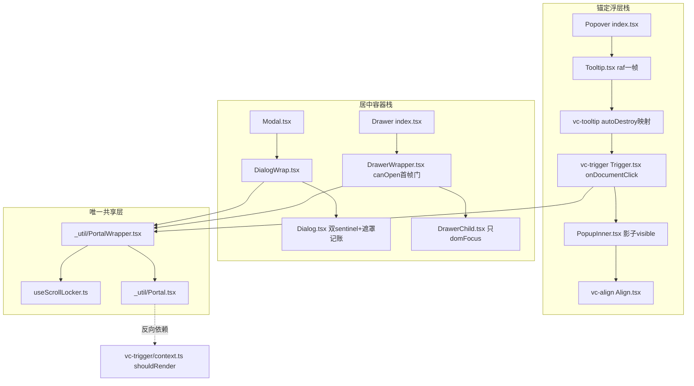
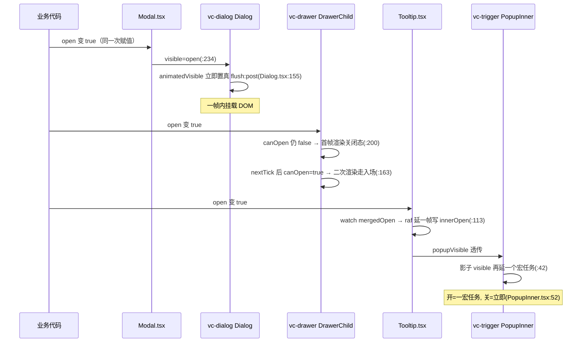
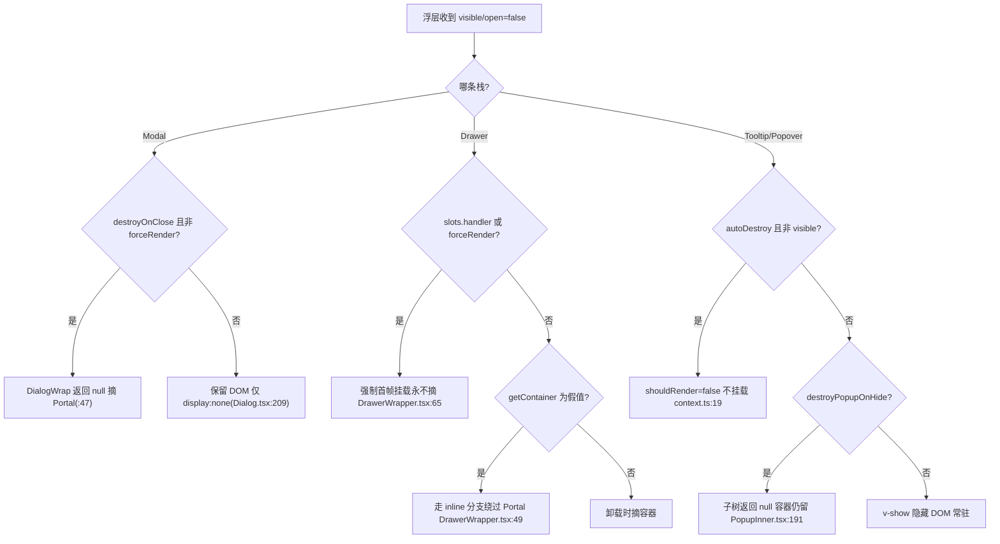

# C07-00 类横写：Modal/Drawer/Popover/Tooltip 的浮层生命周期归一

> **本篇解决**：Modal、Drawer、Popover、Tooltip 四类浮层的"打开 / 关闭 / 焦点 / 滚动锁 / 层叠"五件事，分别落在源码的哪一层、用了哪几种互不相同的实现？如果要把它们归一，收敛点应该在业务层、底座层还是 `_util`？
> **前置**：A07（交互基础设施总览）、I02（vc-trigger 弹出时序与事件穿透）、I10（z-index 层级编排）、C07-01（Modal 对话框）、C07-02（Drawer 抽屉）、C12-06（Portal 传送门）；C07-03（Tooltip 文字提示）与 C07-07（Notification 通知）按编号引用　**读者坐标**：`03-components/07-feedback` 类横写篇

---

## 一、职责与边界

本篇是 `07-feedback` 类的**横写篇**：不重复 C07-01（Modal）、C07-02（Drawer）、C07-03（Tooltip）、C07-04（Popover）逐组件的机制论证，而是把四类浮层共同的五个生命周期关注点——**打开、关闭、焦点、滚动锁、层叠**——压进同一张对照表，回答两个问题：这五件事当前各落在源码的哪一层？归一的收敛点应该在业务层、底座层还是 `_util`？

先给结论性的分层事实。四类浮层在源码里**不是四个并列实现，而是两条互不相交的技术栈**：

- **居中容器栈**：`Modal` 走 `vc-dialog` 底座（`modal/Modal.tsx:4` 导入 `../vc-dialog`），`Drawer` 走 `vc-drawer` 底座（`drawer/index.tsx` 导入 `../vc-drawer`）。两者是两套独立手写的 DOM、焦点、关闭判定，彼此不复用——C07-02 §六 已把这判为"当前最大的一致性债"。
- **锚定浮层栈**：`Popover` 整体复用 `Tooltip`（`popover/index.tsx:3`、`:65` 直接渲染 `<Tooltip>`），`Tooltip` 复用 `vc-tooltip`（`vc-tooltip/src/Tooltip.tsx:2`），`vc-tooltip` 复用 `vc-trigger`，`vc-trigger` 复用 `vc-align`——一条链，A07 与 I02 已充分展开。

两条栈在源码里唯一**真正共享**的东西，只有一个挂载器 `_util/PortalWrapper`（居中栈经 `DialogWrap`/`DrawerWrapper` 用它，锚定栈经 `Trigger` 用它，见 A07 §一 依赖表）与它内部的 `_util/hooks/useScrollLocker`。焦点、关闭、层级、开合节奏这四件事，两条栈各写各的，**没有一个共同的抽象层**。

明确**不负责**（全部是前置篇已论证的内容，本篇只引用不重述）：

| 主题 | 归属篇目 | 本篇怎么用 |
| --- | --- | --- |
| trigger→align 的弹出时序、pending 状态机、事件穿透 | I02、A07 §四 | 只取"开合节奏"一个切片做对照 |
| z-index 三套账本与冲突解法 | I10、A07 §四 论点 7 | 只取"四类浮层各用哪套"做对照 |
| Modal 的双 sentinel 焦点、遮罩记账、`getOpenCount` 死键 | C07-01 论点 2/3/5 | 只引用结论 |
| Drawer 的 `canOpen` 首帧门、`level` 失效、`currentDrawer` 死表 | C07-02 论点 2/4/7 | 只引用结论 |
| Portal 公开组件与浮层基座的挂载分叉 | C12-06 论点 1 | 只引用结论 |
| `getPopupContainer` 的纵向注入链 | A05 | 只引用"它改变哪一个 DOM 节点" |

本篇新增的、前置篇没系统给过的东西只有两样：**跨四类浮层的生命周期五行对照表**，以及**"归一应该落在哪一层"的可证伪判断**。

## 二、源码地图

下表只列本篇对照论证真正读到的锚点文件，行数为 `wc -l` 实测；每类浮层的完整文件清单见对应组件篇。

| 关注点 | Modal 路径 | Drawer 路径 | Tooltip / Popover 路径 |
| --- | --- | --- | --- |
| 业务层主组件 | `modal/Modal.tsx`（259 行） | `drawer/index.tsx`（437 行） | `tooltip/Tooltip.tsx`（319 行）/ `popover/index.tsx`（80 行） |
| 底座 | `vc-dialog/Dialog.tsx`（212）+ `Content.tsx`（156） | `vc-drawer/src/DrawerChild.tsx`（257）+ `DrawerWrapper.tsx`（100） | `vc-tooltip/src/Tooltip.tsx`（136）→ `vc-trigger/Trigger.tsx`（710） |
| 打开判据 | `vc-dialog/Dialog.tsx:155`（`animatedVisible`，`flush:'post'`） | `vc-drawer/src/DrawerChild.tsx:162`（`canOpen` 首帧门） | `tooltip/Tooltip.tsx:113`（`raf` 延一帧）+ `Popup/PopupInner.tsx:42`（影子 `visible` 延一宏任务） |
| 关闭/卸载闸门 | `vc-dialog/DialogWrap.tsx:47`（`destroyOnClose`+`forceRender`） | `vc-drawer/src/DrawerWrapper.tsx:65`（`!!slots.handler\|\|forceRender`） | `vc-trigger/context.ts:12`（`shouldRender`）+ `PopupInner.tsx:191`（`destroyPopupOnHide`） |
| "点外面/点遮罩" | `vc-dialog/Dialog.tsx:99-118`（内容区记账） | `vc-drawer/src/DrawerChild.tsx:224`（只认 mask click） | `vc-trigger/Trigger.tsx:317`（`onDocumentClick`+`hasPopupMouseDown`） |
| 焦点圈定 | `vc-dialog/Content.tsx:29-41`+`Dialog.tsx:142`（双 sentinel+TAB） | 无（仅 `DrawerChild.tsx:108` 的 `domFocus`） | 无（`vc-trigger` 全目录无 `KeyCode.TAB`） |
| 滚动锁 | `_util/PortalWrapper.tsx:109`（`useScrollLocker`） | 同左（`DrawerWrapper.tsx:68` 传 `autoLock`） | 无（`Trigger` 不传 `autoLock`，A07 坑 9 末段） |
| 层级 | `modal/style/index.ts:70`（基准 `zIndexPopupBase`） | `drawer/style/index.ts:228`（基准值） | `tooltip/style/index.ts:151`（`+70`）/ `popover/style/index.ts:179`（`+30`） |
| 现成焦点能力（未接入） | `focus-trap/FocusTrap.tsx:19`——库内零运行时消费者 | 同左 | 同左 |
| 现成层级协调者（死键） | `getOpenCount` 全仓无调用方（C07-01 论点 5） | 同左（`currentDrawer` 只写不读，C07-02 论点 7） | `Trigger` 根本不读 `getOpenCount` |

主实现入口本篇不重画：居中栈见 C07-01 §二，锚定栈见 A07 §二 与 I02 §二。上表的价值在**行号横向对齐**——同一行为（如"打开判据"）在四个不同文件里、用了三种不同性质的异步。

## 三、架构与数据流

### 3.1 静态结构：两条栈，一个共享挂载器



读图三条要点。第一，居中栈的两个底座（`Dialog` 与 `DrawerChild`）之间**没有任何箭头**——它们不共享焦点实现、不共享关闭判定、不共享开合节奏，这是 C07-02 §六 所称"最大一致性债"的结构来源。第二，锚定栈是一条单向链，`Popover` 只是 `Tooltip` 的一层壳（`popover/index.tsx:65`），所有生命周期都落在 `vc-trigger` 上。第三，两条栈唯一交汇的是 `_util/PortalWrapper` → `useScrollLocker` → `_util/Portal` 这条挂载支路，而 `Portal` 又反向依赖 `vc-trigger/context.ts`（`_util/Portal.tsx:11`，A07 §一 依赖表"反向依赖"行），于是"居中栈要不要被锚定栈的可见性管住"必须靠底座显式解除（`DialogWrap.tsx:18` 的 `inTriggerContext: false`）。**归一如果要做，第一个必须坐进的公共节点就是这张图里唯一被两栈同时指入的 `PortalWrapper`。**

### 3.2 一次 `open=true` 的四种落地节奏



这张时序图是横写的核心证据：同一个 `open` 布尔值翻转，到"用户真的看见浮层"之间，Modal 等**一帧**（`flush:'post'`，`Dialog.tsx:155`）、Drawer 等**两帧**（`canOpen` 首帧门，`DrawerChild.tsx:162`/`:200`）、Tooltip 等**一个 `raf` + 一个宏任务**（`Tooltip.tsx:113` 与 `PopupInner.tsx:42`）。四者不是"快慢不同"，而是**异步量级不同**——`flush:post` 是微任务级、`nextTick` 是微任务级、`raf` 是渲染帧级、无参 `setTimeout` 是宏任务级。跨组件复现"开合差一帧"类问题的根源就在这张图（A07 §五 第 1 点已列四种落地节奏）。归一时"打开"这一行**无法用一个 hook 抹平**，因为 Drawer 的两帧是动画起点的硬需求（C07-02 §六：panel 动画从 `-100%` 位移，首帧必须是关闭态才有可插值的起点），删掉首帧门等于删掉入场动画。

### 3.3 挂载/卸载：四套互不相干的闸门



三条出口的**语义并不对齐**，这是本篇"样式面归一"（C07-01 篇头把 `destroyOnClose`/`forceRender` 交接到此）的落点：Modal 的 `destroyOnClose` 会**摘掉 Portal**（`DialogWrap.tsx:47`），Drawer 的 handler 分支反而**强制常驻**（`DrawerWrapper.tsx:65`，C07-02 论点 6），trigger 链的 `destroyPopupOnHide` 只让子树返回 `null` 却**不动容器 div**（`PopupInner.tsx:191` + A07 坑 4），`autoDestroy` 影响的又是 `shouldRender`（`context.ts:19-21`）而非容器。四套开关各管一段，没有一处能说清"关闭后 DOM 到底在不在"。归一的第一个动作应当是**给这四个布尔名统一语义**（详见 §四 论点 3 与 §六）。

## 四、核心机制精读

### 论点 1：四类浮层实际只有两条栈，它们唯一真正共享的运行时节点是 `_util/PortalWrapper`

断言：`Modal` 与 `Drawer` 各挂一个独立底座（`vc-dialog` / `vc-drawer`），`Popover` 只是 `Tooltip` 的壳、`Tooltip` 又只是 `Trigger` 的壳——所以"四类浮层"在源码里是**两条技术栈**，而这两条栈之间唯一的共同下游是挂载器 `_util/PortalWrapper`。归一如果从业务层或底座层入手，永远只能各自收敛，触不到彼此。

锚定栈这一侧的收敛点，看 `vc-tooltip` 把 tooltip 语义整个翻成 trigger 语义的那次组装：

```tsx
// packages/xiaoye-ui/src/vc-tooltip/src/Tooltip.tsx:109
      const triggerProps = {
        popupClassName: overlayClassName,
        prefixCls,
        action: trigger,
        builtinPlacements: placements,
        popupPlacement: placement,
        popupAlign: align,
        afterPopupVisibleChange: afterVisibleChange,
        popupTransitionName: transitionName,
        popupAnimation: animation,
        defaultPopupVisible: defaultVisible,
        destroyPopupOnHide: destroyTooltip.value,
        autoDestroy: autoDestroy.value,
        mouseLeaveDelay,
        popupStyle: overlayStyle,
        mouseEnterDelay,
        ...extraProps,
        ...attrs,
        onPopupVisibleChange: props.onVisibleChange || (noop as any),
        onPopupAlign: props.onPopupAlign || noop,
        ref: triggerDOM,
        arrow: !!props.arrow,
        popup: getPopupElement(),
      };
      return <Trigger {...triggerProps} v-slots={{ default: slots.default }}></Trigger>;
```

逐段读：第 112 行 `action: trigger` 把"hover/click/contextmenu/focus"这些产品开关原样交给 trigger 的事件接管层（A07 §四 论点 2、I02 论点 1）；第 120-121 行的 `destroyPopupOnHide`/`autoDestroy` 是 tooltip 的 `destroyTooltipOnHide` 在 `:74-85` 映射出来的两个 trigger 侧布尔——**锚定栈的"卸载"语义从这一行才第一次落到 `Trigger` 的账本上**；第 133 行整个组件的返回值就是 `<Trigger>` 本身，`vc-tooltip` 没有任何自己的可见性状态。再往上，`Popover` 连 `vc-tooltip` 都不碰，直接复用 `Tooltip`：`popover/index.tsx:3` 导入 `../tooltip`、`:65` 渲染 `<Tooltip>`、`:73` 只加一个裸属性 `data-popover-inject` 关掉 Tooltip 自己的样式注入。也就是说 `Popover` 和 `Tooltip` 之间**不存在第三种生命周期实现**，它们共享同一条到 `Trigger` 的链。

居中栈这一侧正相反。`Modal` 导入 `vc-dialog`（`modal/Modal.tsx:4`），`Drawer` 导入 `vc-drawer`（`drawer/index.tsx`），两个底座之间零复用——C07-02 §六 已把"两条浮层实现各自维护焦点、滚动、层级、卸载语义"判为当前最大的一致性债，并给出根因：形态差异（居中 zoom vs 贴边 translate）让 `vc-drawer` 无法直接吃 `vc-dialog`。

唯一把两条栈焊在一起的是挂载层：居中栈经 `DialogWrap.tsx:4` 与 `DrawerWrapper.tsx:5` 用 `_util/PortalWrapper`，锚定栈经 `Trigger.tsx:18` 用同一个 `PortalWrapper`（A07 §一 依赖表"被依赖（Portal）"行）。所以本篇的结论不是"应该新建一个浮层基类"，而是一个更朴素的定位：**归一的可落点分层，就是这张 `PortalWrapper` 之上/之下的分界线**——`PortalWrapper` 之下（挂载、滚动锁）是两条栈真正能共享的，之上（焦点、关闭判定、开合节奏、层级）至今是四套。

### 论点 2：同一个 `open` 到"看见浮层"之间被塞进了四种不同量级的异步，归一"打开"这一行不可用一个 hook 抹平

断言：四类浮层对"打开"的实现不是快慢不同，而是**异步量级不同**——微任务（Modal）、两个微任务/帧（Drawer）、一个 `raf`（Tooltip 业务层）、一个宏任务（Trigger 影子 `visible`）。任何"统一开合时机"的尝试都会撞上 Drawer 的首帧硬约束。

锚定栈最后一段、也是量级最重的一段在 `PopupInner`：

```tsx
// packages/xiaoye-ui/src/vc-trigger/Popup/PopupInner.tsx:42
    const visible = shallowRef(false);
    let timeoutId: any;
    watch(
      () => props.visible,
      val => {
        clearTimeout(timeoutId);
        if (val) {
          timeoutId = setTimeout(() => {
            visible.value = props.visible;
          });
        } else {
          visible.value = false;
        }
      },
      { immediate: true },
    );
```

这里 `visible`（本地影子）与 `props.visible`（上游请求）不对称：**开**走一个无参 `setTimeout`（宏任务，第 49 行），**关**立即生效（第 53 行）。等待的动机是"节点已在 DOM"与"动画开始"要分处两帧，否则同一次更新里插节点又加 enter 类，过渡不触发（A07 §四 论点 3）。这一格之上还叠着 `Tooltip.tsx:113` 的一个 `raf`：业务层 `watch(mergedOpen)` 先 `raf` 一帧才写 `innerOpen`（`tooltip/Tooltip.tsx:115-117`），于是锚定栈一次打开 = `raf` + 宏任务两跳。

居中栈的两跳来自完全不同的机制。Modal 的 `animatedVisible` 是"打开即真"，且 `watch` 带 `flush: 'post'`（`vc-dialog/Dialog.tsx:155`，C07-01 论点 4），本质是微任务级——DOM 更新完就把 `display` 放开。Drawer 却强制"首帧画关闭态、次帧才画打开态"：`canOpen` 初值 `false`（`DrawerChild.tsx:162`），`watch(dom)` 在根 ref 首次拿到元素后 `nextTick` 才置真（`:163-167`），渲染期 `const open = $open && canOpen.value`（`:200`）——两帧（C07-02 论点 2）。

四跳对齐如下（均为"请求显示"到"可动画"之间的等待）：

| 浮层 | 判据落在 | 等待性质 | 为什么不能删 |
| --- | --- | --- | --- |
| Modal | `Dialog.tsx:155` | `flush:'post'` 微任务 | 删了 `display` 与 Portal 挂载不同帧，闪一帧 |
| Drawer | `DrawerChild.tsx:162/200` | `watch(dom)`+`nextTick` 两帧 | 首帧即打开态 → `translate(-100%)` 无可插值起点，入场动画被跳过（C07-02 §六） |
| Tooltip 业务 | `Tooltip.tsx:113` | 一个 `raf` | 同帧内 `innerOpen` 仍是旧值，`:314` 决定触发元素 open 类名的就是这份旧状态 |
| Trigger 底座 | `PopupInner.tsx:42` | 一个宏任务 | 影子 `visible` 与 DOM 插入分帧，否则过渡不触发 |

回扣论点 1：这四跳分处业务层（Tooltip `raf`）、底座层（Modal `animatedVisible`、Drawer `canOpen`、Trigger `PopupInner`）**三种不同的层**，没有一个共同的"打开"抽象能吃下它们。归一的现实边界是——能统一的只有"打开请求"的**入口 prop 归一**（`open ?? visible`，Modal 在 `Modal.tsx:234`、Tooltip 在 `Tooltip.tsx:107`、Popover 复用），**不能**统一的是这些跳数，因为每一跳都在防一个各自形态特有的动画竞态。

### 论点 3："关闭后 DOM 在不在"由四套互不相干的闸门决定，语义方向甚至相反；归一名分应先于归一实现

断言：四类浮层各有一套"要不要挂载 / 什么时候摘掉"的判定，且四套的默认方向不一致——Modal 的 `destroyOnClose` 摘 Portal、Drawer 的 `handler` 反过来强制常驻、trigger 链的 `destroyPopupOnHide` 只摘子树不摘容器、`autoDestroy` 改的是 `shouldRender` 而非容器。本篇（C07-01 篇头显式把 `destroyOnClose`/`forceRender` 的"样式面"交接到横写篇）认为：**归一的第一步不是合并实现，而是给这四个布尔名定一个统一语义表**，否则用户跨组件时得到的行为是不可预测的。

锚定栈这套闸门藏在 `vc-trigger/context.ts` 的 `shouldRender` 里：

```ts
// packages/xiaoye-ui/src/vc-trigger/context.ts:9
export const useProvidePortal = (instance: any, config = { inTriggerContext: true }) => {
  provide(PortalContextKey, {
    inTriggerContext: config.inTriggerContext,
    shouldRender: computed(() => {
      const { sPopupVisible, popupRef, forceRender, autoDestroy } = instance || {};
      // if (popPortal) return true;
      let shouldRender = false;
      if (sPopupVisible || popupRef || forceRender) {
        shouldRender = true;
      }
      if (!sPopupVisible && autoDestroy) {
        shouldRender = false;
      }
      return shouldRender;
    }),
  });
};
```

第 16 行的 `sPopupVisible || popupRef || forceRender` 是"挂载"判据——`forceRender` 让浮层首帧就挂（这与 Modal 的 `forceRender` 语义一致，C07-01 论点 4）。第 19-21 行是"摘掉"判据：`!sPopupVisible && autoDestroy` 才返回 `false`。但 `shouldRender` 只决定 `_util/Portal.tsx` 里 `<Teleport>` 渲不渲染，**不删已经在 body 上 `appendChild` 的容器 `div`**（容器只在 `getContainer` 变化或组件卸载时移除，A07 坑 4）。真正把子树收成 `null` 的是另一处——`PopupInner.tsx:191` 的 `!destroyPopupOnHide || props.visible ? (子树) : null`，它和 `shouldRender` 是**两个不同源**的开关（I02 论点 6）。于是 `destroyTooltipOnHide` 这个 tooltip prop，经 `vc-tooltip/src/Tooltip.tsx:74-85` 拆成 `destroyPopupOnHide` 与 `autoDestroy` 两个布尔后，分别喂给两条独立闸门。

居中栈的第三、第四套：Modal 看 `DialogWrap.tsx:47` 的 `!forceRender && destroyOnClose && !animatedVisible` → 返回 `null` 摘 Portal（C07-01 论点 4）；Drawer 看 `DrawerWrapper.tsx:65` 的 `!!slots.handler || forceRender` → **一旦有把手就强制首帧挂载、永不自动摘**（C07-02 论点 6）。第四套的方向与前三个相反：Modal 的开关是"要不要销毁"，Drawer 的 `handler` 是"要不要常驻"，语义刚好镜像。

| 布尔名 | 所在栈 | 真为时的效果 | 是否删容器 | 出处 |
| --- | --- | --- | --- | --- |
| `destroyOnClose` | Modal | 摘 Portal（返回 `null`） | 随 Portal 一起 | `DialogWrap.tsx:47` |
| `forceRender` | Modal/trigger 共有 | 首帧即挂载（提前占位） | 否 | `context.ts:16`、`DialogWrap.tsx:47` |
| `handler`/`forceRender` | Drawer | 强制常驻、永不摘 | 否（反而加） | `DrawerWrapper.tsx:65` |
| `destroyPopupOnHide` | trigger 链 | 子树返回 `null` | 否（容器仍留） | `PopupInner.tsx:191` |
| `autoDestroy` | trigger 链 | `shouldRender=false` | 否 | `context.ts:19-21` |

结论回扣论点 1：这五行的落点分属 `DialogWrap`、`DrawerWrapper`、`context.ts`、`PopupInner` 四个文件，两条栈各两套。**能归一的层是 `PortalWrapper`/`context` 这一侧（决定挂不挂），不能归一的层是各底座的 `destroy*` 命名**。务实做法是先在本类文档层把"关闭后 DOM 在不在"写成一张语义表（如本表），推动后续把 `handler` 的强制常驻改写成与其它三者同向的显式 `forceRender`，再谈合并闸门。

### 论点 4：焦点圈定只有 Modal 一家做了，Drawer 与整条 trigger 链都没有；库内现成的 `useFocusTrap` 没有任何运行时消费者

断言：五类关注点里，"焦点"这一行在源码里是**残缺**的——Modal 有双 sentinel + TAB 拦截，Drawer 只有单向 `domFocus`，Popover/Tooltip（trigger 链）连 `KeyCode.TAB` 都不出现。更反常的是：库里已有一个公开、可用的 `XYFocusTrap` 组件与 `useFocusTrap` composable，但**没有任何一个浮层底座接它**，库内运行时消费者为零。所以归一的落点不是"新写一份焦点逻辑"，而是"让三个底座共同消费已有的 `focus-trap`"。

Modal 的焦点能力靠 `Content` 暴露的两个方法，判据是"当前活动元素是不是某个 sentinel"：

```tsx
// packages/xiaoye-ui/src/vc-dialog/Content.tsx:29
    expose({
      focus: () => {
        sentinelStartRef.value?.focus({ preventScroll: true });
      },
      changeActive: next => {
        const { activeElement } = document;
        if (next && activeElement === sentinelEndRef.value) {
          sentinelStartRef.value.focus({ preventScroll: true });
        } else if (!next && activeElement === sentinelStartRef.value) {
          sentinelEndRef.value.focus({ preventScroll: true });
        }
      },
    });
```

`focus()`（第 30-32 行）把焦点送进内容起始哨兵；`changeActive()`（第 33-39 行）在 TAB 越界时把焦点回弹到另一端——`Dialog.tsx:142` 拦 `KeyCode.TAB` 调 `contentRef.value.changeActive(!e.shiftKey)`（C07-01 论点 2）。这是一份**手写的焦点圈定**，与 `focus-trap` 无关。

Drawer 的全部焦点代码只有一句单向聚焦，且**没有回弹、没有归还**：

```tsx
// packages/xiaoye-ui/src/vc-drawer/src/DrawerChild.tsx:108
    const domFocus = () => {
      dom.value?.focus?.();
    };
```

`dom.value` 是根节点（`tabindex={-1}`，只保证可编程聚焦，不构成圈定）。`onKeyDown` 里只处理 ESC（`:116-121`），没有 TAB 分支——C07-02 论点 3 已用判别式 grep 证明 `vc-drawer` 与 `drawer` 目录内 `lastOutSide`/`changeActive`/`sentinel` 三词零命中。trigger 链更彻底：A07 坑 12 给出 `vc-trigger` 全目录连 `KeyCode.TAB` 都不出现，唯一与焦点沾边的是 `vc-align/util.ts` 的 `restoreFocus`，那只解决"重定位导致焦点丢失"，与圈定无关。

对照结论：`useFocusTrap` 的公开能力（`focus-trap/FocusTrap.tsx:19`，包根导出）在库内没有任何运行时消费者（`grep -rn "useFocusTrap" packages/xiaoye-ui/src | grep -v "src/focus-trap/"` 为空）。也就是说**同一个仓库里并存三套焦点现状**：Modal 手写 sentinel、Drawer 无、`focus-trap` 组件闲置。归一方案因此非常明确——把 `focus-trap` 接进三个底座，而不是给 Drawer 再写第四份 Tab 记账（这条路径 A07 坑 12 已建议）；本篇补充它在横写对照表里的定位：**"焦点"是五行归一中唯一"库里已有公共实现、只差接线"的一行**，成本最低、收益最直接。

### 论点 5：滚动锁只有一个真源 `_util/hooks/useScrollLocker`，但它只在居中栈触发，且它的容器判据是一次空判

断言："滚动锁"这一行，源码里其实**只有一份实现**（`useScrollLocker`），位置就在两条栈共享的 `PortalWrapper` 里——这是本篇认定的、五行归一里唯一"天然已归一但坏了"的一行。它坏在两处：其一，锚定栈根本不进这个闸门（`Trigger` 不传 `autoLock`，A07 坑 9 末段），所以 Tooltip/Popover 从不锁滚动是默认行为；其二，进得来的一半（Modal/Drawer）里，那个"只在挂在 body 时才锁"的判据是一次空判，容器被挂到局部滚动容器时背景照旧能滚、body 却被误锁。

闸门本体：

```tsx
// packages/xiaoye-ui/src/_util/PortalWrapper.tsx:109
    useScrollLocker(
      computed(() => {
        return (
          props.autoLock &&
          props.visible &&
          canUseDom() &&
          (container.value === document.body || container.value === defaultContainer)
        );
      }),
    );
```

四个与项里，前三项（`autoLock`、`visible`、`canUseDom`）都正常，坏在最后一项：`container.value === document.body || container.value === defaultContainer`。A07 坑 9 已用行号钉死——`container.value` 在整个 `PortalWrapper.tsx` 只有两处赋值，`null`（`:71`）与 `defaultContainer`（`:92`），而 `defaultContainer` 是本组件自己在 `:64` `document.createElement('div')` 出来的节点，**永远不等于 `document.body`**；于是第一个析取项恒假、第二个恒真，整句话退化成"容器 div 存在即锁"，与挂在谁下面无关。真正决定宿主的是模块内变量 `parent`（`:76` 由 `attachToParent` 赋值），**闸门没有读它**。同文件里 `openCount` 的累加反而显式判了 `parent === document.body`（`:127-133`），即正确写法就在隔壁，只是没被这条闸门用。

锁的执行侧同样只认 body：

```ts
// packages/xiaoye-ui/src/_util/hooks/useScrollLocker.ts:31
      if (mergedLock.value) {
        const scrollbarSize = getScrollBarSize();
        const isOverflow = isBodyOverflowing();

        updateCSS(
          `
html body {
  overflow-y: hidden;
  ${isOverflow ? `width: calc(100% - ${scrollbarSize}px);` : ''}
}`,
          id,
        );
      } else {
        removeCSS(id);
      }
```

选择器是硬编码的 `html body`（`useScrollLocker.ts:35-42`），`isBodyOverflowing()` 只决定要不要补 `width: calc(100% - Npx)` 抵消滚动条跳动，不改变被锁元素。局部容器不在选择器覆盖范围内，所以照旧可滚——这与判据的空判叠加，产出 A07 坑 9 描述的"方向相反"症状：背景仍滚、body 反被冻。

归一落点：**这一行不该被拆到各底座各写一遍（Drawer 一度试过，`scrollLocker` prop 四处在 `DrawerChild.tsx` 空转，C07-02 论点 1 证其为死分支），而应把 `useScrollLocker` 的宿主参数化**——让它接收一个"要锁的元素"，改内联样式而非注入 `html body` 规则，或至少让上面那条闸门去读 `parent` 而不是 `container.value`（A07 坑 9 给的二选一补法）。因为实现已经唯一，归一在这里是**修 bug 而非做抽象**，是五行里第二便宜的一行（第一便宜的是论点 4 的接线）。

### 论点 6：层叠是三套互不知情的账本，四类浮层各用不同套；归一应落在组件 Token 层给相对关系，而不是再补第四套运行时栈

断言："层叠"这一行是全篇唯一"看着有中央管理器、其实浮层链一个都不用"的。A07 论点 7 实测过 `_util/zIndexManager.ts` 不在浮层链上；按当前源码复核，它的库内消费者只有 `context-menu`、`block-ui`、`color-picker` 三处——**没有一个走 `vc-trigger` 的浮层**；而 Modal/Drawer/Tooltip/Popover 的层级全是编译期写进 CSS 的静态偏移。三套账本（静态 CSS Token / `ZIndexManager` 单调栈 / `packages/utils/src/zindex`）的完整冲突解法归 I10，本篇只取"四类浮层各落在哪套、同值时谁压谁"这一横写切片。

最容易被误认成"浮层总闸"的运行时栈长这样：

```ts
// packages/xiaoye-ui/src/_util/zIndexManager.ts:6
export const ZIndexManager = {
  get(element?: HTMLElement): number {
    return element ? parseInt(element.style.zIndex, 10) || 0 : 0;
  },
  set(key: string, element: HTMLElement, baseZIndex?: number): void {
    const base = baseZIndex ?? 0;
    const last = zIndexRecords.length > 0 ? zIndexRecords[zIndexRecords.length - 1] : null;
    const newValue = last ? last.value + 1 : base + 1;
    zIndexRecords.push({ key, value: newValue });
    element.style.zIndex = String(newValue);
  },
```

第 12 行取的是数组**末位**、与传入 `key` 无关（`'modal'`/`'menu'`/`'overlay'` 因此共用一条递增序列），I10 论点 2 已证 `key` 是装饰性的。但关键是：**这套栈压根不在四类浮层的调用路径上**——`grep -rn "zIndexManager" packages/xiaoye-ui/src` 命中的四个业务点里没有 `modal`/`drawer`/`tooltip`/`popover`。四类浮层真正用的是静态偏移表：Modal 的 mask 与 wrap 都取基准值 `zIndexPopupBase`（`modal/style/index.ts:70`、`:98`）、Drawer 同样取基准值（`drawer/style/index.ts:228`）、Tooltip 是 `zIndexPopupBase + 70`（`tooltip/style/index.ts:151`，写入 `:42`）、Popover 是 `+30`（`popover/style/index.ts:179`，写入 `:44`）。

由此得出本篇横写的层叠结论：**Modal 与 Drawer 同为基准值，Tooltip 高于 Popover 40 格**，而"同值浮层谁压谁"（Modal vs Drawer 叠放）没有任何协调者，最终由 DOM 顺序决定——每个浮层容器 `div` 在首次打开时才 `appendChild`（A07 论点 7），后开的排更靠后所以压在上面。这不是设计出来的层序，是挂载时机的副产物。底座本来想做的那个协调者就是 `getOpenCount`，但它在 Modal/Drawer 两侧都是死键（C07-01 论点 5、C07-02 论点 7 各证一次）。

归一落点（本行最贵）：**不要把四类浮层改造成都走 `ZIndexManager`**——运行时栈做不到无副作用渲染（模块级数组，服务端并发互相污染，A07 §六 已判），SSR 也拿不到 `z-index`。可行方向是把"相对关系"表达在组件 Token 层：给 Modal/Drawer 之间、以及它们与 `+30/+70` 的锚定浮层之间约定一套偏移档位，让"Tooltip 不该盖住宿主 Modal"这类关系可声明，而不是像现在这样给每个组件手写一个孤立常数。完整三套账本对照与逃逸点登记见 I10。

## 五、对外契约如何生效

本节不列 Props，只追同一份"开合契约"（`open`/`visible`/关闭事件/容器）在四类浮层里各自的收窄路径，横写出三处**已经归一**、两处**归一半途**的事实。

**入口 prop 归一是四族唯一真正一致的一行。** 对外都收 `open`，`visible` 是 deprecated 别名，且都在业务层折成一个内部值：Modal 用 `visible={open ?? visible}` 一行（`modal/Modal.tsx:234`）；Tooltip 用 `mergedOpen = computed(() => props.open ?? props.visible)`（`tooltip/Tooltip.tsx:107`）；Popover 复用 Tooltip 的 `abstractTooltipProps`（`popover/index.tsx:16`），另加一条 `warning` 提示 `visible` 将被移除（`:36-40`）；Drawer 的收窄最重，把 `visible` 三件套从透传里显式 omit（`drawer/index.tsx:399-403`），底座只认 `open`（C07-02 §五）。四族都做到了"入口两个名、内部一个值"，这一行可以视为已经归一。

**关闭事件回流是四族最容易出错、也最没统一的一行。** Modal 一次关闭同时发四个事件（`update:visible`/`update:open`/`cancel`/`change`，`modal/Modal.tsx:174-179`，C07-01 §五 第 2 点），底座把 ESC/遮罩/关闭按钮统一收进 `onInternalClose`，导致 `@change` 无法分辨来源。Tooltip 走另一条：`handleVisibleChange` 发 `update:visible`/`visibleChange`/`update:open`/`openChange` 四个（`tooltip/Tooltip.tsx:130-133`），但它的触发源是 Trigger 的单一 `onPopupVisibleChange`（`vc-tooltip/src/Tooltip.tsx:127`）炸开的。Drawer 底座只 `emit('close', e)`（`DrawerChild.tsx:112-114`）。**同一件事（用户关掉了浮层）在四族里落成四组事件名、来自三四种触发源**——A07 §五 第 2 点已点出"关闭动画结束回调的触发条件"各族也不同（trigger 侧 `afterPopupVisibleChange` 挂在"渲染过"、Modal 侧 `afterClose` 挂在"动画过"）。归一事件名是横写能给出的最直接建议，但涉及公开 API，属破坏性变更。

**容器注入是"配置层已归一、落点分叉"的一行。** 四族都吃 ConfigProvider 的 `getPopupContainer`：Modal 把它当 `getContainer` 的兜底（`modal/Modal.tsx:231`），Tooltip 直接当 prop 下传（`tooltip/Tooltip.tsx:291`），Popover 复用，Drawer 走自己的 `getContainer`（`drawer/index.tsx`）。共享的是同一个配置键（A07 §五 第 6 点、纵向注入链归 A05），分叉的是**兜底方向**：Drawer 的挂载判定用假值 `!getContainer`（`DrawerWrapper.tsx:49`），传 `false`/`''`/`null` 都走 inline 绕过 Portal 从而失去滚动锁；Modal 用严格 `getContainer === false`（`DialogWrap.tsx:37`）才就地渲染。**同一份配置喂给两条栈会得到不同的"要不要走 Portal"结果**，而"要不要走 Portal"直接决定论点 5 的滚动锁能不能触发。

**expose 面是"名字归一、深度归零"的一行。** `getPopupDomNode` 与 `forcePopupAlign` 是锚定栈对外的两个方法，但要从 `XYTooltip` 穿到 `Align` 得跨六层（A07 §五 第 4 点），任一层用可选链吞空值都会让调用方误判成功；Popover 只透出一个 `getPopupDomNode`（`popover/index.tsx:41-45`），且走 `tooltipRef.value?.getPopupDomNode?.()` 双可选链。Modal/Drawer 则**不 expose 这两个方法**（居中容器无 align）。这不是缺陷，是两条栈职责不同——但横写要如实标注：**"取浮层 DOM 节点"这个诉求在居中栈里根本没有对应公开方法**，想拿 Modal 的内容节点只能靠 `modalRender` 自己留 ref。

**scroll/mask 契约是"能力存在、开关方向相反"的一行。** mask/maskClosable 四族名字近似语义不同：Modal 判遮罩点击靠内容区 mousedown/mouseup 记账（`Dialog.tsx:99-118`，C07-01 论点 3），Drawer 只认遮罩节点自身 click（`DrawerChild.tsx:224`），trigger 链判文档点击 + `hasPopupMouseDown`（`Trigger.tsx:310`）——A07 §四 论点 8 与坑 10 已把这几套"点外面"的输入事件、宿主对象、shadow DOM 穿透能力做过完整对照，本篇不重述，只登记一条横写结论：**这四套没有一套能被另一套替换，因为它们的宿主分别是 document / window / 遮罩节点 / 内容区四种**。

## 六、设计取舍

**为什么两条栈不合成一条——即"为什么不做一个统一浮层基座"。** 这是本篇最该回答的取舍。形态差异是硬的：居中栈（Modal/Drawer）不走 align，没有"贴边翻转/箭头随 placement 反查"这套（A07 全文的主线就是 align 链，而 C07-01 §一 明确 Modal 是居中容器不走 align）；锚定栈（Tooltip/Popover）必须有 `align`、`getClassNameFromAlign` 反向通道、`stretch` 量宽，这些在居中容器里全是死重。把两者强并成一个基座，会让居中容器背上 `vc-align` 依赖、让锚定浮层背上 mask 记账与 sentinel——tree-shaking 直接受损（一个只想用 Tooltip 的应用会被迫打包 `focus-trap` 与双 sentinel）。**代价**就是本篇反复撞到的现状：焦点、关闭、层级、开合节奏各写各的，Modal 修好的（焦点归还）不惠及 Drawer（C07-02 §六 判为最大一致性债）。这是一笔"分层清晰度"换"跨组件一致性"的交易，仓库选了前者。

**为什么滚动锁留在 `PortalWrapper` 而不是各底座自管。** 好处正是论点 5 说的"实现唯一、天然归一"——居中栈两条经 `DialogWrap.tsx:53`/`DrawerWrapper.tsx:68` 传 `autoLock` 就复用同一把锁。**赔上**的是两条约束：其一，锁被绑死在"走不走 Portal"上，`getContainer === false`/inline 分支绕过 Portal 就绕过锁（C07-01 论点 5、C07-02 §五）；其二，锁死认 `html body`，无法锁局部容器（`useScrollLocker.ts:35-42`）。Drawer 曾试图把锁做成可注入的 `scrollLocker` prop（`DrawerChild.tsx:55/80/83/95`），但那条路两侧业务层都不构造它，成了死分支（C07-02 论点 1）——**这笔"想解耦但没收尾"的尝试，恰好证明锁留在 Portal 层是对的，只是接口没收干净**。

**为什么层级用静态 Token 偏移而不是运行时栈。** A07 §六 给过完整权衡（SSR 直出、tree-shaking、无全局可变状态 vs 同值只能靠 DOM 顺序），本篇不重述，只补横写视角的一句话：静态偏移表是**四类浮层里唯一"四族都遵守"的约定**（Modal/Drawer 基准、Tooltip +70、Popover +30），所以它反而是最接近"已归一"的一行——问题不在有没有统一，而在**没有一档描述相对关系**（`+70` 与基准值之间没有换算，导致 Tour 的 1001 能盖过自己的 1070，A07 坑 11、I10 论点 3）。

**为什么焦点不做成一处公共实现，却留着一个没人接的 `focus-trap`。** 与论点 8 的"点外面"四套同理：Modal 的双 sentinel 只需两个 `tabindex=0` 节点、无 MutationObserver、SSR 可预渲染哨兵，代价小（C07-01 §六）；trigger 链是"贴着触发元素"的轻量浮层，圈定焦点反而是反模式（Tooltip 打开时焦点应留在触发按钮）。**赔上**的是：库内已有一个公开的 `XYFocusTrap`/`useFocusTrap`（A07 坑 12），却没有任何库内消费者用它，Drawer 的 WCAG 缺口（C07-02 论点 3）明明能用它补却没接——**这是"分层正确、接线遗漏"型取舍**，不是设计反悔，成本最低、最该先修的一行（论点 4 结论）。

## 七、坑与改动指南

本节的坑全部是**跨族**的——单族内的坑见各组件篇（C07-01/C07-02/C07-03/C07-04），这里只登记"把四类浮层放一起才会暴露"的问题。每条：触发 → 症状 → 原因 → 定位。

1. **同一份 `getPopupContainer` 让 Modal 走 Portal、Drawer 掉进 inline，滚动锁随之消失。**
   触发：把 `getContainer`/`getPopupContainer` 绑成一个暂时返回空串 `''` 的 computed，Modal 与 Drawer 同用。
   症状：Modal 打开后背景锁住、正常；Drawer 打开后背景仍可滚、且渲染位置变成就地 inline。
   原因：两条栈的"走不走 Portal"判据不同向——Drawer 用假值 `if (!getContainer)`（`vc-drawer/src/DrawerWrapper.tsx:49`），`''`/`false`/`null` 全落进 inline 分支（`:51-61`，绕过 `PortalWrapper`，滚动锁随之不触发）；Modal 用严格 `getContainer === false`（`vc-dialog/DialogWrap.tsx:37`），空串仍走 Portal。
   定位：`DrawerWrapper.tsx:49` 对照 `DialogWrap.tsx:37`；真锁来源 `_util/PortalWrapper.tsx:109`（其容器判据空判见 A07 坑 9）。**无测试保护**（见本节末"测试现状"）。

2. **`destroyOnClose` / `destroyTooltipOnHide` / `handler` 三个开关语义方向相反，跨组件迁移后 DOM 常驻行为翻转。**
   触发：把一段依赖"关闭后销毁"的富文本内容从 Modal 迁到 Drawer，或反过来。
   症状：Modal 里 `destroyOnClose` 关完即摘 Portal；同样的内容放进带 `handle` 的 Drawer，即使从未打开也已挂载并常驻（请求已发出）。
   原因：Modal 的销毁闸门 `!forceRender && destroyOnClose && !animatedVisible` → `null`（`DialogWrap.tsx:47`，C07-01 论点 4）；Drawer 的 `!!slots.handler || forceRender` 是**强制挂载**判据（`DrawerWrapper.tsx:65`，C07-02 论点 6），方向镜像。trigger 链的 `destroyPopupOnHide` 只把子树收成 `null`、容器 `div` 仍留在 body（`PopupInner.tsx:191`，A07 坑 4），`autoDestroy` 改的又是 `shouldRender`（`context.ts:19-21`）。
   定位：四行分属 `DialogWrap.tsx:47`、`DrawerWrapper.tsx:65`、`PopupInner.tsx:191`、`context.ts:19-21`，没有一处能说清"关闭后 DOM 在不在"——本篇论点 3 的语义表就是为这条坑准备的对照基准。

3. **Modal 与 Drawer 同屏叠放时，谁压谁由"谁后打开"决定，重开一次顺序就变。**
   触发：Modal 之上再开 Drawer（或反向），或连续开关两次。
   症状：第一次 Drawer 盖住 Modal，关掉再开变成 Modal 盖住 Drawer；无告警。
   原因：两者的 wrap/mask 都写 `zIndex: token.zIndexPopupBase`（`modal/style/index.ts:70`、`:98`，`drawer/style/index.ts:228`）——同值；同 `z-index` 的绝对定位元素按 DOM 顺序绘制，而容器 `div` 首次打开才 `appendChild`（A07 论点 7），后开的排更靠后。底座本应充当协调者的 `getOpenCount` 两侧都是死键（C07-01 论点 5、C07-02 论点 7）。
   定位：`modal/style/index.ts:70` 与 `drawer/style/index.ts:228` 值相同；三套账本与逃逸点见 I10，此处只登记"居中栈两族同基准"这一横写事实。安全的改法只有把要叠放的浮层统一交给 `ZIndexManager`（注意其 `key` 不参与取值，A07 论点 7）或在 Token 层给相对档位（论点 6 结论）。

4. **给 Tooltip 传 `trigger="focus"` 期望"聚焦时把焦点圈在浮层里"，实际只改显示时机、毫无圈定。**
   触发：键盘用户在 Tooltip/Popover 打开后连按 Tab。
   症状：Tooltip 正常在 `focusin` 时出现（`focusDelay` 默认 0，`vc-trigger/interface.ts:125`），但焦点直接走到浮层背后的页面内容，读屏朗读背景——与 Drawer 打开后 Tab 走光是同一族缺陷（C07-02 论点 3）。
   原因：`TriggerType` 里的 `focus`（`tooltip/abstractTooltipProps.ts:4`）是**显示触发动作**，不是焦点管理；整条 `vc-trigger` 链没有任何 TAB 拦截（A07 坑 12），库内现成的 `useFocusTrap` 没有任何运行时消费者。把 `action='focus'` 误读成"焦点被接管"是这条坑的触发点。
   定位：`abstractTooltipProps.ts:4`（动作枚举）、`vc-trigger/interface.ts:125`（focusDelay）、A07 坑 12（无 TAB）。归一见论点 4：把 `focus-trap` 接进底座。

5. **`hover` 进入延迟在 vc-trigger 裸默认是 0，经 vc-tooltip 变 0.1，同一条链不同族默认不同。**
   触发：直接用 `vc-dropdown`/`vc-trigger` 与用 `XYTooltip` 的 hover 响应速度对比；或写 E2E 断言"mouseenter 立刻出现"。
   症状：Tooltip 侧 mouseenter 后约 100ms 才出现，裸 Trigger 侧 0ms；两条对同一交互给出不同手感。
   原因：`vc-trigger/interface.ts:122` 的 `mouseEnterDelay` 默认 `0`（`:123` mouseLeave 0.1），但 `vc-tooltip/src/Tooltip.tsx:25` 把 `mouseEnterDelay` 默认改成 `0.1` 再透传给 Trigger（`:124`）；业务层 `tooltip/abstractTooltipProps.ts:35` 的 `mouseEnterDelay` 无默认值，于是最终值由 `vc-tooltip` 决定。
   定位：`vc-trigger/interface.ts:122` 对照 `vc-tooltip/src/Tooltip.tsx:25`。属"默认值散落在链的多层"横写问题，归一时应把延迟默认收在一处（与论点 2 的四种跳数同源）。

6. **焦点归还同时被 `mask` 门控，无遮罩 Modal 关完焦点掉 body；Drawer/Tooltip 根本没有归还这回事。**
   触发：`:mask="false"` 的 Modal 关闭后，或任意 Drawer/Tooltip 关闭后，检查 `document.activeElement`。
   症状：Modal 有遮罩时焦点回到触发按钮、无遮罩时焦点掉到 `<body>`；Drawer/Tooltip 无论遮罩都掉 body。
   原因：Modal 的归还有三重与门 `props.mask && lastOutSideActiveElement && focusTriggerAfterClose`（`vc-dialog/Dialog.tsx:87`，C07-01 坑 4），`mask` 同时管视觉与焦点是历史耦合；Drawer 无归还（`DrawerChild.tsx:108` 只 domFocus）；trigger 链无焦点记账。
   定位：`Dialog.tsx:87`、`DrawerChild.tsx:108`。归一建议：焦点归还与 `mask` 解耦，并让三底座共用 `useFocusTrap` 的 `returnFocusOnDeactivate` 语义（论点 4）。

**测试现状（如实，不夸大）**：横写范围内的可执行单测极稀疏，且集中在业务层。`modal/` 有 3 个测试文件（`Modal.test.js`/`confirm.test.js`/`__tests__/use-dynamic-modal.test.js`，C07-01 坑 6 已逐一列出未被覆盖的机制）；`tooltip/tooltip.test.js` 约 90 行、`popover/index.test.js` 约 46 行（A07 §七"测试现状"记为仅验显隐与事件参数）。**四个底座目录 `vc-dialog`/`vc-drawer`/`vc-trigger`/`vc-tooltip` 在本篇关注的五行（开合节奏、卸载闸门、焦点、滚动锁、层级）上均无对应测试**——`find packages/xiaoye-ui/src/vc-dialog packages/xiaoye-ui/src/vc-drawer packages/xiaoye-ui/src/vc-trigger packages/xiaoye-ui/src/vc-tooltip -name '*.test.*'` 的命中不足以覆盖这些分支。因此上面 6 条坑**全部没有测试网**，改动前的安全边界只能是手工回归"打开→局部滚动→拖窗→移出→重开→焦点回哪儿"整圈，外加 `pnpm --filter xiaoye-ui test:unit src/modal src/tooltip src/popover src/drawer` 与 `pnpm typecheck`。

## 附：本篇可证伪的三个检查点

1. **两条栈唯一共享的运行时节点是 `PortalWrapper`，且锚定栈不进滚动锁闸门。**

   ```bash
   cd /Users/xiaoye/Desktop/publish/xiaoye-ui-vue
   grep -n "PortalWrapper" packages/xiaoye-ui/src/vc-dialog/DialogWrap.tsx packages/xiaoye-ui/src/vc-drawer/src/DrawerWrapper.tsx packages/xiaoye-ui/src/vc-trigger/Trigger.tsx
   grep -c "autoLock" packages/xiaoye-ui/src/vc-trigger/Trigger.tsx
   ```
   预期：第一条 3 行命中，分别是 `DialogWrap.tsx:4`、`DrawerWrapper.tsx:5`、`Trigger.tsx:18`——三个底座都从 `_util/PortalWrapper` 挂载；第二条为 `0`，即 `Trigger` 全文不含 `autoLock`，锚定栈默认不锁滚动（论点 5、§五 第 3 段）。若第二条出现非零命中，则"Tooltip/Popover 从不锁滚动"作废，需重估归一落点。

2. **焦点圈定只在 Modal 存在，Drawer 与 trigger 链都没有；`useFocusTrap` 无浮层消费者。**

   ```bash
   grep -rln "changeActive\|sentinel" packages/xiaoye-ui/src/vc-dialog
   grep -rn "changeActive\|sentinel\|KeyCode.TAB" packages/xiaoye-ui/src/vc-drawer packages/xiaoye-ui/src/vc-trigger
   grep -rn "useFocusTrap" packages/xiaoye-ui/src | grep -v "src/focus-trap/"
   ```
   预期：第一条命中 2 个文件（`vc-dialog/Content.tsx`、`vc-dialog/Dialog.tsx`）；第二条**为空**；第三条**也为空**——`useFocusTrap` 在库内已无任何运行时消费者。这三条共同支撑论点 4 与坑 4/坑 6。若第二条出现 TAB、或第三条出现任何命中，论点 4 的"只有 Modal 圈定"与归一建议需改写。

3. **层叠是静态 Token 偏移：Tooltip +70、Popover +30，居中栈两族同基准；协调者是死键。**

   ```bash
   grep -n "zIndexPopup" packages/xiaoye-ui/src/tooltip/style/index.ts packages/xiaoye-ui/src/popover/style/index.ts
   grep -n "zIndexPopupBase" packages/xiaoye-ui/src/modal/style/index.ts packages/xiaoye-ui/src/drawer/style/index.ts
   grep -rn "getOpenCount(" packages/xiaoye-ui/src | grep -v "export function"
   ```
   预期：第一条给出 `tooltip/style/index.ts:151`（`zIndexPopup: zIndexPopupBase + 70`）与 `popover/style/index.ts:179`（`+ 30`）；第二条里 Modal 的 mask/wrap 与 Drawer 的 `zIndexPopup` 都取 `zIndexPopupBase` 基准（`modal/style/index.ts:70`、`:98`，`drawer/style/index.ts:228`，无 +偏移）；第三条**为空**——`getOpenCount` 在 `src` 里只有声明/默认值/提供端（`DialogWrap.tsx:41` 的 `getOpenCount={() => 2}`、`PortalWrapper.tsx:175` 的 `() => openCount`、`PortalWrapper.tsx:22` 的 `export function` 测试专用定义），**没有任何调用点**，即协调者是死键（C07-01 论点 5、C07-02 论点 7）。注意必须先 `grep -v "export function"` 排掉那两个函数定义，否则它们会被 `getOpenCount(` 误匹配。三条任意对不上，论点 6 的"三套账本、同值靠 DOM 顺序、协调者是死键"结论需重写。
