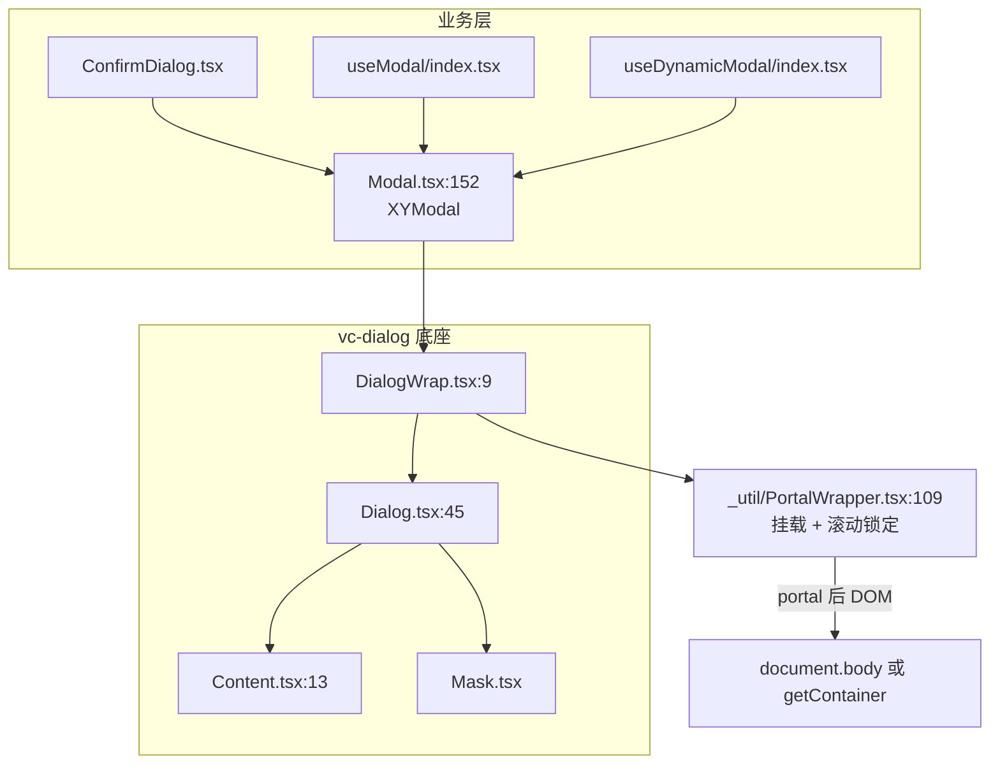
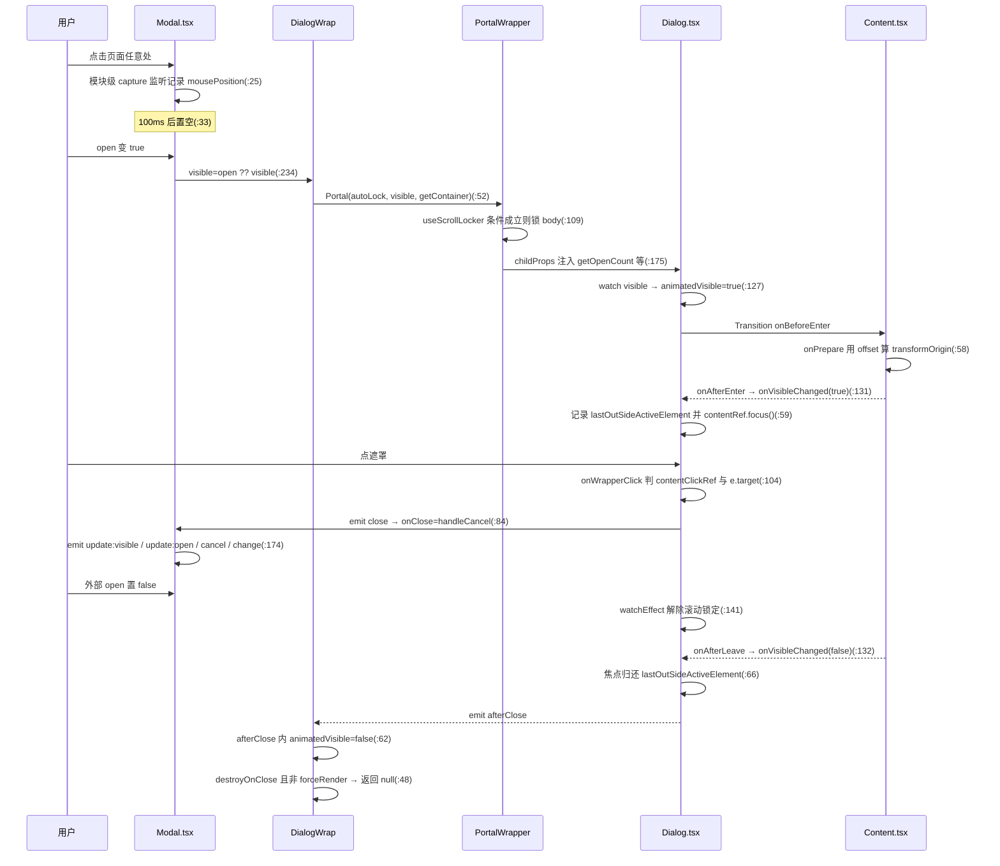

# C07-01 Modal 对话框

> **本篇解决**：`Modal` 打开时"从鼠标点放大"的动画原点是怎么算出来的？焦点为什么能自动进、自动回？点 Select 下拉为什么不会把 Modal 关掉？关闭后 DOM 到底在不在？滚动锁定是谁做的？
> **前置**：A07（交互基础设施总览）、I02（vc-trigger）、I10（z-index）　**读者坐标**：`03-components/07-feedback` 第 1/10 篇
> 浮层定位算法不在本篇（Modal 不用 align）；`destroyOnClose` 与 `forceRender` 的样式面在 C07-00 横写篇。

---

## 一、职责与边界

`modal/` 是**业务语义层**：把 `open / okText / footer / confirmLoading` 这类产品化 props，翻译成 `vc-dialog/` 需要的通用对话框 props，并挂上静态方法族（`Modal.confirm` 等）与两个命令式 hook。

`vc-dialog/` 是**通用对话框底座**：只管 mask、wrap、content 三段 DOM、焦点进出、ESC、点击遮罩、滚动锁定的时序。它不知道 `okText`、不知道 locale、不知道 Button。底座入口标了血统：`vc-dialog/index.ts:1` 的注释 `// based on vc-dialog 8.6.0`——这解释了 §七 里 `rc-dialog` 默认前缀与 `vcDialogTitle` 这类命名残留的来源。

明确**不负责**：

- 定位/碰撞检测 → 本篇不涉及（Modal 是居中容器，非 anchor 浮层）
- 层级数值 → `zIndexPopupBase` + `_util/zIndexManager`（I10）
- 动画 CSS 形状 → `modal/style/index.ts`（464 行）与 `style/motion`（I09）

| 方向 | 对象 | 证据 |
| --- | --- | --- |
| 上层入口 | `Modal.tsx` → `../vc-dialog`（即 `DialogWrap`） | `packages/xiaoye-ui/src/modal/Modal.tsx:4` |
| 被谁用 | `useModal`、`useDynamicModal`、`ConfirmDialog` 均复用 `Modal` 组件 | `modal/useModal/index.tsx:4`、`modal/confirm.tsx:2` |
| 跨层依赖 | `_util/PortalWrapper`（挂载与滚动锁定）、`vc-util/Dom/*`（事件、contains、动态样式）、`_util/hooks/useScrollLocker` | `vc-dialog/DialogWrap.tsx:4`、`vc-dialog/Dialog.tsx:31-32` |
| 与 trigger 断开 | `DialogWrap` 显式声明不在 trigger context 内 | `vc-dialog/DialogWrap.tsx:18` |

---

## 二、源码地图

| 文件 | 行数 | 职责 | 关键点 |
| --- | --- | --- | --- |
| `modal/Modal.tsx` | 259 | 业务层主组件 | props 定义 `:41`、鼠标位置全局监听 `:24-39`、渲染 `:208-257` |
| `modal/index.tsx` | 70 | 静态方法挂载面 | `Modal.confirm/info/...` `:14-36`、`destroyAll` `:38-45` |
| `modal/confirm.tsx` | 146 | 命令式渲染工厂 | DocumentFragment 挂载 `:20`、`appContext` 手工注入 `:98` |
| `modal/ConfirmDialog.tsx` | 234 | confirm 形态的对话框（图标/okCancel/自动聚焦按钮） | — |
| `modal/useModal/index.tsx` | 151 | 组合式 API（拿 contextHolder，走 local state） | `ElementsHolder` `:18-36` |
| `modal/useModal/HookModal.tsx` | 73 | useModal 的占位壳 | — |
| `modal/useDynamicModal/index.tsx` | 136 | 组合式 API（**动态挂载任意组件**） | `ElementsHolder` `:26-44` |
| `modal/useDynamicModal/DynamicHookModal.tsx` | 67 | 动态组件宿主 | — |
| `modal/destroyFns.ts` | 2 | 全局待销毁队列 | 被 `destroyAll` 消费（`modal/index.tsx:39`） |
| `modal/locale.ts` | 28 | 静态方法用的 locale 读取 | `getConfirmLocale()`（`confirm.tsx:82`） |
| `modal/style/index.ts` | 464 | Component Token 与形状 | — |
| `vc-dialog/DialogWrap.tsx` | 76 | Portal 挂载 / 就地渲染 / 销毁判定 | `getContainer===false` 分支 `:37-45` |
| `vc-dialog/Dialog.tsx` | 212 | 三段 DOM + 事件与焦点 | 焦点进出 `:55-81`、遮罩点击 `:104-111`、ESC/TAB `:112-125` |
| `vc-dialog/Content.tsx` | 156 | 内容 DOM + Transition + sentinel | `transformOrigin` `:58-69`、expose `:29-41` |
| `vc-dialog/Mask.tsx` | 24 | 遮罩与 motion | — |
| `vc-dialog/util.ts` | 46 | motion 名、UUID、`offset` | `getUUID` `:11-15`、`offset` `:35-46` |
| `vc-dialog/IDialogPropTypes.ts` | 48 | 底座 props 契约 | — |

主实现入口：`packages/xiaoye-ui/src/modal/Modal.tsx:208`（渲染函数）。

---

## 三、架构与数据流

### 3.1 分层与 DOM 结构



渲染出来的 DOM 三段（`Dialog.tsx:175-215`）：

```
div.xy-modal-root
├── Mask                 (xy-modal-mask)
└── div.xy-modal-wrap    tabindex=-1  ← ESC / TAB / 遮罩点击都绑在这里
    └── Transition
        └── div.xy-modal  role=document  v-show=visible
            ├── div[tabindex=0]        ← sentinelStart（焦点入口）
            ├── div.xy-modal-content   ← 或 modalRender 的产物
            └── div[tabindex=0]        ← sentinelEnd（焦点出口）
```

### 3.2 一次开关的完整时序



---

## 四、核心机制精读

### 论点 1：动画原点不是 prop，是一个模块级全局变量加一条永久的 capture 监听

```tsx
// packages/xiaoye-ui/src/modal/Modal.tsx:22
type MousePosition = { x: number; y: number } | null;

let mousePosition: MousePosition;
const getClickPosition = (e: MouseEvent) => {
  mousePosition = {
    x: e.pageX,
    y: e.pageY,
  };
  // 100ms 内发生过点击事件，则从点击位置动画展示
  // 否则直接 zoom 展示
  // 这样可以兼容非点击方式展开
  setTimeout(() => (mousePosition = null), 100);
};

// 只有点击事件支持从鼠标位置动画展开
if (canUseDocElement()) {
  addEventListener(document.documentElement, 'click', getClickPosition, true);
}
```

三件事同时成立：变量在**模块作用域**（第 24 行）、监听挂在 **`document.documentElement` 的捕获阶段**（第 38 行）、并且**从不在组件卸载时移除**——它在模块顶层执行，生命周期等于整个库的生命周期。

消费点有两条：渲染时 `mousePosition={restProps.mousePosition ?? mousePosition}`（`Modal.tsx:243`，prop 可显式覆盖），以及底座里真正把它变成 CSS 的地方：

```tsx
// packages/xiaoye-ui/src/vc-dialog/Content.tsx:58
    const onPrepare = () => {
      nextTick(() => {
        if (dialogRef.value) {
          const elementOffset = offset(dialogRef.value);
          transformOrigin.value = props.mousePosition
            ? `${props.mousePosition.x - elementOffset.left}px ${
                props.mousePosition.y - elementOffset.top
              }px`
            : '';
        }
      });
    };
```

`onPrepare` 挂在 `<Transition onBeforeEnter>`（`Content.tsx:130`），算出的 `transformOrigin` 由 `contentStyleRef` 写进内联样式（`Content.tsx:52-55`）。注意它是在 `nextTick` 里读 `dialogRef` 的：DOM 必须先存在，否则 `offset()` 量到 0。

`offset()` 本身考虑了页面滚动：

```ts
// packages/xiaoye-ui/src/vc-dialog/util.ts:14
export function offset(el: Element) {
  const rect = el.getBoundingClientRect();
  const pos = {
    left: rect.left,
    top: rect.top,
  };
  const doc = el.ownerDocument as CompatibleDocument;
  const w = doc.defaultView || doc.parentWindow;
  pos.left += getScroll(w);
  pos.top += getScroll(w, true);
  return pos;
}
```

于是链路完整：**全局 click（pageX/pageY，含滚动）− 对话框视口位置 + 页面滚动 = 相对 origin 的像素偏移**。`mousePosition` 为 null 时 origin 置空串，退化为默认中心缩放——这就是"程序化打开不跟着鼠标炸开"的实现方式。

### 论点 2：焦点圈定是自研的双 sentinel，与 `focus-trap` 组件无关

底座没有用 DOM 查询去枚举可聚焦元素，而是**在内容前后各插一个 `tabindex=0` 的哨兵 div**：

```tsx
// packages/xiaoye-ui/src/vc-dialog/Content.tsx:146
              <div tabindex={0} ref={sentinelStartRef} style={entityStyle}>
                {modalRender ? modalRender({ originVNode: content }) : content}
              </div>
              <div tabindex={0} ref={sentinelEndRef} style={sentinelStyle} />
```

配对外暴露的两个方法，靠"当前活动元素是不是某个 sentinel"来判断是否越界：

```ts
// packages/xiaoye-ui/src/vc-dialog/Content.tsx:29
    expose({
      focus: () => {
        sentinelStartRef.value?.focus({ preventScroll: true });
      },
      changeActive: next => {
        const { activeElement } = document;
        if (next && activeElement === sentinelEndRef.value) {
          sentinelStartRef.value.focus({ preventScroll: true });
        } else if (!next && activeElement === sentinelStartRef.value) {
          sentinelEndRef.value.focus({ preventScroll: true });
        }
      },
    });
```

触发方在 wrap 层的 keydown：

```tsx
// packages/xiaoye-ui/src/vc-dialog/Dialog.tsx:119
    const onWrapperKeyDown = (e: KeyboardEvent) => {
      if (props.keyboard && e.keyCode === KeyCode.ESC) {
        e.stopPropagation();
        onInternalClose(e);
        return;
      }

      // keep focus inside dialog
      if (props.visible) {
        if (e.keyCode === KeyCode.TAB) {
          contentRef.value.changeActive(!e.shiftKey);
        }
      }
    };
```

`<div tabIndex={-1} onKeydown={onWrapperKeyDown}>`（`Dialog.tsx:209-210`）是键盘事件的接收容器，`tabIndex=-1` 让 wrap 本身可编程可聚焦但不进 TAB 序列。

进出成对：打开时若焦点不在 wrapper 内才记录"回来的位置"，否则不记录——避免把一个已经在 Modal 内的元素当返回点。

```ts
// packages/xiaoye-ui/src/vc-dialog/Dialog.tsx:62
    const onDialogVisibleChanged = (newVisible: boolean) => {
      if (newVisible) {
        // Try to focus
        if (!contains(wrapperRef.value, document.activeElement as HTMLElement)) {
          lastOutSideActiveElementRef.value = document.activeElement as HTMLElement;
          contentRef.value?.focus();
        }
      } else {
        const preAnimatedVisible = animatedVisible.value;
        // Clean up scroll bar & focus back
        animatedVisible.value = false;
        if (props.mask && lastOutSideActiveElementRef.value && props.focusTriggerAfterClose) {
          try {
            lastOutSideActiveElementRef.value.focus({ preventScroll: true });
          } catch (e) {
            // Do nothing
          }
          lastOutSideActiveElementRef.value = null;
        }
```

归还条件里有三个与门：`props.mask`、有记录、`focusTriggerAfterClose`。`mask=false` 时**焦点不会归还**——这是一个容易忽略的耦合（`mask` 同时管视觉与焦点策略）。`try/catch` 吞掉元素已 detached 时的抛错（`:69-71`）。

### 论点 3：点遮罩关闭靠"按下—抬起"记账，专门为了不被内部浮层误触发

```ts
// packages/xiaoye-ui/src/vc-dialog/Dialog.tsx:99
    // We need record content click incase content popup out of dialog
    const onContentMouseDown: MouseEventHandler = () => {
      clearTimeout(contentTimeoutRef.value);
      contentClickRef.value = true;
    };

    const onContentMouseUp: MouseEventHandler = () => {
      contentTimeoutRef.value = setTimeout(() => {
        contentClickRef.value = false;
      });
    };

    const onWrapperClick = (e: MouseEvent) => {
      if (!props.maskClosable) return null;
      if (contentClickRef.value) {
        contentClickRef.value = false;
      } else if (wrapperRef.value === e.target) {
        onInternalClose(e);
      }
    };
```

朴素写法是"点 wrap 且 `e.target === wrap` 就关"。问题在 Modal 里放 Select / DatePicker 时：下拉面板挂在 body 上，**不在 `xy-modal` 内部**，在它上面点击时事件冒泡到 wrap，`e.target` 是面板元素，不等于 wrap，看似安全；但面板被关掉后紧接的那次 `click` 会落在 wrap 上，`e.target === wrap` 成立 → Modal 被连带关闭。

这里的解法是用 mousedown/mouseup 打时间戳记账：内容区按下即置真（第 93-96 行），抬起后在下一个宏任务里复位（第 99-101 行），wrap 的 click 若发现记着真就**只清标记不关闭**（第 106-107 行）。两个 `shallowRef`（`:89-90`）配合一个 `contentTimeoutRef`，卸载时清理（`:138`）。

### 论点 4：关闭语义分散在三个 `animatedVisible` 上，DOM 默认不销毁

同名变量在三处各司其职，读代码时很容易混：

| 位置 | 初值 | 作用 |
| --- | --- | --- |
| `DialogWrap.tsx:17` | `props.visible` | 决定**要不要渲染 Portal**（销毁判定） |
| `Dialog.tsx:79` | `props.visible` | 决定 wrap 的 `display:none` 与滚动锁定 |
| `Content.tsx:138` | `v-show={visible}` | 决定内容 DOM 的显隐（走 `Transition`） |

打开方向是"立即置真"，且两个 watch 都是 `flush: 'post'`（`DialogWrap.tsx:19-27`、`Dialog.tsx:155-163`），即等 DOM 更新完再置：这样 `display` 与 Portal 挂载在同一帧就位，不会闪一帧。

关闭方向**不靠 watch**，而是等动画结束回调：`Dialog.tsx:86` 把 `animatedVisible` 置 false（由 `Content` 的 `onAfterLeave` 触发，`Content.tsx:132`），`DialogWrap.tsx:62-65` 在包装过的 `afterClose` 里置 false。因此：

```tsx
// packages/xiaoye-ui/src/vc-dialog/Dialog.tsx:195
            style={{ zIndex, ...wrapStyle, display: !animatedVisible.value ? 'none' : null }}
```

关闭后 DOM **仍然在**，只是 `display:none`；内容层同理（`Content.tsx:134` 的 `visible || !destroyOnClose` 决定子树是否保留）。真正把 Portal 摘掉只有一个条件：

```tsx
// packages/xiaoye-ui/src/vc-dialog/DialogWrap.tsx:47
      // Destroy on close will remove wrapped div
      if (!forceRender && destroyOnClose && !animatedVisible.value) {
        return null;
      }
```

`forceRender` 的语义因此是"**首帧就把 Portal 挂上**（提前占位、提前量宽）"，而不是"关闭后保留"。这两者在 `destroyOnClose` 同时为真时语义相反，第 48 行的 `!forceRender` 就是在保护"提前渲染"这个意图。

### 论点 5：Modal 的滚动锁定走 Portal，`Dialog` 里的 `scrollLocker` 分支对本路径恒不执行

底座 `Dialog` 看起来自己管锁定：

```ts
// packages/xiaoye-ui/src/vc-dialog/Dialog.tsx:148
    watchEffect(() => {
      props.scrollLocker?.unLock();
      if (animatedVisible.value) {
        props.scrollLocker?.lock();
      }
    });
```

但 `scrollLocker` 是个外部注入的 prop（`Dialog.tsx:46`）。全仓搜它的读写点，只有 `vc-drawer/src/DrawerChild.tsx`（`:55`、`:80`、`:83`、`:95`）在用——**注意那是 Drawer 自己消费自己声明的 prop，`drawer/` 业务层同样从不构造、从不传入**（核实见 C07-02 论点 1）。也就是说 Modal 与 Drawer 两条路径上这个 prop 都是空的，Modal 的实际锁定发生在 Portal 层：

```tsx
// packages/xiaoye-ui/src/_util/PortalWrapper.tsx:109
    useScrollLocker(
      computed(() => {
        return (
          props.autoLock &&
          props.visible &&
          canUseDom() &&
          (container.value === document.body || container.value === defaultContainer)
        );
      }),
    );
```

`DialogWrap` 传的就是 `autoLock`（`DialogWrap.tsx:53`）。四个与门里最后一条是关键约束：**只有容器是 `body` 时才锁**。把 `getContainer` 指到某个滚动容器里，body 的滚动条不会被处理——因为锁的是 body，锁错了对象不如不锁。

真正的实现是一次动态样式注入：

```ts
// packages/xiaoye-ui/src/_util/hooks/useScrollLocker.ts:31
      if (mergedLock.value) {
        const scrollbarSize = getScrollBarSize();
        const isOverflow = isBodyOverflowing();

        updateCSS(
          `
html body {
  overflow-y: hidden;
  ${isOverflow ? `width: calc(100% - ${scrollbarSize}px);` : ''}
}`,
          id,
        );
      } else {
        removeCSS(id);
      }
```

两个细节值得记：`id` 由模块级自增 `uuid` 生成（`:23-24`），每个 hook 实例独占一条样式节点，`else` 分支和 `onClear` 都会 `removeCSS`（`:44`、`:47`）——这是"锁不泄漏"的机制；`width: calc(100% - Npx)` 只在 body 真的溢出时才补，用来抵消滚动条消失造成的横向跳动（判据在 `:14-19` 的 `isBodyOverflowing`）。

顺带一条容易读错的：`DialogWrap` 在 `getContainer === false` 时**完全绕过 Portal**：

```tsx
// packages/xiaoye-ui/src/vc-dialog/DialogWrap.tsx:37
      // 渲染在当前 dom 里；
      if (getContainer === false) {
        return (
          <Dialog
            {...dialogProps}
            getOpenCount={() => 2} // 不对 body 做任何操作。。
            v-slots={slots}
          ></Dialog>
        );
      }
```

`getOpenCount={() => 2}` 的意图（不操作 body）是达到的——因为没有 Portal，就没有 `openCount` 累加（`PortalWrapper.tsx:128-132`）。但要说清实现现状：**`getOpenCount` 在整个 `src` 里没有任何调用方**。它的 10 处出现全是声明、默认值或提供端：`vc-dialog` 侧只有 prop 声明（`Dialog.tsx:52`）、返回 `null` 的默认值（`Dialog.tsx:63`）、`IDialogPropTypes.ts:40` 的透传声明；`vc-drawer` 侧只把它从 props 里解构出来就再没用过（`DrawerChild.tsx:187`）；提供端是 `PortalWrapper.tsx:175` 的 `childProps`（另有一个同名但无关的 `:22`，标了 `@private Test usage only`，非测试环境恒返回 0）。所以第 41 行是纯装饰，删掉不改变行为——留着反而暗示底座有"多处弹层共存时不要重复操作 body"的协调逻辑，而本库并没有实现它。

### 论点 6：静态方法完全绕开组件树，且命令式 API 有两套并存实现

`Modal.confirm` 不是"渲染一个组件"，而是手工建一个 Vue 树再挂到 Fragment 上：

```tsx
// packages/xiaoye-ui/src/modal/confirm.tsx:19
const confirm = (config: ModalFuncProps) => {
  const container = document.createDocumentFragment();
  let currentConfig = {
    ...omit(config, ['parentContext', 'appContext']),
    close,
    open: true,
  } as any;
  // ...
  const Wrapper = (p: ModalFuncProps) => {
    const global = globalConfigForApi;
    const rootPrefixCls = global.prefixCls;
    const prefixCls = p.prefixCls || `${rootPrefixCls}-modal`;
    const iconPrefixCls = global.iconPrefixCls;
    const runtimeLocale = getConfirmLocale();
    return (
      <ConfigProvider {...(global as any)} prefixCls={rootPrefixCls}>
        <ConfirmDialog {...p} prefixCls={prefixCls} iconPrefixCls={iconPrefixCls} locale={runtimeLocale}
          cancelText={p.cancelText || runtimeLocale.cancelText}></ConfirmDialog>
      </ConfigProvider>
    );
  };
  function render(props: ModalFuncProps) {
    const vm = createVNode(Wrapper, { ...props });
    vm.appContext = config.parentContext || config.appContext || vm.appContext;
    vueRender(vm, container as any);
    return vm;
  }
```

四个必答题都在这里：

1. **为什么 `appContext` 必须手工传**（`:98`）：脱离 `app.mount()` 的 VNode 拿不到全局注册组件与 `provide` 链，不挂就会解析不到组件。`ModalFuncProps` 里 `parentContext` 已标 deprecated，指向 `appContext`（`Modal.tsx:131-133`）。
2. **为什么主题仍生效**：`Wrapper` 自己套一层 `ConfigProvider`，配置来自 `globalConfigForApi`（`:78-84`），而不是祖先注入——静态方法的祖先不存在。
3. **为什么关闭要等动画**：`close` 不卸载，只把 `open` 置 false 并挂一个 `afterClose`，等论点的 4 的 `onAfterLeave` 链走完才 `destroy`（`:46-62`）。
4. **`destroyAll` 的依据**：每个实例把 `close` 推进模块级 `destroyFns`（`:104`），`Modal.destroyAll` 逐个 pop（`modal/index.tsx:38-45`）。

同一目录里还并存两套命令式 hook：`useModal`（`Modal.useModal`，`modal/index.tsx:17`，产出 confirm 风格的函数族 + contextHolder）与 `useDynamicModal`（`modal/index.tsx:12`，`open(component, options)` 直接挂载**任意组件**）。两者面向不同需求，但各自复制了一份宿主容器组件：

```bash
diff <(sed -n '18,36p' modal/useModal/index.tsx) <(sed -n '26,44p' modal/useDynamicModal/index.tsx)
```

输出为空——19 行的 `ElementsHolder` 实现**逐字节相同**，连 `name: 'ElementsHolder'` 都一样。这是本篇认定最值得先收敛的一处重复（见 §六）。

### 论点 7：`useModal` 的补偿队列只兜 `update` 与 `destroy`，不兜"打开"

`useModal` 假设 `contextHolder` 可能还没渲染，于是准备了一个动作队列：

```tsx
// packages/xiaoye-ui/src/modal/useModal/index.tsx:48
  const actionQueue = shallowRef([]);
  watch(
    actionQueue,
    () => {
      if (actionQueue.value.length) {
        const cloneQueue = [...actionQueue.value];
        cloneQueue.forEach(action => {
          action();
        });
        actionQueue.value = [];
      }
    },
    {
      immediate: true,
    },
  );
```

但往队列里塞动作的只有两处——`destroy` 与 `update` 在 `modalRef` 为空时的分支：

```tsx
// packages/xiaoye-ui/src/modal/useModal/index.tsx:118
        if (modalRef.value) {
          destroyAction();
        } else {
          actionQueue.value = [...actionQueue.value, destroyAction];
        }
```

对应 `:122`（destroy 入队）与 `:131`（update 入队）。而"注册这个弹层"这一步**没有入队保护**：

```tsx
// packages/xiaoye-ui/src/modal/useModal/index.tsx:105
      closeFunc = holderRef.value?.addModal(modal);

      if (closeFunc) {
        destroyFns.push(closeFunc);
      }
```

`holderRef` 由 `:148` 返回的 holder 函数在渲染时赋值（`() => <ElementsHolder key={holderKey} ref={holderRef} />`）。因此**在 contextHolder 首次渲染之前调用 `modal.info(...)`，第 105 行得到 `undefined`，`modal()` 这个渲染函数被直接丢弃**：不显示、不报错、也不进 `destroyFns`（连带 `Modal.destroyAll` 也管不到它）。之后补做的 `update` 会入队，但队列执行时操作的仍是那个不存在的目标。

这是本篇在改动上最需要守住的隐式约束：**必须先让 holder 渲染出来，再调 `useModal` 的函数族**；拿不准就用静态 `Modal.info`——它自建容器（`confirm.tsx:20`），不依赖 holder。判别方法：

```bash
grep -n "actionQueue.value = \[\.\.\." packages/xiaoye-ui/src/modal/useModal/index.tsx
```

只应命中 `:122` 与 `:131` 两行（实测正是两行；`:57` 是清空队列、不算入队）。若出现第三行且它包住的是 `addModal`，说明该缺陷已被修。

另外两点顺带记下：`uuid` 是模块级自增（`:12`，用于 `key={modal-${uuid}}`，`:94`），与 `vc-dialog/util.ts:11` 的 `getUUID` 是两个互不相干的计数器；`watch(() => config, ...)`（`:73-81`）在 `config` 是普通对象（非 ref）时**永远不会触发**，因为 getter 返回同一引用。

---

## 五、对外契约如何生效

`Modal` 的 props 到 DOM 之间有三段收窄：

1. **`open` / `visible` 归一**：对外两个 prop（`Modal.tsx:44-45`），向底座只传一个 —— `visible={open ?? visible}`（`:234`），`open` 优先。同时 `visible` 非 undefined 就打一条 deprecation 告警（`:169-173`）。
2. **一次关闭发四个事件**：`handleCancel` 同时 `emit('update:visible')`、`emit('update:open')`、`emit('cancel')`、`emit('change')`（`:174-179`）。所以 `v-model:open` 与 `@cancel` 谁先落地都同步；副作用是**用 `@change` 区分开合方向的代码，会同时收到来自遮罩、ESC、关闭按钮的 false**，无法分辨来源（底座把三种输入统一成 `onInternalClose`，`Dialog.tsx:97-107`）。
3. **类名与层级**：`prefixCls` 来自 `useConfigInject('modal', props)`（`:163`），`hashId` 同时进 `rootClassName` 和 `class`（`:229-230`），`centered` / `rtl` 折进 `wrapClassName`（`:221-224`）而不是主类名——这是为了 wrap 层 DOM 也能拿到这两个状态（wrap 才是 flex 居中容器）。
4. **容器兜底**：`getContainer={getContainer || getPopupContainer?.value}`（`:231`）——ConfigProvider 的 `getPopupContainer` 会作为 Modal 的挂载点兜底，这一点和 tooltip/dropdown 共享同一份配置，改它是一起改。
5. **默认按钮与文案**：`renderFooter` 在未提供 `footer` slot 时兜底（`:185-207`，接线在 `:246`），ok 按钮用 `convertLegacyProps(okType)` 把 `'primary'` 这类旧枚举翻译成 Button props（`:10`、`:198`）；`okType` 默认 `'primary'`、`width` 默认 520（`:156-160`）。`okText` 取 prop 或 `slots.okText`，再兜到 locale（`:187-191`、`:195`）。
6. **expose**：`Modal` 本身不 `expose`；对外可用方法是实例级 `destroy` / `update`（`Modal.tsx:141-144` 的 `ModalFunc` 类型）和全局 `Modal.destroyAll`。

---

## 六、设计取舍

**为什么焦点用双 sentinel 而不是 `focus-trap` 组件？**
双 sentinel 只需要两个 `tabindex=0` 节点和一段 keydown 逻辑（`Content.tsx:146-149` + `Dialog.tsx:126-139`），不需要 MutationObserver、不需要枚举可聚焦元素清单，代价小、行为可预测。赔上的代价：**只做"边界回弹"，不做"焦点恢复记忆"**——从 Modal 内部再打开一层 Modal 时，第二层关闭会把焦点交还给"当时的 activeElement"，也就是第一层的某个元素（`Dialog.tsx:72-74` 的 `contains` 判断挡住了"记录内部元素作返回点"，但两层的 `lastOutSide` 仍会互相覆盖）。库里有独立的 `focus-trap` 组件（C12-07），Modal 没有用它。

**为什么把鼠标位置做成模块级全局，而不是组件级 ref？**
好处是任意入口的点击（包括业务代码里 `document` 上委托的按钮）都能作为动画原点，且不需要每个 Modal 实例挂一条监听。代价是**全局单例**：同一帧里连开两个弹层会共用同一次点击位置；100ms 的窗口期（`Modal.tsx:33`）也让"点击后立即程序化打开别的 Modal"出现原点错配。作者用 `mousePosition` prop 留了显式覆盖口（`:85`、`:243`），这是取舍的逃生门。

**为什么关闭后保留 DOM？**
`display:none` 而不是卸载（`Dialog.tsx:209`）保住了两样东西：表单内部状态、以及下次打开不必重挂 Portal 与重跑动画准备。代价是长列表 / 富文本类 Modal 会常驻内存，所以要 `destroyOnClose` 显式声明"我只要一次"。两个开关（`destroyOnClose` / `forceRender`）合起来才是完整语义，这也是 §论点 4 那张表存在的意义。

**为什么 `useModal` 与 `useDynamicModal` 并存？**
前者让 `const [modal, contextHolder] = Modal.useModal()` 拿到与 confirm 一致的函数族，且能吃到组件树注入（有 contextHolder 就在树内渲染）；后者要的是"把任意业务组件塞进弹层"。目标不同可以理解，但**宿主容器是复制而非提取**（论点 6 的 diff 证据），这是纯粹的债：正确做法是把 `ElementsHolder` 提到 `_util` 或 `modal/_holder.tsx` 复用。同理 `_util/components/` 整个目录是 `_util` 根下同名文件的机械副本（`_util/PortalWrapper.tsx` 与 `_util/components/PortalWrapper.tsx` 的 diff 只有 import 相对路径不同），且 `components/` 版**零直接引用**，却仍被 `_util/index.ts:46` 的 `export * from './components'` 暴露进 barrel。

---

## 七、坑与改动指南

1. **直接用 `vc-dialog` 会拿到 `rc-dialog` 类名。**
   触发：绕过 `Modal` 使用底座，且没传 `prefixCls`。
   原因：`Dialog.tsx:62` 的默认值是 `'rc-dialog'`。
   后果：CSS-in-JS 生成的选择器与业务侧 `xy-` 覆盖全部失效，且违反 AGENTS.md 的类名前缀约定。
   定位：`packages/xiaoye-ui/src/vc-dialog/Dialog.tsx:62`（`Modal` 侧的默认值来自 `useConfigInject('modal', props)`，`Modal.tsx:163`）。

2. **aria id 依赖模块级自增，快照与 SSR 不稳定。**
   触发：`ariaIdRef` 初值 `` `vcDialogTitle${getUUID()}` ``（`Dialog.tsx:52`），`getUUID` 用模块级 `let uuid = -1`（`util.ts:11-15`）。
   症状：同一页面里 Modal 实例化顺序变了，id 就变；服务端与客户端各自从 0 计数，只有顺序完全一致才相等。含 `vc` 字样。
   定位：`vc-dialog/util.ts:11-15`、`vc-dialog/Dialog.tsx:52`、`vc-dialog/Dialog.tsx:208`（`aria-labelledby`）。

3. **`@change` 无法分辨关闭来源。**
   触发：想区分"用户取消"与"遮罩点击"。
   原因：底座把 ESC（`Dialog.tsx:141-144`）、遮罩点击（`:104-111`）、关闭按钮（`Content.tsx:110`）统一收进 `onInternalClose`（`:83-86`），上层只发一个 `cancel`（`Modal.tsx:174-179`）。
   改法：需要在 `onInternalClose(e)` 的 `e` 上判类型（`e.type === 'keydown'` 或 `e.target === wrap`），并显式写死来源语义。

4. **`mask={false}` 时焦点不归还。**
   触发：无遮罩 Modal 关闭后，焦点停在 body。
   原因：归还条件是 `props.mask && lastOutSideActiveElementRef.value && props.focusTriggerAfterClose`（`Dialog.tsx:87`）。
   定位：同处；若要保留无遮罩但仍归还焦点，需把该与门拆开（属底座行为变更，会影响 drawer 之外的调用方）。

5. **`getContainer` 指到非 body 容器时，`body` 被误锁而局部容器照旧能滚——四个与项其实拦不住任何情况。**
   触发：`getContainer={() => document.querySelector('.scroll-area')}`。
   原因：`PortalWrapper.tsx:112-116` 的末项写的是 `container.value === document.body || container.value === defaultContainer`，但 `container.value` 在全文件只有两处赋值——`:71` 置 `null`、`:92` 置 `defaultContainer`（`:64` 于 setup 期 `document.createElement('div')` 造出），**永远不等于 `document.body`**。于是第一个析取项恒假、第二个在容器已建出后恒真，整句话退化成「容器 div 存在」，与挂在谁下面无关；真正决定宿主的是模块内变量 `parent`（`:73`/`:76`），闸门没有读它。完整论证归 A07 坑 9 与 C07-00 论点 5，本篇不复述。
   后果：局部滚动容器不在 `useScrollLocker.ts:35-42` 硬编码的 `html body` 选择器覆盖范围内，背景仍可滚动，而页面其余部分被 `overflow-y: hidden` 冻结——与 `autoLock` 的字面含义相反。另注：`getContainer === false` 就地渲染时完全不锁（`DialogWrap.tsx:37-45`），那是另一条路径。

6. **改 Modal 的关闭/销毁时序没有测试网。**
   实测：Modal 相关测试共 3 个文件（`modal/Modal.test.js` 3 例、`modal/confirm.test.js` 7 例、`modal/__tests__/use-dynamic-modal.test.js` 6 例，均被 `vitest.config.mts:33` 的 `src/**/*.test.{js,ts,jsx,tsx}` 收录）。
   以下机制在这 3 个文件里**一次都没出现**：`mousePosition`、`transformOrigin`、`focus`、`maskClosable`、`scrollLocker`、`keyboard`、`destroyOnClose`、`forceRender`；`useModal`（`modal/useModal/index.tsx`，151 行）**无测试文件**。
   安全边界：改 `Content.tsx` 的 Transition 回调或 `Dialog.tsx` 的 `animatedVisible` 相关代码时，必须手工验证"打开→ESC→动画结束→焦点回到触发按钮→再打开"这个循环；`getContainer=false` 是唯一有测试覆盖的分支（`modal/Modal.test.js:63`）。

7. **`useModal` 在 holder 渲染前调用会静默丢失弹层。**
   触发：在 `setup` 里同步调用 `modal.info({...})`，或把 `contextHolder` 放在 `v-if` 里尚未成立。
   症状：没有弹层、没有告警、`Modal.destroyAll()` 也管不到这次调用；后续 `update` 不报错但无效。
   原因：`useModal/index.tsx:105` 的 `holderRef.value?.addModal(modal)` 可选链返回 `undefined`，`modal` 渲染函数被丢弃；补偿队列只在 `:122`/`:131` 覆盖 `destroy`/`update`（论点 7）。
   定位：`modal/useModal/index.tsx:46`（`holderRef` 初值 `null`）、`:105`、`:148`。
   规避：把调用挪到 `onMounted` 之后，或改用静态 `Modal.info`（`confirm.tsx:20` 自建 DocumentFragment 容器）。这条约束目前**没有任何测试与告警保护**。

改动前的最小电池：

```bash
pnpm --filter xiaoye-ui test:unit src/modal
pnpm typecheck
```

---

## 附：本篇可证伪的三个检查点

1. **`Modal` 路径不传 `scrollLocker`**：下面的命令里，`scrollLocker` 的赋值/传参只应出现在 `vc-drawer/*`，`modal/` 与 `vc-dialog/DialogWrap.tsx` 中不应出现传该 prop 的行。

   ```bash
   grep -rn "scrollLocker" packages/xiaoye-ui/src/modal packages/xiaoye-ui/src/vc-dialog
   ```
   实测输出 6 行，全部落在 `vc-dialog/Dialog.tsx`：`:4`（类型 import）、`:25`（prop 声明）、`:139`/`:142`（`unLock`）、`:144`（`lock`）、`:192`（把它从透传里 omit 掉）；`modal/` 目录**零命中**。若哪天 `modal/` 里出现传该 prop 的行，论点 5 失效。

2. **`getOpenCount` 全仓无调用方**：

   ```bash
   grep -rn "getOpenCount" packages/xiaoye-ui/src
   ```
   实测 10 处命中，且**没有任何一处是调用**：`vc-dialog/Dialog.tsx:52`/`:35`（声明 + `() => null` 默认值）、`vc-dialog/IDialogPropTypes.ts:40`（声明）、`vc-dialog/DialogWrap.tsx:41`（写入假值 2）、`_util/PortalWrapper.tsx:22`（test-only 导出）/`:175`（注入 childProps）、`_util/components/PortalWrapper.tsx:22`/`:175`（副本）、`vc-drawer/src/DrawerChild.tsx:187`（解构后未使用）/`IDrawerPropTypes.ts:55`（声明）。
   判别法：把上面的结果逐行看右侧代码，只要出现 `getOpenCount(` 或 `props.getOpenCount()` 形态的调用，论点 5 末尾与这条检查点都要重写。

3. **两套 `ElementsHolder` 是复制而非相似**：

   ```bash
   diff <(sed -n '18,36p' packages/xiaoye-ui/src/modal/useModal/index.tsx) \
        <(sed -n '26,44p' packages/xiaoye-ui/src/modal/useDynamicModal/index.tsx)
   diff packages/xiaoye-ui/src/_util/PortalWrapper.tsx packages/xiaoye-ui/src/_util/components/PortalWrapper.tsx
   ```
   第一条预期无输出（逐行相同）；第二条预期只有 import 相对路径差异。若第一条开始有输出，说明有人已收敛或已分叉，论点 6 的债的描述需更新。
