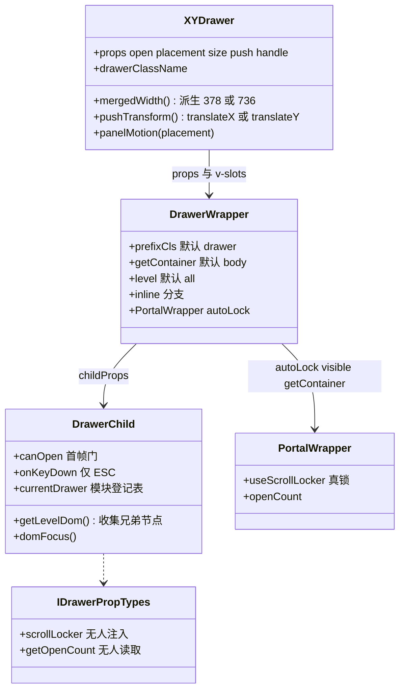
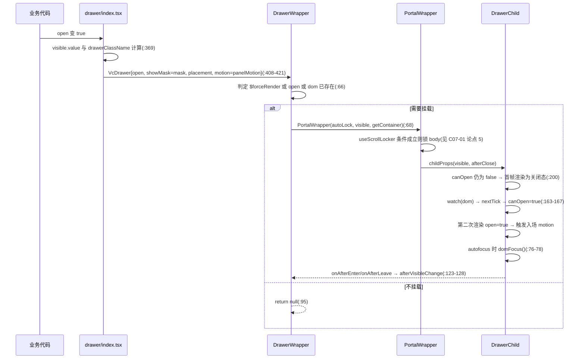

# C07-02 Drawer 抽屉

> **本篇解决**：Drawer 和 Modal 同为浮层容器，为什么关闭后 Modal 能把焦点还回来而 Drawer 不能？为什么 `scrollLocker` 这条锁滚动的路径在两个组件里**都**是死分支？`push`、`level`、`handler` 三套 Drawer 独有能力各自靠什么实现？
> **前置**：C07-01（Modal 对话框）、A07（交互基础设施总览，未完成，仅按编号引用）、I02（vc-trigger，未完成，仅按编号引用）　**读者坐标**：`03-components/07-feedback` 第 2/10 篇
> 本篇的写法是**对照式**：凡 C07-01 已经论证过的 Modal 机制，这里只给行号差异，不重述其原理。

---

## 一、职责与边界

`drawer/` 是业务语义层：把 `open / placement / size / push / forceRender / handle` 这些产品化 props，翻译成 `vc-drawer/` 的通用抽屉 props，并负责标题/关闭按钮/footer/extra 的形状。

`vc-drawer/` 是通用抽屉底座：只管 mask、content-wrapper 两段 DOM、入场出场 motion、`level` 联动位移、ESC、以及挂载方式（Portal / inline）。它不知道 `closeIcon`、不知道 locale、不知道 Button。

与 Modal 的三处结构性差异（决定了本篇所有论点）：

| 维度 | Modal 路径 | Drawer 路径 |
| --- | --- | --- |
| 关闭方式判定 | wrap 上 `e.target === wrap` + 内容区 mousedown/mouseup 记账（`vc-dialog/Dialog.tsx:111-118`、`:92-102`） | **只认 mask 元素自身的 click**（`vc-drawer/src/DrawerChild.tsx:224`） |
| 焦点管理 | 双 sentinel 圈定 + 关闭归还（`vc-dialog/Content.tsx:146-149`、`vc-dialog/Dialog.tsx:76`、`:55-73`） | **只有打开时 `domFocus()`**，无圈定、无归还（`DrawerChild.tsx:108-110`） |
| 挂载决策 | `DialogWrap` 有 `getContainer === false` 的就地渲染分支（`vc-dialog/DialogWrap.tsx:37-45`） | `if (!getContainer)` 走 `inline` 分支（`DrawerWrapper.tsx:49-62`），判定条件是**假值**而非 `=== false` |

---

## 二、源码地图

| 文件 | 行数 | 职责 | 关键点 |
| --- | --- | --- | --- |
| `drawer/index.tsx` | 437 | 业务层主组件 | props 与默认值 `:105-116`、`useConfigInject('drawer', props)` `:155`、push 位移 `:251-266`、宽高归一 `:270-285`、motion 名 `:375-381`、渲染装配 `:400-435` |
| `drawer/style/index.ts` | 230 | Component Token 与形状 | — |
| `drawer/style/motion.ts` | 134 | 四个 placement 的 `panel-motion-*` 关键帧 | 与 `:377-381` 的命名约定配对 |
| `vc-drawer/src/DrawerWrapper.tsx` | 100 | 挂载决策 + Portal | 默认值 `:10-25`、inline 分支 `:49-62`、`$forceRender` `:65`、Portal `:66-93` |
| `vc-drawer/src/DrawerChild.tsx` | 257 | DOM 与交互 | `canOpen` 首帧门 `:162-167`、`open` 合成 `:200`、ESC `:116-121`、`level` 收集 `:130-156`、`currentDrawer` `:16` |
| `vc-drawer/src/IDrawerPropTypes.ts` | 59 | 底座 props 契约 | `scrollLocker` `:56`、`getOpenCount` `:55` |
| `vc-drawer/src/utils.ts` | 112 | DOM/事件小工具 | 半数导出已无使用点（见 §七 坑 5） |
| `vc-drawer/index.ts` | 4 | 出口 | 导出 `DrawerWrapper` |

主实现入口：`packages/xiaoye-ui/src/drawer/index.tsx:400`（`vcDrawerProps` 组装处）。

---

## 三、架构与数据流

### 3.1 模块关系（静态结构）



### 3.2 首帧与开合时序



读图要点：**`canOpen` 这道首帧门是 Drawer 独有的**（`DrawerChild.tsx:162-167` 与 `:200`）。Modal 的 `animatedVisible` 是"打开即真"（`vc-dialog/Dialog.tsx:155-163`），靠 `<Transition>` 自己抓入场；Drawer 则强制"第一帧画关闭态、第二帧才画打开态"，因为它的入场动画靠 `transform` 从 `-100%` 位移进来，若首帧就是打开态就没有可过渡的起点。注释写的是「首次渲染都将是关闭状态」（`:199`）。

---

## 四、核心机制精读

### 论点 1：`scrollLocker` 在 Modal 和 Drawer 两条路径上**都**是死分支，真锁只有一处

C07-01 论点 5 已证明 Modal 不传 `scrollLocker`。这里补上 Drawer 侧的同一事实——**全仓 `scrollLocker` 的读写点只有 6 处，全部在 `vc-drawer` 内部自我消费**：

```bash
grep -rn "scrollLocker" packages/xiaoye-ui/src/drawer packages/xiaoye-ui/src/vc-drawer
```

```
vc-drawer/src/DrawerChild.tsx:55:  props.scrollLocker?.lock();
vc-drawer/src/DrawerChild.tsx:70:  const { open, getContainer, scrollLocker, showMask, autofocus } = props;
vc-drawer/src/DrawerChild.tsx:80:  scrollLocker?.lock();
vc-drawer/src/DrawerChild.tsx:83:  scrollLocker?.unLock();
vc-drawer/src/DrawerChild.tsx:95:  props.scrollLocker?.unLock();
vc-drawer/src/DrawerChild.tsx:188: scrollLocker,        ← 渲染期从 props 解构后并未使用
vc-drawer/src/IDrawerPropTypes.ts:56: scrollLocker: PropTypes.any,
```

`drawer/`（业务层）目录**零命中**——它从不构造 `ScrollLocker` 实例。所以 `DrawerChild.tsx:55`、`:80`、`:83`、`:95` 这四个 `?.` 调用全部空转，真正的 body 滚动锁与 Modal 一样来自 `PortalWrapper.tsx:109-118` 的 `useScrollLocker`（`DrawerWrapper.tsx:68-69` 传了 `autoLock`）。

还有个细节值得记：`:188` 在渲染函数里把 `scrollLocker` 从 props 解构出来**只是为了不进 `otherProps`**，没有别的作用。

**结论对使用者的意义**：不要试图通过给 `vc-drawer` 传 `scrollLocker` 来定制滚动锁定行为——这个 prop 在公开 API 面上存在（`IDrawerPropTypes.ts:56`），但没有任何代码生产它；要改锁定行为只能改 `useScrollLocker` 本身（C07-01 论点 5 给了行号）。

### 论点 2：`canOpen` 首帧门 + `placement` 变更时清空 `contentDom`，两处都是"动画过场"的补丁

```tsx
// packages/xiaoye-ui/src/vc-drawer/src/DrawerChild.tsx:162
    const canOpen = shallowRef(false);
    watch(dom, () => {
      nextTick(() => {
        canOpen.value = true;
      });
    });
```

```tsx
// packages/xiaoye-ui/src/vc-drawer/src/DrawerChild.tsx:199
      // 首次渲染都将是关闭状态。
      const open = $open && canOpen.value;
```

`dom` 是根 div 的 ref（`:216`）。`watch(dom)` 只在 ref 首次被赋上元素时触发一次，于是 `canOpen` 的语义是"**根节点已经挂载过了**"。在它变真之前，无论 props 的 `open` 是什么，渲染出的都是关闭态（`:200`）。这带来两个可观测后果：

1. 页面加载时就 `open: true` 的 Drawer，会有**一帧关闭态**，然后才走出场动画——这正是想要的（否则没有动画起点）。
2. 但它同时意味着：**首帧的 `afterVisibleChange(false)` 有可能先于 `afterVisibleChange(true)` 触发**。因为 `onAfterEnter/onAfterLeave` 绑在同一个 `<Transition>` 上（`:230-233`），而 `v-show={open}` 的初值是 false。若业务在 `afterVisibleChange` 里做"关闭后销毁内容"之类动作，必须自己判 `!!open`，不能假定它只会被调一次。

另一处补丁是 placement 变更：

```tsx
// packages/xiaoye-ui/src/vc-drawer/src/DrawerChild.tsx:98
    watch(
      () => props.placement,
      val => {
        if (val) {
          // test 的 bug, 有动画过场，删除 dom
          contentDom.value = null;
        }
      },
    );
```

`contentDom` 只是 `<div class="...-content">` 的 ref（`:241`），把它置 null 并不能"删除 DOM"——它只影响后续对该 ref 的读取。这条注释自述是为修测试里发现的动画过场问题，而实现方式更像是**试图触发重渲染的遗留写法**；全文件对 `contentDom` 的读取点仅此一处赋值（`grep -n "contentDom" vc-drawer/src/DrawerChild.tsx` 得 `:32`、`:103`、`:241`），说明这段 watch 实际是**空操作**。它留在代码里会误导后来人以为"改 placement 会重建内容 DOM"。

### 论点 3：Drawer 完全没有焦点圈定与焦点归还，这是与 Modal 的真实能力缺口

底座里唯一与焦点有关的代码：

```tsx
// packages/xiaoye-ui/src/vc-drawer/src/DrawerChild.tsx:108
    const domFocus = () => {
      dom.value?.focus?.();
    };
```

调用点只有两处：挂载后（`:50-53`，外面还套了一层 `nextTick`）与 `open` 变 true 时（`:76-78`），且都受 `autofocus` 控制（默认 true，见 `DrawerWrapper.tsx:24`）。

判别性验证（与 Modal 逐项对照）：

```bash
grep -rn "lastOutSide\|changeActive\|sentinel\|tabindex" packages/xiaoye-ui/src/vc-drawer packages/xiaoye-ui/src/drawer
```

结果为**空**（实测：`lastOutSide`、`changeActive`、`sentinel` 三个关键词在 `vc-drawer/` 与 `drawer/` 中零命中；`tabindex` 只有 `DrawerChild.tsx:213` 的 `tabindex={-1}` 一处）。而 Modal 侧对应能力分别位于 `vc-dialog/Content.tsx:146-149`（首尾 sentinel）、`Content.tsx:29-41`（`changeActive`）、`Dialog.tsx:142-145`（TAB 拦截）、`Dialog.tsx:76`、`:55-73`（记录并归还 `lastOutSideActiveElement`）。

后果是两条具体缺陷：

1. **Tab 键可以走出抽屉**：Drawer 打开后按 Tab 会依次聚焦到抽屉后面的页面元素，键盘用户会"迷路"；
2. **关闭后焦点掉到 `<body>`**：焦点没有归还给触发按钮，屏幕阅读器与键盘操作都失去上下文。

根容器 `tabindex={-1}`（`:213`）只保证"可被程序聚焦"，不构成焦点圈定。`onKeydown` 也只处理 ESC：

```tsx
// packages/xiaoye-ui/src/vc-drawer/src/DrawerChild.tsx:116
    const onKeyDown = (e: KeyboardEvent) => {
      if (e.keyCode === KeyCode.ESC) {
        e.stopPropagation();
        onClose(e);
      }
    };
```

并且绑定条件是 `open && keyboard`（`:217`），即关闭态或 `keyboard: false` 时完全不监听键盘。

AGENTS.md 的「无障碍性：遵循 WCAG 规范，提供键盘导航」这条硬要求，在 Drawer 上是**未满足**的。修法有现成路径：库内已有独立的 `focus-trap` 组件（见 C12-07），Modal 走的是自研 sentinel，Drawer 可以二者择一——但无论哪种都属于底座行为变更，会影响所有 `vc-drawer` 的直接使用者。

### 论点 4：`level` + `levelMove` + `push` 三套"下方内容位移"机制并存，且判定条件不同

Drawer 让被遮住的内容产生位移，一共三条路：

```tsx
// packages/xiaoye-ui/src/vc-drawer/src/DrawerChild.tsx:130
    const getLevelDom = ({ level, getContainer }) => {
      if (windowIsUndefined) {
        return;
      }
      const container = getContainer?.();
      const parent = container ? (container.parentNode as HTMLElement) : null;
      levelDom = [];
      if (level === 'all') {
        const children: HTMLElement[] = parent ? Array.prototype.slice.call(parent.children) : [];
        children.forEach((child: HTMLElement) => {
          if (
            child.nodeName !== 'SCRIPT' &&
            child.nodeName !== 'STYLE' &&
            child.nodeName !== 'LINK' &&
            child !== container
          ) {
            levelDom.push(child);
          }
        });
      } else if (level) {
        dataToArray(level).forEach(key => {
          document.querySelectorAll(key).forEach(item => {
            levelDom.push(item);
          });
        });
      }
    };
```

三个事实必须一起看：

1. `level: 'all'` 的语义是"**容器父节点的所有兄弟元素**"，且排除条件里写了 `child !== container`——排除逻辑其实**永远不成立**，因为 `container` 是 `getContainer()` 的返回值，而 `children` 是 `container.parentNode` 的子节点，`container` 必然在 `children` 里，因此这条判断确实有意义（它把抽屉自己的挂载点排掉），**但它同时把与 container 同级的所有节点都收进来了，包括别的浮层容器**（`#xy-drawer-xxx`、Modal 的 wrap 等）。默认值是 `'all'`（`DrawerWrapper.tsx:14`），而主库把自己这层的默认值改成了 `null`（`drawer/index.tsx:114`）——所以**经业务层用的 Drawer 默认不做位移**，绕过业务层直接用 `vc-drawer` 才会。
2. 位移的**执行**不在这里：`levelDom` 在 `getLevelDom` 之后没有被消费（`grep -n "levelDom" vc-drawer/src/DrawerChild.tsx` 得 `:33`、`:136`、`:146`、`:152` 四处，全是写入与声明，**没有读取点**）。也就是说 `level` 的样式施加逻辑在移植过程中已被删除，`level`/`levelMove` 现在是**只有收集、没有应用**的失效属性。
3. 真正还在工作的是主库自己的 `push`：

```tsx
// packages/xiaoye-ui/src/drawer/index.tsx:251
      const { push, placement } = props;
      // ...
      if (placement === 'left' || placement === 'right') {
        return `translateX(${placement === 'left' ? distance : -distance}px)`;
      }
      if (placement === 'top' || placement === 'bottom') {
        return `translateY(${placement === 'top' ? distance : -distance}px)`;
      }
```

它作用在 `contentWrapperStyle` 上（`:287-290`：`{ zIndex, transform: sPush.value ? pushTransform.value : undefined }`）——注意这是**推动抽屉自己的 content-wrapper**，不是推动页面内容。所以 `push` 的视觉效果是"多层抽屉依次错开"，与 `level` 的"页面内容跟着位移"是两件事，文档与命名都容易让人误以为同一个。

（此处诚实标注：`levelDom` 无读取点、`push` 只作用于自身 wrapper 这两条，我分别用上面的 grep 与 `:287-290` 证实；但"是否有别处以另一种方式消费 `level`"我只核到 `vc-drawer` 目录内，若跨目录还有消费者需补查 `grep -rn "\blevelMove\b" packages/xiaoye-ui/src`。）

### 论点 5：宽高的归一是"同一个 size 值同时喂 width 和 height"

```tsx
// packages/xiaoye-ui/src/drawer/index.tsx:270
    const mergedWidth = computed(() => props.width ?? (props.size === 'large' ? 736 : 378));
    const mergedHeight = computed(() => props.height ?? (props.size === 'large' ? 736 : 378));
```

再按 placement 决定写哪个：

```tsx
// packages/xiaoye-ui/src/drawer/index.tsx:278
      if (placement === 'left' || placement === 'right') {
        val.width = isNumeric(mergedWidth.value) ? `${mergedWidth.value}px` : mergedWidth.value;
      } else {
        val.height = isNumeric(mergedHeight.value) ? `${mergedHeight.value}px` : mergedHeight.value;
      }
```

要点：`size` 只有 `'large' | 'default'` 两档，且 **378 / 736 是写死的字面量**，不来自任何 Token（对比 Modal 的 `width: 520` 也是 `initDefaultProps` 里的字面量，`modal/Modal.tsx:156-160`）。数值型才补 `px`（靠 `isNumeric`），字符串原样透传，因此 `width="50%"` 可用而 `width: 500` 与 `width: '500px'` 等价。

后果：`placement: 'top'/'bottom'` 时**没有宽度约束**（只设 height），`placement: 'left'/'right'` 时没有高度约束（内容撑开）。想要"顶部抽屉限制宽度"只能自己写 `contentWrapperStyle`（该 prop 在 `:287-290` 里会被 push 的 `transform` 合并，用户传的同名字段中 `zIndex`/`transform` 由组件后写覆盖，见解构顺序）。

### 论点 6：`handler` 走的是 slot 通道，且它会**强制首帧挂载**

主库对外的 prop 名叫 `handle`（`drawer/index.tsx:91`、slot 声明 `:123`），传给底座时被映射到 `handler` slot：

```tsx
// packages/xiaoye-ui/src/drawer/index.tsx:427
              handler: props.handle ? () => props.handle : slots.handle,
```

而底座判断是否强制渲染 Portal 时看的是这个 slot：

```tsx
// packages/xiaoye-ui/src/vc-drawer/src/DrawerWrapper.tsx:64
      // 如果有 handler 为内置强制渲染；
      const $forceRender = !!slots.handler || forceRender;
      if ($forceRender || props.open || dom.value) {
```

所以：**只要传了 `handle`（prop 或 slot），Drawer 就会在首帧挂载 Portal 与整棵 content DOM**，即使 `open` 一直是 false。这是"用按钮条常驻页面、点开才滑出"这种交互的实现基础，也是它的代价——一个不显示的抽屉会常驻 DOM 并参与 `getLevelDom` 的兄弟节点收集。

另外注意 `drawer/index.tsx:407` 里还有一个 `handler: false` 被放进 `vcDrawerProps`（对象通道），而底座的判定只读 `slots.handler`（slot 通道）——两条通道名字相同但互不相干，读代码时极易误以为那个 `false` 关掉了什么。

### 论点 7：`currentDrawer` 是一张只写不读的登记表，与 `getOpenCount` 同属一类残留

```tsx
// packages/xiaoye-ui/src/vc-drawer/src/DrawerChild.tsx:16
const currentDrawer: Record<string, boolean> = {};

// packages/xiaoye-ui/src/vc-drawer/src/DrawerChild.tsx:34
    const drawerId = `drawer_id_${Number(
      (Date.now() + Math.random())
        .toString()
        .replace('.', Math.round(Math.random() * 9).toString()),
    ).toString(16)}`;
```

写入点 `:47`、`:73`，删除点 `:91`，条件是 `container.parentNode === document.body`。但全文件（以及 `vc-drawer/` 整目录）里**没有任何读取 `currentDrawer[...]` 或遍历它的代码**：

```bash
grep -rn "currentDrawer" packages/xiaoye-ui/src
```

只有那 4 处（定义、两次赋值、一次 delete）。它原本要支撑的能力——"同页面多个 body 级浮层共存时协调 body 样式操作"——在 Drawer 里同样没实现，与 C07-01 论点 5 末尾发现的 `getOpenCount`（`DialogWrap.tsx:41` 写入假值 2，全仓无调用方）是**同一类移植残留**。两个组件各自带着一张没人读的登记表。

顺带一条真实风险：`drawerId` 的构造用了 `Date.now() + Math.random()`（`:35-38`），**服务端与客户端必然不一致**。目前因为无人读取它所以无功能影响，但只要有人按注释把 `currentDrawer` 用起来，就会立刻撞上 SSR/水合不一致——与 C07-01 坑 2 的 `vcDialogTitle${getUUID()}` 是同一族问题（模块级时间/随机量参与标识）。

---

## 五、对外契约如何生效

业务层到底把哪些东西交给底座，看这段收窄（实测节选）：

```tsx
// packages/xiaoye-ui/src/drawer/index.tsx:384
      const { width, height, placement, mask, forceRender, ...rest } = props;
```

```tsx
// packages/xiaoye-ui/src/drawer/index.tsx:400
        'onUpdate:visible',
        'onUpdate:open',
        'visible',
      ]),
      forceRender,
      onClose: close,
      afterVisibleChange,
      handler: false,
      prefixCls: prefixCls.value,
      open: visible.value,
      showMask: mask,
      placement,
      ref: vcDrawer,
```

四条值得注意的契约处理：

1. **`visible` 三件套被显式剔除**：`'onUpdate:visible'`、`'onUpdate:open'`、`'visible'` 从 `rest` 里被 omit 掉（`:399-403` 的列表），底座只认 `open: visible.value`（`:409`）。也就是说 Drawer 的"内部受控值"收敛成一个，业务层负责把 `v-model:open` / 废弃的 `v-model:visible` 归一（对比 Modal 是 `visible={open ?? visible}` 一行搞定，`modal/Modal.tsx:234`）。
2. **`mask` → `showMask` 改名**（`:410`）：业务面用 `mask`，底座用 `showMask`，两个名字在两套 API 里指同一件事；底座默认 `showMask: true`（`DrawerWrapper.tsx:18`），业务层默认 `mask: true`（`drawer/index.tsx:113`）。
3. **`handler: false` 是对象通道的占位**（`:407`），而真正的 handle 走 slot（`:427`）。底座的强制渲染判定只读 slot（`DrawerWrapper.tsx:65`），所以这个 `false` 不参与该判定——它存在的唯一作用是让 `handler` 成为一个已知 prop 名。
4. **`rootClassName` 传的是拼接结果**：`rootClassName={drawerClassName.value}`（`:423`），而 `drawerClassName` 在 `:369` 处已把 `props.rootClassName` 与 `hashId` 等合进去。这个细节关系到 §七 坑 4（`vc-drawer` 里的类名对象写法）。

挂载与容器：`getContainer={getContainer.value}`（`:422`），底座默认 `'body'`（`DrawerWrapper.tsx:13`）；`DrawerWrapper.tsx:49` 用 `if (!getContainer)` 判空，因此传 `false`、`''`、`null`、`undefined` 都会走 **inline 分支**（`:51-61`，`inline={true}`），与 Modal 的严格 `getContainer === false`（`DialogWrap.tsx:37`）不同——**Drawer 更容易被"意外 inline"**，比如业务把 `get-container` 绑成一个暂时返回空串的 computed。inline 分支同时绕过了 `PortalWrapper`，于是 `autoLock` 不再成立，**滚动锁定也随之消失**（对照 C07-01 论点 5 的真锁来源）。

---

## 六、设计取舍

**为什么 Drawer 不直接复用 Modal 的 `vc-dialog`，而要独立一套 `vc-drawer`？**
形态差异是真实的：Modal 是"居中 + 固定宽度 + zoom 动画"，Drawer 是"贴边 + 单向尺寸 + translate 动画 + 可推挤下层"。贴边定位、四向 placement、`content-wrapper` 与 `content` 的两层结构（`DrawerChild.tsx:237-240`）在 dialog 的形状里都得新增。代价就是本篇反复撞到的那件事：**两条浮层实现各自维护焦点、滚动、层级、卸载语义**，Modal 侧修好的东西（焦点归还、maskClosable 记账）不会自动惠及 Drawer。这是当前最大的一致性债。

**为什么入场动画要用 `canOpen` 首帧门，而不是像 Modal 那样交给 `<Transition>` 自己处理？**
Modal 的 `animatedVisible` 是"打开即真 + 关闭等动画结束"（`Dialog.tsx:155-163`、`:65`），它的 zoom 动画有 `transform-origin` 可算（`Content.tsx:58-69`），首帧就是打开态也能过渡。Drawer 的 panel 动画起点是 `-100%` 位移（`drawer/style/motion.ts`，134 行按四个 placement 分别写关键帧），若首帧就渲染成打开态，浏览器没有可插值的起始值，动画会被跳过——所以强制"首帧关闭态"。换来动画正确，赔上"首帧可能触发一次 `afterVisibleChange(false)`"（论点 2 的后果 2）。

**为什么保留 `level` / `levelMove` 这套已失效的属性？**
从证据看（论点 4：`levelDom` 只有收集、没有消费）这是移植时把应用样式的代码删掉、把属性面留下的结果。留着它比删掉的"代价"更小（不破坏公开 API），但对使用者是误导——`level="all"` 看着像开关，其实什么都不做。**我的判断是：这类"API 面存活、实现死亡"的属性应当显式 deprecated 并在 dev 下 `warning`，而不是静默保留**（`_util/warning.ts` 有现成机制，Modal 就是这么标 `visible` 的，`Modal.tsx:169-173`）。

**为什么 `size` 档位用字面量而不用 Token？**
378/736 与 Modal 的 520 一样都是写死值（论点 5）。好处是视觉基线不受主题密度影响；代价是改 `sizeUnit`/`controlHeight` 这类种子不会带动浮层尺寸，且暗色/紧凑算法（`themes/compact/index.ts:8-24`，只重算尺寸与字号）无法影响抽屉宽度。

---

## 七、坑与改动指南

1. **抽屉打开后 Tab 能走光、关闭后焦点丢失。**
   触发：任意 `<xy-drawer>` 用键盘操作。
   症状：Tab 穿过抽屉聚焦到页面元素上；ESC 关闭后焦点回到 `<body>`，屏幕阅读器丢失上下文。
   原因：底座只有 `domFocus()`（`DrawerChild.tsx:108-110`），无 sentinel/`changeActive`/`lastOutSideActiveElement`（对照 `Content.tsx:146-149`、`Dialog.tsx:76`、`:55-73`）。
   定位：`vc-drawer/src/DrawerChild.tsx:108`、`:116-121`（keydown 只处理 ESC）、`:217`（关闭态不绑定监听）。这是 WCAG 缺口，修法见 §三 与 C12-07。

2. **`level` / `levelMove` 传了没效果。**
   触发：`<xy-drawer :level="'all'">` 期望页面内容跟着位移。
   症状：页面无任何变化，也不报错。
   原因：`getLevelDom` 只把节点塞进局部数组 `levelDom`（`DrawerChild.tsx:136-152`），该数组**没有读取点**；且业务层默认 `level: null`（`drawer/index.tsx:114`）。
   定位：`grep -n "levelDom" vc-drawer/src/DrawerChild.tsx` → `:33`、`:136`、`:146`、`:152` 四处（全是声明与写入）。
   注意区分：`push`（`:251-266` + `:287-290`）是有效的，但它推动的是**抽屉自己的 content-wrapper**，不是页面内容。

3. **给了 `handle` 就让抽屉常驻 DOM。**
   触发：使用 `handle` prop 或 `#handle` slot 做常驻把手。
   症状：抽屉即使从未打开，其 `content` 里的组件也已挂载、请求已发出；`v-if` 之外的性能优化全部失效。
   原因：`DrawerWrapper.tsx:65` 的 `!!slots.handler || forceRender` → `:66` 直接成立并渲染 Portal。
   定位：`drawer/index.tsx:427`（slot 映射）、`vc-drawer/src/DrawerWrapper.tsx:64-66`。

4. **直接用 `vc-drawer` 且不给 `rootClassName` 时，类名里会出现字面量 `undefined`。**
   触发：绕过业务层使用底座，未传 `rootClassName`。
   原因：`DrawerChild.tsx:201-207` 用 `{ [rootClassName]: true }` 组对象，而本仓库自己的 `classNames` 实现在 `for (const name in value) if (value[name]) classes.push(name)`（`_util/classNames.ts:17-20`）不过滤 `"undefined"` 这个键名。
   现状：业务层路径不触发，因为它传的是拼接后的 `drawerClassName.value`（`drawer/index.tsx:423`，构造见 `:369`）——**但这条"不触发"我只核到传参形状，没有逐值验证 `drawerClassName` 在最坏输入下是否可能为 `undefined`**；复核方式见 §附 检查点 3。

5. **`vc-drawer/src/utils.ts` 里一半导出是死的。**
   实测（排除 `utils.ts` 自身，统计 `vc-drawer/` + `drawer/`）：

   ```bash
   for f in dataToArray addEventListener removeEventListener transformArguments isNumeric windowIsUndefined getTouchParentScroll transitionStr transitionEndFun; do printf "%-22s %s\n" "$f" "$(grep -rn "\b$f\b" packages/xiaoye-ui/src/vc-drawer packages/xiaoye-ui/src/drawer | grep -v 'utils.ts:' | wc -l | tr -d ' ')"; done
   ```

   实际使用点为 0 的有：`addEventListener`、`removeEventListener`、`transformArguments`、`getTouchParentScroll`、`transitionStr`、`transitionEndFun`（6 个）；`dataToArray` 2、`isNumeric` 3、`windowIsUndefined` 2。
   连带后果：`onUnmounted` 里那句 `document.body.style.touchAction = ''`（`DrawerChild.tsx:93`）**只清不设**——全仓 `touchAction` 仅此一处出现（`grep -rn "touchAction" packages/xiaoye-ui/src`），设值方随 `getTouchParentScroll` 一起被删了。

6. **改动滚动锁定行为要改 Portal 层，改 Drawer 没用。**
   与 C07-01 坑 5 同源：真锁在 `_util/PortalWrapper.tsx:109-124` + `_util/hooks/useScrollLocker.ts`；`DrawerChild.tsx:55`、`:80`、`:83`、`:95` 是空转分支（论点 1）。inline 分支（`DrawerWrapper.tsx:49-61`）完全绕过锁定。

7. **测试与验证现状（如实说明，不夸大）。**
   本篇对 Drawer 的测试覆盖**没有做穷尽核查**；可用的判断入口是：

   ```bash
   find packages/xiaoye-ui/src/drawer packages/xiaoye-ui/src/vc-drawer -name '*.test.*'
   ```

   （`packages/xiaoye-ui/vitest.config.mts:33` 的 glob 是 `src/**/*.test.{js,ts,jsx,tsx}`，凡命中该 glob 的文件才会被执行。）上面第 4 条坑的"是否真会产出 `undefined` 类名"、`levelDom` 是否存在跨目录消费者，也仍需以命令复核，我已把命令写进对应条目。

改动前的最小电池：

```bash
pnpm --filter xiaoye-ui test:unit src/drawer
pnpm typecheck
```

---

## 附：本篇可证伪的三个检查点

1. **`scrollLocker` 在 Drawer 路径上无人注入**：

   ```bash
   grep -rn "scrollLocker" packages/xiaoye-ui/src/drawer packages/xiaoye-ui/src/vc-drawer
   ```
   实测 7 行命中，全在 `vc-drawer` 内部（`DrawerChild.tsx:55/70/80/83/95/188` 与 `IDrawerPropTypes.ts:56`），`drawer/` 目录 0 命中。一旦哪天 `drawer/index.tsx` 出现 `scrollLocker={...}`，论点 1 与坑 6 都要重写。

2. **Drawer 无焦点圈定与归还**：

   ```bash
   grep -rn "lastOutSide\|changeActive\|sentinel" packages/xiaoye-ui/src/vc-drawer packages/xiaoye-ui/src/drawer
   grep -rn "lastOutSide\|changeActive\|sentinel" packages/xiaoye-ui/src/vc-dialog
   ```
   第一条应为空，第二条应有命中（`Dialog.tsx`、`Content.tsx`）。若第一条开始有输出，说明 Drawer 已补齐焦点管理，论点 3 与坑 1 需更新。

3. **`levelDom` 只写不读、`currentDrawer` 只写不读**：

   ```bash
   grep -n "levelDom" packages/xiaoye-ui/src/vc-drawer/src/DrawerChild.tsx
   grep -rn "currentDrawer" packages/xiaoye-ui/src
   ```
   预期分别只有声明/写入行（`33/136/146/152`）与 4 处（定义 + 两写 + 一删）。任何"读取形态"（如 `levelDom.forEach`、`Object.keys(currentDrawer)`）出现，都意味着这两个机制已被接通，论点 4、论点 7 的失效结论要撤。

