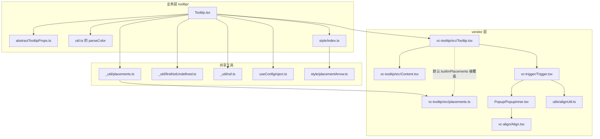
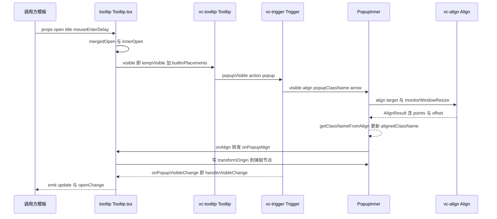
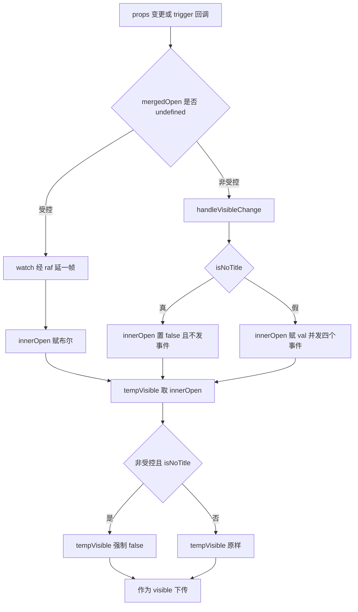
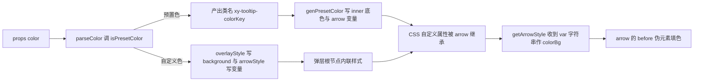

# C07-03 Tooltip 文字提示

> **本篇解决**：Tooltip 如何把「一行文案」变成一套带延迟、箭头、碰撞避让与受控/非受控语义的浮层，以及 `tooltip/` 与 `vc-tooltip/` 的职责切口究竟落在哪一行。
> **前置**：I01《vc-align 定位求解与碰撞检测》、I02《vc-trigger 弹出时序与事件穿透》　**读者坐标**：`03-components/07-feedback` 第 3/10 篇

## 一、职责与边界

Tooltip 负责把一段文案渲染成**跟随触发元素、带单向箭头、可自动翻转方位**的悬浮层，并在 `hover`/`focus`/`click`/`contextmenu` 四种触发方式下决定它何时出现。它不负责坐标计算（`vc-align`，见 I01《vc-align 定位求解与碰撞检测》）、不负责开合时序与事件穿透（`vc-trigger`，见 I02《vc-trigger 弹出时序与事件穿透》）、也不负责层级仲裁：层叠值只是一个静态 Token 算式 `zIndexPopupBase + 70`（`tooltip/style/index.ts:150-153`），`_util/zIndexManager` 不在 `tooltip/Tooltip.tsx:1-26` 的导入清单里。三件套（trigger / align / zIndex）的定名与调用序列由 A07《交互基础设施总览：一个浮层是怎么拼起来的》给出，本篇只补 Tooltip 独有的环节。

明确不做的四件事：不做焦点陷阱（对比 C07-01《Modal 对话框》）、不做滚动锁定（Modal/Drawer 有 `useScrollLocker`，Tooltip 全目录无引用）、不做多实例互斥（`overlayEventBus` 不在其依赖里）、不提供受控以外的「保持悬停」交互——`mouseLeaveDelay` 是唯一的时间旋钮。

`tooltip/` 与 `vc-tooltip/` 的切分线只有一条：**`vc-tooltip` 只做「prop 名翻译」，`tooltip` 做其余全部**。这一刀切得很薄——`vc-tooltip/src/Tooltip.tsx` 全文 136 行里没有一行开合状态机（只有一处 `watchEffect` 维护销毁标志，`:74-85`），它做的就是把 `overlay*` 命名的入参改写成 `popup*` 命名再交给 `vc-trigger`（`:109-132`）。业务层反过来把自己的 props 整份展开给 `vc-tooltip`（`tooltip/Tooltip.tsx:287-305`），两侧没有任何一层做过 props 白名单。

被谁依赖：`popover`、`popconfirm` 直接把它当基座（`popover/index.tsx:3`、`popconfirm/index.tsx:4`），另有 `steps/index.tsx:13`、`form/FormItemLabel.tsx:11`、`rate/index.tsx:10`、`upload/UploadList/ListItem.tsx:12`、`float-button/FloatButton.tsx:3`、`slider/SliderTooltip.tsx:2`、`table/hooks/useSorter.tsx:15`、`menu/src/MenuItem.tsx:15`、`progress/Circle.tsx:8`、`typography/Base.tsx:11` 在内部渲染它；`theme/interface/components.ts:58` 把它的 ComponentToken 汇入全局 Token 表。它依赖谁：`vc-tooltip`、`vc-trigger/interface` 的类型、`_util/placements`、`_util/firstNotUndefined`、`_util/raf`、`_util/colors`、`_util/vnode`、`_util/props-util`、`_util/transition`、`config-provider/hooks/useConfigInject`、`style/placementArrow`、`style/roundedArrow`、`style/motion`。

## 二、源码地图

| 文件 | 行数 | 职责 | 关键导出与主入口 |
| --- | --- | --- | --- |
| `tooltip/index.ts` | 14 | 包出口，`withInstall` | `:14` |
| `tooltip/Tooltip.tsx` | 319 | 主实现，**业务层唯一有逻辑的文件** | `tooltipProps` `:54`、`tooltipDefaultProps` `:59`、组件 `:71`、主渲染 `:252-317` |
| `tooltip/abstractTooltipProps.ts` | 58 | 三个浮层共用的 props 形状与 placement 联合类型 | `:22` 默认导出、`TooltipPlacement` `:8-20` |
| `tooltip/util.ts` | 22 | `color` 分流 | `parseColor` `:5-22` |
| `tooltip/style/index.ts` | 157 | Token 与样式生成，含预置色生成器与箭头样式挂载 | `genTooltipStyle` `:22`、hook `:128-157` |
| `tooltip/tooltip.test.js` | 90 | 单测，只有一个 `it` | `:8` |
| `vc-tooltip/index.ts` | 4 | vendor 出口，注释标基线版本 | `:1-4` |
| `vc-tooltip/src/Tooltip.tsx` | 136 | prop 名翻译层，无状态机 | 渲染 `:87-134` |
| `vc-tooltip/src/Content.tsx` | 29 | 弹层内容盒，`role="tooltip"` | `:13-29` |
| `vc-tooltip/src/placements.ts` | 83 | 第二份 12 方位表 | `placements` `:8-81` |
| `_util/placements.ts` | 111 | 第一份 12 方位表 + `arrowPointAtCenter` 合成 | `getPlacements` `:38` |
| `_util/firstNotUndefined.ts` | 10 | 受控初值取值 | `:1-10` |

主实现入口是 `packages/xiaoye-ui/src/tooltip/Tooltip.tsx:252` 的渲染函数返回；vendor 侧入口是 `packages/xiaoye-ui/src/vc-tooltip/src/Tooltip.tsx:87`。两份 12 方位表都在生效，但生效条件互斥（论点 3）。

组件目录内没有 `demo/`，也没有 `__tests__/` 子目录——测试文件 `tooltip.test.js` 与被测文件同级，仍在 Vitest 的采集范围内（glob 见 `packages/xiaoye-ui/vitest.config.mts:33`）。用法面见 [apps/docs/components/tooltip.md](../../../apps/docs/components/tooltip.md)。

## 三、架构与数据流

### 3.1 静态结构：三层两表



这张图的重点是**两个反常的边**。第一条是 `PL --> VCP`：`_util/placements.ts:1` 不去 import `vc-tooltip/index.ts`（那里只导出组件，`vc-tooltip/index.ts:1-4`），而是深入 vendor 的 `src/` 子目录取 `placements`，因为 `getPlacements` 在 `arrowPointAtCenter` 为假时要把这份表整个回读（`_util/placements.ts:104`）。第二条是虚线 `VCT -.-> VCP`：`vc-tooltip/src/Tooltip.tsx:113` 把同一份表写死为自己的 `builtinPlacements` 默认值，但业务层在 `tooltip/Tooltip.tsx:292` 无条件覆盖它——这条边平时不产生效果，只有绕过 `tooltip` 直接用 `vc-tooltip` 时才活。`TRG --> AU` 与 `PIN --> ALG` 属于 I02 与 I01 的范围，此图只标出边界。

### 3.2 一次悬停的完整闭环



`PIN-->>PIN` 那一步只更新类名，`PIN->>BIZ` 那一步被 `status.value === 'align'` 闸住（`vc-trigger/Popup/PopupInner.tsx:84`、`:96`）——两条分支不在同一个条件下，这是 resize 后动画原点不更新的根因。`BIZ->>PIN` 是**反向写 DOM**：业务回调拿到的是弹层真实节点（`tooltip/Tooltip.tsx:243` 直接赋值 `domNode.style.transformOrigin`），这是全链路里唯一一处样式由 JS 反推的环节。延迟计时、pending 状态、`mouseenter` 到 `popupVisible` 的映射全部发生在 `TRG` 内部，本篇不重复 I02 的论证。

### 3.3 开合判定：`mergedOpen` 与 `isNoTitle` 的两道闸



图里 `F` 与 `J` 是**同一个谓词的两次求值**，但 `J` 多了「非受控」前置条件，这就是论点 1 说的「受控 + 空标题弹空框」的图形化表述。`E` 与 `H`/`G` 是同一个 ref 的两条互斥写入路径，`E` 多走一帧（论点 2）。`A` 的右侧分支由 `vc-trigger` 回调触发，左侧分支由父组件重渲染触发，两者不共享计时器。

### 3.4 颜色链路：一次分流，两处汇合



`Q` 到 `R`/`T` 之后两条路径不再交汇，直到 `V` 才汇合到同一个 CSS 属性上。`T` 之所以把变量放在 `overlayStyle`（根节点）而不是 `overlayInnerStyle`（内容盒），是因为箭头与内容盒在 DOM 上是兄弟（`vc-tooltip/src/Tooltip.tsx:48-61`），自定义属性只能由共同祖先下发——这是本组件里唯一一处「样式落点由 DOM 结构而非语义决定」的地方，详见论点 5。

## 四、核心机制精读

### 论点 1：「没有标题就不弹」这条规则只保护非受控路径，而且它同时决定了事件是否发出

**断言**：空标题的抑制逻辑完全住在业务层 `tooltip/Tooltip.tsx`，`vc-tooltip` 与 `vc-trigger` 对它一无所知；同一段判定 `isNoTitle()` 被三处消费，但三处的守卫条件并不相同——渲染处要求 `mergedOpen === undefined` 才生效，事件处则无条件生效。结果是「受控 + 空标题」会弹出一个空泡，而「非受控 + 空标题」既不弹出也不发 `openChange`。

```tsx
// packages/xiaoye-ui/src/tooltip/Tooltip.tsx:119
    const isNoTitle = () => {
      const title = props.title ?? slots.title;
      return !title && title !== 0;
    };

    const handleVisibleChange = (val: boolean) => {
      const noTitle = isNoTitle();
      if (mergedOpen.value === undefined) {
        innerOpen.value = noTitle ? false : val;
      }
      if (!noTitle) {
        emit('update:visible', val);
        emit('visibleChange', val);
        emit('update:open', val);
        emit('openChange', val);
      }
    };
```

```tsx
// packages/xiaoye-ui/src/tooltip/Tooltip.tsx:257
      let tempVisible = innerOpen.value;
      // Hide tooltip when there is no title
      if (mergedOpen.value === undefined && isNoTitle()) {
        tempVisible = false;
      }
```

逐段看：

- `Tooltip.tsx:120` 的 `props.title ?? slots.title` 取的是**插槽函数本身**而不是插槽内容。函数对象恒为真值，所以只要声明了 `title` 插槽，`isNoTitle()` 就必然返回 `false`；而 `?? ` 只在 `null/undefined` 时兜底，意味着 `title=""` 会**遮住**同名插槽——空串标题 + `#title` 插槽的组合被判为「无标题」。取内容的那一处用的是另一个表达式 `props.title ?? slots.title?.()`（`Tooltip.tsx:215`），两处共享同一个 `??` 短路语义，行为一致但很容易读成两处不同。
- `Tooltip.tsx:121` 的 `!title && title !== 0` 是给 `title={0}` 留的后门：数字 0 是合法文案。这与 `!title` 单独判空的常见写法不同，属于必须保留的分支。
- `Tooltip.tsx:124-135` 里，`noTitle` 为真时**两件事同时发生**：内部状态被钉死为 `false`（127），四个事件全部静默（129 的 `if (!noTitle)`）。后者是显式设计意图，测试直接把它写成断言——`tooltip.test.js:41` 与 `:48` 都在空标题时检查 `expect(onOpenChange).not.toHaveBeenCalled()`。
- 但 `Tooltip.tsx:259` 的守卫多了 `mergedOpen.value === undefined`。一旦父级传了 `:open`，`tempVisible` 就完全跟随 `innerOpen`，空标题不再压住弹层。此时渲染路径继续往下走到 `Tooltip.tsx:306-316`，`overlay` 插槽取 `getOverlay()` 返回空串，`vc-tooltip` 照样把 `<div class="xy-tooltip-inner">` 挂出来（`vc-tooltip/src/Content.tsx:18-27`）。

**回扣**：Tooltip 与 Popover/Popconfirm 共用一套 props，但「空内容不弹」这条产品规则是在业务层用 `isNoTitle` 打的补丁，且补丁的两个消费点条件不一致。要找「为什么我的 tooltip 不弹」，只需在 `Tooltip.tsx:119` 一处下断点；要找「为什么它弹了个空框」，只需检查 `mergedOpen` 是否被父级传值。

### 论点 2：弹层的真值只有一个 `innerOpen`，但它有两条互斥写入路径，受控那条多走一帧

**断言**：业务层没有用 `useMergedState`，而是手写了一个 `innerOpen` ref——非受控时由 `handleVisibleChange` **同帧**写入，受控时由 `watch(mergedOpen)` 经 `raf` **下一帧**写入；两者都不会回读，因此 `props.open` 与实际显示之间恒定存在一帧延迟。

```tsx
// packages/xiaoye-ui/src/tooltip/Tooltip.tsx:107
    const mergedOpen = computed(() => props.open ?? props.visible);
    const innerOpen = ref(firstNotUndefined([props.open, props.visible]));

    const tooltip = ref();

    let rafId: any;
    watch(mergedOpen, val => {
      raf.cancel(rafId);
      rafId = raf(() => {
        innerOpen.value = !!val;
      });
    });
```

```ts
// packages/xiaoye-ui/src/_util/firstNotUndefined.ts:1
function firstNotUndefined<T>(arr: T[] = []): T {
  for (let i = 0, len = arr.length; i < len; i++) {
    if (arr[i] !== undefined) {
      return arr[i];
    }
  }
  return undefined;
}
```

逐段看：

- `Tooltip.tsx:107` 把废弃的 `visible` 和新的 `open` 归一成一个 computed，`??` 的语义是「`open` 传了 `false` 也算传了」，所以 `:open="false"` 加 `:visible="true"` 的组合里 `open` 赢。`abstractTooltipProps.ts:24-26` 把两者都声明为 `Boolean` 且 `default: undefined`，这是「有没有传」能被区分的前提——若声明了默认 `false`，受控判定立刻失效。
- `Tooltip.tsx:108` 的初值走 `firstNotUndefined`，而该函数在全部元素为 `undefined` 时返回 `undefined`（`firstNotUndefined.ts:7`），**没有兜底成 `false`**。于是非受控 Tooltip 在第一次交互前，`innerOpen.value === undefined`；对外暴露的 `expose({ open: innerOpen })`（`Tooltip.tsx:143`）此时读到 `undefined` 而不是 `false`。唯一的补正发生在 `handleVisibleChange` 里——`Tooltip.tsx:127` 的 `noTitle ? false : val` 无论走哪支都写入布尔值，第一次 hover 之后 `open` 才变成 `false`/`true`。现有测试恰好依赖这个时序：`tooltip.test.js:36-43` 先派发 `mouseenter` 再断言 `wrapper.vm.$refs.tooltip.open` `toBe(false)`，若把断言提到派发之前就会拿到 `undefined`。
- `Tooltip.tsx:113-118` 的 `watch` 没有 `immediate`，只做「变化后延一帧」。用 `raf` 而不是同步赋值的原因写在同文件的 `Tooltip.tsx:114`：连续变更先 `raf.cancel(rafId)` 再排新帧，把父级在一帧内多次改 `open` 合并成一次渲染。代价是**受控路径必然滞后一帧**，且 `Tooltip.tsx:314` 给子节点加 `openClassName` 判断用的也是 `innerOpen.value` 而非 `tempVisible`，受控切换时高亮类同样滞后一帧。
- `Tooltip.tsx:112` 的 `rafId` 是 setup 作用域的普通变量，卸载时没有任何清理钩子——在 `tooltip/` 目录内 `raf` 只出现两次（导入 `Tooltip.tsx:20`、取消 `Tooltip.tsx:114`），不存在 `onUnmounted`/`beforeUnmount`。对照同仓库的弹层状态机 `vc-trigger/Popup/useVisibleStatus.ts:91-94`，它在 `onBeforeUnmount` 里既置 `destroyRef` 又 `raf.cancel`。父级在 `open` 刚变更就销毁 Tooltip 时，那一帧的回调仍会执行并写一个已销毁组件的 ref，Vue 不会报错，但也不会有效果。

**回扣**：调试「设了 `:open` 但没反应」时，判定顺序是：先看 `mergedOpen` 是否为 `undefined`（受控判定），再看 `isNoTitle()`（论点 1 的受控分支不受保护），最后才怀疑 `raf` 的一帧延迟。`vc-trigger` 侧不存在第二条状态源——`vc-tooltip/src/Tooltip.tsx:105-107` 只做一件事：`visible !== undefined` 就转发成 `popupVisible`，让 trigger 进入受控。

### 论点 3：`getPlacements` 里那半张表在默认配置下是死数据，`arrowPointAtCenter` 决定的是「用谁的 points」

**断言**：`_util/placements.ts` 先构造一份带箭头位移量的 12 项 `placementMap`，随后在收尾循环里按 `arrowPointAtCenter` 二选一——为 `false` 时**整项被 `vc-tooltip/src/placements.ts` 的同名条目覆盖**，只剩下 `overflow` 是新算的。因此默认路径（`arrowPointAtCenter: false`，见 `tooltip/Tooltip.tsx:65`）下，`arrowWidth`、`horizontalArrowShift`、`verticalArrowShift` 三个参数算了个寂寞。

```ts
// packages/xiaoye-ui/src/_util/placements.ts:96
  Object.keys(placementMap).forEach(key => {
    placementMap[key] = arrowPointAtCenter
      ? {
          ...placementMap[key],
          overflow: getOverflowOptions(autoAdjustOverflow),
          targetOffset,
        }
      : {
          ...placements[key],
          overflow: getOverflowOptions(autoAdjustOverflow),
        };

    placementMap[key].ignoreShake = true;
  });
  return placementMap;
```

```tsx
// packages/xiaoye-ui/src/tooltip/Tooltip.tsx:147
    const tooltipPlacements = computed(() => {
      const { builtinPlacements, autoAdjustOverflow, arrow, arrowPointAtCenter } = props;
      let mergedArrowPointAtCenter = arrowPointAtCenter;

      if (typeof arrow === 'object') {
        mergedArrowPointAtCenter = arrow.pointAtCenter ?? arrowPointAtCenter;
      }
      return (
        builtinPlacements ||
        getPlacements({
          arrowPointAtCenter: mergedArrowPointAtCenter,
          autoAdjustOverflow,
        })
      );
    });
```

逐段看：

- 两条分支产出的 `points` 不同源。`_util/placements.ts:71-74` 给 `topRight` 的是 `['br','tc']`（弹层右下角对齐**触发元素顶边中点**），而 `vc-tooltip/src/placements.ts:45-50` 给的同名项是 `['br','tr']`（对齐触发元素右上角），offset 的水平分量也从 `horizontalArrowShift + arrowWidth`（默认 `16 + 4 = 20`）退回 `0`，垂直分量两者都是 `-4`。前者让箭头指向触发元素中心一侧，后者让弹层角点直接贴住触发元素角点——这正是 `arrowPointAtCenter` 的字面语义，实现方式是「换 points 与 offset 表」而不是「调箭头的 left」。
- `placements[key]` 的展开在 `overflow` 之前，`getOverflowOptions`（`_util/placements.ts:28-36`）在 `:33-34` 用 `{...disabled, ...value}` 合并，因此 `autoAdjustOverflow` 传 `{ adjustX: 1 }` 只放开水平翻转、垂直保持关闭；传 `true` 得到 `{adjustX:1,adjustY:1}`（`:3-6`），传 `false` 得到 `{adjustX:0,adjustY:0}`（`:8-11`）。这与 `abstractTooltipProps.ts:44-47` 声明的 `boolean | AdjustOverflow` 一致；而 `AdjustOverflow` 的成员值域是字面量联合 `0 | 1`（`_util/placements.ts:16-17`），写成 `{ adjustX: true }` 过不了类型。
- `Tooltip.tsx:147-161` 有另一个优先级：`builtinPlacements` 一旦传入就**完全短路** `getPlacements`，此时 `autoAdjustOverflow` 与 `arrowPointAtCenter` 双双失效。业务层把它做成 `builtinPlacements: objectType<BuildInPlacements>()`（`abstractTooltipProps.ts:50`），没有默认值，所以默认一定走计算。
- 但 `vc-tooltip` 自己还留着第三份表：`vc-tooltip/src/Tooltip.tsx:113` 把 `builtinPlacements: placements` 写成硬编码默认，而业务层在 `Tooltip.tsx:292` 显式传了 `tooltipPlacements.value` 覆盖它。也就是说 `vc-tooltip/src/placements.ts` 有两条被消费的路径——直接作 trigger 的 builtinPlacements（被业务层覆盖掉），以及经 `_util/placements.ts:104` 回读（默认路径生效）。`_util/placements.ts:1` 因此越过 `vc-tooltip/index.ts` 直接 `import { placements } from '../vc-tooltip/src/placements'`，把 vendor 层的内部目录当成了公共接口。
- `_util/placements.ts:108` 给每一项补 `ignoreShake = true`，但 `ignoreShake` 在整个仓库里只有两处出现：这一处写入，和 `vc-trigger/interface.ts:63` 的类型声明。`vc-align/` 四个文件（`Align.tsx`、`index.ts`、`interface.ts`、`util.ts`）对它的计数为 0，`vc-trigger/Trigger.tsx` 与 `Popup/` 也不读它。**该字段无任何消费者。**

**回扣**：placement 名字最终不靠传参传递，而靠 points 反查（见论点 4）。改 `getPlacements` 的 offset 数字会同时影响 `tooltip`、`popover`、`popconfirm`、`slider/SliderTooltip` 四个消费方，因为后三者的 `builtinPlacements` 同样来自 `tooltip` 这条链路。

### 论点 4：弹层「当前落在哪个方位」不靠传参，靠 points 反查；业务层为此重写了一遍 vendor 层已有的反查

**断言**：`vc-trigger` 已经把解析后的 placement 名反查出来并写成 `xy-tooltip-placement-*` 类名，但类名无法被 JS 读取，于是 `tooltip/Tooltip.tsx` 在 `onPopupAlign` 里用同一套 `points` 比较**又实现了一次反查**，只为拿到名字去设 `transformOrigin`。两份实现共用 `builtinPlacements`，一旦用户传入自定义 `align.points`，两处会同时静默失效。

```tsx
// packages/xiaoye-ui/src/tooltip/Tooltip.tsx:218
    const onPopupAlign = (domNode: HTMLElement, align: any) => {
      const placements = tooltipPlacements.value;
      // 当前返回的位置
      const placement = Object.keys(placements).find(
        key =>
          placements[key].points[0] === align.points?.[0] &&
          placements[key].points[1] === align.points?.[1]
      );
      if (placement) {
        // 根据当前坐标设置动画点
        const rect = domNode.getBoundingClientRect();
        const transformOrigin = {
          top: '50%',
          left: '50%',
        };
        if (placement.indexOf('top') >= 0 || placement.indexOf('Bottom') >= 0) {
          transformOrigin.top = `${rect.height - align.offset[1]}px`;
        } else if (placement.indexOf('Top') >= 0 || placement.indexOf('bottom') >= 0) {
          transformOrigin.top = `${-align.offset[1]}px`;
        }
        if (placement.indexOf('left') >= 0 || placement.indexOf('Right') >= 0) {
          transformOrigin.left = `${rect.width - align.offset[0]}px`;
        } else if (placement.indexOf('right') >= 0 || placement.indexOf('Left') >= 0) {
          transformOrigin.left = `${-align.offset[0]}px`;
        }
        domNode.style.transformOrigin = `${transformOrigin.left} ${transformOrigin.top}`;
      }
    };
```

```ts
// packages/xiaoye-ui/src/vc-trigger/utils/alignUtil.ts:22
export function getAlignPopupClassName(
  builtinPlacements: BuildInPlacements,
  prefixCls: string,
  align: AlignType,
  isAlignPoint: boolean,
): string {
  const { points } = align;

  const placements = Object.keys(builtinPlacements);

  for (let i = 0; i < placements.length; i += 1) {
    const placement = placements[i];
    if (isPointsEq(builtinPlacements[placement].points, points, isAlignPoint)) {
      return `${prefixCls}-placement-${placement}`;
    }
  }

  return '';
}
```

逐段看：

- 数据通路：`Align` 求解完成后回调 `latestOnAlign(source, result)`（`vc-align/Align.tsx:98-99`），`result` 的类型是 `AlignResult`，含 `points` 与 `offset` 两个必填字段（`vc-align/interface.ts:43-51`）。`PopupInner` 收到后先算类名 `getClassNameFromAlign(matchAlign)`（`vc-trigger/Popup/PopupInner.tsx:79`），该 prop 由 `Trigger.tsx:424` 绑定为 `handleGetPopupClassFromAlign`，后者在 `Trigger.tsx:370-372` 调 `getAlignPopupClassName`。类名最终并入弹层根节点 `mergedClassName`（`PopupInner.tsx:175-180`）。
- 然后才轮到业务回调：`Trigger.tsx:434` 把 `onAlign: $attrs.onPopupAlign || noop` 传给 `Popup`——注意 `onPopupAlign` **不是** Trigger 的声明 prop（`vc-trigger/interface.ts:133` 那一行整条被注释掉了），它靠 `inheritAttrs: false`（`Trigger.tsx:38`）留在 `$attrs` 中被定点取出。上游 `vc-tooltip/src/Tooltip.tsx:128` 负责把它塞进 `triggerProps`。
- `PopupInner.tsx:84-97` 给这个回调加了一道闸：`props.onAlign?.()` 只在 `status.value === 'align'` 分支内调用。`status` 来自 `useVisibleStatus(visible, doMeasure)`（`PopupInner.tsx:60`），是入场过程的中间态。因此**入场之后**因窗口 resize、目标滚动而重新对齐时，`-placement-*` 类名仍会更新（`:81-83` 在闸外），但 `transformOrigin` 保持入场时的值。
- 反查的匹配条件在两层不同：`alignUtil.ts:3-8` 的 `isPointsEq` 在 `isAlignPoint` 为真时只比 `points[0]`，而 `Tooltip.tsx:223-224` 无条件比 `points[0]` 与 `points[1]`。`isAlignPoint` 即 `alignPoint` prop（`Trigger.tsx:367`、`:371`），Tooltip 没有暴露它，所以常规路径下两者行为一致；但 `Tooltip.tsx:222-224` 用 `align.points?.[0]` 做了可选链，紧接着 `:234` 直接读 `align.offset[1]` 不带保护——`AlignResult` 声明 `offset` 必填（`vc-align/interface.ts:45`），所以类型上成立，运行时若上游给了不含 `offset` 的对象就会抛。
- `transformOrigin` 的分支判定依赖**placement 名里第二个单词的首字母大小写**：`top`/`Bottom` 走「贴远边」公式，`Top`/`bottom` 走「贴近边」公式。以 `topLeft` 为例，`indexOf('top')` 命中 0 → 用 `rect.height - offset[1]`；以 `leftTop` 为例，小写 `top` 不存在、`Bottom` 不存在，落到 `else if` 的 `indexOf('Top')` 命中 4 → 用 `-offset[1]`。`left`/`right`/`top`/`bottom` 四个单边名各命中一条，其余八个复合名靠大小写区分主轴与副轴。这套判定没有注释解释，也没有测试覆盖（`tooltip/tooltip.test.js` 全文只有一个 `it`，见下节），改 placement 命名规则会直接击穿它。
- 反查失败的后果是双重的：`getAlignPopupClassName` 返回 `''`（`alignUtil.ts:39`）→ `placementArrow.ts:88-94` 那一整批以 `&-placement-*` 为前缀的箭头定位规则全部不再命中；`Tooltip.tsx:221` 的 `find` 返回 `undefined` → `if (placement)` 整块跳过 → `transformOrigin` 留在上一次的值。

**回扣**：`onPopupAlign` 是「样式由 JS 反推」的孤例——Tooltip 是唯一消费它的业务组件。看到弹层缩放动画从一个错误的角点炸开，先查 `Tooltip.tsx:218`，再查 `alignUtil.ts:22`，两处必须同时命中同一个 placement 名才正常。

### 论点 5：`color` 有两条完全互斥的实现路径，预置色走类名、自定义色走 CSS 变量，且变量必须挂在弹层根节点

**断言**：箭头不是图片也不是独立定位的第四层，而是 `-arrow` 这个空 `<div>` 上的 `::before` 裁切图形；它的填色值是字面量字符串 `'var(--xy-arrow-background-color)'`，被写死进样式生成器。因此自定义色不能只改 `-inner` 的背景——必须让变量出现在弹层根节点的内联样式上，这正是 `parseColor` 把 `background` 与 `--xy-arrow-background-color` 分开放进两个不同对象的原因。

```ts
// packages/xiaoye-ui/src/tooltip/util.ts:5
export function parseColor(prefixCls: string, color?: string) {
  const isInternalColor = isPresetColor(color);

  const className = classNames({
    [`${prefixCls}-${color}`]: color && isInternalColor,
  });

  const overlayStyle: CSSProperties = {};
  const arrowStyle: CSSProperties = {};

  if (color && !isInternalColor) {
    overlayStyle.background = color;
    // @ts-ignore
    arrowStyle['--xy-arrow-background-color'] = color;
  }

  return { className, overlayStyle, arrowStyle };
}
```

```ts
// packages/xiaoye-ui/src/tooltip/style/index.ts:85
        // generator for preset color
        ...genPresetColor(token, (colorKey, { darkColor }) => ({
          [`&${componentCls}-${colorKey}`]: {
            [`${componentCls}-inner`]: {
              backgroundColor: darkColor,
            },
            [`${componentCls}-arrow`]: {
              '--xy-arrow-background-color': darkColor,
            },
          },
        })),
```

逐段看：

- 分流点是 `util.ts:6` 的 `isPresetColor(color)`（实现见 `_util/colors.ts:24-29`，默认 `includeInverse = true`，会把 `inverse` 类反色也算作预置）。命中预置时只产出 `className = 'xy-tooltip-red'` 这类**类名**，两个 style 对象保持为空 `{}`；未命中时才写内联样式。两条路径互斥，同一个 `color` 不可能既走类名又走变量。
- 类名路径的消费端在 `tooltip/style/index.ts:86-95`：`genPresetColor`（`style/presetColor.tsx:20-35`）对每个预置色取 `token[`${colorKey}-6`]` 作为 `darkColor`（`presetColor.tsx:28`），同时给 `-inner` 设 `backgroundColor` 和给 `-arrow` 设同名 CSS 变量。**注意两者都是 `darkColor`**，与自定义色路径用原值形成对比：`color="red"` 得到的是 red-6 的深红，而 `color="#f00"` 得到的是 `#f00` 本身。
- 变量路径的落点由 `tooltip/Tooltip.tsx:285` 与 `:296` 决定：`arrowContentStyle = colorInfo.arrowStyle`，然后 `overlayStyle: { ...arrowContentStyle, ...overlayStyle }`——变量进的是 **`overlayStyle`（弹层根节点）**，而不是同文件 `:297` 的 `overlayInnerStyle`（内容盒）。原因写在 `vc-tooltip/src/Tooltip.tsx:48-61`：`-arrow` 与 `Content`（`-inner`）是**兄弟节点**，`-arrow` 拿不到 `-inner` 上的样式，只能靠根节点继承自定义属性。
- 真正的读端是 `tooltip/style/index.ts:105-115`：`getArrowStyle(token, { colorBg: 'var(--xy-arrow-background-color)', ... })`，该 `colorBg` 一路传给 `style/placementArrow.ts:28-36` 的 `options.colorBg`，在 `placementArrow.ts:74` 进 `roundedArrow(...)` 的第 4 参、并在 `:78-80` 又写了一次 `'&:before': { background: colorBg }`。`style/roundedArrow.ts:53-70` 的 `::before` 本身已带 `background: bgColor`（`:59`）与一段 `clipPath` 双值兜底（`:60-68`，polygon 与 SVG `path()` 两个候选，靠 `_multi_value_` 机制输出），所以 `placementArrow.ts:78-80` 的覆写是**同值重复**。
- 兜底声明在 `tooltip/style/index.ts:51`：组件根选择器上先给 `'--xy-arrow-background-color': tooltipBg`。这意味着变量缺失时箭头回落到默认底色，而不是透明——`color` 未传时箭头照样有色。
- 左/右方位的圆角被单独收紧：`tooltip/style/index.ts:68-79` 用 `Math.min(tooltipBorderRadius, MAX_VERTICAL_CONTENT_RADIUS)` 把 `-inner` 圆角压到不超过 `8`（常量定义在 `style/placementArrow.ts:10`），同时 `:113` 传 `limitVerticalRadius: true` 让 `getArrowOffset` 走 `maxVerticalContentRadius - arrowInnerOffset` 分支（`placementArrow.ts:22-24`）。两处必须同时成立，箭头才不会在左右方位突出圆角之外。
- `tooltipRadiusOuter` 在 `tooltip/style/index.ts:145` 被夹成 `borderRadiusOuter > 4 ? 4 : borderRadiusOuter`，再经 `:106-108` 以 `borderRadiusOuter` 的名字盖掉全局值喂给箭头。换言之主题里把 `borderRadiusOuter` 调到 8，Tooltip 箭头的圆角仍是 4。

**回扣**：`color` 相关的任何改动都要同时看四个文件——`tooltip/util.ts`（分流）、`tooltip/style/index.ts`（类名与读端）、`style/placementArrow.ts` + `style/roundedArrow.ts`（画端）、`vc-tooltip/src/Tooltip.tsx`（兄弟节点结构）。少看一处就会出现「内容换了色、箭头没换」。

### 论点 6：给禁用元素加 Tooltip 靠的是「换 DOM 父级 + 关掉子节点命中」，三个内部标记里有一个从未被定义

**断言**：禁用元素不派发鼠标事件，hover 类 trigger 因此失效。Tooltip 的解法是把子节点包进一个 `<span>`，让 span 去接事件、让原节点 `pointerEvents: none` 不再拦截；识别「哪些子节点需要包」用的是 `__XY_*` 内部标记，而其中 `__XY_RADIO` 在整个仓库里只有读、没有写。

```tsx
// packages/xiaoye-ui/src/tooltip/Tooltip.tsx:168
        if (
          ((elementType.__XY_BUTTON === true || elementType === 'button') &&
            isTrueProps(ele.props.disabled)) ||
          (elementType.__XY_SWITCH === true &&
            (isTrueProps(ele.props.disabled) || isTrueProps(ele.props.loading))) ||
          (elementType.__XY_RADIO === true && isTrueProps(ele.props.disabled))
        ) {
          // Pick some layout related style properties up to span
          const { picked, omitted } = splitObject(getStyle(ele), [
            'position',
            'left',
            'right',
            'top',
            'bottom',
            'float',
            'display',
            'zIndex',
          ]);
          const spanStyle: CSSProperties = {
            display: 'inline-block', // default inline-block is important
            ...picked,
            cursor: 'not-allowed',
            lineHeight: 1, // use the true height of child nodes
            width: ele.props && ele.props.block ? '100%' : undefined,
          };
          const buttonStyle: CSSProperties = {
            ...omitted,
            pointerEvents: 'none',
          };
```

逐段看：

- 判定入口在 `Tooltip.tsx:166-167`：`typeof elementType === 'object' && ele.props` 先排除文本节点与原生字符串标签，紧接着 `:169` 的 `elementType === 'button'` 是给**原生 `<button disabled>`** 留的口子（Vue 原生元素 VNode 的 `type` 就是标签字符串），所以这条不依赖任何标记。
- `__XY_BUTTON` 有两处真实定义：`button/button.tsx:39` 与 `dropdown/dropdown-button.tsx:22`。`__XY_SWITCH` 一处：`switch/index.tsx:62`。而 `__XY_RADIO` 在 `packages` 与 `apps` 的全部 `ts/tsx/vue/js/md` 文件里只命中 `tooltip/Tooltip.tsx:173` 这一处**读取**，`radio/` 目录下没有任何 `__XY_` 标记。**该分支恒为假，禁用单选框套 Tooltip 不会被包装。** 交叉验证命令见文末检查点 3。
- Switch 比其他两个多一个 `|| isTrueProps(ele.props.loading)`（`Tooltip.tsx:171-172`）——加载中同样吞掉事件。
- `isTrueProps`（`Tooltip.tsx:162-164`）写的是 `val || val === ''`：模板里 `disabled` 不带值时，原生元素拿到的是空字符串而不是 `true`，单靠 `val` 判真会漏。这是 `splitObject` 之外第二个容易被忽略的细节。
- 样式拆分由本文件私有的 `splitObject`（`Tooltip.tsx:39-52`）完成：8 个布局属性被抬到 span（`:176-185`），其余留在原节点并与 `pointerEvents: 'none'` 合并（`:193-196`）。`lineHeight: 1`（`:190`）与 `width: block ? '100%'`（`:191`）是给 `xy-button block` 场景兜的水平拉伸。
- 覆盖式克隆：`cloneElement(ele, { style: buttonStyle }, true)`（`Tooltip.tsx:197-203`）第三个实参对应 `_util/vnode.ts:12` 的 `override`，其效果在 `vnode.ts:25` ——`node.props = { ...node.props, ...nodeProps }` 把「合并」改成「覆盖」；第四个参数 `mergeRef` 默认 `false`（`vnode.ts:14`），所以子节点上的 `ref` 被克隆保留但不与传入的 ref 合并。
- 包装节点带的类名是 `${prefixCls}-disabled-compatible-wrapper`（`Tooltip.tsx:205`）。这个类在 `packages` 与 `apps` 的样式源里**没有任何规则**——全仓只有这一处字符串拼接，`tooltip/style/index.ts` 也不生成它。它能生效完全依赖上面那份内联 `spanStyle`，类名只是留给使用方手写 CSS 的挂点。

**回扣**：「禁用的按钮悬停不出提示」的修复点只有 `Tooltip.tsx:165` 这一个函数；反过来，任何人新增一个会吞鼠标事件的组件（如 `__XY_RADIO` 本该有却没有），必须同时在这里补一条判定，否则表现为「该组件禁用后 Tooltip 失灵」。

## 五、对外契约如何生效

`<xy-tooltip>` 的对外面是 `tooltip/index.ts:14` 的 `withInstall(ToolTip)`，`tooltipProps` 与四个类型在 `index.ts:4-12` 单独导出；`index.ts:2` 的导入名写成 `ToolTip`（大小写与目录内文件名 `Tooltip.tsx` 不一致，仅影响阅读）。契约分四条线走。

**开合线**：`open`/`visible` → `mergedOpen`（`Tooltip.tsx:107`）→ `innerOpen`（`:108` 初值、`:113-118` 变化）→ `tempVisible`（`:257-261`）→ `vcTooltipProps.visible`（`:293`）→ `extraProps.popupVisible`（`vc-tooltip/src/Tooltip.tsx:105-107`）→ `Trigger` 的受控判定。`Trigger` 内部如何用 `popupVisible` 压制 pending 计时属于 I02《vc-trigger 弹出时序与事件穿透》，此处不展开。延迟值 `mouseEnterDelay`/`mouseLeaveDelay` 在两层各有一份默认 `0.1`（`Tooltip.tsx:79-80` 与 `vc-tooltip/src/Tooltip.tsx:25-26`），业务层的 `initDefaultProps`（`Tooltip.tsx:75`）保证传下去的永远是数字。

**内容线**：`title` 与 `#title` 插槽经 `getOverlay()`（`Tooltip.tsx:214-216`）汇成一个函数，作为 `v-slots.overlay` 传入（`:311`），在 `vc-tooltip/src/Tooltip.tsx:59` 转交给 `Content` 的 `slots.overlay`，最终渲染在 `<div class="xy-tooltip-inner" role="tooltip">` 内（`vc-tooltip/src/Content.tsx:19-27`）。`Content` 的 `id` 取自 `tipId`（`Content.tsx:7`/`:21`，来源 `vc-tooltip/src/Tooltip.tsx:31`/`:46`/`:57`），而 `tipId` 在 `packages` 与 `apps` 中除这三处外无任何写入方——业务层 `abstractTooltipProps.ts` 没有 `tipId`。同时 `aria-describedby` 在 `vc-trigger/`、`vc-tooltip/`、`tooltip/` 三个目录内的出现次数为 0。结论：**弹层带着 `role="tooltip"`，但触发元素没有任何无障碍关联属性**，读屏器无法把提示与被说明的元素连起来。`#arrowContent` 插槽同理：业务层在 `Tooltip.tsx:310` 渲染了一个空的 `<span class="xy-tooltip-arrow-content">`，而样式侧 `tooltip/style/index.ts:81-83` 只给 `xy-tooltip-content` 定了规则（那个包裹层来自 `vc-trigger/Popup/PopupInner.tsx:171-173` 的多子节点兜底），全仓找不到 `xy-tooltip-arrow-content` 的任何样式；`-inner-content` 则只在 `popover`/`popconfirm` 自己的前缀下定义（`popover/style/index.ts:79`、`popconfirm/style/index.ts:28`）。

**事件线**：`handleVisibleChange`（`Tooltip.tsx:124-135`）一次发四个 `emit`，`v-model:open` 与废弃的 `v-model:visible` 因此同时可用。`abstractTooltipProps.ts:52-57` 把 `onVisibleChange`、`onUpdate:visible`、`onOpenChange`、`onUpdate:open` 也声明成 Function 类型 props，但组件从不主动调用它们——事件只经 `emit` 出口。声明的意义在于让 `h()` 式传参与模板类型检查能通过，副作用是这些函数会随 `...props`（`Tooltip.tsx:288`）继续下传到 `vc-tooltip` 与 `Trigger`，被 `Trigger` 的 `inheritAttrs: false`（`Trigger.tsx:38`）丢弃，不会造成二次触发。

**类名与容器线**：用户写在 `<xy-tooltip>` 上的 `class` 走 `attrs`（`Tooltip.tsx:74` 的 `inheritAttrs: false` 使其进入 `attrs`，`:287` 展开）→ `triggerProps` 的 `...attrs`（`vc-tooltip/src/Tooltip.tsx:126`）→ `Trigger` 的 `$attrs.class` → 与子节点原类名合并后加在**触发元素**上（`Trigger.tsx:688`）；`overlayClassName` 则经 `Tooltip.tsx:272-280` 拼上 rtl、色类与 `hashId`，作为 `popupClassName`（`vc-tooltip/src/Tooltip.tsx:110`）落到**弹层根节点**（`Trigger.tsx:401`/`:432` → `PopupInner.tsx:175-180`）。挂载容器由 `useConfigInject` 的三级链决定：`props.getContainer ?? props.getPopupContainer ?? configProvider.getPopupContainer`（`config-provider/hooks/useConfigInject.ts:26-27`），`Tooltip.tsx:291` 显式重新赋值以覆盖 `...props` 里的原始函数；容器在 `Trigger` 侧的实际取用点是 I02 已复核的内联 `getContainer`，不是那段不可达的 `attachParent`。

**样式开关线**：`Tooltip.tsx:247` 读 `attrs['data-popover-inject']`，把它取反后作为第二个参数交给 `useStyle`（`:248-251`），`tooltip/style/index.ts:133-135` 收到 `false` 就返回空数组。写入方是 `popover/index.tsx:73` 与 `popconfirm/index.tsx:239` 的两处 JSX 无值属性。这条线能否闭合取决于 JSX 对无值属性编译成什么：用 `grep -n "popover-inject" packages/xiaoye-ui/dist/popover.mjs` 在既有构建产物里可复核，结果是布尔真值，因此抑制确实生效；该命令的输出属于产物、不作为源码证据。想当然地把它写成空串就会让 `Popover` 重新吃进整套 Tooltip 底色规则。这条线解释了为什么 `Popover` 复用 `Tooltip` 时不会同时下发两套底色与箭头规则。

## 六、设计取舍

**为什么不用 `useMergedState`，而要手写 `mergedOpen` + `innerOpen` + `raf`。** I13《响应式内核 hooks》把受控/非受控统一到一个 hook 里，Tooltip 却自建三件套（`tooltip/Tooltip.tsx:107-118`）。换来的有两点：一是 `open` 与废弃 `visible` 的双轨兼容能在一个 computed 里收敛（`:107`），不必给 hook 传两个候选 key；二是 `raf` 合帧能把父级同帧多次改 `open` 压成一次渲染（`:114-117`）。赔上的是三点：与 I13 的口径分叉（同一仓库里两种受控实现，改法不同）、`firstNotUndefined` 不兜底导致 `undefined` 经 `expose` 外泄（`:108`、`:143`，详见论点 2）、以及 `rafId` 无卸载清理（`:112`）。这条取舍在组件库里是有意还是遗留，源码没有注释说明，此处不下判断。

**为什么保留 `vc-tooltip` 这层几乎没有逻辑的翻译层。** `vc-tooltip/src/Tooltip.tsx:87-134` 的全部工作是把 `overlayClassName/overlayStyle/overlayInnerStyle/placement/align/transitionName/animation` 改名成 `popupClassName/popupStyle/popupPlacement/popupAlign/popupTransitionName/popupAnimation`（`:109-132`），外加一次 `visible → popupVisible` 的条件转发（`:105-107`）。换来的是 vendor 分层的一致性：`vc-*` 目录只认 `popup*` 词汇表，`dropdown`、`menu` 等不需要 `overlay*` 概念的消费方能直接接 `vc-trigger`。赔上的是三份 props 表要长期同步（`abstractTooltipProps.ts:22-58`、`vc-tooltip/src/Tooltip.tsx:14-41`、`vc-trigger/interface.ts`），任何一侧新增字段而不被另一侧 destructure，就会沿 `...attrs` 漏到 `Trigger` 再被 `inheritAttrs: false`（`Trigger.tsx:38`）静默吞掉——这类漏字段没有任何一层会报错。两处不可达（`tipId`、`destroyTooltipOnHide` 的对象分支）与一处有形无实的挂点（`-arrow-content` 渲染出的空 `span`）正是这种「表加了、链路没接」的产物，见第五节与第七节。

**为什么方位名字要靠 points 反查而不是回传。** `vc-align` 的输出类型 `AlignResult` 只有 `points`、`offset`、`targetOffset`、`overflow` 四个字段（`vc-align/interface.ts:43-51`），没有「方位」概念——它是通用求解器，不知道 12 个语义名。于是「当前落在哪个方位」必须由持有 `builtinPlacements` 的一侧反推：`vc-trigger` 反推成类名（`utils/alignUtil.ts:22-40`），`tooltip` 再反推一次成 `transformOrigin`（`tooltip/Tooltip.tsx:229-225`）。换来的是 `vc-align` 的零业务耦合，赔上的是同一份数据两处解析、以及那套靠 `top`/`Top` 大小写区分主副轴的脆弱判定。可行的替代方案是让 `PopupInner` 把已解析出的 placement 名连同类名一起回调给业务层，但 `getClassNameFromAlign` 的返回值是字符串（`PopupInner.tsx:79`），改名信息就丢了。

**为什么箭头用 `clipPath` 而不是 border 技巧。** `style/roundedArrow.ts:53-70` 用 `::before` 加一段两条候选值的 `clipPath`（`polygon(...)` 与 SVG `path(...)`，`:62-67`）画圆角箭头，`::after` 只负责阴影（`:35-51`）。换来的是箭头能与 `-inner` 的 `borderRadius` 视觉上连续（`getArrowOffset` 把 `borderRadiusOuter` 折进几何量，`style/placementArrow.ts:20-24`），代价是必须支持 `path()`，以及本库要为它配一份 `polygon` 兜底；多值输出的机制属 A04，此处不展开。`tooltip/style/index.ts:145` 把 `borderRadiusOuter` 硬夹到不超过 4，就是给这套几何量设的保险——超出后 `arrowInnerOffset` 会把箭头推出贴合位置。

**为什么空标题抑制写在业务层。** 唯一一处实现（`tooltip/Tooltip.tsx:119-122`）就能同时管住弹层与事件，不必在 `vc-tooltip`、`vc-trigger` 各加一条规则。顺带得到一个非意图的收获：`Popover` 用 `omit(props, ['title', 'content'])` 剥掉 `title` prop、只经 `v-slots.title` 传内容（`popover/index.tsx:66`、`:71`），而 `isNoTitle` 的 `props.title ?? slots.title` 只要拿到插槽函数就判假（`tooltip/Tooltip.tsx:120`），因此内容为空的 Popover **不会**被这条规则压住。两类组件行为不同，是由插槽与 prop 的取值优先级差异决定的，而不是由任何显式配置声明的。

**SSR 与样式哈希。** 渲染整体包在 `wrapSSR(...)` 里（`tooltip/Tooltip.tsx:306`），`hashId` 拼进弹层类名（`:279`）。但 `transformOrigin` 是运行时 DOM 写入（`:243`），`overlayStyle` 里的 CSS 变量也是运行时内联（`util.ts:18`），这两者都不进静态抽取产物——服务端渲染出的 Tooltip 弹层缺少箭头定位原点。机制归属 A04，此处只标出 Tooltip 侧的两个不可静态化点。

## 七、坑与改动指南

**坑 1：受控用法下 `title` 为空会弹出一个空泡**
- 触发：`<xy-tooltip :open="true" :title="''">` 或 `:open` 绑到一个暂时为空的变量。
- 症状：页面上出现一个只有底色和箭头、没有文字的空气泡；同时 `@openChange` 一次都不触发。
- 原因：空标题抑制被写成「非受控且无标题」（`tooltip/Tooltip.tsx:259`），而事件侧的抑制只看标题（`:129`），两处条件不一致。
- 定位：`packages/xiaoye-ui/src/tooltip/Tooltip.tsx:257-261` 与 `:119-122`；`grep -n "mergedOpen.value === undefined" packages/xiaoye-ui/src/tooltip/Tooltip.tsx` 只命中 126 与 259 两行。

**坑 2：传自定义 `align.points` 或 `builtinPlacements` 会让箭头失去定位**
- 触发：`:align="{ points: ['bc', 'tc'] }"` 这类手工对齐，或 `:builtin-placements="myPlacements"`。
- 症状：弹层位置正确，但箭头跑到中间或完全不显示，缩放动画从一个错角炸开。
- 原因：`-placement-*` 类名由 points 反查得到，查不到就返回空串（`vc-trigger/utils/alignUtil.ts:34-39`）；`tooltip/style/placementArrow` 的全部箭头定位规则都以 `&-placement-*` 为前缀（`style/placementArrow.ts:87-94` 起），类名缺失即全部失效；`transformOrigin` 的反查同时落空（`tooltip/Tooltip.tsx:221`）。传 `builtinPlacements` 还会顺带跳过 `getPlacements`，使 `autoAdjustOverflow` 与 `arrowPointAtCenter` 一起失效（`tooltip/Tooltip.tsx:154-160`）。
- 定位：`vc-trigger/utils/alignUtil.ts:22`、`tooltip/Tooltip.tsx:218-225`。自定义表必须让 12 个 key 的 `points` 两两可区分，且与实际求解 `points` 完全一致。

**坑 3：延迟相关分支没有测试保护**
- 触发：改 `mouseEnterDelay` 的换算或默认值（业务层与 vendor 层各有一份 `0.1`，`tooltip/Tooltip.tsx:79-80`、`vc-tooltip/src/Tooltip.tsx:25-26`）。
- 症状：单测全绿，真机上悬停要么立即弹出要么延迟翻倍。
- 原因：唯一的测试用例把两个延迟显式设成 `0`（`tooltip/tooltip.test.js:16-17`），非零延迟路径完全不执行。I02《vc-trigger 弹出时序与事件穿透》已独立复核这一缺口并登记在同篇结论里。
- 定位：`packages/xiaoye-ui/src/tooltip/tooltip.test.js:14-19`。全文件 `it(` 计数为 1（`grep -c "^[[:space:]]*it(" packages/xiaoye-ui/src/tooltip/tooltip.test.js`）。

**坑 4：弹出后滚动或改窗口尺寸，动画原点不再更新**
- 触发：`placement="topLeft"` 的 Tooltip 在视口边缘弹出，被自动翻到 `bottomLeft`。
- 症状：第二次及以后的方位切换，缩放动画仍以第一次的原点起算，视觉上是「从错误的一角弹出」。
- 原因：`props.onAlign` 只在 `status.value === 'align'` 分支里调用（`vc-trigger/Popup/PopupInner.tsx:84`、`:96`），而类名更新在闸外（`:81-83`）；`transformOrigin` 只能靠这个回调写（`tooltip/Tooltip.tsx:243`）。`status` 的取值集合是 `null | measure | align | aligned | motion | stable`（`vc-trigger/Popup/useVisibleStatus.ts:15`），推进队列写成 `['measure', 'align', null, 'motion']`（`:19`），`'align'` 只在这次开合的入场段出现；`watch(visible)` 会把状态打回 `'measure'`（`:58-64`），所以**关闭再打开会刷新原点，同一次打开内的重新对齐不会**。
- 定位：`vc-trigger/Popup/PopupInner.tsx:78-98`。若要修，得把 `props.onAlign` 移出 `if (status.value === 'align')`，但那样会在每次对齐回调里重复写内联样式，需同步评估 `Tooltip.tsx:228` 的 `getBoundingClientRect()` 开销。

**坑 5：禁用单选框套 Tooltip 不会被包装**
- 触发：`<xy-tooltip title="说明"><xy-radio disabled /></xy-tooltip>`。
- 症状：鼠标悬停无提示；换成 `<xy-button disabled />` 就正常。
- 原因：判定依赖 `elementType.__XY_RADIO === true`（`tooltip/Tooltip.tsx:173`），而 `__XY_RADIO` 在全仓只被读、从未被写——`button` 写了 `__XY_BUTTON`（`button/button.tsx:39`）、`switch` 写了 `__XY_SWITCH`（`switch/index.tsx:62`）、`radio/` 目录下没有任何 `__XY_*` 标记。
- 定位：`packages/xiaoye-ui/src/tooltip/Tooltip.tsx:168-174` 加分支，或给 `radio` 补 `__XY_RADIO: true`。

**坑 6：`color` 传预置名拿到的不是那个颜色**
- 触发：分别用 `color="pink"` 与 `color="#ff7875"`。
- 症状：预置名比预期深一档，两者视觉上不一致。
- 原因：预置色路径把 `token` 的 `<colorKey>-6` 档位作为 `-inner` 底色（`style/presetColor.tsx:27-28` 产出、`tooltip/style/index.ts:86-95` 消费），自定义色路径直接用原值（`tooltip/util.ts:16`）。
- 定位：`tooltip/util.ts:5-22` 的分流 + `tooltip/style/index.ts:86-95`。要改语义必须同时改两处，否则类名路径与内联路径分叉。

**坑 7：关掉箭头后仍有留白，或仍有箭头残影**
- 触发：想关箭头却写成 `:arrow="{}"`（空对象），或自定义 `overlayStyle` 覆盖了 padding。
- 症状：弹层在箭头方向上多出一段空白，或箭头仍在。
- 原因：关闭箭头是**两处协作**——`vc-tooltip` 不渲染 `-arrow` 节点（`vc-tooltip/src/Tooltip.tsx:49`，条件 `!!props.arrow`），`PopupInner` 同时在弹层根上加 `-arrow-hidden`（`vc-trigger/Popup/PopupInner.tsx:179`）以撤掉 `placementArrow` 的 padding 补偿（`style/placementArrow.ts:211-249` 的 `:not(&-arrow-hidden)`）。业务层在 `tooltip/Tooltip.tsx:290` 把 `arrow` 强转成布尔（`!!props.arrow`），空对象也是真值，因此 `:arrow="{}"` 无法关闭箭头，只会走 `arrow.pointAtCenter` 缺省回退（`:151-153`）。
- 定位：`tooltip/Tooltip.tsx:290`、`vc-tooltip/src/Tooltip.tsx:49`、`style/placementArrow.ts:211-249`。

**坑 8：`destroyTooltipOnHide` 的对象形态在公开类型上不可达**
- 触发：照 `vc-tooltip/src/Tooltip.tsx:80-84` 的分支意图传 `{ keepParent: false }`。
- 症状：TypeScript 直接拒绝；即使绕过类型检查，Vue 会对 `Boolean` 型 prop 收到对象给出类型告警，随后才走 `destroyTooltip.value = false` 与 `autoDestroy.value = true`（`:82-83`）。
- 原因：业务层把它声明为纯 `Boolean`（`tooltip/abstractTooltipProps.ts:48`），所以经公开 API 只有 `typeof === 'boolean'` 那一条分支会执行（`vc-tooltip/src/Tooltip.tsx:78-79`），`autoDestroy` 恒为 `false`。要分清两件事：**布尔形态本身是有效的**——它经 `destroyPopupOnHide`（`vc-tooltip/src/Tooltip.tsx:120`）控制弹层内容在隐藏时是否卸载（`vc-trigger/Popup/PopupInner.tsx:191`）；不可达的只是 `keepParent` 派生的 `autoDestroy`，它的读取点在 `vc-trigger/context.ts:13`/`:19`，是 Portal 的 `shouldRender` 计算（该上下文与 Portal 的握手见 C12-06《Portal 传送门》），对 Tooltip 永远不为真。
- 定位：`vc-tooltip/src/Tooltip.tsx:74-85`。全仓 `keepParent` 只出现在 `:81`、`:82`、`:83` 三行，无任何写入方。

**测试现状。** `tooltip/` 目录只有 6 个文件（`index.ts`、`Tooltip.tsx`、`abstractTooltipProps.ts`、`util.ts`、`style/index.ts`、`tooltip.test.js`），没有 `__snapshots__/`，也没有 `demo/`。测试文件与源码同级，仍在采集范围内（`packages/xiaoye-ui/vitest.config.mts:33` 的 `src/**/*.test.{js,ts,jsx,tsx}`）。它依赖的两个辅助件真实存在：`tests/shared/mountTest.js` 与 `tests/utils.js`（`tooltip.test.js:1`、`:4` 的导入路径）。除「空标题不发事件」与挂载不破外，受控切换、placement 反查、`color` 分流、禁用包装四条机制**均无断言覆盖**。

**改动安全边界。** 可以独立改的：`tooltip/util.ts` 的分流（仅影响 `color`，但要看 `tooltip/style/index.ts:86-95` 的类名端）、`tooltip/Tooltip.tsx:165-212`（只作用于触发子节点 DOM）。必须连带评估的：`_util/placements.ts` 的 offset 常量（`popover`、`popconfirm`、`slider/SliderTooltip` 共用同一条链路）、`style/placementArrow.ts` 与 `style/roundedArrow.ts`（被 `dropdown`、`popover` 等共用）、`abstractTooltipProps.ts`（三个组件共用）。禁止手工编辑的是生成物 `src/components.ts` 与 `typings/global.d.ts`（Tooltip 的条目在 `src/components.ts:363-364`）。

**验证命令。**

```bash
cd packages/xiaoye-ui && npx vitest run src/tooltip/tooltip.test.js   # 现有用例
pnpm typecheck                                                       # props 与类型链路
node docs/column/tools/verify-refs.mjs --excerpt docs/column/03-components/07-feedback/C07-03-tooltip-文字提示.md
```

## 附：本篇可证伪的三个检查点

1. **`__XY_RADIO` 只有读、没有写**（对应坑 5）。跑：
   `grep -rn "__XY_RADIO" packages apps --include='*.ts' --include='*.tsx' --include='*.vue' --include='*.js' | grep -v "/dist/"`
   期望输出恰好 1 行且落在 `packages/xiaoye-ui/src/tooltip/Tooltip.tsx:173`。若出现第二行且形式是 `__XY_RADIO: true`，则本论点 6 的「该分支恒假」结论作废。
2. **`ignoreShake` 无任何消费者**（对应论点 3 末条）。跑：
   `grep -rn "ignoreShake" packages apps | grep -v "/dist/"`
   期望恰好 2 行：`packages/xiaoye-ui/src/_util/placements.ts:108` 的写入与 `packages/xiaoye-ui/src/vc-trigger/interface.ts:63` 的类型声明。若 `vc-align/` 或 `vc-trigger/Trigger.tsx` 出现第三行读取点，则「写了但没人看」的判断作废。
3. **空标题抑制在两处的守卫条件不同**（对应论点 1 与坑 1）。跑：
   `grep -n "mergedOpen.value === undefined" packages/xiaoye-ui/src/tooltip/Tooltip.tsx`
   期望恰好 2 行：`:126`（无 `isNoTitle` 条件）与 `:259`（带 `&& isNoTitle()`）。若两处条件被改成一致，「受控 + 空标题会弹空泡」不再成立。
