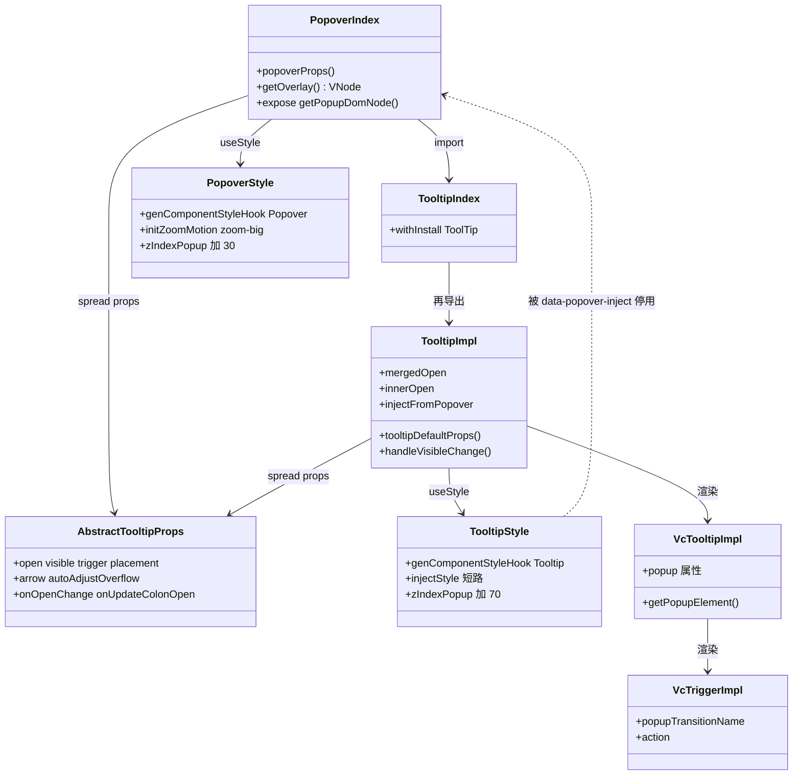
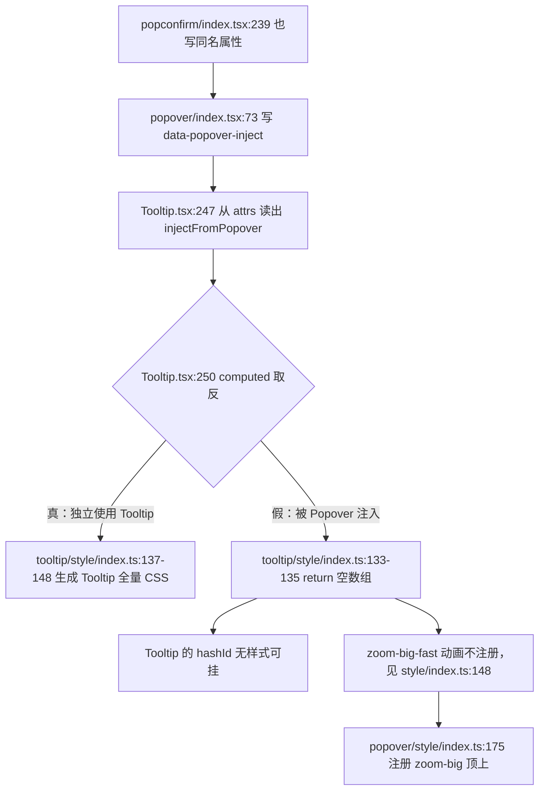
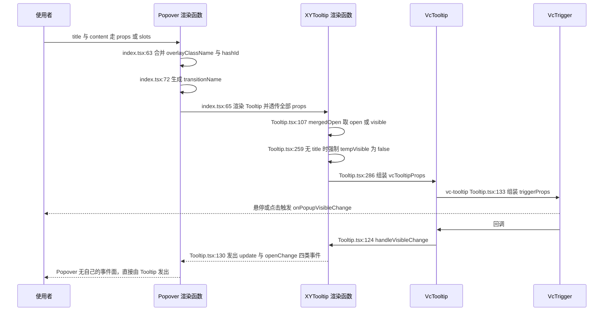
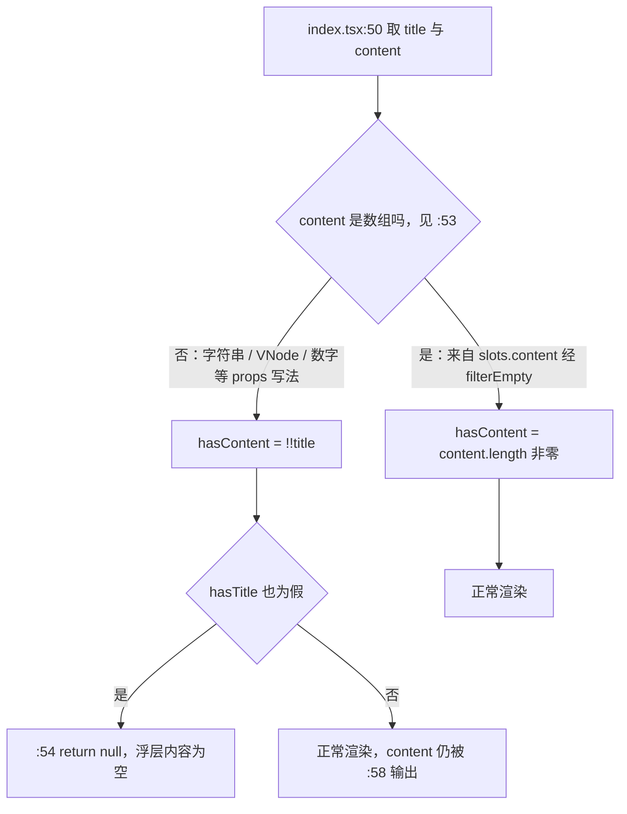

# C07-04 Popover 气泡卡片

> **本篇解决**：只有 80 行的 `popover/index.tsx` 到底接管了 Tooltip 的哪些点，剩下的浮层行为又归谁。
> **前置**：C07-03 Tooltip 文字提示、C07-00 类横写：Modal/Drawer/Popover/Tooltip 的浮层生命周期归一　**读者坐标**：`03-components/07-feedback` 第 4/10 篇

## 一、职责与边界

`popover/index.tsx` 全文 80 行，没有自己的状态 `ref`、没有一段定位计算、没有一次 DOM 操作。它负责的事情只有三件：把 `title`/`content` 装配成一块带类名的浮层内容（`packages/xiaoye-ui/src/popover/index.tsx:49-61`）、把 Tooltip 的样式命名空间改写成 `xy-popover`（`packages/xiaoye-ui/src/popover/index.tsx:46`、`packages/xiaoye-ui/src/popover/index.tsx:68`）、把 Tooltip 自己的 CSS 关掉（`packages/xiaoye-ui/src/popover/index.tsx:73`）。除此之外的一切——显示隐藏状态、延迟计时、placement 计算与翻转、portal 挂载、焦点与禁用态兼容、进出场动画的驱动——Popover 一律不做，全部由 `tooltip/Tooltip.tsx` 和它下面的 `vc-tooltip`/`vc-trigger` 承担。浮层生命周期在四类组件里如何归一为两条栈，C07-00《类横写：Modal/Drawer/Popover/Tooltip 的浮层生命周期归一》已经给出结论，本篇不重复论证，只把镜头拉近到 Popover 这一层**接管了什么、代价是什么**。

明确不负责清单（都有源码依据）：

- **不负责开合状态**。`popover/index.tsx:34-45` 的 setup 里唯一的 `ref` 是 `tooltipRef`（`packages/xiaoye-ui/src/popover/index.tsx:35`），用于转发 `getPopupDomNode`；`open`/`visible` 一路原样透传（`packages/xiaoye-ui/src/popover/index.tsx:66`），真正的状态机在 `packages/xiaoye-ui/src/tooltip/Tooltip.tsx:107-118`。
- **不负责定位**。`builtinPlacements`/`align`/`autoAdjustOverflow` 都是透传项（`packages/xiaoye-ui/src/tooltip/abstractTooltipProps.ts:44-50`），Popover 自己不碰 `_util/placements.ts`。
- **不负责层级**。`zIndexPopup` 由 `packages/xiaoye-ui/src/popover/style/index.ts:178-180` 的组件 Token 决定（`zIndexPopupBase + 30`），和 Tooltip 的 `+70`（`packages/xiaoye-ui/src/tooltip/style/index.ts:150-153`）是两套数，Popover 侧没有 `zIndexManager` 调用。
- **不负责无障碍语义**。`role="tooltip"` 是写死在 `packages/xiaoye-ui/src/vc-tooltip/src/Content.tsx:22` 的，Popover 没有覆盖它的入口。

依赖清单（被谁依赖 / 依赖谁）：

- 依赖：`../tooltip`（`packages/xiaoye-ui/src/popover/index.tsx:3`）、`../tooltip/abstractTooltipProps`（`packages/xiaoye-ui/src/popover/index.tsx:4`）、`../tooltip/Tooltip` 的 `tooltipDefaultProps`（`packages/xiaoye-ui/src/popover/index.tsx:10`）、`./style`（`packages/xiaoye-ui/src/popover/index.tsx:11`），以及 `_util` 的 `filterEmpty`/`initDefaultProps`/`anyType`/`withInstall`/`omit`/`getTransitionName`/`classNames`/`warning`（`packages/xiaoye-ui/src/popover/index.tsx:13-13`）。
- 被依赖：源码内两处直接组件级引用——`packages/xiaoye-ui/src/popconfirm/index.tsx:3` 与 `packages/xiaoye-ui/src/avatar/Group.tsx:4`；包级出口是 `packages/xiaoye-ui/src/components.ts:250-252`。Popconfirm 如何在 Popover 之上再加一层，属于 C07-05 Popconfirm 气泡确认 的范围，本篇只登记「Popconfirm 渲染的是 `<Popover` 而不是 `<Tooltip`」这条事实（`packages/xiaoye-ui/src/popconfirm/index.tsx:229`）。

## 二、源码地图

| 文件 | 行数 | 职责 | 关键导出 / 接管点 |
| --- | --- | --- | --- |
| `packages/xiaoye-ui/src/popover/index.tsx` | 80 | 主实现（无 `Popover.tsx` 拆分，入口即实现） | `popoverProps`（`:15-19`）、`PopoverProps`（`:21`）、`withInstall` 包装的默认导出（`:80`） |
| `packages/xiaoye-ui/src/popover/style/index.ts` | 182 | CSS-in-JS 样式与组件 Token | `genComponentStyleHook('Popover', …)`（`:160-182`）、`zoom-big` 动画注册（`:175`） |
| `packages/xiaoye-ui/src/popover/index.test.js` | 46 | 唯一的测试文件 | `mountTest` 空实例（`:7-15`）、`trigger="click"` 下 `getPopupDomNode` 由 `null` 变节点（`:16-45`） |
| `packages/xiaoye-ui/src/tooltip/index.ts` | 14 | Popover 的 import 目标 | `withInstall(ToolTip)`（`:14`） |
| `packages/xiaoye-ui/src/tooltip/Tooltip.tsx` | 319 | 被复用的引擎 | `tooltipDefaultProps`（`:59-67`）、`data-popover-inject` 读取（`:247`） |
| `packages/xiaoye-ui/src/tooltip/abstractTooltipProps.ts` | 58 | Popover props 的来源 | `open`/`visible`/`trigger` 等（`:22-58`） |
| `packages/xiaoye-ui/src/tooltip/style/index.ts` | 157 | 可被 Popover 关掉的样式 | `injectStyle` 短路（`:128-135`） |
| `packages/xiaoye-ui/src/vc-tooltip/src/Content.tsx` | 29 | 提供 `-inner` 外壳与 `role` | `-inner`（`:20`）、`role="tooltip"`（`:22`） |

组件目录里**没有** `popoverTypes.ts`、没有 `usePopover.ts`、没有 `demo/`。`popoverProps` 就地定义在 `index.tsx:15-19`，两行 spread 加两个 `anyType()` 字段，这是本组件全部的类型面；属性清单见 [apps/docs/components/popover.md](../../../apps/docs/components/popover.md)，本篇不复述。主实现入口的渲染函数在 `packages/xiaoye-ui/src/popover/index.tsx:62-76`，其中 `:65` 那一行 `<Tooltip` 就是本篇全部讨论的支点。

## 三、架构与数据流

图 1 是静态结构。Popover 只有一个实现文件，它在依赖图上的位置是「Tooltip 的调用方」而非「Tooltip 的兄弟」，这一点从 import 语句就能定死（`packages/xiaoye-ui/src/popover/index.tsx:3-10`）：三条来自 `../tooltip*` 的导入 + 一条来自 `./style`。箭头方向决定了改动的传导范围——改 `tooltip/Tooltip.tsx` 会同时改 Tooltip 与 Popover 两个公开组件的行为，反向不成立。



`TooltipStyle ..> PopoverIndex` 那条虚线是全篇最不显眼、后果最大的边：Tooltip 的样式生成函数被 Popover 传出的一个属性整体短路，图 2 单独画这条判定链。

图 2 是样式开关的判定流。注意判定发生在**每次渲染**，不是挂载时一次。



`injectStyle?.value === false` 是**严格等于 false**（`packages/xiaoye-ui/src/tooltip/style/index.ts:133`），而传进来的值恰好是 `!injectFromPopover.value` 的布尔取反（`packages/xiaoye-ui/src/tooltip/Tooltip.tsx:248-251`），所以这条链依赖「无值 JSX 属性编译成真值」这个前提。有构建产物时可自己复核编译形态，`dist` 是本地产物、不作为源码依据：

```bash
grep -n '"data-popover-inject"' packages/xiaoye-ui/dist/popover.mjs
# 产物里是 "data-popover-inject": true
```

若这个属性在源码里写成 `data-popover-inject={''}`，空字符串是 falsy，`injectStyle` 立刻变回 `true`，短路失效。

图 3 是完整闭环：props 如何进来、状态在谁手里、事件如何回流。Popover 这一段几乎全是直线，唯一的分支发生在 Tooltip 内部。



数据流里有三个「Popover 不做、Tooltip 替它做」的关键落差。第一，`transitionName` 在 `packages/xiaoye-ui/src/popover/index.tsx:72` 算好之后，进入 Tooltip 的 `props.transitionName`（声明位置 `packages/xiaoye-ui/src/tooltip/abstractTooltipProps.ts:29`），但 Tooltip 在 `packages/xiaoye-ui/src/tooltip/Tooltip.tsx:300-304` 又拿它调了一次 `getTransitionName`——因为第三参优先级最高（`packages/xiaoye-ui/src/_util/components/transition.tsx:123-125`），Popover 的值原样胜出，Tooltip 自己的 `zoom-big-fast` 默认值被跳过。第二，Popover 没有 `emits` 声明（`packages/xiaoye-ui/src/popover/index.tsx:23-33` 里没有 emits 字段，Tooltip 的那行也还是注释状态，见 `packages/xiaoye-ui/src/tooltip/Tooltip.tsx:88`），所以 `openChange`/`update:open` 全部由 Tooltip 的 `emit` 发出（`packages/xiaoye-ui/src/tooltip/Tooltip.tsx:130-133`），Popover 只是把回调 props 透传下去。第三，`packages/xiaoye-ui/src/popover/index.tsx:66` 的 `omit(props, ['title', 'content'])` 把这两个名字从透传面上挖掉了——但它们仍然是 Popover 自己声明过的 props（`packages/xiaoye-ui/src/popover/index.tsx:17-18`），所以不会以 attrs 身份漏进 Tooltip。这条「声明但不转发」的通道是 Popover 能把内容改写成 DOM 结构的原因。

## 四、核心机制精读

### 论点 1：Popover 不复制 Tooltip 的样式，而是把 Tooltip 的类名前缀夺走

断言：`index.tsx:68` 那一行 `prefixCls={prefixCls.value}` 是全组件最关键的一行——它让 Tooltip 内部所有 `${prefixCls.value}-*` 的拼接产物从 `xy-tooltip-*` 变成 `xy-popover-*`，于是同一份渲染代码生成的 DOM 直接命中 Popover 自己那套 CSS-in-JS 选择器。

```tsx
// packages/xiaoye-ui/src/popover/index.tsx:46-48
    const { prefixCls, configProvider } = useConfigInject('popover', props);
    const [wrapSSR, hashId] = useStyle(prefixCls);
    const rootPrefixCls = computed(() => configProvider.getPrefixCls());
```

```tsx
// packages/xiaoye-ui/src/popover/index.tsx:62-71
    return () => {
      const overlayCls = classNames(props.overlayClassName, hashId.value);
      return wrapSSR(
        <Tooltip
          {...omit(props, ['title', 'content'])}
          {...attrs}
          prefixCls={prefixCls.value}
          ref={tooltipRef}
          overlayClassName={overlayCls}
```

`useConfigInject('popover', props)` 的前缀计算只有一行：

```ts
// packages/xiaoye-ui/src/config-provider/hooks/useConfigInject.ts:14
  const prefixCls = computed(() => configProvider.getPrefixCls(name, props.prefixCls));
```

第二参 `props.prefixCls` 存在时直接胜出，`name`（这里的 `'popover'`）只是没有显式传入时的默认拼接名。所以 Popover 拿到的 `prefixCls.value` 是 `xy-popover`（或使用者显式写的 `prefixCls`）。这个值随后作为 **prop** 交给 Tooltip，而 Tooltip 自己那行 `useConfigInject('tooltip', props)` 走的是同一个函数、同一条优先级规则：

```tsx
// packages/xiaoye-ui/src/tooltip/Tooltip.tsx:103-106
    const { prefixCls, getPopupContainer, direction, rootPrefixCls } = useConfigInject(
      'tooltip',
      props,
    );
```

`'tooltip'` 这个 name 传进去但基本不起作用——`props.prefixCls` 已经是 `xy-popover`。这就是「接管」的确切含义：**Popover 没有让 Tooltip 少跑一行代码，只是让它的字符串参数变了**。于是 Tooltip 内部这些拼接全部改名：`${prefixCls.value}-open`（`packages/xiaoye-ui/src/tooltip/Tooltip.tsx:269`）、`${prefixCls.value}-rtl`（`packages/xiaoye-ui/src/tooltip/Tooltip.tsx:275`）、`${prefixCls.value}-arrow-content`（`packages/xiaoye-ui/src/tooltip/Tooltip.tsx:310`）、`${prefixCls.value}-disabled-compatible-wrapper`（`packages/xiaoye-ui/src/tooltip/Tooltip.tsx:205`），以及底层 `vc-tooltip` 的 `${prefixCls}-inner`（`packages/xiaoye-ui/src/vc-tooltip/src/Content.tsx:20`）和 `${prefixCls}-arrow`（`packages/xiaoye-ui/src/vc-tooltip/src/Tooltip.tsx:50`）。Popover 的样式文件必须把这些名字全都定义出来，它确实定义了：`popover/style/index.ts:56-58` 的 `&-hidden`、`:64-70` 的 `-inner`、`:72-77` 的 `-title`、`:79-81` 的 `-inner-content`、`:52-54` 的 `&-rtl`，而 `-arrow` 交给 `popover/style/index.ts:86` 的 `getArrowStyle(token, …)`。

还有一个更隐蔽的后果。样式生成器里 `componentCls` 是从传进去的 prefixCls 直接拼出来的：

```ts
// packages/xiaoye-ui/src/theme/util/genComponentStyleHook.ts:87
        const componentCls = `.${prefixCls.value}`;
```

Tooltip 的 `useStyle` 拿到 `prefixCls = 'xy-popover'`（因为它就是这么被传进来的），所以 **Tooltip 的样式函数如果照常执行，它生成的全部选择器前缀就是 `.xy-popover`**，和 Popover 自己那套选择器直接撞车——同一个 `.xy-popover` 上会出现 Tooltip 的深色背景与 250px 最大宽度（`packages/xiaoye-ui/src/tooltip/style/index.ts:141-144`）。这解释了论点 2 里那个开关为什么是必需的，而不是「省点体积」的优化。

结论回扣：Popover 的复用不是「组合」，是**在同一实例上换命名空间**。代价是 Popover 与 Tooltip 的类名契约没有类型系统保护，只有字符串相等关系——两边任何一处改名，另一边静默失效。

### 论点 2：`data-popover-inject` 是关 Tooltip 样式的开关，不是给 CSS 用的属性

C07-03 已经证明这个属性的读取端在 `tooltip/Tooltip.tsx:247`、写入端是 `popover/index.tsx:73` 的无值 JSX 属性。本篇接上它的下半段：**这个属性唯一的作用是让 Tooltip 的样式生成函数返回空数组**。

```tsx
// packages/xiaoye-ui/src/tooltip/Tooltip.tsx:246-251
    const colorInfo = computed(() => parseColor(prefixCls.value, props.color));
    const injectFromPopover = computed(() => (attrs as any)['data-popover-inject']);
    const [wrapSSR, hashId] = useStyle(
      prefixCls,
      computed(() => !injectFromPopover.value),
    );
```

`useStyle` 的第二个参数一路传到样式文件：

```ts
// packages/xiaoye-ui/src/tooltip/style/index.ts:128-135
export default (prefixCls: Ref<string>, injectStyle: Ref<boolean>): UseComponentStyleResult => {
  const useOriginHook = genComponentStyleHook(
    'Tooltip',
    token => {
      // Popover use Tooltip as internal component. We do not need to handle this.
      if (injectStyle?.value === false) {
        return [];
      }
```

判定用的是严格 `=== false`，与 `Tooltip.tsx:250` 的布尔取反配成一对：`injectFromPopover` 真 → `injectStyle` 假 → 短路生效。文件里那句上游注释（`packages/xiaoye-ui/src/tooltip/style/index.ts:132`）把这个意图写得很直白。短路一旦生效，被干掉的不只是 `genTooltipStyle(TooltipToken)`，还有同一个 return 里的动画注册：

```ts
// packages/xiaoye-ui/src/tooltip/style/index.ts:148
      return [genTooltipStyle(TooltipToken), initZoomMotion(token, 'zoom-big-fast')];
```

这就是「Tooltip 的 `zoom-big-fast` 不会污染 Popover」的机制来源，也是论点 4 里 Popover 必须自带 `zoom-big` 的原因。

需要精确划界的地方是**它没有关掉什么**。`return []` 只是 styleFn 的返回值，注册流程照走：

```ts
// packages/xiaoye-ui/src/theme/util/genComponentStyleHook.ts:107-108
        flush(component, mergedComponentToken);
        return [genCommonStyle(token.value, prefixCls.value), styleInterpolation];
```

也就是说 Tooltip 那次 `useStyle` 调用依然会以 `xy-popover` 为前缀注册一次通用样式（`packages/xiaoye-ui/src/style/index.ts:105-114` 的 `[class^="xy-popover"]` 属性选择器族，给字体与 `box-sizing`），只是注册路径不同（`packages/xiaoye-ui/src/theme/util/genComponentStyleHook.ts:74` 的 `path: [component, prefixCls, iconPrefixCls]` 里 `component` 一个是 `'Tooltip'` 一个是 `'Popover'`），而缓存键把 path 拼进哈希（`packages/xiaoye-ui/src/_util/cssinjs/hooks/useStyleRegister/index.tsx:331`），因此同一份 common 样式会以两个键各登记一次。返回给组件的 `hashId` 也不受 `component` 影响——它来自 `useToken()`（`packages/xiaoye-ui/src/theme/util/genComponentStyleHook.ts:49`，原样在 `:110` 返回），所以 Popover 与 Tooltip 在这一轮拿到的是同一个 hash 字符串。

顺带确认这个 flag 的写入面。全仓 `src` 下（排除 `dist`、`node_modules`）该标识符只出现三行：

```bash
grep -rn "data-popover-inject" packages apps --include='*.ts' --include='*.tsx' --include='*.vue' | grep -v dist
# tooltip/Tooltip.tsx:247  读取
# popover/index.tsx:73     写入
# popconfirm/index.tsx:239 写入
```

Popconfirm 自己也写了一遍（`packages/xiaoye-ui/src/popconfirm/index.tsx:239`），但它是写在 `<Popover` 上（`packages/xiaoye-ui/src/popconfirm/index.tsx:229`），而 Popover 因为 `inheritAttrs: false`（`packages/xiaoye-ui/src/popover/index.tsx:26`）+ 渲染时 `{...attrs}`（`packages/xiaoye-ui/src/popover/index.tsx:67`）会把 attrs 原样抬给 Tooltip，所以 Popconfirm 那一次其实是**多余但无害**的：Popover 自己在 `:73` 已经写死了同一个属性，且 `:73` 在 `{...attrs}` 之后，值一致所以顺序不产生冲突。也就是说 Popover 同时是这个 flag 的**生产者和中继器**。

结论回扣：这个属性名叫 `data-*`，长得像 DOM 钩子，但它从不进入 DOM——它在 `Tooltip.tsx:247` 就被消化成样式开关。任何「想给 Popover 浮层加个 data 属性做测试锚点」的想法都会撞上这条：只有 `data-popover-inject` 这一个名字被截了。

### 论点 3：`getOverlay` 是 Popover 唯一的 DOM 产出，它和 Tooltip 的 `title` 判定语义互相矛盾

断言：Popover 只产出 `-title` 和 `-inner-content` 两个节点（`packages/xiaoye-ui/src/popover/index.tsx:57-58`），其余外壳（`-inner`、`-arrow`、`-content`、根类名）全都由 Tooltip 之下、Popover 不可见的三层提供；而它「props 优先于 slot」的取值写法，与 Tooltip 用来拦截空浮层的 `isNoTitle()` 判定不在同一套语义上，导致 Popover 失去「内容为空就不弹」的保护。

```tsx
// packages/xiaoye-ui/src/popover/index.tsx:49-61
    const getOverlay = () => {
      const { title = filterEmpty(slots.title?.()), content = filterEmpty(slots.content?.()) } =
        props;
      const hasTitle = !!(Array.isArray(title) ? title.length : title);
      const hasContent = !!(Array.isArray(content) ? content.length : title);
      if (!hasTitle && !hasContent) return null;
      return (
        <>
          {hasTitle && <div class={`${prefixCls.value}-title`}>{title}</div>}
          <div class={`${prefixCls.value}-inner-content`}>{content}</div>
        </>
      );
    };
```

逐段看。第一，解构默认值 `title = filterEmpty(slots.title?.())` 只在 `props.title === undefined` 时生效，这是「props 压 slot」的实现点，也是全组件唯一一处内容取值逻辑。`filterEmpty` 的签名带默认参 `children = []`（`packages/xiaoye-ui/src/_util/props-util/index.ts:230`），所以 slot 缺席时它返回空数组而不是 `undefined`，于是下一行的 `Array.isArray(title) ? title.length : title` 走数组分支得到 `0` → `hasTitle` 为假。这两行是配套写的：`Array.isArray` 分支就是为 `filterEmpty` 的返回值准备的。

第二，`:53` 的三元表达式 `Array.isArray(content) ? content.length : title` 在非数组分支里读的是 **`title`**，不是 `content`。这是一个源码层面的笔误，客观存在于 `packages/xiaoye-ui/src/popover/index.tsx:53`。后果按分支拆开：



也就是说：**只用 `content` prop、不给 `title`** 的用法（`<xy-popover content="纯文本" />`）会走到 `:54` 返回 `null`。而 `:58` 那一行并没有被跳过——它只是拿到一个空插槽内容，因为 `getOverlay` 整体返回了 `null`。这里必须说清我证到了什么、没证到什么：`hasContent` 取错变量、数组分支与非数组分支语义不一致，是从源码直接读出的事实；「用户看到一个空白气泡」这一步依赖 PopupInner 始终渲染 `-inner` 外壳（`packages/xiaoye-ui/src/vc-tooltip/src/Content.tsx:19-26` 无条件返回这个 div）加上论点 6 要讲的 `isNoTitle` 失效，我没有跑浏览器验证实际像素，也没有测试覆盖这条分支（`packages/xiaoye-ui/src/popover/index.test.js:21-28` 用的例子同时给了 `title` 和 `content`）。

第三，返回的是 Fragment（`:56`），没有自己的根元素。根类名不由 Popover 决定：`overlayClassName`（`:63` 合并过 hashId）经 `packages/xiaoye-ui/src/tooltip/Tooltip.tsx:272-280` 拼上 rtl 与色值类，再由 `packages/xiaoye-ui/src/vc-tooltip/src/Tooltip.tsx:110` 变成 `popupClassName`，在 `packages/xiaoye-ui/src/vc-trigger/Trigger.tsx:432` 落到 `class`，最终与 `prefixCls` 一起合并进 `packages/xiaoye-ui/src/vc-trigger/Popup/PopupInner.tsx:175-180`。`${componentCls}-content`（`packages/xiaoye-ui/src/popover/style/index.ts:60-62`）也不是 Popover 产的，它是 PopupInner 在子节点多于一个时的包裹层（`packages/xiaoye-ui/src/vc-trigger/Popup/PopupInner.tsx:171-173`）——`arrow` 为真时 `getPopupElement()` 返回箭头加内容两个节点（`packages/xiaoye-ui/src/vc-tooltip/src/Tooltip.tsx:48-61`），所以这个类只在带箭头的浮层上出现。

第四，样式侧唯一硬要求的结构是两级：`-inner` 给背景与 12px 内边距（`packages/xiaoye-ui/src/popover/style/index.ts:64-70`，`popoverPadding: 12` 见 `:168`），`-title` 给 177px 最小宽度（`packages/xiaoye-ui/src/popover/style/index.ts:72-77`，`width: 177` 见 `:180`）。`minWidth` 落在标题上而不是浮层上，意味着**没有标题时 Popover 不保证 177px 宽度**——`title` 缺席时 `-title` 节点整个不渲染（`:57` 的 `hasTitle &&`），宽度就只由内容撑开。

结论回扣：`getOverlay` 与 Tooltip 的 `title` 语义分歧（论点 6）加上 `:53` 的分支笔误（本论点），共同构成「Popover 的内容契约只在带标题的常规用法下成立」。

### 论点 4：动画是两个文件之间的一对字符串契约，没有任何机制保证它们同步

断言：`index.tsx:72` 把动画名硬编码成 `'zoom-big'`，`style/index.ts:175` 又把 `zoom-big` 的 keyframes 注册一遍，两者靠字面量相等连接；一旦只改一边，表现是动画静默消失，没有报错也没有类型错误。

```tsx
// packages/xiaoye-ui/src/popover/index.tsx:71-72
          v-slots={{ title: getOverlay, default: slots.default }}
          transitionName={getTransitionName(rootPrefixCls.value, 'zoom-big', props.transitionName)}
```

```ts
// packages/xiaoye-ui/src/popover/style/index.ts:171-176
    return [
      genBaseStyle(popoverToken),
      genColorStyle(popoverToken),
      wireframe && genWireframeStyle(popoverToken),
      initZoomMotion(popoverToken, 'zoom-big'),
    ];
```

`getTransitionName` 的规则只有一条优先级：

```ts
// packages/xiaoye-ui/src/_util/components/transition.tsx:122-127
const getTransitionName = (rootPrefixCls: string, motion: string, transitionName?: string) => {
  if (transitionName !== undefined) {
    return transitionName;
  }
  return `${rootPrefixCls}-${motion}`;
};
```

注意 `rootPrefixCls` 在这里是**根前缀**而不是组件前缀：`index.tsx:48` 的 `configProvider.getPrefixCls()` 无参调用取的是全局根（默认 `xy`），与 `useConfigInject` 里那行同名计算完全一致（`packages/xiaoye-ui/src/config-provider/hooks/useConfigInject.ts:17`），Popover 只是没去解构它而是自己又写了一遍。拼出的字符串因此是 `xy-zoom-big`。CSS 侧：

```ts
// packages/xiaoye-ui/src/style/motion/zoom.ts:190-204
export const initZoomMotion = (
  token: TokenWithCommonCls<AliasToken>,
  motionName: ZoomMotionTypes,
): CSSInterpolation => {
  const { rootCls } = token;
  const motionCls = `${rootCls}-${motionName}`;
  const { inKeyframes, outKeyframes } = zoomMotion[motionName];

  return [
    initMotion(
      motionCls,
      inKeyframes,
      outKeyframes,
      motionName === 'zoom-big-fast' ? token.motionDurationFast : token.motionDurationMid,
    ),
```

`rootCls` 由样式生成器注入，值是带点的根选择器（`packages/xiaoye-ui/src/theme/util/genComponentStyleHook.ts:96`），拼出来的选择器 `.xy-zoom-big-enter` 正好等于 Vue `<Transition>` 用的类名——因为 `getTransitionProps` 就是按 `${transitionName}-enter` 这类模板拼的（`packages/xiaoye-ui/src/_util/components/transition.tsx:30-35`），而 `vc-trigger` 拿到 `transitionName` 后不再加任何前缀（`packages/xiaoye-ui/src/vc-trigger/utils/motionUtil.ts:16-20`，落地在 `packages/xiaoye-ui/src/vc-trigger/Popup/PopupInner.tsx:182`）。这条链上任何一环加了前缀，动画就废掉，所以它是**约定而非机制**。

时长差异是唯一写在代码里的产品判断：`zoom.ts:203` 让 `zoom-big-fast` 用 `motionDurationFast`，其余（含 `zoom-big`）用 `motionDurationMid`。而 `zoom-big` 与 `zoom-big-fast` 的 keyframes 完全相同（`packages/xiaoye-ui/src/style/motion/zoom.ts:164-171`，两者都指向 `zoomBigIn`/`zoomBigOut`）。所以 Popover 与 Tooltip 动画的**唯一实际差别就是时长**，缩放曲线一模一样——这一点很容易被误读成「Popover 换了套动画」。

还要接回论点 2：Popover 的 `zoom-big` 不是锦上添花。Tooltip 的 `zoom-big-fast` 注册在 `tooltip/style/index.ts:148` 同一个 return 里，被 `data-popover-inject` 短路整体跳过；如果 `popover/style/index.ts:175` 这行不存在，Popover 的浮层将没有任何进出场动画。两处字面量必须同时存在，但没有任何测试断言过这种配对（`packages/xiaoye-ui/src/popover/index.test.js` 全文 46 行没有涉及 transition 名）。

### 论点 5：Popover 的默认值全部继承自 Tooltip，四处显式重写没有改变任何一个值

断言：`index.tsx:27-33` 看着像「Popover 定义了自己的默认行为」，实际上把 `tooltipDefaultProps()` 摊开对比，四条显式值的字面量与继承来的完全相同；真正生效的默认值只有 `align`、`arrowPointAtCenter`、`autoAdjustOverflow` 三项，而它们全部是 Tooltip 的。

```tsx
// packages/xiaoye-ui/src/popover/index.tsx:27-33
  props: initDefaultProps(popoverProps(), {
    ...tooltipDefaultProps(),
    trigger: 'hover',
    placement: 'top',
    mouseEnterDelay: 0.1,
    mouseLeaveDelay: 0.1,
  }),
```

```tsx
// packages/xiaoye-ui/src/tooltip/Tooltip.tsx:59-67
export const tooltipDefaultProps = () => ({
  trigger: 'hover',
  align: {},
  placement: 'top',
  mouseEnterDelay: 0.1,
  mouseLeaveDelay: 0.1,
  arrowPointAtCenter: false,
  autoAdjustOverflow: true,
});
```

`trigger: 'hover'`、`placement: 'top'`、两个 `0.1` 在两份清单里逐字相等（`Tooltip.tsx:60`、`:62`、`:63`、`:64`）。所以 Popover 相对 Tooltip 的默认行为差异是**零**。这在设计上是合理的——气泡卡片默认悬停即出、默认朝上，和 Tooltip 一致——但它在源码里留下一个陷阱：想给 Popover 单独改默认值的人，如果只改 `index.tsx:29-32`，会以为自己改完了，实际改不动继承来的 `align`（`Tooltip.tsx:61`）；而如果改了 `tooltipDefaultProps()`，Popover 与 Tooltip 会同时变，因为两者共用同一个函数（`packages/xiaoye-ui/src/popover/index.tsx:10` 的 import 就是这条共用的证明）。

默认值落到 props 描述符上的机制值得一提，因为它有一条隐藏的失败路径：

```ts
// packages/xiaoye-ui/src/_util/props-util/initDefaultProps.ts:16-31
  const propTypes: T = { ...types };
  Object.keys(defaultProps).forEach(k => {
    const prop = propTypes[k] as VueTypeValidableDef;
    if (prop) {
      if (prop.type || prop.default) {
        prop.default = defaultProps[k];
      } else if (prop.def) {
        prop.def(defaultProps[k]);
      } else {
        propTypes[k] = { type: prop, default: defaultProps[k] };
      }
    } else {
      throw new Error(`not have ${k} prop`);
    }
  });
  return propTypes;
```

`trigger` 在 `packages/xiaoye-ui/src/tooltip/abstractTooltipProps.ts:23` 声明成裸构造器数组 `[String, Array]`，既没有 `type` 也没有 `default`，因此走 `:25` 那条 else 分支被包成 `{ type, default }`。而 `:21` 那条分支是**原地改对象**——它改的是 `abstractTooltipProps()` 这次调用新建的描述符，因为 `popoverProps()`（`packages/xiaoye-ui/src/popover/index.tsx:15-19`）每次都会重新执行 spread，所以不会跨实例污染。反过来说，`initDefaultProps` 的 `throw new Error` 在 `:28`：默认值字典里写了 props 面上不存在的 key 会在**定义阶段**直接抛错，这正是为什么 `index.tsx:28` 只能 spread `tooltipDefaultProps()` 而不能额外塞新名字。

第二个接管层次是转发顺序。`index.tsx:65-70` 的四段展开是有序的，后者覆盖前者：

```tsx
// packages/xiaoye-ui/src/popover/index.tsx:65-70
        <Tooltip
          {...omit(props, ['title', 'content'])}
          {...attrs}
          prefixCls={prefixCls.value}
          ref={tooltipRef}
          overlayClassName={overlayCls}
```

第一段是全量 props（浅拷贝快照，`packages/xiaoye-ui/src/_util/omit.ts:1-9` 用 `Object.assign({}, obj)` 再逐 key `delete`），第二段 attrs、第三到第五段是 Popover 的三个「不许你改」项。于是优先级是：**Popover 写死的 prefixCls / ref / overlayClassName > 使用者透传的属性（attrs）> Popover 自己声明的 props**。具体后果有两条：使用者写在 `<xy-popover>` 上的 `class`、`style`、`data-*` 因为 `inheritAttrs: false`（`packages/xiaoye-ui/src/popover/index.tsx:26`）不会落在触发元素上自动合并，而是经 `attrs` 抬给 Tooltip，再经 `packages/xiaoye-ui/src/tooltip/Tooltip.tsx:287` 的 `{...attrs}` 继续下传到 `vc-tooltip`；而使用者想用 `overlayClassName` 覆盖 Popover 的 hashId 合并是不可能的，因为它声明在 props 里（`packages/xiaoye-ui/src/tooltip/abstractTooltipProps.ts:32`），只会走第一段，然后在第五段被 `:63` 的合并结果覆盖——这个覆盖是**加法**（`classNames(props.overlayClassName, hashId.value)`），用户的类名保留，`avatar/Group.tsx:78` 就是这样传 `-popover` 后缀类名还能生效的原因。

另外 `omit(props, …)` 每次渲染都会触碰全部 props 的 getter，因此 render effect 订阅了 Popover 的每一个 prop——任何一个 props 变化都会重跑 `:62-76`。这在组件极小时无所谓，但它是「透传式复用」的固有代价：没有精确依赖。

### 论点 6：Popover 一个状态都不持有，代价是丢掉 Tooltip 的空内容保护

断言：`index.tsx:34-45` 里 Popover 的 setup 只做三件事（拿 ref、发一条 deprecation 警告、取 prefixCls），开合状态完全在 Tooltip；而 Tooltip 用来「没内容就不弹」的 `isNoTitle()` 判定，在 Popover 的注入方式下**恒为「有内容」**。

```tsx
// packages/xiaoye-ui/src/tooltip/Tooltip.tsx:119-122
    const isNoTitle = () => {
      const title = props.title ?? slots.title;
      return !title && title !== 0;
    };
```

```tsx
// packages/xiaoye-ui/src/tooltip/Tooltip.tsx:257-261
      let tempVisible = innerOpen.value;
      // Hide tooltip when there is no title
      if (mergedOpen.value === undefined && isNoTitle()) {
        tempVisible = false;
      }
```

Popover 在 `packages/xiaoye-ui/src/popover/index.tsx:66` 把 `title` 从 props 面上删掉，又在 `packages/xiaoye-ui/src/popover/index.tsx:71` 用 `v-slots={{ title: getOverlay, … }}` 把 `getOverlay` **函数**塞进 Tooltip 的 title 插槽。于是 `:120` 的 `props.title ?? slots.title` 必然落在 `slots.title` 上，而它是个函数对象——truthy，`!title` 为假，`isNoTitle()` 返回 `false`。`:259` 那道闸门对 Popover 永远不关，`:124-135` 的 `handleVisibleChange` 里 `noTitle` 也永远是 `false`，所以事件照常外发。Tooltip 的「空标题不弹」语义在 Popover 上不存在，无论 `getOverlay` 返回 `null` 还是内容。

状态本身全在 Tooltip 这一段：

```tsx
// packages/xiaoye-ui/src/tooltip/Tooltip.tsx:107-118
    const mergedOpen = computed(() => props.open ?? props.visible);
    const innerOpen = ref(firstNotUndefined([props.open, props.visible]));

    const tooltip = ref();

    let rafId: any;
    watch(mergedOpen, val => {
      raf.cancel(rafId);
      rafId = raf(() => {
        innerOpen.value = !!val;
      });
    });
```

受控与非受控共用一条通道：`mergedOpen`（`:107`）决定外部是否有值，`innerOpen`（`:108`）是唯一真正驱动渲染的状态，外部变化经过一帧 `raf` 才落地（`:113-118`），内部交互由 `handleVisibleChange` 在 `mergedOpen` 为 `undefined` 时直接写（`:126-128`）。Popover 对这些一无所知，它只在 `packages/xiaoye-ui/src/popover/index.tsx:66` 把 `open`/`visible`/`onOpenChange`/`onUpdate:open`（声明见 `packages/xiaoye-ui/src/tooltip/abstractTooltipProps.ts:24-26`、`:52-57`）原样抬过去。这就是 C07-00 那条「四类浮层其实是两条栈」结论在 Popover 上的具体形状：它连自己的状态机都没有，谈不上第三条路。

expose 面同样收窄到只剩一项：

```tsx
// packages/xiaoye-ui/src/popover/index.tsx:41-45
    expose({
      getPopupDomNode: () => {
        return tooltipRef.value?.getPopupDomNode?.();
      },
    });
```

Tooltip 暴露的是三件（`packages/xiaoye-ui/src/tooltip/Tooltip.tsx:141-145`：`getPopupDomNode`、`open`、`forcePopupAlign`），Popover 只转发第一个，而且用的是双重可选链 `tooltipRef.value?.…?.()`——Tooltip 还没挂载时返回 `undefined` 而不是抛错。`forcePopupAlign` 对 Popover 不可用，即使底层 `vc-tooltip` 有这个方法（`packages/xiaoye-ui/src/vc-tooltip/src/Tooltip.tsx:68-72`）。这条收窄直接体现在唯一的功能测试上：`packages/xiaoye-ui/src/popover/index.test.js:35` 先断言 `getPopupDomNode()` 为 `null`，点击后在 `:41` 断言它变成节点，整个 Popover 的测试面就是「透传出去的那个方法能不能拿到 DOM」。顺带注意 `Tooltip.tsx:137-139` 的 `getPopupDomNode` 内部**没有**可选链（`tooltip.value.getPopupDomNode()`），若 Popover 不用可选链调用就会在未挂载时炸，`:43` 的 `?.` 是必要的防御。

最后一条与状态相关的差异是警告。Popover 在 setup 顶层无条件调用一次 `warning`（`packages/xiaoye-ui/src/popover/index.tsx:36-40`，只针对 `visible`），Tooltip 则把两条弃用名放进 dev 判断块里循环（`packages/xiaoye-ui/src/tooltip/Tooltip.tsx:90-101`，覆盖 `visible` 与 `onVisibleChange`）。两者都安全，因为 `warning` 本身在 production 下就是 `noop`（`packages/xiaoye-ui/src/_util/warning.ts:9-19`）——但 Popover 漏了 `onVisibleChange` 这一条，它同样在 `packages/xiaoye-ui/src/tooltip/abstractTooltipProps.ts:53` 被标了 `@deprecated`。

## 五、对外契约如何生效

契约的第一环是**类型面与运行时面分离**。`popoverProps` 只有三个字段（`packages/xiaoye-ui/src/popover/index.tsx:15-19`）：spread 来的整张 Tooltip props 表，加上 `content`、`title` 两个 `anyType()`。`anyType` 的实现值得注意——它返回的描述符里**没有 `type` 字段**，只有一个恒真的 `validator`（`packages/xiaoye-ui/src/_util/type.ts:66-67`）。这意味着运行时对 `title`/`content` 不做任何收窄，字符串、数字、VNode、VNode 数组全都合法，Vue 的开发期类型告警也不会触发；`PopoverProps` 类型（`packages/xiaoye-ui/src/popover/index.tsx:21`）把这两个字段推成 `any`，所以类型检查同样放行。契约完全交给 `getOverlay` 的运行时判断兜底，也就是论点 3 里那两行 `hasTitle`/`hasContent`——这是本组件唯一「类型系统帮不上忙」的地方，也是它出错的地方。

第二环是**内容从哪来到哪去**。`title`/`content` 支持 props 与具名插槽两路，优先级为 props（`packages/xiaoye-ui/src/popover/index.tsx:50` 的解构默认值）；两者都空时 `getOverlay` 返回 `null`（`:54`）。这个函数不作为 prop 传下去，而是作为 `v-slots.title` 交给 Tooltip（`:71`），Tooltip 再把它原样交给 `vc-tooltip` 的 overlay 插槽（`packages/xiaoye-ui/src/tooltip/Tooltip.tsx:311`），最后由 `Content` 组件调用（`packages/xiaoye-ui/src/vc-tooltip/src/Content.tsx:25`）。`default` 插槽则是纯直通：`:71` 把 `slots.default` 原封不动交给 Tooltip，Tooltip 在 `packages/xiaoye-ui/src/tooltip/Tooltip.tsx:254-255` 扁平化后当作触发元素。Popover 没有 `footer`、没有 `overlay` 插槽，想自定义整块浮层内容的唯一入口就是 `content`。

第三环是**样式契约的三条出口**，它们必须同时成立，Popover 才长得像 Popover：`index.tsx:63` 把 hashId 塞进 `overlayClassName`（这是跨组件传类名的绕行手法，与 C06-04 Mentions 里跨 portal 传 hashId 的处境同源）；`index.tsx:68` 把组件前缀换成 `xy-popover`；`index.tsx:73` 关掉 Tooltip 的 CSS。三者缺一，浮层就会拿到 Tooltip 的外观或拿不到任何外观。

第四环是主题侧的契约。`genComponentStyleHook('Popover', …)`（`packages/xiaoye-ui/src/popover/style/index.ts:161`）里的字符串 `'Popover'` 就是 `ConfigProvider` 主题覆盖的 key，它对应 `packages/xiaoye-ui/src/theme/interface/components.ts:112` 的 `Popover?: PopoverComponentToken`，而该 Token 只有两项：`zIndexPopup` 与 `width`（`packages/xiaoye-ui/src/popover/style/index.ts:7-10`，默认值在 `:178-180`）。样式生成器按 `token.value[component]` 合并覆盖（`packages/xiaoye-ui/src/theme/util/genComponentStyleHook.ts:85`），所以改主题的通路是活的；反过来，因为论点 2 的短路，改 `theme.components.Tooltip` 对 Popover **不会有任何作用**——它作用的那段样式根本没生成（`packages/xiaoye-ui/src/tooltip/style/index.ts:133-135`）。

第五环是注册与导出。`withInstall(Popover)`（`packages/xiaoye-ui/src/popover/index.tsx:80`）挂上 `install`（`packages/xiaoye-ui/src/_util/type.ts:39-46`），标签名由 `name: 'XYPopover'`（`:25`）经 `toXYTagName` 推出 `xy-popover`（`packages/xiaoye-ui/src/_util/registerComponent.ts:6-11`、`:16-25`），全局类型声明在 `packages/xiaoye-ui/typings/global.d.ts:64`。包级出口是三行生成物：`packages/xiaoye-ui/src/components.ts:250-252`（聚合导出加样式副作用导入）与 `packages/xiaoye-ui/package.json:409-413` 的 `./popover`、`./popover/style` 双入口——按需引入时如果只拿 `./popover` 而不让构建链吃到样式，动画与外壳样式仍然能靠 `index.tsx:47` 的 `useStyle` 生成，但 `components.ts:276` 那种全局 side-effect 导入就没了。

事件面没有独立通道：`openChange`/`update:open`/`visibleChange`/`update:visible` 四个都由 Tooltip 发出（`packages/xiaoye-ui/src/tooltip/Tooltip.tsx:130-133`），Popover 侧一个 `emit` 都没接（它的 setup 参数列表里甚至没解构 `emit`，见 `packages/xiaoye-ui/src/popover/index.tsx:34`）。`expose` 只有 `getPopupDomNode`（`:41-45`）。

## 六、设计取舍

第一条权衡是**要不要把 Popover 独立实现**。可选项是像 Modal/Drawer 那样自建浮层栈（C07-00 已说明那是另一条栈），代价是重复实现 placement、延迟、portal、动画驱动；本库选了「借 Tooltip 的壳、换自己的名字」，收益是 80 行、零状态、浮层行为与 Tooltip 天然一致。赔上的是三件事：其一，Tooltip 的语义判断（`isNoTitle`）与 Popover 的内容模型语义不一致，且没有任何编译期约束（论点 6）；其二，两套 CSS 共享一个 `prefixCls` 变量，必须靠一个 `data-*` 属性做运行时互斥（论点 2），这个属性本身又成了公开 DOM 面上的一个保留名；其三，Popover 的可控面被 Tooltip 的形状钉死——Tooltip 暴露三个方法它就只能透传，`forcePopupAlign` 想给也得改 Tooltip 之外的代码。

第二条权衡是**样式停用靠布尔短路而不是靠 CSS 优先级或 `:where`**。替代方案是让 Popover 的样式在层叠上覆盖 Tooltip（更少的运行时耦合），但 CSS-in-JS 的 hash 类名优先级相同、顺序不可控，覆盖会不稳定。现在这个方案确定性强，代价是「一个组件的样式生成函数要知道谁在调用它」，这是分层上的反向依赖：`tooltip/style/index.ts:132` 的那句注释直接把 Popover 的知识写进了 Tooltip。

第三条权衡是**默认值与 Tooltip 共码**。`tooltipDefaultProps()` 被 Popover spread（`packages/xiaoye-ui/src/popover/index.tsx:28`）保证了两者默认行为永不漂移，代价是 Popover 无法独立调整默认值而不动 Tooltip（论点 5）。从代码现状看这个共享已经被「四处显式重写却一模一样」的形式化保留了——它更像一份可执行的文档。

第四条，`zIndexPopup` 给 Popover `+30`、给 Tooltip `+70`（`packages/xiaoye-ui/src/popover/style/index.ts:179`、`packages/xiaoye-ui/src/tooltip/style/index.ts:151`）。把文字提示排在气泡卡片之上是明确的产品判断：提示是瞬时信息，必须压得住停留更久的卡片。代价是同页面出现「Popover 里套 Tooltip」以外的组合时，层级只能靠这个常数解决，Popover 侧没有 `zIndexManager` 的动态递增参与。

## 七、坑与改动指南

**坑 1**
触发：只用 `content` prop 传内容、不传 `title`（例如 `<xy-popover content="说明文字">`）。
症状：`getOverlay` 判定「标题与内容都空」，走 `return null` 分支，浮层内容为空；气泡框本身还会弹出（坑 2 的原因）。
原因：`hasContent` 的非数组分支读的是 `title` 而不是 `content`。
定位：`packages/xiaoye-ui/src/popover/index.tsx:53`（判定点在 `:54`）。用插槽 `<template #content>` 不受影响，因为那条走 `Array.isArray` 分支（`packages/xiaoye-ui/src/_util/props-util/index.ts:230`）。该分支无测试保护——`packages/xiaoye-ui/src/popover/index.test.js:21-28` 的用例同时给了 `title` 与 `content`。

**坑 2**
触发：`title` 与 `content` 全空时 hover 或 click 触发元素。
症状：弹出一个空白气泡，而不是像 Tooltip 那样根本不弹。
原因：Popover 把 `getOverlay` 作为 `v-slots.title` 注入，Tooltip 的 `props.title ?? slots.title` 拿到的是函数对象，恒真。
定位：`packages/xiaoye-ui/src/popover/index.tsx:71` 与 `packages/xiaoye-ui/src/tooltip/Tooltip.tsx:119-122`，闸门在 `packages/xiaoye-ui/src/tooltip/Tooltip.tsx:259-261`。

**坑 3**
触发：只改 `initZoomMotion(popoverToken, 'zoom-big')` 或只改 `getTransitionName(rootPrefixCls.value, 'zoom-big', …)` 中的一处。
症状：动画静默失效（浮层直接出现/消失），无报错、无类型错误、无警告。
原因：两边靠 `xy-zoom-big` 这个字符串字面量相等连接，`vc-trigger` 不再补前缀。
定位：`packages/xiaoye-ui/src/popover/index.tsx:72`、`packages/xiaoye-ui/src/popover/style/index.ts:175`，拼接规则在 `packages/xiaoye-ui/src/style/motion/zoom.ts:195` 与 `packages/xiaoye-ui/src/_util/components/transition.tsx:122-127`，消费点 `packages/xiaoye-ui/src/vc-trigger/utils/motionUtil.ts:16-20`。

**坑 4**
触发：想通过 `ConfigProvider` 的 `theme.components.Tooltip` 统一调 Tooltip 与 Popover 的浮层外观。
症状：Popover 毫无变化；或者在 Popover 里看到了 Tooltip 的深色底与 250px 宽度限制。
原因：前者是 `data-popover-inject` 把 Tooltip 的样式生成整体短路；后者是短路失效时 Tooltip 的样式函数会以 `componentCls = .xy-popover` 生成选择器、与 Popover 自己那套撞车。
定位：`packages/xiaoye-ui/src/popover/index.tsx:73`、`packages/xiaoye-ui/src/tooltip/Tooltip.tsx:247-251`、`packages/xiaoye-ui/src/tooltip/style/index.ts:128-135`、`packages/xiaoye-ui/src/theme/util/genComponentStyleHook.ts:87`。合法的覆盖入口只有 `theme.components.Popover` 的 `zIndexPopup` 与 `width`（`packages/xiaoye-ui/src/theme/interface/components.ts:112`）。

**坑 5**
触发：想用 `data-popover-inject` 当 E2E 选择器，或指望它出现在 DOM 上。
症状：属性不存在，选择器永远选不到。
原因：它在 Tooltip 的 setup 里被当作 props 读走，同时 `inheritAttrs: false`（`packages/xiaoye-ui/src/tooltip/Tooltip.tsx:74`）决定了这族 attrs 不会自动落到 DOM。
定位：`packages/xiaoye-ui/src/tooltip/Tooltip.tsx:247`（读走）、`packages/xiaoye-ui/src/popover/index.tsx:67`（抬给 Tooltip）。另注意 `packages/xiaoye-ui/src/popconfirm/index.tsx:239` 又写了一遍同名属性，删掉它不会改变行为，因为 Popover 在 `:73` 无条件写死。

**坑 6**
触发：需要程序化重新对齐已打开的气泡（例如内容变化后重算位置）。
症状：`ref.forcePopupAlign` 不存在；`ref.open` 也不存在，只有 `getPopupDomNode`。
原因：expose 面只转发了一项，且用了双重可选链防御未挂载。
定位：`packages/xiaoye-ui/src/popover/index.tsx:41-45`，对比 `packages/xiaoye-ui/src/tooltip/Tooltip.tsx:141-145`；底层能力其实在 `packages/xiaoye-ui/src/vc-tooltip/src/Tooltip.tsx:68-72`。改动建议在 Popover 侧补转发，而不是给 `vc-*` 层加接口。

**坑 7**
触发：同页面 Popover 与 Tooltip 同时出现（例如卡片里某个图标带提示）。
症状：Tooltip 永远盖在 Popover 之上，无法通过层级互换。
原因：两层的 `zIndexPopup` 常数不同。
定位：`packages/xiaoye-ui/src/popover/style/index.ts:178-180`（`+30`）、`packages/xiaoye-ui/src/tooltip/style/index.ts:150-153`（`+70`）。

**测试现状与安全边界**。直接以 Popover 为被测对象的文件只有一个：`packages/xiaoye-ui/src/popover/index.test.js`（46 行），它被真实执行——`packages/xiaoye-ui/vitest.config.mts:33` 的 include 里有 `src/**/*.test.{js,ts,jsx,tsx}`，`.js` 在列。测试面是「空实例可挂载」加「`trigger="click"` 下 `getPopupDomNode()` 从 `null` 变节点」（`packages/xiaoye-ui/src/popover/index.test.js:7-15`、`:34-43`）。插槽优先级、`:53` 的非数组分支、`zoom-big` 配对、`data-popover-inject` 短路、四个事件的外发，全部无测试。另有一条**导出面**的快照保护在别处：包根导出名 `Popover` 被登记在 `packages/xiaoye-ui/tests/__snapshots__/index.test.js.snap:126`，改 `popoverProps`/`PopoverProps` 这类公开名字时必须一并更新该快照。改动安全区是 `index.tsx:49-61`（内容装配，纯本地）与 `:63` 的类名合并；高危区是 `:66-73` 的属性顺序（任何一行上移都会改变覆盖关系）和 `style/index.ts:175`（与 `:72` 构成不可分体的契约）。验证命令：`pnpm --filter xiaoye-ui test:unit` 加 `pnpm typecheck`。给 `popoverProps` 新增字段**不需要**跑 `pnpm gen:entries`，因为生成器扫的是目录与导出名，而 `popoverProps`/`PopoverProps` 早已在 `packages/xiaoye-ui/src/components.ts:250` 的 `export *` 覆盖范围内；但删除或改名 `popover` 目录必须跑，因为 `components.ts:274-276` 与 `package.json:468-472` 都是它的生成物。

## 附：本篇可证伪的三个检查点

1. 「`popover/index.tsx:53` 的 `hasContent` 在非数组分支读的是 `title`」——直接看原文，应输出一行、结尾是 `: title);`：

   ```bash
   sed -n '53p' packages/xiaoye-ui/src/popover/index.tsx
   ```

2. 「`data-popover-inject` 在源码里只有三处：一处读、两处写」——命令与预期条数：

   ```bash
   grep -rn "data-popover-inject" packages apps --include='*.ts' --include='*.tsx' --include='*.vue' | grep -v dist
   # 期望 3 行：tooltip/Tooltip.tsx:247、popover/index.tsx:73、popconfirm/index.tsx:239
   ```

3. 「Popover 的显式默认值与 `tooltipDefaultProps()` 完全重合」——两条命令对照，四个值应逐字相同：

   ```bash
   sed -n '27,33p' packages/xiaoye-ui/src/popover/index.tsx
   sed -n '59,67p' packages/xiaoye-ui/src/tooltip/Tooltip.tsx
   ```
