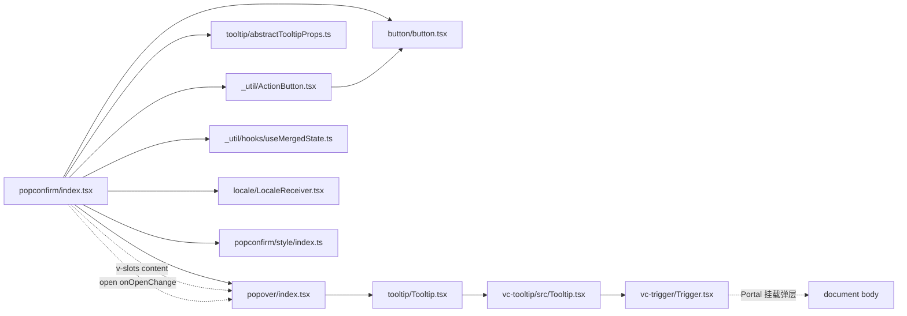
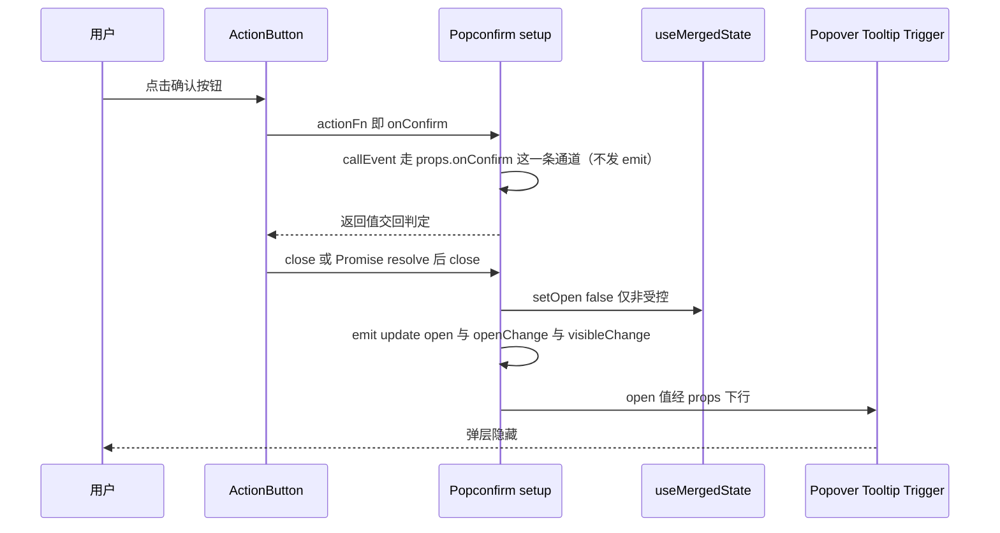
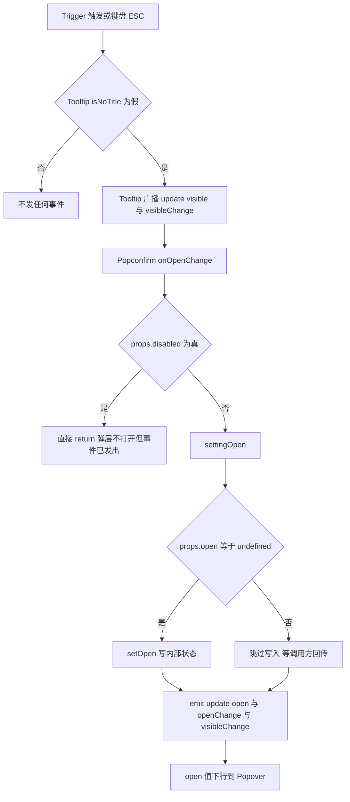

# C07-05 Popconfirm 气泡确认

> **本篇解决**：Popconfirm 的「确认」与「取消」语义由哪几段代码共同决定——为什么 `content` 写了没用、为什么 `okButtonProps` 里的 `onClick` 会让按钮失灵、改哪一行会让 ESC 与禁用态出错。
> **前置**：C07-04 Popover 气泡卡片　**读者坐标**：`03-components/07-feedback` 第 5 篇

## 一、职责与边界

Popconfirm 只做三件事：把 Popover 的内容区替换成「图标 + 标题 + 描述 + 两个按钮」的确认面板（`packages/xiaoye-ui/src/popconfirm/index.tsx:149-212`）、把面板上的点击翻译成对外的 `confirm` / `cancel` 事件（`:119-129`，两侧通道不对称，见论点 4 末段）、以及维护一个布尔开合状态并把控制信号透传给 Popover（`:101-113`）。它不做定位（`packages/xiaoye-ui/src/_util/placements.ts` 与 `packages/xiaoye-ui/src/tooltip/Tooltip.tsx:147-161`）、不做点击外部关闭（`packages/xiaoye-ui/src/vc-trigger/Trigger.tsx`）、不做焦点管理、不做层叠计算，也不生产任何弹层容器节点。

依赖清单（全部来自 `packages/xiaoye-ui/src/popconfirm/index.tsx:1-27` 的 import 段）：`popover`（`:3`）、`tooltip/abstractTooltipProps`（`:4`）、`tooltip/Tooltip` 的 `tooltipDefaultProps`（`:24`）、`button`（`:9`）与 `buttonTypes` 的 `convertLegacyProps`（`:7`）、`_util/ActionButton`（`:25`）、`_util/hooks/useMergedState`（`:16`）、`locale-provider/LocaleReceiver`（`:10`）与 `locale/en_US`（`:12`）、`_util/KeyCode`（`:18`）、`config-provider/hooks/useConfigInject`（`:19`）、`_util/classNames`（`:20`）、`_util/transition`（`:21`）、`_util/vnode` 的 `cloneVNodes`（`:22`）、`_util/omit`（`:23`）、`_util/props-util` 的 `initDefaultProps`（`:5`）、`_util/type`（`:13-14`）、`_util/warning`（`:27`）、`./style`（`:26`），以及 `@xiaoye-ui/icons` 的 `ExclamationCircleFilled`（`:8`）。被谁依赖：包级聚合入口 `packages/xiaoye-ui/src/components.ts:246-248` 与包导出表 `packages/xiaoye-ui/package.json:404-408`，组件 Token 注册在 `packages/xiaoye-ui/src/theme/interface/components.ts:38` 与 `:118`。仓库内没有任何组件把 Popconfirm 当作内部依赖。

## 二、源码地图

| 文件 | 行数 | 职责 | 关键符号与定名行 |
| --- | --- | --- | --- |
| `packages/xiaoye-ui/src/popconfirm/index.tsx` | 255 | 全部实现：props、setup、面板渲染、Popover 包装 | `popconfirmProps` `:29`、`XYPopconfirm` `:56`、主渲染入口 `:214`、`withInstall` 导出 `:255` |
| `packages/xiaoye-ui/src/popconfirm/style/index.ts` | 89 | 组件样式与 `zIndexPopup` | `ComponentToken` `:4`、`genBaseStyle` `:11`、hook 导出 `:79` |
| `packages/xiaoye-ui/src/popconfirm/index.test.js` | 91 | 3 个用例，只测开合与禁用 | `:12`、`:49`、`:74` |
| `packages/xiaoye-ui/src/tooltip/abstractTooltipProps.ts` | 58 | 被继承的 20 个浮层 props | `open` `:24`、`visible` `:26`、四个回调 `:53-57` |
| `packages/xiaoye-ui/src/tooltip/Tooltip.tsx` | 319 | 默认值来源与开合真值合并 | `tooltipDefaultProps` `:59`、`mergedOpen` `:107`、广播 `:124-135` |
| `packages/xiaoye-ui/src/popover/index.tsx` | 80 | 容器与槽位映射 | `getOverlay` `:49-61`、Tooltip 包装 `:65-74` |
| `packages/xiaoye-ui/src/_util/ActionButton.tsx` | 121 | 确认按钮的异步与防重复 | 点击分派 `:76-105`、Promise 处理 `:53-74`、渲染 `:106-119` |
| `packages/xiaoye-ui/src/_util/hooks/useMergedState.ts` | 47 | 受控/非受控合成 | 签名 `:12`、合并式 `:26`、复位 `:42-44` |
| `packages/xiaoye-ui/src/button/buttonTypes.ts` | 47 | `okType` 的旧类型转换 | `convertLegacyProps` `:14-19` |
| `packages/xiaoye-ui/src/_util/vnode.ts` | 82 | ESC 监听注入的克隆语义 | `cloneElement` `:9-28`、`cloneVNodes` `:30-32` |
| `packages/xiaoye-ui/src/vc-trigger/Trigger.tsx` | 710 | 触发子元素与弹层挂载 | 子节点克隆 `:692`、Fragment 根 `:703-707` |
| `packages/xiaoye-ui/src/locale/LocaleReceiver.tsx` | 85 | 文案三级合并 | `useLocaleReceiver` `:66-85` |
| `packages/xiaoye-ui/src/locale/en_US.ts` | 146 | 兜底文案 | `Popconfirm` `:48-51` |

主实现入口是 `packages/xiaoye-ui/src/popconfirm/index.tsx:54`（`defineComponent`）与 `:214`（返回的渲染函数）。这个组件没有 `popconfirmTypes.ts`、没有 `usePopconfirm.ts`、没有 `demo/` 目录，也没有 `__tests__/` 子目录——测试文件与实现平级放在 `index.test.js`。这是全类里少见的「一个文件装完」形态，代价是 255 行里混着 props 声明、状态、面板 DOM、事件与透传规则五件事。

## 三、架构与数据流

### 3.1 静态结构：四层包装与两处旁路



四个框是一层套一层的运行时关系，三张虚线是 Popconfirm 对外的两条控制通道与一条内容通道。内容通道走 `packages/xiaoye-ui/src/popconfirm/index.tsx:238`，控制通道走 `:233`（`onOpenChange`）与 `:234`（`open={open.value}`）；这三处写在一起不是巧合，而是「Popconfirm 只通过 Popover 的公开面说话」这条设计的落点。旁路有两条：`ActionButton`（`:25` 引入、`:198` 使用）与 `Button`（`:9` 引入、`:192` 使用）直接绕过了 Popover 这条主干，它们才是确认面板里真正能被点的两个东西；`_util/hooks/useMergedState` 与 `locale/LocaleReceiver` 则是两条内部依赖，前者决定 `:234` 传给 Popover 的那个布尔值到底归谁，后者决定 `:192` 与 `:206` 的兜底文案。

### 3.2 一次点击「确认」的完整闭环



这张图里最要紧的一行是「返回值交回判定」：Popconfirm 的 `onConfirm`（`packages/xiaoye-ui/src/popconfirm/index.tsx:119-123`）自己不关弹层，也不发 `emit('confirm')`，它只 `return callEvent(props.onConfirm, e)`（`:122`）；关不关由 `packages/xiaoye-ui/src/_util/ActionButton.tsx:87-93` 根据这个返回值决定，再由 `packages/xiaoye-ui/src/popconfirm/index.tsx:115-117` 的 `close` 回到状态机。取消侧没有这一段——`onCancel`（`:125-129`）自己调 `settingOpen(false, e)`，事件只走 `emit('cancel', e)`（`:128`）一条通道。同一个面板上的两个按钮，一个自关闭一个委托关闭，两侧的事件出口也各只留了一条、但留下的那条不同，这就是第四节论点 4 的图证。

### 3.3 开合真值判定



判定链上有两个「非直觉点」，都是上面图中靠分支存在的。第一个是 `E`：禁用闸门在 `packages/xiaoye-ui/src/popconfirm/index.tsx:138-144`，而 `C` 那一步的广播发生在 `packages/xiaoye-ui/src/tooltip/Tooltip.tsx:130-131`，早于 `D`，所以禁用态下事件已经发出去了。第二个是 `G`：受控判定读的是 `props.open === undefined`（`:106`），这一行的默认值来源是 `packages/xiaoye-ui/src/tooltip/abstractTooltipProps.ts:24` 的 `default: undefined`——它没有被 `initDefaultProps` 覆盖（覆盖表在 `packages/xiaoye-ui/src/popconfirm/index.tsx:58-68`，里面没有 `open`），所以这个兜底分支是可达的；`_util/props-util/initDefaultProps.ts:20-21` 的写回条件也解释了为什么它不会被静默改掉。判定链的第一环 `B`（`packages/xiaoye-ui/src/tooltip/Tooltip.tsx:119-122`）在 Popconfirm 场景恒为「是」，因为 Popconfirm 恒定注入内容槽，见论点 1。


## 四、核心机制精读

### 论点 1：Popconfirm 的弹层 DOM 只有一个入口——把 `renderOverlay` 塞进 Popover 的 `content` 槽，代价是自己的 `content` prop 与 `content` 槽同时变成死 API

`packages/xiaoye-ui/src/popconfirm/index.tsx:32` 声明了 `content` prop，`:71` 在 `slots` 类型里声明了 `content` 槽，但把这两处与渲染路径对齐后，它们都到不了 DOM。

```tsx
// packages/xiaoye-ui/src/popconfirm/index.tsx:215
    return () => {
      const { placement, overlayClassName, trigger = 'click', ...restProps } = props;
      const otherProps = omit(restProps, [
        'title',
        'content',
        'cancelText',
        'okText',
        'onUpdate:open',
        'onConfirm',
        'onCancel',
        'prefixCls',
      ]);
      const overlayClassNames = classNames(prefixClsConfirm.value, overlayClassName);
      return wrapSSR(
        <Popover
          {...otherProps}
          {...attrs}
          trigger={trigger}
          placement={placement}
          onOpenChange={onOpenChange}
          open={open.value}
          overlayClassName={overlayClassNames}
          transitionName={getTransitionName(rootPrefixCls.value, 'zoom-big', props.transitionName)}
          v-slots={{ content: renderOverlay }}
          ref={rootRef}
          data-popover-inject
        >
```

这段渲染有两条出口，而 `content` 恰好两条都进不去。

第一条是 prop 通道。`props.content` 在 `setup` 全程没有被读取过一次——`grep -n "content" popconfirm/index.tsx` 只有 5 处命中：`:32`（声明）、`:71`（槽类型）、`:174`（类名字符串 `-inner-content`）、`:218`（omit 名单）、`:237`（`v-slots` 的键名）。`:218` 把 `content` 从 `otherProps` 里剔掉，于是它连透传给 Popover 的机会都没有。用户写 `<xy-popconfirm content="确定吗">` 时，这个字符串从 props 进来、在 `:216` 被摘掉、再也没有第二次被读。

第二条是槽通道。`:237` 用 `v-slots={{ content: renderOverlay }}` **整体覆盖**了传给 Popover 的 `content` 槽；Popconfirm 自己的 `slots.content`（`:71` 声明）从没被 `renderOverlay`（`:149-212`）或渲染函数读过——`grep -n "slots\." popconfirm/index.tsx` 的完整结果是 `:153` `slots.title`、`:154` `slots.description`、`:155` `slots.cancel`、`:156` `slots.okText`、`:158` `slots.icon`、`:242` `slots.default`，六处里没有 `content`，也没有 `cancelText`。

`renderOverlay` 产出的节点最终落在 Popover 的 `content` 槽上，被 Popover 再包一层：

```tsx
// packages/xiaoye-ui/src/popover/index.tsx:49
    const getOverlay = () => {
      const { title = filterEmpty(slots.title?.()), content = filterEmpty(slots.content?.()) } =
        props;
      const hasTitle = !!(Array.isArray(title) ? title.length : title);
      const hasContent = !!(Array.isArray(content) ? content.length : title);
      if (!hasTitle && !hasContent) return null;
      return (
        <>
          {hasTitle && <div class={`${prefixCls.value}-title`}>{title}</div>}
          <div class={`${prefixCls.value}-inner-content`}>{content}</div>
        </>
      );
    };
```

这里有两个只对 Popconfirm 成立的事实。第一，`popconfirm/index.tsx:175` 的 `<div class="xy-popconfirm-inner-content">` 被放进 `popover/index.tsx:58` 的 `<div class="xy-popover-inner-content">` 内部，弹层里存在两个同名不同前缀的 `inner-content` 嵌套——`popconfirm/style/index.ts:28-30` 只给内层那条规则加了 `color: colorText`，外层由 Popover 负责，两者不是同一份 DOM 契约。第二，`popover/index.tsx:54` 的空内容闸门读的是 `slots.content`，而 Popconfirm 恒定向该槽注入一个函数，所以这道闸门对 Popconfirm 永远放行；更关键的是 `:53` 的 `hasContent` 在 `content` 非数组时回落到 `title`（`packages/xiaoye-ui/src/popover/index.tsx:53`），Popconfirm 传入的 `renderOverlay()` 结果是数组——Vue 具名槽返回 VNode 数组，`filterEmpty` 也返回数组（`packages/xiaoye-ui/src/_util/props-util/index.ts:230-242`，返回语句是 `:241` 的 `return res.filter(c => !isEmptyElement(c));`），因此这条错误分支被 Popconfirm 的使用方式意外绕开——见 C07-04 论点 3 对该行的完整论证，本篇不重复。

结论回扣：Popconfirm 的对外形态是「三层 props 继承（`abstractTooltipProps` + 自身）+ 一层槽覆盖」。它自己从不生产弹层容器，只生产容器里的内容。因此任何「Popconfirm 弹层里没有东西 / 多了一层 padding」的问题，定位顺序应当是 `popconfirm/index.tsx:149-212` → `popover/index.tsx:49-61` → `tooltip/Tooltip.tsx` 的弹层根节点，而不是先看样式。而 `content` 这个 prop 名在 Popconfirm 上是**声明存在但实现不读取**的典型：文档写它没有用，删它也没有行为变化，只能在下一大版本随 `:218` 一起清掉。

### 论点 2：`visible` 族的入向是死的、出向是活的，而且会双触发——根因是 Popconfirm 的 omit 名单只堵住了 `open` 族

Popconfirm 的状态真值只挂 `open`：

```tsx
// packages/xiaoye-ui/src/popconfirm/index.tsx:101
    const [open, setOpen] = useMergedState(false, {
      value: toRef(props, 'open'),
    });

    const settingOpen = (value: boolean, e?: MouseEvent | KeyboardEvent) => {
      if (props.open === undefined) {
        setOpen(value);
      }

      emit('update:open', value);
      emit('openChange', value, e);
      emit('visibleChange', value, e);
    };
```

对照同一条继承链上的两个声明（`packages/xiaoye-ui/src/tooltip/abstractTooltipProps.ts:24` 的 `open: { type: Boolean, default: undefined }` 与 `:26` 的 `visible: { type: Boolean, default: undefined }`，`:53` 的 `onVisibleChange` 与 `:55` 的 `'onUpdate:visible'`），四个名字在 Popconfirm 里的待遇完全不同：

- `open` 的入向走 `:102` 的 `toRef(props, 'open')`，出向走 `:110` 的 `emit('update:open')`；`emits` 数组（`packages/xiaoye-ui/src/popconfirm/index.tsx:81`）登记了 `update:open` 与 `openChange`。
- `visible` 的入向**没有任何代码读取**：`grep -n "props.visible" popconfirm/index.tsx` 只有一个命中，即 `:92` 那条 `warning(props.visible === undefined, ...)`（`packages/xiaoye-ui/src/popconfirm/index.tsx:91-95`）。它只用于打印弃用提示，不参与状态合成。`useMergedState` 的 `value` 只绑了 `open`，`mergedValue` 的计算式是 `value.value !== undefined ? value.value : innerValue.value`（`packages/xiaoye-ui/src/_util/hooks/useMergedState.ts:26`），因此 `visible=true` 永远不会让弹层打开。
- `visible` 的出向反而是活的：`emits`（`:81`）里没有 `update:visible`，但 Popconfirm 没有把 `onUpdate:visible` / `onVisibleChange` 放进 `:216-225` 的 omit 名单，于是这两个回调原样透传进 Popover、再透传进 Tooltip，被 Tooltip 自己的 emit 命中：

```tsx
// packages/xiaoye-ui/src/tooltip/Tooltip.tsx:124
    const handleVisibleChange = (val: boolean) => {
      const noTitle = isNoTitle();
      if (mergedOpen.value === undefined) {
        innerOpen.value = noTitle ? false : val;
      }
      if (!noTitle) {
        emit('update:visible', val);
        emit('visibleChange', val);
        emit('update:open', val);
        emit('openChange', val);
      }
    };
```

于是同一份 `onVisibleChange` 被两条互不知情的链路各调一次：先由 `Tooltip.tsx:131` 以 `(val)` 单参调用，再由 `popconfirm/index.tsx:112` 以 `(value, e)` 双参调用。`:126` 处的 `mergedOpen.value === undefined` 判定（`packages/xiaoye-ui/src/tooltip/Tooltip.tsx:126`）在 Popconfirm 场景里恒为假，因为 `:234` 显式传的 `open={open.value}` 是布尔值而不是 `undefined`——Tooltip 的自持状态被完全架空，只剩它的 emit 还在对外广播。这也顺带解释了 `visible` 为什么入向无效：`open` 写在 `{...otherProps}`（`:229`）之后的 `:234`，而 Tooltip 的合并式是 `props.open ?? props.visible`（`packages/xiaoye-ui/src/tooltip/Tooltip.tsx:107`），`??` 只在 `null`/`undefined` 上回落，`false` 不回落到 `visible`。

`openChange` 族没有这个问题，因为 Popconfirm 在 `:233` 用显式属性把 `onOpenChange` 覆盖成了自己的内部函数（`packages/xiaoye-ui/src/popconfirm/index.tsx:138-144`），Tooltip `:133` 的 emit 命中的是内部函数而不是用户的回调；`update:open` 族则由 omit 名单 `:221` 的 `'onUpdate:open'` 掐断，避免 `v-model:open` 被写两次。

这条双调用今天没有暴露，是因为仓库里唯一相关的用例形状恰好看不见它。`packages/xiaoye-ui/src/popconfirm/index.test.js:13` 造了 `const onVisibleChange = vi.fn()`，在 `:25` 以 **prop** 形式 `onVisibleChange={onVisibleChange}` 传给 Popconfirm——这正是上面那条会随 `otherProps` 一路下沉到 Tooltip 的路径；但两处断言 `:40` 与 `:45` 用的是 `toHaveBeenLastCalledWith(true, undefined)` 和 `toHaveBeenLastCalledWith(false, undefined)`。「Last」只比最后一次调用的参数形状，而最后一次恰好是 Popconfirm 自己那次双参调用（`packages/xiaoye-ui/src/popconfirm/index.tsx:112` 的 `emit('visibleChange', value, e)`），Tooltip 那次单参调用（`packages/xiaoye-ui/src/tooltip/Tooltip.tsx:131`）被前一次覆盖掉。把断言换成 `toHaveBeenCalledTimes(1)` 就会立刻红——这条用例是「断言形状选得刚好回避了缺陷」的样本，改 Popconfirm 事件面时应当顺手把它补成计数断言，否则论点 2 描述的这份重复永远测不出来。同族隔壁的 `@confirm` / `@cancel` 双投已经在 2026-09-29 按这个判据收口（见论点 4 末段与坑 7），`packages/xiaoye-ui/src/_util/__tests__/event-dispatch-count.test.tsx:81`、`:87` 两条用例用的正是 `toHaveBeenCalledTimes(1)`；`visible` 族这两条通道不在那批站点里，所以本段的重复今天仍然存在。同一用例还在 `:23-24` 显式传 `mouseEnterDelay={0}` 与 `mouseLeaveDelay={0}`，这印证了论点 7 的判断：默认路径上这两个延迟对 Popconfirm 是可感知需要被清零的量。

结论回扣：这三处（`:221` 掐 open 出向、`:233` 遮 openChange、`:216-225` 漏掉 visible 族）合起来构成一张「谁覆盖谁」的表。改 Popconfirm 的事件面时，必须先确认名字属于哪一族：`open` 族由 Popconfirm 单点控制，`visible` 族则由 Popconfirm 与 Tooltip 双重控制。`v-model:visible` 的可观测结果是「能收到写回、但初始值与后续入参都不生效」，这类半死 API 比全死更难排查。

### 论点 3：`disabled` 只有一道闸门，而且这道闸门落在事件广播之后；它同时不接 `DisabledContext`

```tsx
// packages/xiaoye-ui/src/popconfirm/index.tsx:138
    const onOpenChange = (value: boolean) => {
      const { disabled } = props;
      if (disabled) {
        return;
      }
      settingOpen(value);
    };
```

`grep -n "disabled" packages/xiaoye-ui/src/popconfirm/index.tsx` 只有四个命中：`:36` 的声明（`disabled: { type: Boolean, default: false }`）、`:67` 的重复默认值（`initDefaultProps` 又写了一遍 `disabled: false`）、`:138` 与 `:139` 的这一次读取。也就是说，整个组件的禁用逻辑就是上面这五行。它带来三个可核对的后果。

后果一是顺序。用户的点击最终打到 `packages/xiaoye-ui/src/tooltip/Tooltip.tsx:124-135` 的 `handleVisibleChange`，该函数在 `:130` 与 `:131` 先 `emit('update:visible')`、`emit('visibleChange')`，到 `:133` 才 `emit('openChange')`——而只有 `openChange` 这一条会进到 Popconfirm 的 `onOpenChange`（`packages/xiaoye-ui/src/popconfirm/index.tsx:234` 把它接给了 `:137` 的函数）。因此对 `disabled` 的 Popconfirm 而言，`@visible-change` 与 `v-model:visible` 的监听器照样会被点亮一次 `true`，只是弹层不出现。测试恰好测不到这一层：`packages/xiaoye-ui/src/popconfirm/index.test.js:74-90` 的第三个用例只断言 `getPopupDomNode()` 为假（`:88-89`），没有任何断言检查事件是否发出。

后果二是禁用来源单一。`packages/xiaoye-ui/src/popconfirm/index.tsx:145` 从 `useConfigInject('popconfirm', props)` 里只取了 `prefixCls` 与 `getPrefixCls`，没有取 `useConfigInject` 已经准备好的 `disabled`（`packages/xiaoye-ui/src/config-provider/hooks/useConfigInject.ts:43` 的 `const disabled = computed<boolean>(() => props.disabled ?? disabledContext.value)` 与 `:69` 的返回项）。而同一条链上真正渲染按钮的 `Button` 是取了的——`packages/xiaoye-ui/src/button/button.tsx:50` 注入 `DisabledContext`，`:51` 的 `mergedDisabled = props.disabled ?? disabledContext.value`。两侧拼起来得到一个反直觉的组合：外层 `ConfigProvider`（或 `Form` 的禁用上下文）让 `xy-popconfirm` 处于「全局禁用」时，Popconfirm 本身照样能弹开（它不看上下文），但弹出来以后 `packages/xiaoye-ui/src/popconfirm/index.tsx:193` 的取消按钮与 `:198` 的确认按钮都变成禁用态，用户面对一个打不开也关不掉的确认框，只能靠点空白处或按 ESC 退出。

后果三是属性泄漏。`disabled` 不在 `packages/xiaoye-ui/src/popconfirm/index.tsx:217-226` 的 omit 名单里，于是它跟着 `otherProps`（`:229`）进了 Popover，再经 `packages/xiaoye-ui/src/popover/index.tsx:66-67` 进 Tooltip，再经 `packages/xiaoye-ui/src/vc-tooltip/src/Tooltip.tsx:102-104` 的 `extraProps` 进 Trigger。用 `grep -rn "disabled" packages/xiaoye-ui/src/vc-trigger/Trigger.tsx packages/xiaoye-ui/src/vc-tooltip/src/Tooltip.tsx packages/xiaoye-ui/src/vc-tooltip/src/Content.tsx` 取文件级判据（零命中），再放宽到整目录跑 `grep -rn "disabled" packages/xiaoye-ui/src/vc-trigger packages/xiaoye-ui/src/vc-tooltip` 复核（唯一命中是 `packages/xiaoye-ui/src/vc-trigger/Popup/PopupInner.tsx:198` 的 `disabled={alignDisabled.value}`，那是给 Align 的开关，与本组件的 `disabled` 无关），链路上没有任何一层读取它；而 `packages/xiaoye-ui/src/vc-trigger/Trigger.tsx:38` 声明了 `inheritAttrs: false`，且 `:703-707` 的返回是 `[trigger, portal]` 的 Fragment 根，所以这些泄漏属性既不会自动落到 DOM，也不会被消费，只是在三层里各做一次无用的 props diff。同理泄漏的还有 `description`、`okType`、`showCancel`、`icon`、`okButtonProps`、`cancelButtonProps` 六个 Popconfirm 自己的声明（`packages/xiaoye-ui/src/popconfirm/index.tsx:34-42`，其中 `okText` 与 `cancelText` 已在 `:219-220` 被剔除，其余六个不在名单上），它们在下游四层同样零消费。

结论回扣：Popconfirm 的禁用是一个「单点、后置、不接上下文」的实现。要把它做对，需要同时改三处——`:137-143` 之前先拦 Tooltip 的广播（或在 `:144` 取 `useConfigInject` 的 `disabled`）、`:216-225` 补齐 omit 名单、以及给 `index.test.js` 增加「禁用态不发事件」的断言。

### 论点 4：确认与取消不是同一套实现，而 `okButtonProps` / `cancelButtonProps` 的展开位置会吃掉组件自己的 `onClick`

先看两个按钮的构造：

```tsx
// packages/xiaoye-ui/src/popconfirm/index.tsx:163
      const cancelProps: ButtonProps = {
        onClick: onCancel,
        size: 'small',
        ...cancelButtonProps,
      };
      const okProps: ButtonProps = {
        onClick: onConfirm,
        ...convertLegacyProps(okType),
        size: 'small',
        ...okButtonProps,
      };
```

`cancelProps` 与 `okProps` 都是「先放组件自己的处理器，再展开用户的 `*ButtonProps`」。`ButtonProps` 里含 `onClick`（`packages/xiaoye-ui/src/button/buttonTypes.ts:41`），所以只要调用方写 `:ok-button-props="{ onClick: fn }"` 或 `:cancel-button-props="{ onClick: fn }"`，`onClick` 键就被后展开的对象覆盖。取消按钮的后果最直接：`:192` 的 `<Button {...cancelProps}>` 拿到的是用户的函数，`onCancel`（`:125-129`）里的 `settingOpen(false, e)` 与 `emit('cancel', e)`（`:128`）一并失效——点「取消」，弹层不关、`@cancel` 不响。这个覆盖在类型上完全合法：`packages/xiaoye-ui/src/popconfirm/index.tsx:40-41` 声明的是 `objectType<ButtonProps & HTMLAttributes>()`（`ButtonProps` 从 `:6` 导入），而 `onClick` 正是它的成员，所以 TS 不会拦。公开性也不是边缘用法——`apps/docs/components/popconfirm.md:67` 与 `:62` 把 `okButtonProps` / `cancelButtonProps` 列进了 API 表，同族组件的文档示例 `apps/docs/examples/modal/button-props.vue:7-8` 走的正是这条通道（往同一形状的 prop 里塞 `disabled`），把它当成 `onClick` 的落点只是一步之遥。但要如实记下另一半：`apps/docs/examples/popconfirm/` 的六个示例里没有一个用过这两个 prop（判据 `grep -rn "ok-button-props" apps/docs/examples/popconfirm` 零命中），所以这条坑在本组件的文档面上目前没有现成的触雷示例；`dynamic-trigger.vue` 用的是 `:open` + `@openChange` 的外部状态拦截（`apps/docs/examples/popconfirm/dynamic-trigger.vue:5` 与 `:8`），不是按钮 props。

同一个覆盖模式在确认按钮上被 `ActionButton` 复制了一遍。`ActionButton` 的渲染是：

```tsx
// packages/xiaoye-ui/src/_util/ActionButton.tsx:106
    return () => {
      const { type, prefixCls, buttonProps } = props;
      return (
        <Button
          {...convertLegacyProps(type)}
          onClick={onClick}
          loading={loading.value}
          prefixCls={prefixCls}
          {...buttonProps}
          ref={buttonRef}
          v-slots={slots}
        ></Button>
      );
    };
```

`onClick={onClick}` 写在 `:111`，`{...buttonProps}` 写在 `:114`——用户从 `packages/xiaoye-ui/src/popconfirm/index.tsx:200` 传进来的 `okButtonProps` 同样是后展开者，会把 ActionButton 的内部 `onClick`（`packages/xiaoye-ui/src/_util/ActionButton.tsx:76-105`）整体替换掉，连带丢掉防重复点击（`:78-81` 的 `clickedRef` 闸门）、Promise 期间的 loading（`:57`）与自动关闭（`:91`）。此外 `:110` 这次 `convertLegacyProps(type)` 是空转的：Popconfirm 在 `packages/xiaoye-ui/src/popconfirm/index.tsx:198-207` 只传 `buttonProps`、从不传 `type`，于是 `type` 恒为 `undefined`，`convertLegacyProps(undefined)` 返回 `{ type: undefined }`（`packages/xiaoye-ui/src/button/buttonTypes.ts:14-19`），真正把 `okType` 变成按钮形态的那一次转换发生在 `packages/xiaoye-ui/src/popconfirm/index.tsx:200`。同一个函数在同一条渲染链上被调用两次，一次有效一次空转——这是 DISPATCH 里「同一逻辑的多份拷贝」在本组件的具体样本。

再看两条轨道的行为差异。取消侧是裸 `Button` + `onCancel`（`packages/xiaoye-ui/src/popconfirm/index.tsx:125-129`）：先 `settingOpen(false, e)` 关闭、再 `emit('cancel', e)`（`:128`）一条通道出。确认侧是 `ActionButton`（`:198-207`），传入 `actionFn={onConfirm}`、`close={close}`、`emitEvent`、`quitOnNullishReturnValue` 四个开关，`onConfirm`（`:119-123`）自己不关闭弹层、也不发 `emit('confirm')`，只把 `callEvent(props.onConfirm, e)`（`:122`）的返回值交回给 ActionButton 判定：

```tsx
// packages/xiaoye-ui/src/_util/ActionButton.tsx:86
      let returnValueOfOnOk: PromiseLike<any>;
      if (props.emitEvent) {
        returnValueOfOnOk = actionFn(e);
        if (props.quitOnNullishReturnValue && !isThenable(returnValueOfOnOk)) {
          clickedRef.value = false;
          onInternalClose(e);
          return;
        }
      } else if (actionFn.length) {
        returnValueOfOnOk = actionFn(props.close);
        clickedRef.value = false;
      } else {
        returnValueOfOnOk = actionFn();
        if (!returnValueOfOnOk) {
          onInternalClose();
          return;
        }
      }
      handlePromiseOnOk(returnValueOfOnOk);
```

由于 `emitEvent` 与 `quitOnNullishReturnValue` 在 `packages/xiaoye-ui/src/popconfirm/index.tsx:203-204` 都写死为真，Popconfirm 只会走 `:87-93` 这条分支：返回值不是 thenable 就立刻 `onInternalClose(e)`（`:91`）→ `close`（`packages/xiaoye-ui/src/popconfirm/index.tsx:115-117`）→ `settingOpen(false)`。返回值是 Promise 才交给 `handlePromiseOnOk`（`packages/xiaoye-ui/src/_util/ActionButton.tsx:53-74`）：`:57` 起 loading、resolve 后 `:63` 关闭、reject 时 `:66-72` 不关闭。也就是说「`@confirm` 返回 `false` 能否阻止关闭」的答案是**不能**——`false` 不是 thenable，直接命中 `:89-92` 关闭。想阻止关闭只有一条路：返回一个 pending 或 reject 的 Promise。文档示例 `apps/docs/examples/popconfirm/promise.vue:8-13` 用的正是后者（`return new Promise(resolve => setTimeout(...))`）。

最后是最容易被忽略的一处，而且这一族的处置在两侧**不对称**，必须分开记。取消侧只留 emit：`onCancel` 里只剩 `emit('cancel', e)`（`packages/xiaoye-ui/src/popconfirm/index.tsx:128`），原先紧跟其后的 `callEvent(props.onCancel, e)` 已删（`HEAD` 的 `:126`、`:127`）。确认侧反过来，只留 props 通道：`return callEvent(props.onConfirm, e)`（`:122`）而**不发 emit**——因为 `ActionButton` 必须拿这个返回值来决定是否关闭弹层（`packages/xiaoye-ui/src/_util/ActionButton.tsx:87-93`），`emit` 的返回值拿不到，所以这条通道不能被 emit 顶替。修前两侧各是两条并行通道（`emit('confirm', e)` 配 `callEvent(props.onConfirm, e)`、`emit('cancel', e)` 配 `callEvent(props.onCancel, e)`），而 `confirm` / `cancel` 既在 `emits` 名单里（`:81`）又各有一个同名 prop（`:43`、`:44`）；Vue 的 `emit` 本就从 `instance.vnode.props` 取 `onXxx`，于是两条语句解析到同一个用户函数，`@confirm` / `@cancel`（以及 `:on-confirm` 写法）一次点击被调两遍——这是本栏「事件双投递」缺陷族的形态①在本组件的落点。`callEvent`（`:83-89`）是为「prop 值是函数数组」写的防御分支，声明类型却是单一 `Function`；它在确认侧仍是唯一出口，所以本文件保留它，只删掉取消侧那一处调用。这条现在是实测过的：修前确定与取消各收 2 次，修后各 1 次，回归用例是 `packages/xiaoye-ui/src/_util/__tests__/event-dispatch-count.test.tsx:81` 与 `:87`，判据分别在 `:83`、`:89` 的 `toHaveBeenCalledTimes(1)`，把 `index.tsx` 退回 `HEAD` 复跑即红（复跑步骤见附检查点 3）。

结论回扣：确认与取消的差异不是「一个有样式一个没样式」这种表面差异，而是三件事——关闭时机由谁负责（取消自己关、确认委托 ActionButton）、异步是否被支持（只有确认支持）、以及防重复点击是否存在（只有确认有）。合并成一套是可行的，但那要先决定异步语义归谁，见第六节。

### 论点 5：键盘路径有两个断点——ESC 判定读的是 Ref 对象本身，焦点则从未进入弹层

```tsx
// packages/xiaoye-ui/src/popconfirm/index.tsx:132
    const onKeyDown = (e: KeyboardEvent) => {
      if (e.keyCode === KeyCode.ESC && open) {
        settingOpen(false, e);
      }
    };
```

`open` 来自 `:101-103` 的 `useMergedState`，该 hook 的返回签名是 `[R, (val: T) => void]`（`packages/xiaoye-ui/src/_util/hooks/useMergedState.ts:12`），第一个元素是 `ref(mergedValue)`（`:24` 与 `:46`）——所以 `:132` 里参与 `&&` 的是一个 Ref 对象而不是布尔值，恒为真。同一份 `open` 在 `:234` 用的是 `open.value`，两处写法不一致，正好说明 `:132` 是漏写。后果是 ESC 判定退化成「只要按下 ESC 就发一次关闭」：`settingOpen(false, e)`（`:105-113`）在弹层本来关着的时候依然会 `emit('update:open', false)`、`emit('openChange', false)`、`emit('visibleChange', false)`。对 `v-model:open` 的使用者没有可见变化（写回的还是 `false`），但对监听 `@open-change` 做统计或埋点的使用者会收到虚假的 `false` 事件。`KeyCode.ESC` 的值是 27（`packages/xiaoye-ui/src/_util/KeyCode.ts:51`），而注入点在默认槽的每个子节点上：

```tsx
// packages/xiaoye-ui/src/popconfirm/index.tsx:242
          {cloneVNodes(
            slots.default?.() || [],
            {
              onKeydown: (e: KeyboardEvent) => {
                onKeyDown(e);
              },
            },
            false,
          )}
```

第三个实参是 `false`，对应 `packages/xiaoye-ui/src/_util/vnode.ts:30` 的 `cloneVNodes(vnodes, nodeProps = {}, override = true)`，再传到 `cloneElement` 的 `override`（`:12`）。`cloneElement` 的实现分两步：`:22` 先用 Vue 的 `cloneVNode(ele, nodeProps, mergeRef)` 生成节点，`:25` 再按 `override` 决定是否用 `nodeProps` 二次覆盖合并结果——`{...node.props, ...nodeProps}` 只在 `override` 为真时执行。因此 `override = false` 的实际含义是「不要在 Vue 的合并结果之上再覆盖一次」，注入出来的 `onKeydown` 最终是否与调用方自己的 `keydown` 并存，完全由 `:22` 的 Vue 合并语义决定，而不是由 Popconfirm 决定。这一点本篇只描述到源码可控的范围：**`override=false` 与调用方监听器的最终共存方式未在仓库源码内实现，属于 Vue 运行时行为**，需要实测确认时应写用例而非读代码。另一个可核对的事实是：这个注入只覆盖默认槽的直接子节点（`:242` 的 `slots.default?.()` 结果被逐个 clone），而下游 Tooltip 在多子节点时会把它们整体包进一个 `<span>`（`packages/xiaoye-ui/src/tooltip/Tooltip.tsx:254-255` 与 `:266`），keydown 只有在焦点位于那个被 clone 的元素上时才可能触发。

第二个断点是焦点。Popconfirm 的 import 段（`packages/xiaoye-ui/src/popconfirm/index.tsx:1-27`）里没有任何焦点工具——没有 `useFocusTrap`，没有 `getFocusableList`，也没有主动 `focus()` 调用；`expose` 只暴露一个 `getPopupDomNode`（`:96-100`），调用方连「打开后把焦点移进去」都只能自己拿 DOM 做。而 `ActionButton` 其实备好了 `autofocus` prop（`packages/xiaoye-ui/src/_util/ActionButton.tsx:17`）与对应的 `onMounted` 定时聚焦逻辑（`:40-44`），Popconfirm 在 `:198-207` 从未传这个 prop，于是那条分支在本组件恒不执行。弹层的 DOM 又不在触发元素附近：`packages/xiaoye-ui/src/vc-trigger/Trigger.tsx:694-701` 用 `Portal` 把 popup 挂到容器（默认 `getPopupContainer` 为空时是 body 末尾），所以 Tab 序列要从触发元素穿过整页才到达确认按钮。焦点归一在整个反馈类里是缺席的，这一条 C07-00 论点 4 已经有全类层面的论证（只有 Modal 做了圈定），本篇只补 Popconfirm 自己的证据行。

测试面顺带交代清楚：`packages/xiaoye-ui/src/popconfirm/index.test.js` 共 3 个 `it`（`:12`、`:49`、`:74`）、6 次 `expect(`（`grep -c` 计数），三个用例分别覆盖「点击开合与 `onVisibleChange`」（`:40` 与 `:45`）、`getPopupDomNode` 的有无（`:64`、`:70`）、禁用不弹出（`:89`）。ESC、`ActionButton` 的 Promise 分支、`showCancel`、`okType`、自定义 `okButton`/`cancelButton` 槽——在这个文件里没有用例；`@confirm` / `@cancel` 也不在，它们唯一的现成用例落在组件目录外的 `packages/xiaoye-ui/src/_util/__tests__/event-dispatch-count.test.tsx:81`、`:87`，而且只数投递次数、不断弹层与载荷（见论点 4 末段）。判定「这个文件是否真被执行」要按 `packages/xiaoye-ui/vitest.config.mts:33` 的 include 数组来算，该行写的是 `['tests/**/*.test.{js,ts,jsx,tsx}', 'src/**/*.test.{js,ts,jsx,tsx}']`——两个模式都含 `js`，本文件后缀是 `.js` 因此确实会被收集执行；只按 `.ts`/`.tsx` 搜会误判成「Popconfirm 没有测试」。

结论回扣：Popconfirm 的键盘可用性由三处各自决定——ESC 在 `:131-135`（且判定写错）、焦点在 `:1-27` 的 import 缺失里、Tab 顺序在 `vc-trigger/Trigger.tsx:694-701` 的 Portal 里。想修 ESC 只改 `:132` 的 `open` 为 `open.value` 就够了，但想修键盘体验必须补焦点管理，这两件事的规模差一个数量级，不要混在一个 PR 里。

### 论点 6：Popconfirm 的样式能生效是「蹭」了 Popover 的 hashId，它自己的 `zIndexPopup: +60` 与 Popover 的 `+30` 落在同一个元素上

```ts
// packages/xiaoye-ui/src/popconfirm/index.tsx:145
    const { prefixCls: prefixClsConfirm, getPrefixCls } = useConfigInject('popconfirm', props);
    const rootPrefixCls = computed(() => getPrefixCls());
    const btnPrefixCls = computed(() => getPrefixCls('btn'));
    const [wrapSSR] = usePopconfirmStyle(prefixClsConfirm);
```

`:147` 只解构了 `wrapSSR`，`genComponentStyleHook` 返回的第二个元素 `hashId` 被丢弃（返回元组在 `packages/xiaoye-ui/src/theme/util/genComponentStyleHook.ts:77` 起、`hashId` 是其中的 `:110` 那一项，它的值取自 `:49` 的 `const [theme, token, hashId] = useToken()`）。对照两个上游层：`packages/xiaoye-ui/src/popover/index.tsx:47` 拿的是 `[wrapSSR, hashId]`，并在 `:63` 把 hashId 拼进 `overlayCls`；`packages/xiaoye-ui/src/tooltip/Tooltip.tsx:248` 同样取 hashId，并在 `:272-280` 的 `customOverlayClassName` 里带上（`:279`）。Popconfirm 自己的 `overlayClassNames` 在 `:226` 只有 `prefixClsConfirm` 加用户类名，不含 hashId。于是弹层根节点的类名集合是：`xy-popover`（由 `packages/xiaoye-ui/src/popover/index.tsx:68` 把 Popover 的 prefixCls 交给 Tooltip，再由 `packages/xiaoye-ui/src/tooltip/Tooltip.tsx:289` 落到 popup）、`xy-popconfirm`（来自 `:226` 的 `overlayClassName` 透传）、以及 Popover 写上的那个 `css-*` hash 类。这条「前缀被 Popover 夺走」的链路 C07-04 论点 1 已完整论证，本篇只取它对 Popconfirm 的后果。

后果是：`xy-popconfirm` 的规则要命中，依赖 hash 类由**别人**写上。之所以今天确实命中，是因为 `hashId` 是主题级的而不是组件级——`genComponentStyleHook.ts:49` 的 `hashId` 来自 `useToken()`，同一次 `ConfigProvider` 配置下所有组件拿到的是同一个值；样式之间的区分靠 `:74` 的 `path: [component, prefixCls, iconPrefixCls]`（注册路径），不靠 hash 类。所以「Popconfirm 不写 hashId」在当前实现里是无害的简化，但它把正确性押在「同一个弹层上永远有一个会写 hashId 的上游」这个前提上。若哪天 hashId 改成按组件分桶，或 Popconfirm 的 `wrapSSR` 在 Popover 之外被复用，`packages/xiaoye-ui/src/popconfirm/style/index.ts:24-75` 整段规则会一起失效。

第二件事是层叠。三张组件表各写了一个 `zIndexPopup`：`packages/xiaoye-ui/src/popconfirm/style/index.ts:86` 的 `zIndexPopupBase + 60`、`packages/xiaoye-ui/src/popover/style/index.ts:179` 的 `+ 30`、`packages/xiaoye-ui/src/tooltip/style/index.ts:151` 的 `+ 70`。Popconfirm 的弹层根节点同时带着 `xy-popover` 与 `xy-popconfirm` 两个类（见上），两条规则的选择器形状相同（组件类加 hash 类），特异度因此打平，胜负只由样式插入顺序决定；而 `+70` 那条挂在 `.xy-tooltip` 上，本场景下根节点不带该类（前缀已被 Popover 替换），加上 Tooltip 的样式在注入态被整体关掉（`packages/xiaoye-ui/src/tooltip/Tooltip.tsx:248-251` 的第二个实参是 `computed(() => !injectFromPopover.value)`，开关由 `packages/xiaoye-ui/src/popconfirm/index.tsx:239` 写入，机制见 C07-04 论点 2），所以实际参与竞争的只有 `+60` 与 `+30`。**按 setup 顺序 Popconfirm 先注册、Popover 后注册**（父组件 setup 早于子组件），据此推断生效的是 `+30`，即 Popconfirm 的 `zIndexPopup` 组件 Token 在真实渲染里基本不起作用。这一步是从插入顺序推出来的，本篇没有用浏览器读 computed style 复核，属条件句。层叠账本本身的全貌（三套互不知情的机制）见 C07-00 论点 6。

第三件事是组件 Token 的面。`packages/xiaoye-ui/src/popconfirm/style/index.ts:4-6` 的 `ComponentToken` 只有一个 `zIndexPopup`，`:8` 的 `PopconfirmToken extends FullToken<'Popconfirm'>` 没有追加任何字段，注册在 `packages/xiaoye-ui/src/theme/interface/components.ts:38` 与 `:118`。这意味着想改确认框的按钮间距、图标尺寸或描述文字缩进，都**没有** Component Token 可用，只能改全局 Alias Token 或者覆写 `.xy-popconfirm-*` 类——`:61` 的 `marginInlineStart: fontSize + marginXS` 是硬写死在样式函数里的表达式，`:70-72` 的 `button: { marginInlineStart: marginXS }` 用的是元素选择器。后者还有一个可核对的副作用：它只匹配原生 `button`，一旦用户用 `:189-191` / `:195-196` 的 `cancelButton`/`okButton` 槽换成链接或自定义组件，两个按钮之间就没有任何间距。

最后一个小的命名反向：`packages/xiaoye-ui/src/popconfirm/index.tsx:179-183` 给标题元素加 `${prefixCls}-message-title-only` 的条件是 `!!description`，而 `packages/xiaoye-ui/src/popconfirm/style/index.ts:49-56` 的 `&-title-only` 把它加粗。类名说「只有标题」，触发条件恰好是「还有描述」。规则本身是活的（DOM 结构与 `:41-47`、`:49-56` 的嵌套选择器能对上），但读代码的人一定会先理解反，这类地方改名比改逻辑更值钱。

### 论点 7：默认值写在四张表上，其中一张靠字面顺序才没把 Popconfirm 变成悬停触发

```tsx
// packages/xiaoye-ui/src/popconfirm/index.tsx:58
  props: initDefaultProps(popconfirmProps(), {
    ...tooltipDefaultProps(),
    trigger: 'click',
    placement: 'top',
    mouseEnterDelay: 0.1,
    mouseLeaveDelay: 0.1,
    arrowPointAtCenter: false,
    autoAdjustOverflow: true,
    okType: 'primary',
    disabled: false,
  }),
```

这张表里的后七个键，全部是对 `packages/xiaoye-ui/src/tooltip/Tooltip.tsx:59-67` 的 `tooltipDefaultProps()` 的逐字重写：`placement: 'top'`、`mouseEnterDelay: 0.1`、`mouseLeaveDelay: 0.1`、`arrowPointAtCenter: false`、`autoAdjustOverflow: true` 五个值与上游完全相同（对照 `Tooltip.tsx:62`、`:63`、`:64`、`:65`、`:66`），唯一真正改变语义的是 `packages/xiaoye-ui/src/popconfirm/index.tsx:60` 的 `trigger: 'click'`——它靠对象字面量「后写覆盖先写」压过了 `tooltipDefaultProps()` 里的 `trigger: 'hover'`（`packages/xiaoye-ui/src/tooltip/Tooltip.tsx:60`）。也就是说：把 `:59` 与 `:60` 两行调换位置，Popconfirm 立刻变成悬停确认，而且没有任何类型或测试会拦。`packages/xiaoye-ui/src/popconfirm/index.test.js` 里的点击派发（`:37`、`:66`、`:87`）会因为 `mouseEnterDelay` 生效而变成时序不稳定的用例，但断言本身不涉及触发方式。

第二张表在 props 声明处：`packages/xiaoye-ui/src/popconfirm/index.tsx:35` 的 `okType: stringType<LegacyButtonType>('primary')` 与 `:36` 的 `disabled: { type: Boolean, default: false }` 已经各带一次默认值，`:66` 与 `:67` 又写了一遍；`stringType` 的实现就是 `{ type: String, default: defaultVal }`（`packages/xiaoye-ui/src/_util/type.ts:87-88`），因此这次重复是无害的。第三张表是 `initDefaultProps` 的写回逻辑本身：`packages/xiaoye-ui/src/_util/props-util/initDefaultProps.ts:20-21` 只在 `prop.type || prop.default` 成立时写 `prop.default`，`:27-28` 对表里出现未声明的键直接 `throw new Error('not have ... prop')`——所以往这张表加名字时必须同步加进 `packages/xiaoye-ui/src/popconfirm/index.tsx:29-45`，否则模块初始化就炸。第四张表是 `renderOverlay` 里的解构默认值（`:153-159`），它只在前四张表都给出 `undefined` 时才参与，见第五节首段。

这张表里还有一处实质错配：默认 `trigger` 是 `click`（`:60`，并且 `:215` 的解构又给了一次 `trigger = 'click'` 兜底），而 `mouseEnterDelay` 与 `mouseLeaveDelay` 的默认值 `0.1` 照样被写进了声明（`:62-63`）。这两个值由 `packages/xiaoye-ui/src/vc-tooltip/src/Tooltip.tsx:91-92` 解构、再在 `:122` 与 `:124` 交给 Trigger，只有把 `trigger` 改成 `hover`（或数组含 `hover`）时才起作用。所以它们是「有声明、默认路径上不产生行为」的键——不是死代码，但每次读 `packages/xiaoye-ui/src/tooltip/abstractTooltipProps.ts:35-36`（两个裸 `Number`，无默认）时都要回头确认到底是谁给了默认值。`align: {}` 也被 `tooltipDefaultProps()` 带进这张表（`packages/xiaoye-ui/src/tooltip/Tooltip.tsx:61`），而 Popconfirm 从不读 `align`，`tooltip/Tooltip.tsx` 也不按名字读它——它只随整份 props 展开（`packages/xiaoye-ui/src/tooltip/Tooltip.tsx:288` 的 `...(props as TooltipProps)`）下沉，直到 `packages/xiaoye-ui/src/vc-tooltip/src/Tooltip.tsx:99` 才被按名解构、并在 `:115` 变成 `popupAlign`。

结论回扣：想改 Popconfirm 的默认行为，先确定要改哪一张表——「用户不传时的值」在前两张表（`:35-42` 与 `:58-68`），「面板内的兜底」在第四张（`:153-159`），而 `trigger` 这种「靠字面顺序才正确」的项应该改成显式覆盖而不是依赖展开顺序。把后五个与 `tooltipDefaultProps()` 同值的重复项删掉是安全的（`initDefaultProps` 仍会从展开的上游表拿到同样的值），保留它们的唯一作用是让读者不用跳文件，这一点在第六节按「可读性换冗余」的口径评估。

## 五、对外契约如何生效

**props 进面板的唯一机制是解构默认值。** `packages/xiaoye-ui/src/popconfirm/index.tsx:151-161` 一次解构出九个键，其中六个带兜底表达式：`title = slots.title?.()`、`description = slots.description?.()`、`cancelText = slots.cancel?.()`、`okText = slots.okText?.()`、`icon = slots.icon?.() || <ExclamationCircleFilled />`、`showCancel = true`。JS 的解构默认值只在右值为 `undefined` 时求值，而这些 prop 的声明来自 `anyType()`——`packages/xiaoye-ui/src/_util/type.ts:66-67` 展开成 `{ validator: () => true, default: defaultVal as T }`，不传实参时 `default` 就是 `undefined`。所以「prop 优先、槽兜底」这条契约完全靠「这些 prop 恰好没有非 undefined 默认值」撑着。谁要是给 `title` 加一个 `default: ''`，`:153` 的 `slots.title?.()` 当场变成死代码，而且不会有任何报错。这是 DISPATCH 里「`X !== undefined ? X : Y` 配非 undefined 默认值 ⇒ 兜底分支恒不可达」这一族在本组件的潜伏形态；同一段里的 `showCancel = true`（`:159`）则是显式写了两层默认（声明处 `packages/xiaoye-ui/src/popconfirm/index.tsx:42` 的 `default: true` 与解构处的 `= true`），后者永不生效。

**文案优先级是 `||` 而不是 `??`。** `packages/xiaoye-ui/src/popconfirm/index.tsx:193` 与 `:206` 分别写 `cancelText || popconfirmLocale.value.cancelText` 与 `okText || popconfirmLocale.value.okText`，因此 `ok-text=""` 会被 locale 文案顶掉，无法把按钮文字置空。locale 的来源链是 `:148` 的 `useLocaleReceiver('Popconfirm', defaultLocale.Popconfirm)`，合并序在 `packages/xiaoye-ui/src/locale/LocaleReceiver.tsx:75-82`：默认值 ← `antLocale[componentName]`（`:76`）← `propsLocale`（`:81`），而这里传入的默认值是 `packages/xiaoye-ui/src/popconfirm/index.tsx:12` 硬编码的 `../locale/en_US`（文案在 `packages/xiaoye-ui/src/locale/en_US.ts:48-51`）。于是没有 `ConfigProvider` 注入 locale 时，中文应用里的确认按钮写 "OK"、取消按钮写 "Cancel"，`packages/xiaoye-ui/src/locale/zh_CN.ts:48-51` 的「确定/取消」只有在上下文注入后才参与合并。键完整性这边是够的：`locale` 目录下 65 个语言文件全部定义了 `Popconfirm` 节点（判据命令见附节检查点 2）。

**槽的声明面比读取面大。** 类型里声明了十个槽（`packages/xiaoye-ui/src/popconfirm/index.tsx:69-80`），真正被用的只有八个：`default`（`:242`）、`title`（`:153`）、`description`（`:154`）、`cancel`（`:155`）、`okText`（`:156`）、`icon`（`:158`），以及经 `:161` 一次解构取出、在 `:189-191` 与 `:195-196` 渲染的 `cancelButton` 与 `okButton`。两个从不被读的是 `content`（`:71`）与 `cancelText`（`:76`）。后者尤其容易踩：取消按钮的自定义文案槽真名是 `cancel`（`:155`），而类型里同时列着 `cancelText`，照着类型写 `<template #cancelText>` 的用户不会得到任何提示。

**`expose` 收窄了一层。** `packages/xiaoye-ui/src/popconfirm/index.tsx:96-100` 只暴露 `getPopupDomNode`，而它下游的 Tooltip 暴露了三件（`packages/xiaoye-ui/src/tooltip/Tooltip.tsx:141-145`：`getPopupDomNode`、`open` 这个内部 Ref、以及 `forcePopupAlign`），中间的 Popover 也只转发了一件（`packages/xiaoye-ui/src/popover/index.tsx:41-45`）。所以拿 `ref` 拿到的 Popconfirm 实例既不能读内部开合状态，也不能手动触发重新对齐——`getPopupDomNode` 是测试与外部定位的唯一把手，`packages/xiaoye-ui/src/popconfirm/index.test.js:64`、`:69`、`:88` 三处都只用它。

**attrs 是一条有去无回的路。** 组件声明 `inheritAttrs: false`（`packages/xiaoye-ui/src/popconfirm/index.tsx:57`），渲染时 `{...otherProps}` 之后紧跟 `{...attrs}`（`:229-230`），顺序意味着 attrs 能覆盖同名转发属性；但已声明为 prop 的名字不会出现在 attrs 里，所以这条覆盖只对未声明名成立。真正的后果在下面三层：Popover（`packages/xiaoye-ui/src/popover/index.tsx:26`）与 Tooltip（`packages/xiaoye-ui/src/tooltip/Tooltip.tsx:74`）与 Trigger（`packages/xiaoye-ui/src/vc-trigger/Trigger.tsx:38`）都是 `inheritAttrs: false`，而 Trigger 往触发元素上只写处理器和 `class`（`packages/xiaoye-ui/src/vc-trigger/Trigger.tsx:645-690`，其中 `:690` 的 `newChildProps.class` 是唯一的非事件属性）。因此用户写在 `<xy-popconfirm>` 上的 `id`、`data-*`、`aria-*` 一路透传到 Trigger 后被丢弃，既到不了触发元素也到不了弹层——E2E 想用 `id` 定位 Popconfirm 的触发点是拿不到的，只能给默认槽里的子元素自己加。

**事件面声明五个、emit 点只剩四处。** `emits` 声明五个（`packages/xiaoye-ui/src/popconfirm/index.tsx:81`），实际 emit 点是 `:110`、`:111`、`:112`、`:128` 四处：`update:open` / `openChange` / `visibleChange` 是同一件事的三个名字（`settingOpen` 里连续三行），`cancel` 是单点。`confirm` 这个名字还挂在 `emits` 上，但组件里已经没有任何 `emit('confirm', e)`——它的唯一出口是 props 通道 `return callEvent(props.onConfirm, e)`（`:122`），因为 `ActionButton` 要拿这个返回值决定是否关弹层。再叠加 `:43-44` 声明的两个同名 prop 回调 `onConfirm` / `onCancel`，两侧各自只剩一条被调路径（两侧留下的通道不同，见论点 4 末段与坑 7）。

## 六、设计取舍

**选择一：整层复用 Popover，而不是自建弹层容器。** 换来的是定位、动画、Portal、点击外部关闭、箭头与自动调整全部白拿（`packages/xiaoye-ui/src/popconfirm/index.tsx:229-241` 一共只设了七个属性），外观与 Popover 天然一致；`transitionName` 也是复用同一套（`:236` 与 `packages/xiaoye-ui/src/popover/index.tsx:72` 都走 `zoom-big`，机制见 C07-04 论点 4）。赔上的是三件事：内容槽被永久占用（`:237`），因此 `content` prop 与 `content` 槽只能是死的（论点 1）；面板 DOM 多包一层 `inner-content`（`:174` 套在 `packages/xiaoye-ui/src/popover/index.tsx:58` 里）；以及把上游的语义继承了下来——`visible` 合并式（`packages/xiaoye-ui/src/tooltip/Tooltip.tsx:107`）、`isNoTitle` 闸门（`:119-122`）、hashId 写在谁身上（`:279`）这三条都不由 Popconfirm 决定，本节的论点 2 与论点 6 全部由此而来。被放弃的替代方案是「像 Modal 那样自己持有 `open` 并直接驱动 vc-trigger」，代价是要重写一遍 placements 与 Portal，本类里没人这么干。

**选择二：确认按钮委托 `ActionButton`，取消按钮直接用 `Button`。** 换来的是与 Modal 共用同一套异步语义（`packages/xiaoye-ui/src/_util/ActionButton.tsx:53-74` 的 Promise loading、`:78-81` 的防重复），`promise.vue` 这类示例不需要写任何状态机。赔上的是同屏两套关闭语义（论点 4），以及一份只能给插槽用的 `okProps`（`packages/xiaoye-ui/src/popconfirm/index.tsx:168-173`）：默认渲染分支根本不读它，于是「同一个 prop（`okButtonProps`）在两条分支里的作用范围不同」——插槽分支里它是唯一入参，默认分支里它只是 `:199` 那一行 `buttonProps` 的一部分。统一成一套的可行做法是把取消也换成 ActionButton（`actionFn={onCancel}`、`close={close}`），但那要求 `onCancel` 的返回值语义与确认侧对齐，属于公开行为变更。

**选择三：props 全量继承 + omit 黑名单。** 换来 Tooltip/Popover 新增浮层属性时 Popconfirm 零改动（`:30` 的 `...abstractTooltipProps()`）；赔上是每个人都要记住「自己的 prop 名字得加进 `:216-225`」，而这份名单当前既漏了 `visible` 族（导致双广播，论点 2）也漏了七个自有名（导致无意义下泄，论点 3 后果三）。改成白名单会破坏「新增 tooltip 属性自动可用」这条便利，所以更现实的修法是让 `omit` 名单由 `popconfirmProps` 的键集减去「显式转发的几个」自动生成，而不是靠手维护。

**选择四：不做焦点管理、ESC 只在触发元素上监听。** 换来组件只有 255 行；赔上键盘可用性——见论点 5 与 C07-00 论点 4，这是整类的共同欠账而不是 Popconfirm 独有。

**一处不算取舍的实现偏好值得记下：** `packages/xiaoye-ui/src/popconfirm/index.tsx:58-68` 的默认值表里，`okType`（`:66`）与 `disabled`（`:67`）在声明处（`:35`、`:36`）已经带过一次默认值，`initDefaultProps` 又写了一遍。`packages/xiaoye-ui/src/_util/props-util/initDefaultProps.ts:20-21` 的写回条件是 `if (prop) { if (prop.type || prop.default) prop.default = ... }`，两次赋值结果相同，因此现在无害。但同一个函数的 `:22-25` 分支是危险的：若一个 `anyType()` 声明的 prop（既无 `type` 也无 `default`）被加进默认值表，就会落到 `propTypes[k] = { type: prop, default: ... }`，把整个声明对象当成 `type` 用。这条破坏路径本组件目前没踩到，但本组件的 props 里有六个 `anyType()` 声明（`:32-34` 与 `:37-39`，判据 `grep -c "anyType" packages/xiaoye-ui/src/popconfirm/index.tsx` 得 7，其中一行是 `:13` 的导入）。

## 七、坑与改动指南

**坑 1：给取消按钮塞 `onClick`**
触发：写 `:cancel-button-props="{ onClick: fn }"`。症状：点取消后弹层不关、`@cancel` 不响，只执行了 `fn`。原因：`packages/xiaoye-ui/src/popconfirm/index.tsx:163-167` 把 `onClick: onCancel` 放在展开之前，用户的 `cancelButtonProps` 后展开覆盖它，而 `:192` 直接把合并结果铺给 `Button`。定位：`packages/xiaoye-ui/src/popconfirm/index.tsx:163` 与 `:164`，另见 `packages/xiaoye-ui/src/button/buttonTypes.ts:41` 里 `ButtonProps` 含 `onClick`（所以 TS 也不会拦）。

**坑 2：给确认按钮塞 `onClick`，并以为还能拿到 loading**
触发：`:ok-button-props="{ onClick: fn }"` 且 `@confirm` 返回 Promise。症状：按钮不再进 loading、不关弹层、可重复点击。原因：`packages/xiaoye-ui/src/_util/ActionButton.tsx:111` 的 `onClick={onClick}` 被 `:114` 的 `{...buttonProps}` 覆盖。定位：`packages/xiaoye-ui/src/_util/ActionButton.tsx:109-117` 的属性顺序，与 `packages/xiaoye-ui/src/popconfirm/index.tsx:200`。

**坑 3：以为 `@confirm` 返回 `false` 能阻止关闭**
触发：`@confirm="() => false"` 做条件确认。症状：弹层照样关。原因：`emitEvent` 与 `quitOnNullishReturnValue` 在 `packages/xiaoye-ui/src/popconfirm/index.tsx:203-204` 写死为真，于是 `packages/xiaoye-ui/src/_util/ActionButton.tsx:89-92` 只要看到非 thenable 就立刻 `onInternalClose(e)`。定位：`packages/xiaoye-ui/src/_util/ActionButton.tsx:87-93`；`apps/docs/examples/popconfirm/dynamic-trigger.vue` 用的不是返回值而是外部状态拦，别把它当成「返回 false 可行」的证据。

**坑 4：`v-model:visible` 或 `:visible="true"` 打不开**
触发：沿用旧写法 `visible`。症状：弹层不出现，但 `@visible-change` 会收到值，看起来像「事件通了但显示坏了」。原因：状态只挂 `open`（`packages/xiaoye-ui/src/popconfirm/index.tsx:101-103`），且 `:234` 用布尔值覆盖了下游的 `?? props.visible` 回落（`packages/xiaoye-ui/src/tooltip/Tooltip.tsx:107`）。定位：`packages/xiaoye-ui/src/popconfirm/index.tsx:91-95` 的告警只在非生产构建里存在（`packages/xiaoye-ui/src/_util/warning.ts:9` 把 `warning` 初始化成 `noop`，`:10` 的条件成立时才替换成真实实现），生产包里没有任何提示。测试面注意：`packages/xiaoye-ui/src/locale-provider/index.test.js:154` 恰好写了 `<Popconfirm title="Question?" visible>`，而该文件总共只有 2 次 `expect(`（`:234`、`:235`，都断言 Modal 文案），这条用法从未被验证过——不要把仓库里有这种写法当成它有效。

**坑 5：按 ESC 之后多出一次 `openChange(false)`**
触发：焦点在触发元素上按 ESC，且弹层本来关着。症状：埋点或联动逻辑收到虚假的关闭事件。原因：`packages/xiaoye-ui/src/popconfirm/index.tsx:132` 的 `&& open` 读的是 Ref 对象（恒真），应为 `open.value`（对照 `:234`）。定位：`packages/xiaoye-ui/src/popconfirm/index.tsx:131-135`。该分支无测试保护。

**坑 6：全局禁用状态下确认框变成死角**
触发：外层 `ConfigProvider` 或 `Form` 注入 `disabled`，其内有 Popconfirm。症状：气泡能弹开，但两个按钮都是灰的，只能靠点空白退出。原因：Popconfirm 不读 `useConfigInject` 的 `disabled`（`packages/xiaoye-ui/src/popconfirm/index.tsx:145` 只取 `prefixCls` 与 `getPrefixCls`，而该 hook 的返回项里有 `disabled`，见 `packages/xiaoye-ui/src/config-provider/hooks/useConfigInject.ts:43` 与 `:69`），而按钮自己读了上下文（`packages/xiaoye-ui/src/button/button.tsx:50-51`）。定位：`packages/xiaoye-ui/src/popconfirm/index.tsx:138-144` 是唯一禁用闸门。

**坑 7：`@confirm` / `@cancel` 被调用两次（2026-09-29 已修，两侧处置不对称）**
触发：普通写法 `@confirm="fn"`（或 `:on-confirm="fn"`）。症状（修前）：删除类副作用执行两遍。原因：修前 `HEAD` 的 `:120` 与 `:121` 把 `emit('confirm', e)` 和 `callEvent(props.onConfirm, e)` 写在同一次点击里，而 `confirm` 同时在 `emits`（`:81`）与 props（`:43`）里出现，Vue 的 `emit` 又本就从 `instance.vnode.props` 取 `onXxx`，两条语句落到同一个用户函数；取消侧当时完全对称（`HEAD` 的 `:126`、`:127`，配 `:44`）。收口后两侧**不对称**：取消侧只留 `emit('cancel', e)`（`:128`），确认侧反过来只留 props 通道 `return callEvent(props.onConfirm, e)`（`:122`）且**不发 emit**——`ActionButton` 必须拿到这个返回值来决定是否关闭弹层（`packages/xiaoye-ui/src/_util/ActionButton.tsx:87-93`），而 `emit` 的返回值拿不到，所以这条通道不能被 emit 顶替。定位：`packages/xiaoye-ui/src/popconfirm/index.tsx:119-123` 与 `:125-129`。

> ⚠️ 未在源码中找到框架实现，此处只保留推论的那一半：「`emit` 会命中 vnode 上那个声明成 prop 的同名 `onXxx`」属 Vue 运行时行为，本仓没有可读的框架源码，这一环仍是推论；但「一次点击让外部函数收到两次」已经用计数用例实测过（修前 2 次、修后 1 次，判据与复跑步骤见附检查点 3），不再是纯源码推导。

**坑 8：自定义 `#okButton` 后异步语义整体消失**
触发：用 `packages/xiaoye-ui/src/popconfirm/index.tsx:195-196` 的 `okButton` 插槽替换默认按钮。症状：`@confirm` 返回 Promise 时不再有 loading、不再自动关闭，需要自己调 `props.onClick`。原因：插槽分支拿到的是 `okProps`（`:167-172`），`ActionButton` 不参与渲染，`packages/xiaoye-ui/src/_util/ActionButton.tsx:53-74` 与 `:78-81` 的能力全部旁路。定位：`packages/xiaoye-ui/src/popconfirm/index.tsx:188-208` 的两分支结构。

**坑 9：`id` 与 `aria-*` 加在 Popconfirm 上没落点**
触发：用 `id="delete-confirm"` 给 E2E 定位，或加 `aria-describedby`。症状：DOM 里查不到该属性，事件绑定也收不到（`packages/xiaoye-ui/src/popconfirm/index.tsx:242-250` 的克隆只注入 `onKeydown`）。原因：四层 `inheritAttrs: false` 之后，Trigger 往触发元素只写处理器与 `class`。定位：`packages/xiaoye-ui/src/vc-trigger/Trigger.tsx:645-690` 与 `:38`。绕开方式是把 `id` 写在默认槽里的那个元素上。

**坑 10：改 `zIndexPopup` 组件 Token 看不到效果**
触发：`theme.components.Popconfirm.zIndexPopup = 1200`。症状：弹层层级没变，或被 Popover 场景压住。原因：同一个弹层根节点同时带 `xy-popover` 与 `xy-popconfirm`，两条 `z-index` 规则特异度相同（`packages/xiaoye-ui/src/popconfirm/style/index.ts:86` 与 `packages/xiaoye-ui/src/popover/style/index.ts:179`）。定位：论点 6 第二段；要稳，改 `packages/xiaoye-ui/src/popconfirm/index.tsx:227` 的类名拼接策略，或给 Popconfirm 单独设内联 `overlayStyle`（该 prop 声明在 `packages/xiaoye-ui/src/tooltip/abstractTooltipProps.ts:30`，会经 `otherProps` 下行）。

**坑 11：给 `anyType()` 声明的 prop 加默认值会静默改写整条声明**
触发：往 `packages/xiaoye-ui/src/popconfirm/index.tsx:58-68` 的默认值表里加 `title: '请确认'` 之类。症状：`#title` 槽失效（解构默认值不再求值），极端情况下 prop 解析异常。原因：`packages/xiaoye-ui/src/_util/props-util/initDefaultProps.ts:20-26` 的三分支——`anyType()` 产出的对象既没有 `type` 也没有 `default`（`packages/xiaoye-ui/src/_util/type.ts:67`），会跳过前两支、落到 `:25` 把整个声明塞进 `type`。定位：`packages/xiaoye-ui/src/popconfirm/index.tsx:32-34` 与 `:37-39` 这六个 `anyType()` 声明是暴露面。

**测试现状与安全边界。** 组件目录内只有一个测试文件：`packages/xiaoye-ui/src/popconfirm/index.test.js`（3 个 `it`、6 次 `expect(`，见论点 5 末段），覆盖「点击开合 + `getPopupDomNode` + 禁用不弹出」；`ActionButton` 异步 / ESC / 插槽 / locale / 样式类名全部无用例，`confirm` / `cancel` 也不在这个文件里。判据要跑两条：`find packages -name "*.test.js" -o -name "*.test.ts" -o -name "*.test.tsx"` 里 `grep -i popconfirm` 只命中这一个文件，反向再用 `grep -rl "Popconfirm" --include="*.test.*" packages` 复核，会再多出三个——`packages/xiaoye-ui/src/locale-provider/index.test.js`（引用了 Popconfirm 标签却不断言它）、`packages/xiaoye-ui/tests/__snapshots__/index.test.js.snap`（快照产物，`--include` 的 `*.test.*` 通配恰好把它算进来），以及 `packages/xiaoye-ui/src/_util/__tests__/event-dispatch-count.test.tsx`（跨组件的事件投递次数回归，含 `@confirm` / `@cancel` 两条计数用例，见坑 7）。最后一个是真行为断言，但文件名不含 popconfirm，第一条命令抓不到它。该文件后缀是 `.js`，是否被执行按 `packages/xiaoye-ui/vitest.config.mts:33` 的 glob 判定。改动安全边界：`packages/xiaoye-ui/src/popconfirm/index.tsx:149-212` 的面板 DOM 与 `:226` 的类名拼接属于公开样式契约（`.xy-popconfirm-message*`、`-description`、`-buttons`，见 `packages/xiaoye-ui/src/popconfirm/style/index.ts:32-73`），动之前先跑一次 `pnpm --filter xiaoye-ui build:style` 之类的静态抽取比对不可行（本仓该入口不存在），可行做法是改后运行 `pnpm --filter xiaoye-ui test:unit` 并在文档站 `apps/docs/examples/popconfirm/` 的六个示例上目测；`packages/xiaoye-ui/src/popconfirm/index.tsx:29-45` 的 props 增删会牵动 `packages/xiaoye-ui/src/components.ts:246` 的聚合导出面，必须走 `pnpm gen:entries`（禁止手改生成物）。

## 附：本篇可证伪的三个检查点

1. **`content` 在 Popconfirm 上是死 prop、`cancelText` 是死槽。** 跑 `grep -n "slots\." packages/xiaoye-ui/src/popconfirm/index.tsx` 应只得到六个读取点（`title`、`description`、`cancel`、`okText`、`icon`、`default`），其中没有 `content` 与 `cancelText`；再跑 `grep -n "content" packages/xiaoye-ui/src/popconfirm/index.tsx` 应得到五处（`:32`、`:71`、`:174`、`:218`、`:237`），全是声明、类名或覆盖点，没有读取点。若哪天有人把 `slots.content` 接进 `renderOverlay`，本论点即失效。
2. **`disabled` 与 `description` 等七个自有 prop 在下游四层零消费，且 65 个 locale 文件都定义了 `Popconfirm`。** 前者跑 `grep -rn "disabled" packages/xiaoye-ui/src/vc-trigger/Trigger.tsx packages/xiaoye-ui/src/vc-tooltip/src/Tooltip.tsx packages/xiaoye-ui/src/vc-tooltip/src/Content.tsx | wc -l`，期望输出 `0`；整目录版 `grep -rn "disabled" packages/xiaoye-ui/src/vc-trigger packages/xiaoye-ui/src/vc-tooltip | wc -l` 期望输出 `1`，且那一行必须是 `Popup/PopupInner.tsx:198` 的 Align 开关，出现别的行即说明下游开始消费 `disabled`、论点 3 后果三要改写。后者跑 `for f in $(find packages/xiaoye-ui/src/locale -name "*.ts" -not -name "index*"); do grep -q "Popconfirm" "$f" || echo "MISSING $f"; done | wc -l`，期望输出 `0`（当前 65 个语言文件全含该节点）。
3. **ESC 读的是 Ref，且 `@confirm` / `@cancel` 各只投递一次。** 跑 `grep -n "KeyCode.ESC && open" packages/xiaoye-ui/src/popconfirm/index.tsx`，期望命中一行（当前是 `:132`），再跑 `grep -n "open.value" packages/xiaoye-ui/src/popconfirm/index.tsx`，期望命中 `:234`——同一变量两种写法即为漏写 `.value` 的证据。ESC 这条仍需人工：`pnpm dev` 起文档站，打开 Popconfirm 页面，焦点落在触发元素上按 ESC，观察是否出现一次 `openChange(false)`（可用 `@open-change` 打日志），本篇未执行。坑 7 那条已经不用人工计数：在 `packages/xiaoye-ui` 下跑 `npx vitest run src/_util/__tests__/event-dispatch-count.test.tsx`，本篇实跑输出 `Test Files 1 passed (1)`、`Tests 19 passed (19)`，其中 `:81`、`:87` 两条 Popconfirm 用例的判据是 `:83`、`:89` 的 `toHaveBeenCalledTimes(1)`；把 `index.tsx` 退回 `HEAD` 复跑，两条都会收到 2 次而变红。判据只能数次数——`toHaveBeenCalledWith` 在修前修后都成立，照不出双投。

