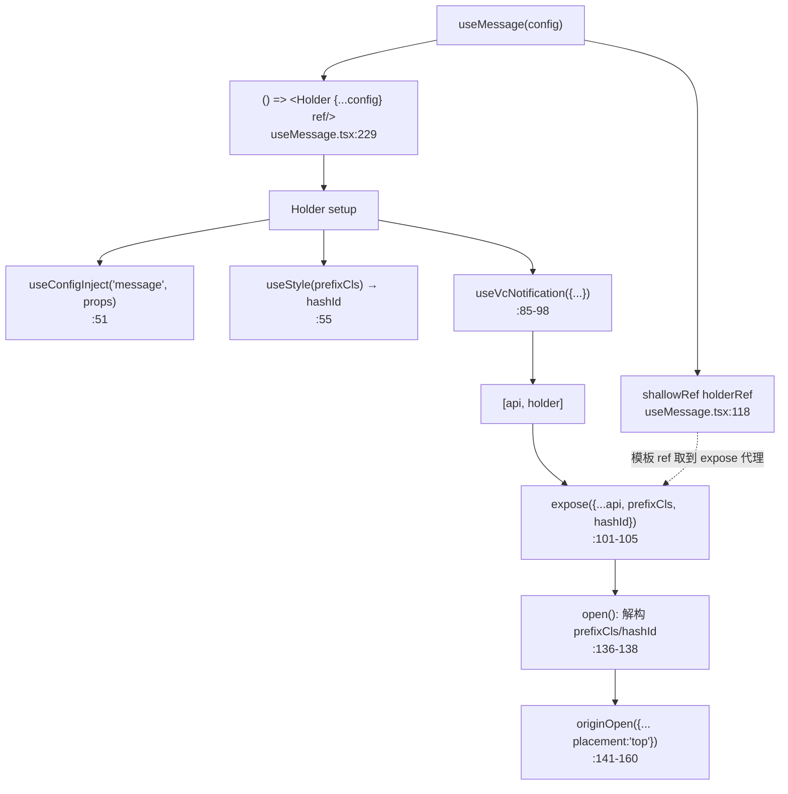
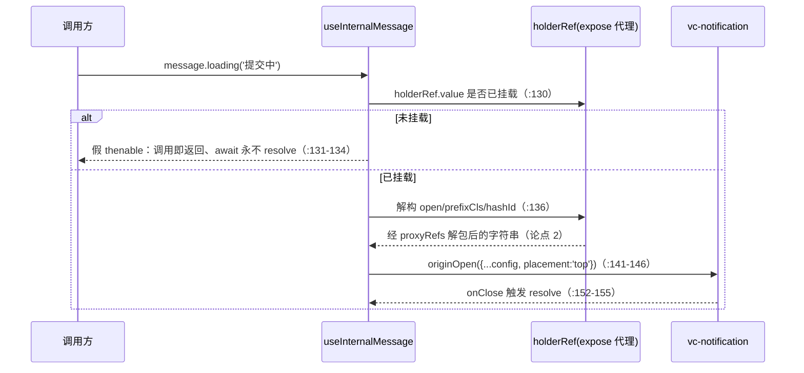

# C07-06 Message 全局消息

> **本篇解决**：`message` 与 `notification` 明明共用 `vc-notification` 内核，为什么一个的配置通道通、另一个不通；`Holder` 的 `expose` 为什么必须依赖 Vue 的 expose 代理才会正确；以及「只能从顶部出现」这件事在源码里是哪几行决定的。
> **前置**：C07-07《Notification 通知》（本篇的对照组）、C12-01《App 应用容器》、I09《动画与 motion 体系》。

## 一、职责与边界

`message` 是轻量的单行全局提示：无标题/正文之分、默认不可关闭、只从顶部居中滑入、3 秒自动消失。它与 `notification` 共用同一个底层内核 `vc-notification`（`message/useMessage.tsx:2` 导入 `useNotification as useVcNotification`），这决定了读 `message` 的正确姿势：**把它当成 `vc-notification` 的又一个带默认值的包装**，然后逐条看它改了哪些默认值、又丢了哪些能力。

本篇与 C07-07 互为对照，两边的差异全部给到行号：偏移 8 对 24、时长 3 对 4.5、`closable` false 对 true、方位「只有顶部」对六种、Holder props 10 项对 6 项。C12-01 论点 9 已经做过这张不对称表（从 `App.useApp()` 的视角），本篇补的是 `message` 自身实现侧的成因，不重复那张表的结论。

边界上还有三件事要先说清：

1. **`message` 没有 `bottom` 概念。** `getStyles()` 只返回 `left`/`transform`/`top` 三个键（`message/useMessage.tsx:61-68`），`HolderProps` 继承的 `ConfigOptions` 里也没有 `bottom`。这不是「默认值不同」而是**能力缺失**：想从底部弹提示只能改用 `notification`。
2. **`closable: false` 但 `closeIcon` 照样构造。** `message/useMessage.tsx:92-93` 同时传 `closable: false` 与 `closeIcon: mergedCloseIcon`，后者是一段真实构建出来的 JSX（`:79-84`），在 `closable: false` 下永远不会渲染。这是「API 面存活、实现死亡」族的又一个样本。
3. **动画名来自 `vc-trigger` 的工具而不是本目录。** `getMotion` 从 `message/useMessage.tsx:17` 导入（真实定义在 `vc-trigger/utils/motionUtil.ts`），默认值写成模板字符串 `` `move-up` ``（`:75`）——一个不带插值的模板串，与直接写 `'move-up'` 等价，属于迁移痕迹。动画体系本体归 I09。

## 二、源码地图

```
packages/xiaoye-ui/src/message/
├── index.tsx          252   静态 API：11 个模块级全局量 + 单实例缓存
├── useMessage.tsx     230   Holder + hook 包装 API（本篇主战场）
├── PurePanel.tsx       77   文档静态面板
├── interface.ts        48   类型面
└── style/index.ts     180   CSS-in-JS
```

`useMessage.tsx` 的结构与 `notification/useNotification.tsx` 完全同形（同一个作者模板的两次实例化）：`HolderProps` 类型（`message/useMessage.tsx:30-31`）、`HolderRef` 接口（`:31-34`）、`Holder` 组件（`:36-108`）、`useInternalMessage`（`:115-225`）、默认导出薄壳（`:227-229`）。同形的两份代码里，**只有两处地方不同**：props 声明表与 `expose` 的写法。这两处差异造成了两边完全不同的可靠性，见论点 1 与论点 2。

静态侧的全局面比 `notification` 更宽：`message/index.tsx:15-24` 有 `defaultDuration`、`defaultTop`、`messageInstance`、`key`、`localPrefixCls`、`transitionName`、`hasTransitionName`、`getContainer`、`maxCount`、`rtl` 十个 `let`，加上 `message/index.tsx:106` 的 `typeToIcon` 与 `:113` 的 `typeList`（`Object.keys(typeToIcon) as NoticeType[]`，即**类型面由图标表反向决定**）。

## 三、架构与数据流



数据流上有两处「快照 vs 活引用」的岔口，是本篇的技术核心：

- **快照**：`prefixCls: prefixCls.value`（`message/useMessage.tsx:89`）与 `getContainer: props.staticGetContainer ?? getPopupContainer.value`（`:95`）都在 setup 执行那一刻求值一次，交给 `useVcNotification` 后不再更新。
- **活引用**：`getStyles`（`:59-67`）与 `getClassName`（`:68`）是**函数**，内核每次渲染都会重新调用，因此 `props.top`、`props.rtl`、`hashId.value`、`prefixCls.value` 都是新鲜的。

同一份 setup 里两种风格并存，于是产生了「改 `top` 会动、改 `prefixCls` 不动、改容器函数不动」这种混合行为。



## 四、核心机制精读

### 论点 1：Holder 的 props 表是这条配置链的唯一入口，`message` 有十项而 `notification` 只有六项

```tsx
// message/useMessage.tsx:38-52
const Holder = defineComponent({
  name: 'Holder',
  inheritAttrs: false,
  props: [
    'top',
    'prefixCls',
    'getContainer',
    'maxCount',
    'duration',
    'rtl',
    'transitionName',
    'onAllRemoved',
    'animation',
    'staticGetContainer',
  ],
```

Vue 只把**声明过的**名字放进 `props`，其余进 `attrs`；`Holder` 又写了 `inheritAttrs: false`（`:39`），所以未声明的配置项既不会落到 DOM，也不会被 `setup` 读到。`message` 这一份把 `setup` 里读到的名字都补齐了：`props.top`（`:60`）、`props.rtl`（`:68`）、`props.animation`（`:75`）、`props.transitionName`（`:76`）、`props.duration`（`:91`）、`props.staticGetContainer`（`:95`）、`props.maxCount`（`:96`）、`props.onAllRemoved`（`:97`）、`props.prefixCls`（`:53`）。

对照 `notification/useNotification.tsx:38` 的 `['prefixCls','class','type','icon','content','onAllRemoved']`——六项，而它的 `setup` 读的是 `props.top`、`props.bottom`、`props.rtl`、`props.maxCount`、`props.getPopupContainer`（`notification/useNotification.tsx:44`、`:49`、`:126-135`）。**两边读的名字都出现在各自的 `HolderProps` 类型里，但只有 message 的运行时声明与之匹配。** 于是 `useMessage({ top: 100, duration: 1 })` 生效，而 `useNotification({ top: 100, maxCount: 3 })` 静默无效。这是同一套模板复制两次、只改了一份声明的典型后果（详见 C07-07 论点 1）。

另外注意 `getContainer` 与 `staticGetContainer` 两个名字都在 props 表里，但 `setup` 只用后者（`:95`），前者从未被读取——即「声明了但没人用」的多余项，与 C07-07 里 `ConfigProps` 有 `getContainer` 而实现另有其人相呼应。

### 论点 2：`expose` 交出的是 ref，正确性完全依赖 Vue 的 expose 代理

```ts
// message/useMessage.tsx:33-36、:101-105
interface HolderRef extends NotificationAPI {
  prefixCls: string;
  hashId: string;
}
...
    expose({
      ...api,
      prefixCls,
      hashId,
    });
```

`prefixCls` 是 `computed`（`:53`），`hashId` 是 `useStyle` 返回的 ref（`:55`），而 `HolderRef` 把两者都声明成 `string`。消费端直接按字符串用：

```ts
// message/useMessage.tsx:136-137
    const { open: originOpen, prefixCls, hashId } = holderRef.value;
    const noticePrefixCls = `${prefixCls}-notice`;
```

这段能工作，唯一原因是 `holderRef.value` 拿到的是 Vue 为 `expose` 对象构造的**代理**，属性访问时才做 ref 解包；如果谁绕过模板 ref、直接持有 `expose` 传入的那个原始对象，`${prefixCls}` 就会得到 `[object Object]-notice`，全部消息的类名一起坏掉。类型标注（`:31-34`）描述的是代理视角，不是原始对象视角，这类「运行时靠代理兜住、类型与实现都不自证」的写法在本库里不止一处（`expose` 形状不匹配这条在 C12-01 里也出现过）。

反过来看 `notification/useNotification.tsx` 的做法：它显式写 `prefixCls: prefixCls.value`（即快照字符串），于是**不需要代理也正确**，但代价是 prefixCls 永久停留在 setup 时刻的值。两种写法各自成立，取向相反：`message` 保持新鲜但依赖代理，`notification` 不依赖代理但会过期。

### 论点 3：`placement: 'top'` 写在展开之后，调用方无法改方位

```ts
// message/useMessage.tsx:147-159
      originOpen({
        ...restConfig,
        key: mergedKey,
        content: () => (
          <PureContent prefixCls={prefixCls} type={type} icon={...}>
            {typeof content === 'function' ? content() : content}
          </PureContent>
        ),
        placement: 'top',
```

`restConfig` 先展开、`placement` 后写死（`:148`），因此**任何用户传入的 `placement` 都会被覆盖**。而 `notification` 侧的顺序相反：`placement: 'topRight'` 写在 `...restConfig` **之前**（`notification/useNotification.tsx:99-100`），所以显式传的方位生效。同一个对象字面量里的键序差异，决定了两个组件「能不能改方位」这条公开能力。`message` 的 `getStyles()` 也印证了它压根不支持别的方位（`:59-67` 只算 `top` 与水平居中）。

同样的键序问题还出现在类名上：`class: classNames(type && `${noticePrefixCls}-${type}`, hashId, className)`（`:155`）里 `className` 排在最后，属于追加而非覆盖，这是对的；但它上面挂着 `// @ts-ignore`（`:154`），说明这段的类型本身就不自洽。

### 论点 4：假 thenable 让 `await message.open()` 在未挂载时永久挂起

```ts
// message/useMessage.tsx:129-134
  const open = (config: ArgsProps): MessageType => {
    if (!holderRef.value) {
      const fakeResult: any = () => {};
      fakeResult.then = () => {};
      return fakeResult;
    }
```

返回的对象**既是函数又是 thenable**：`then` 被替换成空操作，因此 `await` 它时，Promise 决议流程调用 `then(resolve, reject)`，而这个实现忽略两个参数、什么都不调用 ——于是 `await` 永远不返回，且不会报错、不会超时。这是「holder 尚未渲染就调用」这一时序错误的放大版：不抛异常，只把一个 Promise 永久悬置（连带它的 `.finally` 与 `try/await` 之后的代码全部不再执行）。

`notification` 侧的同一守卫返回的是裸 `undefined`（`notification/useNotification.tsx:92-95`），`await undefined` 立刻完成。两边对同一失败模式给出相反的可观察后果——这条对照在 C12-01 坑 7 里记为结论，本篇把成因落到 `fakeResult.then = () => {}` 这一行。

自动 key 的生成是模块级计数器：`let keyIndex = 0`（`:113`）配合 `xy-message-${keyIndex}`（`:140` 附近）。因为挂在模块上，多个 `useMessage()` 实例共享同一序号，key 全局唯一但**不带实例标识**，所以 `destroy(key)` 只能命中当前 holder。

### 论点 5：类型化方法用「参数二态」兼容两种调用姿势

```ts
// message/useMessage.tsx:178-198（要点）
      if (jointContent && typeof jointContent === 'object' && 'content' in jointContent) {
        config = jointContent;
      } else {
        config = { content: jointContent as VNode };
      }
      ...
      if (typeof duration === 'function') {
        mergedOnClose = duration;
      } else {
        mergedDuration = duration;
        mergedOnClose = onClose;
      }
```

`message.success(...)` 这类方法（由 `keys` 数组循环生成，`message/useMessage.tsx:190-223`）接受两种第一参数——VNode 或含 `content` 的对象——并且第二参数既能是时长又能是回调（函数即回调）。这是命令式 API 少见的「重载靠运行时判型」写法：`'content' in jointContent`（`:180`）决定走哪条，`typeof duration === 'function'`（`:187`）决定第二个参数含义。

值得注意的取舍：`notification` 的类型方法只收 config 对象（`notification/index.tsx:244-251`、`notification/useNotification.tsx:133-138`），**没有位置参数形态**。因此 `message.success('ok', 2)` 合法，`notification.success('ok')` 非法。同一族的两个组件在「最常用的一句提示」上 API 形状不同。

最后组装的 `keys` 是五个类型：`['info','success','warning','error','loading']`（`message/useMessage.tsx:189`），比 `notification` 的四个多一个 `loading`（`notification/useNotification.tsx:130` 只有 `success/info/warning/error`）。而 `message` 侧的 `loading` 没有任何特殊实现——它只是 `type: 'loading'` 的一条普通消息，靠 `duration` 决定是否自动消失；`notification` 侧连这个类型都没有（`notification/index.tsx:23` 的 `IconType` 四类），所以 `typeToIcon` 也没有 loading 项（`notification/index.tsx:146-151`）。

### 论点 6：容器落点没有 `document.body` 兜底

`getContainer: props.staticGetContainer ?? getPopupContainer.value`（`message/useMessage.tsx:95`）只认这两个来源，二者都为空时把 `undefined` 交给内核。`notification` 的 hook 路径写的是三级兜底（`notification/useNotification.tsx:63`：`props.getPopupContainer?.() || getPopupContainer.value?.() || document.body`），静态侧也有 `defaultGetContainer = () => document.body`（`notification/index.tsx:45`）。也就是说 `message` 是否落到 `body`，取决于 `vc-notification` 内部对空容器的处理，而不是 `message` 自己的契约——这条把「消息挂在哪」的决定权交给了下层。

### 论点 7：静态侧靠「把实例置空」来让配置生效

`message/index.tsx` 的 `config()` 不像 `notification` 那样只改全局量，它在改某些值时**顺手销毁现有实例**：

```ts
// message/index.tsx:43（同样形态的重置也出现在 :54、:58、:63）
    messageInstance = null; // delete messageInstance for new defaultTop
    messageInstance = null; // delete messageInstance for new getContainer
    messageInstance = null; // delete messageInstance for new transitionName
    messageInstance = null;
```

原因是容器样式在实例创建时就固定了：`getMessageInstance()` 把 `style: { top: defaultTop }` 作为**覆盖内核样式的手段**传给 `Notification.newInstance`（`message/index.tsx:83`，注释原文「覆盖原来的样式」），连同 `hasTransitionName`（`:82`）一起，都属于「建实例时才读一次」的参数。所以如果只改 `defaultTop` 而不重建实例，新偏移不会应用。置空 `messageInstance` 让下一次 `getMessageInstance()`（`message/index.tsx:70`）走进创建分支（`:94` 重新赋值），从而把新配置带进去。

这套机制有两个直接后果：

1. **配置改动会连带丢弃已经在屏上的消息**。实例被置空后，旧容器随实例生命周期结束而消失；这与 `notification` 侧「旧容器继续存在、新配置只对后来的通知生效」的行为不同（`notification/index.tsx:95` 的缓存字典不会因为 `config()` 被清空）。
2. **`hasTransitionName` 是一个一次性开关**：它在 `config()` 里被置真（`message/index.tsx:59`）且初值为假（`message/index.tsx:21`），意思是「只要用户显式配过 transitionName，就告诉内核不要再自己算动画」。这是 `message` 独有的内核协商参数，`notification` 侧对应的是固定传 `hasTransitionName: true`（`notification/index.tsx:137`）。

静态与 hook 两条路径的实例持有方式也不同：静态侧是一个模块变量 `let messageInstance`（`message/index.tsx:17`），而 `notification` 用的是按「前缀-方位-rtl」分键的字典（`notification/index.tsx:37-39`）。因此静态 `message` 在全局只能有一个容器、一种偏移，配合论点 3 里被写死的 `placement: 'top'`，构成「message 天生只有顶部一条方位」的完整因果链。

类型方法的挂载方式也不同：静态侧通过 `attachTypeApi(api, type)` 循环生成（`message/index.tsx:228`，枚举源是 `message/index.tsx:113` 的 `typeList`，而 `typeList` 由 `Object.keys(typeToIcon)` 反向得到，`message/index.tsx:106`），hook 侧则是在 `wrapAPI` 上直接赋值（`message/useMessage.tsx:221`）。也就是说**同一组五个类型方法被两套代码用两种方式生成**，改枚举面时需要同时确认 `typeToIcon`（图标表）与 `keys`（hook 侧数组）两处。

## 五、对外契约如何生效

`MessageInstance` 的公开面由 `useInternalMessage` 返回的 `wrapAPI` 决定（`message/useMessage.tsx:184-188` 的 `open`/`destroy` 加上 `:190-223` 循环出的五个类型方法），第二返回值是渲染函数（`:225`），必须放在模板插值位置：`[wrapAPI, () => <Holder key={holderKey} {...messageConfig} ref={holderRef} />]`（`:225`）。`holderKey` 是一个 `Symbol`（`:119`），用作 vnode key 以避免与业务 key 冲突。

props 侧契约：`ConfigOptions`（`message/interface.ts`）+ `onAllRemoved`（`message/useMessage.tsx:30`）构成 `HolderProps`，其中 `getContainer` 项声明了却无人读取（论点 1 末段），`top`/`duration`/`rtl`/`transitionName`/`animation`/`staticGetContainer` 全部可用。`destroy` 的语义是「给 key 关单条，不给 key 全清」（`message/useMessage.tsx:176-183`）。

静态侧是另一套：`message/index.tsx:192-194` 组装 `api`，`destroy` 分支里判断当前实例是否已建立再决定调用还是丢弃（`message/index.tsx:195-205`）；`message/index.tsx:17` 的 `let messageInstance` 是**单个变量**而不是 `notification/index.tsx:37-39` 那样的字典，因此全局静态 `message` 只有一个容器、一次只能记住一个实例（这也是它没有 `placement` 的结构性原因）。`message/index.tsx:113` 的 `typeList` 把图标表键序对外暴露，供文档与测试枚举类型用。

## 六、设计取舍

**取舍一：把内核的默认值改掉，而不是在内核里加开关。** `closable: false`、`duration: 3`、`offset 8`、水平居中（`message/useMessage.tsx:21-22`、`:59-67`、`:88-91`）都靠在包装层传默认参数实现。好处是 `message` 的 230 行几乎不含自有机制、可读性高；代价是内核能力被包装层裁剪后无法回补——想 closable 只能换用 `notification`（`closeIcon` 已经构造好了却因 `closable: false` 永不渲染，`:89-90`）。

**取舍二：假 thenable 而不是抛错或返回已决议的 Promise。** 选择「静默丢弃 + 挂起」避免了 SSR/首屏竞态下的大面积报错（`await message.open()` 在多数代码里是可选等待），但也让时序 bug 变成不可诊断。可辩护的替代是返回 `Promise.resolve()`：不报错、也不会永久挂起。当前实现的两面性在于它同时是函数与 thenable（`message/useMessage.tsx:131-133`），因此还能兼容 `message.open(...).then(...)` 与把它当返回值丢弃两种用法。

**取舍三：`animation` 与 `transitionName` 双通道并存。** `getMotion({ prefixCls, animation: props.animation ?? 'move-up', transitionName: props.transitionName })`（`message/useMessage.tsx:73-76`）把「动画族名」和「完整 transitionName」两个粒度都暴露出去，静态侧还有 `hasTransitionName` 这个开关（`message/index.tsx:21`）。三个入口都能影响最终动效名，优先级由 `getMotion` 内部决定，因此这类「多入口一个效果」的配置面属于易用性与可预测性之间的让步。

**取舍四：expose 交 ref，而不是交快照。** 见论点 2——`message` 换来新鲜值、押注代理语义；`notification` 换来独立性、押注快照不过期。两者都不是显然正确，本库没有为这条选择留下任何注释。

## 七、坑与改动指南

**坑 1：`await message.open(...)` 在 holder 未挂载时永久挂起。**
触发：在 `App` 的 holder 渲染之前（或脱离 `<Holder>` 使用 `useMessage()`）调用并 `await`。
症状：后续代码不再执行，也不报错；`try/finally` 的 finally 同样不跑。
原因：`message/useMessage.tsx:129-134` 返回 `then` 被替换为空操作的假 thenable。
定位：`message/useMessage.tsx:129-134`；对照 `notification/useNotification.tsx:92-95`。

**坑 2：给 `message` 传 `placement` 无效。**
触发：`message.open({ content, placement: 'bottomRight' })`。
症状：仍然从顶部居中弹出。
原因：`placement: 'top'` 写在 `...restConfig` 之后（`message/useMessage.tsx:159`），且 `getStyles` 只算 `top`（`:59-67`）。
定位：`message/useMessage.tsx:147-159`、`:59-67`。

**坑 3：`getContainer` prop 声明了但没人读；容器函数只在 setup 求值一次。**
触发：`useMessage({ getContainer: () => myEl })`，或先挂 holder 再切换 `ConfigProvider` 的 `getPopupContainer`。
症状：前者完全无效；后者不会迁移已有消息的挂载点。
原因：props 表含 `getContainer`（`message/useMessage.tsx:44`）但 `setup` 只用 `staticGetContainer`（`:95`）；且 `getPopupContainer.value` 是 setup 期快照（`:95`）。
定位：`message/useMessage.tsx:44`、`:95`。

**坑 4：`prefixCls` 传给内核的是快照值。**
触发：动态改变 `ConfigProvider` 的 `prefixCls`。
症状：已挂载消息的内部类名前缀不变，新消息类名与样式 hash 组合可能不匹配。
原因：`prefixCls: prefixCls.value`（`message/useMessage.tsx:89`）在 setup 时求值；而 `getClassName`/`getStyles` 是函数所以 `hashId`/`top` 会更新——同一个 setup 里两种更新语义并存。
定位：`message/useMessage.tsx:56`、`:87`、`:95` 对照 `:59-68`。

**坑 5：`closable: false` 时 `closeIcon` 仍被构造。**
触发：任何 `message.*` 调用。
症状：无功能影响，但每次 setup 都白建一段 JSX，且 `closeIcon` 相关样式类（`-close-x`、`-close-icon`，`message/useMessage.tsx:82-84`）永不出现。
原因：`:89-90` 同时传 `closable: false` 与 `closeIcon`。
定位：`message/useMessage.tsx:79-90`。

**坑 6：模块级 `keyIndex` 跨实例共享。**
触发：同一页面两处 `useMessage()`。
症状：key 序列被两边共同推进，按 key 做幂等（「同一请求只提示一次」）的逻辑会跨实例误命中或漏命中。
原因：`let keyIndex = 0`（`message/useMessage.tsx:113`）在模块作用域，自增加在 `open` 内（`:139` 附近）。
定位：`message/useMessage.tsx:113`、`:137-140`。

**坑 7：`config()` 改偏移/容器/动画名会顺带清掉正在显示的消息。**
触发：页面已弹出若干消息，随后调用 `message.config({ top: 60 })`（或 `getContainer`、`transitionName`、`duration`）。
症状：屏上消息瞬间消失。
原因：这四个分支都会把实例引用置空（`message/index.tsx:43`、`message/index.tsx:54`、`message/index.tsx:58`、`message/index.tsx:63`），而偏移与动画名只在实例创建时注入（`message/index.tsx:82-83`），不重建就带不进新值。
定位：`message/index.tsx:43`、`:54`、`:58`、`:63`、`:70`、`:82-83`、`:94`。

**坑 8：静态 `destroy()` 的行为分叉取决于实例内部方法是否存在。**
触发：`message.destroy()` 在「无实例」与「有实例但实例没有 `destroy`」两种状态下调用。
症状：前者静默返回，后者只把 `message/index.tsx:203` 的引用置空而屏上消息未关。
原因：`api.destroy`（`message/index.tsx:195-205`）里先判实例、再解构 `const { destroy } = messageInstance`（`message/index.tsx:201`），两条出口的效果不等价。
定位：`message/index.tsx:195-205`。

**补充：静态与 hook 两侧「关闭」的记账层级不同。** 静态侧的类型方法会包一层并自建 `closePromise` 来维持 thenable 语义（`message/index.tsx:138`、`message/index.tsx:216`、`message/index.tsx:224`），hook 侧则由 `wrapPromiseFn` 直接返回并在 `onClose` 里决议（`message/useMessage.tsx:146`、`message/useMessage.tsx:162-165`）。静态侧交给内核的实参只有 `key`、`duration`、`style`、`class` 与一个 `content` 渲染函数（`message/index.tsx:145` 取实例、`message/index.tsx:147-151` 逐项传入），因此「同一条消息被两边分别 await」时的时序不保证一致。默认导出与具名导出指向同一个对象（`message/index.tsx:251`、`message/index.tsx:252`），所以 `import { message }` 与 `import message from` 共享同一份模块级状态——与 C07-07 的「全局面」结论同源。

**改动安全边界**：`Holder` 的 props 表（`message/useMessage.tsx:41-52`）与 `useNotification.tsx` 的对应表（`notification/useNotification.tsx:38`）是一对**复制未同步**的清单，任何一边补项应考虑是否同步另一边，否则不对称会继续扩大；改 `expose` 的形状（`:101-105`）前，必须先确认消费点（`:136`）仍走模板 ref，否则会从「依赖代理」退化成「拿到 ref 对象」。

## 附：本篇可证伪的三个检查点

**检查点 1：两边的 Holder props 数量差是 10 对 6。**

```bash
grep -c "'" packages/xiaoye-ui/src/message/useMessage.tsx | head -1
awk 'NR>=38 && NR<=49' packages/xiaoye-ui/src/message/useMessage.tsx | grep -c "^    '"
sed -n "38p" packages/xiaoye-ui/src/notification/useNotification.tsx
```

预期第二条为 `10`、第三条那一行的数组含 6 个名字。一旦两边数目一致，论点 1 与坑 3 需重写。

**检查点 2：`placement: 'top'` 仍写在展开之后。**

```bash
grep -n "\.\.\.restConfig\|placement: 'top'" packages/xiaoye-ui/src/message/useMessage.tsx
grep -n "placement: 'topRight'\|\.\.\.restConfig" packages/xiaoye-ui/src/notification/useNotification.tsx
```

预期 `message` 侧 `...restConfig` 的行号**小于** `placement: 'top'` 的行号（覆盖关系成立），`notification` 侧相反。若 `message` 的两行顺序颠倒，坑 2 已修复。

**检查点 3：假 thenable 仍是「函数 + 空 then」。**

```bash
grep -n "fakeResult" packages/xiaoye-ui/src/message/useMessage.tsx
```

预期三行：声明为箭头函数（`:131`）、`fakeResult.then = () => {}`（`:132`）、`return fakeResult`（`:133`）。若 `then` 的实现改成 `Promise.resolve()`，坑 1 与论点 4 需删改。
