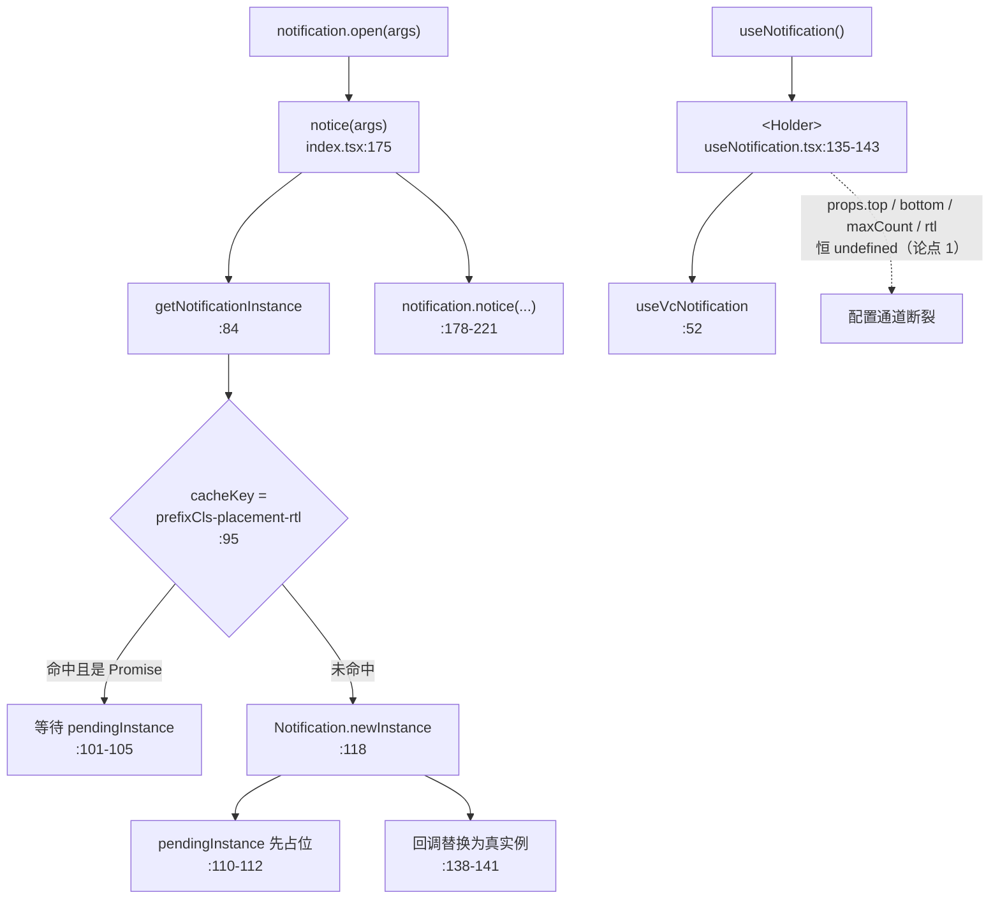
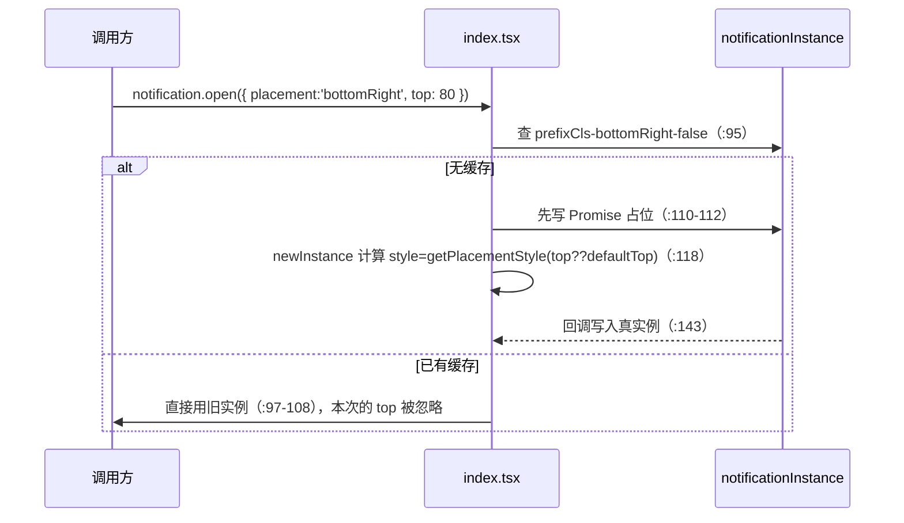

# C07-07 Notification 通知

> **本篇解决**：`notification` 为什么同时存在两套挂载体系（静态 API 的 `Notification.newInstance` 与 `useNotification` 的 `Holder`）；两套之间的配置通道为什么一边能用一边失效；实例缓存键为什么决定了偏移量的生效方式；以及 `destroy()` 里那行自带 `lgtm` 注释的删除为什么是竞态。
> **前置**：A07《交互基础设施总览》、C12-01《App 应用容器》（本篇的对照组）、I02《vc-trigger》。

## 一、职责与边界

`notification` 是本库里**唯一有两条完全独立实现路径**的反馈组件。同一个 `<xy-notification>` 语义，走 `notification.open({...})` 与走 `useNotification()` 得到的两套 Holder、两条配置通道、两套默认值来源，代码上互不共享：

- 静态路径：`notification/index.tsx` 的 `notice()`（`index.tsx:175`）→ `getNotificationInstance()`（`:84`）→ `vc-notification` 的 `Notification.newInstance()`（`:118`），容器由 `renderHelper`/`appContext` 体系创建。
- Hook 路径：`useNotification.tsx` 的 `useInternalNotification()`（`:83`）→ 组件内渲染 `<Holder>`（`:135-143`）→ `useVcNotification()`（`:52`）。

两条路径的**默认值来源不同**这一点非常关键：静态路径读模块级可变全局量（`index.tsx:40-48` 的 `let defaultDuration`、`defaultTop`、`defaultBottom`、`defaultPlacement`、`rtl`、`maxCount` 等），由 `setNotificationConfig()`（`:50`）改写；hook 路径读 `Holder` 的 props（`useNotification.tsx:44`、`:50`、`:64`、`:65`）。因此 `notification.config({ top: 100 })` 只影响静态路径，`<App :notification="{ top: 100 }">` 只可能影响 hook 路径——而下面论点 1 会证明 hook 路径这条其实**接不到**。

与相邻模块的边界：`vc-notification` 本体（队列、`Notice`、`NotificationProvider`）不属于本篇；弹层定位与外点关闭归 A07；`message` 的对照结论归 C12-01（该篇论点 9 已给出 offset 24 对 8、时长 4.5 对 3、`closable` true 对 false 的不对称表）。本篇只补 notification 自身的机制与缺陷。

## 二、源码地图

```
packages/xiaoye-ui/src/notification/
├── index.tsx           278   静态 API：模块全局量 + 实例缓存 + notice()
├── useNotification.tsx 145   hook 路径：Holder + 包装 API
├── PurePanel.tsx       123   文档用的静态展示面板（含 getCloseIcon）
├── util.ts              73   getPlacementStyle（:5）与 getMotion（:69）
├── interface.ts         56   类型面
└── style/index.ts           CSS-in-JS 组件样式
```

`index.tsx` 的全局状态段（`:37-48`）值得完整读一遍：一个 `notificationInstance` 字典加七个 `let` 默认量。`ConfigProps`（`:25-34`）声明了 `top/bottom/duration/prefixCls/placement/getContainer/closeIcon/rtl/maxCount` 九个可配项，但 `setNotificationConfig` 只解构了其中八个——`rtl` 走 `options.rtl !== undefined` 单独读取（`:73-75`），与其余字段的解构风格不一致，这暗示它曾被漏掉过。

导出面在 `:224-254`：`api.open`、`api.close`、`api.config`、`api.destroy`、四个类型方法（`:244-251` 由 `iconTypes` 循环生成），再加一个别名 `api.warn = api.warning`（`:253`）与 `api.useNotification`（`:254`）。`NotificationApi` 接口（`:262-269`）把 `warn` 也写进了公开类型，因此类型面上 `warn` 与 `warning` 是等价合法的两个名字。

## 三、架构与数据流





静态路径的核心数据结构是那个**以「前缀 + 方位 + rtl」为键**的实例字典（`:95`）。一个键对应一个常驻容器，同一键下的所有通知共享该容器的偏移样式与 `maxCount`。

## 四、核心机制精读

### 论点 1：Hook 路径的 Holder 只声明了六个 props，配置项全部读成 undefined

这是本篇最实在的缺陷。`Holder` 的运行时 props 声明是：

```tsx
// useNotification.tsx:35-38
const Holder = defineComponent({
  name: 'Holder',
  inheritAttrs: false,
  props: ['prefixCls', 'class', 'type', 'icon', 'content', 'onAllRemoved'],
```

而它的 `setup` 读的是另一批名字：

```tsx
// useNotification.tsx:43-44、:50、:64-65、:67
    const getStyles = (placement: NotificationPlacement) =>
      getPlacementStyle(placement, props.top ?? DEFAULT_OFFSET, props.bottom ?? DEFAULT_OFFSET);
    const getClassName = () => classNames(hashId.value, { [`${prefixCls.value}-rtl`]: props.rtl });
        props.getPopupContainer?.() || getPopupContainer.value?.() || document.body,
      maxCount: props.maxCount,
      onAllRemoved: props.onAllRemoved,
```

`HolderProps` 类型（`:25-28`）确实声明了 `top`/`bottom`/`maxCount`/`rtl`/`getPopupContainer`，但**类型标注不影响 Vue 的运行时 props 解析**：未出现在 `props` 数组里的属性一律落进 `attrs`。而 `Holder` 又写了 `inheritAttrs: false`（`:37`），返回的又是 `holder` 函数本身（`:75`），attrs 既不会被透传到 DOM，也不会变成 props。结果是一条完整的静默失效链：

| 配置项 | 读取处 | 实际值 | 后果 |
| --- | --- | --- | --- |
| `top` / `bottom` | `:44` | 恒 undefined | 永远取 `DEFAULT_OFFSET = 24`（`:16`） |
| `rtl` | `:50` | 恒 undefined | `-rtl` 类永不产生 |
| `maxCount` | `:65` | 恒 undefined | 队列上限不生效 |
| `getPopupContainer` | `:64` | 恒 undefined | 只能退到 `useConfigInject` 的那一条（`:64` 第二项） |
| `onAllRemoved` | `:67` | 正常 | 它是唯一被声明的回调类 prop（`:38`） |

而调用侧确实把这些值传进来了：`useInternalNotification` 的返回处 `<Holder key={holderKey} {...notificationConfig} ref={holderRef} />`（`:141-142`）把 `NotificationConfig` 整包展开。所以从 API 面上看，`useNotification({ top: 100, maxCount: 3 })` 是「有类型、有参数、有文档、无效果」。

对照组非常清楚：`message/useMessage.tsx` 的 Holder 声明了 `'top'`、`'maxCount'`、`'duration'`、`'rtl'`、`'transitionName'`、`'onAllRemoved'` 等八个（`:41-49`），并在 `:94` 用 `duration: props.duration ?? DEFAULT_DURATION` 读取——**同一条通道在 message 侧是通的**。这也是 C12-01 论点 9 记录的那批 message/notification 不对称里最严重的一条：它不是默认值不同，而是 notification 侧的配置根本进不来。

### 论点 2：缓存键决定容器，于是「第一次调用」的偏移量永久占有该方位

`getNotificationInstance` 的缓存键是 `${prefixCls}-${placement}-${rtl}`（`index.tsx:95`），命中即直接复用（`:97-108`）。而偏移样式在**创建时**一次性算出并交给 `newInstance`：

```tsx
// index.tsx:118-126
  Notification.newInstance(
    {
      name: 'notification',
      prefixCls: customizePrefixCls || defaultPrefixCls,
      useStyle,
      class: notificationClass,
      style: getPlacementStyle(placement, top ?? defaultTop, bottom ?? defaultBottom),
      appContext,
      getContainer,
```

`top`/`bottom` 不在缓存键里，也不在复用路径上重新计算。于是同一方位下，**首次调用携带的 `top` 会被后续所有通知继承**：先 `notification.open({ placement: 'topRight', top: 200 })`，再 `notification.open({ placement: 'topRight', top: 0 })`，第二条仍然落在 200px 处——`getPlacementStyle`（`util.ts:5-12`）只在第一次被调用。同理 `getContainer`（`:126`）与 `closeIcon`（`:127-133`）也被首调用锁定，而 `NotificationArgsProps` 把这三项都声明为**每次调用可传**的参数（`:168-172`）。

`prefixCls` 参与键名带来另一个后果：`App` 上下文里用 `useNotification` 挂的容器（hook 路径）与静态 `notification.open` 的容器是两个世界——前者由 `<Holder>` 渲染在组件树内（`useNotification.tsx:141`），后者由 `newInstance` 挂到 `getContainer()`（`index.tsx:126`，默认 `defaultGetContainer = () => document.body`，`:45`）。同一个 `placement` 下最多能出现两个互不知情的堆叠容器。

### 论点 3：占位 Promise 让并发首调共享一个实例，但 `destroy()` 立刻删键

首次创建时先把一个未 resolve 的 Promise 写进缓存（`:109-113`），真实例到达后才替换并 resolve（`:138-141`）。命中分支专门处理这种中间态：

```ts
// index.tsx:97-108
  if (cacheInstance) {
    if (cacheInstance instanceof Promise) {
      cacheInstance.then(instance => {
        callback(instance);
      });
    } else {
      callback(cacheInstance);
    }
    return;
  }
```

这段是正确的：并发首调会排队等同一个 Promise，因此不会创建两个容器。但 `destroy()` 的做法与之矛盾：

```ts
// index.tsx:234-242
  destroy() {
    Object.keys(notificationInstance).forEach(cacheKey => {
      Promise.resolve(notificationInstance[cacheKey]).then(instance => {
        instance.destroy();
      });
      delete notificationInstance[cacheKey]; // lgtm[js/missing-await]
    });
  },
```

`delete` 是同步执行的，而真正的 `instance.destroy()` 在微任务里。源码用 `// lgtm[js/missing-await]` 注释把这一处显式标给了静态扫描器，等于承认知道它是异步缺口。后果是：`notification.destroy()` 之后、微任务队列清空之前发起的 `open()` 会走「未命中」分支重新创建实例，随后旧的 `destroy()` 回调打到新实例上（因为 `Promise.resolve` 链持有的是删除前取到的那个值，仍会执行）——出现「刚销毁又冒出来」或「新容器被误清」。

`close(key)` 的做法也值得注意：它遍历**所有**缓存键逐个 `removeNotice(key)`（`:233-231`），因为调用方只给 key、不给 placement。这是功能正确的广播，但代价是一次关闭要跨所有方位容器，且 `Promise.resolve(...).then` 让它同样落在微任务里。

### 论点 4：内容渲染是函数式插槽约定，`message`/`description`/`btn` 都支持「传函数」

静态路径把内容包成一个 `content({ prefixCls: outerPrefixCls })` 回调（`index.tsx:180-211`），内部自己拼出六层结构：`-with-icon` 外层（`:200`）、`-icon`（`:188`、`:196`）、`-message`（`:203`）、无 description 且有 icon 时插入的 `-message-single-line-auto-margin` 占位（`:203-205`）、`-description`（`:208`）、`-btn`（`:209`）。所有值都经 `renderHelper` 归一（`:188`、`:207`、`:208`、`:209`），也就是既接受 VNode 也接受 getter 函数——这与 `NotificationArgsProps` 里成对的 `VueNode | (() => VueNode)` 类型一致（`:154-157`）。

类型到图标的映射是硬编码四元表（`:146-151`）：`success/info/error/warning` 对应四个 `*CircleOutlined`，全部具名导入自 `@xiaoye-ui/icons`（`:3-8`），符合图标硬约束。注意 `icon` 优先于 `type`（`:186-190`）：显式传 `icon` 时 `typeToIcon` 完全不参与，`-icon-${type}` 那个类名也就不会出现，样式里针对 `type` 的颜色分支因此可能不生效。

hook 路径的结构不同：内容交给 `PureContent`（`useNotification.tsx:103-110`），且 prefixCls 传的是 `noticePrefixCls`（`:96` 拼出的 `${prefixCls}-notice`），而静态路径的 `prefixCls` 是回调入参 `outerPrefixCls` 再拼 `-notice`（`index.tsx:181`）。两条路径最终类名一致，但**拼装发生在两处不同代码里**，改一处不会同步另一处。

### 论点 5：`useNotification` 返回的 API 少两个能力，且 holder 未挂载时静默丢弃

`wrapAPI` 只组装了 `open`、`destroy` 与四个类型方法（`useNotification.tsx:126-138`），没有 `config`，也没有 message 侧那种 `loading`（`:130` 的 `keys` 只有四个名字）。更值得注意的是 `open` 的首行守卫：

```ts
// useNotification.tsx:92-95
  const open = (config: ArgsProps) => {
    if (!holderRef.value) {
      return;
    }
```

holder 尚未挂载时直接返回 `undefined`，通知被丢弃且**不报错、不排队**。对照 `message/useMessage.tsx:129-134`：同样场景下它返回一个「永不 resolve 的假 thenable」（`fakeResult.then = () => {}`）。也就是说两个组件在「调用早于挂载」这一同一失败模式下，一个是静默丢弃、一个是永久挂起 `await`——这正是 C12-01 坑 7 的机制根源，本篇把它落到具体行号上。

`destroy` 的语义也与 message 同形：`key !== undefined` 时关单条，否则整体销毁（`useNotification.tsx:117-124`）。

### 论点 6：通知主体的 DOM 被写了三遍，参数类型也被写了两遍

同一份「图标 + message + description + btn」结构在本目录里有三处独立实现：

| 实现处 | 结构落点 | 图标映射 | 关闭按钮 |
| --- | --- | --- | --- |
| `notification/index.tsx:180-211`（静态路径） | 自己内联拼 `-with-icon`、`-message`、`-description`、`-btn` | `notification/index.tsx:146-151` | `notification/index.tsx:127-133` |
| `notification/PurePanel.tsx:53-80`（`PureContent`） | `-icon`、`-message`、`-description`、`-btn` | `notification/PurePanel.tsx:46` | `notification/PurePanel.tsx:19-24`（`getCloseIcon`） |
| `notification/useNotification.tsx:103-110`（hook 路径） | 复用 `PureContent`（导入在 `notification/useNotification.tsx:6`） | 同上 | 由 `Holder` 传给 `useVcNotification` 的 `closeIcon`（`notification/useNotification.tsx:61`，值来自 `notification/PurePanel.tsx:19-24`） |

也就是说：**静态路径不用 `PureContent`**，它把同一结构又抄了一遍。两份实现的差异是可观察的——`notification/PurePanel.tsx:77-78` 直接把 `message`/`description` 放进 div，而 `notification/index.tsx:206-208` 对每个值都套了 `renderHelper`；`notification/index.tsx:203-205` 那段「无 description 且有 icon 时插一个 `-message-single-line-auto-margin` 占位」的逻辑在 `notification/PurePanel.tsx` 里完全不存在。同理 `typeToIcon` 两张表（`notification/index.tsx:146-151` 与 `notification/PurePanel.tsx:46`）互相独立，`getCloseIcon` 只有 `notification/PurePanel.tsx:19-24` 这一份，静态路径却另写了 `notification/index.tsx:127-133` 的等价 JSX。

类型面同样裂成两份。`notification/interface.ts:9` 定义 `ArgsProps`，`notification/index.tsx:153-172` 另立 `NotificationArgsProps`。hook 路径导入的是前者（`notification/useNotification.tsx:10`），静态路径全程用后者（`notification/index.tsx:87`、`:175`）。两个类型字段集合并不相同：`notification/interface.ts` 里没有 `appContext`，而静态路径必须靠 `notification/index.tsx:172` 的 `appContext?: any` 才能把上下文传给 `Notification.newInstance`（`notification/index.tsx:119`）。这带来一个直接后果：**「哪条路径能拿到什么参数」没有单一事实来源**，给一条路径加参数不会自动出现在另一条上。`NotificationInstance` 也有两份（`notification/interface.ts:27` 与 `notification/index.tsx:256-262`），后者少 `loading`、少 `open` 的返回类型标注。

配置类型同样是两套并行：`notification/interface.ts:48` 的 `NotificationConfig`（被 hook 路径的 `HolderProps` 继承，见 `notification/useNotification.tsx:25`）与 `notification/index.tsx:25-34` 的 `ConfigProps`（`api.config` 的入参，`notification/index.tsx:233`）。`notification/interface.ts:36` 还夹着一个 `GlobalConfigProps`，字段与 `ConfigProps` 高度重叠。三个类型的取舍没有一处注释说明。

## 五、对外契约如何生效

`notification` 的公开对象是 `api`（`notification/index.tsx:224`，默认导出时标注为 `NotificationApi`，`notification/index.tsx:278`）。类型面与实现面的差异有三处值得点明：

1. **`NotificationInstance` 类型（`notification/index.tsx:256-262`）只声明五个方法**，不含 `warn`、`close`、`config`、`destroy`、`useNotification`；这些补在 `NotificationApi`（`notification/index.tsx:264-271`）里。因此 `import { notification }` 拿到的是 `any`（`notification/index.tsx:224` 显式 `const api: any`），类型约束只在默认导出那条路上生效。
2. **`notice()` 不向 `notification.notice()` 透传 `placement`**（`notification/index.tsx:178-221` 的实参列表里没有 placement），方位是容器级属性而不是单条通知的属性，与论点 2 同源。
3. **`getInstance` 是测试后门**：`process.env.NODE_ENV === 'test' ? notificationInstance[cacheKey] : null`（`notification/index.tsx:273-275`），注释直说「test Only function. Not work on production」。生产构建里它恒返回 `null`，靠的是 `_util/warning.ts` 同族的 NODE_ENV 常量替换（该机制归 A04 与 I14）。

配置通道 `config`（`notification/index.tsx:233` → `setNotificationConfig`）的语义是**只写不读回**：九个 `if` 逐项判断 `!== undefined` 才覆盖（`notification/index.tsx:51-79`），因此传 `{ duration: undefined }` 等于什么都不做，无法把已设的默认值「清空回默认」。`top`/`bottom` 在这一步做了单位归一（`notification/index.tsx:64`、`:60-64`：`number → '${n}px'`），而 hook 路径的 `getPlacementStyle` 也自带一次同样的归一（`notification/util.ts:11-12`）——两处重复实现同一件事。

hook 路径的返回值契约在 `notification/useNotification.tsx:142-145`：`[wrapAPI, () => <Holder ... />] as const`。第二个元素是**渲染函数而不是组件**，这与 message 侧完全一致（`message/useMessage.tsx:225`），也决定了它必须被写进模板的插值位置而不是作为标签使用。`HolderRef` 的形状由 `notification/useNotification.tsx:30-33` 定义（`NotificationAPI` 加 `prefixCls: string` 与 `hashId: string`），而 `expose` 处写入的 `hashId` 是 `ComputedRef`（`notification/useNotification.tsx:71`）——类型声明与实际暴露不一致，`open` 里解构出来的 `hashId`（`notification/useNotification.tsx:96`）因此是 ref 而不是字符串，被直接塞进 `classNames`（`notification/useNotification.tsx:114`）；`classNames` 对 ref 的处理决定了类名是否含 hash，这一点与 C12-01 记录的 `expose` 形状不匹配问题是同一条。

## 六、设计取舍

**取舍一：实例缓存在模块作用域，而不是 ConfigProvider 树。** `notificationInstance` 是模块级字典（`index.tsx:37-39`），配合七个 `let` 全局量（`:40-48`）。这让命令式 API 不依赖组件树就能工作（任何位置调用 `notification.open` 都能出通知），代价是模块状态跨请求共享——SSR 与微前端多实例场景下，一个请求里的 `notification.config({ placement })` 会影响后续所有请求。C12-03《DarkModeToggle》已记录同类问题（`setGlobalConfig` 在 SSR 阶段无 `document` 守卫也会改模块级全局对象），本篇不重复论证，只指出 notification 的全局面更大：不仅有配置，还有实例引用本身。

**取舍二：一个方位一个容器，而不是一容器多方位。** 键里放 `placement`（`:95`）使上下方位必须物理分离（各自的 DOM 容器、各自的 `maxCount` 队列）。好处是上下堆叠互不干扰；代价是同方位内所有通知被迫共享偏移与容器级参数（论点 2），并且 `close(key)` 只能广播遍历（`:233-231`）。

**取舍三：`warn` 别名留在公开类型里。** `api.warn = api.warning`（`:253`）同时写进 `NotificationApi`（`:265`）。注意这与本库其它组件的历史包袱不同：`Modal` 的 `warn` 是被**剔除**的（`app/context.ts:24` 的 `Omit<ModalStaticFunctions, 'warn'>`，见 C12-01）。两个组件对同一个上游别名做了相反决定，说明「是否保留 warn」在本库里不是统一策略而是逐组件选择。

**取舍四：hook 优先，但不清理静态路径。** 引入 `App` 上下文（`useNotification` 是 App 提供的三套 API 之一，`app/context.ts:19-22`）是为了让通知受组件树约束，但 `api.useNotification = useNotification`（`:254`）又把 hook 挂在静态对象上，两条路径并存且能力不对等（论点 1、论点 5）。可辩护的理由是渐进迁移；代价是同一份 `NotificationConfig` 类型在两处落点不同，一处生效一处不生效。

## 七、坑与改动指南

**坑 1：`useNotification({ top, bottom, maxCount, rtl })` 完全不生效。**
触发：在 `App` 里用 `useNotification` 并传任何配置，或 `<App :notification="{ maxCount: 3 }">` 走 hook 路径。
症状：偏移恒 24px、队列无上限、rtl 类不出现。
原因：`Holder` 的运行时 props 数组只有六项（`useNotification.tsx:38`），这些名字全部落进 attrs 且 `inheritAttrs: false`（`:37`）。
定位：`useNotification.tsx:25-28`、`:37-38`、`:44`、`:50`、`:64-65`。对照 `message/useMessage.tsx:41-52` 与 `:94` 可知这是 notification 独有的漏项。

**坑 2：同方位下第一次调用的 `top`/`getContainer`/`closeIcon` 被永久缓存。**
触发：先开一条带自定义偏移或自定义容器的通知，再开第二条不带这些参数的。
症状：第二条沿用第一条的位置与容器，改不动。
原因：缓存键不含 `top`/`bottom`（`index.tsx:95`），容器样式只在创建时计算（`:124-127`）。
定位：`index.tsx:95`、`:97-108`、`:124-127`、`:168-172`。

**坑 3：`destroy()` 与紧随其后的 `open()` 竞态。**
触发：`notification.destroy()` 后同一轮内立刻 `notification.open(...)`。
症状：新通知短暂出现后被清掉，或旧容器残留。
原因：`delete notificationInstance[cacheKey]` 同步执行，而 `instance.destroy()` 在 `Promise.resolve(...).then` 里（`index.tsx:234-242`），源码注释已把它标给 lgtm。
定位：`index.tsx:234-242`。

**坑 4：单条 `maxCount` 参数无效。**
触发：`notification.open({ maxCount: 1 })`。
症状：仍然堆叠多条。
原因：`getNotificationInstance` 传给 `newInstance` 的是模块全局 `maxCount`（`index.tsx:135`），不是 `args.maxCount`，而 `NotificationArgsProps` 明明声明了后者（`:162`）。
定位：`index.tsx:135`、`:162`。

**坑 5：`await notification.open()` 与 `await message.open()` 行为相反。**
触发：holder 未挂载时（hook 路径在 `<Holder>` 渲染前调用）。
症状：notification 侧立即返回（无任何通知），message 侧的 `await` 永不 resolve。
原因：`useNotification.tsx:92-95` 返回 `undefined`；`useMessage.tsx:129-134` 返回假 thenable。
定位：两处行号如上；语义后果见 C12-01 坑 7。

**坑 6：显式 `icon` 会绕过 type 的样式分支。**
触发：`notification.warning({ icon: <MyIcon/>, message: 'x' })`。
症状：`-warning` 相关的图标配色类缺失。
原因：`icon` 分支优先返回（`index.tsx:184-186`），`type` 分支（`:187-194`）不执行，因此 `-icon-${type}` 类名不会生成。
定位：`index.tsx:183-194`。

**坑 7：`config()` 无法把默认值改回默认。**
触发：先 `notification.config({ duration: 0 })`（常驻），再想恢复 4.5。
症状：传 `{ duration: undefined }` 不生效。
原因：`setNotificationConfig` 的每个分支都要求 `!== undefined`（`index.tsx:51-79`）。
定位：`index.tsx:51-79`、`:40`。

**坑 8：改 `PurePanel` 不会改变真实通知的外观结构。**
触发：为了让通知体少一层 div 而修改 `notification/PurePanel.tsx:53-80`。
症状：文档站的静态面板变了，线上通知（走静态 API）毫无变化；只有 hook 路径跟着变。
原因：静态 API 不调用 `PureContent`，它在 `notification/index.tsx:180-211` 里自带一份等价 JSX；hook 路径才从 `notification/useNotification.tsx:6` 导入并用于 `notification/useNotification.tsx:103-110`。
定位：`notification/index.tsx:180-211`、`notification/PurePanel.tsx:53-80`、`notification/useNotification.tsx:6`。

**坑 9：给通知参数加字段要改两处类型，漏一处就只有一条路径能用。**
触发：新增一个只在静态 API 上生效的参数（例如又一个容器级选项）。
症状：TypeScript 在 `notification.open(...)` 上通过，但 `useNotification()` 返回的实例上报「字段不存在」，反之亦然。
原因：静态路径的入参类型是 `notification/index.tsx:153-172` 的 `NotificationArgsProps`，hook 路径的是 `notification/interface.ts:9` 的 `ArgsProps`，两份定义无继承关系，字段集合已经不同（前者多出 `appContext`，见 `notification/index.tsx:172`）。配置类同理有 `notification/interface.ts:48` 与 `notification/index.tsx:25-34` 两份，外加 `notification/interface.ts:36` 的第三份。
定位：上述六个行号；建议改动时以 `notification/interface.ts` 为单一来源并让静态路径复用它。

**改动安全边界**：动 `Holder` 的 props 数组属于「修 API 面」，会让此前静默失效的 `top`/`maxCount` 突然生效，对已上线页面是可观察的视觉变化，应按破坏性变更评估；动 `destroy()` 的异步顺序会影响 `getInstance` 这个测试后门（`notification/index.tsx:273-275`）的可观测状态，改前先确认现有测试依赖。

## 附：本篇可证伪的三个检查点

**检查点 1：hook 路径的 Holder 确实没声明那些 props。**

```bash
grep -n "props: \['prefixCls'" packages/xiaoye-ui/src/notification/useNotification.tsx
grep -n "props: \[" packages/xiaoye-ui/src/message/useMessage.tsx
sed -n "41,49p" packages/xiaoye-ui/src/message/useMessage.tsx
```

预期第一条命中 `:38` 且数组只有六项；第二条命中 `useMessage.tsx:41`，第三条能列出 `'top'`、`'maxCount'`、`'duration'`、`'rtl'`。一旦 notification 侧的数组补上 `top`/`bottom`/`maxCount`/`rtl`，论点 1 与坑 1 需删除。

**检查点 2：缓存键不含偏移，且 `args.maxCount` 未被使用。**

```bash
grep -n "cacheKey = " packages/xiaoye-ui/src/notification/index.tsx
grep -n "maxCount" packages/xiaoye-ui/src/notification/index.tsx
```

预期第一行给出 `${prefixCls}-${placement}-${rtl}`（`:95`）；`maxCount` 共 6 处：类型面 `ConfigProps`（`:34`）与 `NotificationArgsProps`（`:162`）各声明一次，实现面只有全局声明（`:48`）、`config` 赋值（`:76-77`）、传给 `newInstance`（`:135`）三处，**不出现 `args.maxCount`**，**不出现 `args.maxCount`**。若出现第四处含 `args.maxCount`，坑 4 已修复。

**检查点 3：`destroy()` 的删除仍是同步的。**

```bash
grep -n "lgtm\[js/missing-await\]" packages/xiaoye-ui/src/notification/index.tsx
```

预期命中 `:239` 一行。若该行消失并改为 `await Promise.all(...)` 之类的实现，坑 3 需删改。
