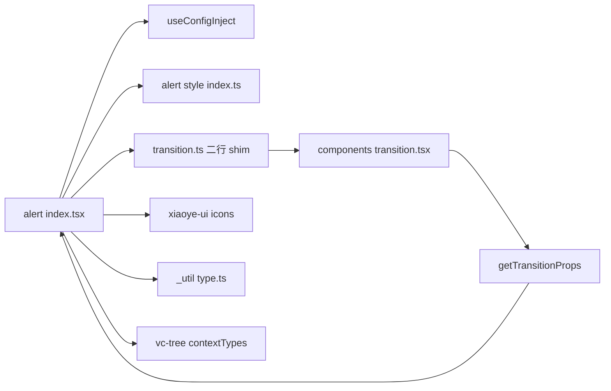
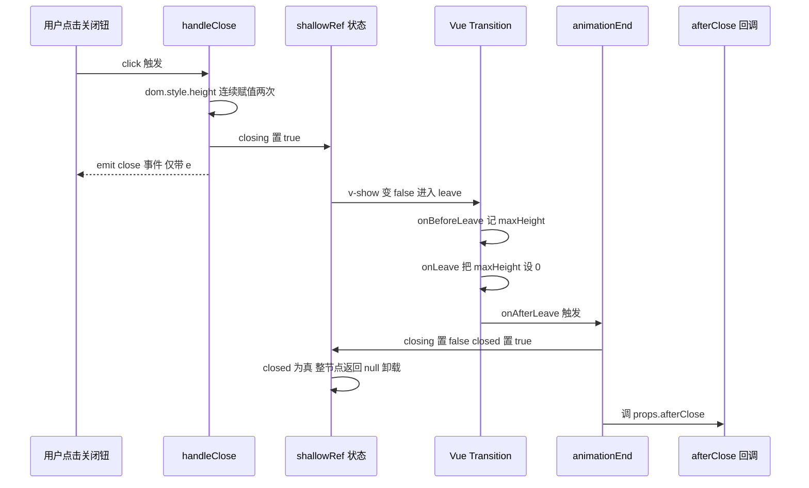
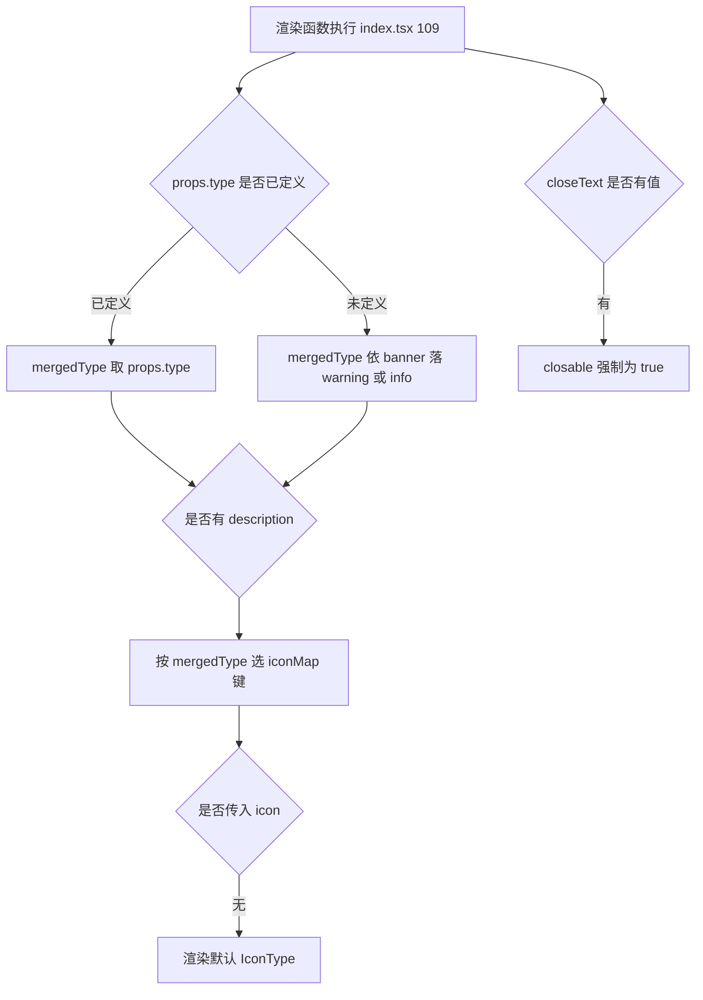

# C07-08 Alert 警告提示

> **本篇解决**：Alert 的「关闭」到底由谁持有、动画结束回调 `afterClose` 与 `close` 事件在真实浏览器与测试环境里分别走哪条路径、`onClose` 的类型声明与运行时 `emit` 差在哪、折叠时那套内联高度写法为什么会出现两遍——读者读完能回答「改哪一行会让 Alert 的关闭动画或回调失效」。
> **前置**：C01-01 Button 按钮　**读者坐标**：`03-components/07-feedback` 组件序第 8 篇（Alert 是内联组件，不走 C07-00 横写篇归一的浮层生命周期，故不重述 trigger / align / zIndex）

## 一、职责与边界

Alert 负责渲染一条可内联展示、可关闭的提示信息，支持四种语义类型（`success` / `info` / `warning` / `error`）、`banner` 变体、图标与描述文案，以及一条「收起自身」的折叠动画。它**不负责**：浮层定位（无 `vc-trigger` / `vc-align`）、全局挂载（与 Message / Notification 不同，Alert 是普通行内组件，靠 `withInstall` 注册为局部标签，见 `packages/xiaoye-ui/src/alert/index.tsx:207`）、也不负责动画曲线本身（动画时长与过渡属性由 Design Token 提供）。它还有一条常被忽略的边界：关闭状态（`closing` / `closed`，`packages/xiaoye-ui/src/alert/index.tsx:76-77`）只活在组件实例内存里，既不持久化也不向父级回传「已被关闭」之外的任何信号——源码里没有 `localStorage` / 全局表之类的持久化设施，因此「关掉后下次不再出现」必须由调用方自己用外部状态（例如一个 `v-if`）来接管，Alert 组件本身重挂载即回到初值。

依赖清单（均可 `grep -n "from '` 复核 `packages/xiaoye-ui/src/alert/index.tsx:1-22`）：

- 上游公共件：`_util/classNames`（`:14`）、`_util/vue-types`（`:15`）、`_util/transition`（`:16`，实际解析见论点 5）、`_util/props-util` 的 `isValidElement`（`:17`）、`_util/type` 的 `tuple` 与 `withInstall`（`:18`）、`_util/vnode` 的 `cloneElement`（`:19`）。
- 类型借用：`onClose` 的事件类型从 `vc-tree/contextTypes` 借来（`:20`），Alert 与树组件之间并无运行时关系，只有类型耦合（见论点 2）。
- 配置注入：`config-provider/hooks/useConfigInject`（`:21`）。
- 样式：本地 `./style`（`:22`，即 `packages/xiaoye-ui/src/alert/style/index.ts`）。
- 图标：`@xiaoye-ui/icons` 的九个图标（`index.tsx:3-13`，`CloseOutlined` 加四对 `Filled` / `Outlined` 状态图标）。

## 二、源码地图

主实现入口是 `packages/xiaoye-ui/src/alert/index.tsx:68`（`defineComponent`），`setup` 从 `:73` 起、渲染函数从 `:109` 起。

| 文件 | 行数 | 职责 | 关键导出 / 落点 |
| --- | --- | --- | --- |
| `alert/index.tsx` | 207 | 组件本体、props 定义、关闭状态机、图标映射 | `alertProps`（`:42`）、`Alert`（`:68`）、`withInstall(Alert)`（`:207`） |
| `alert/style/index.ts` | 240 | CSS-in-JS 样式，四层 Token 消费 | `genBaseStyle`（`:27`）、`genTypeStyle`（`:128`）、`genActionStyle`（`:177`）、`genComponentStyleHook('Alert')`（`:231`） |
| `alert/index.test.js` | 71 | 关闭流与 attrs 透传断言 | 4 个 `it`（`:13`、`:38`、`:49`、`:60`） |

样式 hook `genComponentStyleHook('Alert', …)` 在 `packages/xiaoye-ui/src/alert/style/index.ts:231` 装配三段生成器（`:225-229`），`mergeToken` 在 `:234` 注入两个组件专属 Token（`alertIconSizeLG` 取 `fontSizeHeading3`、`alertPaddingHorizontal` 硬编码 12，见 `:235-236`）。这套「Seed→Map→Alias→Component」的四层链路已由 A03 论证，本篇只在需要时引用行号，不重述。

## 三、架构与数据流

**图 1｜静态依赖结构（含被遮蔽的 transition 副本）**



说明：Alert 在 `index.tsx:16` 写的是 `from '../_util/transition'`（无扩展名），按 Vite 与 TS 默认扩展名解析顺序 `.ts` 先于 `.tsx`，命中的是 2 行的 `packages/xiaoye-ui/src/_util/transition.ts`（其第 2 行 `export * from './components/transition'`）——**该 shim 已于 2026-09-29 删除，现在解析到同目录的 `transition.tsx`**，真正的 `getTransitionProps` 来自 `packages/xiaoye-ui/src/_util/components/transition.tsx:21`；同名的 `packages/xiaoye-ui/src/_util/transition.tsx:21` 反而被遮蔽（详见论点 5）。`useConfigInject`（`:21`→`index.tsx:74`）供 `prefixCls` / `direction`，`./style`（`:22`→`:75`）供 `wrapSSR` 与 `hashId`。

**图 2｜关闭时序（真实浏览器路径 vs 测试路径的分叉）**



说明：这条链的关键分叉在最后两跳——`onAfterLeave → animationEnd` 依赖浏览器真的发出过渡结束事件。测试环境是 jsdom（`packages/xiaoye-ui/vitest.config.mts:31` 的 `environment: 'jsdom'`），不会自然派发过渡结束，所以测试绕开 `onAfterLeave`，直接调被 `expose` 出来的 `animationEnd()`（`packages/xiaoye-ui/src/alert/index.tsx:107`、`packages/xiaoye-ui/src/alert/index.test.js:33`）。这正是 `animationEnd` 之所以要 `expose` 的动机（见论点 1）。

**图 3｜类型 / 图标 / 可关的渲染期判定分支**



说明：`type !== undefined` 与 `banner && showIcon === undefined` 两处判定能落到「兜底分支」，靠的是这些 props 的默认值确实是 `undefined`——`type` 用 `PropTypes.oneOf(AlertTypes)`（`index.tsx:46`）、`closable` / `showIcon` / `banner` 显式写 `default: undefined`（`:48`、`:58`、`:60`）。这与专栏反复排查的「三元兜底永不可达」陷阱形状相反，是**写对了**的一例（论点 6 展开）。

## 四、核心机制精读

### 论点 1：关闭是「双 shallowRef 状态机 + 一个对外暴露口」，两段式驱动折叠

断言：Alert 的收起不是一次 unmount，而是 `closing` 与 `closed` 两个 `shallowRef` 接力——`closing` 先翻真、用 `v-show` 触发 `<Transition>` 的 leave；leave 结束后 `closed` 才翻真、渲染函数直接返回 `null` 卸载整棵子树。动画收尾 `animationEnd` 有两条入口，真实浏览器走 `onAfterLeave`，测试与兜底走被 `expose` 出去的手动调用。

```tsx
// packages/xiaoye-ui/src/alert/index.tsx:76
    const closing = shallowRef(false);
    const closed = shallowRef(false);
    const alertNode = shallowRef();

    const handleClose = (e: MouseEvent) => {
      e.preventDefault();

      const dom = alertNode.value;

      dom.style.height = `${dom.offsetHeight}px`;
      // Magic code
      // 重复一次后才能正确设置 height
      dom.style.height = `${dom.offsetHeight}px`;

      closing.value = true;
      emit('close', e);
    };

    const animationEnd = () => {
      closing.value = false;
      closed.value = true;
      props.afterClose?.();
    };
    // ...
    expose({ animationEnd });
```

逐段解释：`handleClose`（`packages/xiaoye-ui/src/alert/index.tsx:80`）里那两行连写、且注释自称「Magic code / 重复一次后才能正确设置 height」（`:85-88`）的 `dom.style.height = ...`，是为了在折叠前把当前 `offsetHeight` 钉死成内联高度——浏览器在同一帧内先读后写才会让后续的 `max-height` 过渡有确定的起点，这是被反复记录的经验写法而非冗余。真正驱动动画的却是另一套属性：`<Transition>` 的 `onBeforeLeave` 把 `node.style.maxHeight` 记为当前高度、`onLeave` 把它设成 `0px`（`packages/xiaoye-ui/src/alert/index.tsx:171-176`）。于是 `closing.value = true`（`:90`）让 `v-show={!closing.value}`（`:185`）转假、触发 leave，`onAfterLeave`（`:170`）回调 `animationEnd`，把 `closed` 置真（`:96`），渲染函数下一帧命中 `closed.value ? null : (...)`（`:179`）卸载节点。`afterClose` 就挂在这一步（`:97`）。

结论回扣：`animationEnd` 之所以要 `expose({ animationEnd })`（`:107`）而不是只留给内部钩子，是因为在 `packages/xiaoye-ui/vitest.config.mts:31` 的 jsdom 环境里过渡结束事件不会自然派发；测试 `packages/xiaoye-ui/src/alert/index.test.js:33` 直接 `wrapper.vm.$refs.alert.animationEnd()` 收尾，才让 `afterClose` 断言（`:34`）成立。理解这条双入口，是判断「关掉动画后 Alert 到底还在不在 DOM」的关键。

### 论点 2：`onClose` 的公开类型借自 vc-tree，且比运行时多承诺一个参数

断言：`onClose` 这个 prop 的类型是 `NodeMouseEventHandler`，从 `vc-tree/contextTypes` 导入，签名是 `(e, node) => void`；但 Alert 运行时 `emit('close', e)` 只传一个 `e`，第二个树节点参数 `node` 永远拿不到，并且 `props.onClose` 在 `setup` 内零读取。

```tsx
// packages/xiaoye-ui/src/alert/index.tsx:63
  onClose: Function as PropType<NodeMouseEventHandler>,
```

```ts
// packages/xiaoye-ui/src/vc-tree/contextTypes.ts:30
export type NodeMouseEventHandler = (e: MouseEvent, node: EventDataNode) => void;
```

逐段解释：`index.tsx:20` 写着 `import type { NodeMouseEventHandler } from '../vc-tree/contextTypes';`，`contextTypes.ts:30` 定义它需要两个入参，第二参 `EventDataNode` 是树节点的数据结构——对一条提示信息毫无意义。而组件侧 `index.tsx:91` 是 `emit('close', e)`，只给事件对象；`handleClose` 形参也只有 `(e: MouseEvent)`（`:80`）。再看 `setup(props, { slots, emit, attrs, expose })`（`:73`）：整个文件对 `props.onClose` 没有任何读取点（`grep -n "onClose" packages/xiaoye-ui/src/alert/index.tsx` 只命中 `:63` 的声明与 `:91` 无关）。也就是说，`onClose` 被声明成 prop 的实际作用，是把它从 `attrs` 白名单里摘出去（`inheritAttrs: false`，`:71`；`{...attrs}` 在 `:183` 只铺非 prop 的属性），以及提供那个「过宽」的类型；父级 `@close` 的处理器在运行时由 Vue 的 emit 机制从原始 vnode 属性命中，而非由 `setup` 显式调用。测试里 `onClose` 确实被调到（`packages/xiaoye-ui/src/alert/index.test.js:14`、`:31`），证明「能用」，但也仅此而已。

结论回扣：这是一种**类型契约比实现多承诺**的形状——照着 `NodeMouseEventHandler` 写 `(e, node) => node.key` 的调用方，在 Alert 上 `node` 恒为 `undefined`。改 `onClose` 语义时要同时知道「声明」与「触发点」在两个不同行（`:63` 与 `:91`）。

### 论点 3：JSX 属性书写顺序让 `role="alert"` 变成可覆盖的默认值

断言：渲染函数里 `role="alert"` 写死在 `{...attrs}` **之前**，于是用户传入的 `role` 会覆盖内置的 `alert`；而 `class` / `style` 因为走了显式合并（把 `attrs.class` / `attrs.style` 拼进数组），不受这条覆盖规则影响。

```tsx
// packages/xiaoye-ui/src/alert/index.tsx:182
              role="alert"
              {...attrs}
              style={[attrs.style as CSSProperties, motionStyle.value]}
              v-show={!closing.value}
              class={[attrs.class, alertCls]}
              data-show={!closing.value}
              ref={alertNode}
```

逐段解释：`packages/xiaoye-ui/src/alert/index.tsx:182` 先落 `role="alert"`，紧接着 `:183` 展开 `{...attrs}`。在 JSX 里后出现的属性覆盖先出现的同名属性，所以只要 `attrs` 里带了 `role`，`:182` 的硬编码就被顶掉。测试 `packages/xiaoye-ui/src/alert/index.test.js:60-68` 正是拿这个行为断言：`<Alert role="status" />` 后 `getAttribute('role')` 得到 `status` 而非 `alert`。对照 `:184` 的 `style` 与 `:186` 的 `class`——它们没有「先硬写再 spread」，而是主动把外部值并进数组，所以外部 `class` / `style` 与内部 `alertCls` / `motionStyle` 共存，而非互相覆盖。`data-*`、`aria-*` 则纯靠 `{...attrs}` 透传（测试 `:38-46`、`:49-58`）。

结论回扣：这与专栏里 `useMessage.tsx` / `useNotification.tsx` 记录的「显式属性写在 `...restProps` 之前可被覆盖」是同一族机制。要固定 Alert 的无障碍角色，就得把 `role` 移出可被 attrs 顶掉的位置；当前语义是「默认 `alert`，用户可改写」。

### 论点 4：`motionStyle` 是只读不写的死响应式状态

断言：`motionStyle` 用 `shallowRef({})` 建立，只在渲染里被读进 `style` 数组，全文件没有任何对它赋值的语句——它永远等于初始的 `{}`，是折叠动画「本应由它承载、却改用了直接操作 DOM」后留下的空壳。

```tsx
// packages/xiaoye-ui/src/alert/index.tsx:108
    const motionStyle = shallowRef<CSSProperties>({});
    return () => {
      // ...
    };
```

```tsx
// packages/xiaoye-ui/src/alert/index.tsx:184
              style={[attrs.style as CSSProperties, motionStyle.value]}
```

逐段解释：`packages/xiaoye-ui/src/alert/index.tsx:108` 初始化 `motionStyle`，`:184` 把 `motionStyle.value` 作为 `style` 数组第二项读出。除此之外 `grep -n "motionStyle" packages/xiaoye-ui/src/alert/index.tsx` 只剩这两处，没有第三处 `motionStyle.value =` 的写入。折叠动画的高度控制改走了两条别的路：一条是 `handleClose` 里直接 `dom.style.height`（`:85-88`），一条是 `<Transition>` 的 `onBeforeLeave` / `onLeave` 直接 `node.style.maxHeight`（`:171-176`）。对照 `_util/components/transition.tsx:84-120` 的 `collapseMotion`——那种方案是把动画样式写进一个 `style: Ref<CSSProperties>`（`:108`、`:95`）由 `<Transition>` 绑定，Alert 没有采用，却保留了同名形状的 `motionStyle` 容器，于是容器恒空。

结论回扣：`motionStyle` 属于「声明并使用、但写入点缺失」的内部状态。删掉它、把 `:184` 改成 `[attrs.style]` 不会改变任何可见行为；留着它的代价是让读代码的人误以为动画样式会从响应式变量流入。

### 论点 5：折叠过渡类名契约落在被 `.ts` shim 重定向的「机械副本」上

断言：`index.tsx:16` 导入的 `getTransitionProps` 经无扩展名解析命中的不是同名 `.tsx`，而是 2 行的 `transition.ts` shim，后者再 `export *` 到 `_util/components/transition.tsx`；Alert 折叠 CSS 依赖的 `-leave` / `-leave-active` 类名由这份副本产出。

```ts
// 修复前 packages/xiaoye-ui/src/_util/transition.ts 第 2 行（该 shim 已删除）
export * from './components/transition';
```

```tsx
// packages/xiaoye-ui/src/_util/components/transition.tsx:33
        leaveFromClass: ` ${transitionName}-leave`,
        leaveActiveClass: `${transitionName}-leave ${transitionName}-leave-active`,
        leaveToClass: `${transitionName}-leave ${transitionName}-leave-active`,
```

逐段解释：`packages/xiaoye-ui/src/_util/transition.ts` 整份只有两行，`:1` 是注释、`:2` 是 `export * from './components/transition'`。Alert 在 `packages/xiaoye-ui/src/alert/index.tsx:16` 写 `from '../_util/transition'`（不带扩展名），`packages/xiaoye-ui/vite.config.mts` 未覆写 `resolve.extensions`，因此走 Vite/TS 默认顺序 `.ts` 先于 `.tsx`——命中的是这份 shim，进而把 `getTransitionProps` 的来源锁定在 `packages/xiaoye-ui/src/_util/components/transition.tsx:21`。`:33-35` 三行给出的 leave 类名分别是 `xy-alert-motion-leave` 与 `xy-alert-motion-leave xy-alert-motion-leave-active`，与样式端 `packages/xiaoye-ui/src/alert/style/index.ts:80` 的 `` &${componentCls}-motion-leave `` 和 `:88` 的 `` &${componentCls}-motion-leave-active `` 一一对齐，折叠才有过渡。仓库里另有 `packages/xiaoye-ui/src/_util/transition.tsx:33-35` 的同名实现，`diff` 二者只差 `:9` 的 import 路径（`./type` 对 `../type`），内容完全等价——即 `_util/components/*` 机械复制族（归属 A06，本篇不重述其登记），此处只补一条「Alert 实际吃到的是副本、根 `.tsx` 被遮蔽」的证据。

结论回扣：`packages/xiaoye-ui/vitest.config.mts:33` 的 `src/**/*.test.{js,ts,jsx,tsx}` glob 会收进 Alert 的测试，但仓库内没有任何测试断言折叠类名或过渡属性，所以这条「shim → 副本 → CSS 对齐」链路对改动零保护。

### 论点 6：三态布尔 props 显式 `default: undefined`，兜底分支才可达（陷阱的反例）

断言：`closable` / `showIcon` / `banner` 都显式写成 `{ type: Boolean, default: undefined }`，正因为在 prop 定义处 `index.tsx:42-64` 没有为 `type` 附 `default` 键、也没走会注入默认值的封装，`mergedType` 的 `type !== undefined` 判断与 `banner && showIcon === undefined` 才能真的落到 else 分支——这与专栏反复排查的「`X !== undefined ? X : Y` 且 X 带非 undefined 默认值 ⇒ 兜底永不可达」是相反的、写对了的一例。

```tsx
// packages/xiaoye-ui/src/alert/index.tsx:99
    const mergedType = computed(() => {
      const { type } = props;
      if (type !== undefined) {
        return type;
      }
      // banner 模式默认为警告
      return props.banner ? 'warning' : 'info';
    });
```

```tsx
// packages/xiaoye-ui/src/alert/index.tsx:46
  type: PropTypes.oneOf(AlertTypes),
```

逐段解释：`packages/xiaoye-ui/src/alert/index.tsx:48`、`:58`、`:60` 三处 `closable` / `showIcon` / `banner` 都带 `default: undefined`，让「没传」与「传了 false」可区分，配合 `:121` 的 `showIcon = banner && showIcon === undefined ? true : showIcon;`——banner 下若用户没显式设 `showIcon` 才自动开图标，否则尊重用户值，兜底分支确实可达。`mergedType`（`:99-106`）同理：`type` 未传时走 `:105` 依 `banner` 落 `warning` / `info`。至于 `index.tsx:46` 的 `type`——`PropTypes` 来自 `_util/vue-types/index.ts:6` 的 `ExtendedVueTypes`，它只覆写了 `looseBool`（`:8-11`，`default: undefined`）、`style`（`:14-18`，`default: undefined`）、`VueNode`（`:21-25`，无 `default`），`oneOf` 未被本地包装、`index.tsx:46` 也未在 prop 定义里挂 `default`，组件层看不到任何给 `type` 设默认值的代码。

> ⚠️ 未在源码中找到对应实现：`PropTypes.oneOf` 是否会由第三方基库隐式注入一个默认值，属于 `node_modules` 内部行为，本仓不可定点取证；若基库隐式设了默认值，则 `mergedType` 的 `:101` 兜底分支是否可达需要重新核实。此处仅能确认组件侧 `index.tsx:42-64` 未给 `type` 显式附 `default`。

结论回扣：判断这类「三元兜底可达性」时，本仓的纪律是先看 prop 定义处有没有挂默认值。`closable` / `showIcon` / `banner` 三处的 `default: undefined` 是作者刻意为之，用可读代码坐实了「未传态」；`type` 的可达性则建立在「`oneOf` 无默认」这一未在本仓取证的前提上。

### 论点 7：图标集与描述文案跨两个文件耦合，选择规则同时写在渲染端与样式端

断言：Alert 的状态图标不是固定用 `Filled` 或 `Outlined`，而是按「是否有 description」在两张映射表间切换；描述文案的可见性也不是单点决定，而是样式端「基规则隐藏 + with-description 复合规则显影」两条规则协作，二者的开关都挂在渲染端同一个 `description` 真值上。自定义图标又分「是合法 VNode」与「是字符串」两条注入路径，关闭图标再叠一层三级优先级。

```tsx
// packages/xiaoye-ui/src/alert/index.tsx:24
const iconMapFilled = {
  success: CheckCircleFilled,
  info: InfoCircleFilled,
  error: CloseCircleFilled,
  warning: ExclamationCircleFilled,
};

const iconMapOutlined = {
  success: CheckCircleOutlined,
  info: InfoCircleOutlined,
  error: CloseCircleOutlined,
  warning: ExclamationCircleOutlined,
};
```

```tsx
// packages/xiaoye-ui/src/alert/index.tsx:123
      const IconType = (description ? iconMapOutlined : iconMapFilled)[mergedType.value] || null;
```

```tsx
// packages/xiaoye-ui/src/alert/index.tsx:158
      const iconNode = (icon &&
        (isValidElement(icon) ? (
          cloneElement(icon, {
            class: `${prefixClsValue}-icon`,
          })
        ) : (
          <span class={`${prefixClsValue}-icon`}>{icon}</span>
        ))) || <IconType class={`${prefixClsValue}-icon`} />;
```

逐段解释：`iconMapFilled`（`packages/xiaoye-ui/src/alert/index.tsx:24-29`）与 `iconMapOutlined`（`:31-36`）是两张按 `mergedType` 取键的映射表。选哪张由 `:123` 的 `description ? iconMapOutlined : iconMapFilled` 决定——纯标题提示用实心图标，带描述的「信息块」用线性图标，键来自论点 3 之外那条 `mergedType` 计算（`packages/xiaoye-ui/src/alert/index.tsx:99-106`）。若用户经 `icon` prop 或 `icon` 插槽传了自定义图标（`:117` 的 `props.icon ?? slots.icon?.()`），`:158-165` 分两路注入 `-icon` 类：合法元素走 `cloneElement`（`packages/xiaoye-ui/src/alert/index.tsx:160`，来自 `_util/vnode` 的 `:19`）保住原节点、只补类名；非元素（字符串等）走 `<span>` 包裹（`:164`）；两者都 falsy 才回落到内置 `IconType`（`:165`）。是否渲染图标节点又由 `:190` 的 `showIcon ? iconNode : null` 控制。

描述文案的耦合更跨文件：渲染端 `-with-description` 类仅在 `!!description` 时挂到根节点（`packages/xiaoye-ui/src/alert/index.tsx:133`），内容里的 `<div class="{prefixCls}-description">` 也仅在 `description` 真值时渲染（`:194`）。而样式端基规则把 `.xy-alert-description` 设成 `display: none`（`packages/xiaoye-ui/src/alert/style/index.ts:70-74`），只有 `.xy-alert-with-description .xy-alert-description { display: block }` 这条复合规则（`packages/xiaoye-ui/src/alert/style/index.ts:115-117`，其父选择器 `-with-description` 在 `:97`）才让描述显影。也就是说：描述可见 = 渲染端同时满足「`description` 真值」→ 挂 `-with-description` 且渲染 `-description`，样式端再让复合规则命中。任一文件单独改动这条链都会断。

关闭图标同理叠了三级优先级：`:148` 先看 `closeText`（渲染成 `<span class="-close-text">`，`:149`），否则 `:150` 看 `customCloseIcon === undefined`（`:110` 的解构默认值 `closeIcon: customCloseIcon = slots.closeIcon?.()`），都没给才回落默认 `<CloseOutlined />`（`:151`）。这三档最终都包在同一个 `<button class="-close-icon">` 里（`:141-156`），而样式端只有 `-close-icon`（`packages/xiaoye-ui/src/alert/style/index.ts:194`）与 `-close-text`（`:214`）两条规则，`-close-icon` 下还嵌一条对 `iconCls-close` 的着色（`:205-211`）——`iconCls` 由 token 提供，指代 `@xiaoye-ui/icons` 那层 `xyicon` 前缀。

结论回扣：Alert 的视觉层次是「渲染端选表/挂类 + 样式端隐藏/显影」两侧各写一半的耦合。改「带描述时是否换线性图标」只动 `:123` 即可；但改「描述默认显隐」必须同时看 `index.tsx:133`、`:194` 与 `style/index.ts:70-74`、`:115-117` 四处，任何一处单独改都会让描述常驻或彻底消失。

## 五、对外契约如何生效

本节只走「一条契约从入口流到渲染/回调」的路径，不列属性清单（属性表见 `apps/docs/components/alert.md`，用法示例见手册）。

**props → 渲染的三路取值。** 内容类属性一律走「prop 优先、slot 兜底」：`closeText = props.closeText ?? slots.closeText?.()`、`description`、`message`、`icon` 同此形状（`packages/xiaoye-ui/src/alert/index.tsx:114-117`），而 `action` 只有 slot 一条来源（`:118` 的 `slots.action?.()`），没有对应 prop——所以插槽 `action` 是唯一入口，`:197` 据此决定是否渲染 `xy-alert-action` 容器。这条 `?? slots?.()` 链是 Alert 全部展示内容的注入总线。

**布尔三态如何左右结构。** `closable` 与 `showIcon` 在渲染函数里被重新解构为局部 `let`（`packages/xiaoye-ui/src/alert/index.tsx:112`），随后两处改写：`banner` 决定 `showIcon` 的隐式开（`:121`）、`closeText` 有值时把 `closable` 强制为 `true`（`:126-128`）。这两个局部改写不回填 props，只影响本次渲染，因此同一个 `<xy-alert>` 传了 `closeText` 却没传 `closable`，仍会出现关闭钮（因为 `closable` 被就地抬真）。

**样式类名如何生成。** `useConfigInject('alert', props)` 供 `prefixCls` / `direction`（`packages/xiaoye-ui/src/alert/index.tsx:74`），`useStyle(prefixCls)` 返回 `[wrapSSR, hashId]`（`:75`）；`alertCls` 用 `classNames` 把 `{prefixCls}-{mergedType}`、`-closing`、`-with-description`、`-no-icon`、`-banner`、`-closable`、`-rtl` 与 `hashId` 拼成数组（`:129-139`）。这些键要和 `packages/xiaoye-ui/src/alert/style/index.ts` 的规则一一对齐：类型色板在 `genTypeStyle`（`style/index.ts:150-173` 的 `&-success`/`&-info`/`&-warning`/`&-error`），`-with-description` 在 `:97-118`，`-banner` 在 `:120-124`，`-rtl` 在 `:56-58`。`hashId` 作为 CSS-in-JS 的哈希类挂在最外层（`:138`），是整个样式选择器的作用域根，缺它则规则不命中。

**事件与回调的双通道。** 关闭时 `emit('close', e)` 在 `handleClose` 里、折叠动画之后 `props.afterClose?.()` 在 `animationEnd` 里（`packages/xiaoye-ui/src/alert/index.tsx:91`、`:97`）。前者是「开始关」，后者是「关完了」，两条通道分别对应 `onClose` prop 声明（`:63`）与 `afterClose` prop 声明（`:56`）。`animationEnd` 还通过 `expose`（`:107`）对外可达，构成测试/SSR 的手动收尾口。

**attrs 透传与 role 默认。** 根 `<div>` 先写 `role="alert"` 再 `{...attrs}`（`packages/xiaoye-ui/src/alert/index.tsx:182-183`），`class` / `style` 走显式合并（`:184`、`:186`），`data-*` / `aria-*` 直接经 `{...attrs}` 落到 DOM（测试 `packages/xiaoye-ui/src/alert/index.test.js:38-58` 断言 `data-test`、`aria-describedby` 透传成功）。因此 Alert 对「外部属性」的策略是：布局无关属性透传、语义属性可被外部顶替、结构性属性内部合并。

**为什么显式关自动属性继承。** 组件把 `inheritAttrs` 设为 `false`（`packages/xiaoye-ui/src/alert/index.tsx:71`），意味着 Vue 不再把未声明的 attrs 自动贴到根元素上；渲染函数于是拿回了对 attrs 落点的完全控制——它选择在 `:183` 手工展开 attrs，并且刻意排在 `role="alert"` 之后、排在 `style` / `class` 两条显式合并之前。这个顺序不是随手写的：正因为 `inheritAttrs: false` 关掉了自动追加，作者才能自己决定「attrs 里的 `role` 覆盖内置 `alert`，但 `class` 不覆盖 `alertCls` 而是与它相加」。若把 `inheritAttrs` 改回默认 `true`，Vue 会把 attrs 合并进根元素，再叠加 `:183` 的手工 `{...attrs}` 就变成同一份属性被套两次，覆盖语义也随之漂移。论点 3 观察到的「role 可被顶掉」正是这套手工顺序的直接后果，而非缺陷本身。

## 六、设计取舍

**折叠动画为什么是「先 `v-show` 隐藏、后 `closed` 卸载」两段，而不是一步 unmount。** 单步 unmount 会让节点直接从 DOM 消失，浏览器没有可过渡的帧，`max-height` 收不起来（`packages/xiaoye-ui/src/alert/index.tsx:179` 的 `closed.value ? null : (...)` 必须等到 leave 之后才成立）。代价是内部要同时维护 `closing` 与 `closed` 两个状态（`:76-77`），并把 `animationEnd` 从私有函数升级成 `expose` 出口（`:107`）以便测试手动触发。被放弃的替代是「用 `v-if` 直接删」——那会牺牲动画。

**动画样式为什么直接操作 DOM，而不用 `collapseMotion` 的响应式 `style: Ref`。** `_util/components/transition.tsx:84-120` 已经提供「把折叠高度写进响应式 `style` Ref 由 `<Transition>` 绑定」的现成方案，Alert 却选择在 `onBeforeLeave` / `onLeave` 里对 `node.style.maxHeight` 直接赋值（`packages/xiaoye-ui/src/alert/index.tsx:171-176`），好处是折叠起止高度取的是实时 `offsetHeight`（`:172`），对内容动态撑高的提示条更准；代价是渲染里那个本可用于此目的的 `motionStyle` 沦为空壳（`:108`、`:184`，见论点 4）——机制从「响应式驱动」退回到「命令式钩子」，但保留了响应式的容器名，属于半途而废的取舍。

**`onClose` 为什么走 emit 而不是直接 `props.onClose?.()`。** 与 Vue 事件约定一致、并让 `inheritAttrs: false` 下 `onClose` 不进 attrs（`packages/xiaoye-ui/src/alert/index.tsx:71`、`:183`）。赔上的代价是类型只能单独声明、作者顺手从 `vc-tree` 借了个签名（`:20`、`:63`），造成契约与实现脱节（论点 2）。

**SSR / tree-shaking 面。** Alert 没有模块级可变全局量（`iconMapFilled` / `iconMapOutlined` / `AlertTypes` 都是模块级常量，`packages/xiaoye-ui/src/alert/index.tsx:24-38`，只读不写），`wrapSSR` 在渲染函数最外层包裹（`:178`），`withInstall` 只挂 `install`（`packages/xiaoye-ui/src/_util/type.ts:39-45`）。这一层是干净的：不像 Message / Notification 有全局实例持有，Alert 是纯受控渲染，SSR 友好。

**折叠态被同一份 `closing` 表达了三次，是有意还是遗留。** `closing.value` 一变，同时驱动三处：根节点的 `-closing` 类名（`packages/xiaoye-ui/src/alert/index.tsx:132`）、`v-show={!closing.value}` 的显隐（`:185`）、以及 `data-show={!closing.value}` 这个 data 属性（`:187`）。三者同源、同帧、同真假，语义完全重叠。取舍在于各自的消费方不同：`v-show` 是给浏览器与 `<Transition>` 用的（它靠显隐触发 leave），`data-show` 是给测试与外部查询用的「不依赖样式的显式标记」，而 `-closing` 类名当前没有任何样式规则消费它（见坑 6，`style/index.ts` 全文无 `closing` 键）。也就是说，把状态写成三份换来了「测试可读 `data-show`、动画走 `v-show`」两条正交通道，但多出来的 `-closing` 类名是没接线的第三条线——这是同一份逻辑的多出口，其中一条出口悬空。若要清理，删 `:132` 的 `-closing` 分支不影响任何可见行为；若 `-closing` 本意是给折叠中途加边框/阴影，那是样式端漏写，属未完成的意图。

**`alertPaddingHorizontal` 为何硬编码成 12，而非 Token。** 样式端两处注释直说了这是例外：`packages/xiaoye-ui/src/alert/style/index.ts:236` 在 `mergeToken` 里写 `alertPaddingHorizontal: 12, // Fixed value here.`，`:52` 的 `padding` 又标 `// Fixed horizontal padding here.`。它作为 `AlertToken` 的一个键被声明（`:10`）、在 `genBaseStyle` 里被解构使用（`:41`），看起来像组件 Token，实则值被焊死为字面量 12，不来自任何 Map/Alias Token，也不随主题密度（`paddingContentHorizontal` 一类）联动。这与组件库「样式禁止硬编码、应走 Token」的规范是相悖的一处已知偏离：好处是折叠动画的高度计算不受左右内边距变化干扰（`:52` 的横向 padding 与纵向 `paddingContentVerticalSM` 分治，纵向仍是 Token），代价是暗色/紧凑主题下 Alert 的横向留白不会自动收紧，需要另开 Token 才能覆盖。改这里前应先确认是要「焊死」还是「接入 `token.paddingContentHorizontal`」，两者视觉差异只在密度主题下显现。

## 七、坑与改动指南

1. 触发：给 Alert 传 `afterClose`，在单测或 SSR 里等它回调。症状：`afterClose` 从不执行，断言超时。原因：`afterClose` 挂在 `animationEnd`（`packages/xiaoye-ui/src/alert/index.tsx:94-98`），而 `animationEnd` 的自然入口只有 `<Transition>` 的 `onAfterLeave`（`:170`），jsdom 与 SSR 都不派发过渡结束事件。定位：`packages/xiaoye-ui/src/alert/index.tsx:94-98` 与 `:170`；测试里的绕法是手动调暴露口 `packages/xiaoye-ui/src/alert/index.test.js:33`。**该动画收尾路径无自动化保护**——真实浏览器 `transitionend` 分支没有任何测试覆盖。

2. 触发：想固定 Alert 的 `role`（例如强制为 `alert` 语义）。症状：用户传了 `role` 后内置值消失，无障碍角色被外部改写。原因：`role="alert"` 写在 `{...attrs}` 之前（`packages/xiaoye-ui/src/alert/index.tsx:182-183`），后展开的 attrs 覆盖它；测试 `packages/xiaoye-ui/src/alert/index.test.js:60-68` 就是在断言这个覆盖。定位：`packages/xiaoye-ui/src/alert/index.tsx:182-183`。要固定需把 `role` 移到 spread 之后或并入 `alertCls` 式的显式合并。

3. 触发：按 `onClose` 的类型签名写处理函数、访问第二个参数。症状：`node` 恒 `undefined`，运行期读 `node.xxx` 抛错。原因：`onClose` 借用的 `NodeMouseEventHandler` 是 `(e, node) => void`（`packages/xiaoye-ui/src/vc-tree/contextTypes.ts:30`），但 Alert `emit('close', e)` 只传 `e`（`packages/xiaoye-ui/src/alert/index.tsx:91`）。定位：`packages/xiaoye-ui/src/alert/index.tsx:63`（声明）与 `:91`（触发点）。改法：把 `onClose` 的类型换成本组件自己的 `(e: MouseEvent) => void`，别再引 `vc-tree` 类型。

4. 触发：只传 `closeText`、没传 `closable`，却发现出现了关闭按钮。症状：与 prop 直觉不符的「可关」。原因：渲染函数里 `if (closeText) closable = true`（`packages/xiaoye-ui/src/alert/index.tsx:126-128`）就地抬真局部 `closable`（不回填 props）。定位：`packages/xiaoye-ui/src/alert/index.tsx:112`（局部解构）与 `:126-128`。

5. 触发：期望 `banner` 模式自动可关、或以为 `banner` 与 `type` 无关。症状：banner 没有关闭钮、默认类型变成 `warning`、默认出现图标。原因：`banner` 只在 `type` 未传时把 `mergedType` 落到 `warning`（`packages/xiaoye-ui/src/alert/index.tsx:105`）、并在 `showIcon` 未传时隐式开图标（`:121`），但**不**动 `closable`（默认仍是 `undefined`，`:48`）。定位：`packages/xiaoye-ui/src/alert/index.tsx:105`、`:121`、`:48`。

6. 触发：改 `.xy-alert-no-icon` / `.xy-alert-closable` / `.xy-alert-closing` 的样式。症状：改了没反应，或以为存在规则实际查不到。原因：这三个类名在 `packages/xiaoye-ui/src/alert/index.tsx:132`、`:134`、`:136` 被生成，但 `packages/xiaoye-ui/src/alert/style/index.ts` 全文对 `no-icon`、`closable`、`closing` 零规则命中（`grep -c` 均为 0）；折叠的可见效果实际由 `v-show`（`:185`）与 `-motion-leave*` 类驱动，与 `-closing` 类无关。定位：生成点 `index.tsx:132-136`、规则缺失点 `style/index.ts`（全文无此三键）。属「类名生成但无规则」的残留。

7. 触发：想调 Alert 折叠的过渡类名（如换 `-leave-active`）。症状（修复前）：改了 `packages/xiaoye-ui/src/_util/transition.tsx` 却不生效。原因：无扩展名导入解析到 `.ts` shim（`packages/xiaoye-ui/src/_util/transition.ts` 的第 2 行），实际吃到的是 `packages/xiaoye-ui/src/_util/components/transition.tsx:33-35`；根 `.tsx` 因扩展名顺序被遮蔽。**2026-09-29 已修**：该两行 shim 已删除，`from '../_util/transition'` 现在解析到 `_util/transition.tsx`，本条症状不再成立；`_util/components/` 那份副本仍在（仍经 `_util/index.ts` 的 `export * from './components'` 进 barrel）。定位（历史）：`packages/xiaoye-ui/src/_util/components/transition.tsx:33-35`、样式对齐 `packages/xiaoye-ui/src/alert/style/index.ts:80`、`:88`。

测试现状：Alert 只有 `packages/xiaoye-ui/src/alert/index.test.js`（4 个 `it`），覆盖「点击关闭触发 `onClose`」「手动 `animationEnd` 触发 `afterClose`」「attrs 透传 data / aria / role」，对 banner 默认、`closeText` 强制 closable、图标三级优先级（`index.tsx:148-154`）、折叠实际视觉、`-no-icon`/`-closable`/`-closing` 死类名均无断言。改动安全边界：只要不触碰 `:182-186` 的属性顺序、`:126-128` 的隐式 `closable`、`:94-98` 的 `animationEnd` 语义，视觉与回调即不回退。验证命令：`pnpm --filter xiaoye-ui test:unit alert`。

## 附：本篇可证伪的三个检查点

1. `motionStyle` 是只读不写的死状态。跑 `grep -n "motionStyle" packages/xiaoye-ui/src/alert/index.tsx`，预期恰好两处命中（声明 `:108`、读取 `:184`），且没有任何 `motionStyle.value =` 赋值行；若出现第三处赋值，论点 4 即被证伪。

2. `-no-icon` / `-closable` / `-closing` 是生成但无规则的类名。跑 `grep -rn -e no-icon -e closable -e closing packages/xiaoye-ui/src/alert/style/index.ts`，预期零命中；再跑 `grep -n "prefixClsValue}-closing" packages/xiaoye-ui/src/alert/index.tsx` 命中 `:132`。两者对照即证「类名有、规则无」。

3. Alert 的 `getTransitionProps` 来自被 shim 重定向的副本。跑 `grep -n "components/transition" packages/xiaoye-ui/src/_util/transition.ts` 命中 `:2` 的 `export * from './components/transition'`；再 `diff packages/xiaoye-ui/src/_util/transition.tsx packages/xiaoye-ui/src/_util/components/transition.tsx` 应只差 `:9` 的 import 路径一行。若 shim 被删或解析改指根 `.tsx`，论点 5 的来源判定需更新。
