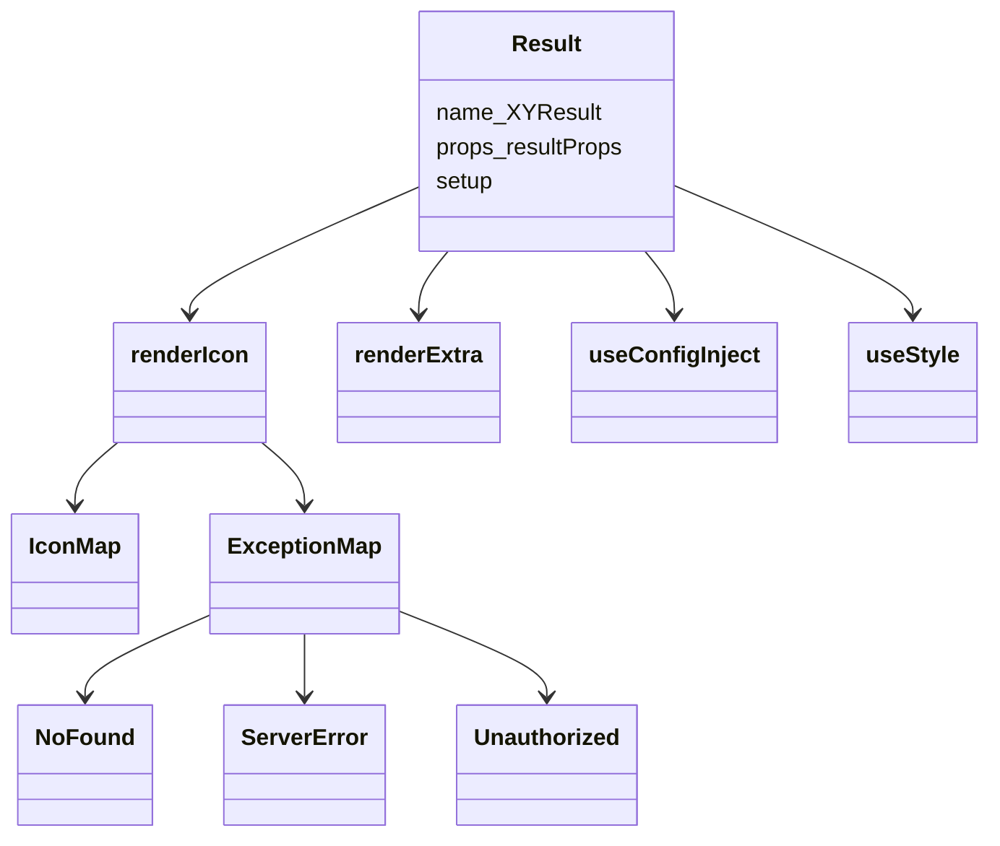
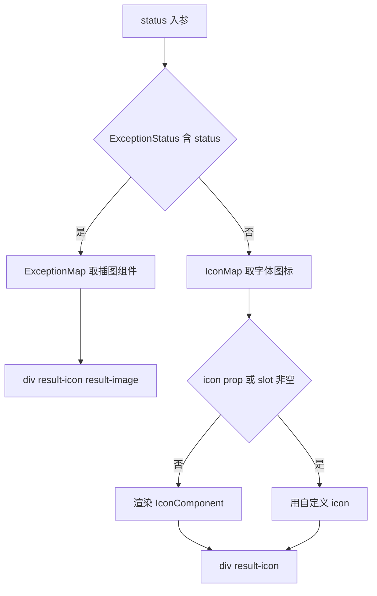
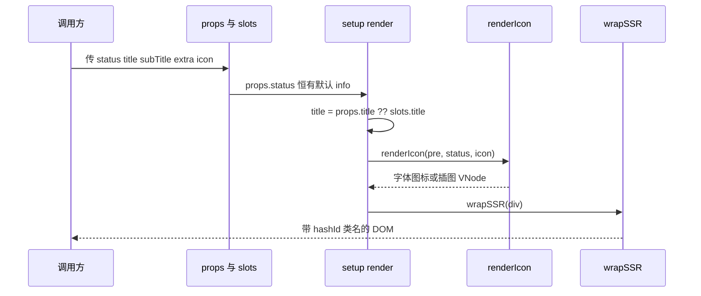

# C07-09 Result 结果

> **本篇解决**：Result 的图标/状态/extra 究竟由哪一段源码拼装、`status` 的默认与推导逻辑在哪里落地、哪些声明是活的哪些是死的。
> **前置**：C07-08 Alert 警告提示　**读者坐标**：`03-components/07-feedback` 第 10/9 篇

## 一、职责与边界

Result 是一个纯展示型状态结果组件：把「状态图标 + 标题 + 副标题 + 操作区 + 内容区」按固定顺序竖排渲染，并用 `status` 这一个入参同时驱动两条分派轨道——四个语义态（`success`/`error`/`info`/`warning` 走 `@xiaoye-ui/icons` 的字体图标）与三个异常码（`403`/`404`/`500` 走内置的整页 SVG 插图）。它不负责数据获取、不负责路由跳转、不负责文案本地化，`extra` 区完全交给调用方塞按钮或链接。

被谁依赖：仅由聚合入口 `packages/xiaoye-ui/src/components.ts:274` 与 `:303` 再导出，库内没有任何其它组件 import 它（`grep -rn "ExceptionMap" packages apps` 排除 `src/result/` 后无命中），因此它是一片自足的叶子。依赖谁：`useConfigInject`（取 `prefixCls`/`direction`）、`genComponentStyleHook`（样式）、`@xiaoye-ui/icons` 四个填充态图标、同目录的三个异常插图函数组件。

仓内唯一的真实消费点不在库里，而在文档站的 404 页：`apps/docs/.vitepress/vitepress/components/vp-not-found.vue:11` 写的是 `<xy-result status="404" title="404" sub-title="页面不存在">`，并在 `:12` 用 `#extra` 插槽塞一个返回首页的按钮（`:13`）。这条消费同时踩到了本篇论点 4（异常码分支）与论点 2（插槽兜底），是这两个机制在生产路径上唯一的活体样本；它的另一处后果见坑 8。文档示例集在 `apps/docs/examples/result/`，共 8 个文件，其中 `customIcon.vue:2` 是唯一不带 `status` 的写法（依赖默认值，见坑 9）。

## 二、源码地图

| 文件 | 行数 | 职责 | 关键导出 |
| --- | --- | --- | --- |
| `packages/xiaoye-ui/src/result/index.tsx` | 124 | 主实现：Props 定义、双轨分派 `renderIcon`、`renderExtra`、`setup` 渲染 | `default Result`、`resultProps`、`IconMap`、`ExceptionMap`、`ResultStatusType` |
| `packages/xiaoye-ui/src/result/style/index.tsx` | 157 | CSS-in-JS：基座样式 + 四态图标配色 + ComponentToken 默认值 | `default genComponentStyleHook('Result', …)` |
| `packages/xiaoye-ui/src/result/noFound.tsx` | 289 | 404 整页插图（箭头函数组件，返回裸 `<svg>`） | `default NoFound` |
| `packages/xiaoye-ui/src/result/serverError.tsx` | 331 | 500 整页插图 | `default ServerError` |
| `packages/xiaoye-ui/src/result/unauthorized.tsx` | 280 | 403 整页插图 | `default Unauthorized` |
| `packages/xiaoye-ui/src/result/index.test.js` | 71 | 5 个 `it`，覆盖图标数、状态类名、异常图、extra 缺省、class 透传 | — |
| `packages/icons/src/index.js`（兼容层） | 4 行别名 | `IconMap` 要的 `*Filled` 图标实际由此映射到描线图标 | `:1246`、`:1249`、`:1267`、`:1327` |
| `apps/docs/.vitepress/vitepress/components/vp-not-found.vue` | 23 | 仓内唯一真实消费点（文档站 404 页） | — |

主实现入口是 `packages/xiaoye-ui/src/result/index.tsx:67`（`defineComponent`）；分派逻辑在 `:50` 的 `renderIcon`；样式 hook 在 `style/index.tsx:127`。三个插图文件没有 `defineComponent`、没有 `name`、没有 props，只是返回 `<svg>` 的函数组件，例如 `noFound.tsx:1` 的 `const NoFound = () => {...}` 与 `:289` 的 `export default`。


## 三、架构与数据流

Result 的分层极浅，但存在两个「一套 status 语义、两份互不相干的表」的结构：`IconMap`（字体图标）与 `ExceptionMap`（整页 SVG 插图）。静态结构如下：



`Result` 自身不持有状态：`prefixCls`/`direction` 来自 `useConfigInject('result', props)`（`index.tsx:80`），样式表来自 `useStyle(prefixCls)`（`:82`）。`renderIcon` 是两个 Map 的唯一消费者（`index.tsx:50-62`）。三个插图是叶子函数组件，无人复用。

`status` 的分派是一棵二岔树，判定用 `ExceptionStatus.includes(\`${status}\`)`：



关键在于「异常分支不读 `icon`」——`index.tsx:51-58` 命中异常码时直接 `return`，`:60` 的 `icon || <IconComponent />` 只在非异常分支执行。因此语义态可被 `icon` 覆盖，异常码不可以。

props 与 slots 的汇流闭环（受控优先、插槽兜底）：




## 四、核心机制精读

### 论点 1：一个 `status` 喂两张互不相干的表，靠模板字符串把数字/字符串码归一

断言：`status` 同时是「语义态」与「异常码」两个值域的入参，但驱动它们的是两份独立常量 `IconMap` 与 `ExceptionMap`，二者的键类型不一致（`IconMap` 用字符串键，`ExceptionMap` 用 `'404'`/`'500'`/`'403'` 字符串键），分派时靠 `\`${status}\`` 强制转字符串才能匹配，数字 `404` 与字符串 `'404'` 因此等价。

```tsx
// packages/xiaoye-ui/src/result/index.tsx:20
export const IconMap = {
  success: CheckCircleFilled,
  error: CloseCircleFilled,
  info: ExclamationCircleFilled,
  warning: WarningFilled,
};

export const ExceptionMap = {
  '404': noFound,
  '500': serverError,
  '403': unauthorized,
};

export type ExceptionStatusType = 403 | 404 | 500 | '403' | '404' | '500';
export type ResultStatusType = ExceptionStatusType | keyof typeof IconMap;

// ExceptionImageMap keys
const ExceptionStatus = Object.keys(ExceptionMap);
```

解释：`ExceptionStatus`（`packages/xiaoye-ui/src/result/index.tsx:37`）是 `Object.keys(ExceptionMap)`，即 `['404','500','403']` 三个字符串。`renderIcon` 的第一句 `if (ExceptionStatus.includes(\`${status}\`))`（`packages/xiaoye-ui/src/result/index.tsx:51`）用模板字符串把可能是数字的 `status` 拉平到字符串再判定，所以 `status={404}` 与 `status="404"` 都命中异常分支。类型上 `ExceptionStatusType`（`packages/xiaoye-ui/src/result/index.tsx:33`）刻意同时列出数字与字符串两种字面量，正是为这个「运行时只认字符串、类型面却给数字放行」的行为背书。命中异常后取 `ExceptionMap[status]`（`packages/xiaoye-ui/src/result/index.tsx:52`）——JS 对象下标会自动把数字键转字符串，所以数字 `404` 也能查到 `'404'`。没命中才落到 `IconMap[status]`（`packages/xiaoye-ui/src/result/index.tsx:59`）。`IconMap`（`packages/xiaoye-ui/src/result/index.tsx:20`）与 `ExceptionMap`（`packages/xiaoye-ui/src/result/index.tsx:27`）之间没有任何共享键，也没有一处校验保证两表键互斥，所以 `status` 的合法值实际上是两份表并集，`ResultStatusType`（`packages/xiaoye-ui/src/result/index.tsx:34`）用 `ExceptionStatusType | keyof typeof IconMap` 把并集写进类型。结论：这是一处「类型联合 + 运行时候选键」的双轨设计，任何一轨的键改了名（比如把 `'404'` 写成 `404`），`\`${status}\`` 的归一就会掩盖类型漂移，让 TS 与运行时判定各说各话。

### 论点 2：`props.x ?? slots.x?.()` 的兜底次序成立，是因为这些 props 全部没有默认值

断言：标题、副标题、图标、extra 四个字段一律「props 优先、插槽兜底」，且这个 `??` 右侧（插槽）确实可达——因为 `resultProps` 把这四项都声明为 `PropTypes.any`（或 `String`）且不带 `default`，Vue 不会给它们填值，`props.title` 在未传时就是 `undefined`，`??` 才会走到 `slots.title?.()`。

```tsx
// packages/xiaoye-ui/src/result/index.tsx:39
export const resultProps = () => ({
  prefixCls: String,
  icon: PropTypes.any,
  status: { type: [Number, String] as PropType<ResultStatusType>, default: 'info' },
  title: PropTypes.any,
  subTitle: PropTypes.any,
  extra: PropTypes.any,
});
```

```tsx
// packages/xiaoye-ui/src/result/index.tsx:89
    return () => {
      const title = props.title ?? slots.title?.();
      const subTitle = props.subTitle ?? slots.subTitle?.();
      const icon = props.icon ?? slots.icon?.();
      const extra = props.extra ?? slots.extra?.();
      const pre = prefixCls.value;
      return wrapSSR(
        <div {...attrs} class={[className.value, attrs.class]}>
          {renderIcon(pre, { status: props.status, icon })}
          <div class={`${pre}-title`}>{title}</div>
          {subTitle && <div class={`${pre}-subtitle`}>{subTitle}</div>}
          {renderExtra(pre, extra)}
          {slots.default && <div class={`${pre}-content`}>{slots.default()}</div>}
        </div>,
      );
    };
```

解释：这正是维护者原理手册反复强调的「`X !== undefined ? X : Y` 型三元 + `X` 带非 `undefined` 默认值 ⇒ 兜底分支恒不可达」缺陷族的**反例**。判据在 `packages/xiaoye-ui/src/result/index.tsx:42`——只有 `status` 一个 prop 有 `default: 'info'`，而 `status` 不参与 `??` 兜底（它直接进 `renderIcon` 与 `className`）；`title`/`subTitle`/`icon`/`extra` 四个用 `??` 的 prop 都声明为 `PropTypes.any`（`packages/xiaoye-ui/src/result/index.tsx:41`、`packages/xiaoye-ui/src/result/index.tsx:43`、`packages/xiaoye-ui/src/result/index.tsx:44`、`packages/xiaoye-ui/src/result/index.tsx:45`）不带默认值，因此 `packages/xiaoye-ui/src/result/index.tsx:90` 到 `:93` 的四行兜底全部有效。对照同族「有默认值反而吃掉兜底」的写法（例如 `packages/xiaoye-ui/src/color-picker/ColorPicker.tsx:56` 用 `props.defaultValue !== undefined ? props.defaultValue : props.modelValue`，而 `defaultValue` 若被给了默认值，回落 `modelValue` 就恒不可达），Result 这里是干净的。副标题与 extra 还各自多包了一层存在性判定（`packages/xiaoye-ui/src/result/index.tsx:99` 的 `subTitle &&`、`renderExtra` 内 `packages/xiaoye-ui/src/result/index.tsx:65` 的 `extra &&`），避免渲染空 `<div>`；`renderExtra` 本身就是「`extra` 为空则返回假值、不产出 DOM 节点」的写法。内容区更直接：`packages/xiaoye-ui/src/result/index.tsx:101` 用 `slots.default &&` 判定，没有默认插槽就不渲染 `-content` div，因此该 div 的样式（`packages/xiaoye-ui/src/result/style/index.tsx:79`）在无内容时不会留下空占位。结论：`?? slots` 能否生效，取决于对应 prop 有没有默认值——这段代码把这件事做对了，但它是「做对」而非「有意防御」，因为一旦有人给 `title` 加了 `default: ''`，`packages/xiaoye-ui/src/result/index.tsx:90` 的插槽分支立刻变哑。

### 论点 3：`Result.PRESENTED_IMAGE_403/404/500` 只写不读，是挂在组件上的死 API

断言：主实现把三个异常插图组件既塞进了 `ExceptionMap`（真正被 `renderIcon` 消费），又复制成三个静态属性 `Result.PRESENTED_IMAGE_*` 挂到组件对象上，但全仓库没有任何一处读取这三个静态属性，渲染路径也从不经过它们。

```tsx
// packages/xiaoye-ui/src/result/index.tsx:108
/* add resource */
Result.PRESENTED_IMAGE_403 = ExceptionMap[403];
Result.PRESENTED_IMAGE_404 = ExceptionMap[404];
Result.PRESENTED_IMAGE_500 = ExceptionMap[500];

/* istanbul ignore next */
Result.install = function (app: App) {
  registerComponent(app, Result);
  return app;
};

export default Result as typeof Result &
  Plugin & {
    readonly PRESENTED_IMAGE_403: typeof unauthorized;
    readonly PRESENTED_IMAGE_404: typeof noFound;
    readonly PRESENTED_IMAGE_500: typeof serverError;
  };
```

解释：`packages/xiaoye-ui/src/result/index.tsx:109`、`:110`、`:111` 只是从 `ExceptionMap` 里把同一批组件「再取一次」赋给静态字段，`packages/xiaoye-ui/src/result/index.tsx:121` 到 `:123` 还在默认导出的交叉类型里给它们补了 `readonly` 声明，让 TS 层面「这三个静态属性是公开契约」的假象更完整。但渲染里用的是 `ExceptionMap[status]`（`packages/xiaoye-ui/src/result/index.tsx:52`），根本不看 `PRESENTED_IMAGE_*`。全仓搜索（`grep -rn "PRESENTED_IMAGE" packages apps`，排除 `dist`）显示：`Result.PRESENTED_IMAGE_*` 只出现在这三处赋值与三处类型声明，读取方全是 `Empty.PRESENTED_IMAGE_SIMPLE`（定义在 `packages/xiaoye-ui/src/empty/index.tsx:89`，消费在 `packages/xiaoye-ui/src/config-provider/renderEmpty.tsx:15` 与 `packages/xiaoye-ui/src/table/hooks/useFilter/FilterDropdown.tsx:372`），与 Result 无关。更糟的是这个死 API 还「不可用」：上游把 `PRESENTED_IMAGE_*` 设计成 `icon` 的可选值来覆盖插图，但本仓 `renderIcon` 在异常分支（`packages/xiaoye-ui/src/result/index.tsx:51`）早返回、从不读 `icon`（见论点 4），所以即便用户照着声明写 `<Result status="404" icon={Result.PRESENTED_IMAGE_500} />` 也毫无效果。结论：这是「API 面存活、实现死亡」的教科书样本——类型声明、静态挂载、`grep` 都找得到，唯独没有任何代码消费它，且配套的消费入口（`icon` 覆盖）在本仓已被砍断。

### 论点 4：`icon` 覆盖只对语义态生效，对 403/404/500 是死开关

断言：`renderIcon` 命中异常码后直接 `return` 插图分支，自定义 `icon` 的读取 `icon || <IconComponent />` 被留在异常 `return` 之后，永远执行不到。

```tsx
// packages/xiaoye-ui/src/result/index.tsx:50
const renderIcon = (prefixCls: string, { status, icon }) => {
  if (ExceptionStatus.includes(`${status}`)) {
    const SVGComponent = ExceptionMap[status];
    return (
      <div class={`${prefixCls}-icon ${prefixCls}-image`}>
        <SVGComponent />
      </div>
    );
  }
  const IconComponent = IconMap[status];
  const iconNode = icon || <IconComponent />;
  return <div class={`${prefixCls}-icon`}>{iconNode}</div>;
};
```

解释：`packages/xiaoye-ui/src/result/index.tsx:53` 的 `return` 让异常分支只渲染 `<SVGComponent />`，`icon` 形参在该分支被完全忽略。只有走到 `packages/xiaoye-ui/src/result/index.tsx:60` 的非异常分支时，`icon || <IconComponent />` 才给自定义图标机会。这意味着 `<Result status="404" icon={myIcon} />`（无论 `icon` 来自 prop 还是 `slots.icon`，后者在 `packages/xiaoye-ui/src/result/index.tsx:92` 汇入 `icon`）静默无效。而且 `icon` 一旦提供，`||` 短路还会让 `IconComponent` 连被求值都不必，即 `packages/xiaoye-ui/src/result/index.tsx:59` 取到的 `IconMap[status]` 在非异常分支里被完全跳过——自定义 `icon` 会替换掉语义态图标，包括其配色：`packages/xiaoye-ui/src/result/style/index.tsx:104` 的 `-success/-error/-info/-warning` 四条选择器都要求命中 `${componentCls}-icon > ${iconCls}`，换成用户自定义节点后若不落到 `iconCls` 上，配色规则也就一并失效。测试面也印证：`packages/xiaoye-ui/src/result/index.test.js:51` 只断言了 `.xy-result-image` 存在，`index.test.js:29`/`:36`/`:42` 只断言语义态类名，没有任何用例覆盖「异常码 + 自定义 icon」。结论：`icon` 是一个作用域被状态值悄悄限定的 prop，文档层面看不出这个限定，改动者若想让异常码可换图，必须把 `icon` 判断提到异常 `return`（`packages/xiaoye-ui/src/result/index.tsx:53`）之前。

### 论点 5：异常插图尺寸硬编码、无 viewBox，`imageWidth`/`imageHeight` 两个 ComponentToken 管不到插图本身

断言：三张 SVG 在各自文件头写死了 `<svg width height>`，且都没有 `viewBox`；样式表里的 `imageWidth`/`imageHeight` token 只作用在包裹插图的 `<div>` 容器上，改 token 不会缩放插图，反而会让容器与插图尺寸对不上。

```tsx
// packages/xiaoye-ui/src/result/style/index.tsx:48
    // Exception Status image
    [`${componentCls} ${componentCls}-image`]: {
      width: token.imageWidth,
      height: token.imageHeight,
      margin: 'auto',
    },
```

```tsx
// packages/xiaoye-ui/src/result/style/index.tsx:153
  {
    imageWidth: 250,
    imageHeight: 295,
  },
```

解释：`style/index.tsx:153-156` 是传给 `genComponentStyleHook('Result', …, getDefaultToken)` 的第三个参数，即 ComponentToken 默认值 `imageWidth: 250`/`imageHeight: 295`（`genComponentStyleHook` 签名见 `theme/util/genComponentStyleHook.ts:40-46`）。`:49-53` 把这两个值贴到 `result-image` 容器 div。而三张插图的真实尺寸是：`noFound.tsx:3` `<svg width="252" height="294">`、`serverError.tsx:3` `<svg width="254" height="294">`、`unauthorized.tsx:3` `<svg width="251" height="294">`——三张各不同，且都不等于 token 的 250×295。更关键的是三张 `<svg>` 都**没有 `viewBox`**（`grep viewBox result/*.tsx` 无命中），因此 SVG 尺寸由 `width`/`height` 属性钉死、不可缩放，token 里改 `imageWidth` 只会改外层 div，插图溢出 div 2-4px。结论：这是一处「token 与硬编码内容两张皮」的样式债——`imageWidth`/`imageHeight` 给人的预期是「控制插图大小」，实际只能控制容器，且默认值与三个插图文件里的常量互不一致，说明它们是分别手填、从未对齐过。

### 论点 6：`direction` 未进 props，RTL 正确回落到 ConfigProvider —— 本仓缺陷族的正例

断言：Result 的 `props` 没有声明 `direction`，因此 `useConfigInject` 里的 `props.direction ?? configProvider.direction?.value` 会稳定走到右侧，全局 `ConfigProvider` 的 `direction="rtl"` 对 Result 有效；这与 `rate/index.tsx` 给 `direction` 加了 `'ltr'` 默认值、导致全局 RTL 对 Rate 零效果的缺陷族恰好相反。

```tsx
// packages/xiaoye-ui/src/result/index.tsx:79
  setup(props, { slots, attrs }) {
    const { prefixCls, direction } = useConfigInject('result', props);

    const [wrapSSR, hashId] = useStyle(prefixCls);

    const className = computed(() =>
      classNames(prefixCls.value, hashId.value, `${prefixCls.value}-${props.status}`, {
        [`${prefixCls.value}-rtl`]: direction.value === 'rtl',
      }),
    );
```

```ts
// packages/xiaoye-ui/src/config-provider/hooks/useConfigInject.ts:14
  const prefixCls = computed(() => configProvider.getPrefixCls(name, props.prefixCls));
  const direction = computed(() => props.direction ?? configProvider.direction?.value);
```

解释：`resultProps`（`:39-46`）里没有 `direction` 这一项，所以 `props.direction` 恒为 `undefined`，`useConfigInject.ts:15` 的 `??` 右侧 `configProvider.direction?.value` 因此生效；`index.tsx:86` 据此给根节点挂 `-rtl` 类，样式在 `style/index.tsx:43-45` 的 `&-rtl { direction: 'rtl' }` 落地。本仓有一族「给本应由 `useConfigInject` 兜底的 prop 加运行时默认值 ⇒ 全局配置被静默吃掉」的缺陷，活例是 `rate/index.tsx` 的 `direction: 'ltr'`。Result 没犯这个错，可作对照基准。结论：Result 是「不声明 direction prop、纯靠 context」的干净写法；一旦后来者为了「支持单组件覆盖方向」给 `resultProps` 补一句 `direction: stringType('ltr')` 带默认值，全局 RTL 立刻对该组件失效，且不会有任何报错。

### 论点 7：`IconMap` 要的四个 `Filled` 图标在图标层全是降级别名，而图标的实际尺寸既不由 Result 决定也不由图标自己的 `size` 决定

断言：`IconMap` 声明的是四枚「填充」语义图标，但 `@xiaoye-ui/icons` 根本没有 `Filled` 变体，兼容层把它们全部映射到描线图标；同时这四个图标的渲染尺寸来自 `genComponentStyleHook` 注册的一条全局 `.xyicon` 规则，而不是 Result 的 `resultIconFontSize` 之外的任何本组件可控路径——图标组件自带的 `size` 默认值在 Result 内部是惰性的。

```tsx
// packages/xiaoye-ui/src/result/index.tsx:5
import {
  CheckCircleFilled,
  CloseCircleFilled,
  ExclamationCircleFilled,
  WarningFilled,
} from '@xiaoye-ui/icons';
import noFound from './noFound';
```

```js
// packages/icons/src/index.js:1245
// CheckCircleFilled (映射自 CircleCheckIcon，无 Filled 变体)
export { default as CheckCircleFilled } from './circle-check';
// CloseCircleFilled (映射自 CircleXIcon，无 Filled 变体)
export { default as CloseCircleFilled } from './circle-x';
```

解释：兼容层的注释自己承认了降级——`packages/icons/src/index.js:1245-1246` 把 `CheckCircleFilled` 指向 `./circle-check`，同族还有 `:1248-1249`（`CloseCircleFilled` → `circle-x`）、`:1266-1267`（`ExclamationCircleFilled` → `circle-alert`）、`:1326-1327`（`WarningFilled` → `exclamationtriangle`），四条都标着「无 Filled 变体」。被指向的组件根节点是描线形状：`packages/icons/src/circle-check/CircleCheckIcon.vue:7` 写 `fill="none"`，内部 `<g>` 同样 `fill="none"` 并以 `stroke="currentColor"` 描绘。于是 Result 四个语义态（`packages/xiaoye-ui/src/result/index.tsx:21-24`）在视觉上拿不到「实心」的重量感，`packages/xiaoye-ui/src/result/style/index.tsx:104-115` 那四条配色规则做的事只是给描边上色——要修「语义态图标不对味」，落点在图标层别名表，不在 Result。

尺寸这条链更容易找错地方。`CircleCheckIcon.vue:4-5` 把 `<svg>` 的宽高绑到自己的 `size` prop，而该 prop 的默认值是 14（`packages/icons/src/circle-check/CircleCheckIcon.vue:27-29`）；`WarningFilled` 那枚更是把 `width="14"`、`height="14"` 直接写死在模板里（`packages/icons/src/exclamationtriangle/ExclamationTriangleIcon.vue:4-5`），连 `size` 都吃不到（它走 `v-bind="pti()"`，而 `packages/core/src/composables/index.ts:22` 里 `pti` 只在 `props.size` 为真值时才写回宽高）。照字面读，`packages/xiaoye-ui/src/result/style/index.tsx:59-61` 给 `> ${iconCls}` 设 `fontSize: token.resultIconFontSize`（值见 `:143` 的 `fontSizeHeading3 * 3`）似乎管不到一个 14px 的 SVG 属性。但它管得到，原因不在 Result：`packages/xiaoye-ui/src/theme/util/genComponentStyleHook.ts:65-66` 会为 `.xyicon` 注册 `resetIcon()`，该常量把 wrapper 与内部 `svg` 的宽高都设成 `1em`（`packages/xiaoye-ui/src/style/index.ts:32-33` 与 `:49-53`），CSS 声明的优先级高于 SVG 的 presentation attribute，所以最终尺寸由 `font-size` 推算，`size` 默认值 14 与写死的 `width="14"` 一起被覆盖。`iconCls` 本身的取值也在同一个文件（`packages/xiaoye-ui/src/theme/util/genComponentStyleHook.ts:95` 的 `iconCls: `.${iconPrefixCls.value}``），前缀默认 `xyicon`（`packages/xiaoye-ui/src/config-provider/context.ts:14`）。结论：Result 图标的「大小」由全局 hook 决定、「形状」由图标别名表决定，两件事都发生在 `packages/xiaoye-ui/src/result/` 目录之外；本篇初稿曾据此推断 `resultIconFontSize` 是死 token，核对 `resetIcon()` 后作废——留此记录是为了说明这条链的反直觉程度：判「token 是否生效」必须连 `genComponentStyleHook` 的公共注册一起读。

### 论点 8：七个合法 `status` 里有三个拼出的类名没有任何样式消费者，三张键表靠人肉同步

断言：`className` 对任何 `status` 一律拼 `xy-result-<status>`，但样式表只为四个语义态生成规则；`-403`/`-404`/`-500` 三个类名在本组件样式里零规则、在全仓零消费者（唯一读者是测试自己），异常态的外观全部由 `-image` 容器承载。由此形成一份「`IconMap` 键 / `ExceptionMap` 键 / 配色选择器」三处必须同步却无机制同步的隐式契约。

```tsx
// packages/xiaoye-ui/src/result/index.tsx:84
    const className = computed(() =>
      classNames(prefixCls.value, hashId.value, `${prefixCls.value}-${props.status}`, {
        [`${prefixCls.value}-rtl`]: direction.value === 'rtl',
      }),
    );
```

```tsx
// packages/xiaoye-ui/src/result/style/index.tsx:100
const genStatusIconStyle: GenerateStyle<ResultToken> = token => {
  const { componentCls, iconCls } = token;

  return {
    [`${componentCls}-success ${componentCls}-icon > ${iconCls}`]: {
      color: token.resultSuccessIconColor,
    },
    [`${componentCls}-error ${componentCls}-icon > ${iconCls}`]: {
      color: token.resultErrorIconColor,
    },
    [`${componentCls}-info ${componentCls}-icon > ${iconCls}`]: {
      color: token.resultInfoIconColor,
    },
    [`${componentCls}-warning ${componentCls}-icon > ${iconCls}`]: {
      color: token.resultWarningIconColor,
    },
  };
};
```

解释：`packages/xiaoye-ui/src/result/index.tsx:85` 的模板字符串不区分值域，七个合法值都会拼出一个状态类；而 `genStatusIconStyle`（`packages/xiaoye-ui/src/result/style/index.tsx:100-117`）只枚举了 `:104`、`:107`、`:110`、`:113` 四条选择器，恰好等于 `IconMap` 的四个键（`packages/xiaoye-ui/src/result/index.tsx:21-24`）。在样式文件里搜三个异常码（`grep -n -e 403 -e 404 -e 500 packages/xiaoye-ui/src/result/style/index.tsx`）零命中；把 `.js`、`.ts`、`.tsx`、`.vue`、`.less`、`.css`、`.md` 七种后缀一起在全仓搜这三个类名，唯一命中是测试自身的 `packages/xiaoye-ui/src/result/index.test.js:42` 与 `packages/xiaoye-ui/src/result/index.test.js:51`——即 `-404`/`-500`/`-403` 目前的唯一功能是给 `findAll` 提供选择器锚点，异常态真正的样式来自 `${componentCls} ${componentCls}-image` 这条不含状态名的选择器（`packages/xiaoye-ui/src/result/style/index.tsx:49-53`）。这个结构的可维护性代价很具体：若新增第五个语义态（例如 `processing`），只在 `IconMap` 加键就会渲染出图标但不上色（配色选择器缺失，静默无报错），只在样式加选择器则 `packages/xiaoye-ui/src/result/index.tsx:59` 取到 `undefined` 直接崩（坑 1）；而 `index.test.js:29`、`:36` 只锁 `warning`/`error` 两个既有类，`index.test.js:42` 锁的是那个无样式的 `500`，没有任何用例会在「新状态没有配色」时变红。结论：状态类名对语义态是样式钩子、对异常码是纯标记，两种角色由同一个模板字符串产出，改动时无法从类名本身分辨它有没有 CSS 后端；要扩状态，必须同轮改 `packages/xiaoye-ui/src/result/index.tsx:20-31` 两张表与 `packages/xiaoye-ui/src/result/style/index.tsx:104-115` 四条选择器，并补一条配色断言。


## 五、对外契约如何生效

Result 的对外面只有 props、slots、attrs 透传与三个死静态属性四条，没有事件（`props` 里没有任何 `onXxx`，组件也不 `emits`），没有 `expose`（`setup` 未调用 `expose`，`:79` 的解构里也没有 `expose`），因此它不向 ref 暴露任何方法。契约的落地路径如下：

- `prefixCls`：`resultProps` 声明 `prefixCls: String`（`:40`），进 `useConfigInject('result', props)`（`:80`），`getPrefixCls(name, props.prefixCls)`（`config-provider/hooks/useConfigInject.ts:14`）决定最终类名前缀，再拼出 `className`（`:84-88`）。调用方可用 `prefixCls` 覆盖，也可用 `ConfigProvider` 的 `prefixCls` 全局改。
- `direction`：不在 props 里，由 `useConfigInject.ts:15` 走 `?? configProvider.direction?.value` 兜底（论点 6），命中时给根节点加 `-rtl`。
- `status`：唯一带默认值的 prop（`'info'`，`:42`），既进 `renderIcon` 决定图标/插图（`:97`），又拼进 `className` 的 `-${status}` 后缀（`:85`）——这个后缀正是 `style/index.tsx:104-115` 四态配色选择器（`-success`/`-error`/`-info`/`-warning`）能命中的原因。异常码 `404`/`500`/`403` 拼出的 `-404` 等类没有对应图标配色规则，但 `index.test.js:42` 断言 `.xy-result-500` 存在，说明这条拼接是被测试锁死的——七个合法值里只有四个真有样式，详见论点 8；默认值 `'info'` 还会连带给「只换图标不写状态」的调用染色，见坑 9。
- `title`/`subTitle`/`icon`/`extra`：全部 `props.x ?? slots.x?.()`（`:90-93`），props 优先、插槽兜底（论点 2）。`slots` 声明在 `:72-78` 的 `CustomSlotsType`，包含 `title/subTitle/icon/extra/default` 五个，`default` 只在 `:101` 用于内容区。两个通道的存在性判据不同：`extra`/`subTitle` 判的是**解析后的值是否为真**（`:99` 与 `:65`），`default` 判的是**插槽函数是否存在**（`:101`）——因此传 `subTitle=""` 不产出 div，而写了 `<template #default></template>` 空插槽却会产出一个带 `colorFillAlter` 背景的空 `-content` 块（样式见 `style/index.tsx:79-83`）。另外，本组件没有 `text` 这个第三文本槽：props 表（`:39-46`）与 slots 表（`:72-78`）两处声明面里都没有该字段，文本面只有 `title`、`subTitle` 与内容区三条通道。
- `attrs`：`inheritAttrs: false`（`:70`），根节点 `<div {...attrs} class={[className.value, attrs.class]}>`（`:96`）手工合并 `class`，所以外部 `class="my-result"` 会与内部类并存（`index.test.js:69` 覆盖了这一点），但 `style` 等其它属性走默认 `...attrs` 展开。
- 死静态：`Result.PRESENTED_IMAGE_403/404/500`（`:109-111`）在类型面是契约、在运行时无人消费（论点 3）。

## 六、设计取舍

- 双轨表（`IconMap` + `ExceptionMap`）而非单表：语义态需要跟随字号与主题色（用字体图标 `@xiaoye-ui/icons`，`:21-24`），异常码是整页插画（用内联 SVG，`:28-30`），两者渲染物不同、样式钩子不同（图标走 `:59` 的 `> ${iconCls}` 选择器，插图走 `:49` 的容器尺寸选择器），合并成一张表会让 `renderIcon` 里塞满类型判断。代价就是 `status` 的值域被劈成两半，`icon` 只在其中一半生效（论点 4）。
- 内联整页 SVG 而非图片资源/图标：三张插图直接以 `<svg>` 硬编码进 `.tsx`（`noFound.tsx`/`serverError.tsx`/`unauthorized.tsx` 合计约 900 行），好处是零网络请求、SSR 可内联（`wrapSSR`，`:95`），坏处是体积进包、且尺寸写死无 `viewBox`（论点 5）。上游把这几张图做成可被 `PRESENTED_IMAGE_*` 覆盖的入口，本仓保留了静态属性却砍断了覆盖路径（论点 3），属于「保留了兼容外壳、丢掉了兼容行为」的遗留。
- `status` 用带默认值的单 prop 而非多布尔：`default: 'info'`（`:42`）保证不传也有图标；代价是 `className` 直接拼 `-${status}`（`:85`），非法值会拼出无样式类、且 `IconMap[非法值]` 为 `undefined` 导致渲染崩溃（见坑 1），类型层挡住了但运行时没挡。
- 语义图标走「兼容层别名」而非补齐变体：`IconMap` 的四枚 `*Filled`（`packages/xiaoye-ui/src/result/index.tsx:21-24`）之所以能一直工作，是因为图标层替它们各留了一条别名（`packages/icons/src/index.js:1245-1246`、`:1248-1249`、`:1266-1267`、`:1326-1327`）。换来的是 `packages/icons` 内部换名、删变体时 Result 一行都不用改；赔上的是「填充/双色」这层语义在 Result 里永久降级为描线（`packages/icons/src/circle-check/CircleCheckIcon.vue:7` 的 `fill="none"`），而且降级点在本组件源码里完全不可见——读 `packages/xiaoye-ui/src/result/index.tsx:5-10` 会以为真有四枚填充图标。同一条别名策略也把降级带进了文档示例：`apps/docs/examples/result/customIcon.vue:12` 导入的 `SmileTwoTone` 实际指向单色 `./smile`（`packages/icons/src/index.js:1116-1117`）。若将来要真正恢复填充语义，改点应在图标层新增变体并让 `IconMap` 直连新名，而不是在 Result 里加图标覆盖 prop——后者会撞上论点 4 的早返回结构，异常码分支依旧换不了图。


## 七、坑与改动指南

1. 触发：给 `status` 传入非枚举值（如 `"fail"`）且不传 `icon`。症状：组件抛「Invalid vnode type」/渲染白屏。原因：`renderIcon` 走非异常分支后 `IconComponent = IconMap["fail"]` 得到 `undefined`，`:60` 的 `icon || <IconComponent />` 因 `icon` 为空而渲染 `<undefined />`。定位：`packages/xiaoye-ui/src/result/index.tsx:59-60`。类型 `ResultStatusType`（`:34`）只挡 TS、不挡运行时；该分支无测试保护（`index.test.js` 无非法 status 用例）。

2. 触发：`status="404"` 同时传 `icon`（或用 `#icon` 插槽）。症状：自定义图标不出现，仍是内置插图。原因：异常分支 `:51-58` 在读取 `icon` 之前就 `return` 了。定位：`packages/xiaoye-ui/src/result/index.tsx:51-60`。修法：把 `icon` 判定提到异常 `return` 之前，或明确文档「异常码不可换图」。

3. 触发：按类型声明写 `<Result icon={Result.PRESENTED_IMAGE_500} />` 想覆盖 404 插图。症状：毫无效果。原因：`PRESENTED_IMAGE_*` 是只写不读的死静态（`:109-111`），且 `icon` 对异常码本就被忽略（坑 2）。定位：`packages/xiaoye-ui/src/result/index.tsx:108-123`。这是「API 面存活、实现死亡」，改动时若要真正删掉这三个静态，需同步删默认导出类型里的 `readonly PRESENTED_IMAGE_*`（`:121-123`）。

4. 触发：通过主题 `ConfigProvider` 调 `Result` 的 `imageWidth`/`imageHeight` 想缩放异常插图。症状：只有外层容器 div 变了，插图本身不缩放并与容器错位。原因：三张 `<svg>` 写死 `width`/`height` 且无 `viewBox`，token 只作用在 `:49-53` 的容器选择器。定位：`packages/xiaoye-ui/src/result/style/index.tsx:48-53` 与 `noFound.tsx:3`、`serverError.tsx:3`、`unauthorized.tsx:3`。彻底修法是给 SVG 补 `viewBox` 并让组件按 token 输出尺寸，代价是要重画/重排三张图。

5. 触发：给 `title`/`subTitle`/`extra`/`icon` 任一 prop 补 `default`（哪怕是 `default: ''`）。症状：对应具名插槽静默失效。原因：`:90-93` 用 `props.x ?? slots.x?.()`，一旦 `props.x` 恒有默认值，`??` 右侧不再可达。定位：`packages/xiaoye-ui/src/result/index.tsx:39-46` 与 `:90-93`。这是本仓「默认值吃掉兜底」缺陷族，现状是干净的反例，改动时勿把它改脏。

6. 触发：给 `resultProps` 加 `direction: stringType('ltr')` 之类带默认值的字段。症状：全局 `ConfigProvider direction="rtl"` 对 Result 失效。原因：`useConfigInject.ts:15` 的 `props.direction ?? …` 被默认值短路。定位：`packages/xiaoye-ui/src/result/index.tsx:39-46` 对照 `config-provider/hooks/useConfigInject.ts:15`。现状 `direction` 不在 props 里，是正例（论点 6）。

7. 触发：把 `ExceptionMap` 的键 `'404'` 改成数字 `404`。症状：TS 不报错、运行时仍命中，但 `ExceptionStatus = Object.keys(...)` 变成 `['404']` 之后靠 `\`${status}\`` 归一，任何漏掉模板字符串的比较（例如新增分支直接 `ExceptionStatus.includes(status)`）会静默不匹配。定位：`packages/xiaoye-ui/src/result/index.tsx:27-37`、`:51`。

8. 触发：改文档站 404 页时按 `apps/docs/.vitepress/vitepress/components/vp-not-found.vue:19` 的 scoped 规则预期它铺满视口。症状：Result 根节点拿不到 `height: 100vh` 与 `width: 100vw`，404 页高度塌成内容高。原因：该规则的选择器写的是旧前缀类名（`ant-` 系，此处作为违规残留引用，非本库规范），而组件渲染出的根类名由默认前缀 `xy` 拼成——`packages/xiaoye-ui/src/config-provider/globalConfig.ts:8` 的 `defaultPrefixCls = 'xy'`、`packages/xiaoye-ui/src/config-provider/context.ts:168` 的 `xy-${suffixCls}`，再经 `packages/xiaoye-ui/src/result/index.tsx:85` 拼出 `xy-result`，两者永不相等。定位：`apps/docs/.vitepress/vitepress/components/vp-not-found.vue:19` 对照 `packages/xiaoye-ui/src/result/index.tsx:85`。这条同时是「死 CSS」与 AGENTS.md 命名规范的反面样本：全仓 `grep -rn "ant-result" packages apps`（排除 `dist` 与 `node_modules`）只有这一处命中，说明它不是约定而是漏改。

9. 触发：照 `apps/docs/examples/result/customIcon.vue:2` 的写法只提供 `#icon` 插槽与 `title`、不写 `status`，想让自定义图标保持周围文本色。症状：图标被静默涂成信息态主色。原因：`packages/xiaoye-ui/src/result/index.tsx:42` 的 `status` 默认 `'info'` 会进 `packages/xiaoye-ui/src/result/index.tsx:85` 的类名拼接，根节点带上 `xy-result-info`；`packages/xiaoye-ui/src/result/style/index.tsx:110` 的 `-info ... > ${iconCls}` 于是命中插槽里的图标——`@xiaoye-ui/icons` 的组件根节点统一是 `<span class="xyicon">`（`packages/icons/src/smile/SmileIcon.vue:2`），形状靠 `stroke="currentColor"`（`packages/icons/src/smile/SmileIcon.vue:13`）描绘，`color` 直接落到描边上，取值为 `packages/xiaoye-ui/src/result/style/index.tsx:111` 引用的 `resultInfoIconColor`（即 `:135` 的 `token.colorInfo`）。定位：`packages/xiaoye-ui/src/result/index.tsx:42` 与 `packages/xiaoye-ui/src/result/style/index.tsx:110`。该示例导入的 `SmileTwoTone` 本身也是别名（`packages/icons/src/index.js:1116-1117` 注明「无 TwoTone 变体，使用普通版本」），所以示例呈现的既不是双色也不是中性色，而是被默认状态染色的单色图标。

改动安全边界：库内无组件依赖本件（`grep -rn "ExceptionMap" packages apps` 排除 `src/result/` 无命中，`IconMap` 同样只在 `packages/xiaoye-ui/src/result/index.tsx:20`、`:34`、`:59` 三处出现），改 `renderIcon`/样式选择器不会波及其它组件；唯一被测试锁死的行为是状态类名拼接与异常图存在性（`index.test.js:29`/`:36`/`:42`/`:51`），动这两处前先跑 `pnpm --filter xiaoye-ui test:unit result`。但「零依赖」不等于「零消费者」：仓内活体调用是文档站 404 页（`apps/docs/.vitepress/vitepress/components/vp-not-found.vue:11`），它走的是异常码分支加 `#extra` 插槽这条组合，`status` 或 `extra` 语义一旦变更要连它一起验；改图标尺寸/形状则要点开 `packages/xiaoye-ui/src/theme/util/genComponentStyleHook.ts:66` 与 `packages/icons/src/index.js:1245` 那组别名表，不能只改 Result 目录（论点 7）。

## 附：本篇可证伪的三个检查点

1. `PRESENTED_IMAGE_*` 只写不读：执行 `grep -rn "PRESENTED_IMAGE" packages/xiaoye-ui/src/result` 只会命中 `index.tsx:109-111`（赋值）与 `:121-123`（类型声明）；再执行 `grep -rn -e "Result.PRESENTED_IMAGE" -e "PRESENTED_IMAGE_403" -e "PRESENTED_IMAGE_404" -e "PRESENTED_IMAGE_500" packages apps --include=*.tsx --include=*.vue`（排除 `dist`）应无「读取方」，可判定它是死 API。

2. `icon` 对异常码无效：执行 `sed -n '50,62p' packages/xiaoye-ui/src/result/index.tsx`，确认异常分支在 `:53` 直接 `return`、`icon` 只在 `:60` 被用，即可复现坑 2/坑 3。

3. `status` 数字与字符串等价：执行 `grep -n "ExceptionStatus.includes" packages/xiaoye-ui/src/result/index.tsx` 得到 `:51` 的 `\`${status}\`` 模板字符串归一；结合 `index.test.js:38-42` 用字符串 `'500'` 断言 `.xy-result-500`，可验证 `status={500}` 与 `status="500"` 同轨。

