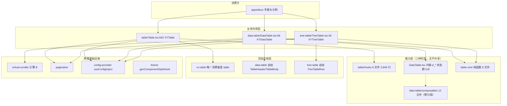
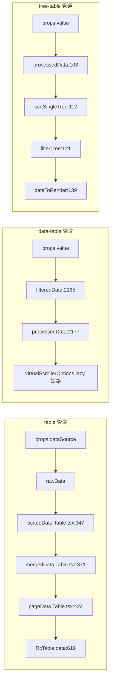
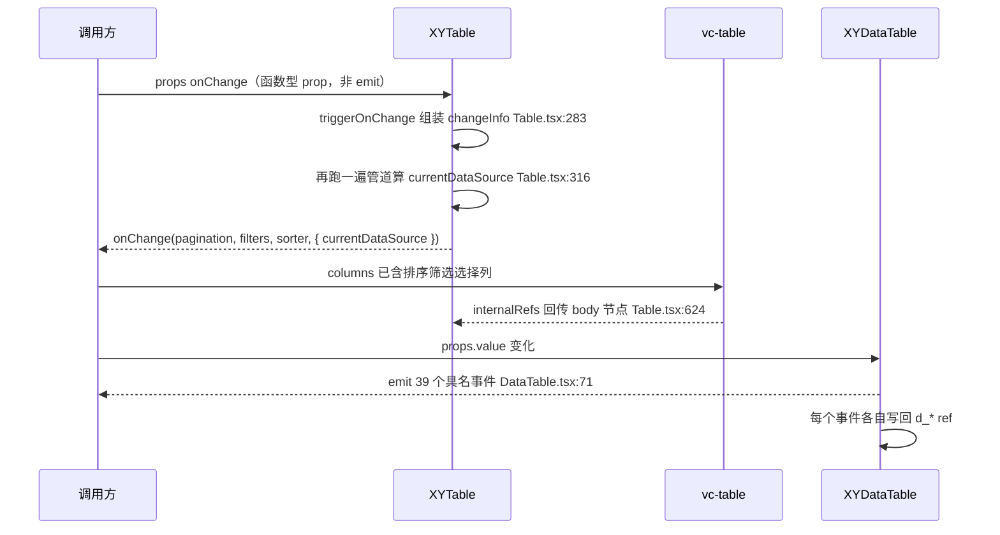

# C08-00 类横写：table / data-table / tree-table 三代表格的分层与选型

> **本篇解决**：仓库里为什么同时存在 `table/`、`data-table/`、`tree-table/` 三个表格目录，它们各自站在哪一层、彼此到底共享了什么（以及没共享什么），接手代码或做技术选型时该按什么顺序读、改哪一层会同时波及谁。读完能回答：「固定列 + 虚拟滚动该用哪个组件」「给表格加一种能力要动几个目录」「为什么 `@change` 只在 `table` 上存在、而 `data-table` 上要写 `@page`」。
> **前置**：I05 vc-table 渲染架构与固定列、I06 table-core 状态机：排序、筛选、选择与展开、I08 虚拟化双实现：vc-virtual-list 与 virtual-scroller　**读者坐标**：`03-components/08-table` 第 1/7 篇（类横写总览）

---

## 一、职责与边界

本篇是 C08 类的**横写总览**，只做两件事：把三代表格放进同一张分层图里说清「谁站在谁上面」，以及把「该选哪一个」的判据落到可 grep 的源码事实上。它**不展开任何一张表格的内部机制**——渲染内核（测量行、固定列 offset、单元格拆分、滚动同步）已在 I05 论证，状态机（排序/过滤/分页三者的调用顺序与状态袋形态）已在 I06 论证，虚拟化两套引擎的差异已在 I08 论证；本篇只引用它们的结论作为分层坐标，不重复取证。单张组件的 props 语义、插槽清单与能力矩阵分别归 C08-01、C08-03、C08-06、C08-07（撰写中，此处只按编号 + 标题引用）。

明确**不负责**：

- 组件用法与属性清单（属手册 `apps/docs/components/table.md`、`apps/docs/components/data-table.md`、`apps/docs/components/tree-table.md`）。
- `vc-table/` 内部实现（归 I05）、`table-core/` 内部实现（归 I06）、虚拟列表与虚拟滚动的窗口算法（归 I08）。
- `list` 这个也落在表格类目里的组件（C08-05）。

三者的依赖关系可以用一句话概括：**一张表格站在渲染内核上，另外两张各自手写了 DOM**。下面这组计数是本篇全部结论的地基，用第二种写法（同时统计相对路径与 `xiaoye-ui/vc-*` 别名路径）交叉验证过，且排除 `dist` 与 `node_modules`：

```bash
cd packages/xiaoye-ui/src && grep -rn "from '\.\./vc-\|from 'xiaoye-ui/vc-" \
  --include='*.ts' --include='*.tsx' data-table tree-table | wc -l   # 0
grep -rn "from '\.\./vc-table'" --include='*.tsx' table | wc -l      # 2
grep -rni "virtual" tree-table | wc -l                               # 0
grep -rn "virtualScroller" data-table/DataTable.tsx | wc -l           # 16
```

| 方向 | 对象 | 证据 |
| --- | --- | --- |
| 依赖 | `table` 唯一地消费渲染内核 `vc-table` | `packages/xiaoye-ui/src/table/Table.tsx:1`、`packages/xiaoye-ui/src/table/Table.tsx:3` |
| 依赖 | `data-table` 只从 `table-core` 取过滤器服务与常量 | `packages/xiaoye-ui/src/data-table/DataTable.tsx:48` |
| 依赖 | `tree-table` 从 `table-core` 取 4 个真实函数 | `packages/xiaoye-ui/src/tree-table/TreeTable.tsx:28` |
| 依赖 | `data-table` 独享虚拟化能力（引擎 B） | `packages/xiaoye-ui/src/data-table/DataTable.tsx:47`、`packages/xiaoye-ui/src/data-table/dataTableTypes.ts:83` |
| 依赖 | `tree-table` 目录内零虚拟化命中 | 上方命令块第 3 条（结果为 0） |
| 被依赖 | 三张表在包根聚合里平级出现 | `packages/xiaoye-ui/src/components.ts:104`、`packages/xiaoye-ui/src/components.ts:338`、`packages/xiaoye-ui/src/components.ts:383` |
| 被依赖 | 分页组件是三张表共同的下游 | `packages/xiaoye-ui/src/table/Table.tsx:6`、`packages/xiaoye-ui/src/tree-table/TreeTable.tsx:27` |

三张表**互不引用**：`grep -rn "data-table" packages/xiaoye-ui/src/tree-table` 命中 0 行。所谓「三代」不是继承关系，而是三次独立移植落进同一套包后的**并存关系**——这一点决定了本篇所有选型结论的形状。

## 二、源码地图

体量差异是分层结论的第一个信号。

| 目录 | 文件构成 | 行数 | 主实现入口 | 内部子层 |
| --- | --- | --- | --- | --- |
| `table/` | 根 15 + `hooks/` 9 + `style/` 13 | 根 2,843 + hooks 3,846 | `packages/xiaoye-ui/src/table/Table.tsx:187`（`InternalTable`） | 能力住 `hooks/`，DOM 住 `vc-table` |
| `data-table/` | 根 20 + `composables/` 12 + 三个 sugar 目录 + `style/` | 根 8,307（含 `DataTable.d.ts` 1,534） | `packages/xiaoye-ui/src/data-table/DataTable.tsx:66`（2,876 行） | DOM 与能力都在自己目录 |
| `tree-table/` | 7 文件 + `style/` + `__tests__/` | 3,031 | `packages/xiaoye-ui/src/tree-table/TreeTable.tsx:40`（966 行） | DOM 4 个文件，能力借 `table-core` |
| `vc-table/` | 渲染内核 | — | 仅 `table/` 可见 | 归 I05 |
| `table-core/` | 8 文件 | 1,271 | `packages/xiaoye-ui/src/table-core/index.ts:8` | 归 I06 |

`table/` 的地图有一个容易被忽略的形状：**能力文件（`hooks/` 3,846 行）比组件本体（根 2,843 行里扣掉 1,693 行测试后只剩 1,150 行）多三倍**，且体积呈金字塔——选择 685、筛选 299+574+39+16、排序 446、分页 91、KV 映射 51、列装配 54、标题列 29。这条金字塔直接说明 `table/` 的复杂度分布：它把全部力气花在「把业务 props 翻译成内核能懂的列矩阵与状态」，渲染本身一行都不写。

`data-table/` 的形状相反：本体 `DataTable.tsx` 2,876 行是绝对重心，周边 9 个渲染子文件（`TableHeader.tsx` 217、`TableBody.tsx` 253、`BodyRow.tsx` 593、`BodyCell.tsx` 833、`HeaderCell.tsx` 395、`ColumnFilter.tsx` 790、`FilterHeaderCell.tsx` 187、`TableFooter.tsx` 92、`FooterCell.tsx` 118）合计 3,478 行，但**没有一个 hook**：状态与派生全在本体里（`packages/xiaoye-ui/src/data-table/DataTable.tsx:118` 起的 `d_*` ref 群）。I06 已证明 `data-table/composables/` 是 12 文件、1,998 行、生产路径零引用的第二实现；本篇用另一种口径复核「零引用」：全仓（排除 `dist`、`node_modules`、`composables/` 自身）搜 `composables/useDataTable` 与 `./composables/` 均命中 0 行。

`tree-table/` 最小，而且**结构上缺了两样东西**：既没有 `column/` 这类 sugar 子目录（目录内只有 `index.ts`、`TreeTable.tsx`、`TreeTableRow.tsx`、`HeaderCell.tsx`、`BodyCell.tsx`、`FooterCell.tsx`、`treeTableTypes.ts`），也没有任何 hook 目录。它的列定义**不走 `columns` prop**（2026-09-29 更正，原文此处写反）：`TreeTable.tsx:68` 建的是 `HelperSet({ type: 'Column' })`，`:96` 提供、`:98-100` 的 `columns` computed 从 `d_columns.get(proxy, { default: () => _slots })` 收集子件，`treeTableProps()`（`treeTableTypes.ts:95` 起）里根本没有 `columns` 这个键——它只出现在 `treeTableRowProps()`（`:154` 起，键在 `:162`），而 `TreeTable.tsx` 对 `props.columns` 零读取。所以「列只能从 `columns` prop 进」是错的，正确口径是**列由 `<Column>` 子件经 HelperSet 收集**，这是它与另外两代表格在写代码形态上最直接的差别（同篇论点 2 已按此展开）。

`data-table/` 的三个 sugar 目录复用情况也不对称：只有 `column/Column.tsx` 被生产代码引用（`packages/xiaoye-ui/src/data-table/DataTable.tsx:49`），`row/Row.tsx` 与 `columngroup/ColumnGroup.tsx` 的引用方只有测试文件 `packages/xiaoye-ui/src/data-table/__tests__/data-table.test.js:8`、`packages/xiaoye-ui/src/data-table/__tests__/data-table.test.js:9`。它们仍通过 `packages/xiaoye-ui/src/theme/interface/components.ts:18`、`packages/xiaoye-ui/src/theme/interface/components.ts:19`、`packages/xiaoye-ui/src/theme/interface/components.ts:20` 三行登记占据独立 Component Token 位——**token 注册表跟的是目录，不是调用图**。

样式层同样三份并列、互不共享生成函数，各自注册一个独立的 Component Token 命名空间：`packages/xiaoye-ui/src/table/style/index.ts:260`（`genComponentStyleHook('Table', ...)`，375 行）、`packages/xiaoye-ui/src/data-table/style/index.ts:6`（`'DataTable'`，597 行）、`packages/xiaoye-ui/src/tree-table/style/index.ts:6`（`'TreeTable'`，241 行）。三者的 `prefixCls` 分别是 `xy-table`、`xy-data-table`、`xy-tree-table`，来自三次互不相干的 `useConfigInject`：`packages/xiaoye-ui/src/table/Table.tsx:230`、`packages/xiaoye-ui/src/data-table/DataTable.tsx:2296`、`packages/xiaoye-ui/src/tree-table/TreeTable.tsx:65`。

## 三、架构与数据流

### 3.1 静态分层：一棵树只有一个树干接到了内核

先把三张表放到同一张结构图上。图里每个框都是真实目录或真实组件名，每条边都能在上一节的命令里复现。



这张图要说明的不是「谁调用谁」，而是**三处断裂**：其一，`vc-table` 这个内核只有一条入边（来自 `table/`），`data-table` 与 `tree-table` 的 DOM 是自己写的，所以任何「修表格渲染 bug」的改动默认只影响 `table/`；其二，`table-core` 有两条入边但深度完全不同——`tree-table` 取的是真正参与数据管道的 4 个函数（`packages/xiaoye-ui/src/tree-table/TreeTable.tsx:28`），`data-table` 取的只是过滤器服务与两个常量（`packages/xiaoye-ui/src/data-table/DataTable.tsx:48`），排序与分页在 `data-table` 里根本没走内核，这条不对称的成因与后果归 I06，本篇只标坐标；其三，`data-table/composables/` 是悬空框，只被自己的测试引用。

### 3.2 数据管道：三条链路，顺序与短路条件都不同

排序/过滤/分页三种加工的**执行顺序**由 I06 论证过，本节不复述其结论的取证过程，只把它画成选型图，并补一条 I06 未展开的横写事实：**短路这条管道的开关，三个组件放在三个不同层**。



三条链路的短路语义互不等价：`table/` 目录内 `grep -rn "lazy" table --include='*.tsx' --include='*.ts'` 命中 **0 行**，它压根没有「惰性/服务端」这个概念，服务端分页靠 `pagination.total` 与 `mergedData.length` 的大小比较来推导是否本地切片（`packages/xiaoye-ui/src/table/Table.tsx:431`）；`data-table/` 把短路条件写成**两个开关的合取**，且同时写在过滤与排序两处（`packages/xiaoye-ui/src/data-table/DataTable.tsx:2171`、`packages/xiaoye-ui/src/data-table/DataTable.tsx:2183`），意味着打开虚拟滚动的 lazy 模式就会连带关掉本地排序；`tree-table/` 只有 `props.lazy` 一个布尔（`packages/xiaoye-ui/src/tree-table/treeTableTypes.ts:121`），且在管道最顶端一次 return（`packages/xiaoye-ui/src/tree-table/TreeTable.tsx:104`）就同时跳过排序、过滤与分页切片（`packages/xiaoye-ui/src/tree-table/TreeTable.tsx:143`）。**同一个「服务端渲染」需求，在三张表里是三种不同粒度的契约**，这是横写层面最容易误判的一处。

能力供给的层位也随管道一起分叉，这里只登记结论、取证归 I06：行选择在三张表里没有共享实现——`table/` 落在自己的 hook（`packages/xiaoye-ui/src/table/hooks/useSelection.tsx:438` 起有半选 `indeterminate` 分支），`tree-table/` 落在单元格（`packages/xiaoye-ui/src/tree-table/BodyCell.tsx`），`data-table/` 则结构性缺失半选；行展开同样只有 `tree-table` 一份状态袋（`packages/xiaoye-ui/src/tree-table/TreeTable.tsx:315` 的回写），`table/` 的展开走内核 props（`packages/xiaoye-ui/src/table/Table.tsx:605`、`packages/xiaoye-ui/src/table/Table.tsx:606`）。对选型的直接含义：**要「树形 + 半选」只能 `tree-table`，要「半选 + 内核级固定列」只能 `table`，`data-table` 缺半选**（`grep -rln "indeterminate" packages/xiaoye-ui/src/table packages/xiaoye-ui/src/data-table packages/xiaoye-ui/src/tree-table` 的命中列表里没有 `data-table` 下的任何文件）。顺带破除一个更常见的误判：**「能不能冻结列」不是选型判据**，三张表都能，只是走三条互不相干的实现（见论点 1 末段），而**半选只有 `table` 与 `tree-table` 有**。

### 3.3 契约回流：一次 change 还是三十九个事件



`table/` 的全部用户反馈收在一个 props 函数上：`const { pagination, scroll, onChange } = props`（`packages/xiaoye-ui/src/table/Table.tsx:286`），排序、筛选、分页三种动作都走同一个 `triggerOnChange`。代价写在同一函数里——为了让 `currentDataSource` 与即将渲染的数据一致，它在事件载荷里**重跑了一遍排序加过滤**（`packages/xiaoye-ui/src/table/Table.tsx:313`、`packages/xiaoye-ui/src/table/Table.tsx:314`），而不是复用 `mergedData.value`。`data-table/` 走的是完全相反的形态：`emits` 数组一次声明 39 个事件（`packages/xiaoye-ui/src/data-table/DataTable.tsx:71`，计数命令 `sed -n '71,110p' data-table/DataTable.tsx | grep -c "^    '"` 得 39），`tree-table/` 声明 17 个（`packages/xiaoye-ui/src/tree-table/TreeTable.tsx:45`）。三者的命名风格也不统一：`data-table/` 用 kebab-case（`row-click`、`update:selection`），`tree-table/` 混用 camelCase 与 kebab（`nodeExpand`、`columnResizeEnd` 与 `update:expandedKeys`），`table/` 则是 `onXxx` 的 props。这条差异不能靠「看一眼文档」消化，只能当作三套互不兼容的契约来对待。

## 四、核心机制精读

### 论点 1：三代表格只在「外壳」这一层同名，往下零行共享；`table/` 把渲染外包给内核，另外两张把渲染写在自己目录里

`table/` 是三张表里唯一有「外壳 / 内壳 / 内核」三段结构的：外壳组件只负责把插槽翻译成列数组，一行 DOM 都不产出。

```tsx
// packages/xiaoye-ui/src/table/Table.tsx:673
    return () => {
      const columns = props.columns || convertChildrenToColumns(slots.default?.());
      return (
        <InternalTable
          ref={table}
          {...attrs}
          {...props}
          columns={columns || []}
          expandedRowRender={slots.expandedRowRender || props.expandedRowRender}
          contextSlots={{ ...slots }} // use new object, 否则slot热更新失效，原因需进一步探究
          v-slots={slots}
        />
      );
    };
```

外壳 `Table`（`packages/xiaoye-ui/src/table/Table.tsx:642`，`name: 'XYTable'`）与内壳 `InternalTable`（`packages/xiaoye-ui/src/table/Table.tsx:187`，`name: 'InternalTable'`，即它不进 `GlobalComponents`）的分工只有一件事：`props.columns` 缺省时用 `convertChildrenToColumns` 把默认插槽的 `<xy-table-column>` 子节点转成列数组（`packages/xiaoye-ui/src/table/util.ts:30`，递归处理分组列在 `packages/xiaoye-ui/src/table/util.ts:52`）。内壳之后才是真正的数据管道，而渲染出口只有一个：

```tsx
// packages/xiaoye-ui/src/table/Table.tsx:602
            <RcTable
              {...attrs}
              {...tableProps}
              expandedRowKeys={props.expandedRowKeys as any}
              columns={mergedColumns.value}
              prefixCls={prefixCls.value}
              data={pageData.value}
              rowKey={getRowKey.value}
              rowClassName={internalRowClassName}
              // Internal
              internalHooks={INTERNAL_HOOKS}
              internalRefs={internalRefs}
              onUpdateInternalRefs={updateInternalRefs}
              transformColumns={transformColumns}
```

`table/` 交给内核的是**已经加工完的数据**（`data={pageData.value}`，`packages/xiaoye-ui/src/table/Table.tsx:619`）和**已经改写过的列矩阵**（`columns={mergedColumns.value}`，`packages/xiaoye-ui/src/table/Table.tsx:610`），外加两个内部协议 `internalHooks` / `internalRefs`（`packages/xiaoye-ui/src/table/Table.tsx:623`、`packages/xiaoye-ui/src/table/Table.tsx:624`，前者是把 `transformColumns` 这类钩子开关起来的门禁，后者把内核测到的 DOM 节点回填给外壳做滚动定位）。这两个内部标识就是「外壳—内核」这条缝的全部宽度，缝的另一侧（`vc-table` 内部如何拆单元格、如何算固定列 offset）归 I05。

`data-table/` 没有这条缝。它的渲染出口是自己写的 `<table>`：

```tsx
// packages/xiaoye-ui/src/data-table/DataTable.tsx:2652
              inline
              autoSize
              showSpacer={false}
              v-slots={{
                content: (slotProps: any) => (
                  <table
                    ref={table}
                    role="table"
                    class={['xy-data-table-table', props.tableClass]}
                    style={[props.tableStyle, slotProps.spacerStyle]}
                    {...props.tableProps}
                  >
                    {props.showHeaders ? (
                      <DTTableHeader
                        columnGroup={headerColumnGroup.value}
                        columns={slotProps.columns}
```

同一个 `<table>` 元素被包在虚拟滚动组件的 `content` 插槽里（`packages/xiaoye-ui/src/data-table/DataTable.tsx:2642`），表头表体分别是同目录的 `TableHeader.tsx` 与 `TableBody.tsx`（别名在 `packages/xiaoye-ui/src/data-table/DataTable.tsx:62`、`packages/xiaoye-ui/src/data-table/DataTable.tsx:63`）。`tree-table/` 同理，三个渲染件由主文件引入（`packages/xiaoye-ui/src/tree-table/TreeTable.tsx:29`、`packages/xiaoye-ui/src/tree-table/TreeTable.tsx:30`、`packages/xiaoye-ui/src/tree-table/TreeTable.tsx:31`），第四个 `BodyCell` 由行组件引入（`packages/xiaoye-ui/src/tree-table/TreeTableRow.tsx:6`，用在 `packages/xiaoye-ui/src/tree-table/TreeTableRow.tsx:434`，组件名 `XYBodyCell` 在 `packages/xiaoye-ui/src/tree-table/BodyCell.tsx:16`）。

这条结论的实用价值很直接：**测量行与滚动同步这套内核机制，在 `data-table/` 与 `tree-table/` 里没有任何对应实现**，两张表的列宽拖拽是自己手写一个浮动 helper 元素并用 `pageX - containerLeft + el.scrollLeft` 定位（`packages/xiaoye-ui/src/data-table/DataTable.tsx:1264`、`packages/xiaoye-ui/src/data-table/DataTable.tsx:1287`、`packages/xiaoye-ui/src/tree-table/TreeTable.tsx:584`、`packages/xiaoye-ui/src/tree-table/TreeTable.tsx:599`），同一个表达式还出现在 I06 判定为零引用的那份孤儿实现里（`packages/xiaoye-ui/src/data-table/composables/useDataTableColumnResize.ts:41`、`packages/xiaoye-ui/src/data-table/composables/useDataTableColumnResize.ts:64`）——这是「复制而非抽象」的最直接文本证据，读 I05 时不需要带着这两张表。反过来，冻结列这个**需求**三张表都用不同办法满足了：`table` 靠内核（归 I05），`data-table` 靠自己的 `col.frozen` / `col.fixed` 判定与 16 处 `frozen` 分支（`packages/xiaoye-ui/src/data-table/DataTable.tsx:2563`），`tree-table` 只在样式层用 `position: 'sticky'` 两处（`packages/xiaoye-ui/src/tree-table/style/index.ts:36`、`packages/xiaoye-ui/src/tree-table/style/index.ts:38`）。同一个名词、三条实现，正是本篇反对「表格内核」这个统称的原因。

### 论点 2：列定义 DSL 是三套互不兼容的约定，`tree-table` 用的那个 `Column` 组件在库里根本不存在

三张表都能「用子组件写列」，但判定「这个子节点算不算一列」的机制各不相同，而 `tree-table` 的机制是三者里唯一没有配套实现的。

```tsx
// packages/xiaoye-ui/src/data-table/column/Column.tsx:55
  setup(_props, { slots }) {
    const instance = getCurrentInstance();
    const columns = inject<Set<any>>('$columns', undefined);

    onMounted(() => {
      instance && columns?.add(instance);
    });

    onUnmounted(() => {
      instance && columns?.delete(instance);
    });

    return () => slots.default?.();
  },
```

`data-table/` 走「自注册」：`XYColumn`（`packages/xiaoye-ui/src/data-table/column/Column.tsx:5`）渲染时只把默认插槽吐出去（`packages/xiaoye-ui/src/data-table/column/Column.tsx:67`），它的价值全部体现在挂载时把自己的实例塞进注入来的 `Set`（`Column.tsx:57`、`Column.tsx:60`）。收集端由宿主声明要匹配的类型字符串：`const d_columns = new HelperSet({ type: 'XYColumn' })`（`packages/xiaoye-ui/src/data-table/DataTable.tsx:132`），并通过 `useProvide('$columns', d_columns)` 发出去（`packages/xiaoye-ui/src/data-table/DataTable.tsx:268`）。这套机制的响应式缺口与版本计数器补偿归 I06，本篇只取它的**约定形状**：匹配靠组件 `name` 字符串。

`tree-table/` 用了同一个 `HelperSet`，但把类型字符串写成了 `'Column'`：

```tsx
// packages/xiaoye-ui/src/tree-table/TreeTable.tsx:68
    const d_columns = new HelperSet({ type: 'Column' });
```

配合 `useProvide('$columns', d_columns)`（`packages/xiaoye-ui/src/tree-table/TreeTable.tsx:96`）与 `columns` computed（`packages/xiaoye-ui/src/tree-table/TreeTable.tsx:98`）。于是库里没有任何一个能自动匹配上的组件：`data-table` 那份叫 `XYColumn`（`packages/xiaoye-ui/src/data-table/column/Column.tsx:5`），`table` 那份叫 `XYTableColumn`（`packages/xiaoye-ui/src/table/Column.tsx:7`），都不等于 `'Column'`。文档只能现场造一个：

```vue
<!-- apps/docs/examples/tree-table/basic.vue:13 -->
// TreeTable 通过 HelperSet 收集 name: 'Column' 的子组件作为列定义
const Column = defineComponent({
  name: 'Column',
```

同一份 mock 也出现在组件自己的测试里（`packages/xiaoye-ui/src/tree-table/__tests__/tree-table.test.js:9`、`packages/xiaoye-ui/src/tree-table/__tests__/tree-table.test.js:10`，注释在 `tree-table.test.js:8` 直接写明「name 必须为 'Column' 以匹配 HelperSet 的 type」）。而 `treeTableProps()`（`packages/xiaoye-ui/src/tree-table/treeTableTypes.ts:95`）里**根本没有 `columns` 这个 prop**——全文件唯一的 `columns` 声明属于行级 props 工厂 `treeTableRowProps()`（`packages/xiaoye-ui/src/tree-table/treeTableTypes.ts:154`，字段在 `packages/xiaoye-ui/src/tree-table/treeTableTypes.ts:162`）。结论：`tree-table` 的列**只能**由插槽子节点提供，且该子节点必须由调用方自备。

`table/` 则是第三种，也是最省事的一种：列是有类型的 props（`packages/xiaoye-ui/src/table/interface.tsx:100` 的 `ColumnType<RecordType>` 泛型，联合类型在 `packages/xiaoye-ui/src/table/interface.tsx:147`），子组件写法只是它的糖——`table/Column.tsx` 的 `render()` 直接 `return null`（`packages/xiaoye-ui/src/table/Column.tsx:15`），列信息由外壳在渲染前一次性转换（`packages/xiaoye-ui/src/table/Table.tsx:674`），没有任何运行期注册表。

### 论点 3：单元格级定制在三张表里走三条互不相通的通道，`templates` 这条通道在两处不同深度断掉

`data-table/` 的单元格插槽不走 `slots`，而是被塞进列对象的 `children` 字段：

```tsx
// packages/xiaoye-ui/src/data-table/BodyCell.tsx:597
    const renderContent = () => {
      const column = props.column;
      const children = column?.children || {};

      // loading 状态
      if (loading.value) {
        const LoadingSlot = children.loading as any;
        return (
          <LoadingSlot
            data={props.rowData}
            column={column}
            field={field.value}
            index={props.rowIndex}
            frozenRow={props.frozenRow}
            loadingOptions={loadingOptions.value}
          />
        );
      }

      // body slot 且非编辑态
      if (children.body && !d_editing.value) {
        const BodySlot = children.body as any;
```

`children.body` 的判定在 `packages/xiaoye-ui/src/data-table/BodyCell.tsx:617`（上一行 `:616` 是它的注释），编辑态分支在 `packages/xiaoye-ui/src/data-table/BodyCell.tsx:633`（`children.editor`），图标类插槽也在这条通道上（`packages/xiaoye-ui/src/data-table/BodyCell.tsx:764`）。`templates` 在 `data-table/` 里只传到行一级：`DataTable.tsx` 把整个 `slots` 对象当 prop 传下去（`packages/xiaoye-ui/src/data-table/DataTable.tsx:2724`），`TableBody.tsx` 有 3 处引用、`BodyRow.tsx` 有 8 处（`grep -c "templates" data-table/BodyCell.tsx` 为 0），所以**单元格想要插槽只能走 `column.children`**。

`tree-table/` 的两条通道是并存的，这是三张表里唯一的混合体：

```tsx
// packages/xiaoye-ui/src/tree-table/BodyCell.tsx:135
    return () => {
      const col = props.column;
      const rowToggleIconTpl = col?.children?.rowtoggleicon;
      const rowTogglerIconTpl = col?.children?.rowtogglericon;
      const bodyTpl = col?.children?.body;
      const nodeToggleIconTpl = props.templates?.['nodetoggleicon'];
      const nodeTogglerIconTpl = props.templates?.['nodetogglericon'];
      const checkboxIconTpl = props.templates?.['checkboxicon'];
```

同一个渲染函数里，列内容读 `col?.children?.body`（`packages/xiaoye-ui/src/tree-table/BodyCell.tsx:139`），树节点图标读 `props.templates?.['nodetoggleicon']`（`packages/xiaoye-ui/src/tree-table/BodyCell.tsx:140`）。`templates` 的来源是 `templates={slots}`（`packages/xiaoye-ui/src/tree-table/TreeTable.tsx:871`）经行组件透传（`packages/xiaoye-ui/src/tree-table/TreeTableRow.tsx:445`、`packages/xiaoye-ui/src/tree-table/TreeTableRow.tsx:498`），而 `templates` 本身在两个 props 工厂里都声明为 `anyType(null)`（`packages/xiaoye-ui/src/tree-table/treeTableTypes.ts:172`、`packages/xiaoye-ui/src/tree-table/treeTableTypes.ts:191`）——**没有任何类型约束**。同时 `col.children` 在 `tree-table` 侧只能由调用方手工写进列对象，因为它没有配套的 Column 组件（论点 2）。

`table/` 用的是第三条通道：插槽进 context，不进 props。

```ts
// packages/xiaoye-ui/src/table/context.ts:22
const SlotsContextKey: InjectionKey<SlotsContextProps> = Symbol('SlotsContextProps');

export const useProvideSlots = (props: SlotsContextProps) => {
  provide(SlotsContextKey, props);
};

export const useInjectSlots = () => {
  return inject(SlotsContextKey, computed(() => ({})) as SlotsContextProps);
};
```

`InternalTable` 在 setup 早期就把外壳传下来的 `contextSlots` 提供出去（`packages/xiaoye-ui/src/table/Table.tsx:206`），任何深处的单元格都能 `useInjectSlots()` 取到 `bodyCell`、`headerCell`、`customFilterDropdown` 等（键名集合见 `packages/xiaoye-ui/src/table/context.ts:5`，`[key: string]` 兜底在 `packages/xiaoye-ui/src/table/context.ts:17`，注释写明是「兼容 2.x 的 columns slots 配置」）。同文件还有第二个 context，只装一个回调 `onResizeColumn`（`packages/xiaoye-ui/src/table/context.ts:38`、`packages/xiaoye-ui/src/table/context.ts:43`），由 `InternalTable` 在提供时就把它接到 `emit('resizeColumn', ...)` 上（`packages/xiaoye-ui/src/table/Table.tsx:207`、`packages/xiaoye-ui/src/table/Table.tsx:209`）。

三条通道的直接后果：**同一种需求（自定义单元格）在三张表里的写法互不可移植**，而且只有 `table/` 的插槽能被 TypeScript 检查（`ContextSlots` 是显式键类型，`packages/xiaoye-ui/src/table/context.ts:5`）；`data-table/` 靠 `column.children` 的字符串键——同目录并存的 `packages/xiaoye-ui/src/data-table/column/Column.d.ts:304` 里确实声明了一个 `ColumnSlots` 接口，但生产代码的导入路径不带扩展名（`packages/xiaoye-ui/src/data-table/DataTable.tsx:49`），且生成物 `packages/xiaoye-ui/typings/global.d.ts` 里没有 `XYColumn` 这一项（`grep -c "XYColumn" packages/xiaoye-ui/typings/global.d.ts` 为 0），所以插槽名在消费侧不受任何类型约束；`tree-table/` 两条通道都无类型。

### 论点 4：三代表格里只有一条真实的虚拟化通路，它在 `data-table` 一侧同时改写了数据管道与 DOM 选择器

先排除两个常见误解。第一个误解是「表格家族都接了 `vc-virtual-list`」：全库对 `vc-virtual-list` 的非自身引用只有 7 处，全部落在选择器与树这两个家族——`packages/xiaoye-ui/src/vc-tree/NodeList.tsx:6`、`packages/xiaoye-ui/src/vc-tree-select/OptionList.tsx:3`、`packages/xiaoye-ui/src/vc-select/OptionList.tsx:9`、`packages/xiaoye-ui/src/vc-select/Selector/index.tsx:23`、`packages/xiaoye-ui/src/vc-select/BaseSelect.tsx:19` 及两条类型转发（`packages/xiaoye-ui/src/vc-tree/interface.tsx:3`、`packages/xiaoye-ui/src/vc-select/OptionList.tsx:18`）——**没有一处来自 `table/`、`data-table/`、`tree-table/`**。第二个误解是「`tree-table` 的 `lazy` 就是虚拟化」：它只是短路开关（`packages/xiaoye-ui/src/tree-table/TreeTable.tsx:104`），`grep -rni "virtual" packages/xiaoye-ui/src/tree-table | wc -l` 为 0。

真实通路只有一条，接的是 I08 定义的引擎 B：

```ts
// packages/xiaoye-ui/src/data-table/DataTable.tsx:2292
    const virtualScrollerDisabled = computed(() => {
      return isEmpty(props.virtualScrollerOptions) || !props.scrollable;
    });
```

`virtualScrollerOptions` 的类型直接引用虚拟滚动组件的 props 形状（`packages/xiaoye-ui/src/data-table/dataTableTypes.ts:83`，类型导入在 `packages/xiaoye-ui/src/data-table/dataTableTypes.ts:2`），并由 `packages/xiaoye-ui/src/data-table/interface.ts:63` 收窄成 `Partial<VirtualScrollerProps>`；渲染时整包展开进去（`packages/xiaoye-ui/src/data-table/DataTable.tsx:2644`），并把 `processedData.value` 作为 `items` 交出去（`packages/xiaoye-ui/src/data-table/DataTable.tsx:2645`）。

这条通路不是「纯渲染层开关」，它有三处越层副作用，且都在同一文件里：其一，**关掉本地管道**——`props.virtualScrollerOptions?.lazy` 与 `props.lazy` 用合取写法同时守卫过滤（`packages/xiaoye-ui/src/data-table/DataTable.tsx:2171`）与排序（`packages/xiaoye-ui/src/data-table/DataTable.tsx:2183`），所以「开虚拟滚动 + lazy」等于声明「排序和筛选都由服务端做」，而组件本身不会校验这件事。其二，**改写 DOM 查询路径**——两处列宽/滚动相关的选择器把虚拟化容器类名硬拼进字符串模板：

```ts
// packages/xiaoye-ui/src/data-table/DataTable.tsx:1357
      const selector = `.xy-data-table > .xy-data-table-table-container ${virtualScrollerDisabled.value ? '' : '> .xy-virtualscroller'} > table.xy-data-table-table`;
```

同一条选择器在 `packages/xiaoye-ui/src/data-table/DataTable.tsx:1951` 又出现一次，两处必须同步修改；`packages/xiaoye-ui/src/data-table/DataTable.tsx:2814` 还额外插了一个占位 `xy-data-table-virtual-scroller-spacer` 节点。其三，**行/单元格要感知窗口信息**——`BodyRow.tsx:50` 声明 `isVirtualScrollerDisabled`、`BodyRow.tsx:296` 定义 `getVirtualScrollerProp` 读回传值，`BodyCell.tsx:451` 同样有一份 `getVirtualScrollerProp`，并在 `packages/xiaoye-ui/src/data-table/BodyCell.tsx:527` 用 `props.index === getVirtualScrollerProp('columns')?.length - 1` 判断「是否最后一列」；非虚拟化分支则由父级显式关掉（`packages/xiaoye-ui/src/data-table/DataTable.tsx:2726` 向冻结表体传 `isVirtualScrollerDisabled={true}`，`packages/xiaoye-ui/src/data-table/TableBody.tsx:56` 声明该 prop）。两份 `getVirtualScrollerProp`（行、单元格各一份）是复制关系，不是共享函数。

`table/` 侧的接缝则是另一种量级：它只留了一个 `components` prop（`packages/xiaoye-ui/src/table/Table.tsx:132`），经 `omit(props, ['columns'])`（`packages/xiaoye-ui/src/table/Table.tsx:597`）原样透传给内核（`packages/xiaoye-ui/src/table/Table.tsx:604`）。也就是说 `table/` 能不能虚拟滚动，取决于 `vc-table` 的 `components.body` 是否接受被替换的渲染函数，这条接缝的形态与限制归 I05 论点 10，本篇不展开；可以确认的是**本仓库没有为 `table/` 提供开箱即用的虚拟滚动实现**。

选型结论因此很窄：**今天要在表格里做虚拟滚动，只有 `data-table` 一条路**，而且要连带接受它「lazy 即放弃本地排序筛选」的语义。

### 论点 5：三张表的公开面是三份平行登记，登记粒度不一致，`XYRow` 的重名暴露了「生成物跟目录名走」这一事实

三张表在四个公开面上各登记一次，彼此不复用：

| 公开面 | `table` | `data-table` | `tree-table` |
| --- | --- | --- | --- |
| 包根聚合 | `packages/xiaoye-ui/src/components.ts:338` | `packages/xiaoye-ui/src/components.ts:104` | `packages/xiaoye-ui/src/components.ts:383` |
| 子路径双入口 | `packages/xiaoye-ui/package.json:519`、`packages/xiaoye-ui/package.json:523` | `packages/xiaoye-ui/package.json:226`、`packages/xiaoye-ui/package.json:230` | `packages/xiaoye-ui/package.json:577`、`packages/xiaoye-ui/package.json:581` |
| `GlobalComponents` | `packages/xiaoye-ui/typings/global.d.ts:86` | `packages/xiaoye-ui/typings/global.d.ts:30` | `packages/xiaoye-ui/typings/global.d.ts:97` |
| 样式副作用导入 | `packages/xiaoye-ui/src/components.ts:340` | `packages/xiaoye-ui/src/components.ts:106` | `packages/xiaoye-ui/src/components.ts:385` |

第四行值得多说一句：`components.ts` 里每个组件目录都会补一条 `import './<dir>/style'`（`packages/xiaoye-ui/src/components.ts:340`、`packages/xiaoye-ui/src/components.ts:106`、`packages/xiaoye-ui/src/components.ts:385`），而 `table-core` 作为非组件目录恰好**没有**这一行（`packages/xiaoye-ui/src/components.ts:342` 只有 `export * from './table-core'`）——生成器按「有没有 `style/` 目录」降级，这条差异可直接用作分层判据：有样式副作用 = 它是用户可见组件。

登记粒度不一致体现在**运行时注册数与类型声明数不等**。`table/index.tsx` 的 `install` 一次注册 6 个标签：`XYTableSummary`、Summary 的 Cell/Row、`Table`、`Column`、`ColumnGroup`（`packages/xiaoye-ui/src/table/index.tsx:48` 至 `packages/xiaoye-ui/src/table/index.tsx:53`，其中 `name: 'XYTableSummary'` 在 `packages/xiaoye-ui/src/table/index.tsx:25`），而 115 行的 `packages/xiaoye-ui/typings/global.d.ts` 里，表格家族只有 `XYTable`（`:94`）、`XYDataTable`（`:30`）、`XYTreeTable`（`:107`）三项，Summary 与列组件都不在其中。标签 `xy-table-column` 能运行时用、不能在模板里获得类型提示，因为 `XYTableColumn`（`packages/xiaoye-ui/src/table/Column.tsx:7`）没有进入 `GlobalComponents`。`data-table/index.ts` 则相反，只注册主组件一项（`packages/xiaoye-ui/src/data-table/index.ts:24`），sugar 组件不进注册表。

更能说明问题的是一处**跨家族重名**。`typings/global.d.ts:72` 声明了 `XYRow: (typeof import('xiaoye-ui'))['Row']`，包根的 `Row` 来自 `packages/xiaoye-ui/src/components.ts:283`（`export { default as Row } from './row'`），而 `src/row/index.ts:1` 只是把 `grid` 的 Row 换个入口再导出（`packages/xiaoye-ui/src/row/index.ts:1`）。可是仓库里有**两个**组件的 `name` 都是 `XYRow`：`packages/xiaoye-ui/src/grid/Row.tsx:49` 与 `packages/xiaoye-ui/src/data-table/row/Row.tsx:19`（用 `grep -rn "name: 'XYRow'" packages/xiaoye-ui/src --include='*.tsx'` 可复现，恰好两条命中）。标签名由 `toXYTagName` 从 `name` 机械推导（`packages/xiaoye-ui/src/_util/registerComponent.ts:6`，把 `XY` 换成 `xy-` 再 kebab），而 `registerComponent` 的防重复逻辑是**先到先得、后者静默跳过**：

```ts
// packages/xiaoye-ui/src/_util/registerComponent.ts:22
  const tagName = toXYTagName(name);
  if (!app.component(tagName)) {
    app.component(tagName, component);
  }
  return app;
```

于是 `<xy-row>` 这个标签在运行时到底解析到布局 Row 还是表格行，取决于哪个 `install` 先被调用；而生成物 `global.d.ts:72` 只声明了一个候选。配合 I06 已证明的「`data-table/row/Row.tsx` 生产零引用」，这张表格里最容易被误改的文件，同时也是公开标签的潜在劫持者。

`ColumnType` 的归属是另一处只登记一次的公开面：包根显式 re-export 把它钉给 `table`（`packages/xiaoye-ui/src/components.ts:411`），而 `data-table` 与 `tree-table` 的相关类型一律带组件前缀（`packages/xiaoye-ui/src/data-table/index.ts:7` 起的 `DataTable*` 系列、`packages/xiaoye-ui/src/tree-table/index.ts:6` 起的 `TreeTable*` 系列），所以包根不存在裸名冲突。做选型时这决定了一件事：**从包根 `import type { ColumnType }` 拿到的永远是 `table` 的那一份**（定义在 `packages/xiaoye-ui/src/table/interface.tsx:100`），想给另外两张表复用列类型只能走子路径。

## 五、对外契约如何生效

三张表的契约路径长度不同，接入的全局配置深度也不同，这两件事决定了「同一份 ConfigProvider 对三张表的作用范围」。

`table/` 的入口链是四段：`props.dataSource`（`packages/xiaoye-ui/src/table/Table.tsx:157`）→ `rawData`（`packages/xiaoye-ui/src/table/Table.tsx:239`，`props.dataSource || EMPTY_LIST`）→ 三段加工（`packages/xiaoye-ui/src/table/Table.tsx:347`、`packages/xiaoye-ui/src/table/Table.tsx:371`、`packages/xiaoye-ui/src/table/Table.tsx:422`）→ 内核 `data` prop（`packages/xiaoye-ui/src/table/Table.tsx:619`）。回流方向只有一个出口 `onChange`，它在 `triggerOnChange` 里被组装并调用（`packages/xiaoye-ui/src/table/Table.tsx:286`、`packages/xiaoye-ui/src/table/Table.tsx:312`）。这条链上还有两个容易被忽略的契约：`useConfigInject('table', props)` 一次性取回 `size`、`renderEmpty`、`direction`、`prefixCls`、`configProvider` 五项（`packages/xiaoye-ui/src/table/Table.tsx:224`），`useLocaleReceiver('Table', defaultLocale, toRef(props, 'locale'))` 把语言包接进表头与空态文案（`packages/xiaoye-ui/src/table/Table.tsx:238`），空态兜底三级回退到 `renderEmpty('Table')`（`packages/xiaoye-ui/src/table/Table.tsx:631`）。`expose` 面很小：外壳只暴露一个 DOM ref（`packages/xiaoye-ui/src/table/Table.tsx:670`），内壳只暴露 `selectedKeySet`（`packages/xiaoye-ui/src/table/Table.tsx:509`），其余状态一律不出门。

`data-table/` 的入口链是三段但**双向都有四路输出**：`props.value` 进 `filteredData`（`packages/xiaoye-ui/src/data-table/DataTable.tsx:2169`）、`processedData`（`packages/xiaoye-ui/src/data-table/DataTable.tsx:2180`），渲染时喂给虚拟滚动容器的 `items`（`packages/xiaoye-ui/src/data-table/DataTable.tsx:2645`）或自绘表体。翻页一次的对外信号有四个：

```ts
// packages/xiaoye-ui/src/data-table/DataTable.tsx:314
      emit('update:first', d_first.value);
      emit('update:rows', d_rows.value);
      emit('page', pageEvent);
      nextTick(() => {
        emit('value-change', processedData.value);
      });
```

前三个同步发（`packages/xiaoye-ui/src/data-table/DataTable.tsx:303` 的 `onPage` 内），第四个 `value-change` 排在 `nextTick` 里（`packages/xiaoye-ui/src/data-table/DataTable.tsx:317`），因为它要读的是 `d_first`/`d_rows` 写入后重新派生的 `processedData.value`。这是三张表里唯一「一次交互四个事件」的契约，也是 `data-table` 迁移成本最高的原因：调用方要么三个 `v-model` 全接，要么就得接受内部状态袋与外部 props 可能不同步。全局配置侧它只接了 `prefixCls`（`packages/xiaoye-ui/src/data-table/DataTable.tsx:2296`）：`grep -rn "direction" packages/xiaoye-ui/src/data-table/DataTable.tsx` 与 `grep -rn "renderEmpty" ...` 均为 0 命中，`useLocaleReceiver` 也不在其中，尺寸走自己的 `size` prop（`packages/xiaoye-ui/src/data-table/dataTableTypes.ts:93` 的 `DataTableSize`）。三张表里没有任何一个使用 `SizeContext`（`grep -rn "useInjectSize\|SizeContext" packages/xiaoye-ui/src/table packages/xiaoye-ui/src/data-table packages/xiaoye-ui/src/tree-table` 命中 0 行），尺寸一致性问题因此在表格上是「每表各自实现一遍」。

`tree-table/` 的契约最短：列从默认插槽进 `HelperSet` 再拼成 `columns`（`packages/xiaoye-ui/src/tree-table/TreeTable.tsx:98`），数据从 `props.value` 进 `processedData`（`packages/xiaoye-ui/src/tree-table/TreeTable.tsx:103`），事件用 `emits` 声明的 17 个（`packages/xiaoye-ui/src/tree-table/TreeTable.tsx:45`），展开态回写走 `update:expandedKeys`（`packages/xiaoye-ui/src/tree-table/TreeTable.tsx:315`、`packages/xiaoye-ui/src/tree-table/TreeTable.tsx:437`）。它的 `expose` 是三张表里最敞开的：

```ts
// packages/xiaoye-ui/src/tree-table/TreeTable.tsx:778
    expose({
      columns: computed(() => {
        const _slots = slots.default?.() || [];
        return d_columns.get(proxy, { default: () => _slots });
      }),
      d_columns,
    });
```

第二个字段是**注册表本体**（`packages/xiaoye-ui/src/tree-table/TreeTable.tsx:783`），意味着外部实例拿到 `ref` 后可以直接 `add`/`delete` 列实例，绕过 props 与插槽的所有约定；组件内部自己也依赖这条通道清表（`packages/xiaoye-ui/src/tree-table/TreeTable.tsx:774` 的 `d_columns.clear()`）。分页则通过直接引入 `pagination` 组件渲染（`packages/xiaoye-ui/src/tree-table/TreeTable.tsx:27` 的导入、`packages/xiaoye-ui/src/tree-table/TreeTable.tsx:790` 的 `<Pagination`），与 `table/` 用 `Pagination` 但把状态收在 `usePagination` hook 里（`packages/xiaoye-ui/src/table/Table.tsx:6`、`packages/xiaoye-ui/src/table/hooks/usePagination.ts:1`）的做法分属两条路。

## 六、设计取舍

**为什么不把三张表合成一张。** 三条血统决定了这不是「重构能解决」的事：`table/` 与 `vc-table` 之间靠 `INTERNAL_HOOKS` 这类内部门禁协议耦合（`packages/xiaoye-ui/src/table/Table.tsx:3`、`packages/xiaoye-ui/src/table/Table.tsx:623`），`data-table/` 与 `tree-table/` 则是另一套上游实现（Prime 系）的移植产物，血统判定与移植程度归 I06，本篇只承认其后果：合并意味着同时改写 `data-table` 根目录的 8,307 行（其中 1,534 行是 `packages/xiaoye-ui/src/data-table/DataTable.d.ts` 的类型声明）与 `tree-table` 的 3,031 行，并把 I05 论证过的内核能力（测量行、固定列）从零移植过去。换来的是**公开 API 与快照保持稳定**，赔上的是「同一个需求三种写法」的长期教育成本，以及本篇论点 5 记录的那类登记粒度漂移。

**`table/` 为什么用 props 函数而不是 `emits`。** 收益是单点聚合：调用方只写一个 `@change`，四个维度的状态（pagination、filters、sorter、currentDataSource）一次性拿到（`packages/xiaoye-ui/src/table/Table.tsx:312`）。代价写在同一处：为了组装 `currentDataSource`，这条路径把 `getSortData` 与 `getFilterData` **重跑了一遍**（`packages/xiaoye-ui/src/table/Table.tsx:313`、`packages/xiaoye-ui/src/table/Table.tsx:314`），而不是复用已经算好的 `mergedData.value`（`packages/xiaoye-ui/src/table/Table.tsx:371`）；同时因为 `table/` 整个目录里没有一处 `emits` 声明（`grep -rn "emits:" packages/xiaoye-ui/src/table | wc -l` 为 0），这些事件既不进类型检查，也会随 `attrs` 透传到内核节点上（`packages/xiaoye-ui/src/table/Table.tsx:603`）。源码里留着一段自我批评的注释，明确说「controlled state in `columns` is not a good idea … too many code (1000+ line?)」并建议下个大版本改成显式受控 props（`packages/xiaoye-ui/src/table/Table.tsx:322`），这段注释是上游实现遗留的设计意图记录，本库至今没有执行。

**为什么留着 `data-table/composables/` 这 1,998 行零引用代码。** 删它是安全的（I06 的引用计数与本篇的第二种口径复核都显示无生产调用点），但它同时是 `DataTableContext` 契约（`packages/xiaoye-ui/src/data-table/composables/types.ts:4`）的**唯一成文形态**，删掉等于删掉一份还没落地的设计稿。真正的代价不是体积而是误导：`pnpm typecheck` 会编译它，`pnpm check:entries` 与单测都不会因为它缺失而报警，于是它能长期保持「看起来在用」的状态。这一点在 `row/Row.tsx`、`columngroup/ColumnGroup.tsx` 上更明显——它们只剩测试引用（`packages/xiaoye-ui/src/data-table/__tests__/data-table.test.js:8`）。

**为什么虚拟化只接在 `data-table`。** 与 I08 记录的双实现并存一致：`data-table` 移植时把上游的 `Scroller` 依赖映射到了本库的 `virtual-scroller`（`packages/xiaoye-ui/src/data-table/DataTable.tsx:47`），这条依赖顺带把 `virtualScrollerOptions` 的类型拉进了公开 props（`packages/xiaoye-ui/src/data-table/dataTableTypes.ts:2`）。收益是 `data-table` 今天能做大数量级渲染；代价是它的排序/筛选语义被渲染层反向污染（`packages/xiaoye-ui/src/data-table/DataTable.tsx:2171`），而 `tree-table` 连这份污染都没有——它保持了一个更干净但也更小规模的能力面（3,031 行、零虚拟化、零固定列）。

## 七、坑与改动指南

**坑 1：给 `tree-table` 写列时用了库里那个 Column 组件。**
触发：`import` 库内现成列组件（如 `xiaoye-ui/data-table/column/Column`）放进 `xy-tree-table` 的默认插槽。症状：表头空白、一列都不渲染，控制台无报错。原因：`tree-table` 的 `HelperSet` 匹配的类型字符串是 `'Column'`（`packages/xiaoye-ui/src/tree-table/TreeTable.tsx:68`），而库里唯一可用的组件 `name` 是 `'XYColumn'`（`packages/xiaoye-ui/src/data-table/column/Column.tsx:5`），`data-table` 侧的收集端写的正是 `'XYColumn'`（`packages/xiaoye-ui/src/data-table/DataTable.tsx:132`）。定位：`grep -n "new HelperSet" packages/xiaoye-ui/src/tree-table/TreeTable.tsx packages/xiaoye-ui/src/data-table/DataTable.tsx`。文档与测试都是用本地 `name: 'Column'` 的临时组件绕开的（`apps/docs/examples/tree-table/basic.vue:15`、`packages/xiaoye-ui/src/tree-table/__tests__/tree-table.test.js:10`）。安全改法是把两处字符串统一后补一份 `tree-table` 的列组件，但这会改变公开 `name`，属于 A02 记录的那类需要重跑 `pnpm gen:entries` 并更新包根快照的改动。

**坑 2：`data-table` 单元格 loading 兜底永远不生效。**
触发：期望 `BodyCell` 通过父级 `loading` 自动显示加载态。症状：单元格 loading 分支只在显式传了 `virtualScrollerOptions.loading` 或列上 `children.loading` 时出现。原因：`BodyCell` 注入的 key `'$pcDataTable'` 在全仓库**没有任何 provider**——`grep -rn '\$pcDataTable' packages apps --include='*.ts' --include='*.tsx' | grep -v /dist/` 只有 2 行命中，即注入点 `packages/xiaoye-ui/src/data-table/BodyCell.tsx:85` 与使用点 `packages/xiaoye-ui/src/data-table/BodyCell.tsx:515`，`DataTable.tsx` 提供的是另一套 key（`packages/xiaoye-ui/src/data-table/DataTable.tsx:217`、`packages/xiaoye-ui/src/data-table/DataTable.tsx:268`）。定位：上面两条 grep。该分支**无测试保护**（`grep -c "pcDataTable" packages/xiaoye-ui/src/data-table/__tests__/data-table.test.js` 为 0）。

**坑 3：开了虚拟滚动后点表头不排序、筛选也失效。**
触发：同时使用 `virtualScrollerOptions` 与 `virtualScrollerOptions.lazy`。症状：排序箭头切换但行序不变，本地筛选无效果。原因：`lazy` 与 `props.lazy` 的合取守卫同时短路了过滤与排序（`packages/xiaoye-ui/src/data-table/DataTable.tsx:2171`、`packages/xiaoye-ui/src/data-table/DataTable.tsx:2183`），设计意图是「服务端负责这两件事」，但组件不校验调用方是否真的在服务端处理。定位：`grep -n "virtualScrollerOptions?.lazy" packages/xiaoye-ui/src/data-table/DataTable.tsx`，另注意开关本身的判定 `packages/xiaoye-ui/src/data-table/DataTable.tsx:2292` 把 `scrollable` 也作为前置条件——只传 `virtualScrollerOptions` 而不传 `scrollable` 时虚拟化是关闭的，两种表现容易被混为同一个 bug。

**坑 4：改动表格外层 DOM 结构会让列宽调整与滚动定位静默失效。**
触发：在 `data-table` 的渲染树里插入或重命名 `table-container` / `virtualscroller` 任一层级。症状：`resizableColumns` 拖拽无反应、`scrollTop` 定位错节点，无报错。原因：DOM 路径以字符串模板硬编码且**重复两处**（`packages/xiaoye-ui/src/data-table/DataTable.tsx:1357`、`packages/xiaoye-ui/src/data-table/DataTable.tsx:1951`），中间还按 `virtualScrollerDisabled` 拼接不同的类名（`packages/xiaoye-ui/src/data-table/DataTable.tsx:2814` 的占位 spacer）。定位：`grep -n "xy-data-table-table-container" packages/xiaoye-ui/src/data-table/DataTable.tsx`。这两处没有共同常量可供单点修改，属于该文件的结构性风险；若要重构，先抽成一条共享的 selector 工厂再动 DOM。

**坑 5：`<xy-row>` 标签被两个不同组件争用。**
触发：同时 `app.use` 布局类与表格类组件，或依赖全局标签写模板。症状：表格内部 `<xy-row>` 渲染出的是栅格 Row 的结构（带 `gutter`/`justify`），或反之。原因：`name: 'XYRow'` 在仓库里出现两次（`packages/xiaoye-ui/src/grid/Row.tsx:49`、`packages/xiaoye-ui/src/data-table/row/Row.tsx:19`），标签名由 `name` 机械推导（`packages/xiaoye-ui/src/_util/registerComponent.ts:6`），而注册是先到先得且静默跳过（`packages/xiaoye-ui/src/_util/registerComponent.ts:23`）。定位：`grep -rn "name: 'XYRow'" packages/xiaoye-ui/src --include='*.tsx'`。生成物只声明了一个候选（`packages/xiaoye-ui/typings/global.d.ts:72`），指向包根 `Row`（`packages/xiaoye-ui/src/components.ts:283` 转发到 `packages/xiaoye-ui/src/row/index.ts:1`，即栅格那份）。修法是给表格行组件换 `name`，但要先确认它没有任何运行时依赖——目前它的引用方只有测试（`packages/xiaoye-ui/src/data-table/__tests__/data-table.test.js:9`）。

**坑 6：`table` 的 `@change` 在大表上把管道跑两遍。**
触发：万行级本地数据 + 自定义 `sorter` 函数 + 监听 `@change`。症状：排序响应时间翻倍，自定义 compare 函数被调用两次。原因：`triggerOnChange` 组装事件载荷时重新执行 `getSortData` 与 `getFilterData`（`packages/xiaoye-ui/src/table/Table.tsx:313`、`packages/xiaoye-ui/src/table/Table.tsx:314`），与渲染路径的 `sortedData`/`mergedData`（`packages/xiaoye-ui/src/table/Table.tsx:347`、`packages/xiaoye-ui/src/table/Table.tsx:371`）没有任何缓存共享。定位：`packages/xiaoye-ui/src/table/Table.tsx:312` 的 `onChange?.(...)` 调用。缓解手段是把重计算下推到服务端（只传 `pagination.total` 并让 `mergedData.length` 小于 `total` 走免切片分支，`packages/xiaoye-ui/src/table/Table.tsx:431`）；**该分支无测试保护**——`currentDataSource` 的形状在 `packages/xiaoye-ui/src/table/Table.filter.test.js:255` 与 `packages/xiaoye-ui/src/table/Table.pagination.test.js:123` 有断言，但排序侧的 `packages/xiaoye-ui/src/table/Table.sorter.test.js` 里 `toHaveBeenCalledWith` 与 `toHaveBeenCalledTimes` 合计 0 处（`grep -c "toHaveBeenCalledWith\|toHaveBeenCalledTimes" packages/xiaoye-ui/src/table/Table.sorter.test.js`），也就是「compare 函数被调用几次」从来没有被测过。

**坑 7：`ConfigProvider` 的 `direction` 与全局文案只对 `table` 生效。**
触发：在 `ConfigProvider` 里设 `direction: 'rtl'` 或换 `locale`，三张表混用。症状：`table` 整体镜像（外壳加 `-wrapper-rtl` 类并给内核传 `direction`），另外两张的镜像完全靠 CSS 的 `:dir()` 伪类个别规则兜底，空态与表头文案不本地化。原因：只有 `table/` 解构了 `direction` 与 `renderEmpty`（`packages/xiaoye-ui/src/table/Table.tsx:224`、`packages/xiaoye-ui/src/table/Table.tsx:592`、`packages/xiaoye-ui/src/table/Table.tsx:611`），并接了语言包（`packages/xiaoye-ui/src/table/Table.tsx:238`）；`grep -rn "direction" packages/xiaoye-ui/src/data-table/DataTable.tsx packages/xiaoye-ui/src/tree-table/TreeTable.tsx` 命中 0 行，`renderEmpty` 同样 0 行。定位：上述 grep，另注意另两个组件的样式目录各只有一个 `index.ts`（`ls packages/xiaoye-ui/src/data-table/style packages/xiaoye-ui/src/tree-table/style`），RTL 相关只有两条图标翻转规则（`packages/xiaoye-ui/src/data-table/style/index.ts:590` 的 `'&__row-toggle-icon:dir(rtl)'`、`packages/xiaoye-ui/src/tree-table/style/index.ts:238` 的 `'&-node-toggle-icon:dir(rtl)'`），而 `table` 有专门的 `packages/xiaoye-ui/src/table/style/rtl.ts:1` 一份 RTL 样式模块。这不是 bug 而是移植未覆盖，要补齐得连 CSS 一起动。

改动这一层的安全边界：任何触及 `table/`、`data-table/`、`tree-table/` 三个目录的改动，验证顺序是 `pnpm --filter xiaoye-ui test:unit`（三张表都有被执行到的测试：`packages/xiaoye-ui/src/table/Table.test.js`、`packages/xiaoye-ui/src/data-table/__tests__/data-table.test.js`、`packages/xiaoye-ui/src/tree-table/__tests__/tree-table.test.js`，命中 `packages/xiaoye-ui/vitest.config.mts:33` 的 glob）、`pnpm typecheck`、`pnpm check:entries`。只有当你**增删目录或改组件 `name`** 时才需要 `pnpm gen:entries` 并重跑包根快照；只改目录内部逻辑时三个生成物都不会漂移，`check:entries` 应当保持绿色。

## 附：本篇可证伪的三个检查点

1. **`vc-table` 的唯一消费者目录只有 `table`**（支撑 §一 依赖表第 1 行、论点 1）：
   `grep -rn "from '../vc-table" packages/xiaoye-ui/src --include='*.tsx' --include='*.ts' | cut -d: -f1 | sed 's|packages/xiaoye-ui/src/||' | cut -d/ -f1 | sort -u` → 只输出 `table` 一行。
2. **`XYRow` 这个组件名在源码里出现两次**（支撑论点 5 与坑 5）：
   `grep -rn "name: 'XYRow'" packages/xiaoye-ui/src --include='*.tsx' | wc -l` → `2`；把 `wc -l` 换成 `head` 可见分别是 `grid/Row.tsx:49` 与 `data-table/row/Row.tsx:19`。
3. **`data-table` 与 `tree-table` 的列收集类型字符串不一致**（支撑论点 2 与坑 1）：
   `grep -n "new HelperSet" packages/xiaoye-ui/src/tree-table/TreeTable.tsx packages/xiaoye-ui/src/data-table/DataTable.tsx` → 三行命中，分别是 `TreeTable.tsx:68` 的 `type: 'Column'`、`DataTable.tsx:132` 的 `type: 'XYColumn'`、`DataTable.tsx:133` 的 `type: 'XYColumnGroup'`；而 `grep -n "name:" packages/xiaoye-ui/src/data-table/column/Column.tsx` 显示组件名是 `XYColumn`，因此 `tree-table` 无法复用库内列组件，只能由调用方自备 `name: 'Column'` 的组件。
