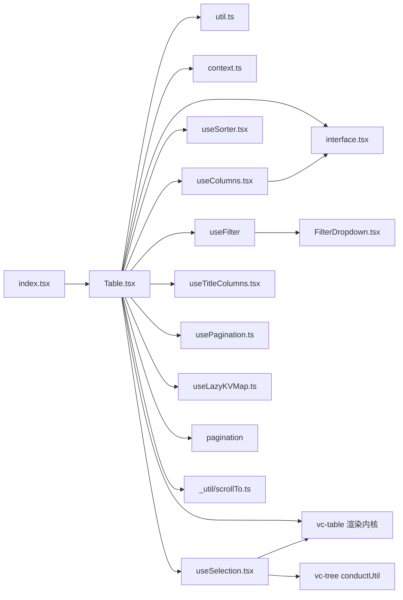
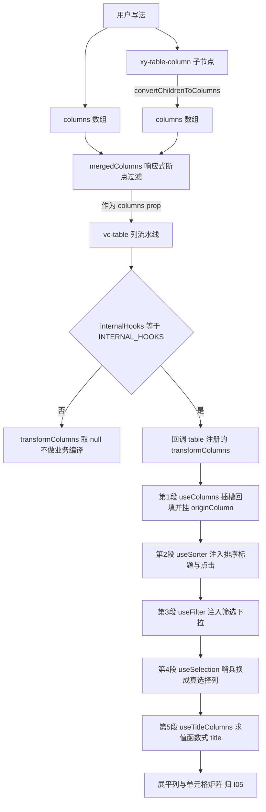
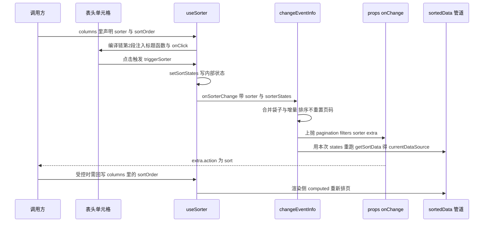

# C08-01 Table 表格

> **本篇解决**：Table 如何把用户声明的 column DSL 编译到 `vc-table` 的渲染单元，固定列与滚动如何同步，排序/筛选/选择的事件如何上抛、状态如何回落。
> **前置**：I05 vc-table 渲染架构、I06 table-core 状态机、I08 虚拟化双实现、I13 响应式内核 hooks　**读者坐标**：`03-components/08-table` 第 2/7 篇

## 一、职责与边界

`table/` 是 **列声明的编译器 + 状态袋**，不是渲染器。它接住用户写的 `columns` 数组或 `<xy-table-column>` 子节点，把它们编译成 `vc-table` 能消费的列矩阵；它接住排序、筛选、选择、分页四种用户动作，把它们折算成一次 `onChange` 上抛，并在下一次渲染时用纯函数管道把数据算回来。渲染内核（测量行、固定列 offset、克隆表头、滚动同步、单元格拆分）一行都不在 `table/` 里——那部分已在 I05《vc-table 渲染架构》论证；排序/过滤/分页的执行顺序与 `table-core` 侧的状态机已在 I06《table-core 状态机》论证；虚拟化两套引擎的取舍见 I08。本篇只讲 `table/` 这一层的输入输出与中间形态。

明确**不负责**：

- 属性清单与用法（属手册 `apps/docs/components/table.md`）。
- `vc-table` 内部（归 I05）、`table-core` 内部（归 I06）、虚拟化窗口算法（归 I08）。
- `data-table`、`tree-table`、`list` 的内部机制；三张表的分层与选型对比归 C08-00，本篇按其标题引用、不重复其结论。

| 方向 | 对象 | 证据 |
| --- | --- | --- |
| 依赖 | 渲染内核 `vc-table` | `packages/xiaoye-ui/src/table/Table.tsx:1` |
| 依赖 | 内核的钩子握手常量 | `packages/xiaoye-ui/src/table/Table.tsx:3` |
| 依赖 | 内核滚动条 DOM 引用（滚动复位用） | `packages/xiaoye-ui/src/table/Table.tsx:33` |
| 依赖 | 分页组件 | `packages/xiaoye-ui/src/table/Table.tsx:6` |
| 依赖 | 开发期告警工具 | `packages/xiaoye-ui/src/table/Table.tsx:36` |
| 被依赖 | 包根聚合与按需入口 | `packages/xiaoye-ui/src/table/index.tsx:1` |
| 被依赖 | 内核反向引用调用方的 `transformColumns` | `packages/xiaoye-ui/src/vc-table/Table.tsx:319` |

## 二、源码地图

`table/` 的形状是「薄本体 + 厚 hooks」：本体 `Table.tsx` 690 行里还含渲染拼装，能力全部住在 `hooks/` 的 2,284 行里，且体积呈金字塔——选择 685、筛选 299+574+39+16、排序 446、分页 91、列装配 54、KV 映射 51、标题列 29。

| 文件 | 行数 | 职责 | 关键导出 |
| --- | --- | --- | --- |
| `packages/xiaoye-ui/src/table/index.tsx` | 56 | 包入口、静态成员挂载、`install` | `default`（`XYTable`）、`tableProps` |
| `packages/xiaoye-ui/src/table/Table.tsx` | 690 | 主实现：props → 编译链 → 数据管道 → `RcTable` | `InternalTable`（`:187`）、`Table`（`:642`） |
| `packages/xiaoye-ui/src/table/interface.tsx` | 225 | 对外类型与 `TransformColumns` 契约 | `ColumnType`、`ColumnsType` |
| `packages/xiaoye-ui/src/table/util.ts` | 62 | 子节点 DSL 编译、列 key/pos 计算 | `convertChildrenToColumns`（`:30`） |
| `packages/xiaoye-ui/src/table/context.ts` | 44 | 插槽与 resize 的跨层注入 | `useProvideSlots`、`useProvideTableContext` |
| `packages/xiaoye-ui/src/table/hooks/useColumns.tsx` | 54 | 编译链第 1 段：插槽回填 | `default` |
| `packages/xiaoye-ui/src/table/hooks/useSorter.tsx` | 446 | 第 2 段：排序注入与状态 | `getSortData`（`:269`） |
| `packages/xiaoye-ui/src/table/hooks/useFilter/index.tsx` | 299 | 第 3 段：筛选注入与状态 | `getFilterData` |
| `packages/xiaoye-ui/src/table/hooks/useSelection.tsx` | 685 | 第 4 段：选择列生成 | `SELECTION_COLUMN`（`:35`） |
| `packages/xiaoye-ui/src/table/hooks/useTitleColumns.tsx` | 29 | 第 5 段：函数式标题求值 | `default` |
| `packages/xiaoye-ui/src/table/hooks/usePagination.ts` | 91 | 分页受控合并与切片参数 | `getPaginationParam` |
| `packages/xiaoye-ui/src/table/hooks/useLazyKVMap.ts` | 51 | record ↔ key 惰性映射 | `default` |
| `packages/xiaoye-ui/src/table/style/index.ts` | 375 | Component Token 与样式生成 | `genComponentStyleHook('Table', ...)` |

主实现入口挂在 `packages/xiaoye-ui/src/table/Table.tsx:187`（`InternalTable`）与 `packages/xiaoye-ui/src/table/Table.tsx:642`（对外壳层 `XYTable`）；内核侧的握手点挂在 `packages/xiaoye-ui/src/vc-table/Table.tsx:71`。

测试按 `packages/xiaoye-ui/vitest.config.mts:33` 的 glob 生效，六个文件与能力金字塔一一对应：`packages/xiaoye-ui/src/table/Table.rowSelection.test.js`（630 行）、`packages/xiaoye-ui/src/table/Table.filter.test.js`（443 行）、`packages/xiaoye-ui/src/table/Table.sorter.test.js`（181 行）、`packages/xiaoye-ui/src/table/Table.pagination.test.js`（214 行）、`packages/xiaoye-ui/src/table/Table.test.js`（123 行）、`packages/xiaoye-ui/src/table/empty.test.js`（102 行）。

## 三、架构与数据流

### 3.1 静态结构：`table/` 是一张「编译链 + 管道」的图，叶子只有两个方向

先看文件之间的真实引用边（全部来自 `Table.tsx` 与 `hooks/` 的 import 语句，可逐条 grep）。



三条边值得单独指出。其一，`useSelection.tsx` 有两条**向外层**的边：向内核取内部列标记（`packages/xiaoye-ui/src/table/hooks/useSelection.tsx:3`）和向树组件取勾选传播算法（`packages/xiaoye-ui/src/table/hooks/useSelection.tsx:7`）；其余 hook 都只向上（`interface.tsx`）或向内（`util.ts`）引用。这意味着选择能力是全表里唯一同时踩到两层外部实现的 hook，改动它的波及面最大。其二，`Table.tsx` 到 `_util/scrollTo.ts` 这条边（`packages/xiaoye-ui/src/table/Table.tsx:33`）是「业务外壳反过来操纵内核 DOM」的唯一通道，靠 `internalRefs` 回传支撑（论点 5）。其三，`index.tsx` 只连 `Table.tsx`（`packages/xiaoye-ui/src/table/index.tsx:1`），hooks 不经入口暴露——外部无法单独复用排序或筛选 hook。

### 3.2 列 DSL 的编译：一次注册、内核回调、五段套叠



这张图的关键分支是那个菱形：编译不是无条件发生的。`packages/xiaoye-ui/src/table/Table.tsx:623` 声明握手、`packages/xiaoye-ui/src/vc-table/Table.tsx:319` 做判定，判定为假时内核拿到 `null`，于是一个裸用 `vc-table` 的调用方**无论如何都拿不到排序列**。子节点写法只在 `Table` 外壳层被折叠成数组（`packages/xiaoye-ui/src/table/Table.tsx:674`），`InternalTable` 永远只见数组，这让两种写法在编译链之后完全等价。断点过滤在注册之前（`packages/xiaoye-ui/src/table/Table.tsx:214`），所以被 `responsive` 隐藏的列**根本不会进入编译链**，而不是编译后再隐藏。

### 3.3 一次排序点击的完整闭环



注意最后两条回流边：**上抛和回落是两条独立路径**。内部 `setSortStates`（`packages/xiaoye-ui/src/table/hooks/useSorter.tsx:428`）让非受控表格立刻能重排；而只要任何列带了 `sortOrder` 键，`mergedSorterStates` 就无视内部状态改用收集值（`packages/xiaoye-ui/src/table/hooks/useSorter.tsx:357`），此时不回写 props 的表格点了没反应。`changeEventInfo` 在中间只起「把三个 hook 的最新状态凑成一份完整载荷」的作用，它自己不是真源（论点 3）。

## 四、核心机制精读

### 论点 1：列编译不在 `table/` 里执行，而是把一个五段纯函数链交给内核，由内核在自己的列流水线里回调

`table/` 从头到尾没有「算出最终 columns」这个动作。它只构造一个函数 `transformColumns`，然后把这个函数连同一次握手声明一起塞给 `RcTable`；真正的调用发生在 `vc-table` 内部。

```tsx
// packages/xiaoye-ui/src/table/Table.tsx:518
    const transformColumns = (innerColumns: ColumnsType<any>): ColumnsType<any> => {
      const res = transformTitleColumns(
        transformSelectionColumns(
          transformFilterColumns(transformSorterColumns(transformBasicColumns(innerColumns))),
        ),
      );
      return res;
    };
```

```tsx
// packages/xiaoye-ui/src/table/Table.tsx:622
              // Internal
              internalHooks={INTERNAL_HOOKS}
              internalRefs={internalRefs}
              onUpdateInternalRefs={updateInternalRefs}
              transformColumns={transformColumns}
              transformCellText={transformCellText.value}
```

内核侧对这个 prop 做门禁判定，判定结果决定编译链是否生效：

```tsx
// packages/xiaoye-ui/src/vc-table/Table.tsx:319
      computed(() => (props.internalHooks === INTERNAL_HOOKS ? props.transformColumns : null)),
```

这个握手常量是一个字符串字面量，在内核里定义（`packages/xiaoye-ui/src/vc-table/Table.tsx:71`，值取自上游 `rc-table` 血统的标识串，不是本库的类名前缀），由 `table/` 原样导入（`packages/xiaoye-ui/src/table/Table.tsx:3`）。也就是说：**任何人直接用 `vc-table` 都拿不到这五段编译，只有传对魔法字符串的调用方才能让排序列、筛选列、选择列被注入**。这条接缝是 `table/` 与 `vc-table` 之间最强的耦合，也是 I05 所述「内核不认识业务 props」这一定位的实现依据。

`transformColumns` 为什么必须写成回调而不是 `computed`：内核的列流水线需要「测量宽度 → 决定列数与 colSpan → 渲染单元格」，而这些步骤发生在内核渲染期；`table/` 的渲染函数（`packages/xiaoye-ui/src/table/Table.tsx:527`）比内核的列处理更早返回，如果 `table/` 自己算好列再作为 prop 传入，就抢在内核测量之前完成了编译，等于放弃了内核的列状态真源。因此这一层是**控制反转**：`table/` 提供规则，内核决定何时套用。

五段的顺序不是排列组合，每一处都承担一次语义：

| 段 | 函数 | 证据 | 为什么在这个位置 |
| --- | --- | --- | --- |
| 1 | `transformBasicColumns` | `packages/xiaoye-ui/src/table/hooks/useColumns.tsx:51` | 先把用户的 `headerCell`/`bodyCell` 插槽回填进列，保证后续段读到的是已填好的列 |
| 2 | `transformSorterColumns` | `packages/xiaoye-ui/src/table/hooks/useSorter.tsx:432` | 把 `column.title` 包成函数式排序标题，并劫持 `customHeaderCell` 的点击 |
| 3 | `transformFilterColumns` | `packages/xiaoye-ui/src/table/hooks/useFilter/index.tsx` | 同理再包一层筛选下拉，标题变成「排序壳套筛选壳」的嵌套 |
| 4 | `transformSelectionColumns` | `packages/xiaoye-ui/src/table/hooks/useSelection.tsx` | 选择在排序/筛选之后注入，因此选择列不参与排序/筛选的标题包装 |
| 5 | `transformTitleColumns` | `packages/xiaoye-ui/src/table/hooks/useTitleColumns.tsx:25` | 最后一步才**求值**函数式 title，把合并后的 `sortColumns` 与 `filters` 交给用户的函数 |

第 1 段同时做一件关键的事——把原始列对象挂在编译产物上：

```tsx
// packages/xiaoye-ui/src/table/hooks/useColumns.tsx:11
  return columns.map(column => {
    if (column === SELECTION_COLUMN || column === EXPAND_COLUMN) return column;
    const cloneColumn = { ...column };
    const { slots = {} } = cloneColumn;
    cloneColumn.__originColumn__ = column;
```

`__originColumn__`（类型声明在 `packages/xiaoye-ui/src/vc-table/interface.ts:92`）让编译变成**无损**的：内核渲染单元格时，回传给调用方插槽的是用户自己写的那一列，而不是被四层包装后的产物——`packages/xiaoye-ui/src/vc-table/Cell/index.tsx:216`、`packages/xiaoye-ui/src/vc-table/Cell/index.tsx:247`、`packages/xiaoye-ui/src/vc-table/Cell/index.tsx:267` 三处都取 `column.__originColumn__`，列宽拖拽回调也走同一条回程（`packages/xiaoye-ui/src/vc-table/Header/DragHandle.tsx:103`）。少了这个锚点，用户在任何编译后的字段上做的相等性判断都会失效。

哨兵对象 `SELECTION_COLUMN`（`packages/xiaoye-ui/src/table/hooks/useSelection.tsx:35`，值是空对象字面量）与 `EXPAND_COLUMN`（`packages/xiaoye-ui/src/vc-table/constant.ts:1`，同样是空对象）用**引用相等**当位置标记，这是 `useColumns.tsx:12` 能一眼跳过它们的原因，也是选择列/展开列能被用户写进 `columns` 数组里精确控制位置的前提。

结论：`table/` 对列 DSL 做的事是「登记五条改写规则 + 锚定原始对象」，编译的物理执行点在内核。改动 `transformColumns` 的调用时机属于跨层改动，要连 I05 的列流水线一起看。

### 论点 2：排序不替换用户的标题与点击，而是把标题包成函数、把点击串到原处理器之后——代价是「受控状态寄生在 `columns` 里」

`injectSorter` 只处理声明了 `sorter` 的列（`packages/xiaoye-ui/src/table/hooks/useSorter.tsx:122`），它产出的不是新标题节点，而是一个**接收渲染 props 的函数**，函数内部再把用户原来的标题当字符串/数组/渲染函数渲染进去：

```tsx
// packages/xiaoye-ui/src/table/hooks/useSorter.tsx:160
        title: (renderProps: ColumnTitleProps<RecordType>) => {
          const renderSortTitle = (
            <div class={`${prefixCls}-column-sorters`}>
              <span class={`${prefixCls}-column-title`}>
                {renderColumnTitle(column.title, renderProps)}
              </span>
              <span
                class={classNames(`${prefixCls}-column-sorter`, {
                  [`${prefixCls}-column-sorter-full`]: !!(upNode && downNode),
                })}
              >
                <span class={`${prefixCls}-column-sorter-inner`}>
                  {upNode}
                  {downNode}
                </span>
              </span>
            </div>
          );
```

`renderColumnTitle`（`packages/xiaoye-ui/src/table/util.ts:19`）就是「title 是函数就调用它，否则原样返回」。于是用户写 `title: ({ sortColumns }) => ...` 时，他拿到的是**排序壳传下来的** `renderProps`，而他自己这一层又可能是函数——标题因此是一层层函数嵌套，直到编译链第 5 段才被求值（`packages/xiaoye-ui/src/table/hooks/useTitleColumns.tsx:12`）。这解释了论点 1 里第 5 段为什么必须在最后：提前求值会让用户函数拿不到后续段注入的状态。

点击的处理同样**不覆盖**，而是先派发再串接：

```tsx
// packages/xiaoye-ui/src/table/hooks/useSorter.tsx:184
        customHeaderCell: col => {
          const cell = (column.customHeaderCell && column.customHeaderCell(col)) || {};
          const originOnClick = cell.onClick;
          const originOKeyDown = cell.onKeydown;
          cell.onClick = (event: MouseEvent) => {
            triggerSorter({
              column,
              key: columnKey,
              sortOrder: nextSortOrder,
              multiplePriority: getMultiplePriority(column),
            });

            if (originOnClick) {
              originOnClick(event as PointerEvent);
            }
          };
```

顺序是「`triggerSorter` 先、用户 `onClick` 后」。用户在自己的表头点击回调里读到的 `column.sortOrder` 仍是旧值，新值只出现在 `onChange` 载荷里——这是一个容易写反的时序。同一段还补了键盘可达性（`packages/xiaoye-ui/src/table/hooks/useSorter.tsx:200` 用 `KeyCode.ENTER` 触发同一 `triggerSorter`）与屏幕阅读器状态（`packages/xiaoye-ui/src/table/hooks/useSorter.tsx:213` 写 `aria-sort`），并把 `cell.tabindex = 0` 交回内核焦点样式（`packages/xiaoye-ui/src/table/hooks/useSorter.tsx:218`）。

方向轮转由一个两行函数决定，值得单独记住，因为它的边界行为不直观：

```ts
// packages/xiaoye-ui/src/table/hooks/useSorter.tsx:46
function nextSortDirection(sortDirections: SortOrder[], current: SortOrder | null) {
  if (!current) {
    return sortDirections[0];
  }

  return sortDirections[sortDirections.indexOf(current) + 1];
}
```

`indexOf(current) + 1` 越界时取到 `undefined`，即「取消排序」，而取消的位置**由 `sortDirections` 数组长度决定**：默认 `['ascend', 'descend']`（`packages/xiaoye-ui/src/table/Table.tsx:343`）时三击取消；若配成 `['descend']` 则两击取消；若把 `undefined` 也放进数组，取消态会变成可停留的排序态。

`triggerSorter` 是双写：先改内部状态，再上抛事件（`packages/xiaoye-ui/src/table/hooks/useSorter.tsx:428`），二者共用同一个 `newSorterStates`。多选分支靠 `multiplePriority` 判定，单选分支直接 `newSorterStates = [sortState]` 丢掉其它列（`packages/xiaoye-ui/src/table/hooks/useSorter.tsx:415-426`）。

最重的债写在主实现自己的注释里：

```tsx
// packages/xiaoye-ui/src/table/Table.tsx:321
    /**
     * Controlled state in `columns` is not a good idea that makes too many code (1000+ line?) to read
     * state out and then put it back to title render. Move these code into `hooks` but still too
     * complex. We should provides Table props like `sorter` & `filter` to handle control in next big version.
     */
```

这段注释直接对应受控判定的实现：`mergedSorterStates` 每轮重新从列里收集受控状态，只要收集到就用收集的，收集不到才回落到内部 `sortStates`。

```ts
// packages/xiaoye-ui/src/table/hooks/useSorter.tsx:352
  const mergedSorterStates = computed(() => {
    let validate = true;
    const collectedStates = collectSortStates(mergedColumns.value, false);

    // Return if not controlled
    if (!collectedStates.length) {
      return sortStates.value;
    }
```

而「收集到」的判据是**键存在**而不是值非空：

```ts
// packages/xiaoye-ui/src/table/hooks/useSorter.tsx:90
      if ('sortOrder' in column) {
        // Controlled
        pushState(column, columnPos);
      } else if (init && column.defaultSortOrder) {
```

结论：排序的可见状态永远由 `columns` 里的 `sortOrder` 决定，内部 `useState`（`packages/xiaoye-ui/src/table/hooks/useSorter.tsx:348`）只在没有任何列声明 `sortOrder` 时生效。库作者自己把它标为应在下个版本改成 props 的设计缺陷（`packages/xiaoye-ui/src/table/Table.tsx:321`），筛选侧同构。

### 论点 3：三种动作共用一个非响应式状态袋上抛，`onChange` 载荷里的数据是**重跑管道**算出来的，不是复用渲染用的那份

`table/` 没有给排序、筛选、分页各写一个事件。它只有一个出口 `triggerOnChange`，加一个普通对象当状态袋：

```ts
// packages/xiaoye-ui/src/table/Table.tsx:279
    const changeEventInfo: Partial<ChangeEventInfo> = {};

    const triggerOnChange = (
      info: Partial<ChangeEventInfo>,
      action: TableAction,
      reset = false,
    ) => {
      const { pagination, scroll, onChange } = props;
      const changeInfo = {
        ...changeEventInfo,
        ...info,
      };
```

`changeEventInfo` 是 `Partial<ChangeEventInfo>` 的普通字面量（`packages/xiaoye-ui/src/table/Table.tsx:279`），不参与响应式；它由一个 `watchEffect` 在每个渲染周期回写：

```ts
// packages/xiaoye-ui/src/table/Table.tsx:407
    watchEffect(() => {
      changeEventInfo.sorter = sorters.value;
      changeEventInfo.sorterStates = sortStates.value;

      changeEventInfo.filters = filters.value;
      changeEventInfo.filterStates = filterStates.value;
      changeEventInfo.pagination =
        props.pagination === false
          ? {}
          : getPaginationParam(mergedPagination.value, props.pagination);

      changeEventInfo.resetPagination = resetPagination;
    });
```

于是三个动作的差异全部压缩成 `triggerOnChange` 的第二个与第三个参数：

| 动作 | 调用处 | `action` | `reset` | 传出的增量 |
| --- | --- | --- | --- | --- |
| 排序 | `packages/xiaoye-ui/src/table/Table.tsx:329` | `'sort'` | `false`（`:335`） | `sorter`、`sorterStates` |
| 筛选 | `packages/xiaoye-ui/src/table/Table.tsx:353` | `'filter'`（`:358`） | `true`（`:359`） | `filters`、`filterStates` |
| 分页 | `packages/xiaoye-ui/src/table/Table.tsx:393` | `'paginate'`（`:397`） | 缺省 `false` | `pagination` |

`action` 只有这三个合法值（`packages/xiaoye-ui/src/table/interface.tsx:51` 的 `tuple('paginate', 'sort', 'filter')`），**选择不在其中**——见论点 4。

`reset` 是排序与筛选唯一的语义分界，实现写在同一段里：

```ts
// packages/xiaoye-ui/src/table/Table.tsx:292
      if (reset) {
        changeEventInfo.resetPagination!();

        // Reset event param
        if (changeInfo.pagination!.current) {
          changeInfo.pagination!.current = 1;
        }

        // Trigger pagination events
        if (pagination && pagination.onChange) {
          pagination.onChange(1, changeInfo.pagination!.pageSize);
        }
      }
```

即：**改筛选条件会把页码打回第一页并额外补发一次 `pagination.onChange`，改排序条件不会**。理由是筛选后行数可能骤减、停在第 7 页会看到空表，而排序不改变行数。注意 `resetPagination` 就是 `usePagination` 返回的 `refreshPagination`（`packages/xiaoye-ui/src/table/hooks/usePagination.ts:89`），它在 `pagination === false` 时直接 return（`packages/xiaoye-ui/src/table/hooks/usePagination.ts:68`），所以关掉分页时这一路是空操作。

上抛前还做一次滚动复位：

```ts
// packages/xiaoye-ui/src/table/Table.tsx:306
      if (scroll && scroll.scrollToFirstRowOnChange !== false && internalRefs.body) {
        scrollTo(0, {
          getContainer: () => internalRefs.body,
        });
      }
```

最后是对外的四次传参，其中 `currentDataSource` 现场重算：

```ts
// packages/xiaoye-ui/src/table/Table.tsx:312
      onChange?.(changeInfo.pagination!, changeInfo.filters!, changeInfo.sorter!, {
        currentDataSource: getFilterData(
          getSortData(rawData.value, changeInfo.sorterStates!, childrenColumnName.value),
          changeInfo.filterStates!,
        ),
        action,
      });
```

这五行是「事件上抛」与「状态回落」之间最贵的一处设计。渲染用的数据是 `sortedData`（`packages/xiaoye-ui/src/table/Table.tsx:347`）→ `mergedData`（`packages/xiaoye-ui/src/table/Table.tsx:371`）→ `pageData`（`packages/xiaoye-ui/src/table/Table.tsx:422`）三级 computed；而事件载荷里的 `currentDataSource` 从 `rawData` 起用**本次 `info` 携带的 states** 重新跑一遍 `getSortData` + `getFilterData`，且**不做分页切片**。为什么要重跑：`watchEffect`（`packages/xiaoye-ui/src/table/Table.tsx:407`）要等本轮状态提交后才回写袋子，而 `onChange` 必须在当前调用栈里就给出新数据，否则 `currentDataSource` 会落后一次动作。代价是排序/筛选回调触发时整条管道算两遍。

`currentDataSource` 是「过滤+排序后但未分页」的全量结果，这一点可以直接从「它不引用 `pageData`」证实（`packages/xiaoye-ui/src/table/Table.tsx:312` 的实参链里没有出现 `pageData`）。服务端分页的调用方正是靠它做全量回写。

分页这一路还有一个双层通知：内核分页组件变更时先调用户的 `pagination.onChange`，再更新内部页码，最后才走 `triggerOnChange`：

```ts
// packages/xiaoye-ui/src/table/hooks/usePagination.ts:75
  const onInternalChange: PaginationProps['onChange'] = (current, pageSize) => {
    if (paginationRef.value) {
      pagination.value.onChange?.(current, pageSize);
    }
    refreshPagination(current, pageSize);
    onChange(current, pageSize || mergedPagination.value.pageSize);
  };
```

受控合并在 `packages/xiaoye-ui/src/table/hooks/usePagination.ts:51` 用 `extendsObject(innerPagination.value, pagination.value, { total })` 完成，后者覆盖前者；而 `extendsObject` 会跳过值为 `undefined` 的键（`packages/xiaoye-ui/src/_util/extendsObject.ts:11`），所以**把 `current` 传成 `undefined` 不能解除受控**，只能传 `false` 关掉分页或不传该键。同一段还会把越界页码悄悄夹回：`packages/xiaoye-ui/src/table/hooks/usePagination.ts:59` 起，`current > maxPage` 时改写为 `maxPage || 1`，无告警。

### 论点 4：选择完全绕开 `onChange` 状态袋，走 `rowSelection` 自己的事件族；它的勾选传播算法是从树组件借来的

排序/筛选/分页汇聚到 `triggerOnChange`，选择不是。`useSelection` 里没有任何一处调用 `triggerOnChange`，它把状态写进 `useMergedState` 并直接调用 `rowSelection` 上的回调：

```ts
// packages/xiaoye-ui/src/table/hooks/useSelection.tsx:198
  const setSelectedKeys = (keys: Key[]) => {
    let availableKeys: Key[];
    let records: RecordType[];
    updatePreserveRecordsCache(keys);
    const { preserveSelectedRowKeys, onChange: onSelectionChange } = mergedRowSelection.value;
    const { getRecordByKey } = configRef;
    if (preserveSelectedRowKeys) {
      availableKeys = keys;
      records = keys.map(key => preserveRecordsRef.value.get(key)!);
    } else {
      // Filter key which not exist in the `dataSource`
      availableKeys = [];
      records = [];

      keys.forEach(key => {
        const record = getRecordByKey(key);
        if (record !== undefined) {
          availableKeys.push(key);
          records.push(record);
        }
      });
    }

    setMergedSelectedKeys(availableKeys);

    onSelectionChange?.(availableKeys, records);
  };
```

这段是所有勾选动作的唯一收口（单选 `packages/xiaoye-ui/src/table/hooks/useSelection.tsx:236`、全选 `packages/xiaoye-ui/src/table/hooks/useSelection.tsx:381`、下拉项 `packages/xiaoye-ui/src/table/hooks/useSelection.tsx:296` 都调它），也因此同时干了两件事：**过滤掉当前数据里不存在的 key**（`:212-218` 的 `record !== undefined` 判据）与**决定是否保留跨页记录**（`:204-206`）。`preserveSelectedRowKeys` 为假时，`availableKeys` 是过滤后的集合，而调用方传进来的 `keys` 不是——受控场景下父组件收到的是「已被裁剪」的结果，两侧的 key 数可以不相等。

状态回落走 `useMergedState`（`packages/xiaoye-ui/src/table/hooks/useSelection.tsx:82-89`，该受控写法由 I13《响应式内核 hooks》记录，此处不重复论证）。本篇要补的是这一处**没有传 `onChange` 选项**：全仓 `table/` 目录内搜 `update:selectedRowKeys` 命中 0 行，即内部不会自动派发 `update:` 事件。结合 `packages/xiaoye-ui/src/_util/hooks/useMergedState.ts:26` 的「`value.value !== undefined` 就用外部值」，闭环只能是：**`setMergedSelectedKeys` 只动内部值 → 下一轮 `watchEffect` 把 `mergedValue` 覆写回外部 `selectedRowKeys`（`:30`）→ 表格必须自己发 `onChange`（上面 `:223`）→ 等父组件回写 props**。父组件不回写，勾选视觉上就不动。这是 `table/` 受控选择最容易漏写的一半。

缓存那一侧的行为要连着看：

```ts
// packages/xiaoye-ui/src/table/hooks/useSelection.tsx:94
  const updatePreserveRecordsCache = (keys: Key[]) => {
    if (mergedRowSelection.value.preserveSelectedRowKeys) {
      const newCache = new Map<Key, RecordType>();
      // Keep key if mark as preserveSelectedRowKeys
      keys.forEach(key => {
        let record = configRef.getRecordByKey(key);

        if (!record && preserveRecordsRef.value.has(key)) {
          record = preserveRecordsRef.value.get(key)!;
        }

        newCache.set(key, record);
      });
```

`newCache.set(key, record)` 在 `record` 为 `undefined` 时照样写入（`:105`），于是 `preserveSelectedRowKeys` 打开时 `records = keys.map(...)`（`:206`）可能含 `undefined` 空洞——一个从未在当前数据里出现过的 key（例如手写的 `defaultSelectedRowKeys`）会以 `undefined` 形式出现在 `selectedRows` 里。

「全选」的作用域是本页，且会跳过禁用行：

```ts
// packages/xiaoye-ui/src/table/hooks/useSelection.tsx:350
    const recordKeys = flattedData.value
      .map(getRowKey.value)
      .filter(key => !checkboxPropsMap.value.get(key)!.disabled);
    const checkedCurrentAll = recordKeys.every(key => keySet.has(key));
```

`flattedData` 取自 `configRef.pageData`（`packages/xiaoye-ui/src/table/hooks/useSelection.tsx:126-128`），而 `keySet` 来自已级联的 `derivedSelectedKeySet`（`:347`，定义在 `:684` 的返回值）。所以点一次表头全选只把**当前页非禁用行**并进集合，翻页后之前的选择仍在——这与 `data-table` 的全选语义不同，归 C08-00（编号 + 标题引用）。

树形的父子传播不在 `table/` 里实现，而是从树组件借来：

```ts
// packages/xiaoye-ui/src/table/hooks/useSelection.tsx:157
  const selectKeysState = computed(() => {
    if (mergedRowSelection.value.checkStrictly) {
      return [mergedSelectedKeys.value || [], []];
    }
    const { checkedKeys, halfCheckedKeys } = conductCheck(
      mergedSelectedKeys.value,
      true,
      keyEntities.value,
      maxLevel.value,
      levelEntities.value,
      isCheckboxDisabled as any,
    );
    return [checkedKeys || [], halfCheckedKeys];
  });
```

`conductCheck` 与 `convertDataToEntities` 分别从 `packages/xiaoye-ui/src/table/hooks/useSelection.tsx:7` 和 `packages/xiaoye-ui/src/table/hooks/useSelection.tsx:8` 导入，两者都属于 `vc-tree`；`checkStrictly` 为真时整棵树实体都不构建（`:116-118` 的 `keyEntities` 直接返回 `null`），这是一条明确的性能开关。半选态同理只在非 radio 下计算（`packages/xiaoye-ui/src/table/hooks/useSelection.tsx:182-184`），radio 还会把选中集截成一条（`:177-179`）。

最后一件事是把哨兵换成真列：

```tsx
// packages/xiaoye-ui/src/table/hooks/useSelection.tsx:670
    // Replace with real selection column
    const selectionColumn = {
      fixed: mergedFixed,
      width: selectionColWidth,
      className: `${prefixCls.value}-selection-column`,
      title: mergedRowSelection.value.columnTitle || title,
      customRender: renderSelectionCell,
      [INTERNAL_COL_DEFINE]: {
        class: `${prefixCls.value}-selection-col`,
      },
    };

    return cloneColumns.map(col => (col === SELECTION_COLUMN ? selectionColumn : col));
```

`INTERNAL_COL_DEFINE` 从内核导入（`packages/xiaoye-ui/src/table/hooks/useSelection.tsx:3`），其值在内核里定义为上游血统的字符串常量（`packages/xiaoye-ui/src/vc-table/utils/legacyUtil.ts:4`），内核据此识别「这不是用户写的列」。选择列的标题可被 `rowSelection.columnTitle` 覆盖（`:674`），勾选框本体走 `Checkbox`/`Radio`（`packages/xiaoye-ui/src/table/hooks/useSelection.tsx:15`、`packages/xiaoye-ui/src/table/hooks/useSelection.tsx:17`）。

结论：选择是 `table/` 里唯一**自成一套契约**的能力——自己的事件族（`onChange` / `onSelect` / `onSelectAll` / `onSelectInvert` / `onSelectMultiple`）、自己的受控通道、自己的级联算法。它不进 `TableAction`，因此永远不会出现在表格级 `onChange` 的 `extra.action` 里。

### 论点 5：固定列与滚动同步在 `table/` 里几乎全是转发，只有两处是真决策——选择列的 `fixed` 推断，和变更后那次 450ms 动画归零

先把边界钉住：`fixHeader` / `fixColumn` / `horizonScroll` 的推导、左右 offset 累加、克隆表头、`scroll` 事件回写 `scrollLeft` 与防回环，全部在内核，已由 I05《vc-table 渲染架构》论证。本篇只查 `table/` 这一层到底为固定列与滚动做了什么。

答案是：**`scroll`、`sticky`、`tableLayout`、`expandFixed`、`expandColumnWidth` 五个 props 在本层没有任何读取点，它们只被声明后整体转发**。

```tsx
// packages/xiaoye-ui/src/table/Table.tsx:597
      const tableProps = omit(props, ['columns']);
      return wrapSSR(
```

`packages/xiaoye-ui/src/table/Table.tsx:597` 造了一个只剔除 `columns` 的对象，`packages/xiaoye-ui/src/table/Table.tsx:604` 用 `{...tableProps}` 铺到 `RcTable` 上，之后 `:605-627` 再逐条覆盖需要加工的那几个。`sticky` 的声明在 `packages/xiaoye-ui/src/table/Table.tsx:154`，`scroll` 在 `packages/xiaoye-ui/src/table/Table.tsx:176`，`expandFixed` 在 `packages/xiaoye-ui/src/table/Table.tsx:136`；这三个名字在 `table/` 的 `.tsx` 逻辑里再无出现（`grep -rn "sticky" packages/xiaoye-ui/src/table --include='*.tsx'` 只命中 `Table.tsx:154` 一行），它们对应的内核 prop 分别是 `packages/xiaoye-ui/src/vc-table/Table.tsx:143`（`sticky`）与 `packages/xiaoye-ui/src/vc-table/Table.tsx:81`（`scroll`）。由于内核 `inheritAttrs: false`（`packages/xiaoye-ui/src/vc-table/Table.tsx:154`），这些铺下去的多余业务 prop（`dataSource`、`pagination`、`rowSelection`、`onChange`）不会渗到 DOM 属性上：内核对 `attrs` 只挑 `aria-*` / `data-*` 两类放行（`packages/xiaoye-ui/src/vc-table/Table.tsx:822`），加上 `class` 与 `style`（`packages/xiaoye-ui/src/vc-table/Table.tsx:839`），其余键被静默丢弃——转发面宽但落点小，这是读代码时最容易误判的一处：**看到 `{...tableProps}` 不代表每个 prop 都被内核消费**。

真正的第一处决策在选择列的固定端推断：

```tsx
// packages/xiaoye-ui/src/table/hooks/useSelection.tsx:650
    let mergedFixed: FixedType | undefined = fixed;

    if (mergedFixed === undefined) {
      if (nextCol?.fixed !== undefined) {
        mergedFixed = nextCol.fixed;
      } else if (prevCol?.fixed !== undefined) {
        mergedFixed = prevCol.fixed;
      }
    }

    if (
      mergedFixed &&
      prevCol &&
      prevCol[INTERNAL_COL_DEFINE]?.columnType === 'EXPAND_COLUMN' &&
      prevCol.fixed === undefined
    ) {
      prevCol.fixed = mergedFixed;
    }
```

`rowSelection.fixed` 缺省时，选择列**先看右邻再看左邻**（`:653-657` 的顺序是 next 优先），只查直接相邻的一列，不做跨列搜索；`prevCol`/`nextCol` 取的是插入后数组的相邻位（`packages/xiaoye-ui/src/table/hooks/useSelection.tsx:645-648`）。第二个 `if`（`:660-667`）是把推断结果**反向写回展开列**——当左邻正是内核标记的展开列且它自己没声明 `fixed` 时，跟着一起钉住。这段直接改的是 `prevCol` 对象本身（`:666` 的赋值），不是副本；而 `mergedFixed` 最终成为真选择列的 `fixed`（`packages/xiaoye-ui/src/table/hooks/useSelection.tsx:671`）。

> ⚠️ 未在源码中找到「`rtl` 下 `left`/`right` 语义翻转」在 `table/` 层的处理；本层只按字面传递 `fixed` 值，翻转（若有）应发生在内核，未在篇内证实，归 I05 范围。

第二处决策是变更后的滚动归零，它依赖一条跨层回传：

```tsx
// packages/xiaoye-ui/src/table/Table.tsx:259
    const internalRefs = reactive({
      body: null,
    });

    const updateInternalRefs = refs => {
      Object.assign(internalRefs, refs);
    };
```

内核只在握手成立时把 body 容器交回来，且用 `flush: 'post'` 保证 DOM 已就绪：

```tsx
// packages/xiaoye-ui/src/vc-table/Table.tsx:527
    watchEffect(
      () => {
        if (props.internalHooks === INTERNAL_HOOKS && props.internalRefs) {
          props.onUpdateInternalRefs({
            body: scrollBodyRef.value
              ? (scrollBodyRef.value as any).$el || scrollBodyRef.value
              : null,
          });
        }
      },
      { flush: 'post' },
    );
```

`table/` 拿它做一件事，就是 `triggerOnChange` 里那次归零（`packages/xiaoye-ui/src/table/Table.tsx:306`，见论点 3）。要注意这不是瞬时跳转：

```ts
// packages/xiaoye-ui/src/_util/scrollTo.ts:14
export default function scrollTo(y: number, options: ScrollToOptions = {}) {
  const { getContainer = () => window, callback, duration = 450 } = options;
  const container = getContainer();
  const scrollTop = getScroll(container, true);
  const startTime = Date.now();
```

默认 `duration = 450`（`packages/xiaoye-ui/src/_util/scrollTo.ts:15`）配 `easeInOutCubic` 逐帧写 `scrollTop`（`packages/xiaoye-ui/src/_util/scrollTo.ts:29`），容器在动画开始前一次性取到（`packages/xiaoye-ui/src/_util/scrollTo.ts:16`）。所以「翻页/排序后回到首行」是一段 450ms 的动画，而不是一次赋值；关闭它只能靠 `scroll.scrollToFirstRowOnChange: false`（`packages/xiaoye-ui/src/table/Table.tsx:306` 的 `!== false` 判据意味着**缺省即开启动画**）。

样式层的固定列只补了两件事：sticky 定位与「假滚动条」外观。

```less
// packages/xiaoye-ui/src/table/style/sticky.ts:18
      [`${componentCls}-sticky`]: {
```

`packages/xiaoye-ui/src/table/style/sticky.ts:18` 起的规则给 `-sticky` 容器打 `position: sticky`（`:20`、`:26`），`:40` 处注明是 sticky 场景下的假滚动条样式；普通固定列侧另有 `packages/xiaoye-ui/src/table/style/fixed.ts:25` 的 `position: 'sticky !important' as 'sticky'` —— 用 `!important` 强制覆盖，说明这一层要压过内核自己写入的行内定位，是跨层样式竞争留下的痕迹。

结论：`table/` 在固定列/滚动上的净贡献是「两条推断 + 一次动画」，其余是转发。想改固定列行为，绝大多数情况必须去内核；想改「什么时候回到首行」，只需要改 `packages/xiaoye-ui/src/table/Table.tsx:306`。

## 五、对外契约如何生效

**契约面从类型层就被削过。** 对外的 `TableProps` 是「内核 props 减去九个内部字段」（`packages/xiaoye-ui/src/table/Table.tsx:83`），减项清单（`packages/xiaoye-ui/src/table/Table.tsx:85-93`）里正好包含本篇涉及的三条内部接缝：`transformColumns`、`internalHooks`、`internalRefs`。也就是说调用方在类型上就**无法**自己注册编译链，这条扩展通道只对本库开放。

**两层组件的分工**在渲染函数里可见：对外壳层 `XYTable`（`packages/xiaoye-ui/src/table/Table.tsx:642`）只做两件事——把子节点折叠成数组（`packages/xiaoye-ui/src/table/Table.tsx:674`），以及把全部插槽原样打包成 `contextSlots` prop（`packages/xiaoye-ui/src/table/Table.tsx:682`，源码在此行留有注释说明必须用新对象否则插槽热更新失效）。真逻辑全在 `InternalTable`（`packages/xiaoye-ui/src/table/Table.tsx:187`）。两层都声明 `inheritAttrs: false`（`packages/xiaoye-ui/src/table/Table.tsx:189`、`packages/xiaoye-ui/src/table/Table.tsx:644`），`attrs` 由 `packages/xiaoye-ui/src/table/Table.tsx:603` 显式铺到内核根节点上，所以用户写在 `<xy-table>` 上的原生属性走的是显式转发而非自动继承。

`<xy-table-column>` 这类子组件是**不渲染的声明载体**：`packages/xiaoye-ui/src/table/Column.tsx:14` 的 `render()` 直接返回 `null`，它的价值全在被 `convertChildrenToColumns` 读取——属性做 kebab 到 camel 归一（`packages/xiaoye-ui/src/table/util.ts:43`），默认插槽降级成 `customRender`（`packages/xiaoye-ui/src/table/util.ts:56`），并用 `__XY_TABLE_COLUMN_GROUP` 标记决定要不要递归下钻（`packages/xiaoye-ui/src/table/util.ts:51`）。数组写法与子节点写法在这一步之后不再有任何区别。

**插槽跨层的方式是 provide/inject，且方向是反的。** `InternalTable` 在 setup 早期把 `contextSlots` 提供出去（`packages/xiaoye-ui/src/table/Table.tsx:206`），而消费插槽的代码在内核里：`packages/xiaoye-ui/src/vc-table/Cell/index.tsx:109` 与 `packages/xiaoye-ui/src/vc-table/hooks/useColumns.tsx:124` 都调用 `useInjectSlots`。这两行 import 的路径是 `../../table/context`（`packages/xiaoye-ui/src/vc-table/Cell/index.tsx:19`、`packages/xiaoye-ui/src/vc-table/hooks/useColumns.tsx:16`）——**被依赖方在内核，声明方在业务层**，`vc-table` 与 `table` 之间存在一条向上的 import。这条环的安全垫在 context 的默认值上：`useInjectSlots` 缺省返回空对象的 computed（`packages/xiaoye-ui/src/table/context.ts:29`），所以裸用内核不会崩，只是 `bodyCell` / `headerCell` 静默失效。同理，`useInjectTableContext` 的默认 `onResizeColumn` 是空函数（`packages/xiaoye-ui/src/table/context.ts:43`）。

列宽拖拽因此是一条三段链：内核把手件回调进业务注入的 context（`packages/xiaoye-ui/src/vc-table/Header/DragHandle.tsx:103`，它传的是 `column.__originColumn__`，见论点 1），`InternalTable` 在 provider 里把它转成 `emit`（`packages/xiaoye-ui/src/table/Table.tsx:209`），而 `resizeColumn` 同时也是声明过的 prop（`packages/xiaoye-ui/src/table/Table.tsx:173`）——Vue 3 的 `emit` 会命中同名 `onXxx` prop，所以调用方两种写法都能收到。这是本篇认为最该记住的一处：**同一个能力有 prop 和 emit 两个入口，但内部只有一条实现路径**。

事件面分三套互不相通的通道：表格级 `onChange`（`packages/xiaoye-ui/src/table/Table.tsx:312`）、分页自带 `pagination.onChange`（`packages/xiaoye-ui/src/table/hooks/usePagination.ts:77`，与表格级 `onChange` 在翻页时**都会**触发）、以及选择级 `rowSelection.onChange` / `onSelect` / `onSelectAll` / `onSelectInvert` / `onSelectMultiple`（`packages/xiaoye-ui/src/table/hooks/useSelection.tsx:223`、`packages/xiaoye-ui/src/table/hooks/useSelection.tsx:233`、`packages/xiaoye-ui/src/table/hooks/useSelection.tsx:375`、`packages/xiaoye-ui/src/table/hooks/useSelection.tsx:551`）。

暴露面是两跳：`InternalTable` 只 `expose({ selectedKeySet })`（`packages/xiaoye-ui/src/table/Table.tsx:509`），外壳层只 `expose({ table })`（`packages/xiaoye-ui/src/table/Table.tsx:670`），因此模板引用要 `引用.table` 才能拿到内层实例，再取其 `selectedKeySet`；而这个 Set 是**已经过级联的派生集**（`packages/xiaoye-ui/src/table/hooks/useSelection.tsx:684` 返回的是 `derivedSelectedKeySet`），与 `rowSelection.selectedRowKeys` 的字面值不等价——树形数据下前者含被推导出的父/子节点。行高亮类名正是用它判定的（`packages/xiaoye-ui/src/table/Table.tsx:502`）。

范围选择（Shift 连选）只在 `checkStrictly` 下参与计算（`packages/xiaoye-ui/src/table/hooks/useSelection.tsx:512`），锚点由上一次单选写入（`packages/xiaoye-ui/src/table/hooks/useSelection.tsx:597`）；非严格模式下勾选走「先填满再纠正」两趟级联——先 `[...originCheckedKeys, key]` 全填（`packages/xiaoye-ui/src/table/hooks/useSelection.tsx:568`），若本次是取消则带 `halfCheckedKeys` 再算一遍修正（`packages/xiaoye-ui/src/table/hooks/useSelection.tsx:583`）。

## 六、设计取舍

**取舍一：把编译权交给内核回调，而不是在 `table/` 里算好列再传下去。** 收益是 `table/` 可以彻底不碰渲染——本体里没有任何单元格逻辑，全部交给内核的测量与展平（内核侧形态归 I05）；也让「列」这件事只有一个真源，排序态、筛选态、选中态变化时不需要 `table/` 主动通知内核重算列。赔上是三层耦合：门禁字符串必须两边一致（`packages/xiaoye-ui/src/table/Table.tsx:623` 对上 `packages/xiaoye-ui/src/vc-table/Table.tsx:319`），编译在**内核渲染期**执行使得一次数据变更会把五段全跑一遍，调试栈跨层且断点难打。放弃的另一条路（本地 `computed` 出最终列）会让 `table/` 必须自己维护展平列与 offset，等价于重写半个内核。

**取舍二：受控状态寄生在 `columns` 里。** 代码里留着作者自己的判词（`packages/xiaoye-ui/src/table/Table.tsx:321-325`），承认这是「1000+ 行为了把状态读出来再塞回标题渲染」的坏设计，并计划在下个大版本改成 `sorter` / `filter` 这样的独立 props。当前方案的收益是兼容既有列声明写法、且每列的状态天然与列同生命周期；赔上是「键存在即受控」这种反直觉判据（`packages/xiaoye-ui/src/table/hooks/useSorter.tsx:90`）与筛选侧的全有全无约束（`packages/xiaoye-ui/src/table/hooks/useFilter/index.tsx:267`）。这是明码标价的技术债，不是无意为之。

**取舍三：一个 `onChange` 收口三种动作，而不是每种动作各发一个事件。** 收益是调用方只需接一个函数就能拿到分页+筛选+排序的完整快照，服务端渲染场景尤其省事（一次动作一次全量上报）。赔上两点：一是载荷必须自洽，于是 `currentDataSource` 只能现场重算管道（`packages/xiaoye-ui/src/table/Table.tsx:312`），大表格每次点击算两遍；二是**选择塞不进这个口子**——`TableAction` 只有三值（`packages/xiaoye-ui/src/table/interface.tsx:51`），选择只能维持自己那套更细的事件族（论点 4），最终对外呈现「表格行为听 `onChange`、勾选听 `rowSelection`」的双轨契约。另一条路的实物在隔壁组件（具名事件族，归 C08-00 编号 + 标题引用），本篇不评优劣。

**取舍四：勾选级联复用树组件算法，而不是在表格内重写。** `conductCheck` / `convertDataToEntities` / `arrAdd` / `arrDel` 全部来自 `vc-tree`（`packages/xiaoye-ui/src/table/hooks/useSelection.tsx:6-8`）。收益是「表格多选」与「树勾选」语义严格一致，父子/半选只有一份实现；赔上是 `table` 与 `vc-tree` 之间多一条硬依赖，并且带来取消勾选要跑两趟级联的成本（`packages/xiaoye-ui/src/table/hooks/useSelection.tsx:568` 与 `packages/xiaoye-ui/src/table/hooks/useSelection.tsx:583`）。`checkStrictly` 提供了关掉整套实体构建的出口（`packages/xiaoye-ui/src/table/hooks/useSelection.tsx:116-118`），说明作者自己清楚这笔账。

**取舍五：`table/` 反过来向内核注入 context。** 插槽与 resize 通过 `provide` 跨层（`packages/xiaoye-ui/src/table/Table.tsx:206`），内核 `import` 业务层模块来 `inject`（`packages/xiaoye-ui/src/vc-table/Cell/index.tsx:19`）。收益是内核不必为每个业务扩展点开一个 prop 形参，`bodyCell` 这类插槽直接可用；赔上的是「内核可独立使用」这一条被破坏——脱离 `table/` 的内核功能不完整且**不报错**（默认值兜在 `packages/xiaoye-ui/src/table/context.ts:29`）。

**取舍六：变更后回到首行用 450ms 动画，而不是瞬时赋值。** `scrollTo` 的默认时长是 450（`packages/xiaoye-ui/src/_util/scrollTo.ts:15`）。收益是长表格翻页/排序后视线不会丢；赔上是可打断性差——动画期间再触发一次动作会叠加两条 rAF 链，且容器在动画开始前就固定了（`packages/xiaoye-ui/src/_util/scrollTo.ts:16`）。库选择把它做成 `scrollToFirstRowOnChange` 开关而非默认关闭，把代价留给调用方按场景决定是否关掉。

## 七、坑与改动指南

**坑 1：列没写 `key` 也没写 `dataIndex`，排序/筛选状态会在增删列后串位。**

- 触发：给 `columns` 中间插入或删除一列，而这些列只靠位置区分。
- 症状：原本按 A 列排序，改完列结构后变成按 B 列排序；或筛选状态跟着挪到别的列。
- 原因：列身份由 `getColumnKey` 决定，兜底是**位置串**（`packages/xiaoye-ui/src/table/util.ts:4`：`key` → `dataIndex` → `defaultKey`），排序状态用这个 key 做匹配（`packages/xiaoye-ui/src/table/hooks/useSorter.tsx:129`），筛选侧同样按 key 回表（`packages/xiaoye-ui/src/table/hooks/useFilter/index.tsx:253`）。
- 定位：`packages/xiaoye-ui/src/table/util.ts:4`、`packages/xiaoye-ui/src/table/hooks/useSorter.tsx:128`。

**坑 2：给列传 `sortOrder: undefined` 会把这一列永久钉死成受控。**

- 触发：用 `v-bind` 展开一个可选对象，或 `reactive` 列配置里预置了 `sortOrder` 字段但值是 `undefined`。
- 症状：点击表头没反应，排序图标不动；`onChange` 里 `sorter.order` 恒为 `undefined`。
- 原因：受控判据是**键存在**而非值有效（`packages/xiaoye-ui/src/table/hooks/useSorter.tsx:90` 的 `'sortOrder' in column`），一旦任一列命中，`mergedSorterStates` 就整体放弃内部状态（`packages/xiaoye-ui/src/table/hooks/useSorter.tsx:357`）。
- 定位：`packages/xiaoye-ui/src/table/hooks/useSorter.tsx:352`。修法是不传该键，而不是传 `undefined`。

**坑 3：`defaultSortOrder` 对异步下发的列配置不生效。**

- 触发：列配置（含 `sorter` + `defaultSortOrder`）在首次渲染之后才到达，典型场景是远程列定义。
- 症状：首屏不排序；而非异步时同一份配置是排序的。
- 原因：默认值只在 setup 阶段收集一次（`packages/xiaoye-ui/src/table/hooks/useSorter.tsx:349` 传入 `init = true`），此后每轮重算都用 `init = false` 的收集（`packages/xiaoye-ui/src/table/hooks/useSorter.tsx:354`），而默认分支要求 `init` 为真（`packages/xiaoye-ui/src/table/hooks/useSorter.tsx:93`）。
- 定位：`packages/xiaoye-ui/src/table/hooks/useSorter.tsx:93`。筛选侧同构（`packages/xiaoye-ui/src/table/hooks/useFilter/index.tsx:228`）。

**坑 4：受控 `selectedRowKeys` 少了回写，勾选看起来「点了没反应」。**

- 触发：只传 `rowSelection.selectedRowKeys`，不传 `rowSelection.onChange`。
- 症状：点击复选框无视觉变化；非受控（只给 `defaultSelectedRowKeys`）时正常。
- 原因：`useMergedState` 只要外部值不是 `undefined` 就以外部值为准（`packages/xiaoye-ui/src/_util/hooks/useMergedState.ts:26`），而 `useSelection` 建它时**没有传 `onChange` 选项**，全仓 `src` 目录内搜 `update:selectedRowKeys` 命中 0 行（`grep -rn "update:selectedRowKeys" packages/xiaoye-ui/src --include='*.ts' --include='*.tsx'`），所以唯一的回流通道是 `rowSelection.onChange`（`packages/xiaoye-ui/src/table/hooks/useSelection.tsx:223`）。
- 定位：`packages/xiaoye-ui/src/table/hooks/useSelection.tsx:82`。受控语义由 I13《响应式内核 hooks》统一记录，此处只记这条具体后果。

**坑 5：`preserveSelectedRowKeys` 打开后 `selectedRows` 里可能混进 `undefined`。**

- 触发：`preserveSelectedRowKeys: true` 且 `selectedRowKeys` / `defaultSelectedRowKeys` 含一个从未在当前 `dataSource` 出现过的 key。
- 症状：`onChange(keys, rows)` 的第二个参数有 `undefined` 项，下游 `rows.map(r => r.name)` 直接抛错。
- 原因：缓存写入不做存在性过滤（`packages/xiaoye-ui/src/table/hooks/useSelection.tsx:105`），`records` 又直接由缓存映射（`packages/xiaoye-ui/src/table/hooks/useSelection.tsx:206`）；对照非保留分支是有 `record !== undefined` 过滤的（`packages/xiaoye-ui/src/table/hooks/useSelection.tsx:214`）。
- 定位：`packages/xiaoye-ui/src/table/hooks/useSelection.tsx:94`。

**坑 6：调换编译链顺序会写坏用户传入的 `columns` 元素。**

- 触发：把 `transformSelectionColumns` 挪到 `transformBasicColumns` 之前（或让某段改成不克隆列）。
- 症状：调用方自己的 `columns` 数组元素被莫名加上 `fixed`，且下一次传参带上副作用。
- 原因：选择列固定端推断会**就地赋值** `prevCol.fixed = mergedFixed`（`packages/xiaoye-ui/src/table/hooks/useSelection.tsx:666`），当前安全是因为 `columns.slice()`（`packages/xiaoye-ui/src/table/hooks/useSelection.tsx:346`）只复制数组，而数组元素已被第 1 段逐列浅拷贝（`packages/xiaoye-ui/src/table/hooks/useColumns.tsx:13`）；顺序一改，第 1 段的拷贝就不再发生在写入之前。
- 定位：`packages/xiaoye-ui/src/table/Table.tsx:518`。这条是链式顺序的隐式前置条件，代码里没有任何注释保护。

**坑 7：翻页与排序后的 450ms 回顶动画不可中断。**

- 触发：快速连续翻页，或排序后立刻手动滚动。
- 症状：滚动位置被拽回顶部，手滚与动画互相打架约半秒。
- 原因：`triggerOnChange` 无条件调用 `scrollTo(0, ...)`（`packages/xiaoye-ui/src/table/Table.tsx:307`），`scrollTo` 用 rAF 逐帧写 `scrollTop`（`packages/xiaoye-ui/src/_util/scrollTo.ts:37`），没有句柄可取消，也没有对 `container` 做已卸载判断（容器在 `packages/xiaoye-ui/src/_util/scrollTo.ts:16` 一次性取定）。
- 定位：`packages/xiaoye-ui/src/table/Table.tsx:306`。关掉它就改 `scroll.scrollToFirstRowOnChange: false`，别去改动画时长。

**坑 8：`reset` 分支在 `current` 为假值时不会把页码写成 1，且改的是袋子里的共享对象。**

- 触发：`pagination.current` 为 `0` 或 `undefined` 时改变筛选条件。
- 症状：`onChange` 第一个参数里的 `pagination.current` 不是 1，与服务端实际请求不一致。
- 原因：复位有真值前置条件（`packages/xiaoye-ui/src/table/Table.tsx:296`）；而 `changeInfo` 是对袋子的**浅拷贝**（`packages/xiaoye-ui/src/table/Table.tsx:287`），`changeInfo.pagination` 与 `changeEventInfo.pagination` 是同一个对象，所以 `:297` 的赋值直接改到了袋子里那份，靠 `packages/xiaoye-ui/src/table/Table.tsx:413` 下一轮整体重写才纠正。
- 定位：`packages/xiaoye-ui/src/table/Table.tsx:292`。

**坑 9：`useLazyKVMap` 名字里的 lazy 与实现相反，是大数据量的隐性开销。**

- 触发：`dataSource` 很大且行内任意字段被就地修改。
- 症状：勾选、`selectedRows`、展开等涉及 `getRecordByKey` 的操作卡顿；profile 显示 Map 反复重建。
- 原因：重建挂在一个 `deep: true` 的 watch 上（`packages/xiaoye-ui/src/table/hooks/useLazyKVMap.ts:41`），每次触发都递归 `dig` 整棵树重建 Map（`packages/xiaoye-ui/src/table/hooks/useLazyKVMap.ts:23`），`shallowRef` 只省了 Map 内部的代理（`packages/xiaoye-ui/src/table/hooks/useLazyKVMap.ts:14`）。
- 定位：`packages/xiaoye-ui/src/table/hooks/useLazyKVMap.ts:16`。注意它映射的是 `rawData` 全量（`packages/xiaoye-ui/src/table/Table.tsx:276`），因此跨页可解析，这也是坑 5 里 key 能被找到的前提。

**坑 10：渲染作用域里的局部变量 `tableProps` 遮蔽了模块级的 props 工厂。**

- 触发：在 `InternalTable` 的渲染函数内需要引用 `tableProps()` 工厂，或把 `:597` 那行上移/改名时手滑。
- 症状：拿到的是 `omit` 后的普通对象而不是工厂函数，运行期 `is not a function`。
- 原因：`packages/xiaoye-ui/src/table/Table.tsx:597` 用 `const tableProps` 覆盖了 `packages/xiaoye-ui/src/table/Table.tsx:121` 导出的同名工厂，二者作用域嵌套。
- 定位：`packages/xiaoye-ui/src/table/Table.tsx:597`。改名时记得它同时是对外导出（`packages/xiaoye-ui/src/table/index.tsx:30`）。

**测试现状。** `table/` 有六个测试文件（见「二、源码地图」），覆盖面集中在筛选下拉交互与行选择基础行为。以下本篇论证过的分支在这些测试文件里搜不到任何命中，属于**无测试保护**：`scrollToFirstRowOnChange`、`preserveSelectedRowKeys`、`checkStrictly`、`responsive`、`onSelectMultiple`、`sticky`、`SELECTION_COLUMN`、`multiplePriority`。复现命令：

```bash
grep -rn "scrollToFirstRowOnChange\|preserveSelectedRowKeys\|checkStrictly\|responsive\|onSelectMultiple\|sticky\|SELECTION_COLUMN\|multiplePriority" \
  packages/xiaoye-ui/src/table --include='*.test.js'   # 命中 0 行
```

同一批测试文件对 `rowSelection|sorter|filter|pagination` 有 164 处命中，可证上面的 0 不是搜索姿势问题。多选列（`multiplePriority`）、跨页保留选择、断点列隐藏这三条路径要改动时，只能自建用例验证。

**改动安全边界。** 属于本层内部、可以单改的：五段链的顺序与内容（`packages/xiaoye-ui/src/table/Table.tsx:518`）、状态袋字段（`packages/xiaoye-ui/src/table/Table.tsx:279`）、各 hook 的注入形态。跨层、必须连带内核一起看的：`INTERNAL_HOOKS` 门禁（`packages/xiaoye-ui/src/vc-table/Table.tsx:319`）、`__originColumn__` 回传约定（`packages/xiaoye-ui/src/vc-table/Cell/index.tsx:216`）、`internalRefs` 发布时机（`packages/xiaoye-ui/src/vc-table/Table.tsx:529`）、以及内核对 `table/context` 的反向 import（`packages/xiaoye-ui/src/vc-table/hooks/useColumns.tsx:16`）。生成物侧别忘了 `pnpm gen:entries` 只管目录级导出，改 `index.tsx` 的具名导出面要同步 `tests/__snapshots__/index.test.js.snap`（根 `AGENTS.md` 已登记此约束）。

验证命令：

```bash
pnpm --filter xiaoye-ui test:unit -- table
pnpm typecheck
```

## 附：本篇可证伪的三个检查点

1. **编译链恰好五段，且选择段夹在筛选段与标题段之间**（论点 1 的顺序断言）。若顺序与本篇所述不符，此命令的输出即证伪。

   ```bash
   grep -n "transformTitleColumns(\|transformSelectionColumns(\|transformFilterColumns(\|transformSorterColumns(\|transformBasicColumns(" \
     packages/xiaoye-ui/src/table/Table.tsx | head
   # 期望：命中 519 / 520 / 521 三行，第 521 行内层自左向右是 Basic → Sorter → Filter
   ```

2. **业务编译受一个魔法串门禁，且判定发生在内核**。这条同时证伪「任何调用方用 `vc-table` 都能拿到排序列」的说法。

   ```bash
   grep -rn "INTERNAL_HOOKS" packages/xiaoye-ui/src/vc-table/Table.tsx packages/xiaoye-ui/src/table/Table.tsx | head
   # 期望：定义在 vc-table/Table.tsx:71；内核判定在 :319 与 :529；table 层仅在 Table.tsx:3 导入、:623 传入
   ```

3. **内核对业务层存在反向 import**（论点 1 / 五 的耦合断言）。若这三行不存在，则 `vc-table` 是纯净内核、`bodyCell` 插槽就不是靠 inject 生效的。

   ```bash
   grep -rn "from '../../table/context'" packages/xiaoye-ui/src/vc-table | head
   # 期望：Cell/index.tsx:19、hooks/useColumns.tsx:16、Header/DragHandle.tsx:15 三条
   ```
