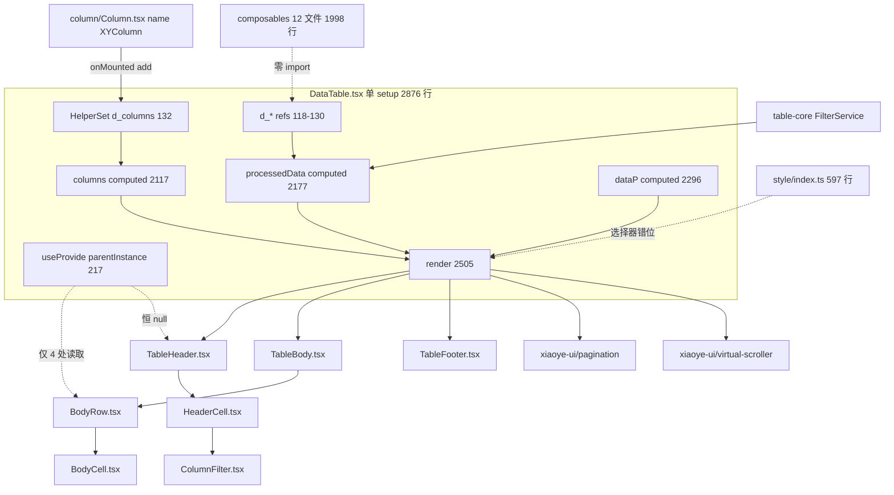
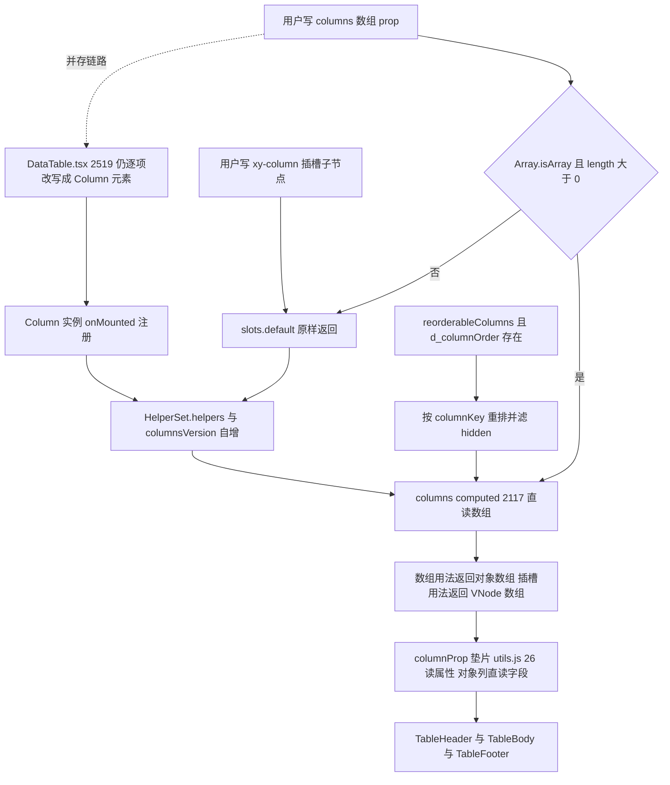
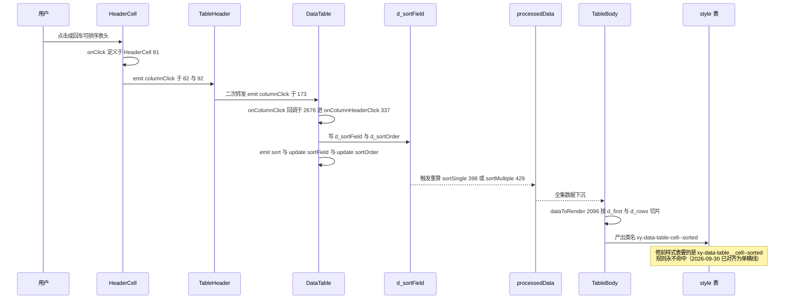

# C08-02 DataTable 数据表格

> **本篇解决**：DataTable 这一层到底在 `table` / `vc-table` 之上做了什么、又重复了什么；列定义从用户输入到 DOM 类名要经过几次改写；哪些 props 与事件是声明了但从未被读取或触发的死契约。
> **关键词**：DataTable、列定义改写链、同名 computed 遮蔽、死 props、分层职责重叠

---

## 一、职责与边界

`data-table` 是**与 `table` 完全平行**的第二套表格实现：它不引用 `vc-table`，而是自带 `TableHeader` / `TableBody` / `TableFooter` / `BodyRow` / `BodyCell` 五个渲染件，加一整套 PrimeVue 血统的列系统（`Column` 子组件 + `HelperSet` 收集）。它负责把「列声明」编译成 DOM、把分页/排序/筛选/选择/展开/编辑/导出/拖拽九类交互编排进同一份渲染函数；它**不负责**的是测量行、固定列 sticky 计算与虚拟滚动内核——前者在它这里根本不存在，后者外包给 `virtual-scroller`（`packages/xiaoye-ui/src/data-table/DataTable.tsx:47`）。

依赖清单（入口 import 实测，`DataTable.tsx:2-57`）：

- 向上游要能力：`@xiaoye-ui/core/utils` 的 `HelperSet`（`:3`）、`@xiaoye-ui/utils/dom` 15 个 DOM 原子（`:6-23`）、`@xiaoye-ui/utils/object` 8 个数据原子（`:24-33`）、`xiaoye-ui/table-core` 的 `FilterMatchMode / FilterOperator / FilterService`（`:48`）。
- 向同级要组件：`xiaoye-ui/pagination`（`:46`）、`xiaoye-ui/virtual-scroller`（`:47`）、以及本地相对路径 `./column/Column`（`:49`，注意它不是包导出，见 §七 坑 6）。
- 向基础设施要约定：`useConfigInject`（`:55`）、`initDefaultProps`（`:54`）、本地 `useStyle`（`:50`）。

OUTLINE 待办第 4 条把 `column`、`columngroup`、`row` 列为「`src/` 下无文档页的顶层目录」，实测只有 `row` 在顶层存在（`src/row/index.ts` 是 `grid/Row` 的再导出垫片），`column` 与 `columngroup` 在 `src/` 顶层不存在，它们唯一的真身就在本组件目录内（`data-table/column/`、`data-table/columngroup/`）。本篇只论证这条链上「三个子目录不可达」这一事实（见 §七 坑 6），顶层 `row` 垫片的机制归 I12/I16，不重述。同类分层总述见 C08-00；`table` 那一侧的列流水线与 `onChange` 状态袋见 C08-01。

## 二、源码地图

| 文件 | 行数 | 职责 | 关键导出 / 入口行 |
| --- | --- | --- | --- |
| `DataTable.tsx` | 2,876 | 主实现，九类交互全部内联在单个 `setup` | `defineComponent` 起于 `DataTable.tsx:66`，渲染函数起于 `:2505` |
| `dataTableTypes.ts` | 133 | 73 键 props 工厂（含 `prefixCls`） | `dataTableProps` `dataTableTypes.ts:16-129` |
| `interface.ts` | 63 | 对外类型面 | 无运行时代码 |
| `index.ts` | 28 | 入口 + `install` | `index.ts:23-26` |
| `BodyCell.tsx` | 833 | 单元格渲染与列级 props 消费 | 全仓最大单元格实现 |
| `BodyRow.tsx` | 593 | 行渲染 + 拖拽/编辑事件 | — |
| `ColumnFilter.tsx` | 790 | 筛选菜单 / 行内筛选双形态 | — |
| `HeaderCell.tsx` | 395 | 表头单元格 + 排序按钮 | — |
| `FilterHeaderCell.tsx` | 187 | `filterDisplay: 'row'` 形态表头 | — |
| `TableHeader/Body/Footer.tsx` | 217/253/92 | 三段渲染壳 | 由 `DataTable.tsx:51-53` 引入 |
| `utils.js` | 25 | 列 prop 读取垫片 | `getColumnProp` `DataTable.tsx:57` |
| `column/`、`columngroup/`、`row/` | 69+707 / 24+54 / 100+86 | 本地列声明件（`.d.ts` 占大头） | 见 §七 坑 6 |
| `style/index.ts` | 597 | CSS-in-JS 样式表 | `useStyle` `DataTable.tsx:50` |
| `composables/`（12 文件） | 1,998 | **无任何消费者**，见论点 1 | — |
| `__tests__/data-table.test.js` | 1,647 | 主测试文件（另一个是 `row/Row.test.js`） | — |
| `DataTable.d.ts` | 1,534 | 手写声明，与 `.tsx` 并存 | 见 §七 改动安全边界 |

主实现入口：`packages/xiaoye-ui/src/data-table/DataTable.tsx:66`。

## 三、架构与数据流

### 图 1：静态结构（模块与所有权）



说明：实线是真实存在的数据流；虚线是三条「已建好但没接通」的通道——`$parentInstance` 代理只有 4 个读取点（论点 5）、`composables/` 无任何 import（论点 1）、样式表选择器与 DOM 类名分隔符不一致（论点 2）。`data-table` 不使用 `vc-table`，三段表体（`TableHeader` / `TableBody` / `TableFooter`）由它自己渲染，这一点与 `table` 那条链路是根本分歧，分层对比见 C08-00。

### 图 2：列定义的两条入路与汇合点



说明：分支 `B` 是互斥而非合并——`props.columns` 非空时 computed（`:2123`-`:2125` 的三元）整段忽略插槽收集（论点 3 后果 3）。2026-10-02 起数组式声明由 computed **直读**进列模型，不再依赖「渲染成子组件、再挂载回投」那圈绕行；渲染层 `:2519` 起的改写链路仍保留（虚线），但它的产物只在数组未传时才被 computed 消费。`columnsVersion` 手工版本号对插槽路径仍然必需（`Column` 是 `onMounted` 才注册，不是响应式输入）。

### 图 3：一次排序点击的完整闭环



说明：这条链上表头点击**连跨三层、两次 `emit` 两次回调 prop**（`HeaderCell.tsx:82` 与 `:92` 抛 `columnClick` → `TableHeader.tsx:173` 原样再抛 → `DataTable.tsx:2684` 用 `onColumnClick` prop 接住 → `DataTable.tsx:337` 处理），既不是纯 emit 也不是纯回调，而是把 emit 包成 `onXxx` prop 逐层上传的混合写法。`TableHeader.tsx:96` 还有第二处 `onColumnClick` 装配点（列分组分支）。这条链上任一层改名都会静默断链，因为三层之间没有类型约束。

另一个值得强调的分支是「切片发生在渲染期而不是在 `processedData` 里」。`processedData`（`:2177`）是**过滤 + 排序后的全集**，分页由 `dataToRender`（`:2096`）在 7 个调用点各自切一次（`:813`、`:838`、`:858`、`:873`、`:887`、`:904`、`:2748`）。后果是：`emit('value-change', processedData.value)`（`:318`、`:392`）抛给外部的载荷是**未分页**的，而屏幕上只有当前页。这与 C08-01 里 `onChange` 载荷「重跑管道算出来」的坑同型，但方向相反——那边是重复计算，这边是页范围不一致。

## 四、核心机制精读

### 论点 1：`composables/` 是一整套 1,998 行、零消费者的「未完成的抽取」，它与 `DataTable.tsx` 是逐字副本关系

断言：`data-table/composables/` 下 12 个文件把九类交互各封成一个 `useDataTableXxx(ctx)`，但**全仓没有任何文件 import 它们**；同时 `DataTable.tsx` 里保留着同名同体的内联版本。这不是「两种实现并存」，而是一次半途而废的重构——函数体除缩进外逐字相同。

证据 A（零消费者，两种检索法交叉核过）：

```bash
# 方法一：按符号名全仓检索（排除 dist）
grep -rn "useDataTableSelection\|useDataTableSorting\|useDataTableState" packages apps \
  --include='*.ts' --include='*.tsx' --include='*.js' --include='*.vue' | grep -v "/dist/"
# → 11 条命中，全部是 composables/ 内部的 export function 定义行本身，无一条是 import
# 方法二：按路径检索，确认没有 barrel 可被间接引用
ls packages/xiaoye-ui/src/data-table/composables/
# → 12 个文件里没有 index.ts；grep "from './composables'" 在 data-table 内 0 命中
```

`DataTable.tsx:2-57` 的 56 行 import 块里没有任何一行指向 `./composables`；`__tests__/data-table.test.js` 里 `grep -c "useDataTable"` 结果为 `0`。

证据 B（副本性质）——`composables/useDataTableSelection.ts:12-30` 与 `DataTable.tsx:624-634`：

```tsx
// packages/xiaoye-ui/src/data-table/composables/useDataTableSelection.ts:12
export function useDataTableSelection(ctx: DataTableContext) {
  const { props, emit, d_first, d_selectionKeys, d_editingRowKeys, bodyRef, table, processedData } =
    ctx;

  // Non-reactive instance properties
  let rowTouched = false;
  let anchorRowIndex: number | null = null;
  let rangeRowIndex: number | null = null;

  function onRowClick(e: any) {
    const event = e.originalEvent;
    const body = bodyRef.value && bodyRef.value.$el;
    const focusedItem = findSingle(body, 'tr[data-xy-selectable-row="true"][tabindex="0"]');

    if (isClickable(event.target)) {
      return;
    }

    emit('row-click', e);
```

```tsx
// packages/xiaoye-ui/src/data-table/DataTable.tsx:624
    function onRowClick(e: any) {
      const event = e.originalEvent;
      const body = bodyRef.value && bodyRef.value.$el;
      const focusedItem = findSingle(body, 'tr[data-xy-selectable-row="true"][tabindex="0"]');

      if (isClickable(event.target)) {
        return;
      }

      emit('row-click', e);
```

解释：唯一的差异是外层多了一层 `setup` 缩进（4 空格 vs 2 空格）。`selectRange`（`DataTable.tsx:1130` ↔ `useDataTableSelection.ts:522`）做了同样的逐行对齐 diff，除缩进外完全相同。

证据 C（规模）：按函数名统计，11 个 composable 里 **83 个 `function` 声明的名字在 `DataTable.tsx` 中同时存在**；其中 `useDataTableSelection.ts` 是 29/29、`useDataTableColumnReorder.ts` 8/8、`useDataTableColumnResize.ts` 8/8、`useDataTableEditing.ts` 8/8 全部命中。只有 `useDataTableState.ts` 是 7/9——`getStateDirty` 与 `setStateDirty` 两个函数**只存在于 composable 里**，`DataTable.tsx` 没有对应内联实现。

逐段推演这三层含义：

1. `DataTableContext`（`composables/types.ts:4-30`）要求调用方把 `props / emit / slots / instance / proxy / d_first / d_rows …` 全部打包传入，也就是它假设存在一个「已经建好 `d_*` refs 的 setup」。`DataTable.tsx:118-130` 恰好建了一整排同名 `d_*` refs——这说明抽取方向是「把 `DataTable.tsx` 的函数搬出去、把 `d_*` 当 ctx 传回去」，接口已经设计完成，只是没人接上。
2. `types.ts:2` 还 `import type { TableEngine } from '../../table-core/types'`，即这层设计曾打算把 `table-core` 引擎注回 DataTable，与 C08-01 所述 `table/` 用 `table-core` 的路径合流。这条通道同样没有落地。
3. `getStateDirty` / `setStateDirty` 的失踪是最实用的一条信号：composable 版本比内联版本**多了状态脏检查**。也就是说 `state-save` / `state-restore` 这条事件族在内联实现里少了一个「值不值得存」的门槛。

结论回扣：读 `DataTable.tsx` 时看到任何一个 `useDataTableXxx` 相关的注释或命名，都不要以为组件是 composable 驱动的。真实驱动方式只有一个 2,876 行的 `setup`。这 1,998 行不进 `src/components.ts` 的导出面，也不被 `pnpm check:entries` 察觉，属于「目录结构存活、实现死亡」——比 OUTLINE 待办第 5 条登记的「API 面存活」更隐蔽，因为它连 API 面都没有，纯粹是磁盘上的死重。

### 论点 2：样式表用 BEM 分隔符 `__`、DOM 用单连字符 `-`——除根类名外整张样式表曾命中不了任何元素（2026-09-30 已修）

断言（**这条机制已在 2026-09-30 改掉**；留在这里是因为它是全库面积最大的一处死样式，判形方法比结论更值钱）：`data-table/style/index.ts` 的 597 行规则全部以 `&__xxx` / `&--xxx` 复合选择器书写，编译后得到 `.xy-data-table__xxx`、`.xy-data-table--small`；而组件渲染的类名字面量全部是 `.xy-data-table-xxx`、`.xy-data-table-small`。两者只有根类 `xy-data-table` 重合，于是**除根块那两条属性外，整张组件样式表命中不了任何元素**。

两处要更正初稿。其一，规模不是「`&__` 出现 99 次」而是 **155 处**（去重 55 个元素名），另有根修饰符 `&--` **40 处**（去重 7 个：`gridlines` / `hoverable` / `striped` / `small` / `large` / `scrollable` / `flex-scrollable`）；判形要分别数「出现次数」与「去重名字」，两者差三倍：

```bash
grep -oE '&__[a-zA-Z0-9-]+' packages/xiaoye-ui/src/data-table/style/index.ts | wc -l   # 155
grep -oE '&__[a-zA-Z0-9-]+' packages/xiaoye-ui/src/data-table/style/index.ts | sed 's/&__//' | sort -u | wc -l   # 55
```

其二，「两套名字从不错位」说过头了——元素内修饰符 `&__cell--frozen` 里的 `--` 是**对的**（DOM 确实产出 `xy-data-table-cell--frozen`，探针实测），错的只有元素分隔符 `__` 与根级 `&--`。所以修法是两处替换：`&__`→`&-`、根级 `&--`→`&-`，元素内 `--` 一律不动。

证据 A（样式侧原文）：

```ts
// packages/xiaoye-ui/src/data-table/style/index.ts:32
    return {
      [componentCls]: {
        position: 'relative',
        display: 'block',

        '&__table': {
          borderSpacing: 0,
          borderCollapse: 'separate',
          width: '100%',
        },

        '&__table-container': {
          overflow: 'auto',
        },

        '&--scrollable &__table-container': {
          position: 'relative',
        },

        '&__table--scrollable &__head': {
          insetBlockStart: 0,
          zIndex: 1,
        },

        '&__table--scrollable &__body--frozen': {
          position: 'sticky',
          zIndex: 1,
```

`componentCls` 的来源在 `theme/util/genComponentStyleHook.ts:87`：`const componentCls = `.${prefixCls.value}`;`，而 `prefixCls` 由 `DataTable.tsx:2297` 的 `useStyle(prefixCls)` 传入，`prefixCls` 来自 `DataTable.tsx:2296` 的 `useConfigInject('data-table', props)` → `xy-data-table`。所以 `'&__table'` 编译为 `.xy-data-table__table`，`'&__body--frozen'` 编译为 `.xy-data-table__body--frozen`。

证据 B（DOM 侧原文）：

```tsx
// packages/xiaoye-ui/src/data-table/DataTable.tsx:2656
                  <table
                    ref={table}
                    role="table"
                    class={['xy-data-table-table', props.tableClass]}
                    style={[props.tableStyle, slotProps.spacerStyle]}
                    {...props.tableProps}
                  >
```

```tsx
// packages/xiaoye-ui/src/data-table/BodyCell.tsx:490
        'xy-data-table-cell',
// ...
        'xy-data-table-cell--frozen': frozen,
        'xy-data-table-cell--frozen-left': frozen && alignFrozen !== 'right',
        'xy-data-table-cell--frozen-right': frozen && alignFrozen === 'right',
```

根类走的是同一个 dash 通道，但形式是模板串（`DataTable.tsx:2301-2309`）：

```tsx
// packages/xiaoye-ui/src/data-table/DataTable.tsx:2301
        [`${prefixCls.value}-scrollable`]: props.scrollable,
        [`${prefixCls.value}-flex-scrollable`]: props.scrollable && props.scrollHeight === 'flex',
        [`${prefixCls.value}-${props.size}`]: props.size,
        [`${prefixCls.value}-loading`]: props.loading,
        [`${prefixCls.value}-empty`]: empty.value,
        [`${prefixCls.value}-resizable`]: props.resizableColumns,
```

`-scrollable` 对上样式表的 `&--scrollable` → 需要 DOM 有 `xy-data-table--scrollable`，实际是 `xy-data-table-scrollable`。同样错位。

证据 C（规模量化）：把两侧后缀取交集，得到 **52 个「同一元素两种写法都存在」的名字**——`table`、`table-container`、`body`、`head`、`foot`、`cell--sortable`、`cell--sorted`、`cell--frozen`、`mask`、`sort-icon`、`pagination--top`、`row--selected`、`column-resizer`、`filter-constraint--selected` 等；样式表共 62 个不同后缀，组件共渲染 80 个不同后缀。全仓（含 `apps/docs`）对 `xy-data-table__` 的检索命中数为 **0**：

```bash
grep -rn "xy-data-table__" packages/xiaoye-ui/src/data-table --include='*.tsx' --include='*.vue' --include='*.js' | wc -l
# → 0
grep -rn "data-table-cell\|data-table-row\|data-table__" packages --include='*.ts' --include='*.less' --include='*.css' | grep -v /dist/ | grep -v src/data-table/
# → 0（没有任何其他样式表在兜底这套 dash 名字）
```

逐段解释这条链为什么一直没被发现：**测试只断言类名字符串，从不断言 CSS 规则命中**。`__tests__/data-table.test.js` 里 `xy-data-table-body` 出现 30 次、`xy-data-table-cell--sortable` 5 次、`xy-data-table-head` 5 次，而 `xy-data-table__` 出现 0 次。也就是说快照式断言全部通过，样式的失效在单测里是不可见的。这类缺陷只能靠肉眼看 `apps/docs/examples/data-table/*.vue` 的渲染结果或引入 CSS 命中测试才会暴露。

结论回扣：`data-table` 的视觉表现来自 **`genCommonStyle`/`genLinkStyle` 等共享层 + 浏览器默认表格样式 + 上游 reset**，而不是它自己的 `style/index.ts`。维护者若接到「DataTable 某个状态没有样式」的反馈，第一步不是去改 `&__cell--sorted` 的属性值，而是先确认分隔符是否对得上——改属性值 100% 无效。

### 论点 3：插槽路径的列本体是 **VNode 而非对象**；`columns` 数组 prop 已由同名 computed 直读（2026-10-02 起），遮蔽仍在、绕行链路并存

> **2026-10-02 已修**（提交 3b783a2）：`columns` computed 从「只读 HelperSet」改为**优先直读 `props.columns` 数组**，`getColumnProp` 为普通对象列加了直读分支并支持 `dataIndex`/`title` 别名；渲染层的「数组 → `<Column>`」改写链路保留。本篇初稿「computed 里一次都没有读 `props.columns`」的断言自此作废，下面给的是修后口径。

断言：插槽路径的列在内部是 `XYColumn` 的 VNode，列属性靠 `getVNodeProp` 现取；`props.columns`（数组式声明）如今是 computed 的**第一优先输入**——非空数组直接进列模型，对象列由 `getColumnProp` 的新分支按别名直读字段；插槽 `<Column>` 收集退为回退路径。同名遮蔽未变：`DataTable.tsx:2117` 仍用 `const columns = computed(...)` 占掉与 prop 同名的绑定名。

证据 A（同名遮蔽，本专栏登记的第四例形状，判据 `grep -n "const <propName> = computed" <主文件>`）：

```tsx
// packages/xiaoye-ui/src/data-table/DataTable.tsx:2117
    const columns = computed(() => {
      // Access version to trigger reactivity when columns change
      columnsVersion.value;
      // Access slots to trigger reactivity when slots change
      const _slots = slots.default?.() || [];
      // columns 数组 prop（配置式 API，见 dataTableTypes/文档）优先；未传时回退到插槽 <Column> 收集
      const cols = props.columns?.length
        ? props.columns
        : d_columns.get(proxy, { default: () => _slots });

      if (cols && props.reorderableColumns && d_columnOrder.value) {
        const orderedColumns: any[] = [];

        for (const columnKey of d_columnOrder.value) {
          const column = findColumnByKey(cols, columnKey);

          if (column && !columnProp(column, 'hidden')) {
            orderedColumns.push(column);
          }
        }

        return [...orderedColumns, ...cols.filter((item: any) => orderedColumns.indexOf(item) < 0)];
      }

      return cols;
    });
```

`grep -n "const columns = computed" DataTable.tsx` 只命中这一行；对 73 个 prop 名逐一跑 `const <propName> = computed|ref` 后，**只有 `columns` 一个命中**。遮蔽的后果也随修复改了方向：修前遮蔽让 prop 完全失效，修后 computed 自己成了 prop 的读者，遮蔽只剩「模板 ref 拿到的 `columns` 与 `props.columns` 形状不同」这一层（见 §五 expose 段）。

证据 B（列本体是 VNode）——`HelperSet._recursive` 的收集聚合判据：

```ts
// packages/core/src/utils/HelperSet.ts:69
      if (childChildren instanceof Array) {
        components = components.concat(this._recursive(helpers, childChildren));
      } else if (child.type?.name === this.type) {
        components.push(child);
      } else if (isNotEmpty(child.key)) {
        const matched = helpers
          .filter(c => this._isMatched(c, child.key))
          .map(c => c.vnode)
          .filter((v: any) => v != null);

        components = components.concat(matched);
      }
```

`this.type` 在 `DataTable.tsx:132` 设为 `'XYColumn'`（对应 `column/Column.tsx:5` 的 `name: 'XYColumn'`）。两个分支返回的都是 VNode（`components.push(child)` 推的是子 VNode；`c.vnode` 推的是已挂载实例的 vnode）。

证据 C（因此所有列读取都要过一层 VNode→prop 的垫片）：

```js
// packages/xiaoye-ui/src/data-table/utils.js:27
export function getColumnProp(column, prop) {
  // 普通 object 列配置没有 __v_isVNode 标记，直接读字段；getVNodeProp 只认 VNode
  if (column && typeof column === 'object' && !column.__v_isVNode) {
    const names = columnPropAliases[prop] || [prop];
    let value;
    for (const name of names) {
      if (column[name] !== undefined) {
        value = column[name];
        break;
      }
    }
    return booleanColumnProps.has(prop) && value === '' ? true : value;
  }

  const value = getVNodeProp(column, prop);

  return booleanColumnProps.has(prop) && value === '' ? true : value;
}
```

`utils.js:3-19` 维护一张 15 项的布尔名单（`sortable` / `expander` / `frozen` / `hidden` / `exportable` …），把 `''` 归一成 `true`——这是模板写法 `<xy-column sortable>` 的产物，因为 Vue 对布尔-ish prop 的空串赋值需要人工纠偏。`:21`-`:25` 的 `columnPropAliases` 是 2026-10-02 加的对象列别名表：`field` 兼容 `dataIndex`、`header` 兼容 `title`，其余 prop 按原名直读。`getVNodeProp` 本体在 `packages/core/src/utils/internal.ts:71`。`columnProp` 只是 `DataTable.tsx:272` 对 `getDataTableColumnProp`（`:57` 起的别名）的一层薄封装。全目录对列属性的读取共 **159 次**走这条垫片：`HeaderCell.tsx` 42、`FilterHeaderCell.tsx` 27、`BodyCell.tsx` 26、`DataTable.tsx` 25、`FooterCell.tsx` 16、`TableHeader.tsx` 10、`BodyRow.tsx` 7、`TableFooter.tsx` 6。

证据 D（渲染层改写链路的现状）：computed 直读之外，渲染函数里那份「把对象数组改写成 `<Column>` 元素」的映射仍在（`DataTable.tsx:2527` 起），两条链路并存。

```tsx
// packages/xiaoye-ui/src/data-table/DataTable.tsx:2519
          {Array.isArray(props.columns) && props.columns.length > 0
            ? props.columns.map((col, i) => (
                <Column
                  key={
                    col.key != null
                      ? col.key
                      : col.dataIndex != null
                        ? col.dataIndex
                        : col.field != null
                          ? col.field
                          : i
                  }
                  field={col.field != null ? col.field : col.dataIndex}
                  sortable={Boolean(col.sortable != null ? col.sortable : col.sorter)}
                  header={col.header != null ? col.header : col.title}
                  // ...
                  frozen={
                    col.frozen != null ? col.frozen : col.fixed === 'left' || col.fixed === 'right'
                  }
                  // ...
                />
              ))
            : slots.default?.()}
```

这段 2,519 起的映射表是本层最厚的一处「列定义改写」：它把 `dataIndex→field`、`title→header`、`sorter→sortable`、`fixed:'left'|'right'→frozen + alignFrozen` 四组异名做了单向翻译，然后交给 `Column` 的 props。修前这是 `props.columns` 进入列模型的**唯一**通路；修后 computed 直读使它退为并存链路——改写产物注册进 HelperSet 后，只在数组未传（或数组被清空）时才会被 computed 消费。

逐段解释这条链的三个后果：

1. **首次渲染拿不到列。** `Column` 是在 `onMounted` 才 `columns?.add(instance)`（`column/Column.tsx:59-61`），`HelperSet` 的 `add` 在挂载之后；但 `_recursive` 的类型匹配分支（`HelperSet.ts:71-72`）能直接从 slot 的 vnode 树里按 `type.name` 捞出来，所以首屏不空。代价是列的顺序语义取决于 `slots.default()` 的 vnode 顺序，而不是 `helpers` 的插入顺序——两者在动态增删列时会分歧。
2. **响应性靠手工版本号。** `columnsVersion = ref(0)`（`DataTable.tsx:136`）配合对 `d_columns.add` / `d_columns.delete` 的猴子补丁（`:143-162`）——只有当 `helpers.size` 真的变了才 `++`。`d_columnGroups` 又各自打了一遍同样的补丁（`:164-183`）。`columns` computed 的第一行 `columnsVersion.value;`（`:2119`）是一个**只为建立依赖而存在的裸表达式**，注释写得很清楚，但这类「读一次只为 track」的写法在维护时极易被当成无用行删掉。
3. **`props.columns` 与默认插槽互斥，不合并。** 互斥判据修前在渲染层三元（旧 `:2511`），修后挪进了 computed（`:2123`-`:2125`）：`props.columns` 非空数组时 `d_columns.get(...)`（即插槽收集）整段不被求值消费。混用时插槽里的 `<xy-column>` 完全不生效，且不会有任何告警。

结论回扣：判 `columns` 这个 prop 有没有效，看 `DataTable.tsx:2123` 的三元——非空数组直读进列模型，对象列属性走 `getColumnProp` 的对象分支（`utils.js:28`-`:38`）；插槽路径的列属性则继续走 `getVNodeProp` 垫片。两条路径的属性读取机制不同，排查「某个列属性没生效」时先分清列是从哪条入口进来的。

### 论点 4：分页是「三个死 prop + 一条零转发的适配缝」

断言：`dataTableTypes.ts:27`、`:31`、`:33` 声明了 `paginationTemplate` / `pageLinkSize` / `currentPageReportTemplate` 三个分页外观开关，它们在 `data-table` 全目录内**没有任何读取点**；DataTable 用的是本项目自己的 `Pagination`，而渲染处只转发了 6 个属性，把 `Pagination` 真正支持的定制面全丢掉了。

证据 A（死 prop 判定，两种检索法）：

```bash
# 方法一：逐 prop 名扫 props.<name> 读取点
node -e '…对 dataTableTypes.ts 的 73 个键跑 new RegExp("props\\."+n+"\\b") 扫全目录（排除 .d.ts 与 __tests__）…'
# → 零读取：paginationTemplate / pageLinkSize / currentPageReportTemplate / breakpoint / highlightOnSelect
# 方法二：按裸名 grep 复核（含 .js / .vue / 测试）
grep -rn "paginationTemplate" packages/xiaoye-ui/src/data-table --include='*.tsx' --include='*.ts' --include='*.js'
# → dataTableTypes.ts:27（声明）+ __tests__/data-table.test.js:100 与 :693（两处传参），无读取点
grep -rn "pageLinkSize\|highlightOnSelect\|breakpoint" packages/xiaoye-ui/src/data-table --include='*.tsx' --include='*.ts' --include='*.js'
# → 仅 dataTableTypes.ts:31 / :92 / :88 三行声明，全目录零命中
```

`paginationTemplate`（默认值是一串 PrimeVue 风格的模板串 `'FirstPageLink PrevPageLink …'`，`dataTableTypes.ts:28-30`）与 `currentPageReportTemplate`（`:33`）**在测试里被当真参数传进去过**，测试仍然通过——因为传一个组件不读的 prop 不会产生任何错误。这是「测试面存活、实现死亡」的教科书形状：写测试的人照着 API 文档造了 props，但没有断言效果。

证据 B（转发面实测）：

```tsx
// packages/xiaoye-ui/src/data-table/DataTable.tsx:2620
            <DTPagination
              pageSize={d_rows.value}
              current={currentPage.value}
              total={totalRecordsLength.value}
              pageSizeOptions={props.rowsPerPageOptions}
              showSizeChanger={
                Array.isArray(props.rowsPerPageOptions) && props.rowsPerPageOptions.length > 0
              }
              class={['xy-data-table-pagination', 'xy-data-table-pagination--top']}
              onChange={onPaginationChange}
              hideOnSinglePage={!props.alwaysShowPagination}
              data-xy-pagination-position="top"
              v-slots={renderPaginationSlots()}
            />
```

而 `Pagination` 一侧真实存在的定制点：`pagination/Pagination.tsx:32` `showQuickJumper`、`:33` `showTotal`、`:35` `simple`、`:41` `itemRender`、`:61` `position`。`grep -n "itemRender\|showTotal\|showQuickJumper" data-table/*.tsx` 结果为空——**五个转发目标零命中**。

逐段解释：`DataTable.tsx:60` 的 `const DTPagination = Pagination;` 只是别名，没有做 prop 名映射层；`:2503` 的 `renderPaginationSlots()` 是唯一的定制通道，它把 `paginationfirstpagelinkicon` 之类**图标插槽**转成 `Pagination` 的 `itemRender` 族（`:2495-2502` 全是 icon 类插槽的中转）。所以用户能改的是分页按钮图标，改不了页码模板、每页条数选择器的文案、跳转框与总数报表——`paginationTemplate` 那三个 prop 描述的正是后者，全链路断裂。

结论回扣：`alwaysShowPagination`（`:26`）与 `rowsPerPageOptions`（`:32`）是活的两条，`paginationPosition`（`:25`）需要看 `paginationTop`/`paginationBottom` 两个 computed 才判定；剩下三条是纯文档负担。改分页时若只想动样式，正确做法是给 `xy-data-table-pagination--top`（注意这个类名同样逃不过论点 2 的分隔符错位）加规则，而不是去接 `paginationTemplate`。

### 论点 5：`$parentInstance` 是一个 17 键的 getter 代理，其中 14 键零消费者，且它自指的 `$parentInstance` 被硬编码为 `null`

断言：父→子传值除了 props 之外还有一条 inject 通道，`useProvide('$parentInstance', {…})` 造了一个「假装自己是组件实例」的对象（PrimeVue 的 `getCurrentInstance()` 自引用形状）。这条通道 82% 的键无人读取，两处读取因自指键恒 `null` 而永久失效。

证据 A（代理本体）：

```tsx
// packages/xiaoye-ui/src/data-table/DataTable.tsx:217
    useProvide('$parentInstance', {
      get $el() {
        return instance.proxy?.$el;
      },
      get $attrs() {
        return instance.attrs;
      },
      get $parentInstance() {
        return null;
      },
      columnProp,
      get d_sortField() {
        return d_sortField.value;
      },
      // ...
      get resizableColumns() {
        return props.resizableColumns;
      },
      get rowHover() {
        return props.rowHover;
      },
      get selectionMode() {
        return props.selectionMode;
      },
      get stripedRows() {
        return props.stripedRows;
      },
      get scrollable() {
        return props.scrollable;
      },
    });
```

17 个键：`$el`、`$attrs`、`$parentInstance`、`columnProp`、`d_sortField`、`d_sortOrder`、`d_multiSortMeta`、`d_filters`、`resizableColumns`、`reorderableColumns`、`loading`、`size`、`showGridlines`、`rowHover`、`selectionMode`、`stripedRows`、`scrollable`（`DataTable.tsx:217-267`，共 51 行）。

证据 B（消费者只有 3 个文件、4 处读取）：

```tsx
// packages/xiaoye-ui/src/data-table/BodyRow.tsx:84
    const $parentInstance = inject<any>('$parentInstance', null);
    const dataTableInstance = computed(() => $parentInstance?.$parentInstance ?? $parentInstance);
```

```tsx
// packages/xiaoye-ui/src/data-table/TableHeader.tsx:124
          data-xy-scrollable={$parentInstance?.$parentInstance?.scrollable}
```

`TableFooter.tsx:65` 是 `TableHeader.tsx:124` 的逐字副本。

逐段解释这条链为什么是坏的：`DataTable.tsx:224-226` 那个 getter **字面返回 `null`**。于是 `$parentInstance?.$parentInstance?.scrollable` 的求值结果恒为 `undefined`，`data-xy-scrollable` 属性永远不会被渲染出来。把 `undefined` 赋给 JSX 属性等于不写这个属性，所以这两行是静默空操作。`BodyRow.tsx:85` 用了 `??`，`.$parentInstance` 为 `null` 时**回落到代理自身**——那里确实有 `rowHover` 与 `selectionMode` 两个 getter，所以 `BodyRow.tsx:328` 这一处是能工作的。三个读取点里一个是活的、两个是死的，差别只在写法（`??` vs `?.`）。

证据 C（零消费者量化）：

```bash
cd packages/xiaoye-ui/src/data-table
for k in d_sortField d_sortOrder d_multiSortMeta d_filters resizableColumns \
         reorderableColumns showGridlines stripedRows columnProp; do
  echo "$k -> $(grep -rn "\.$k\b" --include='*.tsx' . | grep -v "props\.$k" | grep -vc 'DataTable.tsx')"
done
# → 九个键全部输出 0；$el / $attrs 的读取点同样 grep 为 0
```

`$el`、`$attrs`、`columnProp` 这三个「实例形状」键没有任何人通过代理读取——尤其 `columnProp`，它被挂在代理上（`DataTable.tsx:227`）本意是让子组件复用父的列读取垫片，但 `HeaderCell.tsx:73`、`BodyCell.tsx:112`、`FooterCell.tsx:21`、`FilterHeaderCell.tsx:50`、`TableHeader.tsx:65`、`TableFooter.tsx:29`、`BodyRow.tsx:108` 加上 `DataTable.tsx:272` 一共**八个文件各自本地重新定义了一个 `columnProp`**。这条注入通道是「设计出来但被本地副本取代」的直接化石证据。

结论回扣：`$parentInstance` 不是 Context API，而是一个手写 getter 对象，Vue 的 devtools 与类型系统都不认识它。维护者看到子组件里有 `$parentInstance?.xxx` 时，必须先回到 `DataTable.tsx:217` 确认 `xxx` 是否真是代理的键，以及读取方用的是 `?.` 还是 `??`——后者决定了它是否在静默失败。

### 论点 6：`inheritAttrs: false` 但渲染函数从不绑定 `attrs`——透传属性被整条丢弃；三个根状态类压根没有生产者

断言：组件在 `DataTable.tsx:68` 声明 `inheritAttrs: false`，而渲染函数（`:2505-2876`）**没有一处 `{...attrs}` 或 `v-bind={attrs}`**；`attrs` 这个词在整个 `DataTable.tsx` 里只出现在 2 次，且都在那个无人读取的代理 getter 上（`:221-222`）。因此写在 `<xy-data-table>` 上的 `class` / `style` / `id` / `data-*` / `aria-*` / 原生事件监听全部静默丢失。

证据 A（根节点类名构成，无 attrs）：

```tsx
// packages/xiaoye-ui/src/data-table/DataTable.tsx:2513
    return () =>
      wrapSSR(
        <div
          class={[prefixCls.value, dataP.value, hashId.value]}
          data-scrollselectors=".xy-data-table-table-container"
        >
```

```bash
grep -n "attrs" packages/xiaoye-ui/src/data-table/DataTable.tsx
# 221:      get $attrs() {
# 222:        return instance.attrs;
```

`setup(props, { emit, expose, slots })`（`:112`）的解构里**连 `attrs` 都没取**，只用 `getCurrentInstance()!.attrs` 间接访问，而访问结果挂在 `$parentInstance.$attrs`（`:221`）上——正是论点 5 里 14 个零消费者键之一。两条死路是同一条：作者按 PrimeVue 的 `getCurrentInstance()` 习惯写了 `$attrs` getter，但没有任何子组件读它，也没有任何地方把它绑回 DOM。

证据 B（本仓文档示例正在踩这条死路）：

```vue
<!-- apps/docs/examples/data-table/basic.vue:2 -->
  <xy-data-table
    class="demo-data-table"
    :value="products"
    :columns="columns"
    show-gridlines
    striped-rows
  />
<!-- apps/docs/examples/data-table/basic.vue:27 -->
<style scoped>
.demo-data-table {
  width: 100%;
}
</style>
```

`class="demo-data-table"` 被丢弃；而 `<style scoped>` 编译出的 `[data-v-xxx]` 选择器同样依赖 attrs 落到根元素，也一并落空。四个示例（`basic.vue:3`、`sort.vue:3`、`pagination.vue:4`、`selection.vue:5`）用的是同一个模式。

证据 C（状态类缺生产者，与论点 2 独立的第二类样式失效）：根类名由 `dataP` computed 生成——

```tsx
// packages/xiaoye-ui/src/data-table/DataTable.tsx:2299
    const dataP = computed(() => {
      return cn({
        [`${prefixCls.value}-scrollable`]: props.scrollable,
        [`${prefixCls.value}-flex-scrollable`]: props.scrollable && props.scrollHeight === 'flex',
        [`${prefixCls.value}-${props.size}`]: props.size,
        [`${prefixCls.value}-loading`]: props.loading,
        [`${prefixCls.value}-empty`]: empty.value,
        [`${prefixCls.value}-resizable`]: props.resizableColumns,
        [`${prefixCls.value}-resizable-fit`]:
          props.resizableColumns && props.columnResizeMode === 'fit',
        [`${prefixCls.value}-reorderable`]: props.reorderableColumns,
      });
    });
```

`dataP` 只产出 8 个类。样式表侧共有 7 个根级修饰符（`&--scrollable`、`&--flex-scrollable`、`&--small`、`&--large`、`&--gridlines`、`&--striped`、`&--hoverable`，见 `style/index.ts:78`、`:88`、`:516`、`:536`、`:446`、`:502`、`:352`）。前四个在 DOM 侧有对应物（只是分隔符错位，见论点 2）；后三个**连错位的对应物都没有**——DOM 从不生成它们：

| 样式表需要的根修饰符 | 规则行 | 对应 prop | DOM 生产者 |
| --- | --- | --- | --- |
| `&--gridlines` | `style/index.ts:446` 起共 12 条 | `showGridlines` `dataTableTypes.ts:90` | 无 |
| `&--striped` | `style/index.ts:502`、`:506`、`:511` | `stripedRows` `dataTableTypes.ts:91` | 无 |
| `&--hoverable` | `style/index.ts:352`、`:428` | `rowHover` `dataTableTypes.ts:55` | 无 |

这三个 prop 在 `DataTable.tsx:252-263` 只被包成代理 getter（`showGridlines` / `rowHover` / `stripedRows`），从不进 `dataP`；`grep -rn "striped\|gridlines\|hoverable" data-table --include='*.tsx'` 的全部命中只有 `DataTable.tsx:253`、`:262` 与 `TableBody.tsx:142` 的 `hoverable:` 计算属性名，没有任何一处生成类名。所以即使把论点 2 的分隔符统一修好，网格线、斑马纹、行悬停三种视觉仍不会出现——`apps/docs/examples/data-table/basic.vue:6-7` 同时演示了 `show-gridlines` 与 `striped-rows` 两个失效开关。

证据 D（JSX 属性顺序覆盖，反方向的问题）：`tableProps` 的展开位置**在内部 `class` 之后**：

```tsx
// packages/xiaoye-ui/src/data-table/DataTable.tsx:2656
                  <table
                    ref={table}
                    role="table"
                    class={['xy-data-table-table', props.tableClass]}
                    style={[props.tableStyle, slotProps.spacerStyle]}
                    {...props.tableProps}
                  >
```

JSX 展开是对象合并，后写的覆盖先写的，所以 `tableProps: { class: 'x' }` 会**整串替换掉** `xy-data-table-table`（`:2651`），连带 `tableClass`（`:2651` 第二个元素）一起消失，内部选择器基座被拆掉。对照虚拟滚动那一处，顺序是反的——保护性的：

```tsx
// packages/xiaoye-ui/src/data-table/DataTable.tsx:2642
            <DTVirtualScroller
              ref={virtualScroller}
              {...props.virtualScrollerOptions}
              items={processedData.value}
              columns={columns.value}
              style={props.scrollHeight !== 'flex' ? { height: props.scrollHeight } : undefined}
```

`:2636` 的用户展开**在前**，`:2637-2639` 的内部值在后，于是 `virtualScrollerOptions.items` / `.columns` / `.style` 三个键永远不可能覆盖成功。同一个文件里相邻 20 行存在两种相反的顺序约定，这就是维护者最需要记住的一条本地规则。

结论回扣：`data-table` 的透传契约是**断的**，而且断得没有任何提示。需要外部钩子时，只能用 `tableClass` / `tableStyle` / `tableProps` 这三个显式 props（`dataTableTypes.ts:94-96`），其中 `tableProps` 因顺序问题反而是最危险的一个。

## 五、对外契约如何生效

`data-table` 有四条对外通道，存活度差异极大。

**props（73 键）**分三种命运。第一种是常规直读，例如 `value` 在 `DataTable.tsx:2169` 进 `filteredData`、`lazy` 在 `:2168` 与 `:2180` 两处闸门、`sortMode` 在 `:2182-2183` 选排序函数。第二种是**被同名 computed 优先直读**的 `columns`（`:2123`-`:2125`，见论点 3；渲染层 `:2519` 起的改写链路退为并存喂源）。第三种是**零读取死键**，实测 5 个：`paginationTemplate`（`dataTableTypes.ts:27`）、`pageLinkSize`（`:31`）、`currentPageReportTemplate`（`:33`）、`breakpoint`（`:88`）、`highlightOnSelect`（`:92`）。

`props` 到子组件的传递是**逐键手工点名**的，不是 `v-bind`。看 `TableBody` 的装配处（`DataTable.tsx:2756` 起）和 `TableHeader` 的装配处（`:2666-2680`）——后者把 `columnGroup`、`columns`、`rowGroupMode`、`groupRowsBy`、`groupRowSortField`、`reorderableColumns`、`filterButtonProps` 等逐个写出。因此新增一个 prop 到子组件必须改渲染函数，加在 `dataTableTypes.ts` 里不会自动生效。

**emits（39 键）**是这篇里唯一全部存活的面。`DataTable.tsx:71-111` 声明 39 个事件名，逐一在 `DataTable.tsx` 里有 `emit('...')` 调用点（`update:selection` 最密，12 处；`value-change` 3 处 `:318`、`:392`、`:610`）。判定命令见文末检查点。要注意 `emit` 计数会被 `composables/` 里的副本污染（多数事件在内联实现里只有 1 个 emit 点，另 1 个在死码里），逐文件看才准。

**expose（33 键）**：`DataTable.tsx:2435-2469` 一次性暴露 33 个成员，其中 `exportCSV`、`resetPage`、`getVirtualScrollerRef` 是有意的公开命令式 API（`:2428-2430`），但同一批里还夹着 `columnProp`（`:2431`，即论点 3 的 VNode 垫片）、`columns`（`:2432`，返回 computed 求值结果：数组用法下是用户传入的对象数组、插槽用法下才是 VNode 数组，见论点 3）、`dataP`（`:2444`，一个类名字符串）、`onRowClick`（`:2450`）、`filter`（`:2454`）、`onColumnResizeStart`（`:2455`）这类纯内部件。通过模板 ref 拿到的 `columns` 与外部 `props.columns` 形状完全不同，这是最容易误用的一处。`getStateDirty` 一类在 composable 里存在的能力根本没被暴露（论点 1 证据 C）。

**slots（18 个名字，零声明）**：组件用到了 `default`、`header`、`footer`、`loading`、`loadingicon`、`paginationcontainer`、`paginationstart`、`paginationend`、`paginationfirstpagelinkicon`、`paginationprevpagelinkicon`、`paginationnextpagelinkicon`、`paginationlastpagelinkicon`、`paginationjumptopagedropdownicon`、`paginationrowsperpagedropdownicon`、`reorderindicatordownicon`、`reorderindicatorupicon`、`rowreorderindicatordownicon`、`rowreorderindicatorupicon`，但 `defineComponent` 里**没有 `slots:` 字段**（`grep -n "^\s*slots:" DataTable.tsx` 零命中），不符合根目录 `AGENTS.md`「组件开发模板」要求的 `slots: Object as CustomSlotsType<{…}>`。后果是这 18 个插槽名没有类型面，拼错不报错。且 `loading` / `loadingicon` / `paginationcontainer` 三个分支的取值顺序在 `:2595-2606` 是硬编码的四级回退（slot → slot → prop → 内置 `SpinnerIcon`），改优先级必须改这段 JSX 而不是任何配置。

**context（`useProvide`）**：3 个键 `$parentInstance`（`:217`）、`$columns`（`:268`）、`$columnGroups`（`:269`）。后两个是列系统的真实通道；第一个 82% 无消费者（论点 5）。

## 六、设计取舍

**为什么自带三段表体而不复用 `vc-table`。** `data-table` 走的是 PrimeVue 的 `Column`-as-VNode 模型：列本身携带筛选 UI（`ColumnFilter.tsx` 790 行）、行内编辑、列拖拽、行展开等语义，这些能力在 `vc-table` 的「列 = 数据对象 + render函数」模型里没有对应槽位。要把 `Column` 的 46 个 props（`column/Column.tsx:8-53`）接进 `vc-table` 就得先做一层双向映射，而 `vc-table` 的固定列 sticky 计算与 `data-table` 的 `frozen`/`alignFrozen` 语义并不等价。赔上的代价是：测量行、`sticky`、`colSpan` 校正这些表格疑难全都要自己实现或干脆没有——`data-table` 里搜不到 `MeasureRow` 之类的实现。两条链路的对比归 C08-00，本篇不重述。

**把列做成 VNode 换来了什么、赔上什么。** 换来的是模板声明能力（`<xy-column field="x" sortable>` 这种可组合语法）和「列自己决定渲染」的扩展点。赔上是三件：所有列属性读取都要经过 `getVNodeProp`（`utils.js:21`，159 个读取点）、列不再是可 `structuredClone` 的普通数据（`expose` 出去的 `columns` 携带 Vue 内部对象）、响应性只能靠 `columnsVersion` 手工戳（`DataTable.tsx:136-183`）。而模板声明这条路对最终用户其实**不可达**：`<xy-column>` 既没有全局注册（`typings/global.d.ts` 只有 `XYDataTable` 与 `XYRow`，无 `XYColumn`/`XYColumnGroup`），也没有包导出（`package.json` 的 `exports` 里只有 `./data-table` 与 `./data-table/style`），自动导入链路上 `grep -rn "xy-column" packages apps` 零命中。2026-10-02 起 `props.columns` 直读让对象列不必再绕子组件链路，配置式入口的可用性补上了一半；但插槽声明依旧没有公开入口，改写链路与 HelperSet 机制仍为其保留。

**为什么样式表整个失效却没被回滚。** 猜测（无法在源码中证实，标注为推断）：`data-table` 与其 `column`/`columngroup`/`row` 三个子目录是从一个用 BEM 命名的实现（PrimeVue 风格 `p-datatable__table`）移植过来的，类名字面量在移植时被机械地从 `p-datatable-` 批量换成 `xy-data-table-`，而 `style/index.ts` 里的 `&__` 结构被原样保留。支持这一推断的旁证是 `composables/types.ts:2` 仍留着 `import type { TableEngine } from '../../table-core/types'` 这类「设计过但没接」的痕迹，以及 `DataTable.tsx:59` 的注释 `// Rename components to match template usage`。未在源码中找到迁移脚本或记录，本段为待核实推断，不作为事实陈述。

**`cn` 而不是 Design Token 组装。** 根类名用 `cn({...})`（`DataTable.tsx:2300`，`packages/utils/src/classnames/index.ts:1`）做对象到字符串的展开，这与 `AGENTS.md` 的 token 化约定不冲突（样式值仍走 token），但 `TableBody.tsx:140-146` 同一个 `dataP` 名字被用来产出一个**无前后缀的状态包字符串**（`hoverable`、`frozen`），再塞进 `data-xy` 属性（`:244`）。`grep -rn "data-xy" data-table/style/index.ts` 与 `grep -rn "data-xy" src/style` 均零命中——没有任何 CSS 消费它，但它被测试断言着（`__tests__/data-table.test.js:806`）。这是「为样式预留但样式从不消费」的形状，与 OUTLINE 待办第 5 条登记的残留同类。

## 七、坑与改动指南

**坑 1｜给 `xy-data-table` 加类名不生效。**
触发：`<xy-data-table class="my-table" style="max-height:300px">`，或用 `ref` 后 `querySelector`。
症状：DOM 根节点上没有用户 `class`/`style`/`id`，也没有任何 `data-*`；原生事件监听（如 `@keyup`）不触发。
原因：`inheritAttrs: false`（`DataTable.tsx:68`）而渲染函数从不绑定 attrs（`:2505-2509` 的根 `div` 只挂 `prefixCls` / `dataP` / `hashId`），`setup` 也没解构 `attrs`（`:112`）。
定位：`packages/xiaoye-ui/src/data-table/DataTable.tsx:68`、`:112`、`:2507`。本仓自己的四个示例都在踩这个坑：`apps/docs/examples/data-table/basic.vue:3` 与 `:27-30`。
临时绕法：用 `tableClass` / `tableStyle`（`dataTableTypes.ts:94-95`），它们作用于内层 `<table>` 而非根 `div`（`:2651-2652`）。

**坑 2｜`tableProps` 会拆掉内部选择器基座。**
触发：`<xy-data-table :table-props="{ class: 't' }">` 或 `:table-props="{ role: 'grid' }"`。
症状：`xy-data-table-table` 类名与 `tableClass` 一起消失；依赖它的测试选择器全部找不到元素。
原因：JSX 展开顺序在内部 `class` 之后（`DataTable.tsx:2659-2661`，`{...props.tableProps}` 在最后一行），后写覆盖先写。
定位：`packages/xiaoye-ui/src/data-table/DataTable.tsx:2656-2662`。同一文件相反写法的参照点是 `:2636`（用户展开在前、内部值在后）。**该分支无测试保护**——`__tests__/data-table.test.js` 里没有 `tableProps` 的用例。

**坑 3｜改样式改不到东西（2026-09-30 已修）。**
触发：给 `data-table/style/index.ts` 里任一条规则改属性值或加规则。
修前症状：视觉零变化，热更新后 DOM 上找不到新规则命中——155 处 `&__` 加 40 处根级 `&--` 编译成 DOM 永不产出的 `.xy-data-table__xxx` / `.xy-data-table--xxx`。
原因：编译后选择器由 `theme/util/genComponentStyleHook.ts:87` 的 `componentCls` 与 `&__` 拼接而来，而类名生产者写的是单横线。
修法：两处机械替换（`&__`→`&-`、根级 `&--`→`&-`，元素内 `--` 不动），195 处一次改完。**公开类名不变**（DOM 侧一行未动），所以用户已写的 `.xy-data-table-cell` 之类覆盖继续有效；改的反而是仓库里那些从来没用上的规则。
验收（不是「grep 到 0 残留」就算完）：新增 `packages/xiaoye-ui/src/data-table/__tests__/style-selectors.test.tsx` 三条判据，读的是**注入到 document 的真实 CSS 文本**——① 不再出现 `.xy-data-table__` / `.xy-data-table--` 选择器；② DOM 实际产出的类名（`-body`、`-cell`、`-column-title`、`-table`）能被 CSS 引用到；③ 规则连属性一起送达（`.xy-data-table-cell… { position: sticky }`）。退回基线复跑：①数到 155 条 `__` 选择器、②交集只剩根类一个、③匹配不到，三条全红。
后果要写明：**这 597 行规则从此真的生效**——表头吸顶、列宽与边框、悬停底色、尺寸档位都会变，因此这不属「删死代码」的安全操作，上线前需人工比一版视觉；全量单测（154 文件 / 1351 通过）不覆盖外观。
定位：`packages/xiaoye-ui/src/data-table/style/index.ts`（改后 `&__` / `&--` 计数均为 0）与类名生产者 `DataTable.tsx:2299-2316`、`BodyCell.tsx:490-497`。

**坑 4｜`show-gridlines` / `striped-rows` / `row-hover` 三个开关曾永远无效（2026-09-30 已修）。**
触发：`<xy-data-table show-gridlines striped-rows row-hover>`。
修前症状：无网格线、无斑马纹、无悬停底色；DOM 根节点上找不到 `-gridlines` / `-striped` / `-hoverable` 类。**坑 3 修完这三条仍然是死的**——2026-09-30 的挂载探针把三个开关同时打开，收集到的 28 个 `xy-data-table*` 类名里没有它们；对照组是 `size` 确实产出 `-small`，说明缺的是**类名生产者**而不是选择器。这条与坑 3 是两个独立断点，缺一不可，所以「样式表对齐了类名」不等于「开关生效」。
原因：`dataP`（`DataTable.tsx:2299` 起）是根节点类名的唯一来源（用在 `:2508` 的 `class={[prefixCls, dataP, hashId]}`），里面原先只有 scrollable / flex-scrollable / size / loading / empty / resizable / resizable-fit / reorderable 八个键；三个 prop 只进了 `$parentInstance` 代理（`:252-263`）与子组件 props，从不参与根类名。样式表那侧的 12 条 gridlines 规则（`style/index.ts:446-508`）、striped 三条（`:502-511`）、hoverable 两条（`:352`、`:428`）就永远等不到宿主。
修法：`dataP` 里补三个键（`-gridlines`←`showGridlines`、`-striped`←`stripedRows`、`-hoverable`←`rowHover`），prop 名拼写见 `dataTableTypes.ts:55`、`:90`、`:91`。
验收：`__tests__/style-selectors.test.tsx` 第四条，既查根节点带这三个类，也查注入 CSS 里的复合链`.xy-data-table-striped .xy-data-table-body>tr.xy-data-table-row--odd`（比对前先抹掉 cssinjs 给每个类名加的 `:where(hash)` 前缀，否则永远 `toContain` 不上），并确认行上真的有 `-row--odd`——斑马纹这条链两端都要在。退回基线复跑：报「根节点缺类 xy-data-table-gridlines」。
留下的口径提示：`-striped&-hoverable` 那条组合规则（`:511`）说明设计者原本就打算这两个类挂在同一个根节点上，补键时按这个前提放，不要拆到子节点。

**坑 5｜新增一个 composable 看似重构成功，其实一行都没生效。**
触发：在 `data-table/composables/useDataTableXxx.ts` 里修 bug 或加逻辑。
症状：`pnpm typecheck` 通过、`pnpm test:unit` 通过、行为完全不变。
原因：`composables/` 12 个文件 1,998 行**零 import**（论点 1），且目录内无 `index.ts`，不在 `src/components.ts` 导出面上（`grep -n "data-table" packages/xiaoye-ui/src/components.ts` 只有 3 行，均指向主入口），所以既不会被 `pnpm check:entries` 校验也不会被 tree-shaking 提示。
定位：改任何行为请落到 `DataTable.tsx` 的内联同名函数上；对照表见论点 1 证据 C（83 个同名函数）。

**坑 6｜用插槽写 `<xy-column>` 不渲染任何列。**
触发：`<xy-data-table><xy-column field="name" /></xy-data-table>`。
症状：表头与表体全空；控制台可能伴随组件未解析的警告。
原因：`XYColumn` 未全局注册（`typings/global.d.ts` 无该键）、无包导出（`packages/xiaoye-ui/package.json` 的 `exports` 只有 `./data-table`、`./data-table/style`），`registerComponent` 只对 `DataTable` 与 `data-table/row` 调用过（`data-table/index.ts:24`、`data-table/row/index.ts:8`）。`Column` 只在 `DataTable.tsx:2521` 被内部 JSX 使用。
定位：`packages/xiaoye-ui/src/data-table/column/Column.tsx:5`（`name: 'XYColumn'`）与 `DataTable.tsx:132`（HelperSet 按该名匹配）。同理 `XYColumnGroup` 也不可达，因此 `d_columnGroups`（`:133`）恒空，`columnGroups` / `headerColumnGroup` / `footerColumnGroup`（`:2141-2154`）恒为 `null` → `TableHeader.tsx:124` 的列分组分支永不进入。**多级表头在这条链路上不可用。**

**测试现状。** `data-table` 只有两个测试文件：`__tests__/data-table.test.js`（1,647 行，1 个 `describe`、名义 56 个 `it`、158 处 `expect`）和 `row/Row.test.js`（63 行、5 个 `it`、无 skip）。两者都被 `vitest.config.mts:33` 的 `src/**/*.test.{js,ts,jsx,tsx}` 收进。注意 `data-table.test.js:1539-1545` 有一个**整块被注释掉的 `it('should export table')`**，静态数 `it(` 得 56，实跑 55——按 OUTLINE 待办第 5 条登记的「测试面假象」判形处理。被注释的那条正是 `exportCSV`，即导出功能当前零断言。两个文件都只断言类名与属性字符串，不断言 CSS 命中（论点 2），也不传 `tableProps`（坑 2）。

**改动安全边界。** 唯一能安全改的是 `DataTable.tsx` 内联函数与 `props.columns` 的改写映射（`:2511-2589`）；`style/index.ts` 在坑 3 修复前属于禁改区；`composables/` 属于禁改区（无效）；`column/Column.d.ts`（707 行）与 `DataTable.d.ts`（1,534 行）是手写声明，与同名 `.tsx` 并存，改 props 时若不同步改它们，`pnpm typecheck` 不会报错（`.d.ts` 不在生成物链路上），类型面会与运行面漂移。验证命令：

```bash
pnpm --filter xiaoye-ui test:unit -- data-table
pnpm typecheck
node docs/column/tools/verify-refs.mjs --excerpt docs/column/03-components/08-table/C08-02-data-table-数据表格.md
```

## 附：本篇可证伪的三个检查点

1. **样式分隔符全量错位（论点 2 / 坑 3）。** 组件渲染零条 BEM 名，样式表全部用 BEM 名：

   ```bash
   cd packages/xiaoye-ui/src/data-table
   grep -rhoE "'xy-data-table__[a-zA-Z0-9-]+'" --include='*.tsx' . | wc -l        # 实测 0
   grep -coE "&__[a-zA-Z0-9-]+" style/index.ts                                     # 实测 99（出现次数）
   grep -ohE "&__[a-zA-Z0-9-]+" style/index.ts | sort -u | wc -l                    # 实测 55（去重元素名）
   grep -ohE "&--[a-zA-Z0-9-]+" style/index.ts | sort -u | wc -l                    # 实测 7（去重根修饰符）
   ```

   第一条为 0 且第二/三条非 0，即错位成立。若有人把 DOM 侧改成 BEM，第一条会跳到非 0。

2. **`composables/` 零消费者（论点 1 / 坑 5）。** 目录内 12 个文件、1,998 行，但没有任何 import 边：

   ```bash
   cd /Users/xiaoye/Desktop/publish/xiaoye-ui-vue
   find packages/xiaoye-ui/src/data-table/composables -type f -name '*.ts' | xargs wc -l | tail -1
   # 实测 1998 total
   grep -rn "useDataTableSelection\|useDataTableSorting\|useDataTableState\|useDataTableFiltering\|useDataTableEditing\|useDataTableExport\|useDataTableExpansion\|useDataTablePagination\|useDataTableRowReorder\|useDataTableColumnReorder\|useDataTableColumnResize" \
     packages --include='*.ts' --include='*.tsx' --include='*.js' --include='*.vue' | grep -v /dist/ \
     | grep -v "src/data-table/composables/" | wc -l
   # 实测 0  —— 所有命中都落在 composables 目录内部，外部无一条
   ```

   注意不要用 `grep -rn "composables"` 代替：`DataTable.tsx:2` 等三行 import 的是 `@xiaoye-ui/core/composables`（另一个包），会产生 3 条假阳性。必须按符号名检索。

3. **`attrs` 从不绑回 DOM（论点 6 / 坑 1）。** 全文件只有 2 处 `attrs`，且都在无人读取的代理 getter 上：

   ```bash
   grep -n "attrs" packages/xiaoye-ui/src/data-table/DataTable.tsx
   # 期望仅两行：221:  get $attrs() {  /  222:  return instance.attrs;
   grep -cE "\{\.\.\.attrs\}|v-bind=\{attrs\}" packages/xiaoye-ui/src/data-table/DataTable.tsx
   # 期望 0
   ```

   也可跑单测直接证伪：给 `DataTable` 挂 `class` 后断言根节点——

   ```bash
   pnpm --filter xiaoye-ui test:unit -- data-table
   ```
