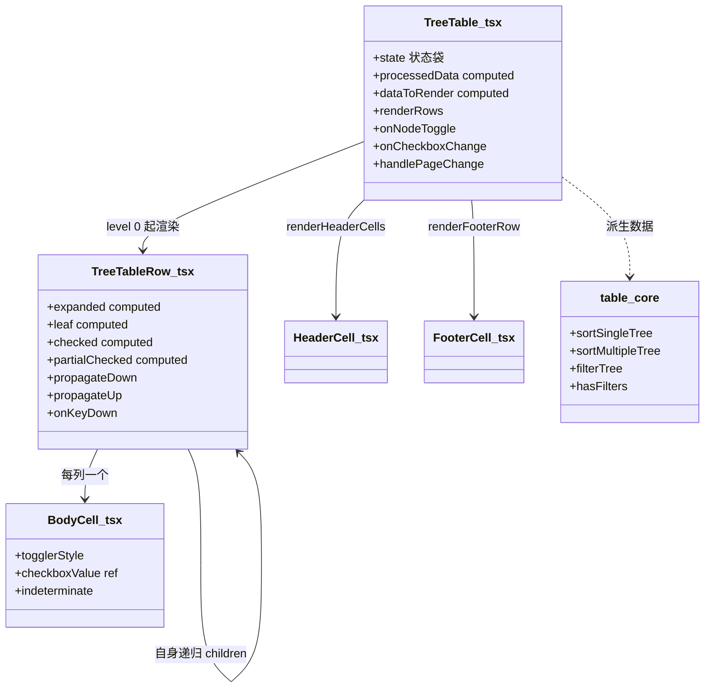
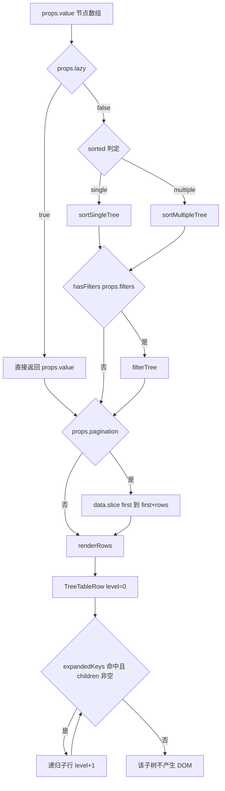
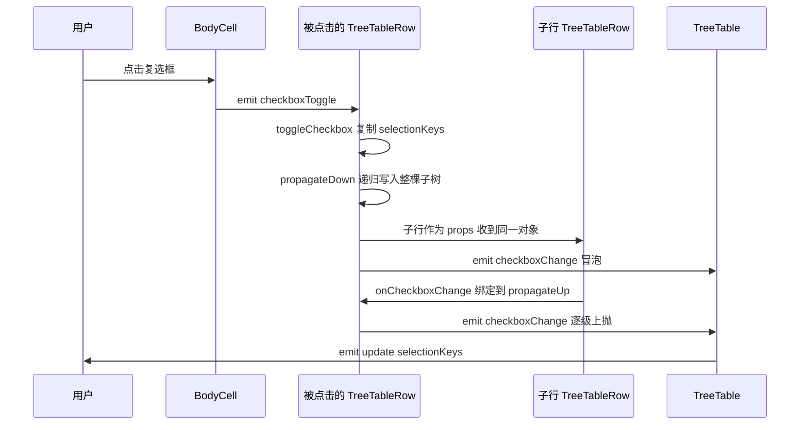

# C08-03 TreeTable 树表格

> **本篇解决**：TreeTable（树表格）如何在 `table-core` 的派生函数之上长出「树」这一维——可见行由谁决定、展开键与勾选键存在哪里、父子勾选如何传播，以及「不拍平」这一处选择会连带牵出哪些行为。
> **前置**：I06《table-core 状态机》、C08-00《类横写：三代表格的分层与选型》　**读者坐标**：`03-components/08-table` 第 4/7 篇（含类横写 `C08-00`）
>
> 内核侧结论（`table-core` 的接线状况、展开状态只有一份、半选在 `data-table` 一侧结构性缺失）由 I06 论证，分层与选型判据由 C08-00 论证，本篇一律引用不复述；同类的 C08-01《Table 表格》、C08-06《VirtualList 虚拟列表》、C08-07《VirtualScroller 虚拟滚动》仍在撰写，本篇不涉及其主题。

## 一、职责与边界

`XYTreeTable`（`packages/xiaoye-ui/src/tree-table/TreeTable.tsx:41`）负责把一棵**节点树**渲染成一张带层级缩进、可逐节点展开、可在父子间传播勾选状态的表格。它自带一整套单元格实现（`HeaderCell` / `BodyCell` / `FooterCell` / `TreeTableRow` 四个文件都在 `tree-table/` 目录内），派生数据（排序、筛选）则委托给 `table-core` 的 tree 变体函数（`packages/xiaoye-ui/src/tree-table/TreeTable.tsx:28`）。

它明确**不负责**的事，都能在源码里以「搜不到」证明：

- **不拍平数据**。整个 `tree-table/` 目录里没有任何 `flatten` / `walkTree` / 可见行数组的构造；可见行是由 `TreeTableRow` 递归渲染自身子节点产生的（`packages/xiaoye-ui/src/tree-table/TreeTableRow.tsx:481`）。这一点决定了本篇几乎所有机制。
- **不做虚拟化**。`tree-table/` 内 `grep -n "virtual" packages/xiaoye-ui/src/tree-table/*.tsx` 命中 0 行，`dataToRender` 直接把整页节点交给 `renderRows`（`packages/xiaoye-ui/src/tree-table/TreeTable.tsx:846`）。
- **没有表头全选框**。`packages/xiaoye-ui/src/tree-table/HeaderCell.tsx` 全文 `grep -ci checkbox` 结果为 `0`，即勾选只能逐行发起。
- **不支持分组**。`grep -n groupRowsBy packages/xiaoye-ui/src/tree-table/TreeTable.tsx` 命中 0 行（该结论由 I06 论点 8 记录，本篇不复述其推导）。

依赖清单（全部为运行时依赖，来自 `packages/xiaoye-ui/src/tree-table/TreeTable.tsx:1` 到 `:35` 的 import 块）：`@xiaoye-ui/utils/dom` 与 `@xiaoye-ui/utils/object`（DOM 与字段取值）、`@xiaoye-ui/core/utils` 的 `getVNodeProp` 与 `HelperSet`、`@xiaoye-ui/core/composables` 的 `useProvide`、`../table-core` 的四个符号、`xiaoye-ui/pagination`、`@xiaoye-ui/icons`、`../config-provider/hooks/useConfigInject`、`./style`。被谁依赖：`packages/xiaoye-ui/src/components.ts:384` 以 `export { default as TreeTable }` 注册到包根，`:425` 无条件引入样式。

三代表格的分层关系与选型判据归 C08-00《类横写：三代表格的分层与选型》，`table-core` 内部如何派生归 I06《table-core 状态机》，本篇只在 TreeTable 自己的位置上展开：树形态的渲染递归、展开键的读写、勾选的父子传播、缩进与无障碍语义的落点。

## 二、源码地图

| 文件 | 行数 | 职责 | 关键导出 / 入口行 |
| --- | --- | --- | --- |
| `tree-table/index.ts` | 33 | 包出口与 `install` | `packages/xiaoye-ui/src/tree-table/index.ts:28` |
| `tree-table/TreeTable.tsx` | 966 | 主组件：状态袋、派生链、表头/表体/分页/列宽拖拽 | 主渲染 `packages/xiaoye-ui/src/tree-table/TreeTable.tsx:898` |
| `tree-table/TreeTableRow.tsx` | 512 | 递归行：可见性、键盘导航、勾选传播 | `packages/xiaoye-ui/src/tree-table/TreeTableRow.tsx:430` |
| `tree-table/BodyCell.tsx` | 243 | 单元格：切换按钮、复选框、缩进、冻结列 | `packages/xiaoye-ui/src/tree-table/BodyCell.tsx:135` |
| `tree-table/HeaderCell.tsx` | 257 | 表头单元格：排序、冻结列 sticky、筛选入口 | `packages/xiaoye-ui/src/tree-table/HeaderCell.tsx:14` |
| `tree-table/FooterCell.tsx` | 123 | 表尾单元格，仅展示 | 同目录 |
| `tree-table/treeTableTypes.ts` | 224 | 四组 props 工厂 + 公开类型 | `packages/xiaoye-ui/src/tree-table/treeTableTypes.ts:95` |
| `tree-table/style/index.ts` | 241 | CSS-in-JS 样式 | `packages/xiaoye-ui/src/tree-table/style/index.ts:6` |
| `tree-table/__tests__/tree-table.test.js` | 432 | 单元测试（JavaScript，非 TS） | 同目录 |

四个值得先记住的坐标：组件身份三件套在 `packages/xiaoye-ui/src/tree-table/TreeTable.tsx:41`（`name: 'XYTreeTable'`）、`:42`（`inheritAttrs: false`）、`:43`（内部标识 `__XY_TREE_TABLE: true`）；样式前缀在 `:65` 的 `useConfigInject('tree-table', props)`；根元素 `role="treegrid"` 在 `:935`；唯一 `<tbody>` 在 `:943`。

列定义入口 `packages/xiaoye-ui/src/tree-table/TreeTable.tsx:68` 的 `new HelperSet({ type: 'Column' })` 是 C08-00 论点 2 的取证对象（结论：库内不存在名为 `Column` 的组件），本篇不重复论证，只补一条 TreeTable 侧的事实：`packages/xiaoye-ui/src/tree-table/TreeTable.tsx:96` 用 `useProvide('$columns', d_columns)` 提供收集容器，`:98` 到 `:101` 的 `columns` computed 在收集结果为空时退回 `slots.default?.()`——也就是说「子组件声明列」与「默认插槽当列」是同一个出口上的两条兜底路径。

## 三、架构与数据流

### 图 1：静态结构——一个组件文件把渲染全包了



图 1 想说明的是**依赖方向**而非继承：`TreeTableRow` 递归调用自己（`packages/xiaoye-ui/src/tree-table/TreeTableRow.tsx:483`），所以层级深度不进 `TreeTable` 的任何状态；`table-core` 只被 `TreeTable` 单向调用（`packages/xiaoye-ui/src/tree-table/TreeTable.tsx:112`、`:117`、`:121`），`TreeTableRow` 完全不知道内核存在。这与 `table/` 把渲染外包给 `vc-table` 的形态不同，具体分层判据见 C08-00。

### 图 2：数据管道——派生只在「顶层数组」发生



两个分支值得解释「为什么存在」。第一，`lazy` 分支（`packages/xiaoye-ui/src/tree-table/TreeTable.tsx:104`）让排序与筛选整体旁路，因为服务端已经处理过；但分页切片也在 `lazy` 时把 `first` 强制为 `0`（`packages/xiaoye-ui/src/tree-table/TreeTable.tsx:143`），即 `lazy` 模式下本地不再切第二刀。第二，`EXP` 判定在**渲染层**而不是数据层（`packages/xiaoye-ui/src/tree-table/TreeTableRow.tsx:481`），这条选择决定了后面所有关于「折叠子树仍参与排序筛选」「翻页收起全部」的行为，是 TreeTable 最重要的一处设计。

### 图 3：勾选传播闭环——一次点击，三次 emit



这条链的要点是**传播发生在事件层而不是数据层**：`toggleCheckbox`（`packages/xiaoye-ui/src/tree-table/TreeTableRow.tsx:343`）先做向下递归写（`propagateDown`，`:356`），再把事件交给父行做向上归算（`propagateUp`，`:369`），父行归算完继续 `emit('checkboxChange', ...)`（`:397`），直到根行把事件交回 `TreeTable`（`packages/xiaoye-ui/src/tree-table/TreeTable.tsx:874`），最终只有一次 `emit('update:selectionKeys', ...)`（`packages/xiaoye-ui/src/tree-table/TreeTable.tsx:397`）。

## 四、核心机制精读

### 论点 1：可见行不是算出来的，是渲染递归出来的——`TreeTable` 全程没有「可见行数组」这个概念

**断言**：`TreeTable` 只渲染第 0 层行，「哪些子行可见」这件事由 `TreeTableRow` 在自己的渲染函数里递归决定；因此展开状态不参与任何数据派生，只参与组件树形状。

`packages/xiaoye-ui/src/tree-table/TreeTable.tsx:854` 起，`renderRows` 的循环对象是 `dataToRender.value`，且每个节点都写死 `level={0}`：

```tsx
// packages/xiaoye-ui/src/tree-table/TreeTable.tsx:854
      return dataToRender.value.map((node: any, index: number) => (
        <TreeTableRow
          key={nodeKey(node)}
          dataKey={props.dataKey}
          columns={columns.value}
          node={node}
          level={0}
          expandedKeys={state.d_expandedKeys}
          indentation={props.indentation}
          selectionMode={props.selectionMode}
          selectionKeys={props.selectionKeys}
          ariaSetSize={dataToRender.value.length}
          ariaPosInset={index + 1}
          tabindex={setTabindex(node, index)}
          loadingMode={props.loadingMode}
          contextMenu={props.contextMenu}
          contextMenuSelection={props.contextMenuSelection}
          templates={slots}
          onNodeToggle={onNodeToggle}
          onNodeClick={onNodeClick}
          onCheckboxChange={onCheckboxChange}
          onRowRightclick={onRowRightClick}
        />
      ));
```

注意 `expandedKeys={state.d_expandedKeys}`（`packages/xiaoye-ui/src/tree-table/TreeTable.tsx:861`）是**整包下发**，不是按层过滤：每个行组件都拿到完整的展开键表，自己查自己那一条。查的动作在 `packages/xiaoye-ui/src/tree-table/TreeTableRow.tsx:56`：

```tsx
// packages/xiaoye-ui/src/tree-table/TreeTableRow.tsx:56
    const expanded = computed(() => {
      return props.expandedKeys && props.expandedKeys[nodeKey(props.node)] === true;
    });

    const leaf = computed(() => {
      return props.node?.leaf === false
        ? false
        : !(props.node?.children && props.node?.children.length);
    });
```

`:57` 用 `=== true` 做严格比较，所以 `d_expandedKeys` 里任何非 `true` 的值（例如调用方传了 `{ a: 1 }`）都会被判成折叠。`leaf` 的写法比「没有 children 就是叶子」多一层：`node.leaf === false` 时**强制非叶**，这是为惰性加载准备的——一个当前没有 `children` 但语义上还能展开的节点必须显式声明 `leaf: false`，否则切换按钮会被隐藏（`packages/xiaoye-ui/src/tree-table/BodyCell.tsx:127` 的 `visibility: props.leaf ? 'hidden' : 'visible'`）。

真正把递归变成可见行的是渲染函数尾部：

```tsx
// packages/xiaoye-ui/src/tree-table/TreeTableRow.tsx:481
          {expanded.value && props.node?.children && props.node?.children.length
            ? props.node.children.map((childNode: any) => (
                <TreeTableRow
                  key={nodeKey(childNode)}
                  dataKey={props.dataKey}
                  columns={props.columns}
                  node={childNode}
                  parentNode={props.node}
                  level={props.level + 1}
                  expandedKeys={props.expandedKeys}
                  selectionMode={props.selectionMode}
                  selectionKeys={props.selectionKeys}
                  contextMenu={props.contextMenu}
                  contextMenuSelection={props.contextMenuSelection}
                  indentation={props.indentation}
                  ariaPosInset={props.node.children.indexOf(childNode) + 1}
                  ariaSetSize={props.node.children.length}
                  templates={props.templates}
                  onNodeToggle={(e: any) => emit('nodeToggle', e)}
                  onNodeClick={(e: any) => emit('nodeClick', e)}
                  onRowRightclick={(e: any) => emit('rowRightclick', e)}
                  onCheckboxChange={propagateUp}
                />
              ))
            : null}
```

三个后果都能从这段直接读出来。第一，`level={props.level + 1}`（`:489`）与 `expandedKeys={props.expandedKeys}`（`:490`）说明层级是**沿组件树累加的渲染参数**，父组件不存任何层级状态。第二，返回的是 Fragment（`:455` 的 `<>`），一个行组件产出「一个 `<tr>` 加上若干子行组件的 `<tr>`」，所以最终 DOM 里所有 `<tr>` 都是同一个 `<tbody>`（`packages/xiaoye-ui/src/tree-table/TreeTable.tsx:943`）下的兄弟节点——没有嵌套 `<table>`，也没有按层分组。第三，折叠子树**不产生任何 DOM**，而不是 `display: none`，这直接决定了后面论点 4 的测量行为与论点 5 的键盘导航。

### 论点 2：勾选状态是一次「向下递归写满 + 向上逐级归算」，半选只在归算里诞生

**断言**：`propagateDown` 负责把被点节点及其全部后代写成 `{ checked: true, partialChecked: false }`，`propagateUp` 负责让每个祖先根据**直接 children** 的计数把自己归成全选 / 半选 / 全不选；半选（`partialChecked`）不是数据字段，而是归算产物。

```tsx
// packages/xiaoye-ui/src/tree-table/TreeTableRow.tsx:343
    function toggleCheckbox() {
      const _selectionKeys = props.selectionKeys ? { ...props.selectionKeys } : {};
      const _check = !checked.value;

      propagateDown(props.node, _check, _selectionKeys);

      emit('checkboxChange', {
        node: props.node,
        check: _check,
        selectionKeys: _selectionKeys,
      });
    }

    function propagateDown(node: any, check: boolean, selectionKeys: Record<string, any>) {
      if (check) selectionKeys[nodeKey(node)] = { checked: true, partialChecked: false };
      else delete selectionKeys[nodeKey(node)];

      if (node.children && node.children.length) {
        for (const child of node.children) {
          propagateDown(child, check, selectionKeys);
        }
      }
    }
```

`:344` 的浅拷贝是整条链唯一的「不可变点」：之后 `propagateDown` 与所有 `propagateUp` 都在这同一个对象上原地增删。取消勾选走的是 `delete`（`:358`）而不是写 `{ checked: false }`，因此 `selectionKeys` 是一个**稀疏表**——未选中节点根本不在表里。这让 `checked` 的读取（`packages/xiaoye-ui/src/tree-table/TreeTableRow.tsx:66`）返回值实际上是 `undefined | true | false`，而不是布尔：`props.selectionKeys[key] && props.selectionKeys[key].checked` 在键缺失时短路成 `undefined`。这一点在 `aria-checked={checked.value || undefined}`（`packages/xiaoye-ui/src/tree-table/TreeTableRow.tsx:469`）上被刻意吸收掉了，但任何把它当严格 `boolean` 用的下游代码都要自己兜住。

向上一侧的归算：

```tsx
// packages/xiaoye-ui/src/tree-table/TreeTableRow.tsx:369
    function propagateUp(event: { check: boolean; selectionKeys: Record<string, any>; node: any }) {
      const check = event.check;
      const _selectionKeys = { ...event.selectionKeys };
      let checkedChildCount = 0;
      let childPartialSelected = false;

      for (const child of props.node.children) {
        if (_selectionKeys[nodeKey(child)] && _selectionKeys[nodeKey(child)].checked)
          checkedChildCount++;
        else if (_selectionKeys[nodeKey(child)] && _selectionKeys[nodeKey(child)].partialChecked)
          childPartialSelected = true;
      }

      if (check && checkedChildCount === props.node.children.length) {
        _selectionKeys[nodeKey(props.node)] = { checked: true, partialChecked: false };
      } else {
        if (!check) {
          delete _selectionKeys[nodeKey(props.node)];
        }

        if (
          childPartialSelected ||
          (checkedChildCount > 0 && checkedChildCount !== props.node.children.length)
        )
          _selectionKeys[nodeKey(props.node)] = { checked: false, partialChecked: true };
        else _selectionKeys[nodeKey(props.node)] = { checked: false, partialChecked: false };
      }
```

读这段要注意三处。第一，`:375` 循环的是 `props.node.children`（**当前行的节点**，即父节点），不是 `event.node.children`——所以每个祖先只归算自己这一层，深层信息由 `propagateDown` 事先铺好，这就是「一次点击、逐级归算」能成立的原因。第二，`:371` 又做了一次 `{ ...event.selectionKeys }` 浅拷贝，于是每一层都产生一个新对象引用，但**它们共享同一批 value 对象**：`{ checked: true, partialChecked: false }` 这个字面量在 `:357` 和 `:383` 各是新对象，不会互相污染。第三，`:393` 判定半选的条件是「有孩子处于半选」或「已选孩子数大于 0 且不等于孩子总数」，`else` 分支 `:394` 写 `{ checked: false, partialChecked: false }` 而不是删除——于是勾选一个节点再取消它的某个孙节点时，父节点会以「全 false」的形态留在表里，这是 `selectionKeys` 混入空壳条目的来源。

半选最终怎么变成界面，落在单元格上（I06 已证「半选只存在于 tree-table 一侧」，此处只补它如何落地）：

```tsx
// packages/xiaoye-ui/src/tree-table/BodyCell.tsx:209
            {checkboxSelectionMode.value && columnProp('expander') ? (
              <Checkbox
                checked={checkboxValue.value}
                onUpdate:checked={(val: boolean) => (checkboxValue.value = val)}
                onChange={toggleCheckbox}
                class={[`${prefixCls.value}-node-checkbox`]}
                disabled={props.node?.selectable === false}
                indeterminate={props.partialChecked}
                data-xy-partialchecked={props.partialChecked}
```

`indeterminate={props.partialChecked}`（`packages/xiaoye-ui/src/tree-table/BodyCell.tsx:216`）之外还留了个 `data-xy-partialchecked`（`:217`）给测试与样式做选择器。复选框只在 `columnProp('expander')` 为真的那一列渲染（`:209`），即**表头的勾选能力与展开器列是同一个开关**。

### 论点 3：节点是 `{ key, data, children }` 三段式，`field` 与 `dataKey` 走的是两个不同的取值命名空间

**断言**：TreeTable 里所有「按字段取值」的代码分裂成两条规则——列的 `field` 一律在 `node.data` 下解析，而行身份 `dataKey` 一律在 `node` 顶层解析；两条规则由三个不同文件的代码共同维持，改任何一条都会跨包破坏。

渲染取值（组件侧）：

```tsx
// packages/xiaoye-ui/src/tree-table/BodyCell.tsx:233
            {bodyTpl ? (
              <bodyTpl node={props.node} column={col} />
            ) : (
              <>{resolveFieldData(props.node?.data, columnProp('field'))}</>
            )}
```

排序取值（内核侧，tree 变体）：

```ts
// packages/xiaoye-ui/src/table-core/sorting.ts:96
export function sortSingleTree(nodes: any[], params: SortSingleParams): any[] {
// ...
      const value1 = resolveFieldData(node1.data, sortField);
      const value2 = resolveFieldData(node2.data, sortField);
// ...
      node.children && node.children.length
        ? { ...node, children: sortSingleTree(node.children, params) }
```

`packages/xiaoye-ui/src/table-core/sorting.ts:106` 与 `:107` 显式写 `.data`，而同一文件里 flat 变体的 `packages/xiaoye-ui/src/table-core/sorting.ts:33` 写的是 `resolveFieldData(item, sortField)`——同一个 `sortField` 字符串在两种数据形态下指向不同深度。筛选侧同样：`packages/xiaoye-ui/src/table-core/filtering.ts:241` 是 `resolveFieldData(node.data, filterField)`。多列排序的字段比较也走 `.data`（`packages/xiaoye-ui/src/table-core/sorting.ts:151`）。

身份取值则相反，`node` 顶层：

```ts
// packages/xiaoye-ui/src/tree-table/TreeTable.tsx:329
    function nodeKey(node: any) {
      return resolveFieldData(node, props.dataKey);
    }
```

`packages/xiaoye-ui/src/tree-table/TreeTable.tsx:330` 没有 `.data`，`packages/xiaoye-ui/src/tree-table/TreeTableRow.tsx:23` 的行内版本同样没有。默认值在 `packages/xiaoye-ui/src/tree-table/treeTableTypes.ts:98` 到 `:101`：`dataKey` 类型是 `string | ((item) => string)`，默认 `'key'`；行组件那份 props 在 `packages/xiaoye-ui/src/tree-table/treeTableTypes.ts:157` 到 `:160` 重复声明了同样的默认值。

由此得到三条可操作的推论。第一，`sortField: 'name'` 要求数据是 `{ key, data: { name } }`，而 `dataKey: 'key'` 要求 `key` 在顶层：如果调用方把整行字段平铺在节点顶层（`{ id, name, children }`），那么排序拿不到值、展开与勾选却因为 `resolveFieldData(node, 'key')` 返回 `undefined` 而让**所有行共用同一个键**——`packages/xiaoye-ui/src/tree-table/TreeTableRow.tsx:57` 的判断会把「任意一个节点展开」变成「全部同键节点一起展开」。第二，`dataKey` 允许函数（`treeTableTypes.ts:99`），但 `packages/xiaoye-ui/src/tree-table/TreeTableRow.tsx:36` 的注释暴露了另一处不一致：`equals` 的第三参数只接受 string，所以传给 contextMenu 比较时被降级成 `undefined`。第三，`sorting.ts:113` 的 `{ ...node, children: ... }` 说明排序**重建节点对象但不改键**，因此展开与勾选状态能跨排序存活；这一点与筛选的行为要分开看（论点 4）。

### 论点 4：`filterTree` 是「互递归 + 命中即短路」，于是 lenient 模式下命中的父节点保留完整原子树

**断言**：树过滤由 `findFilteredNodes` 与 `isFilterMatched` 互相调用来实现下钻，而 `isFilterMatched` 的下钻是有条件的——lenient 模式下节点自身命中就不再往孩子看，这造成「命中的父节点子树原样保留，未命中但孩子命中的父节点子树被裁剪」两种不同结果。

```ts
// packages/xiaoye-ui/src/table-core/filtering.ts:235
function isFilterMatched(
  node: any,
  { filterField, filterValue, filterConstraint, strict }: any,
  filterLocale?: string,
): boolean {
  let matched = false;
  const dataFieldValue = resolveFieldData(node.data, filterField);

  if (filterConstraint(dataFieldValue, filterValue, filterLocale)) {
    matched = true;
  }

  if (!matched || (strict && !isNodeLeaf(node))) {
    matched =
      findFilteredNodes(
        node,
        { filterField, filterValue, filterConstraint, strict },
        filterLocale,
      ) || matched;
  }

  return matched;
}
```

`:247` 的两个条件是全部的复杂度来源。`!matched` 让「自身不命中」的节点必须下钻找孩子；`strict && !isNodeLeaf(node)` 让 strict 模式（`packages/xiaoye-ui/src/tree-table/treeTableTypes.ts:137` 的 `filterMode` 默认是 `'lenient'`）下**即使自身命中也继续下钻**，因为 strict 的语义是「只有叶子命中才算数」。`isNodeLeaf` 在 `packages/xiaoye-ui/src/table-core/utils.ts:100` 到 `:102`，判据与组件侧的 `leaf` computed（`packages/xiaoye-ui/src/tree-table/TreeTableRow.tsx:60`）逐字符同构——两处用不同文件里的同一份逻辑判断「是不是叶子」，改动必须同步。

下钻那侧会**改写 children**：

```ts
// packages/xiaoye-ui/src/table-core/filtering.ts:202
function findFilteredNodes(node: any, paramsWithoutNode: any, filterLocale?: string): boolean {
  if (node) {
    let matched = false;

    if (node.children) {
      const childNodes = [...node.children];
      const matchedChildren: any[] = [];

      for (const childNode of childNodes) {
        const copyChildNode = { ...childNode };

        if (isFilterMatched(copyChildNode, paramsWithoutNode, filterLocale)) {
          matched = true;
          matchedChildren.push(copyChildNode);
        }
      }

      // 仅在有匹配的子节点时才替换 children，避免无条件清空导致数据丢失
      if (matched) {
        node.children = matchedChildren;
      }
    }

    return matched;
  }
```

`packages/xiaoye-ui/src/table-core/filtering.ts:221` 的赋值对象是**调用方传进来的那份浅拷贝**：主循环在 `packages/xiaoye-ui/src/table-core/filtering.ts:131` 做 `const copyNode = { ...node }`，随后 `:149`、`:155`、`:183` 传的都是 `copyNode`，所以 `props.value` 的顶层节点对象不被改写；但 `copyNode.data` 仍是原引用，孙层以下也只有在这一层被 `{ ...childNode }`（`:211`）复制过。结论：**克隆深度等于下钻深度**，未下钻的子树共享原对象。

主循环的保留判据（`:146` 到 `:157`）把两种模式的下钻顺序也反了过来：strict 先 `findFilteredNodes` 再 `isFilterMatched`，lenient 先 `isFilterMatched` 再 `findFilteredNodes`。而全局过滤是**另一段独立循环**（`packages/xiaoye-ui/src/table-core/filtering.ts:169` 到 `:184`，注释在 `:169` 写明「避免跨列副作用」），命中条件是 `isFilterMatched || findFilteredNodes`（`:182`、`:183`），约束固定为 `'contains'`（`:173`）。最后 `packages/xiaoye-ui/src/table-core/filtering.ts:186` 用 `localMatch && globalMatch` 才 push，且 push 的是 `copyNode`。

对调用方最重要的一个可预测行为：被过滤掉的子树**不会**进入 `expandedKeys` 判定，因为它压根不在返回数组里；而 `TreeTable` 传入的 `columns: columns.value`（`packages/xiaoye-ui/src/tree-table/TreeTable.tsx:125`）与 `columnProp`（`:126`）说明内核需要**反向依赖组件的列 DSL 读取方式**才能拿到 `filterField`/`field`——这是 `table-core` 里少见的「纯函数接受不纯回调」的接缝，签名在 `packages/xiaoye-ui/src/table-core/types.ts` 的 `FilterTreeParams`。

### 论点 5：键盘导航不用内部状态，而是「读 DOM 兄弟 + 伪造点击」——它是论点 1 那套扁平 DOM 的下游消费者

**断言**：`TreeTableRow` 的上下键靠 `nextElementSibling` / `previousElementSibling` 找邻居，左右键靠 `querySelector` 找到切换按钮后调用 `.click()`，Home/End 用 `tr[aria-level="N"]` 当选择器。三件事全部依赖真实 DOM，因此它们与「折叠不产生 DOM」这个实现细节是绑死的。

```tsx
// packages/xiaoye-ui/src/tree-table/TreeTableRow.tsx:172
    function onArrowDownKey(event: KeyboardEvent) {
      const nextElementSibling = (event.currentTarget as HTMLElement).nextElementSibling;

      nextElementSibling &&
        focusRowChange(event.currentTarget as HTMLElement, nextElementSibling as HTMLElement);

      event.preventDefault();
    }
```

`:173` 取的是 `event.currentTarget`，也就是当前 `<tr>`——只有当所有层级的 `<tr>` 都是同一 `<tbody>` 的直接子元素时，「下一个可见行」才恰好等于「下一个兄弟节点」。递归渲染（`packages/xiaoye-ui/src/tree-table/TreeTableRow.tsx:481`）用 Fragment 把子行摊平成兄弟，这个等式才成立；若哪天改成「每层一个 `<tbody>`」或「嵌套 table」，上下键会立刻失效。

左右展开则不走状态，而是点按钮：

```tsx
// packages/xiaoye-ui/src/tree-table/TreeTableRow.tsx:190
    function onArrowRightKey(event: KeyboardEvent) {
      if (!nodeRef.value) return;

      // 修复类型：findSingle 返回 Element | null，断言为 HTMLElement | null 以访问 style/click
      const button = findSingle(nodeRef.value, 'button') as HTMLElement | null;
      const ishiddenIcon = button?.style.visibility === 'hidden';
      const togglerElement = findSingle(
        nodeRef.value,
        `.${prefixCls.value}-node-toggle-button`,
      ) as HTMLElement | null;

      if (ishiddenIcon) return;

      if (!expanded.value && togglerElement) togglerElement.click();

      nextTick(() => {
        onArrowDownKey(event);
      });
```

三处细节值得标注。第一，`:194` 用 `findSingle(nodeRef.value, 'button')` 拿「第一个 button」再读它的 `style.visibility`，判定依据是 `BodyCell.tsx:127` 写入的行内 `visibility`，即**代码读取自己刚写进 DOM 的样式**来做分支判断；一旦该行有别的按钮排在前面（例如调用方在单元格里放了自定义按钮），`:194` 取到的就不是切换按钮，`ishiddenIcon` 判断随之失真。第二，`:203` 调 `.click()` 而不是 `toggle()`，所以展开必然经过 `onClick`（`packages/xiaoye-ui/src/tree-table/BodyCell.tsx:201` 的 `toggle` → `emit('nodeToggle')`）这条真实链路，行为与鼠标点击一致，代价是无法区分「用户点击」与「键盘派生点击」。第三，`:205` 到 `:207` 在 `nextTick` 里复用同一个 `event` 调用 `onArrowDownKey`，而后者只从 `event.currentTarget` 取元素（`:173`）——原生事件的 `currentTarget` 在派发结束后会被复位，这一步的实际结果依赖运行时是否仍持有引用，本篇未在真实浏览器中实测，只记录代码事实：`onArrowLeftKey` 走的是另一条安全路径，它用 `findBeforeClickableNode(currentTarget)`（`packages/xiaoye-ui/src/tree-table/TreeTableRow.tsx:233`）而非复用 event。

`onArrowLeftKey` 也值得一读，因为它显式处理了「第 0 层且折叠」这个边界：

```tsx
// packages/xiaoye-ui/src/tree-table/TreeTableRow.tsx:212
    function onArrowLeftKey(event: KeyboardEvent) {
      if (!nodeRef.value) return;

      if (props.level === 0 && !expanded.value) {
        return;
      }
// ...
      if (expanded.value && !ishiddenIcon) {
        togglerElement?.click();
        return;
      }

      const target = findBeforeClickableNode(currentTarget);

      target && focusRowChange(currentTarget, target);
    }
```

`:215` 的提前 return 意味着顶层折叠行按左键无任何反应，这是 W3C treegrid 模式的常规行为，源码里靠 `props.level`（`packages/xiaoye-ui/src/tree-table/treeTableTypes.ts:166` 默认 `0`）来判断，而不是靠 DOM 结构。

Home/End 则把 `aria-level` 当成查询键使用：`packages/xiaoye-ui/src/tree-table/TreeTableRow.tsx:247` 与 `:262` 都是 `` `tr[aria-level="${props.level + 1}"]` ``，作用域是 `currentTarget.parentElement`（`:240`、`:257`），即那个唯一 `<tbody>`。而 `aria-level` 由 `packages/xiaoye-ui/src/tree-table/TreeTableRow.tsx:465` 写成 `props.level + 1`。也就是说 `aria-level` 在本库里同时是**无障碍语义**和**功能选择器**：如果有人把 `:465` 改成 `aria-level={props.level}`（0 基），Home/End 会查不到任何行而静默失效。同理 `aria-setsize` / `aria-posinset` 在顶层来自 `packages/xiaoye-ui/src/tree-table/TreeTable.tsx:865`（`dataToRender.value.length`，即「本页顶层节点数」），在子层来自 `packages/xiaoye-ui/src/tree-table/TreeTableRow.tsx:496` 与 `:497`（父节点的 children），两套语义混在同一 `<tbody>` 里，是 treegrid 规范要求的写法，不是 bug。

### 论点 6：冻结列与列宽拖拽都绕开响应式，直接读全局 DOM、写全局 `<style>`

**断言**：`BodyCell` / `HeaderCell` 的 sticky 偏移量用 `document.querySelectorAll` 全表扫描算出，`TreeTable` 的列宽拖拽则把结果写进一个自己注入的 `<style>` 标签，用 `!important` 覆盖组件样式；两条路径都不经过 Vue 的渲染。

```tsx
// packages/xiaoye-ui/src/tree-table/BodyCell.tsx:40
    onMounted(() => {
      if (columnProp('frozen')) {
        updateStickyPosition();
      }
    });

    onUpdated(() => {
      if (columnProp('frozen')) {
        updateStickyPosition();
      }
    });

    function updateStickyPosition() {
      if (!isClient) return;
      if (columnProp('frozen')) {
        const align = columnProp('alignFrozen');
// ...
          const allTds = document.querySelectorAll('td[data-xy-frozen-column="true"]');
```

`:40` 到 `:50` 是两个钩子，`:61` 与 `:79` 是两次 `document.querySelectorAll`，选择器只按属性匹配、**不按当前表格限定**。属性本身写在 `packages/xiaoye-ui/src/tree-table/BodyCell.tsx:194`（`data-xy-frozen-column={columnProp('frozen')}`），表头对应的是 `packages/xiaoye-ui/src/tree-table/HeaderCell.tsx:62` 与 `:80` 的 `th[data-xy-frozen-column="true"]`。同页两张 TreeTable 时，第二张的偏移量会把第一张的 `<td>` 也算进 `prev`/`next` 候选（`:64` 到 `:71`、`:82` 到 `:88` 只比较 `style.insetInlineStart` 是否已有值，不校验归属）。加上 `onUpdated` 每次行更新都重算，展开一个节点就会触发整表所有冻结单元格的扫描。

列宽拖拽的落点更彻底：

```ts
// packages/xiaoye-ui/src/tree-table/TreeTable.tsx:650
    function resizeTableCells(newColumnWidth: number, nextColumnWidth?: number) {
      if (!isClient) return;
      const colIndex = getIndex(resizeColumnElement.value!);
      const widths: number[] = [];
      const headers = find(tableRef.value, `.${prefixCls.value}-head > tr > th`);

      headers.forEach(header => widths.push(getOuterWidth(header)));

      destroyStyleElement();
      createStyleElement();

      let innerHTML = '';
      const selector = `.${prefixCls.value} > .${prefixCls.value}-table-container > .${prefixCls.value}-table`;

      widths.forEach((width, index) => {
        const colWidth =
          index === colIndex
            ? newColumnWidth
            : nextColumnWidth && index === colIndex + 1
              ? nextColumnWidth
              : width;
        const style = `width: ${colWidth}px !important; max-width: ${colWidth}px !important`;
// ...
        innerHTML += `
                    ${selector} > .${prefixCls.value}-head > tr > th:nth-child(${index + 1}),
                    ${selector} > .${prefixCls.value}-body > tr > td:nth-child(${index + 1}),
                    ...
      });

      state.styleElement!.innerHTML = innerHTML;
    }
```

`:654` 从表头量宽度、`:658` 到 `:659` 先销毁再创建 `<style>`、`:662` 拼出一个三段全链选择器、`:671` 加 `!important`、`:682` 用 `state.styleElement!` 的非空断言写入。注意选择器里的 `.${prefixCls.value}-body > tr > td:nth-child(...)`（`:675`）是**直接子代组合**：它要求 `<tr>` 是 `<tbody>` 的儿子，这与论点 1 的扁平 DOM 是同一处约定的第二次被消费——把行改成嵌套结构不会让渲染报错，只会让拖拽后的列宽失效。`state.styleElement` 声明在 `packages/xiaoye-ui/src/tree-table/TreeTable.tsx:81`，卸载时在 `packages/xiaoye-ui/src/tree-table/TreeTable.tsx:772` 到 `:776` 的 `onBeforeUnmount` 里连同 `d_columns.clear()`、`unbindColumnResizeEvents()` 一起清理。

还有第三处「渲染期写状态」：`packages/xiaoye-ui/src/tree-table/TreeTable.tsx:899` 在渲染函数第一行执行 `state.hasASelectedNode = false;`，随后 `renderRows` 通过 `packages/xiaoye-ui/src/tree-table/TreeTable.tsx:867` 调 `setTabindex`，而 `setTabindex` 内部 `packages/xiaoye-ui/src/tree-table/TreeTable.tsx:757` 到 `:758` 又把它写回 `true`。`state` 是 `reactive`（`packages/xiaoye-ui/src/tree-table/TreeTable.tsx:70`），因此在渲染过程中读写响应式对象是这一处 tabindex 策略的直接后果，不是笔误——但它让「哪一行拿到 `tabindex=0`」依赖渲染顺序（`:764` 的 `index === 0 && !state.hasASelectedNode`）。

## 五、对外契约如何生效

公开事件在 `packages/xiaoye-ui/src/tree-table/TreeTable.tsx:45` 到 `:63` 的 `emits` 数组里登记，共 17 条。按「谁真正决定状态」分，它们其实是两套契约。

**展开：半受控。** `state.d_expandedKeys`（`packages/xiaoye-ui/src/tree-table/TreeTable.tsx:72`）在 setup 时从 props 浅拷贝一份，之后本地 `onNodeToggle` 写它（`packages/xiaoye-ui/src/tree-table/TreeTable.tsx:307`、`:310`）并 `emit('update:expandedKeys', ...)`（`:315`）；父组件若用 `v-model:expanded-keys`，回流靠 `packages/xiaoye-ui/src/tree-table/TreeTable.tsx:257` 到 `:262` 的 watch 整包替换 `newValue || {}`。也就是说调用方**不接**这个事件也能用（本地态自己活着），**接了但不写回**也不会报错。代价见 §七 坑 2 的翻页行为。

**勾选：全受控。** `tree-table/` 里根本没有 `d_selectionKeys`——六个 watch（`packages/xiaoye-ui/src/tree-table/TreeTable.tsx:257`、`:264`、`:271`、`:278`、`:285`、`:292`）覆盖 `expandedKeys` / `first` / `rows` / `sortField` / `sortOrder` / `multiSortMeta`，**唯独没有 `selectionKeys`**。`TreeTableRow` 读的永远是 `props.selectionKeys`（`packages/xiaoye-ui/src/tree-table/TreeTableRow.tsx:67`），写完只 `emit('update:selectionKeys', ...)`（`packages/xiaoye-ui/src/tree-table/TreeTable.tsx:397`）。调用方不接这条事件，界面就**完全不动**：`checked` 与 `partialChecked` 都没变。这与展开的宽容度形成鲜明对比，也是最容易让接入方困惑的一处——同一张表上两个近亲能力，受控程度不同。

**排序：状态在本地、判定看 props。** `onColumnHeaderClick`（`packages/xiaoye-ui/src/tree-table/TreeTable.tsx:470`）翻转的是 `state.d_sortOrder` / `state.d_sortField`（`:493`、`:496` 到 `:497`），而表头高亮用的 `isColumnSorted` 读的是 `props.sortField`（`:467`），`HeaderCell` 自己的同名判断也是 `props.sortField`（`packages/xiaoye-ui/src/tree-table/HeaderCell.tsx:33`）。因此不接 `update:sortField`（`:500`）时，数据会重排（`sorted` 依赖 `state`，`packages/xiaoye-ui/src/tree-table/TreeTable.tsx:155`）而表头箭头不亮——排序的「生效」与「显示」分属两个源。另有一处 DOM 门槛：点击必须命中带 `data-xy-sortable-column` 的元素或其祖先（`packages/xiaoye-ui/src/tree-table/TreeTable.tsx:482` 到 `:483`），否则整段排序逻辑跳过。

**插槽：两条互不相通的通道，优先级在渲染函数里硬编码。** `renderRows` 把整个 `slots` 当 `templates` 传下去（`packages/xiaoye-ui/src/tree-table/TreeTable.tsx:871`），`BodyCell` 再从两个不同地方取同名模板：

```tsx
// packages/xiaoye-ui/src/tree-table/BodyCell.tsx:137
      const rowToggleIconTpl = col?.children?.rowtoggleicon;
      const rowTogglerIconTpl = col?.children?.rowtogglericon;
      const bodyTpl = col?.children?.body;
      const nodeToggleIconTpl = props.templates?.['nodetoggleicon'];
      const nodeTogglerIconTpl = props.templates?.['nodetogglericon'];
      const checkboxIconTpl = props.templates?.['checkboxicon'];
```

`:137` 到 `:139` 走的是「列 VNode 的 children」，`:140` 到 `:142` 走的是「表格级 slots」，两者名字近似但来源不同。切换图标的实际选取是一条 6 级 if/else 链（`packages/xiaoye-ui/src/tree-table/BodyCell.tsx:145` 到 `:187`）：`node.loading && loadingMode === 'icon'` 时 `nodeTogglerIconTpl` 优先（`:145` 到 `:150`）→ `rowtoggleicon`（`:151`）→ `nodetoggleicon`（`:159`）→ `rowtogglericon`（`:167`）→ 展开态默认 `ChevronDownIcon`（`:179`）→ 折叠态默认 `ChevronRightIcon`（`:185`）。此外 `props.node?.expandedIcon` / `collapsedIcon`（`:176`、`:182`）是**数据字段级的第四条通道**，它排在四个插槽之后。四个近似名字加两个数据字段，构成同一个视觉元素的六种写法——这是本篇认为最需要在改动前先读一遍 `:145` 到 `:187` 的原因。

**expose 面只有两项。** `packages/xiaoye-ui/src/tree-table/TreeTable.tsx:778` 到 `:784` 暴露 `columns` 与 `d_columns`。注意暴露的 `columns`（`:779`）与内部 computed（`:98`）不是同一个实现：内部版结尾有 `|| []` 兜底（`:100`），暴露版没有。外部通过 `ref.columns` 拿到的可能是 `undefined` 而不是空数组。

**卸载清理与 SSR 边界。** `onBeforeUnmount`（`packages/xiaoye-ui/src/tree-table/TreeTable.tsx:772`）做三件事：`destroyStyleElement()`、`d_columns.clear()`、`unbindColumnResizeEvents()`。`isClient` 守卫（`packages/xiaoye-ui/src/tree-table/TreeTable.tsx:38`）出现在每个 DOM 路径函数开头（例如 `:574`、`:605`、`:651`、`:686`），样式则始终经 `wrapSSR`（`packages/xiaoye-ui/src/tree-table/TreeTable.tsx:918`）输出，所以服务端能渲染出带 hash 类名的静态表格。注册路径为 `packages/xiaoye-ui/src/tree-table/index.ts:28` 的 `install` → `registerComponent(app, TreeTable)`，组件名 `XYTreeTable`（`TreeTable.tsx:41`）经该工具映射为 `xy-tree-table` 标签。

## 六、设计取舍

**取舍一：用渲染递归代替数据拍平。** `TreeTable` 从不生成「可见行列表」，展开折叠纯粹是组件树形状的变化（`packages/xiaoye-ui/src/tree-table/TreeTableRow.tsx:481`）。换来的是：派生管道里少一个 O(n) 阶段，`processedData` 只需处理顶层数组（`packages/xiaoye-ui/src/tree-table/TreeTable.tsx:103`），且每一行的 `expanded` 是局部 computed（`packages/xiaoye-ui/src/tree-table/TreeTableRow.tsx:56`），展开一个节点只重渲染那一条子树。赔上的同样明确：无法虚拟化（`tree-table/` 内 `virtual` 命中 0 行）、无法统计「可见行总数」（`ariaSetSize` 在子层只能用 `props.node.children.length`，`packages/xiaoye-ui/src/tree-table/TreeTableRow.tsx:497`）、键盘导航与列宽样式都必须读真实 DOM（论点 5、论点 6）。若日后要接虚拟滚动，第一个要被推翻的就是「折叠子树不存在」这个前提。

**取舍二：勾选全受控、展开半受控，两者不做统一。** 从实现成本看，给 `selectionKeys` 也加一份本地态只是三行代码（对照 `packages/xiaoye-ui/src/tree-table/TreeTable.tsx:72` 与 `:257`）。不这么做的收益是：树勾选的 value 形态是 `{ checked, partialChecked }` 嵌套对象（`packages/xiaoye-ui/src/tree-table/TreeTableRow.tsx:357`），组件一旦自持就要负责深拷贝与半选重算的一致性，而这正是 `propagateUp` 已经在做的事；把它交给调用方，等于把「选中集合的持久化与序列化」这个业务问题留在业务侧。代价是同一张表出现两种心智模型，以及 `packages/xiaoye-ui/src/tree-table/TreeTable.tsx:436` 那行「翻页清空展开、却清不掉勾选」的不对称行为。

**取舍三：父子传播放在行组件事件冒泡里，而不是下沉进 `table-core`。** `table-core` 提供的是 tree 变体的排序与筛选（`packages/xiaoye-ui/src/table-core/sorting.ts:96`、`packages/xiaoye-ui/src/table-core/filtering.ts:122`），却没有 tree 选择——`TreeTable` 只 import 四个符号（`packages/xiaoye-ui/src/tree-table/TreeTable.tsx:28`）。把 `propagateDown` / `propagateUp` 放在 `TreeTableRow` 里（`packages/xiaoye-ui/src/tree-table/TreeTableRow.tsx:356`、`:369`）的直接好处是它们能免费拿到 `props.node.children` 与 `parentNode` 这条组件父子链，不需要另外维护一份「key → 父 key」索引。赔上的有三样：每层 `propagateUp` 都做一次浅拷贝（`:371`），一次点击的拷贝次数等于祖先深度；事件必须逐层转译（`:499` 到 `:502` 的四个 handler 转发）；以及 `nodeSelect` 语义被压成「一个节点」——`onCheckboxChange` 只 emit 一次（`packages/xiaoye-ui/src/tree-table/TreeTable.tsx:399`），批量勾选的后代不会各自触发。

**取舍四：列宽与 sticky 走原生 DOM，不进 token 也不进响应式。** `resizeTableCells` 生成的规则带 `!important`（`packages/xiaoye-ui/src/tree-table/TreeTable.tsx:671`），并写进一个自建的全局 `<style>`：`state.styleElement` 声明在 `packages/xiaoye-ui/src/tree-table/TreeTable.tsx:81`，由 `:741` 到 `:745` 创建并 `document.head.appendChild`，写入在 `:682`，销毁在 `:750` 到 `:752`。这样做能在不做 per-cell props 广播的前提下一次改写所有列宽，代价是这套宽度完全不在 CSS-in-JS 的 token 体系里：`packages/xiaoye-ui/src/tree-table/style/index.ts:4` 的 `ComponentToken` 是空接口，`:6` 的 `genComponentStyleHook('TreeTable', ...)` 没有任何组件级 token 可调，拖拽结果也无法被主题切换或 SSR 复现。

**取舍五：复用内核的 tree 变体，但不复用它的分页。** 排序筛选走 `sortSingleTree` / `filterTree`（`packages/xiaoye-ui/src/tree-table/TreeTable.tsx:121`、`:121`），分页却是一行内联 `slice`（`packages/xiaoye-ui/src/tree-table/TreeTable.tsx:144`）。这与 I06 论点 3 记录的内核接线状况一致，本篇不重复其结论；只补一条组件侧动因：`paginate` 的签名是 `paginate(data, first, rows)` 且函数体就是 `data.slice(first, first + rows)`（`packages/xiaoye-ui/src/table-core/pagination.ts:11` 到 `:15`），它没有任何树感知参数，而 `tree-table` 的 `rows` 语义是「每页顶层节点数」——直接套用会让「一页多少行」在树形态下失去意义，所以抽完之后没回头接线（`:9` 的注释同时点名了两个来源文件）。

## 七、坑与改动指南

**坑 1：数据少写一层 `data`，展开会「一点全开」。**

- 触发：`value` 用 `{ id, name, children }` 平铺结构，且没有覆盖 `dataKey`。
- 症状：任意一行点展开，所有行同时展开；单元格内容与表头排序都取不到值。
- 原因：`nodeKey` 是 `resolveFieldData(node, props.dataKey)`（`packages/xiaoye-ui/src/tree-table/TreeTable.tsx:330`），默认 `dataKey` 为 `'key'`（`packages/xiaoye-ui/src/tree-table/treeTableTypes.ts:100`）；平铺结构下每行都返回 `undefined`，于是 `expandedKeys[undefined] === true` 对全部行成立（`packages/xiaoye-ui/src/tree-table/TreeTableRow.tsx:57`）。而 `field` 一律在 `node.data` 下取值（`packages/xiaoye-ui/src/tree-table/BodyCell.tsx:236`、`packages/xiaoye-ui/src/table-core/sorting.ts:106`）。
- 定位：`packages/xiaoye-ui/src/tree-table/TreeTable.tsx:329`、`packages/xiaoye-ui/src/tree-table/treeTableTypes.ts:98`。测试里的正确形状见 `packages/xiaoye-ui/src/tree-table/__tests__/tree-table.test.js:40` 到 `:65`。

**坑 2：翻页把展开全部收起，但保留勾选。**

- 触发：`pagination` 为真时切换页码。
- 症状：第 2 页展开的节点在翻页（包括翻到相邻页）后一律折叠；选中状态却仍在。
- 原因：`handlePageChange` 显式执行 `state.d_expandedKeys = {}` 并 emit（`packages/xiaoye-ui/src/tree-table/TreeTable.tsx:436` 到 `:437`）。勾选不受影响是因为它的真源在调用方（论点见 §五）。排序点击也会重置分页：`onColumnHeaderClick` 调 `resetPage()`（`packages/xiaoye-ui/src/tree-table/TreeTable.tsx:502`），`resetPage` 写 `state.d_first = 0`（`:444`）。
- 定位：`packages/xiaoye-ui/src/tree-table/TreeTable.tsx:427` 到 `:441`。若要保留展开，必须在调用方监听 `page` 事件后自己重放 `expandedKeys`；组件内没有开关能关掉这次清空。

**坑 3：取消勾选后 `selectionKeys` 里留下「全 false」的空壳条目。**

- 触发：勾选父节点 → 再取消其中一个子节点 → 读 `selectionKeys` 统计选中数量。
- 症状：`Object.keys(selectionKeys).length` 大于真实选中数；用 `selectionKeys[key]` 做真值判断会误判。
- 原因：取消是 `delete`（`packages/xiaoye-ui/src/tree-table/TreeTableRow.tsx:358`、`:386`），但归算的 `else` 分支在既不全选也不半选时写入 `{ checked: false, partialChecked: false }`（`packages/xiaoye-ui/src/tree-table/TreeTableRow.tsx:394`）而不是删除。计数应过滤 `.checked`。
- 定位：`packages/xiaoye-ui/src/tree-table/TreeTableRow.tsx:384` 到 `:395`。该分支无测试保护：`grep -c selectionKeys packages/xiaoye-ui/src/tree-table/__tests__/tree-table.test.js` 与 kebab 变体 `selection-keys` 均为 0。

**坑 4：批量勾选只发一次 `nodeSelect`，靠事件维护选中集合会漏数据。**

- 触发：`selectionMode="checkbox"` 下点击一个含 50 个后代的父节点复选框，用 `@node-select` 累积「已选节点数组」。
- 症状：`selectionKeys` 有 51 个条目，`nodeSelect` 只触发 1 次，调用方集合少 50 个。
- 原因：`propagateUp` 逐层上抛时始终携带最初那个节点（`packages/xiaoye-ui/src/tree-table/TreeTableRow.tsx:398` 的 `node: event.node`），根层 `onCheckboxChange` 只按这一个 node 发事件（`packages/xiaoye-ui/src/tree-table/TreeTable.tsx:399` 到 `:400`）。
- 定位：`packages/xiaoye-ui/src/tree-table/TreeTable.tsx:396` 到 `:401`。要拿全量集合只能读 `update:selectionKeys`。

**坑 5：同页两张带冻结列的表，sticky 位置互相污染。**

- 触发：同一文档内两张 TreeTable 都设置 `frozen` 列。
- 症状：第二张表的冻结列偏移量偏大或偏小，滚动时列间出现缝隙或重叠。
- 原因：`updateStickyPosition` 用全局 `document.querySelectorAll('td[data-xy-frozen-column="true"]')` 取候选（`packages/xiaoye-ui/src/tree-table/BodyCell.tsx:61`、`:79`），不校验元素属于哪张表；表头同样（`packages/xiaoye-ui/src/tree-table/HeaderCell.tsx:62`、`:80`）。
- 定位：`packages/xiaoye-ui/src/tree-table/BodyCell.tsx:52` 到 `:93`。修复方向是把查询作用域收敛到 `tableRef`，但那需要把表格根元素传进行组件——目前 `BodyCell` 只收到 `column` / `node` / `level` 等（`packages/xiaoye-ui/src/tree-table/TreeTableRow.tsx:434` 到 `:450`）。

**坑 6：复选框视觉状态与数据短暂脱钩。**

- 触发：调用方接了 `@update:selection-keys` 但写入的是异步/节流后的值。
- 症状：点击后复选框立刻变成勾选态，数据未更新时也不会回弹；父级随后改动 `selectionKeys` 时才同步。
- 原因：`BodyCell` 把 props 镜像进本地 `ref`（`packages/xiaoye-ui/src/tree-table/BodyCell.tsx:25`），`onUpdate:checked` 直接写本地值（`:212`），而 watch 只做 props → 本地单向（`:26` 到 `:31`）。
- 定位：`packages/xiaoye-ui/src/tree-table/BodyCell.tsx:25` 到 `:31`。这是本组件唯一的「本地状态吞掉受控语义」的位置。

**测试现状与安全边界。** `packages/xiaoye-ui/src/tree-table/__tests__/tree-table.test.js` 有 17 个 `it` 块（`grep -c "^  it("` 实测为 17），另有一个 `mountTest(TreeTable)` 在 `:68` 由公共套件补挂载断言。命中路径为：根类名（`:70`）、`treegrid` 角色（`:87`）、空态（`:103`）、表头列（`:119`）、顶层行（`:138`）、`expandedKeys` 渲染子行（`:159`）、size/gridlines/scrollable 类名（`:184`、`:200`、`:216`）、`nodeExpand`（`:232`）、install 与标签注册（`:260`、`:265`）、切换按钮点击（`:278`）、单选/多选行点击（`:330`、`:354`）、表头排序（`:382`）、列 body 插槽（`:407`）。该文件自己 mock 了一个 `name: 'Column'` 的组件（`:8` 到 `:38`，`:8` 的注释写明「name 必须为 'Column' 以匹配 HelperSet 的 type」），样本数据形状是 `{ key, data, children }`（`:40` 到 `:65`），这两处都印证了论点 3 与 C08-00 的结论。**以下分支无测试保护**：`propagateDown` / `propagateUp` / `partialChecked` / `indeterminate`、`indentation`、键盘导航全部（`keydown` 在测试文件里命中 0 次）、冻结列（`frozen` 仅在 mock 的 props 声明里出现，`tree-table.test.js:16`）、列宽拖拽。用 `grep -c` 对 camelCase 与 kebab-case 两种写法各测一遍，结果均为 0。测试文件本身是 `.js`，能进入执行集，因为 `packages/xiaoye-ui/vitest.config.mts:33` 的 glob 含 `js`。改动本篇任一机制后的最小验证：

```bash
cd packages/xiaoye-ui && npx vitest run src/tree-table
```

改 `tree-table/` 目录名或导出名后，还要按 AGENTS.md 的要求跑 `pnpm gen:entries`（生成物 `packages/xiaoye-ui/src/components.ts:383` 到 `:425` 是本组件的登记处）。

## 附：本篇可证伪的三个检查点

1. **「表头没有全选框」**：执行 `grep -ci checkbox packages/xiaoye-ui/src/tree-table/HeaderCell.tsx`，输出应为 `0`。若将来实现了表头全选，这个数会变正，且 `packages/xiaoye-ui/src/tree-table/TreeTable.tsx:396` 的 `onCheckboxChange` 必然要新增分支。
2. **「折叠子树不产生 DOM，所有 `<tr>` 是同一 `<tbody>` 的兄弟」**：执行 `grep -n "expanded.value && props.node" packages/xiaoye-ui/src/tree-table/TreeTableRow.tsx` 应命中 `:481` 一行（条件渲染而非样式隐藏），且 `grep -n "<tbody" packages/xiaoye-ui/src/tree-table/TreeTable.tsx` 应只命中 `:943` 一处。
3. **「`field` 取 `node.data`、`dataKey` 取 `node` 顶层」**：执行 `grep -n "resolveFieldData(node1.data" packages/xiaoye-ui/src/table-core/sorting.ts` 命中 `:106`，再执行 `grep -n "resolveFieldData(node, props.dataKey)" packages/xiaoye-ui/src/tree-table/TreeTable.tsx` 命中 `:330`；两者深度不一致即证伪本篇论点 3。
