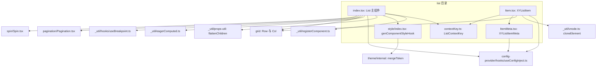
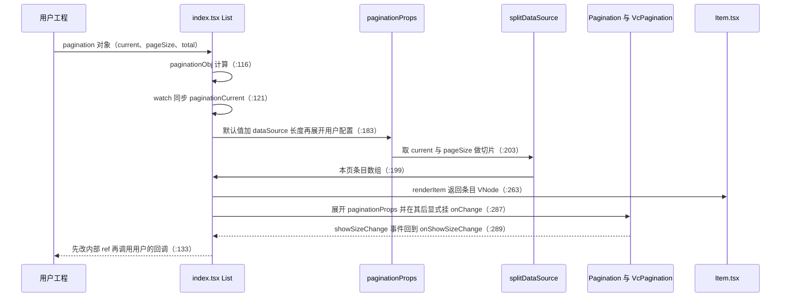
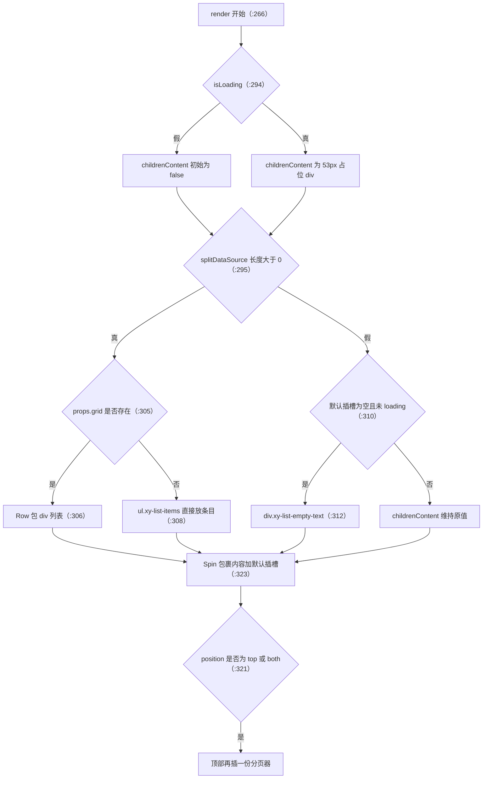
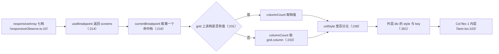

# C08-05 List 列表

> **本篇解决**：`List` 的分页、栅格、加载与空态四套状态分别在哪一行决定结果，以及为什么 `<xy-list>` 上有几个看起来能用的属性（`extra`、`Item.grid`）实际一行代码都没读它。
> **前置**：C08-00 类横写：table / data-table / tree-table 三代表格的分层与选型　**读者坐标**：`03-components/08-table` 第 6/7 篇

## 一、职责与边界

`List` 负责的是**条目流式集合的装配**：把 `dataSource` 与 `renderItem` 组合成条目（`packages/xiaoye-ui/src/list/index.tsx:243`），在外面套一层加载遮罩（`:323`）、页眉页脚（`:322`、`:327`）、加载更多位（`:328`）与可选的客户端分页切片（`:198`），并按断点把条目铺成多列（`:226`）。它明确不负责三件事：条目内部结构（由 `Item`/`ItemMeta` 各自渲染，`packages/xiaoye-ui/src/list/Item.tsx:60`、`packages/xiaoye-ui/src/list/ItemMeta.tsx:30`）、数据获取与分页的服务端语义（它只会把 `dataSource.length` 当总数，`index.tsx:185`）、以及超大列表的窗口化渲染（那是 `vc-virtual-list` 一侧的 `VirtualList`，本目录零引用）。

与同类组件的关系要划清：C08-00 论点 1 已经论证三代表格（`table`、`data-table`、`tree-table`）往下零行共享；`List` 是第四种形态，它连 `table-core` 与 `vc-table` 都不进——`index.tsx:1-32` 的 import 清单里只有 `spin`、`pagination`、`grid` 与 `_util`，没有任何表格内核。也就是说 `List` 的「列」是 CSS 宽度百分比（`:236`）加栅格容器，不是列定义 DSL，改表格的那套心智不要搬到这里。

反向依赖（谁使用 `List`）在本仓是空的：把 `src/list` 聚合入口之外的引用全部列出来，只有包自身的聚合表 `packages/xiaoye-ui/src/components.ts:199`、`:208` 与样式副作用 `:209`；`packages/xiaoye-ui/src/transfer/index.tsx:6` 导入的 `./list` 是 `transfer` 目录自己的 `list.tsx`，与 `src/list` 无关。结论是 `List` 是一个**纯叶子公开组件**：它没有内部复用者替它兜住回归，任何改动的暴露面直接是文档站点与用户工程。

本篇的取证范围（文件级全量，非全目录通读）：

- 主实现：`packages/xiaoye-ui/src/list/index.tsx`、`Item.tsx`、`ItemMeta.tsx`、`contextKey.ts`
- 样式：`packages/xiaoye-ui/src/list/style/index.tsx`
- 测试：`packages/xiaoye-ui/src/list/empty.test.js`、`index.test.js`、`loading.test.js`、`dead-rules.test.tsx`
- 横向对照（只取被引用的行）：`packages/xiaoye-ui/src/spin/Spin.tsx`、`packages/xiaoye-ui/src/pagination/Pagination.tsx`、`packages/xiaoye-ui/src/vc-pagination/Pagination.tsx`、`packages/xiaoye-ui/src/_util/vnode.ts`、`packages/xiaoye-ui/src/_util/responsiveObserve.ts`、`packages/xiaoye-ui/src/_util/eagerComputed.ts`、`packages/xiaoye-ui/src/theme/util/genComponentStyleHook.ts`

## 二、源码地图

| 文件 | 行数 | 职责 | 关键导出与标识 |
| --- | --- | --- | --- |
| `packages/xiaoye-ui/src/list/index.tsx` | 352 | 主组件：分页状态、切片、栅格列宽、空态与装载遮罩装配 | `listProps`（`:55`）、默认值表（`:87`）、`ListContextKey` 的 provide（`:103`）、默认导出（`:347`） |
| `packages/xiaoye-ui/src/list/Item.tsx` | 111 | 条目：extra 与 actions 排布、flex 判定、栅格下换标签与外套 `Col` | `listItemProps`（`:14`）、`XYListItem`（`:25`）、`Meta` 挂载（`:27`） |
| `packages/xiaoye-ui/src/list/ItemMeta.tsx` | 51 | 头像加标题加描述的三段式元信息 | `listItemMetaProps`（`:7`）、`__XY_LIST_ITEM_META`（`:21`） |
| `packages/xiaoye-ui/src/list/contextKey.ts` | 8 | 只有一个 Symbol key 的上下文，携带两个 ref | `ListContextKey`（`:8`）、`ListContext`（`:3`） |
| `packages/xiaoye-ui/src/list/style/index.tsx` | 352 | CSS-in-JS 组件样式与 `ListToken` | `ComponentToken.contentWidth`（`:6`）、`genComponentStyleHook('List', …)`（`:336`） |
| `packages/xiaoye-ui/src/list/index.test.js` | 31 | 挂载测试加一条 locale 断言 | `mountTest(List)`（`:7`）、唯一显式断言（`:28`） |
| `packages/xiaoye-ui/src/list/loading.test.js` | 47 | 三条 loading 断言，覆盖对象形态与自定义指示符 | `.xy-list-empty-text`（`:15`）、`.xy-spin-spinning`（`:27`） |
| `packages/xiaoye-ui/src/list/empty.test.js` | 12 | 只挂载不判断 | 无 `expect`（`:5`） |
| `packages/xiaoye-ui/src/list/dead-rules.test.tsx` | 68 | 2026-09-29 新增的四条死选择器回归 | 根类名 `-empty`（`:43`）、CSS 里无死字面量（`:51`、`:57`） |

主实现入口是 `packages/xiaoye-ui/src/list/index.tsx:82` 的 `defineComponent`；组件名 `XYList`（`:84`）经 `packages/xiaoye-ui/src/_util/registerComponent.ts:6` 的 `toXYTagName` 折算成标签 `xy-list`，安装函数在 `index.tsx:338` 一次注册三个标签（`xy-list`、`xy-list-item`、`xy-list-item-meta`）。

有两处结构细节会在后文反复用到，先登记：

- `index.tsx:86` 的 `Item,` 与 `Item.tsx:27` 的 `Meta: ItemMeta,` **不是** Vue 的 `components` 选项，而是挂在选项对象上的自定义字段，唯一用途是让 `List.Item`（`index.tsx:340`）与 `List.Item.Meta`（`:341`）这两个访问路径成立。
- `index.tsx:83` 与 `Item.tsx:24`、`ItemMeta.tsx:17` 都带 `compatConfig: { MODE: 3 }`，是 Vue 2 兼容层的遗留声明，对本组件行为没有作用。

## 三、架构与数据流

**图 1：静态结构与依赖方向**（谁 import 谁，箭头指向被依赖方）



这张图解释了本篇一半的坑：`List` 与 `Item` 之间**没有 import 关系**（只有 `Item.tsx:11` 反向 `import type { ListGridType } from '.'` 取类型），二者唯一的运行时通道是 `contextKey.ts:8` 那一个 Symbol，携带的也只有 `grid` 与 `itemLayout` 两个 ref（`contextKey.ts:3`）。条目本身则由用户通过 `renderItem` 亲手放进树里（`index.tsx:263`），所以 `List` 拿不到条目的实例，也无法把自身属性下发给条目——这正是 `prefixCls` 断层（坑 2）与 `Item.grid` 失效（论点 1）的共同根因。

**图 2：一次翻页的完整闭环**（props 进入、状态改写、渲染回流）



关键点在倒数第二、三行：`index.tsx:287` 用 `{...paginationProps.value}` 展开用户配置，`onChange` 与 `onShowSizeChange` 写在展开**之后**（`:288`、`:289`），因此外部无法用 `pagination.onChange` 覆盖掉内部处理器——但内部处理器 `index.tsx:132` 又在改完状态后回查 `paginationObj.value[eventName]` 并调用（`:135`），所以用户回调不会丢。这一对「顺序覆盖加回查转发」构成本篇论点 3 的主线。

**图 3：渲染分支决策**（同一次渲染里内容体如何被选中）



图里有两个分支是本篇要单独论证的。其一是 `:294` 的占位：加载中且没有条目时，撑起高度的是一张写死 `minHeight: '53px'` 的内联样式节点，而样式表里为「加载态最小高度」准备的两条 token 规则在修前都挂在永不命中的选择器上（论点 2；2026-09-29 已把选择器接到真实类名，于是内联兜底与 token 规则现在**同时**生效）。其二是 `:310` 的条件把「默认插槽为空」也算了进去：只要用户塞了默认插槽内容，空态文案就永远不出现（`:325` 会把默认插槽与数据条目一起渲染）。同一条判据还被抽成 `isEmpty`（`:273`）贴到根节点类名上，这是 `-empty` 那条 footer 边框规则的唯一入口。

**图 4：栅格列数如何变成宽度**（响应式链路）



`currentBreakpoint` 用 `packages/xiaoye-ui/src/_util/eagerComputed.ts:4` 而不是普通 `computed`，因为 `eagerComputed.ts:11` 以 `flush: 'sync'` 立即求值——窗口尺寸变化时必须同步拿到档名，否则同一次渲染里 `colStyle` 会用到旧档。链路终点是**两层容器**：外层 `div` 拿百分比宽度（`index.tsx:301`），内层是条目自己外套的 `Col`（`Item.tsx:103`），这正是论点 5 的入口。

## 四、核心机制精读

### 论点 1：`List` 的 `extra` 是「prop 与 slot 双声明、零消费」的死入口，`Item` 的 `grid` prop 被同名 inject 永久遮蔽

`index.tsx:55` 的 props 工厂把 `extra` 放在第三个位置声明，`index.tsx:94` 的 slots 声明里又列了一次 `extra`——两处都是公开面的一部分，会被类型系统接受、会被文档站点的属性表读到：

```tsx
// packages/xiaoye-ui/src/list/index.tsx:55
export const listProps = () => ({
  bordered: booleanType(),
  dataSource: arrayType(),
  extra: vNodeType(),
  grid: objectType<ListGridType>(),
  itemLayout: String as PropType<ListItemLayout>,
  loading: someType<boolean | (SpinProps & HTMLAttributes)>([Boolean, Object]),
  loadMore: vNodeType(),
```

```tsx
// packages/xiaoye-ui/src/list/index.tsx:94
  slots: Object as CustomSlotsType<{
    extra: any;
    loadMore: any;
    renderItem: { item: any; index: number };
    header: any;
    footer: any;
    default: any;
  }>,
```

但渲染函数体只读另外四个同族入口，`extra` 一次都没出现：

```tsx
// packages/xiaoye-ui/src/list/index.tsx:266
    return () => {
      const loadMore = props.loadMore ?? slots.loadMore?.();
      const footer = props.footer ?? slots.footer?.();
      const header = props.header ?? slots.header?.();
      const children = flattenChildren(slots.default?.());
      const isSomethingAfterLastItem = !!(loadMore || props.pagination || footer);
```

负面结论按纪律要用第二种方法交叉验证，两条命令的实测结果如下（第一条只命中 `:58` 与 `:95` 两个声明处，第二条在 `Item.tsx` 上零命中）：

```bash
grep -n "extra" packages/xiaoye-ui/src/list/index.tsx
grep -n "props\.grid" packages/xiaoye-ui/src/list/Item.tsx
grep -rn "props\.extra" packages/xiaoye-ui/src/list/
```

第三条只返回 `packages/xiaoye-ui/src/list/Item.tsx:53` 与 `packages/xiaoye-ui/src/list/Item.tsx:63` 两行，也就是说**整个目录里只有条目侧的 `extra` 真的被消费**。于是 `<xy-list extra="...">`、`<template #extra>` 这两种写法都不报错、不告警、不渲染，而 `loadMore`、`header`、`footer` 走的是同一套「prop 优先回落 slot」的写法（`:267`、`:268`、`:269`），唯一漏掉消费点的就是 `extra`。这不是类型层面的问题：`index.tsx:94-101` 的 slot 声明会让 `GlobalComponents` 层面认为它合法，所以IDE 也不会提示。

`Item.tsx` 上还有一个更隐蔽的同类问题——声明与读取用了**同名不同源**的两个变量。props 里明确列了 `grid`：

```tsx
// packages/xiaoye-ui/src/list/Item.tsx:14
export const listItemProps = () => ({
  prefixCls: String,
  extra: PropTypes.any,
  actions: withUndefined(PropTypes.array),
  grid: Object as PropType<ListGridType>,
  colStyle: { type: Object as PropType<CSSProperties>, default: undefined as CSSProperties },
});
```

> 注：`actions` 一行在 2026-10-02 之前写作裸 `PropTypes.array`——vue-types 对未传的数组 prop 会解析成 `[]`，`Item.tsx:65` 的 `props.actions ?? slots.actions` 左侧恒有值，`#actions` 插槽全库失效。现已包上 `withUndefined` 恢复「未传即 `undefined`」语义，与上文「回落分支确实可达」的结论一致。

而渲染里判断是否换标签、是否外套 `Col` 用的是注入值：

```tsx
// packages/xiaoye-ui/src/list/Item.tsx:102
      return grid.value ? (
        <Col flex={1} style={props.colStyle}>
          {itemChildren}
        </Col>
      ) : (
        itemChildren
      );
```

`grid.value`（`:102`、以及 `:77` 的 `const Element = grid.value ? 'div' : 'li'`）来自 `Item.tsx:35` 的 `inject(ListContextKey, { grid: ref(), itemLayout: ref() })`，与 `props.grid` 没有任何赋值关系。结论：给单个 `<xy-list-item>` 传 `grid` 完全不改变结构；条目的栅格行为**只能**通过父级 `List` 的 `grid` 属性经 `packages/xiaoye-ui/src/list/contextKey.ts:8` 那个 Symbol 传下来。`Item.tsx:19` 的 `colStyle` 也是同一族：它确实被读（`:103`），但 `List` 在栅格分支里把列宽挂在了自己新建的外层 `div` 上（`index.tsx:297`），从不往条目上传 `colStyle`，因此这条 prop 在正常用法下恒为 `undefined`。

对照组在同目录里就有：`ItemMeta.tsx:32`、`:33`、`:34` 三行把 `title`、`description`、`avatar` 三个 prop 全部落到 slot 回落上，`Item.tsx:65` 的 `actions` 同样有读取点。也就是说这个目录里「prop 加 slot 双入口」的写法只漏了一处，属于可定位的个别缺失，而非全组件的风格。

### 论点 2：空态与加载态有四条规则挂在代码从不生成的类名上，唯一活着的高度是组件里写死的 53px

> **2026-09-29 已修**（处置细节见 §七 坑 8 顶部的说明）：三条错位选择器已指向真实类名（`style/index.tsx:147`、`:311`、`:80`），根节点开始生成 `-empty`（`index.tsx:278`）使 `:308` 那条 footer 边框规则可达，与 `-empty-text` 值冲突的旧 `.xy-list-empty` 块删除；`ListToken.minHeight` 从此有了活着的消费点（`:148`）。本节下面的取证描述的是**修复前**状态，修前/修后的行号与文本都各给一份，因为「53px 内联兜底 vs 死掉的 token 高度」这层论证正是当时看不出异常的原因。

先把两边集合摆出来。组件实际生成的类名后缀修前只有这些：根级 `classObj`（`index.tsx:171-180`）产出 `-vertical`、`-sm`/`-lg`、`-split`、`-bordered`、`-loading`、`-grid`、`-rtl`，渲染时补 `-something-after-last-item`（`:279`）、`-pagination`（`:285`）、`-header`（`:322`）、`-footer`（`:327`）、`-items`（`:308`）、`-empty-text`（`:312`）；条目级在 `Item.tsx:68`、`:72`、`:91`、`:95` 产出 `-item-action`、`-item-action-split`、`-item-main`、`-item-extra`。里面**没有** `-empty`、没有 `-spin`、也没有 `-action`——修后只有 `-empty` 补上了生成点（`:278`，判据是抽出来的 `isEmpty`，见 `:273`），另两个至今不存在，因为样式端改指向了 `Spin` 与条目的真实类名。

样式表修前却为它们准备了规则：

```tsx
// 修复前快照（旧 style/index.tsx:145），该段现已改写
      [`${componentCls}-spin`]: {
        minHeight,
        textAlign: 'center',
      },
```

`componentCls` 是 `.xy-list`，且这一段嵌在 `[${componentCls}]`（`:126`）里，编译结果是后代选择器 `.xy-list .xy-list-spin`。加载容器实际由 `Spin` 渲染，`packages/xiaoye-ui/src/spin/Spin.tsx:42` 用的是 `useConfigInject('spin', props)`，因此容器类名是 `xy-spin-nested-loading`（`packages/xiaoye-ui/src/spin/Spin.tsx:127`），内容容器是 `xy-spin-container`（`packages/xiaoye-ui/src/spin/Spin.tsx:123`）。同一文件的另外两条正好证明这不是我的读法差异，而是选择器本身错位——修后这一段长这样：

```tsx
// packages/xiaoye-ui/src/list/style/index.tsx:308
    [`${componentCls}-split${componentCls}-empty ${componentCls}-footer`]: {
      borderTop: `${token.lineWidth}px ${token.lineType} ${token.colorSplit}`,
    },
    [`${componentCls}-loading ${rootCls}-spin-nested-loading`]: {
      minHeight: controlHeight,
    },
    [`${componentCls}-split${componentCls}-something-after-last-item ${rootCls}-spin-container > ${componentCls}-items > ${componentCls}-item:last-child`]:
      {
        borderBlockEnd: `${token.lineWidth}px ${token.lineType} ${token.colorSplit}`,
      },
```

`:314` 这条用的是 `${rootCls}-spin-container`，而 `rootCls` 由 `packages/xiaoye-ui/src/theme/util/genComponentStyleHook.ts:96` 注入为 `.${rootPrefixCls}` 即 `.xy`，拼出 `.xy-spin-container`——完全正确。紧挨着的 `:311` 修前却把 `spin-nested-loading` 拼在 `componentCls` 上（旧文本 `${componentCls}-loading ${componentCls}-spin-nested-loading`，旧行号 `:312`），得到 `.xy-list-loading .xy-list-spin-nested-loading`，这条规则当时永远不会命中。同族的还有空态：修前 `:235` 的 `.xy-list .xy-list-empty`（`padding: ${padding}px 0`、`fontSizeSM`、`colorTextDescription`）没有命中者，真正生效的是下一条（旧 `:242`，现 `:241`）的 `.xy-list .xy-list-empty-text`（`padding` 单值、`colorTextDisabled`、`fontSize`），两条规则声明的并不是同一套值，所以「空态字号比预期大一号、颜色是 disabled 灰」这类观感差异的源头是选择器改写而非 token 调整——这也是本轮选择**删掉**旧 `-empty` 块而不是留下它的理由：根节点一旦带上 `-empty`，两条规则的 padding 会叠成双份。至于 `:308`，它要求根节点同时带 `-empty`，修前没有任何生成点，空数据带 `footer` 的场景里 footer 的上边框整条丢失；修后 `index.tsx:278` 补上了这个类名，该规则才第一次生效。

媒体查询里还有一条同族错位：

```tsx
// 修复前快照（style/index.tsx 的 screenSM 媒体块，旧 :75 起），其中 -action 一行现已改写
    [`@media screen and (max-width: ${screenSM})`]: {
      [`${componentCls}`]: {
        [`${componentCls}-item`]: {
          flexWrap: 'wrap',

          [`${componentCls}-action`]: {
            marginInlineStart: marginSM,
          },
        },
      },
```

修前那行 `-action` 拼出来是 `.xy-list-action`，条目侧真实类名是 `Item.tsx:68` 的 `xy-list-item-action`——同一段里 `:60`（`genResponsiveStyle` 第一条媒体查询内的 `-item-action`）用的就是正确写法，两处写法不一致。后果是窄屏下 actions 与主内容之间的 `marginInlineStart` 只在大屏生效，缩到 `screenSM` 以下时反而丢掉间距（`:61` 那条只在 `max-width: screenMD` 的分支里，旧 `:80` 这条命中不了，两者不是同一档）。修后该行已改成 `-item-action` 拼接（现 `:80`），与 `:60` 对齐；同文件 `-item-action` 的选择器现在共 6 处（`:60`、`:80`、`:204`、`:225`、`:283`、`:327`）。

`ListToken.minHeight` 的命运把这条证据链闭合：它在 `packages/xiaoye-ui/src/list/style/index.tsx:12` 声明、`:341` 由 `token.controlHeightLG` 赋值、`:109` 解构出来，修前唯一消费点是旧 `:146`——也就是死选择器里的那条 `minHeight`。于是加载态的「最小高度」这件事在样式层没有任何生效实现，真正撑着的是主实现里的内联样式：

```tsx
// packages/xiaoye-ui/src/list/index.tsx:294
      let childrenContent = isLoading.value && <div style={{ minHeight: '53px' }} />;
      if (splitDataSource.value.length > 0) {
```

`53px` 是硬编码字面量，既不来自 `controlHeightLG`（`:341` 的 token 值），也不来自 `controlHeight`（`:312` 那条规则引用的值），改主题高度刻度时这里不会跟着变。修后两条通路**同时**生效：内联的 53px 占位节点仍在，而 `:147`/`:311` 给 `xy-spin-nested-loading` 容器加上了 `minHeight`/`controlHeight`，所以加载态的高度现在由「容器最小高度」与「占位 div 高度」取大者决定——这正是本轮改动唯一的可见副作用，也是必须连同 `dead-rules.test.tsx` 一起 review 的原因。附带一个分支事实：`isLoading.value` 为假时 `childrenContent` 初值是 `false`（`:294` 的短路结果），若此时 `splitDataSource` 为空且默认插槽非空，`:310` 的条件不成立，内容体就一直是 `false`，只剩默认插槽被 `:325` 渲染进 `Spin`——这正是「`dataSource` 空但有默认插槽内容时空态文案不出现」的机制，而根节点的 `-empty`（`:278`）用的是同一条判据，所以那种场景下 footer 上边框同样不出现。

### 论点 3：分页有两套互不相干的控制路径——内部 ref 加 watch 与对象展开顺序，受控时前者退化为只写状态

`index.tsx:107` 先立了一个常量，`index.tsx:116` 起立了两个 ref，`index.tsx:121` 又加了一个 watch；到了 `index.tsx:182` 再用一次对象展开把这三者的产物**重新覆盖掉**：

```ts
// packages/xiaoye-ui/src/list/index.tsx:107
    const defaultPaginationProps = {
      current: 1,
      total: 0,
    };
    const { prefixCls, direction, renderEmpty } = useConfigInject('list', props);

    // Style
    const [wrapSSR, hashId] = useStyle(prefixCls);

    const paginationObj = computed(() =>
      props.pagination && typeof props.pagination === 'object' ? props.pagination : {},
    );
    const paginationCurrent = ref(paginationObj.value.defaultCurrent ?? 1);
    const paginationSize = ref(paginationObj.value.defaultPageSize ?? 10);
    watch(paginationObj, () => {
      if ('current' in paginationObj.value) {
        paginationCurrent.value = paginationObj.value.current;
      }
      if ('pageSize' in paginationObj.value) {
        paginationSize.value = paginationObj.value.pageSize;
      }
    });
```

```ts
// packages/xiaoye-ui/src/list/index.tsx:182
    const paginationProps = computed(() => {
      const pp = {
        ...defaultPaginationProps,
        total: props.dataSource.length,
        current: paginationCurrent.value,
        pageSize: paginationSize.value,
        ...((props.pagination as PaginationConfig) || {}),
      };

      const largestPage = Math.ceil(pp.total / pp.pageSize);
      if (pp.current > largestPage) {
        pp.current = largestPage;
      }
      return pp;
    });
```

三个事实按字面顺序成立，不需要运行时观察：

1. `defaultPaginationProps`（`:107`）的两个键 `current: 1`、`total: 0` 在 `:184` 展开后，立刻被 `:185` 的 `total` 与 `:186` 的 `current` 无条件覆写。它既不提供默认值也不提供回落，是一个纯死常量——删掉 `:107-110` 与 `:184` 这一行，`paginationProps` 的结果逐键相同。
2. 受控用法下（用户给了 `pagination.current`），`paginationCurrent.value` 的唯一读取点是 `:186`，而它在同一对象字面量里被 `:188` 的展开覆盖。于是 `:119` 的 ref 与 `:121` watch 里的写入（`:123`）在受控路径上不产生任何可见结果，只留下 `:133` 的赋值动作。
3. `:121` 的 watch 依赖粒度停在 `props.pagination` 这一层引用上（`:116` 的计算体只读 `props.pagination` 本身，不读它的字段），所以**就地改写** `pagination.current` 而不更换对象引用时，watch 回调根本不触发。这一点在受控用法里不致命——覆盖链（事实 2）让显示与切片仍然跟随用户的值；但它意味着 `paginationCurrent` 与用户值之间不存在同步保证，只存在覆盖顺序巧合。

`defaultCurrent` 与 `defaultPageSize` 的读取（`:119`、`:120`）依赖 `pagination` 对象上的这两个键，它们确实是 `PaginationConfig` 的成员（`packages/xiaoye-ui/src/pagination/Pagination.tsx:23` 声明 `defaultCurrent: Number`）。同一份 `defaultCurrent` 还会随 `:188` 的展开继续下传给分页器，由 `pagination` 自己再初始化一次内部状态——即同一个默认值有两个互不通告的消费者，`List` 侧的 `paginationCurrent` 与 `VcPagination` 侧的当前页各算各的。

真正把两条路径焊在一起的是渲染末尾的**属性书写顺序**：

```tsx
// packages/xiaoye-ui/src/list/index.tsx:284
      const paginationContent = props.pagination ? (
        <div class={`${prefixCls.value}-pagination`}>
          <Pagination
            {...paginationProps.value}
            onChange={onPaginationChange}
            onShowSizeChange={onPaginationShowSizeChange}
          />
        </div>
      ) : null;
```

`onChange`、`onShowSizeChange` 写在 `{...paginationProps.value}` **之后**（`:288`、`:289`），因此用户塞在 `pagination` 对象里的同名回调无法覆盖内部处理器——这与 DISPATCH 里 `useMessage.tsx:159` 与 `useNotification.tsx:101` 的对照属同一族，只是这里选的是「不可覆盖」的方向。用户的回调没有丢，因为内部处理器做了回查转发：

```ts
// packages/xiaoye-ui/src/list/index.tsx:132
    const triggerPaginationEvent = (eventName: string) => (page: number, pageSize: number) => {
      paginationCurrent.value = page;
      paginationSize.value = pageSize;
      if (paginationObj.value[eventName]) {
        paginationObj.value[eventName](page, pageSize);
      }
    };

    const onPaginationChange = triggerPaginationEvent('onChange');

    const onPaginationShowSizeChange = triggerPaginationEvent('onShowSizeChange');
```

这里的键名 `onShowSizeChange` 与底层事件的对应关系是隐式的，而且**不是** Vue 的事件机制在起作用：`packages/xiaoye-ui/src/vc-pagination/Pagination.tsx:227` 调的是本仓自建的 `__emit`，它在 `packages/xiaoye-ui/src/_util/BaseMixin.ts:32` 把事件名首字母大写并加 `on` 前缀（`showSizeChange` 变 `onShowSizeChange`），再去 `$props` 或 `$attrs` 里取函数直接调用（`packages/xiaoye-ui/src/_util/BaseMixin.ts:33`）。因此这条链路能通，靠的是「函数名转换规则」与「`List` 侧恰好按同样的驼峰键回查」（`index.tsx:135`）两处独立约定刚好一致；`List` 的 `pagination` 对象经 `packages/xiaoye-ui/src/pagination/Pagination.tsx` 的 `restProps` 展开原样透传到厂商层，中间没有任何 `emits` 校验——外层 `packages/xiaoye-ui/src/pagination/Pagination.tsx:85` 的 `emits` 数组是**被注释掉的**，声明与触发之间没有契约约束，只靠 `:53` 的 prop 声明成立。

结论回到机制：`List` 没有使用本仓统一的受控状态工具 `packages/xiaoye-ui/src/_util/hooks/useMergedState.ts`（`grep -rln -e useMergedState packages/xiaoye-ui/src --include='*.ts' --include='*.tsx'` 计数得 17 个文件），而是在组件内部手写了一套「ref 兜非受控、展开兜受控」的双轨。代价是上面这三条只有读源码才能发现的空转。

### 论点 4：`rowKey` 算出来的键只在栅格分支被消费；`listItemsKeys` 是渲染期写入的普通数组，不是响应式状态

`renderInnerItem` 为每一条数据算 key，然后写进 `listItemsKeys`：

```tsx
// packages/xiaoye-ui/src/list/index.tsx:243
    const renderInnerItem = (item: any, index: number) => {
      const renderItem = props.renderItem ?? slots.renderItem;
      if (!renderItem) return null;

      let key;
      const rowKeyType = typeof props.rowKey;
      if (rowKeyType === 'function') {
        key = (props.rowKey as any)(item);
      } else if (rowKeyType === 'string' || rowKeyType === 'number') {
        key = item[props.rowKey as any];
      } else {
        key = item.key;
      }

      if (!key) {
        key = `list-item-${index}`;
      }

      listItemsKeys[index] = key;

      return renderItem({ item, index });
    };
```

取键优先级链完整：函数 `rowKey`（`:250`）→ 字符串或数字作为字段名（`:252`）→ 数据自带的 `item.key`（`:254`）→ 索引兜底（`:258`）。兜底用 `if (!key)`（`:257`），判据是**假值**而不是 `undefined`，因此 `rowKey="id"` 遇上 `id === 0` 或 `id === ''` 时会被替换成 `list-item-<index>`，键与业务主键脱钩。而 `:263` 返回的是 `renderItem({ item, index })` 的原始结果——计算出来的 `key` 从未被贴到返回的 VNode 上，只进了 `:261` 那个数组。

写完之后，这个数组只在栅格分支被读：

```tsx
// packages/xiaoye-ui/src/list/index.tsx:295
      if (splitDataSource.value.length > 0) {
        listItemsKeys.length = 0;
        const items = splitDataSource.value.map((item: any, index: number) =>
          renderInnerItem(item, index),
        );
        const childrenList = items.map((child: any, index) => (
          <div key={listItemsKeys[index]} style={colStyle.value}>
            {child}
          </div>
        ));
        childrenContent = props.grid ? (
          <Row gutter={props.grid.gutter}>{childrenList}</Row>
        ) : (
          <ul class={`${prefixCls.value}-items`}>{items}</ul>
        );
```

非栅格分支（`:308`）直接把 `items` 塞进 `<ul>`，`childrenList` 整个白算一遍：此时参与 Vue 列表 diff 的键是用户 `renderItem` 返回值自带的 `key`，`rowKey` 与 `listItemsKeys` 都不起作用。也就是说 `index.tsx:65` 声明的 `rowKey`（文档 `apps/docs/components/list.md:74` 描述为「各项 key 的取值」）在**默认形态下不产生任何 DOM 或 diff 层面的效果**，只有开了 `grid` 才生效——而栅格形态下它绑的是 `List` 自己新建的那层 `<div>`（`:301`），不是条目的 key。

`listItemsKeys` 本身的性质也值得记一笔：`index.tsx:130` 声明为 `const listItemsKeys: Key[] = []`，普通数组，没有 `ref`；写入发生在 `:261`（渲染函数调用链内部），清空发生在 `:296`，读取在 `:301`。它靠「同一轮渲染里 `:297` 的 map 先跑完，`:300` 的 map 才能按下标取到值」这一执行顺序成立，而不是靠响应式。任何后续改动把这两个 map 拆开成异步、或把 `renderInnerItem` 挪到 `watch` 里预算，就会静默读到 `undefined` 键，且没有任何类型或运行时报错。

### 论点 5：栅格形态的列宽由 `List` 新建的外层 `div` 承担，条目的 `Col` 只是 `flex: 1 1 auto` 的空壳，样式表为此写了反向适配选择器

上下文通道只有两个键，且都用 `toRef` 保持响应：

```tsx
// packages/xiaoye-ui/src/list/index.tsx:102
  setup(props, { slots, attrs }) {
    provide(ListContextKey, {
      grid: toRef(props, 'grid'),
      itemLayout: toRef(props, 'itemLayout'),
    });
    const defaultPaginationProps = {
```

列宽在 `List` 侧算：

```ts
// packages/xiaoye-ui/src/list/index.tsx:226
    const colStyle = computed(() => {
      if (!props.grid) {
        return undefined;
      }
      const columnCount =
        currentBreakpoint.value && props.grid[currentBreakpoint.value]
          ? props.grid[currentBreakpoint.value]
          : props.grid.column;
      if (columnCount) {
        return {
          width: `${100 / columnCount}%`,
          maxWidth: `${100 / columnCount}%`,
        };
      }
      return undefined;
    });
```

`:231` 的取值是「当前断点档优先，回落 `grid.column`」，而档名来自 `index.tsx:216` 的循环——`packages/xiaoye-ui/src/_util/responsiveObserve.ts:10` 的 `responsiveArray` 是 `['xxxl','xxl','xl','lg','md','sm','xs']`，从最宽档往窄档找第一个命中项，命中即返回（`:221`）。于是 `ListGridType`（`index.tsx:40-50`）声明的七个键确实全部可达，包括 `xxxl`（`index.tsx:49`）——这与本篇论点 1 那两处死 API 形成对照：同一份 props 工厂里，`grid` 的子键是**活**的。真值判断也留下一个边界：`if (columnCount)`（`:234`）与 `:231` 的 `&&` 都是假值判据，`grid: { column: 0 }` 会让 `colStyle` 返回 `undefined`（`:240`），即不套宽度而不是一列零宽。

`colStyle` 与 `key` 一起贴到 `List` 自己造的 `div` 上（`index.tsx:301`），这个 `div` 又被塞进 `Row`（`:306`）。条目内部则无条件外套一层 `Col`：

```tsx
// packages/xiaoye-ui/src/list/Item.tsx:102
      return grid.value ? (
        <Col flex={1} style={props.colStyle}>
          {itemChildren}
        </Col>
      ) : (
        itemChildren
      );
```

`grid/Col.tsx:21` 的 `parseFlex` 对数字 `1` 产出字符串 `1 1 auto`（`:22`），并在 `grid/Col.tsx:137` 写成 `style.flex`。因此栅格形态的真实 DOM 链是 `.xy-row > div(width:%) > .xy-col(flex:1 1 auto) > .xy-list-item`：约束宽度的是中间那个 `div`，`Col` 只负责在 `div` 内部填满。`List` 从不向条目传 `colStyle`（见论点 1），所以 `Item.tsx:103` 的 `style` 在该链路里恒为 `undefined`，两层容器里只有一层真正参与布局计算。

样式表按这条链做了适配：

```tsx
// packages/xiaoye-ui/src/list/style/index.tsx:253
    [`${componentCls}-grid ${rootCls}-col > ${componentCls}-item`]: {
      display: 'block',
      maxWidth: '100%',
      marginBlockEnd: margin,
      paddingBlock: 0,
      borderBlockEnd: 'none',
    },
```

这里同时解释了两件事：其一，栅格下条目从 flex 行（`:159` 的 `display: 'flex'`）改回 `display: block`（`:254`），因为多列布局里每个格子自己就是容器；其二，`:258` 显式把 `borderBlockEnd` 关掉，用来压过 `:297` 的 `.xy-list-split .xy-list-item` 分隔线规则——选择器多一个 `.xy-col`（三段 vs 两段）所以优先级更高，栅格列表默认没有条目底边线，行距改由 `marginBlockEnd: margin`（`:256`）提供。`gutter` 的唯一入口是 `index.tsx:306` 的 `<Row gutter={props.grid.gutter}>`，`List` 自己不读 `gutter` 键；`Row` 在 `packages/xiaoye-ui/src/grid/Row.tsx:123` 归一化后经上下文下发，`Col` 用 `useInjectRow()` 取回（`packages/xiaoye-ui/src/grid/Col.tsx:75`）并把水平 gutter 的一半写成内边距（`packages/xiaoye-ui/src/grid/Col.tsx:123` 的注释即为 Horizontal gutter use padding，取值在 `:124`）。由于中间那层 `div` 不带任何 gutter 逻辑，格子之间的可见间隙完全来自 `Col` 的内边距。

### 论点 6：条目是否走 flex 由一次「文本节点扫描」决定，而水平形态的 `extra` 会被 `cloneElement` 截成单个节点

`Item.tsx` 的 flex 判定分两条完全不同的路径：

```tsx
// packages/xiaoye-ui/src/list/Item.tsx:41
    const isItemContainsTextNodeAndNotSingular = () => {
      const children = slots.default?.() || [];
      let result;
      children.forEach(element => {
        if (isStringElement(element) && !isEmptyElement(element)) {
          result = true;
        }
      });
      return result && children.length > 1;
    };

    const isFlexMode = () => {
      const extra = props.extra ?? slots.extra?.();
      if (itemLayout.value === 'vertical') {
        return !!extra;
      }
      return !isItemContainsTextNodeAndNotSingular();
    };
```

`:44` 的循环只把 `result` 往 `true` 方向写、从不写回 `false`，所以它实际含义是「存在非空文本节点」；名字里的 "NotSingular" 由 `:49` 的 `children.length > 1` 在末尾补上。结论是水平布局下：**默认插槽里有多个节点且其中含文本**时条目被判定为非 flex，加上 `Item.tsx:84` 的 `-item-no-flex` 类，样式表把它改回 `display: block`（`packages/xiaoye-ui/src/list/style/index.tsx:250`），并在 `:326-332` 让 actions 用 `float: right` 定位。而垂直布局的判定只看 `extra` 是否存在（`:54-56`），完全不看文本——同一个 `itemLayout` 开关切换的是两套判定函数，这是「条目里加了文字后 actions 位置突然变浮动」这类观感问题的源头。

`extra` 的两条渲染分支不对称，是本篇最直接的实现缺陷：

```tsx
// packages/xiaoye-ui/src/list/Item.tsx:89
          {itemLayout.value === 'vertical' && extra
            ? [
                <div class={`${pre}-item-main`} key="content">
                  {children}
                  {actionsContent}
                </div>,
                <div class={`${pre}-item-extra`} key="extra">
                  {extra}
                </div>,
              ]
            : [children, actionsContent, cloneElement(extra, { key: 'extra' })]}
```

垂直分支把 `extra` 原样放进 `div`（`:96`），多节点全部保留；水平分支（`:99`）交给 `cloneElement`，而它对数组只取第一个非空元素：

```ts
// packages/xiaoye-ui/src/_util/vnode.ts:15
  let ele = vnode;
  if (Array.isArray(vnode)) {
    ele = filterEmpty(vnode)[0];
  }
  if (!ele) {
    return null;
  }
```

`packages/xiaoye-ui/src/_util/vnode.ts:17` 的下标 `[0]` 意味着：水平布局下用 `<template #extra>` 写两个并列元素（例如一个按钮加一个标签），第二个会被静默丢弃；换成 `extra` prop 传数组是同样结果。而 `:99` 传 `{ key: 'extra' }` 且 `cloneElement` 的 `override` 默认为 `true`（`packages/xiaoye-ui/src/_util/vnode.ts:12`），覆盖式合并发生在 `packages/xiaoye-ui/src/_util/vnode.ts:24`，所以条目里 extra 节点自带的 `key` 一定被改写成 `'extra'`。

与可访问性相关的一处也落在这个文件里：`packages/xiaoye-ui/src/list/style/index.tsx:129` 给根节点下所有后代无条件设 `outline: 'none'`，而 `packages/xiaoye-ui/src/list/style/index.tsx:4` 只从 `../../style` 引入了 `resetComponent`，没有引入本仓用于焦点环的 `genFocusStyle`（`packages/xiaoye-ui/src/style/index.ts` 提供，`button`、`tabs`、`pagination`、`breadcrumb` 等组件的样式文件都引入了它）。结果是条目内的裸链接没有 `List` 侧的焦点样式，`packages/xiaoye-ui/src/list/style/index.tsx:187` 为标题链接准备的规则只有 `color`、`transition` 与 `:hover`（`:189`），没有 `:focus-visible` 分支；自带焦点环的子组件（按钮、分页器）只因其自身样式表里有规则才仍然可见。

## 五、对外契约如何生效

**默认值如何落地。** `index.tsx:87` 的 `initDefaultProps(listProps(), {…})` 把五个键写进 props 定义：`dataSource: []`、`bordered: false`、`split: true`、`loading: false`、`pagination: false`。走的是 `packages/xiaoye-ui/src/_util/props-util/initDefaultProps.ts:20` 这条分支——因为 `listProps()` 产出的每个成员都带 `type`（`booleanType` 见 `packages/xiaoye-ui/src/_util/type.ts:59`，`someType` 见 `:92`），所以命中 `prop.default = defaultProps[k]`（`:21`）而不是 `:25` 的 `{ type: prop, default: … }` 重建。`dataSource` 的默认值是**一个数组字面量而非工厂函数**，同一个引用被所有未传 `dataSource` 的实例共享；组件没被这个共享引用坑到，靠的是读取侧每次都拷贝（`packages/xiaoye-ui/src/list/index.tsx:199` 的 `let dd = [...props.dataSource]`）与只读长度（`:185`）。

**prop 与 slot 的优先级。** 六个双入口全部写成 `props.x ?? slots.x?.()`：`renderItem`（`:244`）、`loadMore`/`footer`/`header`（`:267`、`:268`、`:269`）、条目的 `extra`（`Item.tsx:53`、`Item.tsx:63`）与 `actions`（`Item.tsx:65`）。这些 prop 都没有默认值——`vNodeType()` 在 `packages/xiaoye-ui/src/_util/type.ts:79` 只返回一个恒真 validator，`functionType`（`:62`）与 `PropTypes.any` 在这里也都没带 default——所以回落分支确实可达。本篇把目录里 9 处兜底（`index.tsx:119`、`:120`、`:188`、`:244`、`:267`、`:268`、`:269`、`:313`、`:318`）逐条对着默认值核过，**没有**命中「默认值使兜底分支恒不可达」那一族缺陷；`List` 在这条纪律上是干净的，它的死 API 是另一种形态（声明了却无人读取，见论点 1）。

**上下文只带两个键。** `index.tsx:103` 的 `provide` 只塞 `grid` 与 `itemLayout`（`contextKey.ts:3-6`），条目自己再走 `useConfigInject('list', props)`（`Item.tsx:39`），而该 hook 的前缀计算在 `packages/xiaoye-ui/src/config-provider/hooks/useConfigInject.ts:14`——`configProvider.getPrefixCls(name, props.prefixCls)`，取的是**条目自己的** `prefixCls` prop。因此「父组件改前缀、子组件跟着改」这件事在 `List` 与 `Item` 之间不成立（坑 2）。

**attrs 的三处手工落点。** `index.tsx:85`、`Item.tsx:26` 都设了 `inheritAttrs: false`，靠手工展开回填。`List` 的写法是 `{...attrs}` 在前、`class={classString}` 在后（`index.tsx:320`、`:321`），能这么写是因为 `classString` 自己已经把 `attrs.class` 并进去了（`:281`）；`Item` 则先把 class 解构摘出（`Item.tsx:61`），把 `restAttrs` 挂到条目元素（`:80`）、再把 className 合并进 class（`:87`）。两者的差别在栅格形态下会显形：条目上写的 `style` 落在内层 `div`，而外层 `Col` 的 style 只认 `props.colStyle`（`Item.tsx:103`），也就是 `List` 从不填充的那一个。

**事件与 expose 都是空的。** `grep -rn "emits" packages/xiaoye-ui/src/list/` 与 `grep -rn "expose" packages/xiaoye-ui/src/list/` 都零命中：`List` 不声明事件、也不 `expose` 任何方法，`setup(props, { slots, attrs })`（`index.tsx:102`）连 `emit` 都没取。所有对外回调只可能来自 attrs 透传（`:320`）与分页配置的键名回查（`:135`）。这意味着模板上写 `@click="…"` 会被当作 `attrs` 里的 `onClick` 落到根 `div`（`:320`），而不是条目上——条目级交互必须由用户在 `renderItem` 里自己绑。

**空态文案的本地化通道只有一条半。** `index.tsx:313` 的一行是「`props.locale?.emptyText` 回落 `renderEmpty('List')`」：`locale` 是 props（`:71`，类型 `ListLocale` 见 `:74`），`renderEmpty` 来自 `useConfigInject`（`:111`）。这个目录里没有任何 `useLocaleReceiver` 调用（`grep -rn "useLocaleReceiver" packages/xiaoye-ui/src/list/` 零命中），而语言包根本没有 `List` 段（`packages/xiaoye-ui/src/locale/en_US.ts:10-37` 只有 `Pagination`、`global`、`Table`、`Tour` 这些键，`Table` 段里才有 `emptyText`）。所以切换 `ConfigProvider` 的 locale 不会改变 `List` 的空态文案，能改变它的只有 `locale` prop 或 `ConfigProvider.renderEmpty`——后者的实现是 `packages/xiaoye-ui/src/config-provider/renderEmpty.tsx` 里按组件名分支，`'List'` 是与 `'Table'` 并列的硬编码 case（`packages/xiaoye-ui/src/config-provider/renderEmpty.tsx:14`），命中它才用简版空图（`:15`）。这个字符串与 `index.tsx:313` 是两个文件之间唯一的契约，改任意一边都会静默降级到 `default` 分支（`:23`）。

**包级出口。** 聚合入口三段式在 `packages/xiaoye-ui/src/components.ts:199`（星号再导出）、`:208`（默认导出改名 `List`）、`:209`（样式副作用 `import './list/style'`）；`index.tsx:338` 的 `install` 用 `packages/xiaoye-ui/src/_util/registerComponent.ts:16` 注册三个标签，重复注册由 `:23` 的 `if (!app.component(tagName))` 拦住。`List` 还在类型层面导出 `ListItemProps` 与 `ListItemMetaProps`（`index.tsx:34`、`:35`），这两个名字由 `pnpm gen:entries` 生成的表决定归属，手工挪动会牵动包根导出面。

## 六、设计取舍

**分页：组件内切片 vs 交还调用方。** `index.tsx:198` 选择自己切 `dataSource`，换来的是「`pagination: true` 一个布尔就能翻页」这种低成本用法（`:200` 的真值判据同时接受布尔与对象）。赔上的代价有两处：一是总数默认取自 `dataSource.length`（`:185`），服务端分页必须显式传 `total`，否则 `:191` 的夹页会把当前页钉回第一页；二是「客户端还是服务端」这个信息不是声明出来的，而是由 `:201` 那条长度比较**猜**出来的——当页数据条数小于等于偏移量时走 `else`（不切），这正是服务端分页唯一能绕过二次切片的通道。一个更干净的方案是加一个显式的 `serverSide` 开关或用 `useMergedState` 接管当前页，但那会改公开面，本仓至今没付这个成本。

**受控状态：自研双轨 vs `useMergedState`。** 见论点 3。选前者的实际收益是不引入 `v-model:current` 之类新 API，且 `pagination` 对象原样透传给分页器（`:287`）；代价是 `paginationCurrent` 在受控路径上退化为只写字段（`:186` 被 `:188` 覆盖）、`watch` 的依赖粒度只到对象引用（`:116`），两处空转都需要读源码才能发现，`grep` 与 `typecheck` 都不报。

**栅格：多插一层 `div` vs 让条目直接当列。** `List` 在 `Row` 与条目之间插了自己的 `div`（`index.tsx:301`），把 `key` 与 `width` 都握在父组件手里。收益是即便用户的 `renderItem` 返回的是无 key 的裸节点，栅格也能按数据条数稳定定宽；代价是三层容器（`div` 定宽、`Col` 填满、条目本体），条目上的 `Col` 只剩 `flex: 1 1 auto`（`Item.tsx:103` 加 `packages/xiaoye-ui/src/grid/Col.tsx:22`），而条目自己声明的 `colStyle` 成为死口（论点 1 末段）。

**语义标签：`li` vs 栅格下换 `div`。** `Item.tsx:77` 按注入的 `grid` 切换元素类型，非栅格是 `ul`（`index.tsx:308`）加 `li` 的合法列表结构。换 `div` 后没有任何 `role` 补偿（目录内 `grep -rn "role=" packages/xiaoye-ui/src/list/` 零命中），栅格列表在读屏软件里退化成一组普通块——这是保布局结构换来的可访问性缺口，与 `packages/xiaoye-ui/src/list/style/index.tsx:129` 抹掉全部后代轮廓是同一类取舍的两端。

**样式：`-bordered` 独立常量 vs 嵌套 `&`。** `genBorderedStyle`（`packages/xiaoye-ui/src/list/style/index.tsx:18`）所有选择器都基于 `listBorderedCls`（`:340` 拼成 `.xy-list-bordered`）而不是嵌在 `componentCls` 里，好处是带边框的容器可被外部单独命中；坏处是该函数内部（`:33`、`:37`）又混用了 `componentCls` 拼子元素，两种写法同存一函数——`-spin`、`-action`、`-empty` 三条错位选择器（论点 2）就是在这类混用里产生的，2026-09-29 已把三条接到真实类名，同一函数里 `${rootCls}-spin-container` 这种正确写法与它们并存，正说明当时靠的是人眼而非工具。

**死代码为什么不删。** 修前本目录里的 `.xy-list-spin`、`.xy-list-empty`、`.xy-list-action` 三条错位选择器，加上 `defaultPaginationProps`（`index.tsx:107`）这条真死常量，都不会被工具链拦下：`pnpm lint` 不看 CSS-in-JS 选择器与字符串类名的匹配，`pnpm typecheck` 只看类型，`pnpm gen:entries` 只管导出面。2026-09-29 的处置是**人工**把三条接到真实类名（见论点 2 与坑 8），`defaultPaginationProps` 仍在原地——也就是说这类残留到现在依然**没有任何机器闸门负责**，下面第七节的三条命令是当前唯一的检测手段。新加的 `dead-rules.test.tsx` 只钉住这一个组件的四条选择器，换个组件同样会漏。

## 七、坑与改动指南

**坑 1：给 `<xy-list>` 传 `extra`（prop 或 `#extra` 插槽）什么都不出现。**

- 触发：想让整个列表右侧挂一块内容，按 `Item` 的经验写了 `extra`。
- 症状：不报错、不告警、不渲染；同一份内容写在 `<xy-list-item extra>` 上就正常显示。
- 原因：`extra` 在 `listProps()`（`packages/xiaoye-ui/src/list/index.tsx:58`）与 slots 声明（`:95`）里各出现一次，渲染函数（`:266-332`）从未读取它，也不参与 `-something-after-last-item` 判定（`:274`）。
- 定位：`packages/xiaoye-ui/src/list/index.tsx:58`、`packages/xiaoye-ui/src/list/index.tsx:95`；对照活口 `packages/xiaoye-ui/src/list/Item.tsx:53`。

**坑 2：改 `prefixCls` 只改到根节点，条目类名留在旧前缀，分隔线与边框整条失配。**

- 触发：`ConfigProvider` 之外单独给某个 `<xy-list prefixCls="my-list">` 换前缀。
- 症状：根元素是 `my-list`，条目仍是 `xy-list-item`，`split` 的条目底边线（`packages/xiaoye-ui/src/list/style/index.tsx:297`）、栅格适配（`:253`）全部不命中。
- 原因：`List` 与 `Item` 之间的唯一通道是 `ListContextKey`，只带 `grid` 与 `itemLayout`（`packages/xiaoye-ui/src/list/contextKey.ts:3`、`index.tsx:103`），前缀由条目自己算（`packages/xiaoye-ui/src/list/Item.tsx:39` → `packages/xiaoye-ui/src/config-provider/hooks/useConfigInject.ts:14`），读的是条目自己的 `prefixCls` prop。
- 定位：`packages/xiaoye-ui/src/list/contextKey.ts:3`；要修得同时给 `provide` 加第三个键并让 `Item.tsx:39` 优先用它。

**坑 3：`loading` 传对象却不带 `spinning`，加载态完全没效果。**

- 触发：写 `<xy-list :loading="{ tip: '加载中' }">`，以为对象形态等价于 `true`。
- 症状：没有遮罩、没有 spinner，列表照常渲染；`-loading` 类名也不出现。
- 原因：`loadingProp`（`packages/xiaoye-ui/src/list/index.tsx:144`）对非布尔值原样返回（`:150`），`isLoading` 只看 `spinning` 字段（`:154`），默认值为 `false`（`:91`）⇒ 对象形态必须自己写 `spinning: true`。
- 定位：`packages/xiaoye-ui/src/list/index.tsx:144`、`:154`；活样本见 `packages/xiaoye-ui/src/list/loading.test.js:7`、`:19`（两处都显式写了 `spinning: true`）。

**坑 4：水平布局下条目的 `#extra` 只渲染第一个节点，第二个起被丢弃。**

- 触发：`<template #extra>` 里并列写两个元素（按钮加标签，或图标加文字两个根）。
- 症状：内容凭空少一截；`itemLayout="vertical"` 时同一段代码又是完整的。
- 原因：垂直分支原样渲染 `extra`（`packages/xiaoye-ui/src/list/Item.tsx:96`），水平分支把它交给 `cloneElement`（`:99`），后者对数组只取 `filterEmpty(vnode)[0]`（`packages/xiaoye-ui/src/_util/vnode.ts:17`），且 `override` 默认为真（`:12`）、`key` 被改写为 `'extra'`（`:23`）。
- 定位：`packages/xiaoye-ui/src/list/Item.tsx:99`、`packages/xiaoye-ui/src/_util/vnode.ts:17`。绕过办法是把多节点包进一个单一根元素。

**坑 5：服务端分页忘传 `total` 时，翻页看起来完全无效。**

- 触发：`dataSource` 只放当页数据（典型远程分页），`pagination` 只给 `{ current, pageSize, onChange }`。
- 症状：分页器只显示 1 页；点第 2 页后数据不变，`onChange` 也确实被调用。
- 原因：`paginationProps` 的 `total` 先被写成 `props.dataSource.length`（`packages/xiaoye-ui/src/list/index.tsx:185`），随后 `:191` 用 `largestPage` 把 `current` 夹到合法范围，`:203`、`:206` 再按夹后的值切片；用户没在 `pagination` 对象里提供 `total` 时，`:188` 的展开无从覆盖它。
- 定位：`packages/xiaoye-ui/src/list/index.tsx:185`、`:191`、`:201`。正确用法是把服务端总数放进 `pagination.total`；越界 `current` 的「点了回弹」是同一条 `:192` 分支。

**坑 6：`rowKey` 在非栅格形态不产生任何 diff 效果，指向假值字段时还会退化成索引键。**

- 触发：默认（非 `grid`）用法下靠 `rowKey` 控制条目复用；或数据主键可能是 `0`、空串。
- 症状：删中间一条数据后条目内容错位一行；或加了 `rowKey` 依然按位置复用。
- 原因：算出的 `key` 只写进 `listItemsKeys`（`packages/xiaoye-ui/src/list/index.tsx:261`），只有栅格分支把它贴到 `div` 上（`:301`），非栅格分支直接渲染 `items`（`:308`）；兜底判据是 `if (!key)`（`:257`），对 `0` 与 `''` 都成立（`:258`）。
- 定位：`packages/xiaoye-ui/src/list/index.tsx:305`、`:308`、`:257`。文档 `apps/docs/components/list.md:74` 对该属性的描述没有区分这两种形态。

**坑 7：默认插槽非空时空态文案永远不出现。**

- 触发：把 `<xy-list>` 当作带自定义内容的容器用，塞了默认插槽又留空 `dataSource`。
- 症状：空白列表，没有「暂无数据」。
- 原因：空态分支要求 `!children.length && !isLoading`（`packages/xiaoye-ui/src/list/index.tsx:310`），而 `children` 来自默认插槽（`:270`）；同时默认插槽内容会与数据条目一起被渲染进 `Spin`（`:325`），二者不是互斥关系。同一判据还被 `isEmpty`（`:273`）复用去贴根类名，所以「有默认插槽内容」时根节点连 `-empty` 都不带，footer 的上边框也一起消失。
- 定位：`packages/xiaoye-ui/src/list/index.tsx:310`、`:325`、`:273`。

**坑 8：空态与加载态的样式改动打在不生效的选择器上。**

> **2026-09-29 已修**：四条死选择器全部改掉——`.xy-list-spin` 改指 `${rootCls}-spin-nested-loading`（`style/index.tsx:147`）、`.xy-list-loading .xy-list-spin-nested-loading` 同理（`:311`）、窄屏媒体块改指 `-item-action`（`:80`）、根节点开始生成 `-empty`（`index.tsx:278`，判据与空态分支一致）于是 `:308` 那条 footer 边框规则可达。与 `-empty-text` 值冲突的旧 `.xy-list-empty` 块**删除**（保留会让根与内层叠成双份 padding，空态外观维持原状）。**这是有意的行为变更**：加载态现在真的有 `minHeight`/`controlHeight` 兜底高度与居中，窄屏的 `-item-action` 左边距也开始生效。回归在 `src/list/dead-rules.test.tsx`（4 个用例 6 条断言，基线文本里 `git show HEAD` 可查到 `componentCls}-spin`、`componentCls}-action`、根类名无 `-empty`，故反向断言非空转）。下面的原始取证保留，描述的是修复前状态。

- 触发（修前）：想调空态字号或加载最小高度，改了 `packages/xiaoye-ui/src/list/style/index.tsx` 的 `:145`、`:235`、`:312`、`:80` 四条中的任何一条——修后对应 `:147`、已删除、`:311`、`:80`。
- 症状（修前）：构建产物里 CSS 变了，页面纹丝不动。
- 原因：这四条的选择器分别是 `.xy-list .xy-list-empty`、`.xy-list .xy-list-spin`、`.xy-list-loading .xy-list-spin-nested-loading`、窄屏媒体里的 `.xy-list-action`，代码从不生成对应类名（修前的生成集合见 `index.tsx:171-180` 与 `-empty-text` 那条（原 `:308`，现 `:312`），里面确实没有这三个后缀；`Spin` 的真实前缀见 `packages/xiaoye-ui/src/spin/Spin.tsx:42`）。加载高度实际由硬编码内联样式决定（`index.tsx:294`），`ListToken.minHeight`（`style/index.tsx:12`、`:341`）当时唯一消费点在死规则里（原 `:146`，即现在的 `:148`）。
- 定位：`packages/xiaoye-ui/src/list/style/index.tsx:147`、`:237`（旧块位置的说明注释）、`:308`、`:311`、`:80`，以及 `packages/xiaoye-ui/src/list/index.tsx:276`、`:278`、`:294`；修前文本用 `git show HEAD:packages/xiaoye-ui/src/list/style/index.tsx` 对照。

**测试现状。** 目录内四个测试文件，后缀混着 `.js` 与 `.tsx`（只按 `.test.tsx` 找会误判成只有一个测试）。实测断言数 `grep -c "expect(" `：`packages/xiaoye-ui/src/list/empty.test.js` 为 **0**（`:5` 那条 `it` 只挂载，`packages/xiaoye-ui/src/list/empty.test.js:6`-`:11` 没有任何判断），`index.test.js` 为 1，`loading.test.js` 为 3，`dead-rules.test.tsx` 为 6（2026-09-29 随本轮修复新增，覆盖四条选择器与根类名）。`index.test.js:28` 那唯一一条断言 `expect(wrapper.props().locale).toBe(undefined)` 检查的是 `mount` 传入的**外层匿名组件**的 props（`:11`-`:26`），而不是 `List` 实例的 props，也不是 DOM——`locale` 无论 `List` 内部怎么处理都不可能出现在匿名组件的 props 上，所以这条断言恒真，与被测行为无关（用例名「locale not passed to internal div」承诺的事情实际没被验证）。此外 `index.test.js:24` 的 `sync: false` 与 `:27` 的 `asyncExpect` 是 Vue 2 测试期遗留写法。

**无测试保护的分支清单。** 分页全套（`index.tsx:116-212`，含 `:135` 的回调转发、`:191` 的夹页、`:201` 的服务端兜底）、栅格与断点（`:214-241`、`:300-306`）、`rowKey` 取键链（`:243-264`）、条目 `actions` 与 flex 判定（`Item.tsx:41-76`）、垂直分支（`Item.tsx:89-99`）、`ItemMeta` 全件——这些在四个测试文件里出现次数为零（可用下方检查点 3 的命令自证）。`dead-rules.test.tsx` 只补了空态与加载态的**类名**通路，没碰这些分支。

**改动安全边界。** 可以安全动的：`splitDataSource` 的判据（`:198`，行为由 `paginationProps` 完全决定，改前先补测试）。**样式表里那四条死选择器已在 2026-09-29 处理完**（三条改成指向真实类名、一条随根节点新增 `-empty` 而复活，见坑 8 顶部的修复说明）——注意这不再是"删除不改变渲染结果"的安全操作，而是**会让此前不生效的高度与边距真的生效**，所以改动必须连同 `dead-rules.test.tsx` 一起看。必须谨慎的：`Item.tsx:35` 的 `inject` 默认值（决定条目脱离 `List` 时的行为，而 `xy-list-item` 是全局注册标签，见 `index.tsx:340`）、`index.tsx:287` 与 `:288` 的书写顺序（对调会让用户能在 `pagination` 里塞回调覆盖内部状态推进，破坏 `:133` 的单点写入）、`components.ts:207-209` 这三个生成物行（改目录名或导出名后必须 `pnpm gen:entries`，不能手改）。验证顺序建议：

```bash
pnpm --filter xiaoye-ui test:unit
node docs/column/tools/verify-refs.mjs --excerpt docs/column/03-components/08-table/C08-05-list-列表.md
```

## 附：本篇可证伪的三个检查点

1. **`List` 级 `extra` 没有任何消费点。** 跑 `grep -n "extra" packages/xiaoye-ui/src/list/index.tsx`，应当只得到两行（`:58` 的 prop 声明与 `:95` 的 slot 声明）；再跑 `grep -rn "props\.extra" packages/xiaoye-ui/src/list/`，应当只得到 `Item.tsx:53` 与 `Item.tsx:63`。若第一条命令出现第三行命中、或第二条命令命中 `index.tsx`，本篇论点 1 的前半段即被推翻。
2. **空态与加载类名错位已闭合。** 四条命令各自有唯一预期：`grep -rn "componentCls}-spin" packages/xiaoye-ui/src/list/style/index.tsx` 只命中 `:146` 的一句注释（修前那行是选择器本体）；`grep -rn "rootCls}-spin-nested-loading" packages/xiaoye-ui/src/list/style/index.tsx` 命中 `:147`、`:311` 两行；`grep -c "componentCls}-action" packages/xiaoye-ui/src/list/style/index.tsx` 计数为 **0**，而 `grep -c "componentCls}-item-action"` 同文件计数为 6；`grep -rn "isEmpty" packages/xiaoye-ui/src/list/index.tsx` 命中 `:273`（判据）与 `:278`（贴根类名）两行。任一条反了，本篇论点 2 的「已修」标注即被推翻。要二次确认类名基准可以看 `grep -n -e "nested-loading" -e "container" packages/xiaoye-ui/src/spin/Spin.tsx`，命中的类名拼接基准是 `prefixCls.value` 即 `xy-spin`，输出全为 `xy-spin-*`。
3. **测试面的真实强度。** 跑 `grep -c "expect(" packages/xiaoye-ui/src/list/empty.test.js packages/xiaoye-ui/src/list/index.test.js packages/xiaoye-ui/src/list/loading.test.js packages/xiaoye-ui/src/list/dead-rules.test.tsx`，四个文件的计数应为 `0 / 1 / 3 / 6`；再看 `grep -n "wrapper.props()" packages/xiaoye-ui/src/list/index.test.js` 命中的是 `:28`，其 `wrapper` 由 `:11` 的匿名组件挂载得到。如果有人补了针对 `pagination`、`grid`、`rowKey` 的断言，本篇「无测试保护分支」清单需要重写。
