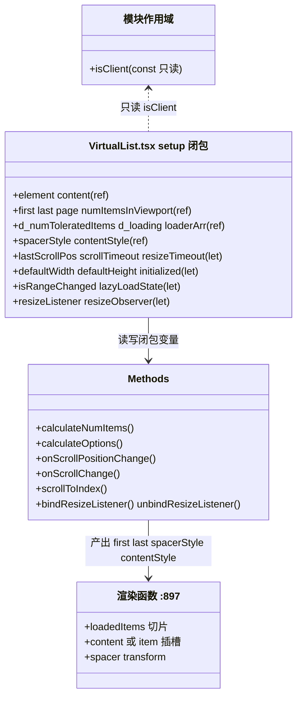
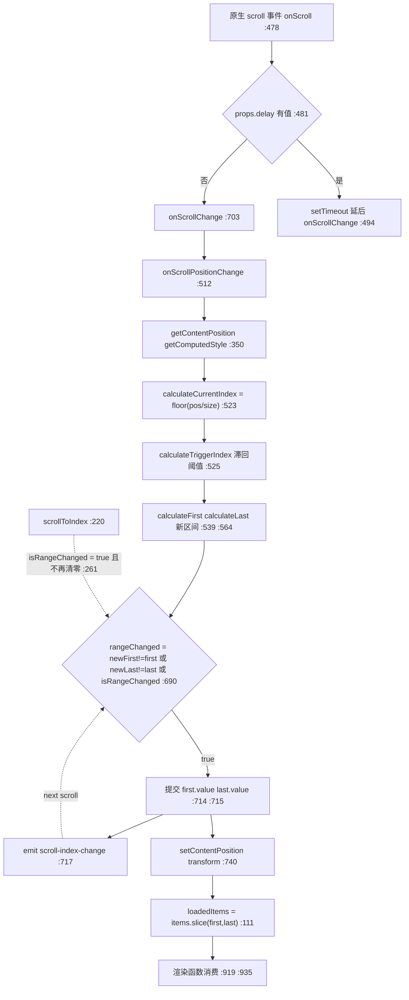
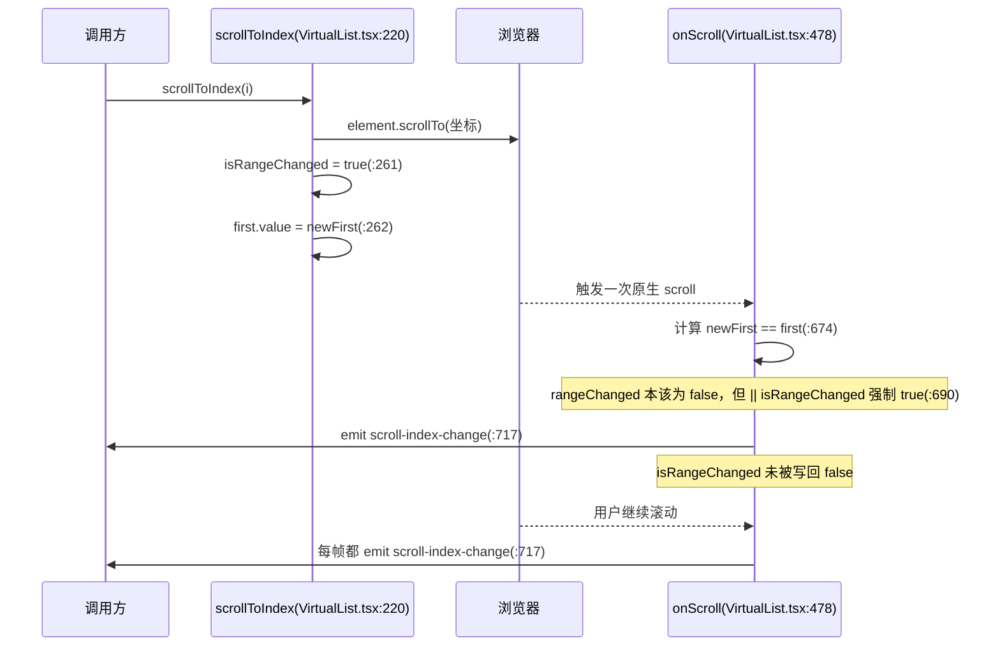

# C08-06 VirtualList 虚拟列表

> **本篇解决**：公开件 `XYVirtualList`（`packages/xiaoye-ui/src/virtual-list/`）作为虚拟滚动组件，它的高度缓存、切片区间计算、滚动位置往返一致性到底建立在哪些状态之上；这些状态是否存在模块作用域、会不会在多实例与 SSR 下互相污染；对外契约（props/插槽/emits/expose）如何真正流到渲染。
> **前置**：I08 虚拟化双实现：vc-virtual-list 与 virtual-scroller　**读者坐标**：`03-components/08-table` 第 7/7 篇

## 一、职责与边界

本篇写的是公开件 `XYVirtualList`，源码根目录 `packages/xiaoye-ui/src/virtual-list/`，主实现 `VirtualList.tsx` 共 965 行。它是一个**窗口游标供给器**：组件本身不测行高、不管数据，只维护「当前应渲染 items 数组的第几个到第几个」这一区间（`first`/`last`），把切片结果交给 `item` 或 `content` 插槽渲染。

它明确不负责的事：单项高度测量（引擎 B 全程信任声明式 `itemSize`，无测量回路，见 I08《虚拟化双实现：vc-virtual-list 与 virtual-scroller》论点 3）、DOM 节点回收池（两引擎都没有，见 I08 论点 6）、`scrollToIndex` 上界校验（见 I08 论点 5）。这些机制 I08 已论证，本篇不重复展开，只做组件视角的补充取证。

被谁依赖：库内**零消费者**，只有聚合出口 `packages/xiaoye-ui/src/components.ts:395` 与类型声明 `packages/xiaoye-ui/typings/global.d.ts:100`，以及文档示例 `apps/docs/examples/virtual-list/basic.vue`；`grep -rn "from 'xiaoye-ui/virtual-list'" packages apps` 排除自身目录后无组件级命中。它依赖谁：`@xiaoye-ui/utils/dom` 的三个尺寸工具（`packages/xiaoye-ui/src/virtual-list/VirtualList.tsx:1`）、`@xiaoye-ui/icons` 的 `SpinnerIcon`（`:2`）、`useConfigInject`（`packages/xiaoye-ui/src/virtual-list/VirtualList.tsx:74`）、`useStyle`（`packages/xiaoye-ui/src/virtual-list/VirtualList.tsx:75`）、`initDefaultProps`（`packages/xiaoye-ui/src/virtual-list/VirtualList.tsx:26`）。

与内部件 `virtual-scroller` 的关系是文件级拷贝而非分层（I08 论点 1、坑 6），因此本篇每个结论都默认在 `virtual-scroller/VirtualScroller.tsx` 有近乎同款的实现；本篇坑 1 的缺陷已核实同样存在于那份拷贝。

## 二、源码地图

| 文件 | 行数 | 职责 | 关键导出 / 主入口 |
| --- | --- | --- | --- |
| `virtual-list/index.ts` | 19 | 入口，`registerComponent` 注册（`:15`） | `VirtualList` default（`:19`） |
| `virtual-list/interface.ts` | 53 | props 与事件类型 | `virtualListProps`（`:9`） |
| `virtual-list/VirtualList.tsx` | 965 | 主实现，`defineComponent` 于 `:22`、`setup` 于 `packages/xiaoye-ui/src/virtual-list/VirtualList.tsx:35`、渲染函数于 `packages/xiaoye-ui/src/virtual-list/VirtualList.tsx:897` | `XYVirtualList`（`packages/xiaoye-ui/src/virtual-list/VirtualList.tsx:23`） |
| `virtual-list/style/index.ts` | 69 | Component Token 样式钩子 | `genComponentStyleHook('VirtualList')`（`:7`） |
| `virtual-list/__tests__/virtual-list.test.js` | 164 | 公开件测试 | 8 个 `it`（`mountTest` 加 7 个自有） |

主实现入口是 `packages/xiaoye-ui/src/virtual-list/VirtualList.tsx:22` 的 `defineComponent`，`setup` 体在 `packages/xiaoye-ui/src/virtual-list/VirtualList.tsx:35` 起、渲染返回在 `packages/xiaoye-ui/src/virtual-list/VirtualList.tsx:897` 起。全文件只有一处模块作用域绑定——`const isClient`（`:20`），其余全部可变状态都在 `setup` 闭包里。

## 三、架构与数据流

先看状态归属的静态结构：`setup` 闭包持有全部游标、样式与监听句柄，方法只读这些闭包变量，渲染函数只消费闭包产出的切片。没有任何缓存表挂在模块作用域。



数据流主循环是「滚动位置 → 游标 → 切片」的往返。下图把每一次滚动的判定链画全，并标出本篇坑 1 的闩（`isRangeChanged`）从何处注入：



第三张图是 `scrollToIndex` 与后续原生滚动的时序，用来把坑 1 讲清：程序化滚动会自己触发一次原生 `scroll`，而这次 `scroll` 本应因游标已同步而判为「区间未变」，但被 `isRangeChanged` 强制判为「变了」；由于该标志从不清零，之后的每一帧滚动都被强制判为变化。



## 四、核心机制精读

### 论点 1：全部可变状态都关在 `setup` 闭包里，模块作用域只留一个只读常量；滚动/尺寸监听成对且实例内聚——本篇不假设它坏，实测确实没有多实例与 SSR 污染

断言：派工单提示「缓存表是否挂在模块作用域」是虚拟滚动的高危点，但 `XYVirtualList` 这条链是干净的：除了 `isClient` 这一个只读常量，`first`/`last`/游标缓冲/样式/定时器/监听句柄全部声明在 `setup` 函数体内，每个组件实例各持一份；`window` 上的 `resize`/`orientationchange` 监听与 `ResizeObserver` 在 `onMounted` 里绑定、在 `onBeforeUnmount` 里解绑，绑定变量本身也是闭包变量。因此同页多个虚拟列表、以及服务端渲染，都不会共享或被彼此的滚动状态污染。

先给「模块作用域到底有什么」的定形证据。整个文件顶格（第 0 列）的绑定只有三处，且都不是可变缓存：

```tsx
// packages/xiaoye-ui/src/virtual-list/VirtualList.tsx:19
// SSR 安全判断
const isClient = typeof window !== 'undefined' && !!window.document;

export default defineComponent({
```

`isClient`（`:20`）是一个布尔常量，且被 `getContentPosition`（`packages/xiaoye-ui/src/virtual-list/VirtualList.tsx:345`）、`calculateAutoSize` 依赖的 `onResize`（`packages/xiaoye-ui/src/virtual-list/VirtualList.tsx:779`）、`bindResizeListener`（`packages/xiaoye-ui/src/virtual-list/VirtualList.tsx:809`）在入口早退——服务端没有 `window` 时这些函数直接返回，不会触碰 DOM API。这是 SSR 安全的第一道闸。

真正承载「缓存」语义的可变量，全部在 `setup` 之内：

```tsx
// packages/xiaoye-ui/src/virtual-list/VirtualList.tsx:44
    let lastScrollPos: any = isBoth() ? { top: 0, left: 0 } : 0;
    let scrollTimeout: ReturnType<typeof setTimeout> | null = null;
    let resizeTimeout: ReturnType<typeof setTimeout> | null = null;
    let defaultWidth = 0;
    let defaultHeight = 0;
    let isRangeChanged = false;
    let lazyLoadState: any = {};
    let resizeListener: (() => void) | null = null;
    let resizeObserver: ResizeObserver | null = null;
    let initialized = false;

    const d_numToleratedItems = ref<any>(props.numToleratedItems);
    const d_loading = ref(props.loading);
    const loaderArr = ref<any[]>([]);
    const spacerStyle = ref<Record<string, string>>({});
    const contentStyle = ref<Record<string, string>>({});

    const first = ref<any>(isBoth() ? { rows: 0, cols: 0 } : 0);
    const last = ref<any>(isBoth() ? { rows: 0, cols: 0 } : 0);
    const page = ref<any>(isBoth() ? { rows: 0, cols: 0 } : 0);
    const numItemsInViewport = ref<any>(isBoth() ? { rows: 0, cols: 0 } : 0);
```

逐段看归属：`:44`-`packages/xiaoye-ui/src/virtual-list/VirtualList.tsx:53` 的十个 `let` 是纯命令式的滚动/尺寸状态——上次滚动位置、两个防抖定时器、容器初始宽高、区间变更闩、懒加载快照、监听句柄本体、`ResizeObserver` 实例、初始化标志；`packages/xiaoye-ui/src/virtual-list/VirtualList.tsx:55`-`packages/xiaoye-ui/src/virtual-list/VirtualList.tsx:64` 的十个 `ref` 是响应式的区间游标与样式产物。它们都在 `setup(props, ...)` 的函数作用域，Vue 每次实例化组件都重新执行一次 `setup`，于是每个实例得到独立的这一整套。不存在 `const cache = new Map()` 这类跨实例共享的高度表（引擎 B 根本没有高度表——见 I08 论点 3，它连测都不测）。

监听器的成对性：`viewInit` 在 `onMounted` 中调用（`packages/xiaoye-ui/src/virtual-list/VirtualList.tsx:872`），`viewInit` 里对容器绑定监听（`packages/xiaoye-ui/src/virtual-list/VirtualList.tsx:203`-`packages/xiaoye-ui/src/virtual-list/VirtualList.tsx:205`），实体在 `bindResizeListener`：

```tsx
// packages/xiaoye-ui/src/virtual-list/VirtualList.tsx:808
    function bindResizeListener() {
      if (!isClient) return;

      if (!resizeListener) {
        resizeListener = onResize;

        window.addEventListener('resize', resizeListener);
        window.addEventListener('orientationchange', resizeListener);

        if (typeof ResizeObserver !== 'undefined') {
          resizeObserver = new ResizeObserver(() => {
            onResize();
          });
          resizeObserver.observe(element.value!);
        }
      }
    }
```

解绑在 `onBeforeUnmount`：

```tsx
// packages/xiaoye-ui/src/virtual-list/VirtualList.tsx:826
    function unbindResizeListener() {
      if (!isClient) return;

      if (resizeListener) {
        window.removeEventListener('resize', resizeListener);
        window.removeEventListener('orientationchange', resizeListener);
        resizeListener = null;
      }

      if (resizeObserver) {
        resizeObserver.disconnect();
        resizeObserver = null;
      }
    }
```

两个函数都以 `isClient` 早退（`packages/xiaoye-ui/src/virtual-list/VirtualList.tsx:809`、`packages/xiaoye-ui/src/virtual-list/VirtualList.tsx:827`），`bindResizeListener` 用 `if (!resizeListener)`（`packages/xiaoye-ui/src/virtual-list/VirtualList.tsx:811`）保证不重复挂、`unbindResizeListener` 用 `if (resizeListener)`（`packages/xiaoye-ui/src/virtual-list/VirtualList.tsx:829`）保证只解已挂的，且解绑后把句柄与观察者都置空（`packages/xiaoye-ui/src/virtual-list/VirtualList.tsx:832`、`packages/xiaoye-ui/src/virtual-list/VirtualList.tsx:837`）。这与本仓 C04-07《Slider》得出的正面结论同构：看似「挂在 document/window 上会抢句柄」的监听，其实是每个实例各持一份、绑解配对、幂等。`resizeListener`/`resizeObserver` 本身（`packages/xiaoye-ui/src/virtual-list/VirtualList.tsx:51`-`packages/xiaoye-ui/src/virtual-list/VirtualList.tsx:52`）是闭包变量，不存在多实例互相覆盖的问题。

调用点确认配对存在（不是只绑不解）：

```bash
grep -n "bindResizeListener\|unbindResizeListener\|onMounted\|onBeforeUnmount" packages/xiaoye-ui/src/virtual-list/VirtualList.tsx
# 204（viewInit 内调用 bind） 808/826（定义） 872（onMounted） 883（onBeforeUnmount 内调用 unbind）
```

结论回扣：`XYVirtualList` 的「缓存」不是共享的高度表，而是一组每实例私有的区间游标；模块作用域仅暴露一个只读的 `isClient`。所以本篇开头那条「缓存表是否挂模块作用域」的高危怀疑，在这个组件上不成立——这是需要如实记录的事实，而不是默认所有虚拟滚动都犯这个错。多实例滚动状态互不干扰、SSR 无 `window` 访问、监听不泄漏，三点都由上述行号支撑。

### 论点 2：所谓「高度缓存」在本组件里其实是「区间游标缓存」；切片完全由 `first`/`last` 两个数决定，而这两个数只在判定「区间真的变了」时才提交

断言：引擎 B 没有单项高度，也就没有「估算高度 vs 实测高度」的一致性难题（那套难题属于引擎 A 的 `heights` Map，见 I08 论点 3）；本组件的一致性难题是另一种——声明式 `itemSize` 推出的目标区间（游标）与浏览器真实滚动位置之间的往返，中间隔着一道 `rangeChanged` 提交门。

切片产出只读游标，不读 DOM：

```tsx
// packages/xiaoye-ui/src/virtual-list/VirtualList.tsx:102
    const loadedItems = computed(() => {
      if (props.items && !d_loading.value) {
        if (isBoth()) {
          return props.items
            .slice(first.value.rows, last.value.rows)
            .map(item => (props.columns ? item : item.slice(first.value.cols, last.value.cols)));
        } else if (isHorizontal() && props.columns) {
          return props.items;
        } else {
          return props.items.slice(first.value, last.value);
        }
      }
      return [];
    });
```

纵向分支就是 `props.items.slice(first.value, last.value)`（`packages/xiaoye-ui/src/virtual-list/VirtualList.tsx:111`）。`first`/`last` 不动，`loadedItems` 就不重算，DOM 也就不重排——这正是引擎 B「滚动不等于重渲染」的落点。

游标怎么从滚动位置推出来：`onScrollPositionChange` 里做一次除法拿到「当前首项下标」，再靠一个滞回阈值 `triggerIndex` 决定要不要移动窗口：

```tsx
// packages/xiaoye-ui/src/virtual-list/VirtualList.tsx:521
      const calculateScrollPos = (_pos: number, _cpos: number) =>
        _pos ? (_pos > _cpos ? _pos - _cpos : _pos) : 0;
      const calculateCurrentIndex = (_pos: number, _size: number) =>
        Math.floor(_pos / (_size || _pos));
      const calculateTriggerIndex = (
        _currentIndex: number,
        _first: number,
        _last: number,
        _num: number,
        _numT: number,
        _isScrollDownOrRight: boolean,
      ) => {
        return _currentIndex <= _numT
          ? _numT
          : _isScrollDownOrRight
            ? _last - _num - _numT
            : _first + _numT - 1;
      };
```

`calculateCurrentIndex`（`packages/xiaoye-ui/src/virtual-list/VirtualList.tsx:523`）= `floor(滚动位置 / itemSize)`，即「滚动位置 → 第几项」的直接映射；`calculateScrollPos`（`:521`）先扣掉内容盒的 padding/定位偏移。`calculateTriggerIndex`（`packages/xiaoye-ui/src/virtual-list/VirtualList.tsx:525`）是滞回核心：向下滚时触发点是 `last - num - numT`（`packages/xiaoye-ui/src/virtual-list/VirtualList.tsx:536`，滚到窗口尾端前留 `numT` 缓冲才前移），向上滚时触发点是 `first + numT - 1`（`packages/xiaoye-ui/src/virtual-list/VirtualList.tsx:537`，回滚超过头部缓冲才后移）。方向由 `isScrollDownOrRight`（`packages/xiaoye-ui/src/virtual-list/VirtualList.tsx:661`）判定，参照物是闭包里的 `lastScrollPos`（`:44`）。

新区间是否提交，取决于 `rangeChanged`：

```tsx
// packages/xiaoye-ui/src/virtual-list/VirtualList.tsx:690
          rangeChanged = newFirst !== first.value || newLast !== last.value || isRangeChanged;
          newScrollPos = scrollPos;
        }
      }

      return {
        first: newFirst,
        last: newLast,
        isRangeChanged: rangeChanged,
        scrollPos: newScrollPos,
      };
    }
```

提交动作在 `onScrollChange`：

```tsx
// packages/xiaoye-ui/src/virtual-list/VirtualList.tsx:711
      if (rangeChanged) {
        const newState = { first: newFirst, last: newLast };
        setContentPosition(newState);
        first.value = newFirst;
        last.value = newLast;
        lastScrollPos = scrollPos;
        emit('scroll-index-change', newState);

        if (props.lazy && isPageChanged(newFirst)) {
```

`first.value`/`last.value`（`packages/xiaoye-ui/src/virtual-list/VirtualList.tsx:714`-`packages/xiaoye-ui/src/virtual-list/VirtualList.tsx:715`）与 `lastScrollPos`（`packages/xiaoye-ui/src/virtual-list/VirtualList.tsx:716`）只在 `rangeChanged` 为真时一起更新，三者保持同一帧内一致；`loadedItems` 随之重算，`setContentPosition`（`packages/xiaoye-ui/src/virtual-list/VirtualList.tsx:713`）把窗口起点的偏移写成 `transform: translate3d(...)`（`packages/xiaoye-ui/src/virtual-list/VirtualList.tsx:750`）。这条链在纯滚动场景是自洽的：滚动幅度没越过滞回缓冲，`newFirst === first.value` 且 `newLast === last.value`，`rangeChanged` 为假，什么都不发生——缓冲带的意义正在于此。

一致性风险点恰恰在 `:690` 这个式子的第三项 `|| isRangeChanged`：它不是从滚动位置推出来的，而是一个闭包闩，由 `scrollToIndex` 单方面置位且从不归零。这正是论点 3 与坑 1 的对象。结论回扣：本组件「滚动位置 ↔ 区间」往返一致性的成立条件，是 `rangeChanged` 严格等于「游标真的动了」；一旦有第二来源（`isRangeChanged`）能把它钉成常量真，这道提交门就失去过滤作用。

### 论点 3：`isRangeChanged` 是一个「只置位、从不复位」的闭包闩——一次 `scrollToIndex` 之后，`numToleratedItems` 滞回缓冲被永久旁路

断言：`isRangeChanged`（`packages/xiaoye-ui/src/virtual-list/VirtualList.tsx:49`）声明为闭包变量，全文件只有一处把它写成真（`scrollToIndex` 的 `packages/xiaoye-ui/src/virtual-list/VirtualList.tsx:261`），没有任何一处把它写回假；而它被 `onScrollPositionChange` 当作 `rangeChanged` 的一个「或」项来读（`packages/xiaoye-ui/src/virtual-list/VirtualList.tsx:656`、`:690`）。后果是：只要调用过一次改变了区间的 `scrollToIndex`，此后每一次原生滚动都会被强制判成「区间变了」，`first`/`last` 每帧重算重提交、`scroll-index-change` 每帧外发，论点 2 辛苦设计的缓冲带过滤作用被这个闩永久拉直。

置位点（`scrollToIndex` 末尾）：

```tsx
// packages/xiaoye-ui/src/virtual-list/VirtualList.tsx:257
          scrollChanged = lastScrollPos !== (horizontal ? scrollLeft : scrollTop);
          rangeChanged = newFirst !== firstVal;
        }

        isRangeChanged = rangeChanged;
        if (scrollChanged) first.value = newFirst;
      }
    }
```

读位点（`onScrollPositionChange` 纵向分支）：

```tsx
// packages/xiaoye-ui/src/virtual-list/VirtualList.tsx:683
          newLast = calculateLast(
            currentIndex,
            newFirst,
            last.value,
            numItemsInViewport.value,
            d_numToleratedItems.value,
          );
          rangeChanged = newFirst !== first.value || newLast !== last.value || isRangeChanged;
```

关键是这个式子的第三项。正常滚动里 `newFirst`/`newLast` 是拿 `currentIndex`（`packages/xiaoye-ui/src/virtual-list/VirtualList.tsx:664`，来自真实 `scrollTop`）现算的，若没越过滞回触发点，它们会等于当前的 `first.value`/`last.value`，前两项为假、`rangeChanged` 为假、窗口不动。可一旦 `isRangeChanged` 被 `scrollToIndex` 钉成真，`rangeChanged` 就恒为真，前两项的判断被短路绕过。消费它的地方也不清零：

```tsx
// packages/xiaoye-ui/src/virtual-list/VirtualList.tsx:703
    function onScrollChange(event: Event) {
      const {
        first: newFirst,
        last: newLast,
        isRangeChanged: rangeChanged,
        scrollPos,
      } = onScrollPositionChange(event as any);

      if (rangeChanged) {
        const newState = { first: newFirst, last: newLast };
        setContentPosition(newState);
        first.value = newFirst;
        last.value = newLast;
        lastScrollPos = scrollPos;
        emit('scroll-index-change', newState);
```

注意 `packages/xiaoye-ui/src/virtual-list/VirtualList.tsx:707` 这里 `const { isRangeChanged: rangeChanged } = ...` 解构出来的是**函数返回对象**里的字段（`packages/xiaoye-ui/src/virtual-list/VirtualList.tsx:698` 的 `isRangeChanged: rangeChanged`），是个新局部变量，跟闭包里那个 `isRangeChanged` 不是同一个绑定——它只在这几行里遮蔽同名，赋值 `rangeChanged`（`packages/xiaoye-ui/src/virtual-list/VirtualList.tsx:707`）根本不会改到闭包变量。同理 `onScroll` 里 `packages/xiaoye-ui/src/virtual-list/VirtualList.tsx:488` 的 `const { isRangeChanged } = onScrollPositionChange(event)` 也是局部遮蔽。所以整条滚动链里，闭包 `isRangeChanged` 从头到尾没有任何一行把它写回 `false`。

对「是否真只有两个写入点」做第二方法交叉验证：

```bash
grep -n "isRangeChanged" packages/xiaoye-ui/src/virtual-list/VirtualList.tsx
# 49 声明 false；261 唯一赋值（在 scrollToIndex 内）；
# 488 489 是 onScroll 里的局部解构；656 690 是读取；698 707 是返回字段与局部解构
```

命中行里除了 `packages/xiaoye-ui/src/virtual-list/VirtualList.tsx:49` 初始化和 `packages/xiaoye-ui/src/virtual-list/VirtualList.tsx:261`，其余全是读或局部同名遮蔽，没有一处 `isRangeChanged = false`。这就是「置位即永久」的机器证据。

该缺陷同时存在于 `virtual-scroller` 那份拷贝（`grep -n "isRangeChanged" packages/xiaoye-ui/src/virtual-scroller/VirtualScroller.tsx` 显示 `:50` 声明、`:262` 唯一赋值、其余为读/遮蔽），因此不是本组件独有，是移植时一并复制过来的（拷贝分叉面见 I08 论点 1）。

结论回扣：`isRangeChanged` 本来的用途应是「程序化滚动后强制让下一次真实滚动重算一次窗口」——因为 `element.scrollTo` 不会同步更新闭包 `lastScrollPos`，需要一次补偿。但作者只在 `scrollToIndex` 入口置位、没在补偿消费后复位，把一次性补偿写成了永久开关。对下游（如 `data-table` 经 `getRenderedRange`/`scroll-index-change` 反查区间）的直接代价，是从那次 `scrollToIndex` 起每次滚动都触发一轮区间提交与事件外发，缓冲优化名存实亡。

### 论点 4：`numToleratedItems` 是可被内部计算覆写的半受控 prop；它的 `||` 兜底因默认值是 `null` 而可达——这一处正好是常见「三元兜底恒不可达」缺陷族的反面

断言：派工单 §3 列的缺陷族里有一条——「`X !== undefined ? X : Y` 型三元，而 `X` 带非 `undefined` 默认值，于是兜底分支永不可达」。本组件在缓冲值上**没有**犯这个错：它用的是 `d_numToleratedItems.value || <计算式>`，而 `numToleratedItems` 的默认值是 `null`（falsy），所以未显式传值时计算式可达。但同一 prop 的另一面是：它会被 `calculateOptions` 用算出来的值覆写，导致「用户传的值」只在初始化前权威。

默认值来源确认：

```ts
// packages/xiaoye-ui/src/virtual-list/interface.ts:19
  numToleratedItems: { type: Number, default: null },
```

兜底分支（用户没传就算半个视口）：

```tsx
// packages/xiaoye-ui/src/virtual-list/VirtualList.tsx:315
      const calculateNumToleratedItems = (_numItems: number) => Math.ceil(_numItems / 2);
      const numItemsInVP: any = both
        ? {
            rows: calculateNumItemsInViewport(contentHeight, itemSize[0]),
            cols: calculateNumItemsInViewport(contentWidth, itemSize[1]),
          }
        : calculateNumItemsInViewport(horizontal ? contentWidth : contentHeight, itemSize);

      const numToleratedItems: any =
        d_numToleratedItems.value ||
        (both
          ? [
              calculateNumToleratedItems(numItemsInVP.rows),
              calculateNumToleratedItems(numItemsInVP.cols),
            ]
          : calculateNumToleratedItems(numItemsInVP));
```

`d_numToleratedItems` 初值就是 prop 值（`packages/xiaoye-ui/src/virtual-list/VirtualList.tsx:55`），未传即 `null`，于是 `packages/xiaoye-ui/src/virtual-list/VirtualList.tsx:324` 的 `||` 走右侧计算式——这与 `_util/type.ts:66-67` 里 `anyType(v)` 把默认值展开成 `{ default: v }`、配合 `!== undefined` 三元就会翻车的那个形状相反，这里形状是对的。

但半受控问题在覆写与回灌之间：

```tsx
// packages/xiaoye-ui/src/virtual-list/VirtualList.tsx:421
      last.value = lastVal;
      numItemsInViewport.value = numItemsInVP;
      d_numToleratedItems.value = numToleratedItems;
      emit('update:numToleratedItems', d_numToleratedItems.value);
```

`packages/xiaoye-ui/src/virtual-list/VirtualList.tsx:423` 用「算出来（或用户传入）」的缓冲值覆写 `d_numToleratedItems`，`packages/xiaoye-ui/src/virtual-list/VirtualList.tsx:424` 又把它 `emit` 成 `update:numToleratedItems`。配合把 prop 灌回内部态的 watch：

```tsx
// packages/xiaoye-ui/src/virtual-list/VirtualList.tsx:140
    watch(
      () => props.numToleratedItems,
      newValue => {
        d_numToleratedItems.value = newValue;
      },
    );
```

于是形成：用户不传 → `d` 从 `null` 被 `calculateOptions` 填成实数；此后 `d` 恒真，`packages/xiaoye-ui/src/virtual-list/VirtualList.tsx:324` 的 `||` 不再触发。一旦 `items`/容器尺寸变化触发 `onResize` 的重初始化分支：

```tsx
// packages/xiaoye-ui/src/virtual-list/VirtualList.tsx:798
          if (reinit) {
            d_numToleratedItems.value = props.numToleratedItems;
            defaultWidth = width;
            defaultHeight = height;
            init();
          }
```

`packages/xiaoye-ui/src/virtual-list/VirtualList.tsx:799` 又把 `d` 复位成 `props.numToleratedItems`（若用户没传就是 `null`），重新交给 `calculateOptions` 计算。含义是：把 `numToleratedItems` 当 `v-model` 用是可行的（组件会把算出的值 emit 回来），但当普通 prop 传固定值时，它只在「首次计算」与「每次 resize 复位后重算」这两个时刻被尊重，中间的容器变化会用旧算值——这与论点 3 的缓冲旁路叠加时，实际缓冲宽度可能和声明值不一致。

### 论点 5：`id` 声明了却从不被读取，且 `inheritAttrs: false` 却不读 `attrs`、根元素也不展开——`id` 与所有透传属性被静默丢弃

断言：这是本仓反复出现的「API 面存活、实现死亡」在 props 层的实例，但更狠一层：组件关掉了属性透传（`inheritAttrs: false`），又没有手动把 `attrs` 绑到任何 DOM 上，于是不仅是 `id`，连 `data-*`、`aria-*` 和非 `emits` 白名单里的原生事件监听都进不了 DOM。

`id` 在 props 里活着：

```ts
// packages/xiaoye-ui/src/virtual-list/interface.ts:10
  prefixCls: String,
  id: String,
```

但 `setup` 从头到尾没有 `props.id`，渲染函数里的根 `div` 也没有 `id`：

```tsx
// packages/xiaoye-ui/src/virtual-list/VirtualList.tsx:909
          <div
            ref={elementRef}
            class={containerClass.value}
            tabindex={props.tabindex}
            style={props.style}
            onScroll={onScroll}
          >
```

根元素只显式绑了 `class`、`tabindex`、`style`、`onScroll`，`attrs` 未出现。核对 `attrs` 与 `id` 的读取面（两种写法一起数，避免漏掉 `v-bind`/展开）：

```bash
grep -n "props.id\|attrs\|v-bind\|useAttrs" packages/xiaoye-ui/src/virtual-list/VirtualList.tsx   # 0 命中
grep -n "inheritAttrs" packages/xiaoye-ui/src/virtual-list/VirtualList.tsx                          # 24 命中
```

`setup(props, { slots, emit, expose })`（`packages/xiaoye-ui/src/virtual-list/VirtualList.tsx:35`）连第三个上下文参数 `attrs` 都没解构，`inheritAttrs: false`（`packages/xiaoye-ui/src/virtual-list/VirtualList.tsx:24`）又阻止了 Vue 的默认兜底透传。两件事叠加，等于所有非声明 props 的 attribute 都无处落地。

值得对照的是：`class` 与 `style` 因为在 `interface.ts:12`-`:13` 被声明成了 props（`props.class` 在 `packages/xiaoye-ui/src/virtual-list/VirtualList.tsx:79` 被读进 `containerClass`、`props.style` 在 `packages/xiaoye-ui/src/virtual-list/VirtualList.tsx:913` 绑到根元素），所以这两个能生效——这恰恰反证 `id` 的失效原因：`id` 声明了却没被任何一处读取。而 `data-*`/`aria-*` 等压根没声明为 props、又被 `inheritAttrs: false` 挡在默认透传之外的 attribute，会一并消失。

结论回扣：给 `<xy-virtual-list id="x" data-role="y" @focus=...>` 传的这些，在渲染出的 DOM 上一个都找不到（`@focus` 不在 `emits` 白名单 `packages/xiaoye-ui/src/virtual-list/VirtualList.tsx:34` 里，本应作为原生监听透传，但 `attrs` 未被展开）。这既是「声明未读取」的死亡 prop（`id`），也是「关掉透传却不自己接管」的整体 attribute 丢失。

## 五、对外契约如何生效

props 到渲染有两条通路，取决于 `disabled`。`disabled: true` 时整个虚拟化被旁路，`props.items` 被原样交给插槽、不做任何切片：

```tsx
// packages/xiaoye-ui/src/virtual-list/VirtualList.tsx:899
        props.disabled ? (
          <>
            {slots.default?.()}
            {slots.content?.({
              items: props.items,
              rows: props.items,
              columns: loadedColumns.value,
            })}
          </>
        ) : (
```

这条分支里唯一渲染 `default` 插槽的地方就是它（`packages/xiaoye-ui/src/virtual-list/VirtualList.tsx:901`）。启用虚拟化后，`default` 插槽不再被消费——渲染函数只走 `content` 或 `item`。这是契约上一个容易误读的点：`slots` 声明里 `default`（`packages/xiaoye-ui/src/virtual-list/VirtualList.tsx:28`）在正常态是死插槽。

启用态下分两种渲染模式。给了 `content` 插槽时，组件把全部区间产物打包成一个对象丢给插槽，自己完全不生成条目 DOM：

```tsx
// packages/xiaoye-ui/src/virtual-list/VirtualList.tsx:916
            {slots.content ? (
              slots.content({
                styleClass: contentClass.value,
                items: loadedItems.value,
                getItemOptions: getOptions,
                loading: d_loading.value,
                getLoaderOptions,
                itemSize: props.itemSize,
                rows: loadedRows.value,
                columns: loadedColumns.value,
                contentRef,
                spacerStyle: spacerStyle.value,
                contentStyle: contentStyle.value,
                vertical: isVertical(),
                horizontal: isHorizontal(),
                both: isBoth(),
              })
            ) : (
```

这里 `contentRef`（`packages/xiaoye-ui/src/virtual-list/VirtualList.tsx:926`）被交给插槽方，由插槽内部把它绑到承载 transform 的元素上——`setContentEl`/`setContentEl(content.value)` 的链路（`packages/xiaoye-ui/src/virtual-list/VirtualList.tsx:194`、`packages/xiaoye-ui/src/virtual-list/VirtualList.tsx:474`）就靠这个回填 `content` ref。没给 `content` 时才走内置渲染，逐条调 `item` 插槽且**不挂 key**（`packages/xiaoye-ui/src/virtual-list/VirtualList.tsx:935`-`packages/xiaoye-ui/src/virtual-list/VirtualList.tsx:937`，无 key 复用的成因见 I08 论点 6）。

数据流闭环：`props.items` → watch 触发 `init`（`packages/xiaoye-ui/src/virtual-list/VirtualList.tsx:154`-`packages/xiaoye-ui/src/virtual-list/VirtualList.tsx:163`）→ `calculateOptions` 算 `last`/缓冲并覆写 `d_numToleratedItems`（`packages/xiaoye-ui/src/virtual-list/VirtualList.tsx:408`-`packages/xiaoye-ui/src/virtual-list/VirtualList.tsx:424`）→ 滚动经 `onScroll`→`onScrollChange` 提交 `first`/`last` → `loadedItems` 切片 → 插槽消费；外发经 `emits`（`packages/xiaoye-ui/src/virtual-list/VirtualList.tsx:34`）四条，且四条都真实触发，没有「声明不发射」的死事件：

| 事件 | 触发点 |
| --- | --- |
| `scroll` | `onScroll` 首行无条件发（`packages/xiaoye-ui/src/virtual-list/VirtualList.tsx:479`） |
| `update:numToleratedItems` | `calculateOptions` 末尾回写计算值（`packages/xiaoye-ui/src/virtual-list/VirtualList.tsx:424`） |
| `scroll-index-change` | `rangeChanged` 提交时发新区间（`packages/xiaoye-ui/src/virtual-list/VirtualList.tsx:717`） |
| `lazy-load` | 懒加载下 `calculateOptions` 函数体内的那处发射（`packages/xiaoye-ui/src/virtual-list/VirtualList.tsx:440`，函数起于 `:408`）与滚动换页（`packages/xiaoye-ui/src/virtual-list/VirtualList.tsx:734`）两处发 |

命令契约由 `expose` 交出七个成员：

```tsx
// packages/xiaoye-ui/src/virtual-list/VirtualList.tsx:887
    expose({
      scrollTo,
      scrollToIndex,
      getRenderedRange,
      getOptions,
      getLoaderOptions,
      element,
      content,
    });
```

`scrollTo`/`scrollToIndex` 是写侧（分别落到 `element.value.scrollTo`（`packages/xiaoye-ui/src/virtual-list/VirtualList.tsx:217`）与论点 3 的区间重算），`getRenderedRange` 是读侧——它同时返回「内部游标 `first`/`last`」和「按当前 `scrollTop` 现算的 viewport」（`packages/xiaoye-ui/src/virtual-list/VirtualList.tsx:296`-`packages/xiaoye-ui/src/virtual-list/VirtualList.tsx:303`）两套坐标。这两套在稳态一致，但在 `props.delay` 生效时（`packages/xiaoye-ui/src/virtual-list/VirtualList.tsx:481`，`onScrollChange` 被 `setTimeout` 推后 `packages/xiaoye-ui/src/virtual-list/VirtualList.tsx:494`）会短暂分叉：DOM 已滚、游标未提交，`getRenderedRange` 的 `first`/`last` 落后于 `viewport`。下游若读 `first`/`last` 做行级 key，就要意识到这个延迟窗口。`getOptions`（`packages/xiaoye-ui/src/virtual-list/VirtualList.tsx:841`）把「渲染下标」翻译成「数据下标 + 首末奇偶」，是 `content` 插槽反查行号的手段，被表格侧逐层消费（接缝与表格架构见 I08 论点 6 与 C08-02）。

`prefixCls` 经 `useConfigInject('virtual-list', props)`（`packages/xiaoye-ui/src/virtual-list/VirtualList.tsx:74`）得到 `xy-virtual-list`，`useStyle(prefixCls)`（`packages/xiaoye-ui/src/virtual-list/VirtualList.tsx:75`）产出的 `hashId` 挂进 `containerClass`（`packages/xiaoye-ui/src/virtual-list/VirtualList.tsx:80`），并由 `wrapSSR` 包裹整棵渲染树（`packages/xiaoye-ui/src/virtual-list/VirtualList.tsx:898`）以支持样式注入与 SSR。

## 六、设计取舍

组件层的第一条取舍是**「只算不测」**：窗口区间用 `itemSize` 标量做除/乘（`packages/xiaoye-ui/src/virtual-list/VirtualList.tsx:523`、`packages/xiaoye-ui/src/virtual-list/VirtualList.tsx:567`、`packages/xiaoye-ui/src/virtual-list/VirtualList.tsx:394`），代价是声明值与实际渲染高度不符时无任何自纠（I08 论点 3、坑 3），换来的是每帧滚动 O(1)、以及一个组件覆盖纵/横/双向/网格/懒加载/仅追加六种形态（`interface.ts:18`、`:22`、`:25`、`:32`、`:33`）。这是把「正确性责任」外包给调用方的 CSS 契约——调用方必须保证行高恒等。

第二条取舍是**「游标提交门 + 滞回缓冲」**（`rangeChanged`，`:690`）。作者宁可写一整套 `triggerIndex`/`calculateFirst`/`calculateLast` 的滞回数学，也不要逐帧重排 DOM：小幅抖动滚动因不越过缓冲而完全不触发 `first`/`last` 更新（`:711` 的整块提交都在 `if (rangeChanged)` 里）。赔上的复杂度是这套区间数学极难验证——本组件的 8 个测试用例没有一个覆盖 `scrollToIndex` 或 `getRenderedRange`（论点 3 的闩因此无测试保护，见坑 1）。而正是为了「让程序化滚动后补算一次」而加的 `isRangeChanged`，把这套缓冲优化在最常见的一次 `scrollToIndex` 之后彻底旁路了（论点 3）——这是「优化设计」与「一个未复位的补偿标志」互相打架的真实后果。

第三条取舍是**「半受控 `numToleratedItems`」**（`packages/xiaoye-ui/src/virtual-list/VirtualList.tsx:423` 覆写 + `:140` 回灌 + `packages/xiaoye-ui/src/virtual-list/VirtualList.tsx:799` resize 复位）。它允许 `v-model` 语义，也让组件能在容器变化时自适应重算缓冲。代价是把它当固定 prop 传时，权威区间只覆盖「首算」与「resize 后重算」两个时刻（论点 4）。

第四条是**「关掉 `inheritAttrs` 但不接管」**（`packages/xiaoye-ui/src/virtual-list/VirtualList.tsx:24` + 无 `attrs` 展开）。合理动机是虚拟化容器不应被随便的透传 attribute 污染根节点样式/行为；不合理之处是既然关了，就该手动挑该透传的绑上，而实现里一个都没绑，于是连 `id`、`aria-*` 这类无障碍锚点都进不去 DOM（论点 5）。这条与 `role`/`aria` 的可及性约定相悖，是明知故犯的简化。

SSR 姿态是「安全但空」：所有 DOM 触碰被 `isClient` 挡住（`packages/xiaoye-ui/src/virtual-list/VirtualList.tsx:345`、`packages/xiaoye-ui/src/virtual-list/VirtualList.tsx:779`、`packages/xiaoye-ui/src/virtual-list/VirtualList.tsx:809`），服务端不崩；但 `viewInit`/`init` 只在 `onMounted`（`packages/xiaoye-ui/src/virtual-list/VirtualList.tsx:872`）跑，服务端里 `first`/`last` 恒为初值 `0`（`packages/xiaoye-ui/src/virtual-list/VirtualList.tsx:61`-`packages/xiaoye-ui/src/virtual-list/VirtualList.tsx:62`），`loadedItems = items.slice(0, 0)` 得到空数组（`packages/xiaoye-ui/src/virtual-list/VirtualList.tsx:111`），所以 SSR 产物里 `content` 盒是空的，条目要等 hydration 后才出现。这是「无模块态污染」（论点 1）的另一面：正因为不共享状态，服务端无法预渲染窗口内容。

## 七、坑与改动指南

坑 1——`scrollToIndex` 之后滞回缓冲被永久旁路。
触发：任意一次会改变区间的 `scrollToIndex(i)` 调用（例如表格「滚动到第 N 行」）。症状：此后每次用户滚动都重排 `first`/`last` 并发一次 `scroll-index-change`，缓冲带内本不该有的重渲染被逐帧触发，下游按区间反查的组件被高频刷新。原因：`isRangeChanged` 只在 `scrollToIndex` 里被置真（`packages/xiaoye-ui/src/virtual-list/VirtualList.tsx:261`），消费处 `onScrollChange`（`:703`）不解闭包闩、`:690` 的 `rangeChanged` 因 `|| isRangeChanged` 恒真。定位：`packages/xiaoye-ui/src/virtual-list/VirtualList.tsx:49`、`packages/xiaoye-ui/src/virtual-list/VirtualList.tsx:261`、`:690`。修复方向：在 `:711` 提交块末尾补一行 `isRangeChanged = false`，把它恢复成一次性补偿。该分支无测试保护——`virtual-list/__tests__/virtual-list.test.js` 全程不调用 `scrollToIndex`（八个 `it` 里唯一测滚动的是 `:82`，走的是纯原生 scroll 路径，`rangeChanged` 天然为真，碰不到这个闩）。同一缺陷在 `virtual-scroller` 拷贝里同款存在（`:50`/`:262`/`:688`）。

坑 2——`id` 与所有透传 attribute 被吞。
触发：`<xy-virtual-list id="list-1" data-role="x" aria-label="列表" @focus=...>`。症状：渲染出的容器 `div` 上没有这些 attribute，锚点/自动化测试选择器/无障碍标签全部落空，`@focus` 也不生效。原因：`id` 声明但从不读取（`interface.ts:11` 声明，全文件 `props.id` 零命中），且 `inheritAttrs: false`（`packages/xiaoye-ui/src/virtual-list/VirtualList.tsx:24`）叠加 `attrs` 未解构、根元素（`:909`）未展开。定位：`packages/xiaoye-ui/src/virtual-list/VirtualList.tsx:24`、`packages/xiaoye-ui/src/virtual-list/VirtualList.tsx:35`、`:909` 与 `interface.ts:11`。改动建议：把 `setup` 第三参 `attrs` 接上并在根 `div` 展开，`id` 要么真正绑到元素、要么从 props 删掉。无测试覆盖 attribute 透传。

坑 3——`itemSize` 缺省为 `0` 时窗口数学塌缩。
触发：不声明 `itemSize`（或声明为 0）直接用。症状：`calculateCurrentIndex = Math.floor(_pos / (_size || _pos))` 在 `_size=0` 时变成 `floor(_pos/_pos)=1`（`packages/xiaoye-ui/src/virtual-list/VirtualList.tsx:523`），窗口首项恒被算成 1、无法随滚动推进；总高 `items.length * itemSize` 也塌成 0（`packages/xiaoye-ui/src/virtual-list/VirtualList.tsx:400`）。原因：`itemSize` 默认 `0`（`interface.ts:15`）且无单项测量兜底（I08 论点 3）。定位：`packages/xiaoye-ui/src/virtual-list/VirtualList.tsx:523`、`packages/xiaoye-ui/src/virtual-list/VirtualList.tsx:313`、`packages/xiaoye-ui/src/virtual-list/VirtualList.tsx:400`。该路径无测试保护。

坑 4——SSR 首屏空内容。
触发：服务端渲染一个带 `items` 的 `xy-virtual-list`。症状：HTML 里 `xy-virtual-list-content` 是空的，条目要等客户端 hydration + `onMounted` 后才出现，SEO/首屏白。原因：区间提交只在 `onMounted`→`viewInit`→`init`（`packages/xiaoye-ui/src/virtual-list/VirtualList.tsx:872`）后发生，服务端 `first`/`last` 恒 `0`（`packages/xiaoye-ui/src/virtual-list/VirtualList.tsx:62`），`loadedItems = items.slice(0,0)` 为空（`packages/xiaoye-ui/src/virtual-list/VirtualList.tsx:111`）。定位：`packages/xiaoye-ui/src/virtual-list/VirtualList.tsx:62`、`packages/xiaoye-ui/src/virtual-list/VirtualList.tsx:111`、`packages/xiaoye-ui/src/virtual-list/VirtualList.tsx:872`。这是论点 1「无模块态污染」的代价面。测试文件在 jsdom 下 `attachTo: document.body` 跑（`:88`），完全绕过了纯 SSR 分支，无服务端渲染用例。

坑 5——`numToleratedItems` 当固定 prop 传时半失效。
触发：显式传 `:num-tolerated-items="5"` 并期望它恒定。症状：首次 `init` 后组件用 `5` 计算出窗口，但 `packages/xiaoye-ui/src/virtual-list/VirtualList.tsx:423` 把 `d_numToleratedItems` 覆写为算出来的值（此处恰是 5，看似正常），一旦容器尺寸变化又不走 `onResize` 的 `reinit` 分支，缓冲值停留在旧算值；`onResize` 命中 `reinit` 时才复位成 `props.numToleratedItems`（`packages/xiaoye-ui/src/virtual-list/VirtualList.tsx:799`）。原因：prop→内部态是单向 watch（`:140`）加内部覆写（`packages/xiaoye-ui/src/virtual-list/VirtualList.tsx:423`）的混合。定位：`packages/xiaoye-ui/src/virtual-list/VirtualList.tsx:140`、`packages/xiaoye-ui/src/virtual-list/VirtualList.tsx:423`、`packages/xiaoye-ui/src/virtual-list/VirtualList.tsx:799`。安全用法是把它当 `v-model:numToleratedItems`（`packages/xiaoye-ui/src/virtual-list/VirtualList.tsx:424` 有回发）。无测试覆盖 `numToleratedItems` 路径。

改动安全边界与验证命令：动 `onScrollPositionChange`（`packages/xiaoye-ui/src/virtual-list/VirtualList.tsx:512`-`packages/xiaoye-ui/src/virtual-list/VirtualList.tsx:701`）这段滞回数学前，先固定住三件事——`numItemsInViewport`、`numToleratedItems`、`lastScrollPos` 的当前值，逐分支手推 `calculateFirst`/`calculateLast`；因为这套区间数学在纯滚动路径有测试 `:104` 兜底（断言渲染条数 `≤ 11`），但 `scrollToIndex` 路径完全裸奔。修任何一份拷贝都要同时改另一份：

```bash
diff packages/xiaoye-ui/src/virtual-list/VirtualList.tsx packages/xiaoye-ui/src/virtual-scroller/VirtualScroller.tsx
pnpm --filter xiaoye-ui test:unit -- virtual
node docs/column/tools/verify-refs.mjs --excerpt docs/column/03-components/08-table/C08-06-virtual-list-虚拟列表.md
```

## 附：本篇可证伪的三个检查点

1. `isRangeChanged` 是只置位不复位的闩（论点 3、坑 1）：运行 `grep -n "isRangeChanged = " packages/xiaoye-ui/src/virtual-list/VirtualList.tsx`，应只命中两处——`packages/xiaoye-ui/src/virtual-list/VirtualList.tsx:49` 的 `= false` 初始化与 `packages/xiaoye-ui/src/virtual-list/VirtualList.tsx:261` 在 `scrollToIndex` 内的 `= rangeChanged`；只要没有出现第二处把它写回 `false`（尤其在滚动提交块 `:711` 附近），本论断成立。若将来有人补了复位行，论点 3 的「永久旁路」即失效。
2. `id` 是死亡 prop 且 `attrs` 未接管（论点 5、坑 2）：运行 `grep -n "props.id\|attrs\|v-bind" packages/xiaoye-ui/src/virtual-list/VirtualList.tsx`，应 0 命中；同时 `grep -n "inheritAttrs" packages/xiaoye-ui/src/virtual-list/VirtualList.tsx` 应命中 `packages/xiaoye-ui/src/virtual-list/VirtualList.tsx:24` 的 `inheritAttrs: false`。三者同时成立则 `id` 与透传属性确被丢弃；若渲染函数里出现 `attrs` 展开或 `id={props.id}`，本结论作废。
3. 全部可变状态在 `setup` 闭包、模块作用域只有只读 `isClient`（论点 1）：运行 `grep -nE "^(let|var) |^const .*(new Map|new Set|\[\]|\{\})" packages/xiaoye-ui/src/virtual-list/VirtualList.tsx`，应 0 命中（模块作用域没有任何可变缓存表）；`grep -n "^const isClient" packages/xiaoye-ui/src/virtual-list/VirtualList.tsx` 应命中 `:20`。一旦出现模块级 `const cache = new Map()` 或 `let`，多实例污染论断需重写。
