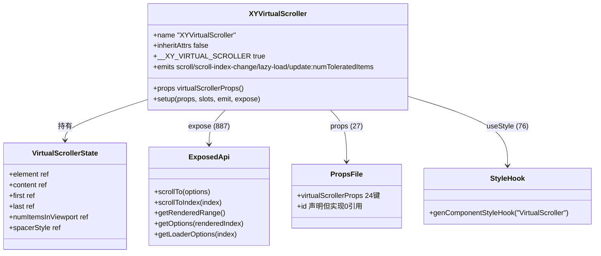
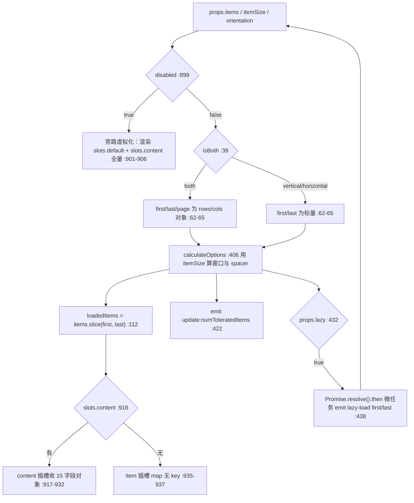
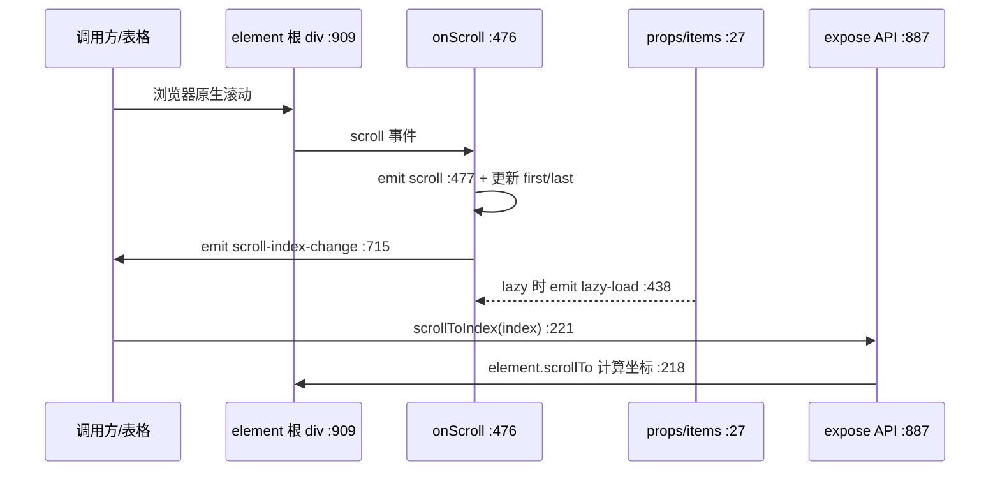

# C08-07 VirtualScroller 虚拟滚动

> **本篇解决**：`virtual-scroller` 这份实现到底是什么、被谁真正使用、它和同仓孪生拷贝 `virtual-list` 的能力面差在哪、对外契约里哪些声明真正落地、改它要注意什么。
> **前置**：I08 虚拟化双实现：vc-virtual-list 与 virtual-scroller（引擎级窗口数学、overscan、scrollTo 边界已在 I08 论证，本篇不重述，只补组件侧证据与分叉现状）　**读者坐标**：`03-components/08-table` 第 7 篇

## 一、职责与边界

`VirtualScroller`（组件名 `XYVirtualScroller`，`packages/xiaoye-ui/src/virtual-scroller/VirtualScroller.tsx:24`）是一个「以声明式 `itemSize` 为输入、用一次除法算可见窗口、靠 spacer 撑总高」的虚拟化滚动容器。它明确负责三件事：把 `items` 按 `orientation`（纵向 / 横向 / 双向）切片只渲染驻留区间、用 `spacer` 占位维持滚动条长度、通过插槽把每个已渲染项的元信息（`index/count/first/last/even/odd`）回流给父组件。

它明确不负责：单项高度测量（引擎只信任 `itemSize`，见论点 2）、原生滚动条的接管与平滑合成（滚轮 / 触屏事件零拦截，`wheel`/`touchmove` 在本文件 0 命中，机制原因见 I08 论点 4）、按数据 key 的程序化定位（只有 `scrollToIndex(number)`，无 `scrollTo({key})`，见 I08 论点 5）。

依赖关系（全部来自 `grep -rn "virtual-scroller\|VirtualScroller" packages apps --include='*.ts' --include='*.tsx' --include='*.vue'`，已排除 `node_modules` 与 `dist`）：

- 被使用：`data-table/DataTable.tsx:47` 直接 `import VirtualScroller`，`:61` 别名 `const DTVirtualScroller = VirtualScroller`，`:2634` 渲染 `<DTVirtualScroller>`；`data-table/BodyRow.tsx:296`、`data-table/TableBody.tsx:124`、`data-table/BodyCell.tsx:451` 各自定义 `getVirtualScrollerProp` 反查引擎选项。`data-table` 是它在本仓**唯一**的组件级消费者（第二方法复核：`grep -rn "DTVirtualScroller" packages apps` 仅命中 `DataTable.tsx:61,:2634`）。
- 依赖谁：`../_util/type`（props 辅助函数）、`../_util/props-util`（`initDefaultProps`）、`../config-provider/hooks/useConfigInject`、`./style`（`useStyle`）、`@xiaoye-ui/icons` 的 `SpinnerIcon`（渲染 loader 兜底图标，`VirtualScroller.tsx:957`）。
- 公开面：`components.ts:399` `export * from './virtual-scroller'`、`:400` `export { default as VirtualScroller }`、`:441` 样式副作用导入；`typings/global.d.ts:101` 注册 `XYVirtualScroller`；`apps/docs/components/virtual-scroller.md` 有文档页。也就是说它既是内部引擎、又在对外导出面上。

## 二、源码地图

| 文件 | 行数 | 职责 | 关键导出 / 入口锚点 |
| --- | --- | --- | --- |
| `virtual-scroller/index.ts` | 14 | 入口：`install` + 聚合导出 | `registerComponent(app, VirtualScroller)`（:10）、`virtualScrollerProps`（:5）、`VirtualScrollerProps` 类型（:6） |
| `virtual-scroller/virtualScrollerTypes.ts` | 37 | 24 个 props 的函数式定义 | `virtualScrollerProps`（:6）、`VirtualScrollerOrientation`（:4） |
| `virtual-scroller/VirtualScroller.tsx` | 965 | 主引擎：窗口计算、滚动、插槽回流 | `name: 'XYVirtualScroller'`（:24）、`expose`（:887）、根 render（:897） |
| `virtual-scroller/style/index.ts` | 72 | CSS-in-JS Component Token 样式钩子 | `genComponentStyleHook('VirtualScroller', ...)`（:10） |
| `virtual-scroller/index.test.js` | 189 | 组件测试（`.js` 后缀，命中 vitest glob） | 19 个 `it`、27 个 `expect`（见论点 5） |
| `virtual-scroller/` 无 `__tests__/` | — | 测试与源码同目录 | 按 `vitest.config.mts:33` glob 采集 |

主实现入口锚点：`packages/xiaoye-ui/src/virtual-scroller/VirtualScroller.tsx:23`（`export default defineComponent`）。

孪生文件对照（本篇与 `virtual-list` 的关系，拷贝成因已由 I08 论点 1 论证，此处只登记当前分叉现状）：`diff packages/xiaoye-ui/src/virtual-scroller/VirtualScroller.tsx packages/xiaoye-ui/src/virtual-list/VirtualList.tsx` 输出 36 行、其中真实内容差异 24 行（`grep -c '^[<>]'`），差异全部是身份标识与两处微调（见论点 1、坑 3）。

## 三、架构与数据流

先看组件与外部契约的静态结构（一张 `classDiagram`，节点名取真实符号）：



`classDiagram` 里最值得盯的是 `ExposedApi` 与 `PropsFile`：`setup` 的形参只解构了 `{ slots, emit, expose }`（`VirtualScroller.tsx:36`），**没有 `attrs`**，配合 `inheritAttrs: false`（`:25`），意味着未声明属性无处可去——这条会在论点 4 展开。

组件内部的数据流是一条「props → 游标 → 切片 → 插槽 → 事件」的单向链，配合一个 `Promise.resolve().then` 的懒加载回流：



逐段说明分支为何存在：`disabled` 分支（:899）是 `data-table` 实现「行数少就不虚拟」的开关（`DataTable.tsx:2726` 传 `isVirtualScrollerDisabled={true}` 一路透传到这里）；`isBoth` 分支（:39）决定了 `first/last` 是标量还是 `{rows, cols}` 对象，这是双向滚动唯一的状态形状切换点；`content`/`item` 二选一分支（:916/:934）是引擎给「全权接管渲染的表格」与「自带渲染的简单列表」留的两条插槽路——`data-table` 走 `content`（详见论点 3），简单列表走 `item`；`lazy` 走微任务而非同步 emit（:433），是为了让首帧先渲染窗口骨架、再把 `{first,last}` 交回父组件补数。

`sequenceDiagram` 描述一次滚动到回流的完整闭环（participant 用短标识）：



这张图强调一点：滚动输入的语义完全交给浏览器原生（`onScroll` 只被动接收 `scroll` 事件，不 `preventDefault`），`scrollToIndex` 是唯一能反向驱动滚动的入口，且它只认数字下标（:221），不认 key（见 I08 论点 5）。

## 四、核心机制精读

### 论点 1：`VirtualScroller` 与 `VirtualList` 是文件级孪生拷贝，但已各自分叉——且分叉点带一个只存在于本组件的真实缺陷

断言：两份 965 行主文件的差异只剩身份标识与两处微调；拷贝之后 `virtual-list` 补了一处数值容错，`virtual-scroller` 没补，于是本组件独享一个 `parseFloat` 返回 `NaN` 未被兜底的路径。

差异全貌来自实测 `diff`（24 行内容差异）：

```tsx
// packages/xiaoye-ui/src/virtual-scroller/VirtualScroller.tsx:1
/// <reference types="vue/jsx" />
// ...
// packages/xiaoye-ui/src/virtual-scroller/VirtualScroller.tsx:14
import virtualScrollerProps from './virtualScrollerTypes';
// ...
// packages/xiaoye-ui/src/virtual-scroller/VirtualScroller.tsx:24
  name: 'XYVirtualScroller',
// ...
// packages/xiaoye-ui/src/virtual-scroller/VirtualScroller.tsx:26
  __XY_VIRTUAL_SCROLLER: true,
// ...
// packages/xiaoye-ui/src/virtual-scroller/VirtualScroller.tsx:75
    const { prefixCls } = useConfigInject('virtualscroller', props);
```

对应的另一半（`virtual-list` 侧）只有名字不同：`import virtualListProps from './interface'`、`name: 'XYVirtualList'`、`__XY_VIRTUAL_LIST`、`useConfigInject('virtual-list', props)`。真正的**行为级**分叉在 `getContentPosition`：

```tsx
// packages/xiaoye-ui/src/virtual-scroller/VirtualScroller.tsx:352
        const left = parseFloat(style.paddingLeft) + Math.max(parseFloat(style.left) || 0, 0);
        const right = parseFloat(style.paddingRight) + Math.max(parseFloat(style.right) || 0, 0);
        const top = parseFloat(style.paddingTop) + Math.max(parseFloat(style.top) || 0, 0);
        const bottom = parseFloat(style.paddingBottom) + Math.max(parseFloat(style.bottom) || 0, 0);
```

而孪生文件的同名函数是：

```tsx
// packages/xiaoye-ui/src/virtual-list/VirtualList.tsx:351
        const left =
          (parseFloat(style.paddingLeft) || 0) + Math.max(parseFloat(style.left) || 0, 0);
        const right =
          (parseFloat(style.paddingRight) || 0) + Math.max(parseFloat(style.right) || 0, 0);
```

逐段解释：`VirtualScroller.tsx:352` 的 `parseFloat(style.paddingLeft)` 没有 `|| 0` 兜底。`getComputedStyle` 在 padding 缺省或值为 `normal`/关键字时返回非数字串，`parseFloat` 得到 `NaN`，于是 `left = NaN`、`x = left + right = NaN`（:357）。这个 `contentPos` 会被 `setSpacerSize` 直接乘进总高（`VirtualScroller.tsx:392-398` 的 `+ contentPos.y`、`+ contentPos.x`），产出 `spacerStyle.height = "NaNpx"`。孪生文件在拷贝之后加了 `|| 0`（`VirtualList.tsx:352-357`），所以同样的输入在 `virtual-list` 上得到 0、在 `virtual-scroller` 上得到 `NaN`。第三处差异是 `VirtualScroller.tsx:866-867` 有一段解释「把 `d_numItemsInViewport_cols` 移到 return 之前修复上游 bug」的注释，`virtual-list` 无此注释——这是文档漂移不是行为漂移。

结论回扣：拷贝成因见 I08 论点 1，本篇补充的是「拷贝已经开始各修各的，而且缺的那半边修在了被真正使用的这份上」。这不是抽象的维护成本，而是 `data-table`（唯一消费者）会实际命中的 `NaN` 路径。

关于差异量本身做一次对账，避免与前置篇结论打架：I08 记的是「跑 `diff` 仅 36 行差异」，本篇实测 `diff ... | wc -l` 同为 36，而 `diff ... | grep -c '^[<>]'` 为 24——两个数不矛盾，36 是含 `c`/`d` 段头与 `---` 分隔的全部输出行，24 是真正增删的内容行（`1d0`、`14c13`、`24c23`、`26,27c25,26`、`75c74`、`352,355c351,357`、`866,867d867` 七个 hunk）。其中唯一带语义的是 `352,355c351,357` 这一 hunk（`|| 0` 容错），其余全是身份标识；`866,867d867` 是 `virtual-scroller` 独有的两行修复注释。换言之，本篇与 I08 对「两者是拷贝」的判断一致，只是本篇把「分叉已经发生、且分叉点是一个真缺陷」这一现状钉死到了 `virtual-list` 已补、`virtual-scroller` 未补的具体行号上。

### 论点 2：能力面之「动态高度」——本组件全程不测单项高度，窗口数学是纯声明式乘法，负面结论两法交叉

断言：`VirtualScroller` 没有单项高度测量回路，一切坐标来自 `itemSize` 声明值；文件里读到的 `offsetHeight` 只读容器自身，`ResizeObserver` 观察的也是容器。

方法一（读乘法）——spacer 总高是 `items.length * itemSize` 加内容偏移，逐字可查：

```tsx
// packages/xiaoye-ui/src/virtual-scroller/VirtualScroller.tsx:389
        if (both) {
          spacerStyle.value = {
            ...spacerStyle.value,
            height: `${items.length * itemSize[0] + contentPos.y}px`,
            width: `${((props.columns || items[1])?.length || 0) * itemSize[1] + contentPos.x}px`,
          };
        } else {
          const size = horizontal
            ? (props.columns || items).length * itemSize + contentPos.x
            : items.length * itemSize + contentPos.y;
```

窗口起止同样是一次除法，没有逐项累计：

```tsx
// packages/xiaoye-ui/src/virtual-scroller/VirtualScroller.tsx:268
      const calculateFirstInViewport = (_pos: number, _size: number) =>
        Math.floor(_pos / (_size || _pos));
```

方法二（找测量代码的反证）——文件内 `offsetHeight` 的全部出现点是容器与父容器尺寸，不是列表项：

```tsx
// packages/xiaoye-ui/src/virtual-scroller/VirtualScroller.tsx:371
          props.scrollHeight ||
          `${element.value.offsetHeight || parentElement?.offsetHeight || 0}px`;
```

`ResizeObserver` 的观察对象是 `element.value`（容器根）而非任何 item：

```tsx
// packages/xiaoye-ui/src/virtual-scroller/VirtualScroller.tsx:816
          resizeObserver = new ResizeObserver(() => {
            onResize();
          });
          resizeObserver.observe(element.value!);
```

`grep -rn "offsetHeight\|offsetWidth" packages/xiaoye-ui/src/virtual-scroller/VirtualScroller.tsx` 的结果里没有任何 `item`/`child`/子节点的高度读取。两法相互印证：没有以 key/下标为索引的高度缓存 Map，也没有逐节点 `offsetHeight` 采样，所以「动态高度」在 `VirtualScroller` 上不成立——这与 I08 论点 3 对引擎 B 的判断一致，但本篇的证据全落在 `virtual-scroller` 自己的行号上。后果是：一旦 `itemSize` 与真实渲染高度不符（换行文本、图片），窗口漂移无法自我修正（对应坑 3，机制成因见 I08 论点 3）。

双向 / 网格只是把这套「纯声明式几何」从一维扩到两维，并没有引入测量。`orientation` 决定内部游标的形状：`first/last/page/numItemsInViewport` 在 `both` 下是 `{rows, cols}` 对象、否则是标量（`VirtualScroller.tsx:62-65`），`loadedItems` 据此二级切片（先按 `first.rows..last.rows` 取行、再对每行按 `first.cols..last.cols` 取列，`VirtualScroller.tsx:106-108`），`loadedColumns` 则把 `columns` 也按游标切（`VirtualScroller.tsx:132-135`）。`columns` prop（`virtualScrollerTypes.ts:22`）是网格列的定义源：`setSpacerSize` 在 `both` 下用 `itemSize[0]` 算行高、`itemSize[1]` 算列宽（`VirtualScroller.tsx:392-393`），仍全是标量乘法。也就是说「横向 / 双向 / 网格」这些能力共享同一个前提——行、列尺寸都得是外部声明的 `itemSize`（数组形态 `[行, 列]`），组件不测任何一项。这与 I08 论点 2 的结论吻合：引擎 B 的窗口是 O(1) 除法（`calculateFirstInViewport` :268），代价正是高度必须先验恒等；本篇补的是把该结论落到 `virtual-scroller` 自己的游标形状与二级切片行号上。

### 论点 3：能力面之「谁真的在被使用」——本组件是 data-table 的实引擎，靠 content 插槽与 getVirtualScrollerProp 反查对接，不是「只挂在导出面上」

断言：`virtual-scroller` 与孪生的 `virtual-list` 虽然 99% 同源，但使用面不对等：本组件是 `data-table` 实际渲染与选项反查的载体，孪生件在本仓无组件级消费者（该结论出自已完成的 I08 论点 1，本篇不重复取证，只登记本组件一侧）。

对接点之一，渲染主体：

```tsx
// packages/xiaoye-ui/src/data-table/DataTable.tsx:47
import VirtualScroller from 'xiaoye-ui/virtual-scroller';
// packages/xiaoye-ui/src/data-table/DataTable.tsx:61
const DTVirtualScroller = VirtualScroller;
```

对接点之二，表格侧通过 `content` 插槽拿引擎回流的 15 字段对象，再逐层反查选项：

```tsx
// packages/xiaoye-ui/src/virtual-scroller/VirtualScroller.tsx:917
              slots.content({
                styleClass: contentClass.value,
                items: loadedItems.value,
                getItemOptions: getOptions,
                loading: d_loading.value,
                getLoaderOptions,
                itemSize: props.itemSize,
                rows: loadedRows.value,
                columns: loadedColumns.value,
                contentRef,
                spacerStyle: spacerStyle.value,
                contentStyle: contentStyle.value,
                vertical: isVertical(),
                horizontal: isHorizontal(),
                both: isBoth(),
              })
```

表格的 `getVirtualScrollerProp` 正是读这张对象里的键：

```tsx
// packages/xiaoye-ui/src/data-table/BodyRow.tsx:296
    function getVirtualScrollerProp(option: string, options?: Record<string, any> | null): any {
// packages/xiaoye-ui/src/data-table/BodyRow.tsx:303
      const getItemOptions = getVirtualScrollerProp('getItemOptions');
```

逐段解释：`data-table` 之所以走 `content` 而非 `item` 插槽，是因为 `item` 分支的渲染循环不挂 key（`VirtualScroller.tsx:935-937`，行级状态会串位，成因见 I08 论点 6），而表格需要行级 key 与固定列，于是把渲染权整个拿到 `content` 里自管。类型契约也钉死了这层关系：`data-table/dataTableTypes.ts:83` 把 `virtualScrollerOptions` 声明为 `VirtualScrollerProps`、`data-table/interface.ts:63` 导出 `DataTableVirtualScrollerProps = Partial<VirtualScrollerProps>`。结论：本组件不是躺在导出面上没人用，而是被 `data-table` 深度绑定的内部引擎——「对外公开」与「被内部真实使用」两件事在它身上同时成立。

### 论点 4：对外契约有三处「声明与落地不一致」——死 prop、丢弃 attrs、悬空类型

断言：`VirtualScroller` 的公开面上挂着若干「声明了却没落到渲染里」的东西，构成典型的 API 面存活、实现死亡。

其一，`id` prop 完全死。声明：

```tsx
// packages/xiaoye-ui/src/virtual-scroller/virtualScrollerTypes.ts:8
  id: String,
```

实现里对 `id` 的引用为零。两法交叉：`grep -oE "props\.[a-zA-Z]+" VirtualScroller.tsx` 的去重清单里没有 `props.id`；`grep -nE "\bid\b" VirtualScroller.tsx` 直接 0 命中。根元素绑定的属性只有 `ref/class/tabindex/style/onScroll`：

```tsx
// packages/xiaoye-ui/src/virtual-scroller/VirtualScroller.tsx:909
          <div
            ref={elementRef}
            class={containerClass.value}
            tabindex={props.tabindex}
            style={props.style}
            onScroll={onScroll}
          >
```

其二，`inheritAttrs: false` 却不转发 attrs。`setup` 形参根本没要 `attrs`：

```tsx
// packages/xiaoye-ui/src/virtual-scroller/VirtualScroller.tsx:36
  setup(props, { slots, emit, expose }) {
```

配合 `inheritAttrs: false`（`VirtualScroller.tsx:25`）与上面根 `<div>` 没有 `v-bind="$attrs"`/`{...attrs}`，任何未声明属性（`data-*`、`aria-*`、`onClick` 之类）都被静默丢弃。

其三，悬空类型 `VirtualScrollerLoaderOptions`。`index.ts` 对外只导出两个类型：

```tsx
// packages/xiaoye-ui/src/virtual-scroller/index.ts:6
export type { VirtualScrollerProps, VirtualScrollerOrientation } from './virtualScrollerTypes';
```

但 `data-table` 却从 `xiaoye-ui/virtual-scroller` 导入并 extends 了一个从未定义的名字：

```tsx
// packages/xiaoye-ui/src/data-table/column/Column.d.ts:13
import type { VirtualScrollerLoaderOptions } from 'xiaoye-ui/virtual-scroller';
// packages/xiaoye-ui/src/data-table/column/Column.d.ts:39
export interface ColumnLoadingOptions extends VirtualScrollerLoaderOptions {
```

`grep -rn "VirtualScrollerLoaderOptions" packages apps --include='*.ts' --include='*.tsx' --include='*.d.ts'`（排除 `node_modules`）只命中这两处使用、零处定义。`getLoaderOptions` 的返回形状（`VirtualScroller.tsx:855-863` 的 `{index,count,first,last,even,odd,...extOptions}`）从未被命名导出，所以 `Column.d.ts` 的 extends 指向一个不存在的类型面。结论：这三处是同一类问题的三种表现——props 面、attrs 面、类型面各有一块「写了但没接上」。三处都能追溯到同一个根因：`virtual-scroller` 是从孪生件复制而来，复制时带来了 `virtualScrollerTypes.ts` 的整张 props 表和 `data-table` 侧对 loader/选项类型的引用，但 `virtual-list/interface.ts` 里那两个命名类型没有被同步改名成 `VirtualScroller*` 并落到 `virtual-scroller` 的 props 文件，`id` 与 attrs 转发也在两份里本就缺失——拷贝只搬了实现，没搬契约的对账。

### 论点 5：测试面假象——19 个 it 看着不少，但窗口数学在 jsdom 下从不被执行

断言：`index.test.js` 名义 19 个 `it` / 27 个 `expect`，但真正的可见窗口切片、overscan、`scrollToIndex` 定位结果都没有断言；测试文件自己也写明了原因。

文件顶部先把 `scrollTo` mock 成空函数：

```js
// packages/xiaoye-ui/src/virtual-scroller/index.test.js:8
if (!window.HTMLElement.prototype.scrollTo) {
  window.HTMLElement.prototype.scrollTo = () => {};
}
```

关键的一条断言连同它的自我说明：

```js
// packages/xiaoye-ui/src/virtual-scroller/index.test.js:41
    // jsdom 下 offsetWidth/offsetHeight 为 0，last=0，不渲染实际项目，但 content 容器应存在
    expect(wrapper.find('.xy-virtualscroller-content').exists()).toBe(true);
```

逐段解释：因为 jsdom 里容器 `offsetHeight = 0`，`setSize`（`VirtualScroller.tsx:362`）算出的视口尺寸为 0，`calculateNumItems` 得出的 `numItemsInViewport` 为 0，于是 `last` 停在 0、`loadedItems = props.items.slice(first, last)`（`VirtualScroller.tsx:112`）恒为空——没有任何一行真实 item 进入渲染。所以 :33 的测试只敢断言「容器存在」而不敢断言「渲染了几项」。`scrollToIndex does not throw` 用例（`index.test.js:164`、`index.js:168` 传 `scrollToIndex(5)`）在 `scrollTo` 已被 mock 的前提下退化为「调用不报错」的空断言，无法验证坐标是否算对；越界分支（`VirtualScroller.tsx:224` 的 `valid` 只查 `> -1`，不查上界）根本没有用例触达。负面结论两法交叉：其一，逐条读 19 个 `it` 的 `expect`，断言对象全是「类名 / 存在性 / `typeof === function` / `toBeDefined`」；其二，`grep -n "slice\|numToleratedItems\|toBe(2\|getRenderedRange" index.test.js` 里没有任何对窗口区间数值或 `getRenderedRange()` 结果的断言。测试确实会被 `vitest.config.mts:33` 的 `src/**/*.test.{js,ts,jsx,tsx}` 采集执行（`.js` 命中），但覆盖面是身份与骨架，不是数学。

### 论点 6：容器尺寸自适应是「双监听 + 防抖 + 方向敏感 reinit」，但观察器用了非空断言，且没有单项尺寸概念

断言：本组件对外界尺寸变化的反应全部作用在容器（`element.value`）这一层——同时挂 `window` 的 `resize`/`orientationchange` 与一个 `ResizeObserver`，回调统一走一个按 `resizeDelay` 防抖的 `onResize`；它比较的是容器宽高差，而非任何单项高度差。这与论点 2「无单项测量」是同一枚硬币的两面。

回调本体：

```tsx
// packages/xiaoye-ui/src/virtual-scroller/VirtualScroller.tsx:776
    function onResize() {
      if (!isClient) return;

      if (resizeTimeout) clearTimeout(resizeTimeout);

      resizeTimeout = setTimeout(() => {
        if (isVisible(element.value)) {
          const both = isBoth();
          const vertical = isVertical();
          const horizontal = isHorizontal();
          const [width, height] = [getWidth(element.value!), getHeight(element.value!)];
          const [isDiffWidth, isDiffHeight] = [width !== defaultWidth, height !== defaultHeight];
          const reinit = both
            ? isDiffWidth || isDiffHeight
            : horizontal
              ? isDiffWidth
              : vertical
                ? isDiffHeight
                : false;

          if (reinit) {
            d_numToleratedItems.value = props.numToleratedItems;
            defaultWidth = width;
            defaultHeight = height;
            init();
          }
        }
      }, props.resizeDelay);
    }
```

监听绑定与解绑：

```tsx
// packages/xiaoye-ui/src/virtual-scroller/VirtualScroller.tsx:806
    function bindResizeListener() {
      if (!isClient) return;

      if (!resizeListener) {
        resizeListener = onResize;

        window.addEventListener('resize', resizeListener);
        window.addEventListener('orientationchange', resizeListener);

        if (typeof ResizeObserver !== 'undefined') {
          resizeObserver = new ResizeObserver(() => {
            onResize();
          });
          resizeObserver.observe(element.value!);
        }
      }
    }
```

逐段解释：`onResize` 的 `clearTimeout` + `setTimeout(..., props.resizeDelay)`（:779、:803）把连续尺寸变化压成一次，`resizeDelay` 默认 10ms（`virtualScrollerTypes.ts:18`）；`reinit` 判定是方向敏感的（:788-794）——`both` 看宽高任一变、`horizontal` 只看宽、`vertical` 只看高，非 `reinit` 时整段跳过，避免容器被无关方向的抖动重算；`isVisible(element.value)`（:782）挡掉 `display:none` 容器拿到 0×0 的伪变化。问题在 `resizeObserver.observe(element.value!)`（:819）与 `getWidth(element.value!)`（:786）都用了非空断言：`bindResizeListener` 若在 `element` 尚未赋值时被调用，`observe(null)` 会抛；实际由 `onMounted`→`viewInit`（:872-873）保证时序，但这条时序没有独立测试兜底（论点 5）。`defaultWidth/defaultHeight` 在 `viewInit` 里初始化（`VirtualScroller.tsx:199-200`），`reinit` 后再回写（:798-799 一带），形成「首帧记基准、后续比基准」的差量 reinit。另一条相关路径是 `autoSize`：`calculateAutoSize`（`VirtualScroller.tsx:443`）在 `props.autoSize && !d_loading` 时测内容容器整体尺寸回推容器高，测的仍是容器盒而非单项，与论点 2 呼应。结论：本组件对「尺寸」的全部自适应都停留在容器级，条目级永远是声明式——这是它相对带测量的引擎 A（`vc-virtual-list` 有逐项 `offsetHeight` 批读，见 I08 论点 3）在架构上的确定分界。

## 五、对外契约如何生效
props 流到渲染的路径：24 个声明里，`grep` 实测有 22 个被 `props.X` 读取，`prefixCls` 经 `useConfigInject('virtualscroller', props)`（`VirtualScroller.tsx:75`）间接消费并落到类名前缀 `xy-virtualscroller`（测试 `index.test.js:40` 断言可见），`id` 则如论点 4 所述完全不落地。读取最频繁的是 `items`（切片 :103-116、总高 :392-398）、`itemSize`（除法 :268、乘法 :397）、`columns`（网格列 :108/:122/:339）、`orientation`（三条 `isXxx` 判定 :39-41）。

事件契约四条全真触发，无「声明但从不 emit」：

```tsx
// packages/xiaoye-ui/src/virtual-scroller/VirtualScroller.tsx:35
  emits: ['update:numToleratedItems', 'scroll', 'scroll-index-change', 'lazy-load'],
```

对应触发点分别是 `calculateOptions` 末尾的 `emit('update:numToleratedItems', ...)`（:422）、`onScroll` 里的 `emit('scroll', event)`（:477）、区间变化里的 `emit('scroll-index-change', newState)`（:715）、lazy 微任务里的 `emit('lazy-load', lazyLoadState)`（:438）。

命令契约走 `expose`，七个成员原样暴露：

```tsx
// packages/xiaoye-ui/src/virtual-scroller/VirtualScroller.tsx:887
    expose({
      scrollTo,
      scrollToIndex,
      getRenderedRange,
      getOptions,
      getLoaderOptions,
      element,
      content,
    });
```

`getOptions` 产出 `{index,count,first,last,even,odd}`（:843-850），`getLoaderOptions` 产出同构再加 `...extOptions`（:855-863）——这两个函数是 `data-table` 反查行/列元信息的入口（论点 3）。`disabled` 是唯一的「契约旁路开关」：为真时 :899-907 直接渲染 `slots.default` 与全量 `props.items`，虚拟化整段跳过，`data-table` 用它实现「行数不足就不虚拟」。样式契约经 `genComponentStyleHook('VirtualScroller', ...)`（`style/index.ts:10`）注册，`theme/interface/components.ts:156` 挂了一个空对象 token `VirtualScroller?: {}`——注意键必须大写 S，`style/index.ts:9` 有一行迁移注释专门记录了这个大小写坑。

外部 props 的改动不是即时生效，而是经过一串 `watch` 归一到 `init()` 再回灌几何。`items`、`itemSize`、`scrollHeight`、`scrollWidth` 四个监听都会调 `init()` + `calculateAutoSize()`（`VirtualScroller.tsx:155-191`），而 `init()` 内部有 `!props.disabled` 门禁（`VirtualScroller.tsx:210`）——这解释了为什么 `disabled` 一旦为真，改 `items` 也不重算窗口：整条重算链被 :210 挡住，渲染直接走 :899 的全量旁路。`items` 的监听还带 `{ deep: true }`（`VirtualScroller.tsx:163`），但处理体只在数组长度变化时才 `init()`（`VirtualScroller.tsx:158`）——对万级数组做深遍历只为读长度，是这个组件在数据量上去后的一个隐性开销点（无测试覆盖该分支）。`orientation` 监听则只重置 `lastScrollPos` 的形状（`VirtualScroller.tsx:175`），不重算窗口，意味着切换滚动方向后需要一次真实 `scroll` 事件才会把游标拉回新坐标语义。`numToleratedItems` 有独立 watch 把外部覆盖值同步进内部 `d_numToleratedItems`（`VirtualScroller.tsx:141-146`），与 `calculateOptions` 末尾回吐的 `emit('update:numToleratedItems', ...)`（:422）构成一个「可被 `v-model:numToleratedItems` 双向绑定」的闭环。顺带登记一个 API 形状差异：孪生件的 `virtual-list/interface.ts:38,:43` 额外导出了 `VirtualListScrollIndexChangeEvent` 与 `VirtualListItemOptions` 两个命名类型，而本组件的 `virtualScrollerTypes.ts` 只有 `VirtualScrollerProps`/`VirtualScrollerOrientation` 两个（`index.ts:6`），`getOptions`/`getLoaderOptions` 的返回形状（:843-863）在本组件侧没有对应的命名类型——这正是论点 4 里 `VirtualScrollerLoaderOptions` 悬空的根源。

## 六、设计取舍

`VirtualScroller` 选了「算得快 + 能力面宽」，代价是「不自适应」。

- 换来的能力：窗口起止与总高全是 O(1) 公式（`VirtualScroller.tsx:268` 的除法、:392-398 的乘法），滚动时的重渲染频率由 `numToleratedItems` 缓冲带（:410-411 的 `calculateLast`，机制详解见 I08 论点 4）压低；一个组件覆盖纵向 / 横向 / 双向 / 网格列 / 懒加载 / 仅追加多种形态（`virtualScrollerTypes.ts:15,19,22,29,30` 的 `orientation/numToleratedItems/lazy/appendOnly/autoSize`）。
- 赔上的成本：高度必须外部保证恒等，声明与实际不符时没有测量回路来纠偏（论点 2）；`scrollToIndex` 上界不校验（:224）；自绘滚动条缺失，双向平滑全押在浏览器原生行为上（见 I08 论点 4/6）。

第二条权衡是「为什么不并进 `virtual-list`、也不并进 `vc-virtual-list`」。三份文件里，`virtual-list` 与本组件本是同一份代码，理论上该合一，但拷贝之后两份各修各的（论点 1 的 `parseFloat` 分叉即证据），合并意味着要同时决定「以哪一份的容错为准」，而它们又都挂在公开导出面上（`components.ts` 同时导出两者），外部可能已按不同行为依赖——收敛成本压过了重复成本，于是维持双份。另一条被放弃的路是给 `VirtualScroller` 加动态测量、对齐 `vc-virtual-list`（引擎 A 有测量回路，见 I08 论点 3），但 `data-table` 依赖的是「行高恒等」这一前提，加测量反而引入首滚跳动与多帧重试（I08 论点 5），因此没走。给接手者的判据：条目高度不可预知就不该用本组件，该用带测量的 `vc-virtual-list`；恒定高度且要横向 / 双向 / 懒加载才用它——具体能力矩阵见 I08 六的对照表，此处不重列。

把「换引擎会付出什么」说得更具体一点：若有人想把 `data-table` 底层从本组件迁到 `vc-virtual-list`（引擎 A），迁移成本不在窗口数学而在契约形状——`data-table` 是通过 `content` 插槽拿一个 15 字段对象、再调 `getItemOptions`/`getLoaderOptions` 反查每行元信息的（`VirtualScroller.tsx:917-932`、`BodyRow.tsx:303`），而引擎 A 的渲染入口是 `children(item)` 函数 prop、且强制要求调用方提供唯一 `itemKey`（`useScrollTo` 按 key 寻址，见 I08 论点 5/6）。两套契约方向相反：本组件「不挂 key、把 key 交给表格自管」，引擎 A「key 必填、由引擎持有并用于测量与定位」。所以对 `data-table` 而言，本组件的「无单项测量 + 无 key」恰好匹配「行高恒等 + 表格自己管行标识」的场景，这不是缺陷而是选型契合；真正的风险只在行高被内容撑开时（坑 3），此时应换的不是参数而是引擎。反过来，两份拷贝都挂在公开导出面上（`components.ts` 同时 re-export `virtual-list` 与 `virtual-scroller`），意味着外部若分别依赖两份，会拿到两份已经分叉的行为（`parseFloat` 容错只在 `virtual-list` 侧），这是「并存」这个历史决定持续对外付费的部分。

## 七、坑与改动指南

坑 1——给 `VirtualScroller` 传 `id` 不生效。
触发：`<virtual-scroller :id="..." />`。症状：根 DOM 拿不到 `id`，需要按 id 定位滚动容器时找不到；SSR 锚点、`aria-labelledby` 等关联失效。原因：`virtualScrollerTypes.ts:8` 声明了 `id`，但实现里 `grep -nE "\bid\b" VirtualScroller.tsx` 零命中，根元素 :909-915 也未绑 `id`。定位：`packages/xiaoye-ui/src/virtual-scroller/VirtualScroller.tsx:909`（补 `id={props.id}`）与 `virtualScrollerTypes.ts:8`。该 prop 无测试保护（`index.test.js` 全篇未测 `id`）。

坑 2——`inheritAttrs: false` 吞掉一切未声明属性。
触发：父级写 `data-testid` / `aria-*` / `@click`。症状：这些属性既不在根元素也不在内容元素上，测试选择器与无障碍标注丢失，且不报错。原因：`setup` 未解构 `attrs`（:36）+ `inheritAttrs: false`（:25）+ 根 `<div>` 无 attrs 展开（:909-915）。定位：`packages/xiaoye-ui/src/virtual-scroller/VirtualScroller.tsx:25,:36,:909`。无测试保护。

坑 3——`itemSize` 与真实渲染高度不符，或 padding 非数字导致 spacer 变 `NaNpx`。
触发：给不等高内容配固定 `itemSize`；或内容节点的计算 `padding-left` 解析为 `NaN`。症状：窗口起点越滚越偏、滚到底留白或提前见底；极端下 spacer 高度写成 `"NaNpx"`，滚动条长度错乱。原因：总高是声明值乘法（:392-398）无单项测量（论点 2），而 `getContentPosition`（:352-355）缺 `|| 0` 兜底——孪生的 `VirtualList.tsx:351-357` 已补、本组件未补。定位：`packages/xiaoye-ui/src/virtual-scroller/VirtualScroller.tsx:352-355`（建议对齐孪生件的 `|| 0`）。改动本函数时务必同步孪生件（坑 5），机制层成因见 I08 论点 3。

坑 4——`scrollToIndex` 越界与未挂载全静默，且把越界值写进内部游标。
触发：`scrollToIndex(999999)`、或数据未加载就定位。症状：不报错、不定位；下一次 `onScroll` 之前 `first.value` 停在越界值上，行号类插槽参数短暂错位。原因：`valid` 只判 `(index as number) > -1`（:224）不判上界，`calculateFirst`（:233）越界值直接进 `calculateCoord`（:234），坐标被浏览器钳制但 `first.value = newFirst`（:263）写脏；容器未挂载时 `scrollTo` 短路（:218）。定位：`packages/xiaoye-ui/src/virtual-scroller/VirtualScroller.tsx:221-264`。无越界用例保护（论点 5）。

坑 5——改一个 bug 要同时改两份拷贝，否则同类缺陷在另一件上复发。
触发：只修 `virtual-scroller` 或只修 `virtual-list`。症状：另一份行为不变；两份已分叉（`diff` 24 行内容差异，`|| 0` 只在 `virtual-list` 侧、修复注释只在 `virtual-scroller` 侧）。原因：文件级拷贝（成因见 I08 论点 1）。定位：改前先跑 `diff packages/xiaoye-ui/src/virtual-scroller/VirtualScroller.tsx packages/xiaoye-ui/src/virtual-list/VirtualList.tsx` 确认同步面（分叉现状见本篇论点 1）。

坑 6——`VirtualScrollerLoaderOptions` 悬空，改 loader 返回形状没有类型闸门。
触发：修改 `getLoaderOptions`（:853-864）的返回字段。症状：`data-table/column/Column.d.ts:39` 的 `ColumnLoadingOptions extends VirtualScrollerLoaderOptions` 因基类型未定义而失去约束，字段改名/删字段不会被类型检查挡住。原因：`index.ts:6` 未导出该类型、全仓无定义（`grep` 两法确认，论点 4）。定位：`packages/xiaoye-ui/src/virtual-scroller/index.ts:6`（应补导出）与 `packages/xiaoye-ui/src/data-table/column/Column.d.ts:13`。

测试现状与验证命令：`index.test.js` 19 用例只覆盖身份标记、install、类名、spacer/禁用旁路、expose 存在性与「不抛错」，窗口数学 / overscan / lazy 区间 / `scrollToIndex` 定位结果均无断言（论点 5）。改动安全边界：`content` 插槽回流的 15 字段对象（`VirtualScroller.tsx:917-932`）是 `data-table` 的反查契约面，任何改名或删字段都会静默打断表格的行/列元信息，属公开面不能轻动；`item` 槽的 map（:935-937）是对外简单列表契约，改它会波及文档示例；真正能安全改的是 `getContentPosition`（:352-355）补 `|| 0` 与 `scrollToIndex`（:224）加上界校验这类「行为等价但更健壮」的局部修正，且改完必须同步孪生件（坑 5）。

```bash
pnpm --filter xiaoye-ui test:unit -- virtual
node docs/column/tools/verify-refs.mjs --excerpt docs/column/03-components/08-table/C08-07-virtual-scroller-虚拟滚动.md
```

## 附：本篇可证伪的三个检查点

1. 「本组件无单项高度测量，动态高度不成立」：运行 `grep -nE "offsetHeight|offsetWidth" packages/xiaoye-ui/src/virtual-scroller/VirtualScroller.tsx`，命中应只落在容器 `element.value`/`parentElement`（如 :368、:371）而非任何列表项；若出现按 item 读取高度或 key 索引的高度 Map，论点 2 失效。
2. 「`id` 是死 prop」：运行 `grep -nE "\bid\b" packages/xiaoye-ui/src/virtual-scroller/VirtualScroller.tsx; echo rc=$?`，应 `rc=1` 零命中（`id` 只存在于 `virtualScrollerTypes.ts:8`）；一旦根元素绑定 `id={props.id}`，论点 4 与坑 1 需要改写。
3. 「两份是拷贝且已分叉一处数值容错」：运行 `diff packages/xiaoye-ui/src/virtual-scroller/VirtualScroller.tsx packages/xiaoye-ui/src/virtual-list/VirtualList.tsx | grep -c '^[<>]'`，输出应为 24（内容差异行）；其中 `getContentPosition` 段应显示 `virtual-list` 侧带 `|| 0`、本组件侧不带——若把本组件也补上 `|| 0`，坑 3 消除但坑 5 的同步面清单要重取。
